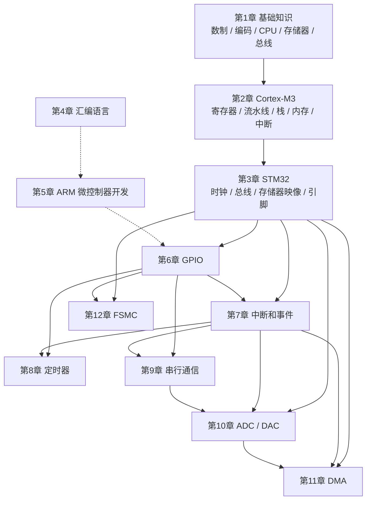
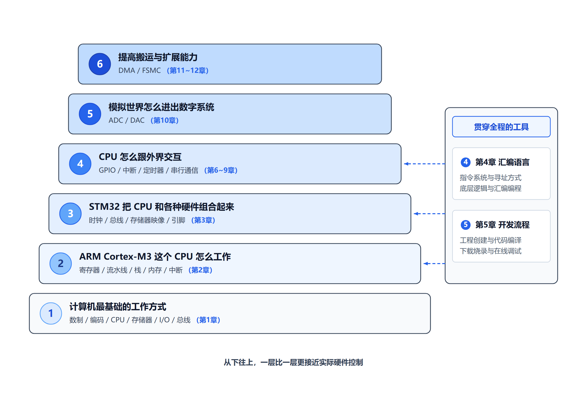
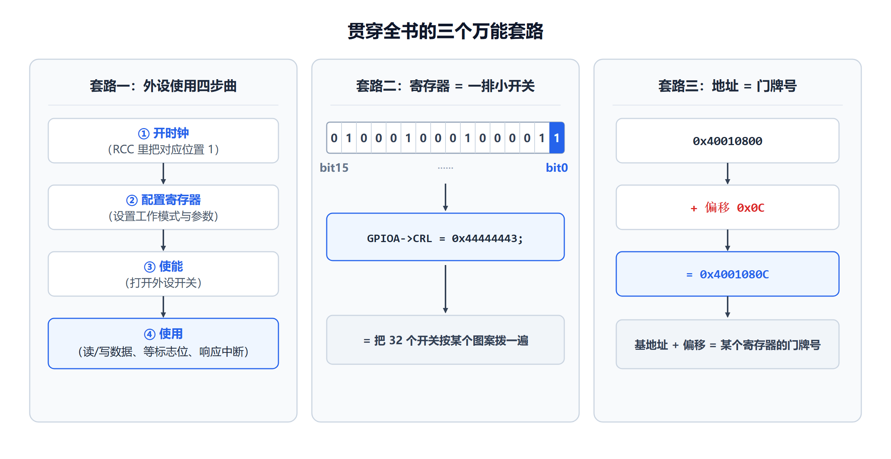

# 全书知识地图

> 这份讲义是对教材《基于ARM的微机原理与接口技术——STM32嵌入式系统架构、编程与应用》（陈桂友）的重新整理。
> 整理的目标只有一个：**让基础薄弱的人也能顺着它一步一步学明白。**
>
> 在开始之前，请先花十分钟看完这份地图。它会告诉你：这门课到底在讲什么、一共分几层、你现在要学的那一章在这张地图的哪个位置。

---

## 一、先别急着看教材：这门课到底在讲什么？

如果只用一句话说：

> **这门课讲的是"一台小小的计算机（STM32 芯片）是怎么被程序指挥着，去感知外部世界、并且控制外部世界的"。**

拆开来看，它其实在回答四个问题：

| 问题 | 通俗说法 | 对应内容 |
|---|---|---|
| 计算机内部是什么？ | 一堆格子、一堆开关、一堆线，怎么就能算数了？ | 第 1 章 |
| 这个"大脑"（CPU）怎么工作？ | 它一次只能做一件很小的事，为什么还这么快？ | 第 2 章 |
| 大脑外面接了些什么？ | 芯片上除了 CPU，还有一大圈"帮手"和"接口" | 第 3 章 |
| 怎么指挥它？怎么让它跟外界打交道？ | 写程序、点灯、按键、计时、通信、测电压、搬数据 | 第 4～12 章 |

所以整本书不是十二个孤立的知识点，而是**一条从"最底层原理"到"实际控制硬件"的链条**。

---

## 二、整门课的六层结构

把十二个章节按"抽象层次"重新排列，会得到非常清晰的六层：

```
┌──────────────────────────────────────────────────────────────────────┐
│  第六层  怎么提高数据搬运和外部扩展能力                                 │
│          → 第 11 章 DMA（请一个搬运工替 CPU 搬数据）                    │
│          → 第 12 章 FSMC（让芯片能外接一大片存储器/屏幕）                │
├──────────────────────────────────────────────────────────────────────┤
│  第五层  模拟世界怎么进出数字系统                                       │
│          → 第 10 章 ADC / DAC（电压 ⇄ 数字）                           │
├──────────────────────────────────────────────────────────────────────┤
│  第四层  CPU 怎么跟外界交互                                             │
│          → 第 6 章 GPIO（读引脚 / 控引脚）                              │
│          → 第 7 章 中断和事件（"有人敲门"就立刻响应）                    │
│          → 第 8 章 定时器（数时间、产生波形）                            │
│          → 第 9 章 串行通信（USART / SPI，和别的芯片说话）               │
├──────────────────────────────────────────────────────────────────────┤
│  第三层  STM32 把 CPU 和各种硬件组合起来                                │
│          → 第 3 章 STM32（时钟、总线、存储器映像、引脚、最小系统）        │
├──────────────────────────────────────────────────────────────────────┤
│  第二层  ARM Cortex-M3 这个 CPU 到底怎么工作                            │
│          → 第 2 章 Cortex-M3（寄存器、流水线、栈、内存、中断）           │
├──────────────────────────────────────────────────────────────────────┤
│  第一层  计算机最基础的工作方式                                          │
│          → 第 1 章 基础知识（数制、编码、CPU、存储器、I/O、总线）         │
└──────────────────────────────────────────────────────────────────────┘
        第 4 章 汇编语言、第 5 章 ARM 微控制器开发
        是横跨第二层到第四层的"表达方式"和"动手方式"，
        不属于某一层，而是贯穿始终的工具。
```

用一张图表示它们之间的依赖关系：



**怎么读这张图**：箭头表示"要学后面的，最好先懂前面的"。虚线表示"工具性关系"，不是硬依赖。

下面这张【辅助理解图】把上面六层的结构画成一座阶梯，方便你一眼记住"自己学到哪儿了"：



**看图方法**：从最底下第一层开始往上看。越往下越抽象、越接近原理；越往上越具体、越接近"我实际能控制什么硬件"。你现在学的每一章，都能在这座阶梯上找到位置。

---

## 三、每一层在讲什么（用大白话）

### 第一层：计算机最基础的工作方式（第 1 章）

这一层回答的是最根本的疑问：

> 一台机器里只有电子的通断，它凭什么能算 1+1？

- **数制与编码**：计算机只认 0 和 1，那怎么表示 255？怎么表示负数？怎么表示汉字？
- **CPU、存储器、I/O**：计算机其实只有三样东西——算的、存的、跟外界打交道的。
- **总线**：这三样东西怎么互相传数据？靠"公共道路"。
- **冯·诺依曼结构 / 哈佛结构**：程序本身也是一种数据，可以存在存储器里——这是现代计算机的根本思想。

> ⚠️ 这一章**极其重要**。如果这一章没真正懂，后面的寄存器、存储器映射、位操作、GPIO 配置都会越看越懵。所以本讲义把第 1 章写得比原教材详细得多。

### 第二层：CPU 到底怎么工作（第 2 章）

这一层回答：

> CPU 一次只能做一件小事，为什么感觉它同时在做好多事？

- **寄存器**：CPU 手边那几十个"小格子"，运算全靠它。
- **流水线**：像工厂流水线一样，把"取指令、译码、执行"重叠起来做，所以快。
- **栈**：CPU 的"草稿纸"，函数调用、中断现场都靠它。
- **存储器映射**：CPU 眼里，内存和外设都只是"有编号的格子"。
- **中断**：正在干活时被人打断，怎么不把原来的活弄乱？

### 第三层：STM32 把零件组装成芯片（第 3 章）

这一层回答：

> 内核（CPU）外面那一大圈东西是什么？它们怎么连起来？

- **时钟**：整块芯片的"心跳"，没有它谁都不动。
- **总线矩阵 / AHB / APB**：内核和外设之间的"道路网"，不同道路限速不同。
- **存储器映像**：Flash、SRAM、外设各自住在 4GB 地址空间的哪一段。
- **引脚与最小系统**：芯片怎么才能真正跑起来（供电、晶振、复位、启动配置）。

### 第四层：CPU 怎么跟外界打交道（第 6～9 章）

这是最"看得见摸得着"的一层：

- **GPIO（第 6 章）**：让某个引脚输出高电平（点灯），或者读某个引脚的高低（按键）。
- **中断和事件（第 7 章）**：外面有事情发生，CPU 立刻停下手头的活去处理。
- **定时器（第 8 章）**：数时间、产生精确的方波（PWM）。
- **串行通信（第 9 章）**：用一两根线，一个 bit 一个 bit 地和别的芯片说话（USART、SPI）。

### 第五层：模拟世界怎么进出（第 10 章）

前面都是"高电平/低电平"这种数字世界的事。可现实世界的温度、光照、声音都是连续变化的电压。

- **ADC**：把电压变成数字（模拟 → 数字）。
- **DAC**：把数字变成电压（数字 → 模拟）。

### 第六层：怎么搬得更快、接得更多（第 11～12 章）

- **DMA（第 11 章）**：CPU 亲自搬数据太浪费，雇一个"搬运工"专门搬。
- **FSMC（第 12 章）**：芯片内部空间不够，把外部的一整片存储器或一块屏幕，接到地址空间上来。

### 贯穿全程的两个工具（第 4、5 章）

- **汇编语言（第 4 章）**：最贴近硬件的"说话方式"，能看清每条指令到底动了哪个寄存器。
- **ARM 微控制器开发（第 5 章）**：从写代码到芯片上跑起来，中间到底发生了什么。

---

## 四、章节索引

| 章 | 讲义文件 | 一句话概括 | 所在层 |
|---|---|---|---|
| 1 | [01_基础知识.md](01_基础知识.md) | 计算机只认 0/1，那它怎么表示世界、怎么算数 | 第一层 |
| 2 | [02_Cortex-M3处理器.md](02_Cortex-M3处理器.md) | 这个 CPU 内部有哪些零件，它怎么一步步执行指令 | 第二层 |
| 3 | [03_STM32控制器.md](03_STM32控制器.md) | 内核外面包了什么，时钟和总线怎么组织 | 第三层 |
| 4 | [04_汇编语言及程序设计.md](04_汇编语言及程序设计.md) | 用最贴近硬件的语言写程序 | 贯穿 |
| 5 | [05_ARM微控制器开发.md](05_ARM微控制器开发.md) | 从源代码到芯片运行，中间经历了什么 | 贯穿 |
| 6 | [06_GPIO.md](06_GPIO.md) | 用程序读引脚、控引脚 | 第四层 |
| 7 | [07_中断和事件.md](07_中断和事件.md) | 外面有事，CPU 怎么立刻响应 | 第四层 |
| 8 | [08_定时器.md](08_定时器.md) | 怎么数时间、怎么产生波形 | 第四层 |
| 9 | [09_串行通信.md](09_串行通信.md) | 怎么和别的芯片一个 bit 一个 bit 地通信 | 第四层 |
| 10 | [10_ADC与DAC.md](10_ADC与DAC.md) | 电压怎么变成数字，数字怎么变成电压 | 第五层 |
| 11 | [11_DMA.md](11_DMA.md) | 怎么让数据自己搬，不麻烦 CPU | 第六层 |
| 12 | [12_FSMC.md](12_FSMC.md) | 怎么给芯片外接一大片存储器和屏幕 | 第六层 |

---

## 五、建议的学习顺序

**第一次学，按 1 → 2 → 3 → 4 → 5 → 6 → 7 → 8 → 9 → 10 → 11 → 12 的顺序。**

原因：

1. 第 1、2 章是地基，跳过它们后面全是天书。
2. 第 3 章让你知道"芯片上都有什么"，之后每讲一个外设，你都能在地图上指出它在哪。
3. 第 4、5 章是工具，越早掌握越省力。
4. 第 6 章 GPIO 是"第一次真正控制硬件"，从这里开始，后面的外设都会重复同样的套路：
   **开时钟 → 配置寄存器 → 使能 → 用（查状态 / 传数据 / 响应中断）**。
   一旦你看懂了 GPIO 这一套，第 8～12 章会越来越轻松。

**如果时间紧，只想先跑起来**：可以走 1 → 3 → 6 这条最短路径，先让一个 LED 亮起来，再回头补第 2 章和其余章节。

**如果已经会一点点 STM32**：可以直接从第 6 章开始，但第 2 章（寄存器、栈、中断）和第 3 章（时钟、存储器映像）建议至少速读一遍，因为后面所有章节都会反复用到。

---

## 六、贯穿全书的三个"万能套路"

学这门课时，你会反复看到同样的三件事。提前认识它们，后面就不容易迷路。

### 套路一：外设使用四步曲

无论 GPIO、定时器、串口还是 ADC，用法几乎都是这四步：

```
① 开时钟      给这个外设供电（RCC 寄存器里把对应位置 1）
      ↓
② 配置寄存器  设置工作模式、参数（写各种 CR / PSC / ARR ...）
      ↓
③ 使能        把外设开关打开（通常也是某个寄存器的某一位）
      ↓
④ 使用        读数据 / 写数据 / 等标志位 / 响应中断
```

### 套路二：寄存器 = 一排小开关

一个 32 位寄存器，不是"一个数字"，而是**32 个小开关**。
以后每次看到类似这样的写法：

```
GPIOA->CRL = 0x44444443;
```

不要把它当成一个整体，要理解成"把 32 个开关按某个图案拨了一遍"。本讲义会用 ASCII 位图和生成图，把每次操作到底拨了哪几个开关标出来。

### 套路三：地址 = 门牌号

CPU 眼里没有"内存"和"外设"的区别，只有"地址"。看到：

```
0x40010800   ← GPIOA 的基地址
0x4001080C   ← 加偏移 0x0C 就是 ODR 寄存器
```

要能反应出：**基地址 + 偏移 = 某个具体寄存器的门牌号**。这条链在整本书里会一直用。



**看图方法**：三张卡片分别是"怎么用外设""怎么看寄存器""怎么看地址"。这三件事会在后面每一章反复出现。现在看不懂细节没关系，先记住有这三个套路；等你学到第 6 章 GPIO 时，回头再看这张图，会发现它把 GPIO 的用法全概括了。

---

## 七、这份讲义怎么用

- 每一章都按"**先别急着看教材 → 你需要先知道的东西 → 先看一张图 → 用大白话理解 → 正式知识 → 它到底是怎么工作的 → 看教材原图 → 再画一张更容易懂的图 → 代码到底做了什么 → 容易搞混的地方 → 本节真正要记住什么**"的结构组织（不同章节会按内容裁剪）。
- 看到这些标记时，含义是：

| 标记 | 含义 |
|---|---|
| 【教材内容】 | 原教材讲到的内容，是课程主线 |
| 【补充解释】 | 为了讲明白而额外加的解释 |
| 【先补一个前置知识】 | 这里有个你可能不懂的前提，先补上 |
| 【类比】 | 用生活例子帮助理解，之后会回到真实概念 |
| 【辅助理解图】 | 为降低理解难度而新画的简化图 |
| 【容易搞混】 | 初学者最常犯的错误 |
| 【待核验】 | 原书解析可能有误、需要核对原始 PDF 的地方 |

- 图片分两类：
  - **教材原图**：来自原书，帮助你建立"教材就是这样画的"的印象；
  - **辅助理解图**：本讲义重新绘制的简化图，专为降低理解难度。

---

## 八、最后

这门课看起来名词很多，但它的骨架其实很朴素：

> **一个会算数的内核 + 一堆有门牌号的存储单元 + 一圈能读能写引脚的外设 + 一条把它们连起来的总线 + 一个让它们同步的时钟。**

剩下的所有章节，都只是在给这五样东西加细节。

所以，如果你现在觉得满眼都是陌生的缩写——没关系，那是正常的。请从第 1 章开始，一页一页来。本讲义会在每一个"你可能会卡住"的地方，先停下来把它讲清楚。
