# 第 1 章 基础知识

> **本章在知识地图上的位置**
>
> 还记得那张六层阶梯图吗？本章是最底下、最基础的**第一层**：
>
> > **计算机最基础的工作方式——数制、编码、CPU、存储器、I/O、总线。**
>
> 后面第 2 章讲"CPU 内部怎么工作"，第 3 章讲"STM32 芯片上有什么"，第 6～12 章讲"怎么控制 GPIO（General-Purpose Input/Output，通用输入输出接口）、定时器、串口、ADC、DMA"——
> **所有这些内容，最后都会落回本章的这几个概念上。**
>
> 所以本章不是"前言""绪论"这种可以跳过的章节。
> 对基础薄弱的读者来说，本章实际上是**整门课的地基**：
> 地基没打好，后面看到寄存器、地址、位操作、存储器映射，就会越看越像天书。

---

## 1.0 先别急着看教材：这一章到底要干什么？

先问一个问题：

> **一台只有电、只有导线和晶体管的机器，凭什么能算数、能记事、能听懂你的程序？**

计算机内部其实只有两种状态：有电 / 没电，或者更准确地说，高电平 / 低电平。
我们把这两种状态记作 **1** 和 **0**。

于是问题就来了：

| 疑问 | 本章对应小节 |
|---|---|
| 只有 0 和 1，怎么表示 255？怎么表示 0.5？怎么表示 −13？ | 1.2 数制与编码 |
| 只有 0 和 1，怎么表示字母 'A'？怎么表示汉字"春"？ | 1.2.4 非数值数据编码 |
| 什么叫"位""字节""字"？1KB 到底是 1000 还是 1024？ | 1.3.1 常用单位及术语 |
| 什么叫 CPU、存储器、I/O？它们靠什么连起来？ | 1.3.2 微型计算机的基本构成 |
| 什么叫地址？为什么 20 根地址线就是 1MB？ | 1.3.1 第 7 条、1.3.2 |
| 什么叫指令、汇编、反汇编、高级语言？ | 1.3.1 第 10～14 条 |
| 冯·诺依曼结构和哈佛结构到底差在哪？ | 1.3.4 |
| 微处理器、微型计算机、微控制器、嵌入式系统，是不是一回事？ | 1.3.3 |

**一句话概括本章**：

> 本章讲的是"**计算机这台机器的最基本约定**"——
> 它用什么数、怎么编码、由哪几块组成、块与块之间怎么说话。
> 这些约定不是"常识"，而是**必须先学才能懂**的东西。

本章的写法比教材细很多。原因很简单：

> 教材默认你已经知道"寄存器""地址""总线"是什么，所以它直接往下讲。
> 而本讲义默认你**不知道**，所以会在每一个可能卡住的地方先停下来，把它讲清楚。

---

## 1.1 微型计算机发展概述

### 1.1.1 这一节为什么要读？

这一节讲的是历史。历史本身不用背，但有一件事必须看懂：

> **计算机为什么会变成今天这个样子？每一个新结构的出现，都是在解决前一个结构的某个毛病。**

所以本讲义把大段历史压缩成一条线，只保留"为什么会出现这种结构"的逻辑。

### 1.1.2 一条被极度压缩的时间线

【教材内容（压缩整理）】

| 时间 | 发生了什么 | 关键意义 |
|---|---|---|
| 1946 | 世界上第一台计算机问世 | 计算机诞生 |
| 之后几十年 | 经历 **电子管 → 晶体管 → 集成电路 → 超大规模集成电路** 四代 | 器件越来越小、越来越快、越来越便宜 |
| 1971 | Intel 生产出世界上第一片 4 位集成微处理器 **4004** | "微型计算机"的开端 |
| 1975 | 中档 8 位微处理器问世 | |
| 1976 | 高档 8 位微处理器出现，如 Intel **8085**、Zilog **Z80** | |
| 1978 | 出现性能与中档 16 位小型机相当的微处理器，代表产品 **Intel 8086** | 8086 有 **20 条地址线**，可寻址 **1MB** 存储单元，时钟频率 4～8MHz |

> 【补充解释】这里出现的三个数字，请先记住它们的"形状"，后面会反复用：
> - "**4 位 / 8 位 / 16 位**"指的是**字长**（一次能处理多少个二进制位），1.3.1 会详细讲；
> - "**20 条地址线 → 1MB**"是一条非常关键的换算关系，1.3.1 第 7 条会一步一步算给你看；
> - "**4～8MHz**"是**时钟频率**，也就是芯片每秒"打拍子"几百万次，第 3 章讲时钟时会再遇到它。

**一句话总结这段历史**：

> **微型计算机的发展，取决于微处理器的发展。** 微处理器越做越强，整台机器就跟着变强。

【教材内容】总的发展趋势是：**功能加强、性能提高、体积减小、价格下降。**

### 1.1.3 进入 21 世纪后，计算机加了些什么？

【教材内容】新一代计算机采用人工智能技术及新型软件，硬件采用新的体系结构和超导集成电路，分为问题解决与推理机、知识数据库管理机、智能接口计算机等。它具有以下特点：

① 在 CPU 上集成存储管理部件；
② 采用指令和数据高速缓存；
③ 采用流水线结构以提高系统的并行性；
④ 采用大量的寄存器组成寄存器堆以提高处理速度；
⑤ 具有完善的协处理器接口，提高数据处理能力；
⑥ 在系统设计上引入兼容性，实现高、低档微机间的兼容。
⑦ 另外，产品是否开源也成为微处理器发展的方向之一。

【补充解释】这 6 条不是随便列的，每一条都是在解决一个具体的"性能瓶颈"。先把它们和后面的章节对上号：

| 教材中的特点 | 它到底在解决什么问题 | 本书哪里会再讲 |
|---|---|---|
| ② 采用指令和数据高速缓存 | CPU 太快、内存太慢，中间加一层"顺手的小仓库" | 1.3.4 的 **Cache** |
| ③ 采用流水线结构 | 一条指令还没做完就开始做下一条，提高"同时干活"的程度 | 1.3.4 的 **流水线** |
| ④ 大量寄存器组成寄存器堆 | 寄存器是 CPU 手边最快的小格子，多用它少跑内存 | 第 2 章（寄存器组） |
| ① 集成存储管理部件 | 让程序用到的地址和真实物理地址解耦 | 本书不展开，知道有这回事即可 |
| ⑤ 协处理器接口 | 让专门的硬件帮忙算某些特殊的运算 | 本书不展开 |
| ⑥ 兼容性 | 新机器能跑老程序，保护已有软件投资 | 1.4 会看到 Cortex 系列"放弃向前兼容"的例外 |
| ⑦ 开源 | 指令集开放，厂商可以自己实现 | 1.4 的 ARM 授权模式有类似的"开放"味道 |

【类比】

> 一台计算机就像一个**工厂**。
> - 早期工厂：只有一个工人（CPU），一件活从头做到尾。
> - 后来的改进：
>   在工人旁边放一个**手边工具箱**（寄存器）、
>   在原料仓库和工位之间加一个**中转小推车**（Cache）、
>   把一件活拆成几道工序**流水作业**（流水线）。
>
> **类比的边界**：真实硬件里这些部件是同时存在、协同工作的，并不是"一个改进替换掉另一个改进"。而且 Cache 的替换策略、流水线的冲突处理，比"小推车"复杂得多。类比只帮你记住"它们都是为了解决速度不匹配"。

### 1.1.4 本节真正要记住什么

1. 计算机的发展路线是：**电子管 → 晶体管 → 集成电路 → 超大规模集成电路**。
2. **微型计算机的发展取决于微处理器的发展**。
3. 总趋势：**功能更强、性能更高、体积更小、价格更低**。
4. 现代 CPU 提高性能的三大常见手段：**Cache、流水线、寄存器堆**（这三个后面都会讲到）。

---

## 1.2 微型计算机中的数制及其编码

> 本节回答一个问题：**信息在计算机里到底是怎么表示的？**

---

### 1.2.1 微型计算机中的数制

#### 先别急着看教材：这一小节要解决什么？

你平时写数字，写的是 `123`，意思是"一百二十三"。
可是计算机里只有 0 和 1 两种符号。那么：

> **怎么用只有 0 和 1 的符号系统，表示出"一百二十三"？**

答案是：**换一套"计数规则"**。这套规则就叫**数制**。

---

#### 【先补一个前置知识：什么叫数制（进位计数制）？】

【教材内容】**进位计数制，简称数制，是人们利用符号来计数的方法。**

【补充解释】用大白话讲：

> **数制 = 一套"用有限的几个符号，通过位置来表示任意大小数字"的规则。**

任何一套数制都由两样东西决定：

1. **基数**：这套数制一共有几个不同的符号。
2. **位权**：同一个符号放在不同位置上，代表的大小不一样。

##### 先说人最熟悉的十进制

十进制有 **10 个符号**：`0 1 2 3 4 5 6 7 8 9`，所以**基数是 10**。
规则是"**逢十进一**"：数到 9 再加 1，就进位变成 `10`。

看这个数：`123`

```
       1        2        3
       │        │        │
     百位      十位      个位
    ×100     ×10      ×1
    =100     =20      =3        →  100 + 20 + 3 = 123
```

这里的 `100`、`10`、`1` 就是**位权**。

#### 【先补一个前置知识：什么叫位权？】

> **位权 = 这个位置上的一个 1，代表多大的实际数值。**

十进制的位权是 10 的幂：

| 位置（从右往左数，从 0 开始） | 第 0 位 | 第 1 位 | 第 2 位 | 第 3 位 |
|---|---|---|---|---|
| 位权 | 10⁰ = 1 | 10¹ = 10 | 10² = 100 | 10³ = 1000 |

所以十进制的通用写法是：

> **一个数 = 每一位的数字 × 这一位的位权，全部加起来。**

这个公式极其重要，**它就是"任何进制转十进制"的方法**，后面 1.2.2 会反复用。

---

#### 为什么计算机偏偏用二进制？

【教材内容】由于人在最初计数的时候是用 10 个手指协助的缘故，因此习惯上采用的计数制是十进制。

【教材内容】在计算机中是用晶体管的可靠截止与可靠饱和导通这样两个状态下的输出电平——**高电平**（一般用 1 表示）和**低电平**（一般用 0 表示）来表示数字的，所以，计算机中所采用的计数制是**二进制**。二进制数的基数为 2，只有 0、1 两个数码，并遵循**相加时逢二进一、相减时借一当二**的规则。

【补充解释】把这段话翻译成人话：

> 晶体管（芯片里最基本的电子开关）最可靠的状态只有两种：
> **导通**（相当于开关合上，输出高电平）和 **截止**（相当于开关断开，输出低电平）。
>
> 如果硬要让它表示 10 种状态（比如靠电压高低分成 10 档），
> 那么稍微有点干扰、有点温度变化，电压就会漂移，"3 档"可能被认成"4 档"，机器就错了。
>
> 而**只用两种状态，抗干扰能力最强**：电压高一点低一点都没关系，只要还能分清"高"还是"低"就行。
>
> 所以计算机选了二进制——**不是因为二进制算起来方便，而是因为二进制在电路上最可靠。**

【类比】

> 一个电灯开关，只有"开"和"关"两种状态。
> 1000 个开关排成一排，每个开关的"开/关"组合，就能记录下极大量的信息。
> **二进制 = 一排开关；一个开关 = 一位（1 bit）。**
>
> **类比的边界**：真实的存储单元不是机械开关，而是晶体管、电容、磁介质等；但"只有两种稳定状态、靠组合表示信息"这个本质是一致的。

【辅助理解图】

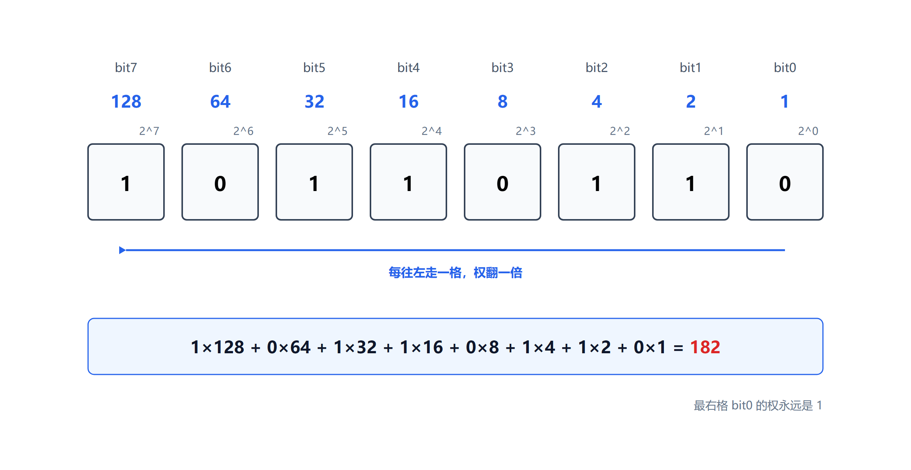

**看图方法**：
1. **先看最下面一行**：8 个小方格，从左到右分别标着 bit7、bit6、…、bit0。
2. **再看每格上方的数字**：128、64、32、16、8、4、2、1。这就是**位权**——第 n 位的权是 2ⁿ。
3. **注意规律**：从右往左，每往左走一格，权就**翻一倍**。最右边 bit0 的权永远是 1。
4. **这张图要你记住什么**：任何一个 8 位二进制数，只要看哪几位是 1，把对应位权加起来，就是它的十进制值。例如 `10110110B` 就是 128 + 32 + 16 + 4 + 2 = 182。
5. **为什么最左是 128 而不是 256**：因为 8 位二进制最多只有 8 个位置，编号 0～7，2⁷ = 128。

---

#### 十进制和二进制，人和机器各用一半

【教材内容】计算机和人打交道的时候用十进制，用十进制输入数据和输出显示数据；而在计算机内部进行数据的计算和处理时用二进制。为此，在计算机中的解决方法是：和人进行数据的交流（也称为**人机交互**）时，利用**接口技术**作转换。例如，我们用键盘输入数据时，都使用十进制数，输入接口电路将十进制数转换为二进制数后送到机器内部；而在计算机内部，计算机从接口得到二进制数，进行运算和处理后的结果当然也是二进制数，再把结果利用接口技术转换成十进制数后输出显示。

【补充解释】画成一条链就是（假设你让计算机算 **100 + 82**）：

```
你在键盘上输入两个十进制数：100 和 82
        │
        ▼
   输入接口电路
   ── 把这两个十进制数转成二进制，数值一点不变，只是换了一种写法：
        100 → 01100100B
         82 → 01010010B
        │
        ▼
   CPU 内部用二进制做加法：
        01100100B      (100)
      + 01010010B      (82)
      ───────────
        10110110B      (182)
        │
        ▼
   输出接口电路  ── 把二进制结果转回十进制
        │
        ▼
   屏幕上显示 "182"
```

> **注意两点**：
> 1. **"接口转换"本身不会改变数值**：100 输入进去，机器内部存的还是 100（只是写成 `01100100B`），换个写法而已。屏幕上出现 182，是因为中间**真的做了一次加法**（100 + 82 = 182），不是因为 100 被"转换"成了 182。
> 2. 这条链里的"接口转换"是硬件/软件自动完成的，你在写 C 语言程序时一般感觉不到。但你必须知道：**机器内部只有 0/1，十进制只是"给人看的外衣"。**

---

#### 十六进制：给二进制准备的"速记法"

【教材内容】当二进制数的位数较多时，读写都不方便。这时，使用**十六进制**表示数据的方法就简明一些。1 位十六进制数共有 16 个字符，分别使用数字 0～9 和大写英文字母 A、B、C、D、E、F 表示。为表明是十六进制数，需要在数字的后面加上字母 **H**（Hexadecimal）。

【补充解释】为什么需要十六进制？看一个例子就懂了：

```
同样是 32 位二进制：
1010 0000 0000 0001 0000 1000 0000 0000        ← 数得你眼花

换成十六进制：
A 0 0 1 0 8 0 0                                ← 8 位字符就够了
```

因为 **4 位二进制正好对应 1 位十六进制**（16 = 2⁴），所以十六进制就是二进制的"四合一压缩包"。

#### 【先补一个前置知识：0x 是什么意思？H 后缀是什么意思？】

【补充解释】同一个十六进制数，在不同的场合有两种写法：

| 写法 | 例子 | 说明 |
|---|---|---|
| 后缀 H | `B6H`、`43H` | 教材常用的写法。**注意：如果十六进制数以字母开头，前面要补个 0**，如 `0A5H`，否则会被当成变量名 |
| 前缀 0x | `0xB6`、`0x43` | C 语言和 STM32 程序里的写法（本书第 6 章以后到处都是） |

两者含义完全一样：`B6H` 就是 `0xB6`。

**为什么要专门加个记号？** 因为 `11` 这个符号是有歧义的：

- 如果它是十进制，表示"十一"；
- 如果它是十六进制，表示"十七"（1×16 + 1 = 17）；
- 如果它是二进制，那它根本不是一个合法的二进制数（二进制只有 0 和 1）。

所以必须给数字戴上"帽子"，标明它属于哪种数制。常用的后缀还有：

| 后缀 | 含义 | 例子 |
|---|---|---|
| B | Binary，二进制 | `1011B` |
| D | Decimal，十进制 | `45D`（也可以不写后缀） |
| H | Hexadecimal，十六进制 | `B6H` |

---

#### 【教材内容】4 位二进制数和 1 位十六进制数的对应关系

教材表 1-1 给出了这张极其重要的对照表。**这张表必须背下来**，因为它就是后面所有地址、寄存器值换算的基础。

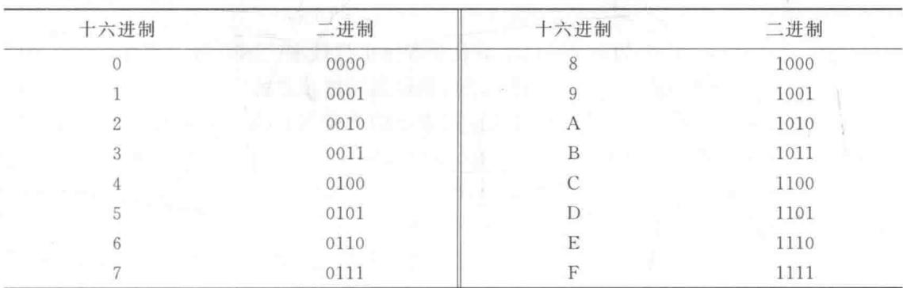

**看图方法**：
1. 这张图是**两栏并排**的表格：左半栏是十六进制 0～7，右半栏是十六进制 8～F；每一行左边是十六进制数字，右边是对应的 4 位二进制。
2. 竖着看第一列：`0` 对 `0000`，`1` 对 `0001`，`2` 对 `0010`……**注意 `8` 是分水岭**：`8` 对应 `1000`，也就是说**最高位变成 1 了**。
3. `A`～`F` 这 6 个"字母数字"只是符号，别害怕：`A` 就是十进制的 10，`B` 是 11，`C` 是 12，`D` 是 13，`E` 是 14，`F` 是 15。
4. **这张图要你理解什么**：4 位二进制能表示 0～15 共 16 个数，正好和 1 位十六进制能表示的 16 个符号一一对应。所以"二进制 ⇄ 十六进制"不需要做除法，只要**四位一组直接查表**。

为了让你一眼记住，本讲义再画一张更直观的对照图（含"0x 从哪来"）：

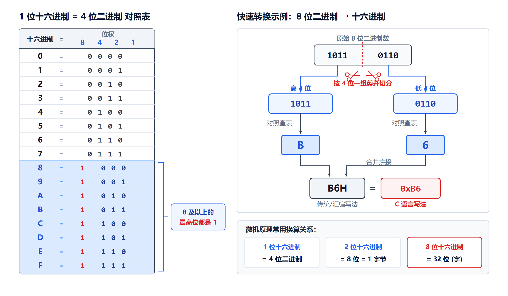

**看图方法**：
1. 图中央是一条**竖向的对应带**：左边一列是 4 个二进制格，右边一格是十六进制字符，用等号连接。
2. 请特别留意 4 格上方的位权 `8 4 2 1`：这解释了为什么 `1010` 是 `A`（8 + 2 = 10 = A）。
3. 图下方有一个例子：`1011 0110` → 切成两组 `1011` 和 `0110` → 查表得 `B` 和 `6` → `B6H`（也就是 `0xB6`）。
4. **这张图要你记住**：一个十六进制位 = 4 个二进制位；两个十六进制位 = 8 个二进制位 = 1 字节。

【补充解释】顺手记一个常用换算：

| 十六进制位数 | 二进制位数 | 等于 |
|---|---|---|
| 1 位（如 `4`） | 4 位（`0100`） | 半个字节 |
| 2 位（如 `4A`） | 8 位（`0100 1010`） | **1 字节** |
| 4 位（如 `40010800`） | 16 位 | 2 字节（半字） |
| 8 位（如 `0x40010800`） | 32 位 | 4 字节（1 个字，在 STM32 里） |

> 这就解释了：**为什么 STM32 里的地址、寄存器值经常写成 8 位十六进制数？** 因为 STM32 是 32 位机器，一个寄存器就是 32 位 = 8 个十六进制位。看到 `0x40010800`，你立刻应该想到"这是一个 32 位的值"。

---

### 1.2.2 不同数制之间的转换

#### 先别急着看教材：这一小节要解决什么？

四种转换，必须全部会，而且**不许跳步**：

| 转换方向 | 方法 |
|---|---|
| 十进制 → 二进制 | 整数：除 2 取余，倒序排列；小数：乘 2 取整，正序排列 |
| 二进制 → 十进制 | 每位 × 位权，求和 |
| 二进制 ⇄ 十六进制 | 四位一组，查表 |
| 十进制 ⇄ 十六进制 | 除 16 取余 / 每位 × 16 的幂 |

#### 1. 十进制整数转二进制：除 2 取余，倒序排列

【教材内容】反复除以 2 取余数，直到商为 0 为止。最后将所有余数**倒序**排列，得到的数就是转换结果。

##### 一步一步推演：把 100 变成二进制

| 步骤 | 算式 | 商 | 余数 |
|---|---|---|---|
| ① | 100 ÷ 2 | 50 | **0** ← 最后一位（最低位） |
| ② | 50 ÷ 2 | 25 | **0** |
| ③ | 25 ÷ 2 | 12 | **1** |
| ④ | 12 ÷ 2 | 6 | **0** |
| ⑤ | 6 ÷ 2 | 3 | **0** |
| ⑥ | 3 ÷ 2 | 1 | **1** |
| ⑦ | 1 ÷ 2 | **0**（商为 0，停止） | **1** ← 第一位（最高位） |

**倒序**读余数（从最后一次的余数开始往回读）：

```
⑦ ⑥ ⑤ ④ ③ ② ①
1  1  0  0  1  0  0
```

所以：

> **(100)₁₀ = (01100100)₂** 或者写作 **100D = 01100100B**

【补充解释】**为什么是"倒序"？** 因为第一次除出来的余数，其实是最低位。第一次除以 2，余数只反映"这个数是不是奇数"——这正是一个二进制数最低位（bit0）的含义。所以最先算出来的余数反而排最后。

教材原图也是这个意思：

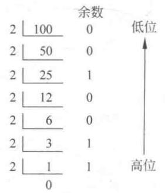

**看图方法**：
1. 图中是一个**从上往下的短除法**：每一层是"除数 2、被除数、商、余数"。
2. 注意箭头：**余数是从下往上读的**（图中通常用一个折线箭头标出来），这对应"倒序排列"。
3. 最上面一行是最低位，最下面一行是最高位——和刚才的表格对照着看。
4. 图中的最终结果 `01100100` 前面补了一个 0，因为要凑成 **8 位**（1 字节）。补 0 不改变数值大小。
5. **这张图要你理解什么**：转换过程本身很简单，难的是别把顺序搞反。

【补充解释】**为什么要凑成 8 位？** 因为计算机存储的最小单位是字节（8 位）。写 `1100100B`（7 位）在数学上没错，但在讨论"一个字节里存了什么"时，习惯补成 `01100100B`。

##### 一步一步推演：把 45.613 变成二进制（小数部分）

【教材内容】小数部分转换方法：乘以 2 取整，直到满足精度要求为止。

**整数部分 45：**

| 步骤 | 算式 | 商 | 余数 |
|---|---|---|---|
| ① | 45 ÷ 2 | 22 | 1 |
| ② | 22 ÷ 2 | 11 | 0 |
| ③ | 11 ÷ 2 | 5 | 1 |
| ④ | 5 ÷ 2 | 2 | 1 |
| ⑤ | 2 ÷ 2 | 1 | 0 |
| ⑥ | 1 ÷ 2 | 0 | 1 |

倒序读：**101101**

**小数部分 0.613**（保留 6 位）：

| 步骤 | 算式 | 取整（写下来的位） | 剩余小数 |
|---|---|---|---|
| ① | 0.613 × 2 = 1.226 | **1** ← 小数点后第 1 位 | 0.226 |
| ② | 0.226 × 2 = 0.452 | **0** | 0.452 |
| ③ | 0.452 × 2 = 0.904 | **0** | 0.904 |
| ④ | 0.904 × 2 = 1.808 | **1** | 0.808 |
| ⑤ | 0.808 × 2 = 1.616 | **1** | 0.616 |
| ⑥ | 0.616 × 2 = 1.232 | **1** ← 第 6 位 | 0.232 |

**正序**读（从上往下）：

```
0 . 1 0 0 1 1 1
```

合并：

> **45.613 ≈ (101101.100111)₂**，或者写作 **45.613D ≈ 101101.100111B**

【补充解释】**为什么小数是"正序"而不是"倒序"？** 因为每次乘 2 得到的整数部分，恰好就是从小数点后第 1 位开始往后一位一位产生的：第一次乘 2 得到的整数部分，权重是 2⁻¹，就是小数点后第一位。所以按算出的先后顺序写即可。

【补充解释】**注意那个"≈"**：0.613 这个十进制小数，**永远无法用有限位二进制精确表示**（就像 1/3 无法用有限位十进制精确表示一样）。所以只能保留若干位，用约等号。这一点在以后做 ADC 采样、浮点运算时会反复遇到。

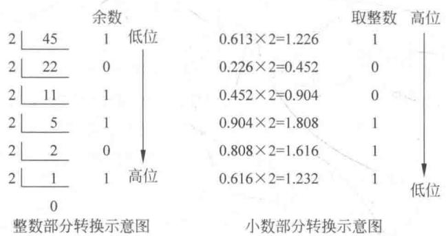

**看图方法**：
1. 图被**分成上下两块**：上面一块处理整数部分 45，下面一块处理小数部分 0.613。
2. 上面一块的余数**从下往上读**；下面一块的整数部分**从上往下读**。这是全图最容易搞错的地方，请对照箭头方向看。
3. 最后把两块拼起来，小数点对齐，得到 `101101.100111`。
4. **这张图要你理解什么**：整数部分和小数部分是**分开转换、最后拼接**的，两者的读数方向相反。

#### 2. 二进制转十进制：每位 × 位权，再求和

【教材内容】二进制数转换为十进制数的方法是将二进制数的每位上的数字与其**权值**相乘，然后加在一起就是对应的十进制数。例如，一个 8 位的二进制数的各位的权值依次是 2⁷, 2⁶, 2⁵, …, 2⁰。

##### 一步一步推演：10110110B = ?

先把每一位和它的权列出来：

| 位置 | bit7 | bit6 | bit5 | bit4 | bit3 | bit2 | bit1 | bit0 |
|---|---|---|---|---|---|---|---|---|
| 该位的值 | 1 | 0 | 1 | 1 | 0 | 1 | 1 | 0 |
| 位权 | 2⁷=128 | 2⁶=64 | 2⁵=32 | 2⁴=16 | 2³=8 | 2²=4 | 2¹=2 | 2⁰=1 |
| 相乘 | 1×128 | 0×64 | 1×32 | 1×16 | 0×8 | 1×4 | 1×2 | 0×1 |
| 结果 | 128 | 0 | 32 | 16 | 0 | 4 | 2 | 0 |

求和：

```
128 + 0 + 32 + 16 + 0 + 4 + 2 + 0 = 182
```

所以：

> **(10110110)₂ = (182)₁₀**，或者写作 **10110110B = 182D**

【补充解释】**速算技巧**：不用写这么长的表。只需要**找出所有为 1 的位，把它们的权加起来**（为 0 的位不用管）。比如 `10110110B`，为 1 的位是 bit7、bit5、bit4、bit2、bit1，权是 128、32、16、4、2，加起来 182。

#### 3. 二进制与十六进制互转：四位一组，直接查表

【教材内容】因为 4 位二进制数的模是 16，所以二进制整数转换为十六进制时，只要从最低位开始，每 4 位一组（不足 4 位时高位补 0）转换成 1 位十六进制数据就可以了。

##### 一步一步推演：10110110B = ?

**第一步**：从最低位（最右边）开始，每 4 位切一组。

```
10110110B
   ↓ 切两刀
1011 | 0110
```

**第二步**：查表 1-1。

| 二进制 | 十六进制 |
|---|---|
| 1011 | B（8 + 2 + 1 = 11 = B） |
| 0110 | 6（4 + 2 = 6） |

**第三步**：按顺序拼起来。

> **10110110B = B6H**

##### 一步一步推演：64H = ?

**第一步**：把每一位十六进制展开成 4 位二进制。

```
6 → 0110
4 → 0100
```

**第二步**：拼起来。

> **64H = 01100100B**

【补充解释】**为什么可以这样直接切？** 因为 16 = 2⁴。十六进制"逢十六进一"，二进制"逢二进一"，每 4 位二进制进位一次，正好对应 1 位十六进制的进位。所以它们之间是"**整除关系**"，不需要做除法，只要切块查表。

> **【容易搞混】** 二进制转八进制是**每 3 位一组**，因为 8 = 2³。千万别和十六进制的 4 位一组搞混。

#### 4. 十六进制与十进制互转

【教材内容】十六进制数据和十进制数据之间的转换可以通过二进制转换，也可以使用类似于十进制数据转换为二进制数据的方法，将十进制数**反复除以十六取余数**来完成十进制数转换为十六进制数；将十六进制数的每位上的数字与其权值相乘，然后加在一起就是对应的十进制数，此时的 n 位十六进制数的权值分别为 16ⁿ⁻¹, …, 16², 16¹, 16⁰。

【补充解释】两条路都走一遍，你就明白了。

##### 十进制 → 十六进制：除 16 取余（以 1538 为例，对应习题 1-2）

| 步骤 | 算式 | 商 | 余数 |
|---|---|---|---|
| ① | 1538 ÷ 16 | 96 | **2**（2，不是 2H 以外的意思，就是 2） |
| ② | 96 ÷ 16 | 6 | **0** |
| ③ | 6 ÷ 16 | **0**（停止） | **6** |

倒序读余数：

> **1538 = 602H**

**验算**（用位权法反推）：

```
6 × 16² + 0 × 16¹ + 2 × 16⁰
= 6 × 256 + 0 + 2
= 1536 + 2
= 1538   ✓
```

##### 十六进制 → 十进制：位权法

以 `B6H` 为例：

| 位置 | 高位 B | 低位 6 |
|---|---|---|
| 该位的值 | B = 11 | 6 |
| 位权 | 16¹ = 16 | 16⁰ = 1 |
| 相乘 | 11 × 16 = 176 | 6 × 1 = 6 |

```
176 + 6 = 182
```

所以 **B6H = 182D**。这和前面 `10110110B = 182D` 完全一致——**同一个数，三种写法**。

#### 5. 教材给的一条提速建议

【教材内容】知道了这些关系以后，将十进制数转换为二进制数时，常常先把十进制数转换为十六进制数，然后直接使用表 1-1 中的关系写出对应的二进制数即可，这样可以大大提高转换效率。

【补充解释】举个例子对比一下。

**方法一（直接除 2）**：把 1538 转成二进制，要除 11 次 2。

**方法二（先转十六进制）**：
1. 1538 ÷ 16 取余 → `602H`（只除了 3 次）；
2. 查表：`6` → `0110`，`0` → `0000`，`2` → `0010`；
3. 拼起来 → `0110 0000 0010`，去掉高位的 0 → `11000000010B`。

**验算**：1024 + 512 + 2 = 1538 ✓（`11000000010` 中为 1 的是 bit10=1024、bit9=512、bit1=2）

> 位数越多，方法二的优势越明显。这也是为什么程序员更喜欢用十六进制——**它既是给人看的短写法，又能一眼还原成二进制**。

#### 6. 本节小结表

| 转换 | 方法口诀 | 读数方向 |
|---|---|---|
| 十进制整数 → 二进制 | 除 2 取余 | 余数**倒序** |
| 十进制小数 → 二进制 | 乘 2 取整 | 整数**正序** |
| 十进制整数 → 十六进制 | 除 16 取余 | 余数**倒序** |
| 二进制 → 十进制 | 每位 × 位权，求和 | — |
| 十六进制 → 十进制 | 每位 × 16 的幂，求和 | — |
| 二进制 → 十六进制 | 从最低位起 4 位一组，查表 | 保持原顺序 |
| 十六进制 → 二进制 | 每位展开成 4 位 | 保持原顺序 |

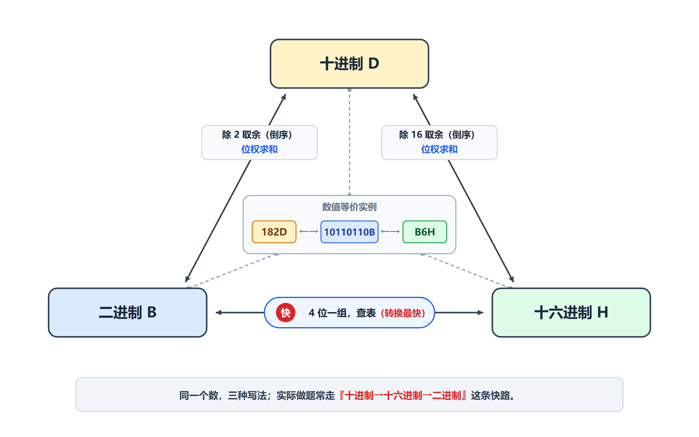

**看图方法**：
1. 图中央画三个大圆角方框，分别写"十进制 D""二进制 B""十六进制 H"，呈三角形摆放。
2. 三个框之间用**双向箭头**连接，每条箭头上写转换方法：
   - 十进制 ↔ 二进制：除 2 取余（倒序）/ 位权求和；
   - 十进制 ↔ 十六进制：除 16 取余（倒序）/ 位权求和；
   - 二进制 ↔ 十六进制：4 位一组查表（**这条箭头上画一个"快"字标记**）。
3. 图的右侧画一个小例子贯穿三个框：`182D` ←→ `10110110B` ←→ `B6H`。
4. **这张图要你记住**：三个框里装的是同一个数的不同写法；走"二进制 ⇄ 十六进制"这条边最快，所以实际做题时经常绕这条路走。

#### 7. 本节真正要记住什么

1. **十进制转二进制：除 2 取余，倒序排列。**
2. **二进制转十进制：每位乘位权，加起来。**
3. **二进制与十六进制：4 位一组，直接查表，不用计算。**
4. **1 个十六进制位 = 4 个二进制位；8 个十六进制位 = 32 位（STM32 一个寄存器）。**
5. 十六进制只是二进制的一种**书写方式**，不是另一种"数"。

---

### 1.2.3 数值数据的编码及其运算

#### 先别急着看教材：这一小节要解决什么？

前面我们学会了"怎么把 182 写成 10110110B"。但还有一个更麻烦的问题：

> **负数怎么办？**

计算机里只有 0 和 1，**没有"负号"这个符号**。所以必须想个办法，用 0/1 本身来"表示负"。

更要命的是第二个问题：

> **减法怎么办？**

芯片里的运算器（ALU）其实**只会做加法**。那 `56 − 87` 是怎么算出来的？

这一节要解决的就是这两个问题。它们是本章最重要、也最容易考的内容。

#### 【先补一个前置知识：什么叫 ALU？】

【补充解释】

> **ALU = Arithmetic Logic Unit = 算术逻辑单元。**
>
> 它是 CPU 里真正"动手算"的那块电路。加减乘除、与或非，都在这里算。
>
> **大白话说**：CPU 像一个工人，ALU 就是这个工人的"手"。工人决定"该算什么"，手负责"算出来"。
>
> **一个关键事实**：这块电路在设计上"加法"最容易做，"减法"要额外加一套电路。为了省电路，工程师想出了"把减法变成加法"的办法——这就是**补码**存在的根本原因。

---

#### 1. 无符号数和有符号数

【教材内容】在计算机中，采用数字化方式来表示数据，数据分为**无符号数**和**有符号数**。其中：

- **无符号数**：用整个机器字长的**全部**二进制位表示数值，无符号位；
- **有符号数**：用**最高位**表示该数的符号位，其他的二进制位表示数值位。有符号数根据其编码的不同又有**原码、补码和反码** 3 种形式。

#### 【先补一个前置知识：什么叫最高位（MSB）、最低位（LSB）？】

【补充解释】

> 一个 8 位的二进制数 `1 0 1 1 0 1 1 0`：
> - **最左边**那一位（这里是 1）叫**最高位**，英文 **MSB = Most Significant Bit**，"最重要的位"，因为它的位权最大（2⁷ = 128）；
> - **最右边**那一位（这里是 0）叫**最低位**，英文 **LSB = Least Significant Bit**，"最不重要的位"，位权最小（2⁰ = 1）。
>
> **为什么最高位"最重要"**：因为它一变，数值就变 128；最低位变一下，数值只变 1。

【补充解释】"有符号数用最高位表示符号"这件事，用大白话讲就是：

> 一个 8 位的格子里，**最左边那一格不装数值了，专门用来装"正负号"**：
> - 那一格写 **0** → 这个数是**正数**；
> - 那一格写 **1** → 这个数是**负数**。
>
> 剩下 7 格装数值大小。

所以有符号数的"能表示的范围"会变小，因为有一位被符号占用了。

---

#### 2. 原码表示法

【教材内容】由于计算机中只能有 0、1 两种数，所以，不仅一个数的数值部分在计算机中用 0、1 编码的形式表示，正、负号也只能用 0、1 编码表示。一般用数的最高位（MSB）表示它的正负符号。

【教材内容】例如，若用 5 位二进制数表示数据时，最高位表示符号，**0 表示正数，1 表示负数**，余下的 4 位表示数据：

- MSB = 0 表示正数，如 **+1011B 表示为 01011B**；
- MSB = 1 表示负数，如 **−1011B 表示为 11011B**。

【教材内容】这种用**符号位加数据位**的表示方法叫作**原码表示法**。

##### 两个必须分清的词：机器数与真值

【教材内容】把一个数在机器内的二进制表示形式称为**机器数**。而把这个数本身称为该机器数的**真值**。

【补充解释】用例子说最清楚：

| 真值（人眼看到的数） | 机器数（机器里存的 0/1） |
|---|---|
| +1011B | 01011B |
| −1011B | 11011B |

> **一句话记**：**真值带正负号，机器数只有 0 和 1。**

##### 原码的数学定义（教材的写法）

【教材内容】

- 若真值为**纯小数**，其原码形式为 `X_S . X₁X₂…Xₙ`，其中 `X_S` 表示符号位。
  - 若 X = 0.0110，则 `[X]原 = X = 0.0110`；
  - 若 X = −0.0110，则 `[X]原 = 1.0110`。
- 若真值为**纯整数**，其原码形式为 `X_S Xₙ Xₙ₋₁ … X₂ X₁`，其中 `X_S` 表示符号位。

【补充解释】这里 `[X]原` 这种写法读作"X 的原码"。符号位单独拿出来，小数点（或数据区）单独拿出来。不用死记形式，**记住一句话就行**：

> **原码 = 符号位（0 正 1 负） + 数值部分的二进制。**

##### 原码的表示范围

【教材内容】

- 8 位二进制原码的表示范围为 **−127 ～ −0 ～ +0 ～ +127**；
- 16 位二进制原码的表示范围为 **−32767 ～ −0 ～ +0 ～ +32767**。

【补充解释】这个范围怎么来的？

- 符号位占 1 位，剩 7 位装数值，7 位最大是 `1111111` = 127，所以正数最大 +127、负数最小 −127。
- 那个 **"−0"** 是怎么回事？看下面。

##### 原码里有两个零

【教材内容】原码表示中，真值 0 有两种不同的表示形式：

```
[+0]原 = 00000，  [−0]原 = 10000
```

（这是 5 位的例子；8 位就是 `0000 0000` 和 `1000 0000`。）

【补充解释】这不奇怪：符号位是"单独的一位"，正号写 0、负号写 1，所以 +0 和 −0 自然就成了两个不同的机器数。**但 0 只有一个，"−0"和"+0"是两个不同的编码却表示同一个值**——这是个麻烦，后面补码会解决它。

##### 无符号数的范围（对比着记）

【教材内容】当然，在不需要考虑数的正、负时，就不需要占用 1 位数来表示符号。这种没有符号位的数，称为**无符号数**。由于符号位要占用 1 位，所以用同样位数的字长，**无符号数的最大值比有符号数的要大一倍**。

- 8 位无符号数最大值为 `11111111B` = **255**；
- 8 位有符号数最大值为 `01111111B` = **+127**。

【教材内容】

- 8 位二进制无符号数的表示范围为 **0～255**；
- 16 位二进制无符号数的表示范围为 **0～65 535**。

【补充解释】这两个范围要能随口说出来：

| 位数 | 无符号范围 | 有符号（原码/反码）范围 | 有符号（补码）范围 |
|---|---|---|---|
| 8 位 | 0 ～ 255 | −127 ～ +127 | −128 ～ +127 |
| 16 位 | 0 ～ 65 535 | −32 767 ～ +32 767 | −32 768 ～ +32 767 |

**为什么 2⁸ − 1 = 255**：8 位能表示 2⁸ = 256 种状态，从 0 开始数，最大就是 255。同理 2¹⁶ − 1 = 65 535。

##### 原码的优缺点

【教材内容】原码的优点是**直观易懂**，机器数和真值间的转换很容易，用原码实现乘、除运算的规则简单；**缺点是加、减运算规则较复杂**。

【补充解释】为什么加减复杂？因为"符号位"和"数值位"是分开处理的：

- 做加法前，得先**看两个数的符号**：
  - 同号 → 数值相加，符号照抄；
  - 异号 → 得先**比较哪个绝对值大**，用大的减小的，结果的符号跟大的那个走。
- 这意味着电路里必须多出"比较大小""选择符号"的部件，很麻烦。

##### 原码直接做加法的三个麻烦（教材逐一分析了）

【教材内容】直接用 1 位 0、1 码表示数的正、负，在运算时可能会带来一些新的问题：这是因为计算机的运算器毕竟是一个大型数字电子器件，而有符号数和无符号数的表示形式并没有任何区别，都是用二进制数据 0、1 表示，所以，**CPU 在进行运算时，并不知道参与运算的数是有符号数还是无符号数**，在进行有符号数的运算时，就会将符号也当作是数进行运算，因而有时会出现错误的结果。下面以有符号数的加法运算为例加以说明。

【补充解释】这句"**CPU 并不知道**"是本小节最要害的一句话，用例子说明：

同一个 8 位模式 `1000 1000`：
- 把它**当无符号数**看：128 + 8 = **136**；
- 把它**当有符号数原码**看：最高位是 1 → 负数，数值位 0001000 = 8 → **−8**。

**机器里存着的就是同一串 0/1（`1000 1000`），"它到底是 136 还是 −8"，完全取决于你（程序）打算怎么解释它。** CPU 只会照着指令把这串 0/1 拿去加、拿去减，它身上并没有一个额外的开关告诉它"这次算的是有符号数"。

正因为如此：

- 做加法时，"符号位"会被当作普通数字一样参与运算，才会出现下面这三种麻烦；
- 也才有必要区分"**进位**（无符号数的概念）"和"**溢出**（有符号数的概念）"——机器只有一套加法电路，是两个概念把人分开了（见本节后面的【容易搞混】）。

**① 两个正数相加时，符号位也同时相加**

若两个数之和**不超出**所能表示的最大值 127，符号位相加 `0 + 0 = 0`，和仍为正数，**结果正确**。

【教材内容】例如，两个有符号正数 `01010111B`(87D) 和 `00010110B`(22D) 相加：

```
   01010111      (87)
 + 00010110      (22)
 ──────────
   01101101
```

【补充解释】逐位验算一下：

| 位 | bit7 | bit6 | bit5 | bit4 | bit3 | bit2 | bit1 | bit0 |
|---|---|---|---|---|---|---|---|---|
| 87 | 0 | 1 | 0 | 1 | 0 | 1 | 1 | 1 |
| 22 | 0 | 0 | 0 | 1 | 0 | 1 | 1 | 0 |
| 和 | 0 | 1 | 1 | 0 | 1 | 1 | 0 | 1 |

- bit0：1 + 0 = 1
- bit1：1 + 1 = 10 → 本位写 0，向 bit2 进位 1
- bit2：1 + 1 + 进位 1 = 11 → 本位写 1，向 bit3 进位 1
- bit3：0 + 1 + 进位 1 = 10 → 本位写 0，向 bit4 进位 1
- bit4：1 + 0 + 进位 1 = 10 → 本位写 0，向 bit5 进位 1
- bit5：0 + 0 + 进位 1 = 1 → 本位写 1
- bit6：1 + 0 = 1
- bit7：0 + 0 = 0

结果 `01101101B` = 64 + 32 + 8 + 4 + 1 = **109**，符号位为 0 表示正数。**87 + 22 = 109，正确。**

【教材内容】**若两个数之和超出了其所能表示的最大值 127 时，就会产生数字位向符号位的进位**，两个符号位相加 `0 + 0 = 0`，再加上低位进上来的 1，`0 + 1 = 1`，符号位为 1，作为有符号数，表示两个正数相加的和为负数，显然是不对的。

【教材内容】例如，两个有符号正数 `00110111B`(55D) 和 `01011101B`(93D) 相加：

```
   00110111      (55)
 + 01011101      (93)
 ──────────
   10010100
```

【教材内容】和应为正数 148，但是在这里，最高位即符号位为 1，表示和是负数，显然是错了。产生错误的原因是：相加的和应该是 +148，超出了 8 位有符号正数所能表示的最大值 +127，**数值在运算产生的进位影响到了符号位**。

【教材内容】**对于有符号数，这种数值运算侵入符号位造成结果错误的情况，称为溢出。**

【补充解释】把溢出的过程看清楚：

```
        00110111    (55)
      + 01011101    (93)
      ──────────
     1 10010100
     ↑
   多出来的这一位，机器装不下，直接丢掉
     结果变成 10010100B
     ↑
   最高位（符号位）变成了 1 → 机器以为这是 -108
```

**55 + 93 = 148**，可 8 位有符号数最大只能表示 +127，装不下，于是"**进位挤进了符号位**"，把正数变成了负数。这就是溢出。

> **【容易搞混】** 溢出（overflow）和进位（carry）不是一回事：
> - **进位**：无符号数运算时，最高位往外多出来的那一位。它本身不是错误，把进位接到更高位继续算就行。
> - **溢出**：有符号数运算时，**结果超出了该位数能表示的范围**，符号位被数值"挤"变了。这才是错误。
>
> 同一个运算可能"有进位但不溢出"，也可能"无进位但溢出"。

**② 一个正数与一个负数相加**

【教材内容】和的符号位不应是两符号位直接运算的值（`0 + 1 = 1`），而应由两数的大小决定，即**和的符号位由两数中绝对值大的决定**。

**③ 两个负数相加**

【教材内容】由于 `1 + 1 = 10`，符号位只剩下 0，因此和的符号也不应由两符号位直接运算的结果所决定。

【教材内容】因为所有的运算都是在算术逻辑单元 ALU 中进行，**即使是减法运算，也是用相加的办法来解决**。为了解决机器内有符号数的符号位参加运算的问题，引入了**反码**和**补码**两种机器数的形式。

【补充解释】把上面三种情况总结成一句话：

> **原码的符号位不能像普通数字一样参加运算**，否则会出错。所以必须发明一种"符号位也能跟着一起算"的编码——这就是反码和补码的动机。

---

#### 3. 反码表示法

【教材内容】对正数来说，反码和原码的形式是相同的，即 `[X]原 = [X]反`。

【教材内容】对负数来说，反码为**原码的数值部分的各位变反**，0、1 互为反码。

教材的例子：

| X | [X]原 | [X]反 |
|---|---|---|
| +1101B | 01101B | 01101B |
| −1101B | 11101B | 10010B |

【补充解释】逐位看一下 −1101B 是怎么变的：

```
原码：  1 1 1 0 1
        ↑ ↑─────── 数值部分的 4 位
        符号位

第一步：符号位不动，保持 1
第二步：数值部分 1101 逐位取反 → 0010
第三步：拼起来 → 1 0010 = 10010B
```

【补充解释】**什么叫"取反"？** 就是 0 变 1、1 变 0。这是一个非常常见的操作，后面讲位运算、GPIO 寄存器时会天天用到。取反在 C 语言里用 `~` 表示。

##### 反码里也有两个零

【教材内容】在反码表示中，真值 0 也有两种不同的表示形式：

```
[+0]反 = 00000B
[−0]反 = 11111B
```

（8 位就是 `0000 0000` 和 `1111 1111`。）

##### 反码运算要注意的三个问题

【教材内容】

- 符号位要与数值位**一样参加运算**；
- 符号位运算后**如有进位产生，则把进位送回到最低位去相加**，即**循环进位**；
- 反码运算具有的性质：`[X]反 + [Y]反 = [X + Y]反`。

【补充解释】**循环进位**这个词听着玄，其实很简单：

> 在反码运算里，如果最高位（符号位）算完还往外冒出一个进位，**不要丢掉它，而是把它加回到最低位（bit0）上去**。

【补充解释】**反码的缺点**：还是要处理"循环进位"，电路上依然麻烦；而且零还是有两个编码。所以现代计算机**实际使用的是补码，不是反码**。反码在这里的作用是：**它是从原码通往补码的中间桥梁**（负数的补码 = 反码 + 1）。

---

#### 4. 补码表示法

##### 1）同余的概念

【教材内容】两个不同的整数 A 和 B 除以同一正整数 M，所得余数相同，则称 A 和 B 对 M **同余**，即 A 和 B 在以 M 为模时是相等的，可写作：

```
A = B (mod M)
```

【教材内容】对钟表来说，其模 M = 12，故 4 点和 16 点、5 点和 17 点……均是同余的，可写作

```
4 = 16 (mod 12),   5 = 17 (mod 12)
```

【补充解释】用大白话讲"同余"：

> **两个数除以同一个数，余数一样，就叫同余。**
>
> 4 除以 12 余 4；16 除以 12 也余 4。所以在"模 12"的世界里，4 和 16 是"同一回事"。

##### 2）补码的概念：用钟表来理解

【教材内容】以指针式钟表为例，若钟表快了两个小时，本应是 3 点时，显示却是 5 点，将其校准的方法有两个：

- **一个方法是往回拨两个小时**：5 − 2 = 3；
- **另一个方法是往前拨 10 个小时**：5 + 10 = 15，但钟表是按 12 小时循环计数的，一旦加到大于 12，就会把 12 舍弃，15 − 12 = 3。

**结果一样。**

【教材内容】这种按照周期循环的数的周期叫作**模**，这里的模就是 12，数一旦大于或等于其模，就会被自动舍弃。所以：

```
5 + 10 − 12 = 3
```

在这里，`5 − 2` 可以看作是 `5 + 10 − 12 = 5 + (10 − 12)`，**10 就可以看作是 −2 的补码**。也就是说，以 12 为模时，−2 和 10 同余。同余的两个数具有互补关系，−2 与 10 对模 12 互补，即 **−2 的补码是 10**。

【教材内容】类似的例子也适合数字式钟表，只不过数字式钟表的小时有时是 24 小时制的，那样其模就是 24。当然，**分钟的模是 60**。调整数字式钟表也可以只使用加的方法：如果钟表慢了，加上数字；如果钟表快了，也是相加，直到溢出后从 0 继续计数，所加的总数就是加上的补码。

【教材内容】可见，只要确定了"模"，就可找到一个与负数等价的正数（该正数是负数的补码）来代替此负数，这个正数可用**模加上负数本身**求得，这样就可把**减法运算用加法实现**了。

【类比】

> **钟表就是一台"模 12"的计算机。**
>
> - 表针只有 12 个位置，走到 12 就回到 0，多出来的部分自动被"扔掉"——这就像计算机里位数固定，超出的高位被自动丢弃。
> - "往回调 2 小时"和"往前拨 10 小时"到达同一个位置——所以**减法可以用加法代替**。
> - 10 就是 −2 在模 12 下的"替身"，这个替身叫**补码**。
>
> **类比的边界**：
> 1. 钟表的模是 12，计算机的模是 **2ⁿ**（n 是字长），机制一样但数值不同；
> 2. 钟表只有 12 个刻度、数字范围是 0～11，计算机里还有"符号位"和"负数范围不对称"这些细节；
> 3. 真实硬件并不是"真的把 12 丢掉"，而是**寄存器只有 n 位，第 n+1 位根本无处存放，自然丢失**。

##### 由此得到补码的概念

【教材内容】

**①** 知道模的大小，求某个负数的补码时，只要将该负数加上其模，就得到它的补码。如以 10 为模，则 −7 的补码为：

```
(−7) + 10 = 3 (mod 10)
```

这时，3 就是 −7 的补码。

**②** 某一正数加上一个负数时，实际上是做一次减法。在引入补码概念之后，可以将该正数加上这个负数的补码，最高位向上产生的进位会自然丢失，所以得到的结果同样是正确的。例如，当模为 10 时：

```
7 + (−4) = 7 + (−4 + 10) = 7 + 6 = 13 = 13 − 10 = 3 (mod 10)
```

【补充解释】第 ② 条极其关键，它是"**减法变加法**"的全部秘密。用大白话再讲一遍：

> 你想算 `7 − 4`。
> 但机器只会加法。
> 那就把 `−4` 换成一个**正数替身**：在模 10 的世界里，`−4` 的替身是 `6`（因为 −4 + 10 = 6）。
> 于是 `7 − 4` 变成 `7 + 6 = 13`。
> 13 超过了模 10，自动丢掉 10，剩下 **3**。
> **结果正确。**

##### 3）以 2ⁿ 为模的补码

【教材内容】在计算机中，带符号的数用二进制补码表示。存放数据的存储器的位数都是确定的。如果每个存数单元的字长为 n 位，那么它的**模就是 2ⁿ**。

【补充解释】为什么是 2ⁿ？因为 n 位二进制最多表示 2ⁿ 种状态，数到 2ⁿ 就"绕回来"了，正好像钟表数到 12 就绕回来。

【教材内容】2ⁿ 是一个 n+1 位的二进制数 `100…0B`（1 后面有 n 个 0）。由于机器只能表示 n 位数，因此数 2ⁿ 在机器中仅能以 n 个 0 来表示，而该数最高位的数字 1 就被自动舍弃了。由此可见，如果以 2ⁿ 为模，则 **2ⁿ 和 0 在机器中的表示形式是完全一样的**。

【补充解释】举个例子就清楚了（n = 8）：

```
2⁸ = 256 = 1 0000 0000B     ← 这是 9 位
但机器只有 8 位，只能存：  0000 0000B   ← 也就是 0
                          ↑ 最高位的那个 1 被丢掉了
```

【教材内容】如果将 n 位字长的二进制数的最高位留做符号位，则数字只剩下 n−1 位，下标从 n−2 到 0。数字 X 的补码（以 2ⁿ 为模）的表示形式为：

**① 当 X 为正数**，即 `X = +Xₙ₋₂Xₙ₋₃…X₁X₀` 时：

```
[X]补 = 2ⁿ + X
      = 0 Xₙ₋₂Xₙ₋₃…X₁X₀ (mod 2ⁿ)
      = [X]原
```

**② 当 X 为负数**，即 `X = −Xₙ₋₂Xₙ₋₃…X₁X₀` 时，由于 `2ⁿ = 2ⁿ⁻¹ + 2ⁿ⁻¹`，有：

```
[X]补 = 2ⁿ + X
      = 2ⁿ − Xₙ₋₂Xₙ₋₃…X₁X₀
      = 2ⁿ⁻¹ + 2ⁿ⁻¹ − Xₙ₋₂Xₙ₋₃…X₁X₀
      = 2ⁿ⁻¹ + (2ⁿ⁻¹ − 1) + 1 − Xₙ₋₂Xₙ₋₃…X₁X₀
      = 2ⁿ⁻¹ + 111…11 − Xₙ₋₂Xₙ₋₃…X₁X₀ + 1     ←（n−1 个 1）
      = 2ⁿ⁻¹ + X̄ₙ₋₂X̄ₙ₋₃…X̄₁X̄₀ + 1
      = 1 X̄ₙ₋₂X̄ₙ₋₃…X̄₁X̄₀ + 1
      = [X]反 + 1
```

其中 `X̄ᵢ` 为对 `Xᵢ` 取反的逻辑值。

【补充解释】这一串推导看着吓人，**结论只有一句话**：

> **负数的补码 = 该负数反码（符号位不动、数值位取反） + 1。**
> 或者更常听到的口诀：**取反加 1**。

**不用背推导过程，但要知道结论是怎么来的**：它是从"模"的定义 `[X]补 = 2ⁿ + X` 一步步推出来的。教材推这一遍，是为了说明"取反加 1"不是天上掉下来的。

##### 教材的例子：求 −1010111B 的补码（n = 8）

【教材内容】n = 8 时，2⁸ = 100000000B，则 −1010111B 的补码为：

**方法一（用模的定义直接算）：**

```
[−1010111B]补 = 100000000B − 1010111B = 10101001B
```

**方法二（取反加 1）：**

```
[−1010111B]反 = 10101000B
[−1010111B]补 = 10101000B + 1 = 10101001B
```

【补充解释】把方法二逐位写清楚（这一步不许跳）：

```
真值：      −1010111
加上 8 位表示：

① 先写原码：   1 0100111
                ↑ ↑────── 数值部分 1010111
                符号位（负数为 1）

② 求反码：符号位不动，数值部分 1010111 逐位取反 → 0101000
          拼起来：1 0101000

③ 反码加 1：
      10101000
   +         1
   ───────────
      10101001

所以 [−1010111B]补 = 10101001B   ✓
```

##### 教材的对比例子

【教材内容】

| | X | [X]原 | [X]反 | [X]补 |
|---|---|---|---|---|
| 正数 | +0001101B | 00001101B | 00001101B | 00001101B |
| 负数 | −0001101B | 10001101B | 11110010B | 11110011B |

【补充解释】负数那一行的变化过程：

```
原码：  10001101
反码：  11110010   ← 符号位 1 不动，数值部分 0001101 → 1110010
补码：  11110011   ← 反码 + 1（11110010 + 1 = 11110011）
```

**正数三个编码完全一样**，这一点务必记住。

##### 为什么"取反加 1"在电路上容易实现？

【教材内容】这种利用取反加 1 求负数补码的方法，在逻辑电路中利用**非门电路和加法计数器**的功能实现起来是很容易的。这是因为二进制数有反码，每位数非 0 即 1，0 与 1 互为反码，利用**反相电路**很容易实现；而十进制数有 0～9 共 10 个数字，相互之间没有反码的关系，所以十进制数虽然有补码，但是**无法用求反加 1 的方法**实现求补码的运算。

【补充解释】这段话讲的是"为什么二进制特别适合用补码"：

> 二进制只有 0 和 1，**"取反"就是 0↔1 互换，一个反相器（非门）就能做到**。
> 而十进制有 10 个数字，0 的反码是谁？1 的反码是谁？根本凑不出"互换"的关系，所以十进制做不到"取反加 1"。

##### 反码与补码的一个相似性质

【教材内容】不论是正数还是负数，反码与补码具有下列相似的性质：

```
[[X]反]反 = [X]原
[[X]补]补 = [X]原
```

【补充解释】这两个式子说的是"**再求一次就还原**"：

> 对一个数求反码，再对结果求反码，就回到原码。
> 对一个数求补码，再对结果求补码，就回到原码。
>
> 这个性质非常有用：**已知一个补码，想知道它代表的真值是多少，就"再求一次补码"**。例 1-2 就会用到。

##### 教材例 1-1：+13 和 −13 的三码，以及"再求一次码"

【教材内容】教材在讲完上面两条性质之后给出了**例 1-1**：把 **+13 和 −13** 的**原码、反码、补码**，连同**[X]反 的反码**和 **[X]补 的补码**一起列出来，用来验证"再求一次码就还原"。

【补充解释】教材这道例题的表格，在 MinerU 解析结果里只留下了表头（`X`、`[X]原`、`[X]反`、`[X]补`、`[[X]反]反`、`[[X]补]补`）而没有数据行，下面按定义一步步算出来，你可以对照本节第 7 条的速查表核对。

**① X = +13（正数，三码相同）**

```
13 = 1101B → 补成 8 位 → 0000 1101B

[X]原 = 0000 1101
[X]反 = 0000 1101   （正数，反码 = 原码）
[X]补 = 0000 1101   （正数，补码 = 原码）
```

**② X = −13（负数）**

```
[X]原 = 1000 1101        ← 符号位写 1，数值位照抄 0001101
[X]反 = 1111 0010        ← 符号位不动，数值位 0001101 逐位取反 → 1110010
[X]补 = 1111 0011        ← 反码 + 1（1111 0010 + 1 = 1111 0011）
```

**③ 再求一次码：验证 `[[X]反]反 = [X]原`、`[[X]补]补 = [X]原`**

对 +13 来说，因为三码本来就相同，"再求一次"还是 `0000 1101`，看不出什么。**有意思的是 −13**：

```
【反码的反码】
  [−13]反 = 1111 0010
  把这个反码再求一次反码（最高位是 1 → 是负数，符号位不动、数值位取反）：
    数值位 1110010 取反 → 0001101
    拼回符号位 → 1 0001101 = 1000 1101
  结果 = 1000 1101 = [−13]原   ✓

【补码的补码】
  [−13]补 = 1111 0011
  把这个补码再求一次补码（最高位是 1 → 是负数，取反加 1）：
    数值位 1110011 取反 → 0001100
    加 1 → 0001101
    拼回符号位 → 1 0001101 = 1000 1101
  结果 = 1000 1101 = [−13]原   ✓
```

> **这就是"已知一个补码，求它代表的真值"的标准做法**：对补码再求一次补码 → 得到原码 → 原码的符号位告诉你正负、数值位告诉你大小。本节后面的例 1-2，以及习题 1-4 里对 `11100001B` 求真值，用的都是这一招。

##### 两个特殊数的补码

【教材内容】

**① 0 的补码。**

因为 `[+0]补 = 00000000B`，`[−0]` 的原码为 `10000000B`，经求反加 1，得 `00000000B`，所以 `[−0]补 = 00000000B`。即，**对补码来说，不分正 0、负 0，都是 0**。

【补充解释】验算一下：

```
[−0]原 = 1000 0000
符号位不动，数值位取反：1111 1111   （这就是 [−0]反）
加 1：
  11111111
+        1
──────────
1 00000000
↑
最高位那个 1 被丢掉（模 2⁸ 的作用）
结果 = 0000 0000
```

**这就是补码最大的好处之一：0 只有一个编码，不再有"+0/−0"的混乱。**

**② −128 的补码。**

【教材内容】根据补码的定义，可知：

```
[−128]补 = 2ⁿ + (−128) = 2⁸ + (−128) = 2⁸ + (−127) − 1
```

所以

```
[−128]补 = 256 − 128 = 100000000B − 1111111B − 1
         = 10000001B − 1
         = 10000000B
```

【补充解释】这一条是补码最"反直觉"的地方，请仔细看：

> 在 **8 位补码**里，`1000 0000B` 表示的是 **−128**，而不是"−0"。
>
> 为什么？因为：
> - `0000 0000` 已经被"0"占用了；
> - 8 位一共能表示 256 种状态，正数占 0～127（128 种），负数就占 −1～−128（128 种）；
> - 所以多出来的那一个编码 `1000 0000` 正好分给 −128。
>
> **结论**：8 位补码能表示 **−128 ～ +127**，比原码/反码多一个负数（−128）。

【辅助理解图】

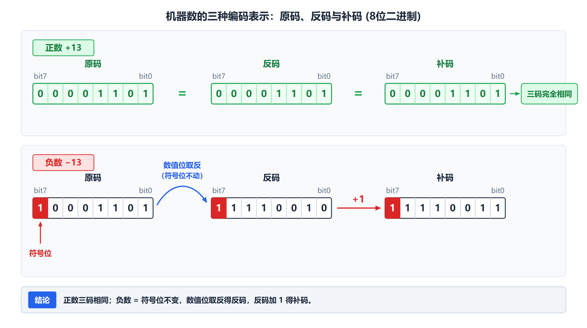

**看图方法**：
1. 图分**上下两栏**：上栏是正数 `+13`，下栏是负数 `−13`；每栏横向排三个 8 格的长条，分别是原码、反码、补码。
2. **先看正数那一栏**：三个长条的 8 个格子**完全一样**（`0000 1101`）。这印证了"正数三种编码相同"。
3. **再看负数那一栏**：
   - 第一个长条（原码）：最左格高亮写 `1`（符号位），其余是 `0001101`；
   - 第二个长条（反码）：最左格仍是 `1`，但数值部分 `0001101` 全部翻转成 `1110010`；
   - 第三个长条（补码）：在反码基础上**最右一格加 1**，得到 `11110011`，图中用一个红色 "+1" 箭头从反码长条指向补码长条。
4. 图底部写一行小字："**正数三码相同；负数：符号位不变，数值位取反得反码，反码加 1 得补码。**"
5. **这张图要你记住什么**：看到一个负数，你能立刻画出它的三个编码；反过来看到一个补码，你能判断它是正是负（看最高位）。

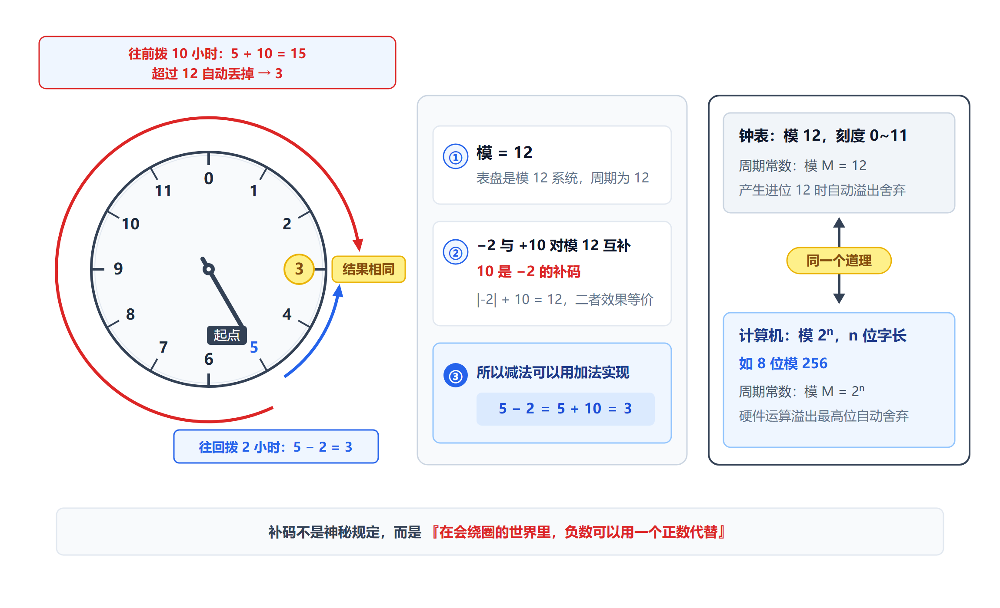

**看图方法**：
1. 图左边画一个**表盘**，刻度 0～11（模 12），指针指向 5。
2. 表盘上有两条弧形箭头：
   - 一条**逆时针**的蓝色箭头，标注"往回拨 2 小时 → 5 − 2 = 3"；
   - 一条**顺时针**的红色箭头，标注"往前拨 10 小时 → 5 + 10 = 15，超过 12 自动丢掉 → 3"。
3. 两条箭头都指向刻度 3，旁边写"**结果相同**"。
4. 图右边写三行结论：
   - "模 = 12"；
   - "−2 与 +10 对模 12 互补，10 是 −2 的补码"；
   - "所以：**减法可以用加法实现**"。
5. 图底部一行对照文字："钟表模 12 ←→ 计算机模 2ⁿ（n 位字长）"。
6. **这张图要你理解什么**：补码不是什么神秘规定，而是"在一个会绕圈的世界里，负数可以用一个正数代替"这一朴素事实的产物。

##### 4）数值数据的运算

【教材内容】采用补码进行加减运算时要注意以下几个问题：

**①** 补码运算时，其符号位要与数值部分一样参加运算，但**结果不能超出其所能表示的数的范围，否则会出现溢出错误**。无符号数的加减运算结果超出数的范围的情况称为**产生进位或借位**，计算机中有专门记录运算时产生的进位或借位的**标志**，只要将进位加到更高位上或者将借位从更高位上减去，运算就不会出错，在多字节数加减运算时，必须考虑进位和借位的处理。

**②** 采用了补码以后，符号运算后如有进位出现，则**把这个进位舍去**，不影响运算结果，运算后的符号就是结果的符号。

**③** 补码运算的性质：

```
[X]补 + [Y]补 = [X + Y]补
[X]补 − [Y]补 = [X − Y]补
```

这些运算性质**与数的位数 n 无关**。

【补充解释】三条各用一句大白话总结：

| 教材表述 | 大白话 |
|---|---|
| 符号位参加运算 | 补码里**没有"特殊的符号位"**，全部 8 位一视同仁地相加 |
| 进位舍去 | 算出第 9 位就**直接扔掉**，不循环进位（这是补码比反码省事的地方） |
| 运算性质 | 先求补码再加，等于先加再求补码。**所以可以直接拿补码当普通二进制数相加** |

##### 例 1-2：X = +0101101B，Y = −0000001B，求 X + Y

【教材内容】解：

```
[X]补 = 00101101
+ [Y]补 = 11111111
──────────────
[X+Y]补 = 100101100
          ↑
        进位舍去
```

【补充解释】把每一步都写清楚：

**第一步：求 X 的补码。**

```
X = +0101101B（正数，补码 = 原码）
补成 8 位：0 0101101 → 00101101B
```

**第二步：求 Y 的补码。**

```
Y = −0000001B
① 原码：1 0000001
② 反码：符号位不动，数值位取反 → 1 1111110
③ 补码：反码 + 1 → 11111110 + 1 = 11111111
所以 [Y]补 = 11111111B
```

**第三步：相加。**

```
   00101101      (45)
 + 11111111      (−1)
 ──────────
 1 00101100
 ↑
 第 9 位，舍去
```

**第四步：结果的真值。**

```
[X+Y]补 = 00101100B
最高位是 0 → 正数 → 补码即原码
00101100B = 32 + 8 + 4 = 44
```

**验算**：45 + (−1) = **44** ✓

【教材内容】

```
X + Y = [[X+Y]补]补 = 0101100B = [X]补 + [Y]补
```

【补充解释】这个式子说的是：**结果的补码再求一次补码，就得到真值**（用到了前面 `[[X]补]补 = [X]原` 的性质）。

##### 为什么计算机能做到"只有加法器就能算一切"？

【教材内容】因为减去一个正数的减法运算可以看作是加上一个负数的加法运算，所以在计算机中，利用反码加 1 的方法求得补码之后，即将减一个正数的运算转变为加上一个负数的运算，进而变为加上该负数的补码的加法运算；而**乘法运算又可以采用移位相加的方法完成，除法运算采用移位相减的方法完成**，这样**只用加法器就能完成所有的算术运算**。

【补充解释】把这条"化归链"画出来：

```
  减法  ──→  加上"减数的相反数"  ──→  加上"负数的补码"  ──→  纯加法
  乘法  ──→  移位 + 相加          ──┐
  除法  ──→  移位 + 相减  ──→  移位 + 加补码  ──→  纯加法
                                    │
                                    ▼
                          只要一个加法器就够了
```

【补充解释】**这就是补码最大的工程价值**：

> 如果不用补码，CPU 里就得同时造"加法器"和"减法器"两套电路，还要加上"比较符号、选择路径"的电路。
> 用了补码，**一套加法器搞定加减乘除**，电路简单、速度快、成本低。

##### 【补充解释】怎么做减法？以 56 − 87 为例（对应习题 1-4）

教材的例 1-2 只演示了加法。这里补一个减法的完整推演，因为习题里一定会考。

**目标**：用补码计算 `56 − 87`。

**第一步：把减法变成加法。**

```
56 − 87 = 56 + (−87)
```

**第二步：求两个数的 8 位补码。**

`56`：

```
56 ÷ 2 逐次取余 → 111000B → 补成 8 位 → 00111000B
（正数，原码 = 反码 = 补码）
```

`−87`：

```
87 = 1010111B → 补成 8 位 → 01010111B
① 原码： 1 1010111
② 反码： 1 0101000   （符号位不动，数值位取反）
③ 补码： 1 0101000 + 1 = 10101001B
```

**第三步：相加。**

```
   00111000      (56)
 + 10101001      (−87)
 ──────────
   11100001
```

逐位验算：

| 位 | bit7 | bit6 | bit5 | bit4 | bit3 | bit2 | bit1 | bit0 |
|---|---|---|---|---|---|---|---|---|
| 56 | 0 | 0 | 1 | 1 | 1 | 0 | 0 | 0 |
| −87 | 1 | 0 | 1 | 0 | 1 | 0 | 0 | 1 |
| 和 | 1 | 1 | 1 | 0 | 0 | 0 | 0 | 1 |

- bit0：0 + 1 = 1
- bit1：0 + 0 = 0
- bit2：0 + 0 = 0
- bit3：1 + 1 = 10 → 本位 0，进位 1
- bit4：1 + 0 + 1 = 10 → 本位 0，进位 1
- bit5：1 + 1 + 1 = 11 → 本位 1，进位 1
- bit6：0 + 0 + 1 = 1
- bit7：0 + 1 = 1

结果 `11100001B`。最高位是 1 → 结果是负数。

**第四步：求真值。**

```
[结果]补 = 11100001
求真值要"再求一次补码"：
① 符号位不动，数值位取反：1 0011110
② 加 1：10011110 + 1 = 10011111
③ 去掉符号位，数值部分是 0011111B = 31
所以真值 = −31
```

**验算**：56 − 87 = **−31** ✓

【辅助理解图】

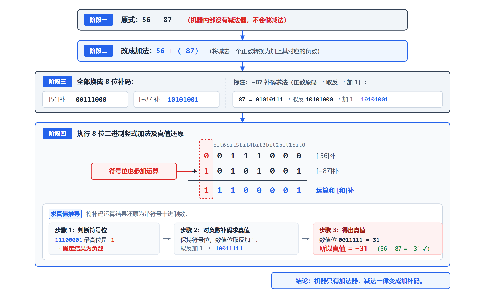

**看图方法**：
1. 图从左到右分**四个方框**，用箭头串联：
   - 方框 1 写"原式：`56 − 87`（机器不会减法）"；
   - 方框 2 写"改成加法：`56 + (−87)`"；
   - 方框 3 写"换成补码：`00111000` + `10101001`"；
   - 方框 4 写竖式结果 `11100001`。
2. 图下方再画一个方框，写"求真值：`11100001` 再取反加 1 → 数值 `0011111` = 31，符号为负 → **−31**"。
3. 图中用一个**红色虚线框**圈住 bit7，标注"符号位也参加运算，不需要特殊处理"。
4. 图右下角写一行小字："**机器只有加法器，减法一律变成加补码。**"
5. **这张图要你记住**：做补码运算的三个固定动作——**① 把减号改成加负数；② 全部换成补码；③ 加完看最高位判断正负，若为负再取反加 1 求真值。**

#### 5. 【教材内容】三种编码小结

教材给出的三条总结，请务必背下来：

- **对正数而言，上述 3 种编码都等于真值本身。**
- **最高位都表示符号位**。补码和反码的符号位可与数值位一样看待，和数值位一起参加运算；但**原码的符号位必须与数值位分开处理**。
- **原码和反码的真值 0 各有两种不同的表示方式，而补码的真值 0 表示是唯一的。**

#### 6. 教材表 1-2：8 位二进制数的原码、反码、补码

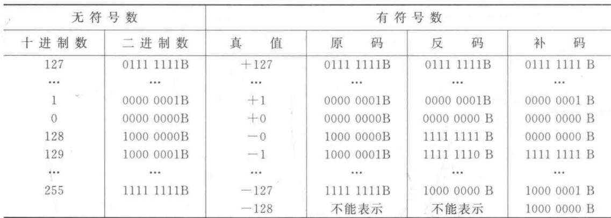

**看图方法**：
1. 表格分成**左右两大块**：
   - 左边两列是"**无符号数**"视角：十进制数、二进制数；
   - 右边四列是"**有符号数**"视角：真值、原码、反码、补码。
2. **先看最上面一行**：无符号 127（`0111 1111B`）对应真值 +127，原码/反码/补码全都是 `0111 1111B`。这印证"正数三码相同"。
3. **再看中间特别的一行**：无符号 128（`1000 0000B`）对应真值 **−0**，它的原码是 `1000 0000B`、反码是 `1111 1111B`、**补码是 `0000 0000B`**——注意补码这一格变成了全 0，说明补码里没有"−0"这个东西。
4. **看最下面一行**：真值 −128 那一行的"原码""反码"两格写着"**不能表示**"，只有补码一格写着 `1000 0000B`。这说明补码比原码/反码多表示一个数。
5. **注意教材这张表的排序方式**：它是按"无符号二进制数从 0 数到 255"来排列的，所以同一行的"无符号数"和"真值"看起来差别很大。不要被这个排版搞晕——**你要看的是同一行里"真值 → 原码 → 反码 → 补码"的关系**。
6. **这张图要你理解什么**：8 位下，原码和反码的范围是 −127～+127，而**补码的范围是 −128～+127**，多出来的那个就是 `1000 0000B`。

#### 7. 【教材内容】三种编码速查表（本讲义整理）

以 8 位、真值 ±13 为例：

| 真值 | 原码 | 反码 | 补码 |
|---|---|---|---|
| +13 | `0000 1101` | `0000 1101` | `0000 1101` |
| −13 | `1000 1101` | `1111 0010` | `1111 0011` |
| +0 | `0000 0000` | `0000 0000` | `0000 0000` |
| −0 | `1000 0000` | `1111 1111` | `0000 0000`（与 +0 相同） |
| −128 | 不能表示 | 不能表示 | `1000 0000` |

**转换口诀**：

```
正数：原码 = 反码 = 补码
负数：符号位固定为 1
      数值位照抄 → 原码
      数值位取反 → 反码
      数值位取反后加 1 → 补码
```

#### 8. 【容易搞混】关于补码的四个常见误解

| 误解 | 真相 |
|---|---|
| "补码就是反码加 1，正数也要加 1" | **只有负数才"取反加 1"**。正数三码相同，直接照抄 |
| "补码的符号位不能参与运算" | 恰恰相反，**补码的符号位和数值位一样参与运算**，这是它的最大优点 |
| "8 位补码能表示 −127 到 +127" | 是 **−128 到 +127**。`1000 0000` 表示 −128 |
| "溢出就是进位，进位就是溢出" | **不是一回事**。无符号数看进位，有符号数看溢出（见前面 1.2.3 第 2 节） |

---

#### 9. 十进制数的编码（BCD 码）

【教材内容】常用的十进制数编码有 **BCD 码**（Binary-Coded Decimal）、**余 3 码**和**格雷码**等。最常见的是 BCD 码。

##### BCD 码是什么？

【教材内容】BCD 码是**二进制编码形式的十进制数**，即用 **4 位二进制数表示 1 位十进制数**，这种编码形式可以有多种，其中最自然、最常用的一种形式为 **8421 码**，即这 4 位二进制数的权值，从左向右依次分别为 **8、4、2、1**。

【补充解释】用大白话讲：

> **BCD 码 = "一个十进制数字，用一个 4 位二进制数来存"。**
>
> 它不是"把整个数转成二进制"，而是"**一位一位地转**"。
>
> 对比一下就清楚了，以十进制数 `39` 为例：
>
> | 表示方式 | 结果 | 说明 |
> |---|---|---|
> | 真正的二进制 | `100111B` | 39 整体转成二进制，只有 6 位 |
> | 8421 BCD 码 | `0011 1001` | 3 转成 `0011`，9 转成 `1001`，拼起来 8 位 |
>
> **两者完全不同！** 教材特别强调："尽管在 8421 码中 0～9 共 10 个数码的表示形式与用二进制表示的形式一样，但这是两个完全不同的概念，不能混淆。"

##### 为什么需要 BCD 码？

【补充解释】

> 因为**有些场合希望机器像人一样"按十进制一位一位地处理数字"**。
> 最典型的例子是：**数码管显示、电子表、计算器的键盘输入**。
>
> 如果用纯二进制存"39"，要在数码管上显示，得先做一次"二进制转十进制"的除法运算；
> 而用 BCD 码存 `0011 1001`，**高 4 位直接就是 3，低 4 位直接就是 9**，送到显示电路就行，不用算。
>
> 代价是：**BCD 码浪费存储空间**——4 位二进制本来能表示 16 个数，BCD 只用了 10 个（`1010`～`1111` 这 6 个编码是浪费的）。

##### 非压缩 BCD 码

【教材内容】当用 1 字节的 8 位二进制数表示十进制数时，若每个字节的**高 4 位为 0**，只用其低 4 位表示 1 位十进制数，则称为**非压缩的 BCD 码**。它所表示的数的范围是 **0～9**。

【教材内容】表示格式如图 1-3 所示（D7～D0，高 4 位全 0，低 4 位是个位）：

| D7 | D6 | D5 | D4 | D3 | D2 | D1 | D0 |
|---|---|---|---|---|---|---|---|
| 0 | 0 | 0 | 0 | 个位（4 位） |

【补充解释】"非压缩"的意思是：**一个字节只装一个十进制数字**，高 4 位白白浪费。

```
十进制数字 5 的非压缩 BCD：
0000 0101
↑↑↑↑ ↑↑↑↑
白白浪费  装的是 5
```

##### 压缩 BCD 码

【教材内容】若将 8 位用于表示 2 位十进制数，则称为**压缩的 BCD 码**。它所表示的数的范围是 **0～99**。

| D7 | D6 | D5 | D4 | D3 | D2 | D1 | D0 |
|---|---|---|---|---|---|---|---|
| 十位（4 位） | 个位（4 位） |

【补充解释】"压缩"的意思是：**一个字节装两个十进制数字**，高 4 位装十位、低 4 位装个位。

```
十进制数 39 的压缩 BCD：
0011 1001
↑↑↑↑ ↑↑↑↑
 3    9
```

##### 教材的完整例子：用 4 字节表示十进制数 4321

【教材内容】

**用非压缩的 BCD 码表示时是：**

```
0000 0100,  0000 0011,  0000 0010,  0000 0001
```

【补充解释】对照一下：十进制数 4321 的每一位分别是 4、3、2、1，每一位用一个字节（高 4 位补 0）：

```
字节 1：0000 0100  → 数字 4
字节 2：0000 0011  → 数字 3
字节 3：0000 0010  → 数字 2
字节 4：0000 0001  → 数字 1
```

【教材内容】用十六进制数据表示，则是：

```
04H, 03H, 02H, 01H
```

**用压缩的 BCD 码表示时只需要 2 字节：**

```
0100 0011,  0010 0001
```

【补充解释】

```
字节 1：0100 0011  → 高 4 位 0100 = 4（千位），低 4 位 0011 = 3（百位）→ 43
字节 2：0010 0001  → 高 4 位 0010 = 2（十位），低 4 位 0001 = 1（个位）→ 21
拼起来 → 4321
```

【教材内容】用十六进制数据表示则是：

```
43H, 21H
```

【补充解释】**注意一个非常容易掉的坑**：`43H` 在这里**不是**十进制数 67（十六进制 43 = 4×16+3 = 67）！

> `43H` 只是"**用十六进制的写法来描述一串 BCD 位模式**"。
> 它描述的是 `0100 0011` 这一串位，含义是"十进制数的 4 和 3"。
>
> 同一个位模式 `0100 0011`，可以说它是：
> - 压缩 BCD 码的 `43`（十进制四十三）；
> - 十六进制数 `43H`（数值等于十进制 67）；
> - 纯二进制数 `1000011B`（数值等于十进制 67）。
>
> **关键不是位模式，而是"你按哪套规则去解释它"。**

【辅助理解图】

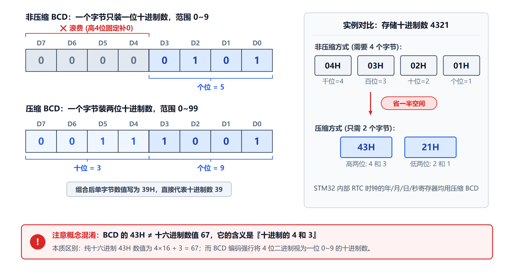

**看图方法**：
1. 图分**上下两栏**，每栏画一个 8 格的横向长条（从 D7 到 D0）。
2. 上栏标"**非压缩 BCD**"：左 4 格画成灰色并写 `0 0 0 0`，标注"浪费"；右 4 格用蓝色写 `0 1 0 1`，标注"个位 = 5"。
3. 下栏标"**压缩 BCD**"：左 4 格写 `0 0 1 1`，标注"十位 = 3"；右 4 格写 `1 0 0 1`，标注"个位 = 9"。
4. 图右侧用一个小例子说明容量差别："存 4321 需要 **4 字节**（非压缩） vs **2 字节**（压缩）"。
5. 图底部写一行警告文字："**BCD 的 `43H` ≠ 十六进制数值 67**，它是'十进制的 4 和 3'。"
6. **这张图要你记住**：BCD 码是"用二进制格子装十进制数字"，高 4 位是"十位"、低 4 位是"个位"（压缩时）。

##### 【补充解释】余 3 码和格雷码（教材只提到名字，这里简单说明）

教材说"常用的十进制数编码有 BCD 码、余 3 码和格雷码等"，但没有展开。为了不让你遇到时发懵，这里各给一句：

| 编码 | 一句话说明 | 什么时候会遇到 |
|---|---|---|
| **余 3 码** | 在 8421 码的基础上每个数字**加 3**（如 0 的余 3 码是 `0011`，1 是 `0100`） | 数字电路、部分数制教材 |
| **格雷码** | 相邻两个数的编码**只有 1 位不同**，用于减少电路翻转时的错误 | 位置传感器、编码器 |

> 本书后续章节（STM32 相关）基本只用 BCD 和普通二进制，余 3 码、格雷码了解名字和用途即可。

#### 10. 本节真正要记住什么

1. **无符号数**：全部位都用来表示数值，8 位范围 0～255。
2. **有符号数**：最高位是符号位（0 正 1 负），有原码、反码、补码三种形式。
3. **正数三码相同；负数**：原码→数值位取反得反码→反码加 1 得补码。
4. **补码的核心思想**：在模 2ⁿ 的世界里，负数可以用一个正数（它的补码）代替，于是**减法变加法**。
5. **8 位补码范围 −128～+127**；`1000 0000` 表示 −128；**0 的补码唯一**。
6. **补码的符号位参与运算**，最高位产生的进位**直接舍去**。
7. **溢出**：有符号数结果超出范围，数值"挤"进符号位导致结果错误。
8. **BCD 码**：用 4 位二进制表示 1 位十进制数；压缩 BCD 一个字节装两位。

---

### 1.2.4 非数值数据的编码

#### 先别急着看教材：这一小节要解决什么？

前面讲的都是"数"。但计算机还要处理**文字**：

> **字母 'A'、汉字"春"、标点符号，怎么变成 0 和 1？**

【教材内容】**非数值数据**是指不能进行算术运算的数据，包括字符、字符串、图形符号和汉字、语音与图像的信息等多种数据。这些信息在传送时，并不是直接传送和处理其原值，而是先按照某种规则进行一定的处理，使之具有通用的传送格式。**经过这种处理的数值信息，称为编码。**

【补充解释】这段话的关键词是"**通用**"：

> 计算机里存 'A'，存的其实不是字母本身，而是一个**约定的编号**。
> 比如约定"65 号代表大写字母 A"，那么机器里存的就是 `65`（二进制 `01000001`）。
> 显示的时候，显示器拿到 65，去查同一张表，画出 'A' 的形状。
>
> **编码 = 全世界的计算机都说好的一套"编号规则"。** 没有这套约定，A 机器发出的 65 到了 B 机器可能被显示成别的符号。

本节内容较多，但核心只有一条链：

```
输入（人敲键盘）→ 编码 → 存储/传输 → 解码 → 输出（屏幕显示）
```

---

#### 1. ASCII 编码

【教材内容】在处理文本文件时，每个字符都是由其相应的标准字模构成的，文本文件本身并不包括这些字模，而只是使用其编码来表示每个字符。

【教材内容】国际上通用的标准字符编码为 **ASCII 码**（American Standard Code for Information Interchange，**美国标准信息交换码**）。

##### 术语卡片（第一次出现，按规则完整给出）

| 项目 | 内容 |
|---|---|
| 英文全称 | American Standard Code for Information Interchange |
| 中文名称 | 美国标准信息交换码 |
| 缩写 | ASCII |
| 大白话意思 | 给英文字母、数字、标点符号编的一套"门牌号"表 |
| 它是干什么的 | 让所有计算机用同一套编号表示字符，这样文件在 A 电脑存、B 电脑读，显示出来是一样的 |

##### ASCII 码的组成

【教材内容】ASCII 码共定义了 **256 个代码（0～255）**，其中：

- **0～32 为控制字符**（ASCII Control Characters）；
- **33～127 为可打印字符**（ASCII Printable Characters）；
- **0～127 是标准的 ASCII 编码**，**128～255 是扩展的 ASCII 编码**。

【教材内容】其中，标准 ASCII 码包含：**26 个小写英文字母**和 **26 个大写英文字母**、**10 个数字码（0～9）**以及 **25 个特殊字符**，如 `[`、`+`、`-`、`@`、`|`、`#` 等，共计 **87 个**。这 87 个字符可用 **7 位二进制编码**来表示。

【教材内容】为了能与主流计算机相兼容，各国也都采用这种字符编码进行上述字符和数字的传输。目前，几乎所有小型计算机和微型计算机都采用 ASCII 码。例如，标准键盘与主机之间，显示器与主机之间的数据传输等，都采用了这种 ASCII 码。

【补充解释】把这段拆开理解：

**（1）为什么是 7 位？**

> 2⁷ = 128，正好够放下 128 个常用字符（字母 + 数字 + 标点 + 控制符）。所以标准 ASCII 用 7 位。

**（2）那第 8 位干什么用？**

【教材内容】附录 A 为 ASCII 码字符表，它用 8 位二进制数表示字符代码。其**基本代码占 7 位，第 8 位可用作奇偶校验**，通过对奇偶校验位设置 1 或 0 状态，保持 8 位字节中的 1 的个数总是**奇数**（称为**奇校验**）或**偶数**（称为**偶校验**），一般用于字符或数字在**串行传送**时检测传送过程中是否出错。

【补充解释】**奇偶校验**是大白话很好懂的一件事：

> 假设要传一个 7 位的数据 `1000001`（也就是 'A'，65）。
> 这 7 位里一共有 2 个 1，是**偶数**。
>
> - 如果用**奇校验**：要求加上校验位后 1 的个数是奇数 → 校验位补 **1**，变成 `11000001`（3 个 1）；
> - 如果用**偶校验**：要求 1 的个数是偶数 → 校验位补 **0**，变成 `01000001`（2 个 1）。
>
> 接收方收到后数一下 1 的个数，如果不符合约定，就说明**传输过程中有一位被干扰翻了**。
>
> **注意它的能力边界**：奇偶校验只能发现"**奇数个位出错**"。如果有两位同时翻了，1 的个数奇偶性不变，就查不出来。所以它只是一种很弱的检错手段。（第 9 章讲串行通信时会再遇到。）

**（3）ASCII 表的规律（很实用，建议记住）**

【补充解释】虽然不需要背整张表，但有三条规律能帮你省很多事：

| 字符 | 编码规律 | 例子 |
|---|---|---|
| 数字 `'0'`～`'9'` | 从 `0x30`（48）开始连续排列 | `'0'`=48，`'9'`=57 |
| 大写字母 `'A'`～`'Z'` | 从 `0x41`（65）开始连续排列 | `'A'`=65，`'Z'`=90 |
| 小写字母 `'a'`～`'z'` | 从 `0x61`（97）开始连续排列 | `'a'`=97，`'z'`=122 |

由此还能推出两个常用结论：

```
'B' = 'A' + 1 = 66
'a' - 'A' = 97 - 65 = 32 = 0x20
```

**"大小写字母相差 32"** 这条规律在写程序时经常用到（比如用"和 0x20 做或运算"把大写转小写）。

##### 【先补一个前置知识：什么叫"位运算"（与、或、异或、取反）？】

上面这句话里出现了"**或运算**"，这是本章第一次遇到"位运算"，先把它的家底交代清楚。

【补充解释】**位运算 = 对二进制数的每一个 bit 单独做运算**。它逐位进行，位与位之间**不发生进位**（这一点和加法完全不同）。

最常用的有 4 个（每个 bit 只有 0/1 两种值）：

| 运算 | 符号 | 规则（大白话） | 一句话记 |
|---|---|---|---|
| **与** AND | `&` | 两个都是 1 才是 1，否则是 0 | "都同意才通过" |
| **或** OR | `\|` | 只要有一个是 1 就是 1，两个都是 0 才是 0 | "有一个同意就通过" |
| **异或** XOR | `^` | 两个**不一样**才是 1，一样是 0 | "意见不同才通过" |
| **取反** NOT | `~` | 0 变 1、1 变 0 | "全部反过来" |

**看一个真正的小例子：把大写 'A' 变成小写 'a'**

```
'A' = 0x41 = 0100 0001
'a' = 0x61 = 0110 0001
```

两者只差 **bit5**（也就是 `0x20` 这一位）：'A' 的 bit5 是 0，'a' 的 bit5 是 1。所以只要"把 bit5 强行变成 1"，其他位不动，大写就变成小写了。

**运算前 / 掩码 / 运算后**（一步一步写，不跳步）：

```
运算前：   'A'   0x41 = 0100 0001
    或
掩码：            0x20 = 0010 0000   ← 只有 bit5 是 1，其余位都是 0
──────────────────────────────────
运算后：               0110 0001 = 0x61 = 'a'   ✓
```

逐位说明为什么"其他位不动"：

- **bit5**：原来是 0，和 1 做"或" → 0 或 1 = **1**（这一位被"点亮"）；
- **其他每一位**：原来的值和 0 做"或" → x 或 0 = **x**（原值不变）。

所以 `x | 0x20` 这个写法的含义就是"**把 bit5 强行置 1，其他位一个也不碰**"。
反过来，想从小写变回大写，就"把 bit5 强行清 0"：掩码取 `0xDF`（= `1101 1111`，只有 bit5 是 0），做**与**运算即可：

```
运算前：   'a'   0x61 = 0110 0001
    与
掩码：            0xDF = 1101 1111   ← 只有 bit5 是 0
──────────────────────────────────
运算后：               0100 0001 = 0x41 = 'A'   ✓
```

> **【容易搞混】** C 语言里 `|` 是"**按位或**"，`||` 是"**逻辑或**"（结果只有"真/假"）；`&` 是按位与，`&&` 是逻辑与。以后写寄存器操作时，用的一定是**单个符号**的按位运算。
>
> 这一小节不需要背，只要知道"位运算 = 逐位算、可以用掩码只改关心的几位"。第 6 章配置 GPIO 寄存器时会天天用到它。

**（4）控制字符是什么？**

> 0～32 这些编号不对应任何可见字符，而是"命令"。例如：
> - `0x0A`（10）= 换行 LF；
> - `0x0D`（13）= 回车 CR；
> - `0x09`（9）= 制表符 Tab；
> - `0x00`（0）= 空字符 NUL，常用来标记字符串结束（C 语言里字符串末尾就有一个 `\0`）。
>
> 你在程序里写的 `'\n'`、`'\t'`、`'\0'`，本质就是这些编号。

---

#### 2. 汉字编码

【教材内容】由于计算机现有的输入键盘与英文打字机键盘完全兼容，因而如何输入非拉丁字母的文字（包括汉字）便成了多年来人们研究的课题。汉字信息处理系统一般包括**编码、输入、存储、编辑、输出和传输**，编码是关键。**不解决这个问题，汉字就不能进入计算机。**

【补充解释】为什么汉字比英文麻烦得多？

> - 英文字母一共只有 52 个（大小写）+ 数字标点，**128 个编号就够了**；
> - 常用汉字有**几千个**，而且每个汉字笔画形状复杂。
>
> 所以汉字需要**好几套不同的编码**，分别负责"怎么输入""怎么交换""怎么存储""怎么显示"。
> 这也是本节最容易让人晕的地方——**同样是"春"这个字，它在不同环节有不同的编码**。

##### 1）汉字输入编码

【教材内容】汉字输入编码就是用计算机标准键盘上按键的不同排列组合来对汉字进行编码。一个好的输入编码法应满足：

- 编码短，击键次数少；
- 重码少，可盲打；
- 好学好记。

【教材内容】常用的输入编码有数字、字音、字形和音形编码等。

| 类型 | 做法 | 优点 | 缺点 | 例子 |
|---|---|---|---|---|
| **数字编码** | 用数字串代表一个汉字 | **无重码** | 难记 | 电报码、区位码 |
| **字音编码** | 以汉语拼音为基础 | 简单易学 | **重码很高** | 搜狗拼音、百度拼音、全拼、双拼、微软拼音、智能 ABC |
| **字形编码** | 把汉字字形信息分解归类 | **重码少** | 需要记字根 | 五笔字型码、表形码、郑码 |
| **音形编码** | 音码 + 形码结合 | 规则简化、重码少 | — | 全息码 |

【补充解释】**什么叫"重码"？** 就是"同一个编码对应多个汉字"。

> 比如你打拼音 `shi`，可能是"是、时、事、使、十、实、式……"几十个字，必须再从候选框里挑一个。这就是重码。
> 而电报码里每个汉字对应一个唯一数字串，不用挑，但你得背下几千个数字。

##### 2）汉字国标码

【教材内容】**汉字国标码即国标码**，是在不同汉字信息处理系统间进行**汉字交换**时所使用的编码。国标码以国家标准局颁布的 **GB 2312—80** 规定的 **7445 个汉字交换码**作为标准汉字编码。

【教材内容】在字符集中，汉字和字符符号分在 **94 个区，每区 94 位**。每个汉字及字符用 **2 个字节**表示，前一个字节为**区码**，后一个字节为**位码**，各用 2 位十六进制数表示。这就是所谓的**汉字区位码**。

【补充解释】把"94 区 × 94 位"理解清楚：

```
        区号 1   区号 2   ...   区号 94
位号 1  ┌────┬────┬────┬────┐
位号 2  │ 汉字│ 汉字│ ...│ 汉字│      共 94 × 94 = 8836 个位置
  ...   │    │    │    │    │      其中 7445 个位置分配给了汉字和符号
位号 94 └────┴────┴────┴────┘
```

**区码 + 位码 = 区位码**。例如"春"字的区位码是 **20-26**，意思是"第 20 区的第 26 位"。

【教材内容】汉字区位码并不等于汉字国标码，两者间的关系可用以下公式表示：

```
国标码 = 区位码（化成十六进制） + 2020H
```

【补充解释】**为什么加 2020H？** 因为 ASCII 码里 0～32 是控制字符，为了让汉字的编码**不与 ASCII 冲突**，就把每个字节整体往上挪 32（也就是十六进制的 `20H`）。两个字节各挪 32，就是加 `2020H`。

**一步一步算：求"春"的国标码**

```
① 已知区位码：区 = 20，位 = 26（十进制）
② 把区码和位码分别转成十六进制：
   20 ÷ 16 = 1 余 4   → 20 = 14H
   26 ÷ 16 = 1 余 10  → 26 = 1AH
③ 拼成区位码的十六进制形式：14H 1AH → 写作 141AH
④ 加 2020H：
      141A
   +  2020
   ───────
      343A
所以"春"的国标码 = 343AH
```

##### 3）汉字机内码

【教材内容】**汉字机内码**简称汉字内码，是在计算机外部设备和信息系统**内部存储、处理、传输**汉字用的代码，是汉字在设备或信息处理系统内部最基本的表达形式。

【教材内容】在西文计算机中，无交换码和内码之分，一般以 ASCII 码作为内码。英文字符的机内码是 **7 位 ASCII 码，最高位为 0**。

【教材内容】汉字内码用 2 字节表示。**为了区分汉字字符与英文字符，将汉字国标码的每个字节的最高位置 1**，作为汉字机内码。

【教材内容】如"啊"的国标码为 `0011 0000 0010 0001`（3021H），机内码为 `1011 0000 1010 0001`（B0A1H），即：

```
汉字机内码 = 汉字国标码 + 8080H
```

【补充解释】**为什么要把最高位置 1？** 这是本节最精彩的一个设计：

```
英文字符的机内码（ASCII）：  0xxx xxxx   ← 最高位是 0
汉字的机内码：              1xxx xxxx 1xxx xxxx  ← 每个字节最高位都是 1
```

> 于是机器只要看**第一个字节的最高位**：
> - 是 0 → 这是一个 ASCII 字符，占 1 个字节；
> - 是 1 → 这是一个汉字，要连着读 2 个字节。
>
> **一个 bit，就解决了"中英文混排怎么区分"的大问题。** 这就是工程上的巧妙之处。

**一步一步算：求"春"的机内码**

```
① 前面已算出"春"的国标码 = 343AH
② 加 8080H：
      343A
   +  8080
   ───────
      B4BA
所以"春"的机内码 = B4BAH
③ 验证最高位：
   国标码 343A → 二进制 0011 0100 0011 1010（两个字节最高位都是 0）
   机内码 B4BA → 二进制 1011 0100 1011 1010（两个字节最高位都变成 1）✓
```

##### 4）汉字字形码

【教材内容】一般情况下，汉字用**点阵方式**表示其外形，这个点阵称为**汉字字模**，也称为**汉字字形码**。

【教材内容】不管汉字的笔画多少，都可在同样的方块中书写，从而把方块分割为许多小方块，组成 1 个点阵，每个小方块就是点阵中的 1 个点，即**二进制的 1 个位**。每个点由 0 和 1 表示"白"和"黑"两种颜色。用这样的点阵就可输出汉字。存储在计算机中的汉字和符号的外形集合称为**汉字库**。

【补充解释】用 16×16 点阵举个例：

```
一个 16×16 的方格网 = 256 个小点
每个点用 1 个 bit 表示（0 = 白，1 = 黑）
一个汉字需要 256 bit = 32 字节

"一"字的点阵大致长这样（示意）：
0000000000000000
0000000000000000
0000000000000000
0000111111110000   ← 只有中间几行有 1
...
```

> **关键区别**：
> - **机内码**是"这个字是谁"（身份编号）；
> - **字形码**是"这个字长什么样"（图形数据）。
>
> 存储一篇文章时，存的是**机内码**（一个汉字 2 字节）；
> 显示时，才根据机内码去**汉字库**里查出对应的**字形码**（16×16 点阵要 32 字节），画到屏幕上。
> 这解释了为什么"字库"文件很大——它存的是几千个汉字的点阵图形。

【教材内容】不同的输入编码输入到计算机中时都统一使用国标码。各种代码间的逻辑关系如图 1-5 所示。

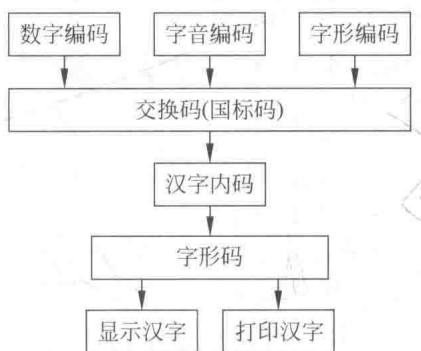

**看图方法**：
1. **先看最上面一行**：并排三个方框——"**数字编码**""**字音编码**""**字形编码**"，这就是前面讲的四类输入码（图中画了三类作代表）。它们都有一根箭头**向下**指。
2. **第二行**：三个箭头全部汇入一个**横长条**，条里写着"**交换码（国标码）**"。这就是图想表达的"**统一**"——不管你怎么输入，到了这里都变成同一种码。
3. **第三行**：从交换码再往下，得到"**汉字内码**"（图中标注的正是本书讲的"机内码"，即存储/传输用的码）。
4. **第四行**：再往下是"**字形码**"（汉字的点阵外形）。
5. **最后一行**：字形码分两路输出——"**显示汉字**"和"**打印汉字**"。因为屏幕和打印机都需要"形状"才能画出来。
6. **注意**：整张图是**从上往下的单行道**，每一层都是"上一种码转换得到的下一种码"，**每个环节用的编码都不一样**。这正是初学者最容易混的地方。
7. **这张图要你理解什么**：汉字编码不是"一个码"，而是一条**流水线**：输入码 →（统一成）→ 国标码 → 机内码 → 字形码 → 显示/打印。

【辅助理解图】

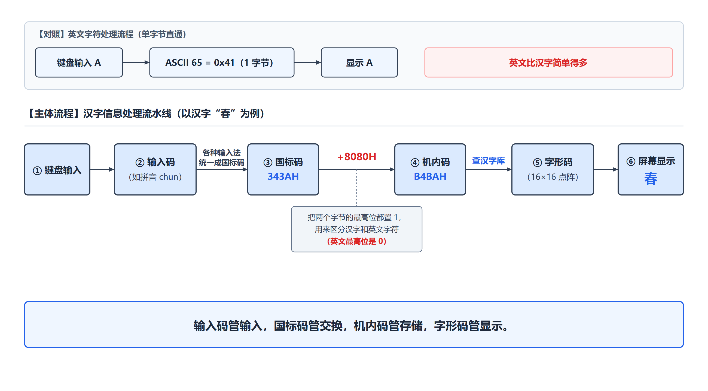

**看图方法**：
1. 图从左到右画一条**横向流水线**，共 5 个方框，用箭头串联：
   `键盘输入` → `输入码（如拼音 chun）` → `国标码 343AH` → `机内码 B4BAH` → `字形码（点阵）` → `屏幕显示"春"`。
2. 在"国标码 → 机内码"这个箭头上，用红色标注 `+8080H`，并画一个小方框说明"**每个字节最高位置 1，用来区分汉字和英文字符**"。
3. 在"机内码 → 字形码"这个箭头上，标注"**查汉字库**"。
4. 图的最上面画一条对照带，展示英文的处理链只有两步：`键盘输入 'A'` → `ASCII 65 = 0x41` → `显示 'A'`，用来对比"英文比汉字简单得多"。
5. 图底部写一行结论："**输入码管输入，国标码管交换，机内码管存储，字形码管显示。**"
6. **这张图要你记住**：同一个汉字在不同环节有不同的码；做题时先问"题目问的是哪一个环节的码"。

##### 5）汉字编码的发展

【教材内容】汉字编码的发展经历了下面几个阶段。

**① GB 2312—80**：是国家标准局 1980 年颁布的，其中只包含 **6763 个**一级和二级常用汉字。已不能满足各方面应用的需要。

**② "通用多 8 位编码字符集"国际标准（ISO/IEC 10646）**：简称 **UCS**，是国际标准化组织 1993 年公布的。它确定了 **20902 个中日韩统一汉字**。

**③ GB 13000 与 GBK**：我国标准化管理机构发布了与 ISO/IEC 10646 一致的国家标准 GB 13000。2000 年 3 月，信息产业部和国家质量技术监督局共同颁布了 **GB 18030—2000**《信息技术 信息交换用汉字编码字符集 基本集的扩充》（简称 **GBK**）这一强制性国家标准，共收录汉字 **27 000 多个**，彻底解决了偏、生汉字的输入问题。

【补充解释】一张表看清演进：

| 标准 | 年份 | 收录汉字数 | 解决的问题 |
|---|---|---|---|
| GB 2312—80 | 1980 | 6763 | 第一次让汉字能进计算机 |
| ISO/IEC 10646（UCS） | 1993 | 20902（中日韩统一） | 国际统一，含日韩汉字 |
| GB 13000 | — | 与 ISO 10646 一致 | 与国际接轨的国家标准 |
| GB 18030—2000（GBK） | 2000 | 27000+ | 偏僻字、生僻字也能打出来 |

##### 6）统一代码（Unicode）

【教材内容】**统一代码（Unicode）**是一种全新的编码方法，此编码方法有足够的能力来表示全世界多达 **6800 种语言**中任意一种语言里使用的所有符号。其基本方法是，用 **1 个 16 位的数**来表示 Unicode 中的每个符号，即允许表示 **65536 个**不同的字符或符号。这种符号集被称为**基本多语言平面**（Basic Multilingual Plane，**BMP**）。

【教材内容】计算机中用扩展 ASCII 码、Unicode UCS-2 和 UCS-4 方法表示一个符号之间的差异，如图 1-6 所示。

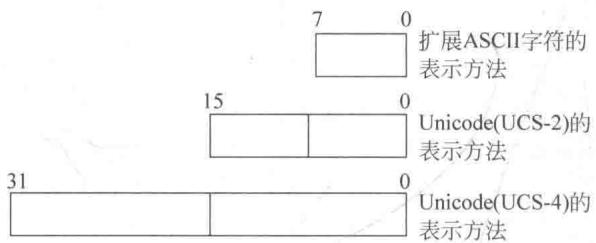

**看图方法**：
1. 图中横向排了三行，每行是一个**长方形格子**，格子上方标着位号，右边用文字说明这是哪种编码方式。
2. **第一行**：格子从 **7 号位到 0 号位**，共 **8 格**（1 字节），右边写"扩展 ASCII 字符的表示方法"。也就是说，一个符号最多占 1 字节。**限制**：总共只能表示 256 个符号，汉字根本不够放。
3. **第二行**：格子从 **15 号位到 0 号位**，共 **16 格**（2 字节），中间画了一条竖线把它分成两半，右边写"Unicode（UCS-2）的表示方法"。一个符号固定占 2 字节，能表示 65536 个符号，汉字够用了。**限制**：英文字母本来 1 字节就够，现在也要占 2 字节，**浪费空间**。
4. **第三行**：格子从 **31 号位到 0 号位**，共 **32 格**（4 字节），被竖线分成四段，右边写"Unicode（UCS-4）的表示方法"。空间巨大，但更浪费。
5. **注意格子上方的数字（7、15、31）**：它们就是"最高位"的位号。位号越大，说明这个编码占的格子越多。
6. **这张图要你理解什么**：编码方式的选择本质上是"**能表示多少符号**"和"**浪费多少空间**"之间的权衡。ASCII 省空间但符号少，UCS-4 符号多但太浪费，UCS-2 居中。

【教材内容】在实际应用中，常见的编码还有 **UTF-8**（8-bit Unicode Transformation Format），它是一种针对 Unicode 的**可变长度**字符编码，又称**万国码**。由 Ken Thompson 于 1992 年创建，现在已经标准化为 RFC 3629。UTF-8 用 1～6 字节编码 Unicode 字符。用在网页上可以在同一页面中显示简体中文、繁体中文及其他语言（如英文、日文、韩文）。详细内容请读者通过网络查阅相关资料。

【补充解释】**"可变长度"是 UTF-8 的精髓**，它一举解决了图 1-6 中"省空间"和"符号多"的矛盾：

> - 英文字母 → 用 **1 字节**（和 ASCII 完全兼容，老文件不用改）；
> - 欧洲某些字母 → 用 **2 字节**；
> - 常用汉字 → 用 **3 字节**；
> - 生僻字 → 用 **4 字节**。
>
> **短的用短码，长的用长码**，既不浪费，又能表示全世界所有文字。这就是为什么今天的网页、Linux 系统普遍用 UTF-8。

#### 3. 本节真正要记住什么

1. **编码 = 全世界的计算机约定好的"编号规则"**，目的是让信息能通用地传输。
2. **ASCII**：0～127 标准，128～255 扩展；7 位基本代码 + 1 位奇偶校验；数字从 48 开始，大写字母从 65 开始，小写字母从 97 开始。
3. **汉字有四套码**：
   - **输入码**（拼音/五笔/区位码……）：人怎么输入；
   - **国标码**：交换用，`国标码 = 区位码(十六进制) + 2020H`；
   - **机内码**：存储用，`机内码 = 国标码 + 8080H`（每个字节最高位置 1，用来区分汉字和 ASCII）；
   - **字形码**：点阵图形，存在汉字库里，用于显示输出。
4. **Unicode / UTF-8**：为了解决"全世界所有文字"的问题而出现的；UTF-8 是变长编码，英文 1 字节、汉字 3 字节。

---

## 1.3 微型计算机领域的几个相关概念

> 这一节是本章的**核心**。前面讲的数制和编码是"数据层面"，这一节开始讲"硬件层面"：
> **计算机到底由哪几块组成？每一块是干什么的？它们怎么连起来？**

---

### 1.3.1 常用单位及术语

#### 先别急着看教材：这一小节为什么必须逐条讲透？

因为这一小节里的每一个词，**后面 11 章都会反复出现**：

```
位 → 字节 → 字 → 字长 → K/M/G/T → MIPS
地址 → 总线 → 访问
机器指令 → 汇编指令 → 指令系统 → 汇编/反汇编 → 高级语言
```

任何一个没弄懂，后面就会"卡壳"。所以本讲义**一条都不省略**。

---

#### 1. 位（bit）

【教材内容】计算机所能表示的**最小的数字单位**，即二进制数的位。通常每位只有 2 种状态 0、1。

【补充解释】

> **bit = 二进制位 = 一个 0 或者一个 1。**
>
> 它是信息的最小单位。**再往下就没了**——不能说"半个 bit"。
>
> 它的英文是 **binary digit** 的缩写（**bit**），中文叫"**比特**"。
>
> **它是干什么的**：它是计算机里一切信息（数字、文字、图像、声音）的最终载体。**所有东西最后都会被拆成一大堆 0 和 1。**

#### 【先补一个前置知识：什么叫位？为什么 1 字节是 8 位？】

【补充解释】

> **"位"就是"位置"的位。** 想象一排小灯泡，每个灯泡要么亮要么灭：
>
> ```
> 灭 亮 灭 灭 亮 灭 灭 灭
>  0  1  0  0  1  0  0  0
> ```
>
> 这 8 个灯泡就是 8 个"位"，每个位有两种状态。8 个位一共有 2⁸ = 256 种组合。
>
> **为什么偏偏是 8 位一组？**
>
> 这不是物理规律，而是**工程上的历史选择**：
> - 4 位太少，只能表示 16 种组合，连英文字母大小写都放不下；
> - 16 位太多，早期硬件成本高；
> - **8 位正好能表示 256 种组合**：够放 128 个 ASCII 字符（7 位），还能多出 1 位做校验，或者用来表示 0～255 的整数；
> - 而且 8 是 2 的整数次幂，和二进制、十六进制（2 个十六进制位 = 8 位）都对得很齐。
>
> 于是 8 位就成了工业界的标准，一直用到现在。

---

#### 2. 字节（Byte）

【教材内容】**8 位（bit）二进制数为 1 字节**，是内存的基本单位，常用 **B** 表示。

【补充解释】

> **Byte = 字节 = 8 个 bit 打包在一起。**
>
> - 它是**内存的基本单位**：内存里每个"格子"装 1 个字节；
> - 它是**地址的基本单位**：给内存编号时，**一个编号对应 1 个字节**（不是对应 1 个 bit！）；
> - 它的符号是 **B**（注意大写，和小写 b 不同）。
>
> **【容易搞混】B 和 b 完全不是一回事**：
>
> | 符号 | 含义 | 例子 |
> |---|---|---|
> | **B**（大写） | Byte，字节 | 100MB 是 100 兆字节 |
> | **b**（小写） | bit，位 | 100Mbps 是每秒 100 兆**位** |
>
> 网速说的 "100Mbps" 其实是 100 兆**位**/秒 = 12.5 兆**字节**/秒。这是买宽带时最常见的误解。

---

#### 3. 字（Word）

【教材内容】**16 位二进制数称为 1 个字**，1 个字等于 2 字节。

【补充解释】

> 教材在这里定义的"字"是 **16 位 = 2 字节**。
>
> **但要注意**：不同机器上"字"的长度不一样。这个"字长"是由**这台机器的设计**决定的：
> - 8 位机：1 字 = 8 位
> - 16 位机（如 8086）：1 字 = 16 位（教材就是按这个讲的）
> - **32 位机（如 STM32）：1 字 = 32 位**
>
> 【补充解释】所以在看 ARM/STM32 的资料时，你会看到 **word（字）= 32 位 = 4 字节**，**half-word（半字）= 16 位 = 2 字节**，**byte（字节）= 8 位**。这和第 1 章教材的"字 = 16 位"不一样，**因为参照的机器不同**。做题时以题目/教材的定义为准，读 STM32 手册时按 ARM 的定义理解。
>
> 为了方便，ARM 里的三种"数据宽度"记住这张表就行：
>
> | ARM 术语 | 中文 | 位数 | 字节数 |
> |---|---|---|---|
> | Byte | 字节 | 8 | 1 |
> | Half-word | 半字 | 16 | 2 |
> | Word | 字 | 32 | 4 |

---

#### 4. 字长

【教材内容】**字长即字的长度，是一次可以并行处理的数据的位数，即数据线的条数。** 常与 CPU 内部的寄存器、运算器、总线宽度一致。常用微型计算机字长有 8 位、16 位和 32 位。

【补充解释】这段话信息量很大，逐句拆开：

**（1）"一次可以并行处理的数据的位数"**

> "并行"就是"同时"。字长 32 位，意味着 CPU **一次就能同时处理 32 个 0/1**。
> 就像搬运工一次能搬 32 块砖，而不是一块一块搬。
> **字长越长，一次能处理的数据越大，效率越高。**

**（2）"即数据线的条数"**

> 因为数据要"一次全部搬进去"，就必须有同样多的"通道"。
> 32 条数据线 → 一次能并行送 32 位 → 字长是 32 位。
> **数据线有几条，一次就能送几位。**

**（3）"常与 CPU 内部的寄存器、运算器、总线宽度一致"**

> 这三个东西的宽度通常和字长一样：
> - **寄存器**：CPU 手边的临时格子，32 位机里寄存器就是 32 位宽；
> - **运算器（ALU）**：一次能算 32 位；
> - **总线**：一次能传 32 位。
>
> 这样数据从内存到寄存器到运算器，**一路都是 32 位宽，不用"拆分/拼接"**，效率最高。

**（4）为什么"字长"这么重要？**

> 字长是衡量一台计算机性能的重要指标，也是"多少位机"这个说法的来源：
> - 8 位机：一次处理 8 位；
> - 16 位机：一次处理 16 位；
> - **32 位机：一次处理 32 位（STM32 就是 32 位机）**。

---

#### 5. 数量单位（K、M、G、T）

【教材内容】

- **K**（千，Kilo 的符号）：**1K = 1024**，如 1KB 表示 1024 字节；
- **M**（兆，Million 的符号）：**1M = 1K × 1K**；
- **G**（吉，Giga 的符号）：**1G = 1K × 1M**；
- **T**（太，Tera 的符号）：**1T = 1M × 1M**。

【补充解释】**这里的 1024 是整门课最容易出错的地方之一。**

> 生活中我们说 1 千米 = 1000 米，所以直觉上"1K"应该等于 1000。
> 但在计算机里，**1K = 1024 = 2¹⁰**。
>
> **为什么是 1024 而不是 1000？**
> 因为计算机用二进制，一切都要和 2 的幂对齐。10 位二进制正好能表示 2¹⁰ = 1024 个数，所以用 1024 做"千"最方便。
>
> 完整的换算（**必须记住**）：

| 单位 | 等于 | 以 2 的幂表示 | 以字节为单位 |
|---|---|---|---|
| 1K | 1024 | 2¹⁰ | 1 024 B |
| 1M | 1K × 1K = 1024 × 1024 | 2²⁰ | 1 048 576 B |
| 1G | 1K × 1M | 2³⁰ | 1 073 741 824 B |
| 1T | 1M × 1M | 2⁴⁰ | 1 099 511 627 776 B |

**一步一步算 1M 到底是多少：**

```
1M = 1K × 1K
   = 1024 × 1024
   = 1 048 576 字节
```

**一步一步算 1G 到底是多少：**

```
1G = 1K × 1M
   = 1024 × 1 048 576
   = 1 073 741 824 字节
```

【补充解释】**为什么 M 是 2²⁰ 而不是 2¹⁰**？因为"兆"= "千 × 千" = 2¹⁰ × 2¹⁰ = 2²⁰。同理 G = 2³⁰，T = 2⁴⁰。

> **⚠️ 现实中的一个小陷阱**：硬盘厂商卖硬盘时用 1K = 1000 来算，而操作系统用 1K = 1024 来算，所以你买 1TB 硬盘，系统里显示只有约 931GB。这不是硬盘"缺斤短两"，而是两套换算标准不同。（近年标准写法：1024 叫 KiB/MiB/GiB，1000 叫 KB/MB/GB，但日常和教材里还是混用。）

---

#### 6. MIPS

【教材内容】单字长定点指令平均执行速度 **Million Instructions Per Second** 的缩写，每秒处理的百万级的机器语言指令数。这是衡量 CPU 速度的一个指标。

【补充解释】

| 项目 | 内容 |
|---|---|
| 英文全称 | Million Instructions Per Second |
| 中文名称 | 每秒百万条指令 |
| 缩写 | MIPS |
| 大白话意思 | 这个 CPU 一秒钟能执行几百万条指令 |
| 它是干什么的 | 衡量 CPU 快慢的一个指标 |

> 例如说"速度 120MIPS"，意思就是**每秒能执行 1.2 亿条指令**。
>
> **它的局限**：不同 CPU 的指令能力不一样。A 机器的一条指令可能顶 B 机器的三条，所以单看 MIPS 数字不能直接比谁快。它只是一个粗略指标。

---

#### 7. 地址

【教材内容】**地址是微型计算机存储单元的编号**，通常 **8bit 为一个单元**，每个单元有独立的编号。**存储器地址的最大编号（容量）由地址线的条数决定。** 如：

- **16 条地址线的容量为 64KB**（0000H ～ FFFFH）；
- **20 条地址线的容量为 1MB**（00000H ～ FFFFFH）。

【补充解释】这是全章**最重要的知识点之一**，必须彻底搞懂。

#### 【先补一个前置知识：什么叫地址？】

【类比】

> 想象一个大楼里的**信箱墙**，上面密密麻麻全是信箱。
> 每个信箱都有一个编号：001、002、003……
>
> - **信箱 = 存储单元**（能存 1 个字节的数据）；
> - **编号 = 地址**（CPU 用它来找"我要的是哪一个信箱"）；
> - **信箱里的信 = 数据**（真正存的内容）。
>
> **类比的边界**：
> 1. 真实的存储单元不是信箱，而是由晶体管/电容构成的电路；
> 2. 大楼的信箱编号是给人看的，计算机的地址是给电路译码用的；
> 3. 但"**编号 → 定位 → 取出内容**"这个本质完全一致。

**正式定义**：

> **地址 = CPU 用来定位某个存储单元（或某个寄存器、某个外设）的编号。**

**为什么要地址？**

> 因为 CPU 要读写数据时，必须先告诉内存："**我要的是哪一个格子**"。
> 没有地址，内存不知道自己该把哪个格子里的数据送出去。

**一步一步推演：为什么 20 条地址线 = 1MB？**

**第一步：一条地址线能表示几种情况？**

```
一条地址线只有 2 种状态：0 或 1
→ 只能区分 2 个单元
```

**第二步：两条地址线呢？**

```
线 1、线 2 的组合有：
00、01、10、11   →  4 种 = 2²
```

**第三步：n 条地址线呢？**

```
n 条地址线 → 2ⁿ 种组合 → 能区分 2ⁿ 个不同的单元
```

**第四步：代入 16 条和 20 条。**

```
16 条：2¹⁶ = 65536 个单元
       每个单元 1 字节
       65536 字节 = 64 × 1024 字节 = 64KB
       地址范围：0000H ～ FFFFH
                 ↑ 4 位十六进制 = 16 位

20 条：2²⁰ = 1048576 个单元 = 1 048 576 字节
       1048576 ÷ 1024 = 1024KB = 1MB
       地址范围：00000H ～ FFFFFH
                 ↑ 5 位十六进制 = 20 位
```

**第五步：验证地址范围的写法。**

```
16 条地址线 → 地址用 16 位二进制表示 → 16 ÷ 4 = 4 位十六进制
  最小：0000 0000 0000 0000B = 0000H
  最大：1111 1111 1111 1111B = FFFFH  （FFF = 4095，4095 × 16 + 15 = 65535 ✓）

20 条地址线 → 20 位二进制 → 20 ÷ 4 = 5 位十六进制
  最小：00000H
  最大：FFFFFH  （FFFFF = 1 048 575 ✓，加上编号 0 一共 1 048 576 个）
```

【补充解释】**关键结论（务必背下来）**：

> **地址线的条数决定能"看到"多少个单元；每个单元 1 字节，所以地址线条数决定容量。**
>
> 通用公式：**n 条地址线 → 容量 = 2ⁿ 字节**。
>
> | 地址线条数 | 容量 | 地址范围（十六进制） | 十六进制位数 |
> |---|---|---|---|
> | 16 条 | 64KB | 0000H ～ FFFFH | 4 位 |
> | 20 条 | 1MB | 00000H ～ FFFFFH | 5 位 |
> | 32 条 | 4GB | 00000000H ～ FFFFFFFFH | 8 位 |

> **顺带解释了一个大问题**：为什么 STM32 的地址看起来都是 `0x40010800` 这种 **8 位十六进制**？
> 因为 STM32 是 32 位机，有 **32 条地址线**，能访问 2³² = 4GB 的地址空间，地址需要用 8 位十六进制来写。**这个 4GB 地址空间在第 3 章讲"存储器映像"时会详细展开。**

【辅助理解图】

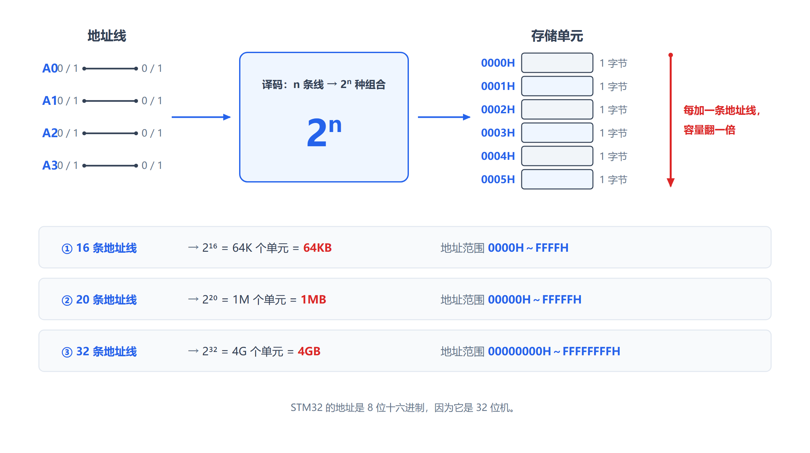

**看图方法**：
1. 图左侧画**一排横向的地址线**，标成 A0、A1、A2 …（画 4 条作代表），每条线两端标 `0 / 1`。
2. 中间画一个方框，写"**译码**：n 条线 → 2ⁿ 种组合"，下方给出算式 `2ⁿ`。
3. 右侧画一个"**存储单元阵列**"，是一排小方格，每格写一个地址（0000H、0001H、0002H…），每格标注"1 字节"。
4. 图下方给出三行具体数字：
   - `16 条 → 2¹⁶ = 64K 个单元 = 64KB，地址 0000H～FFFFH`；
   - `20 条 → 2²⁰ = 1M 个单元 = 1MB，地址 00000H～FFFFFH`；
   - `32 条 → 2³² = 4G 个单元 = 4GB，地址 00000000H～FFFFFFFFH`。
5. 用一个红色箭头标出"**每往左加一条地址线，容量翻一倍**"。
6. **这张图要你记住**：**地址线条数 → 2ⁿ → 容量**，这条公式后面每章都会用到。

---

#### 8. 总线

【教材内容】CPU 是微型计算机的核心。微型计算机利用 **3 种总线**将 CPU 与系统的其他部件如存储器、I/O 接口等联系起来。**总线是具有同类性质的一组信号线。** 3 种总线分别是**地址总线（Address Bus, AB）**、**数据总线（Data Bus, DB）**和**控制总线（Control Bus, CB）**。

#### 【先补一个前置知识：什么叫总线？】

【类比】

> 一个公司里有很多部门：老板（CPU）、档案室（存储器）、前台（I/O 接口）。
> 如果每两个部门之间都单独拉一条专线，那么：
> - 老板→档案室 一条；
> - 老板→前台 一条；
> - 档案室→前台 一条；
> - ……
>
> 部门一多，**线就会乱成一团蜘蛛网**，而且大部分线平时闲着，非常浪费。
>
> 聪明的做法是：**在走廊里铺一条公共通道，所有部门都接到这条通道上**。谁要传东西，就"占用"这条通道传一下。
>
> **这条公共通道就是总线。**
>
> **类比的边界**：
> 1. 总线不是"一条路"，而是**几十根并排的信号线**（地址线一组、数据线一组、控制线一组），只是画图时常把它们简化成一条粗线；
> 2. 公司里谁都可以随时喊话，但总线上**同一时刻只能有一个发送者**（下面马上就会讲到这条规则）；
> 3. "占用通道"在硬件里靠的是**控制信号和严格的时序**，并不是真有个管理员在指挥。

**正式定义**：

> **总线 = 一组公共的、被多个部件共享的信号线，用来在部件之间传送信息。**

【补充解释】**共享**是总线的灵魂。教材用一句话点出了共享的规则：

【教材内容】在连接系统总线的设备中，**某时刻只能有一个发送者向总线发送信号；但可以有多个设备从总线上同时获取信号。**

【补充解释】这句话用大白话讲：

> 总线像**一条单车道**：
> - **同一时刻只能有一辆车（一个发送者）在上面跑**——否则两辆车撞上，数据就乱了；
> - **但可以有好多人在路边看这辆车经过**（多个设备同时接收）——这不冲突。
>
> 所以总线上的通信必须**轮流来**，不能大家一起喊。

##### 三种总线的分工

| 总线 | 英文 | 传什么 | 方向 | 大白话 |
|---|---|---|---|---|
| **地址总线 AB** | Address Bus | 地址 | **单向**（CPU → 外部） | "我要第几号格子" |
| **数据总线 DB** | Data Bus | 数据/代码 | **双向** | "真正搬的东西" |
| **控制总线 CB** | Control Bus | 控制信号、状态信号 | 有出有入 | "红绿灯和指挥信号" |

【补充解释】这张表是本小节最需要记住的东西。后面的 1.3.2 会详细展开，这里先建立印象。

---

#### 9. 访问

【教材内容】CPU 对寄存器、存储器或 I/O 接口电路的操作通常分为两类：

- 把数据**存入**寄存器、存储器或 I/O 接口电路的操作称为**写入**或**写操作**；
- 把数据从寄存器、存储器或 I/O 接口电路**取到 CPU** 的操作称为**读出**或**读操作**。

这两种操作过程通常统称为"**访问**"。

【补充解释】

> **访问 = 读 + 写，是"CPU 去碰某个东西"的总称。**
>
> 注意教材这里说"CPU 对**寄存器**、存储器或 I/O 接口电路的操作"——也就是说，**CPU 访问的对象有三类**：
> 1. CPU 内部的**寄存器**；
> 2. 外部的**存储器**；
> 3. 外部的**I/O 接口电路**（也就是后面章节的 GPIO、定时器、串口等外设的寄存器）。
>
> **这一点非常重要**：在后面第 6 章你会看到 `GPIOA->ODR = 0x0001;`，这个"写"操作，本质上就是**CPU 访问一个 I/O 接口里的寄存器**。它和第 9 条这个定义是同一回事。

---

#### 10. 机器指令

【教材内容】**机器指令是由二进制代码组成的、可以直接由微处理器进行译码、执行的代码。**

【教材内容】一条机器指令应包含：

- 要求微处理器所要完成的**操作**；
- 参与该操作的**数据**或该数据所在的**地址**；
- 有时还要有操作结果的**存放地址**信息。

这些都是以二进制数字的形式表示的。当然，也有某些特殊指令不需要数据或地址。

【补充解释】把一条机器指令拆开看：

```
一条机器指令 = 操作码（要干什么） + 操作数（对谁干）
                │                  │
         "加法"、"取数"、"存数"    数据本身，或者数据所在地址
```

【类比】

> 一条机器指令就像一张**工作单**：
> - "操作"栏写"搬运"；
> - "对象"栏写"3 号柜子的第 5 个盒子"；
> - "放到哪"栏写"6 号柜子"。
>
> CPU 就是那个照着工作单干活的工人。

> **类比的边界**：真实机器指令是纯 0/1 编码，没有"栏位"这种可视结构；"栏位"是**人为划分出来的字段**，第 4 章讲汇编时你会看到这些字段的真实样子。

---

#### 11. 汇编指令

【教材内容】微处理器只能识别二进制数，所以指令也用二进制数表示。例如，一条 4 字节的指令如下：

```
00001111
00100100
00010010
01000101
```

【教材内容】这就是用二进制数表示的、可以直接由微处理器进行译码、执行的**机器指令**。这样一条 4 字节指令的含义是**将十六进制的数据 0x1245 送到寄存器 R1 中**。

【补充解释】我们很难直接看出这种含义，也很难适应这种用二进制数字序列的指令形式来编程，即使是经过一定专业训练的人也不喜欢和这种表示方式打交道。

【教材内容】所以人们在编程时使用的是比较容易看出其操作含义的、用英文的缩写形式表示的指令。如果上面的指令写成：

```
MOV R1, #0x1245
```

就很容易理解和阅读了。**这种形式的指令称为汇编指令，这种编程语言称为汇编语言。** 不同厂家的 CPU 配备有相应的汇编语言指令系统。用汇编语言编写的程序称为**源程序**。

【补充解释】把这段的意思翻译成大白话：

> 用 0/1 写程序，就像**用摩尔斯电码写文章**——理论上可行，实际上没法读、没法改、没法查错。
> 于是人们给每种"0/1 组合"起了一个**助记符**（英文缩写）：
>
> | 想干的事 | 机器指令（0/1） | 汇编指令（助记符） |
> |---|---|---|
> | 把数据搬到寄存器 | `00001111 00100100 00010010 01000101` | `MOV R1, #0x1245` |
>
> `MOV` 就是 **Move（搬）** 的缩写。**看到 MOV，就知道是"搬数据"。**

##### 【补充解释】逐项拆解 `MOV R1, #0x1245`

| 部分 | 含义 | 大白话 |
|---|---|---|
| `MOV` | Move，传送/搬移 | 要做的动作："搬" |
| `R1` | Register 1，1 号寄存器 | 搬到哪里去："放到 R1 这个格子里" |
| `#` | 立即数前缀 | "#"表示"后面这个是数据本身"，不是地址 |
| `0x1245` | 十六进制数 0x1245 | 要搬的东西 |

所以整句话是：

> **把数值 0x1245 搬进 R1 寄存器。**

【补充解释】**注意那个 `#`**：这是 ARM 汇编的写法。`#` 表示"**立即数**"——也就是"**这个值就写在这里，直接拿来用**"，而不是"去 0x1245 这个地址取数"。这个区别在学汇编时非常关键（第 4 章详讲）。

##### 【补充解释】为什么汇编难学但仍然要学？

| 优点 | 缺点 |
|---|---|
| 直接对应硬件，能精确控制每个寄存器、每个 bit | 不同厂家的 CPU 指令不一样，不可移植 |
| 生成的代码效率高、体积小 | 写起来繁琐，开发慢 |
| 调试硬件问题时能看清"到底动了什么" | 需要记住大量指令 |

> 本书第 4 章专门讲 ARM 汇编，就是为了让你能"看清 CPU 到底在干什么"。

---

#### 12. 指令系统

【教材内容】**指令系统是一台计算机所能识别的全部指令的集合。**

【补充解释】

> **指令系统 = 这台 CPU 的"全部词汇表"。**
>
> 就像一个人会的所有单词构成他的词汇量一样，一台 CPU 能"听懂"的所有指令，合起来就是它的指令系统。
>
> - 不同厂家的 CPU，指令系统不同（Intel 和 ARM 不一样）；
> - 同一系列的不同型号，指令系统通常**向上兼容**（新型号支持老型号的全部指令，再加新的）；
> - 指令系统也叫"**指令集**"，英文 **Instruction Set**。
>
> **后面 1.3.4 讲的 CISC / RISC，讲的就是"指令系统是大而全还是小而精"这两种设计思路。**

---

#### 13. 汇编与反汇编

【教材内容】利用汇编语言编程虽然容易了，但是机器只能识别二进制数形式的指令，不能直接识别和执行汇编语言形式的指令，所以还要把汇编语言源程序翻译成与之相对应的用二进制数表示的机器语言，才能被微处理器识别和执行，这种翻译称为**汇编**。

【教材内容】每一条汇编语句都可以汇编成对应的机器语言。虽然可以用人工汇编，但是用人工进行汇编太麻烦，且容易出错，人们就编写了专门的**汇编程序**来完成这项工作。用汇编程序来进行汇编就变得容易得多，又快又准确，还能把语法不正确的语句找出来，以方便用户的程序编写和调试。

【教材内容】反过来，将用二进制数表示的机器语言形式的程序翻译成汇编语言形式的源程序的过程称为**反汇编**。**反汇编是汇编的逆过程。**

【补充解释】用箭头图表示：

```
   汇编语言源程序                     机器语言程序
   MOV R1, #0x1245        ──汇编──→   00001111 00100100 ...
   （人能看懂）           ←─反汇编──   （机器能执行）
```

【补充解释】把四个概念理清楚：

| 概念 | 方向 | 输入 → 输出 | 由谁做 |
|---|---|---|---|
| **汇编** | 汇编 → 机器 | 汇编源程序 → 机器码 | 汇编程序（汇编器） |
| **反汇编** | 机器 → 汇编 | 机器码 → 汇编源程序 | 反汇编程序 |
| **汇编程序/汇编器** | — | 是**工具软件**的名字 | — |
| **汇编语言源程序** | — | 是**你写的东西**的名字 | — |

> **【容易搞混】** "汇编"既是**动作**（把汇编翻译成机器码），也可能是"汇编语言"的简称。看到这个词时，先看上下文：说的是"汇编语言"（一门语言），还是"做汇编这个动作"（一个翻译过程）。
>
> **反汇编的用途**：逆向分析别人的程序、调试时查看机器到底在执行什么指令。

---

#### 14. 高级语言

【教材内容】汇编指令虽然较二进制机器指令容易阅读和编写，但还是不如高级语言更接近英语自然语言。为了解决这个问题，人们发明了**高级语言**，用高级语言编程，然后再用某种特殊程序翻译成机器语言。这样，编程人员可以仿照自然语言的书写形式完成程序的编写，降低了程序开发的门槛。

【教材内容】将用高级语言编写的用户程序翻译成某个具体的微处理器的机器语言程序（这个过程称为**编译**）的软件，称为**编译器**。例如，现在市面上常见的各种 C 编译器就是能把 C 语言转换成某个具体的微处理器的机器语言的编译工具。

【教材内容】这种编译器比较适于对汇编语言不熟悉的用户使用，**其缺点是不可避免地会出现编译后的机器程序冗长、不够简练，导致程序运行时间加长、速度降低等问题**。另外，用汇编语言编程更有利于硬件电路与程序的结合设计与调试。

【教材内容】当然，如果用户并不在乎程序的长短和运行速度的快慢，并拥有对应的编译软件的条件下，完全可以采用 C 语言编写用户程序。

【补充解释】用一条链把四个层次串起来：

```
高级语言（C）            人能看懂，接近英语，与硬件无关
      │  编译（编译器）
      ↓
汇编语言（MOV R1, #0x1245）  人能看懂，但和具体 CPU 绑定
      │  汇编（汇编程序）
      ↓
机器语言（00001111 00100100 ...）  只有机器能懂
      ↓
      CPU 执行
```

【补充解释】关于"编译器生成的代码不如汇编精炼"，用大白话解释：

> 你写 `a = a + 1;`，编译器为了保证**各种情况都不出错**，可能会生成好几条指令（先取数、再算、再存回，还可能做边界检查）。
> 而一个熟练的汇编程序员知道"这里其实一条指令就够了"，可以直接写那一条。
>
> **但代价是**：汇编要人工优化，写得慢、容易错、不能跨平台。所以现代开发**默认用 C 语言**，只在极少数对性能/体积要求苛刻的地方才手写汇编。
>
> **本书的做法**：以 C 语言为主（第 5、6 章以后），但第 4 章专门讲汇编，目的是**让你能看懂底层发生了什么**。

---

#### 15. 本节速查总表

把 14 个术语压成一张表，方便复习：

| # | 术语 | 英文 | 一句话解释 | 关键数字 |
|---|---|---|---|---|
| 1 | 位 | bit | 一个 0 或 1，信息最小单位 | 2 种状态 |
| 2 | 字节 | Byte (B) | 8 个 bit，内存基本单位 | 1B = 8bit |
| 3 | 字 | Word | 教材定义 16 位（ARM 中 32 位） | 1 字 = 2 字节（教材） |
| 4 | 字长 | Word Length | 一次能并行处理的位数 | STM32 是 32 位 |
| 5 | K/M/G/T | Kilo/Mega/Giga/Tera | 数量单位，都是 1024 进制 | 1K = 1024 |
| 6 | MIPS | Million Instructions Per Second | 每秒执行几百万条指令 | 速度指标 |
| 7 | 地址 | Address | 存储单元的编号 | n 条地址线 → 2ⁿ 字节 |
| 8 | 总线 | Bus | 多个部件共享的一组信号线 | AB / DB / CB |
| 9 | 访问 | Access | 读操作 + 写操作的总称 | 读 = 取出，写 = 存入 |
| 10 | 机器指令 | Machine Instruction | 二进制形式的指令 | CPU 直接执行 |
| 11 | 汇编指令 | Assembly Instruction | 用助记符写的指令 | 如 `MOV R1,#0x1245` |
| 12 | 指令系统 | Instruction Set | 一台 CPU 全部指令的集合 | 又叫指令集 |
| 13 | 汇编/反汇编 | Assemble / Disassemble | 汇编→机器 / 机器→汇编 | 互为逆过程 |
| 14 | 高级语言 | High-level Language | 接近自然语言的编程语言 | 需编译器翻译 |

【辅助理解图】这 14 个术语里，有 5 个是"从小到大"的尺寸概念，最容易记混。下面这张图把它们按包含关系排好：

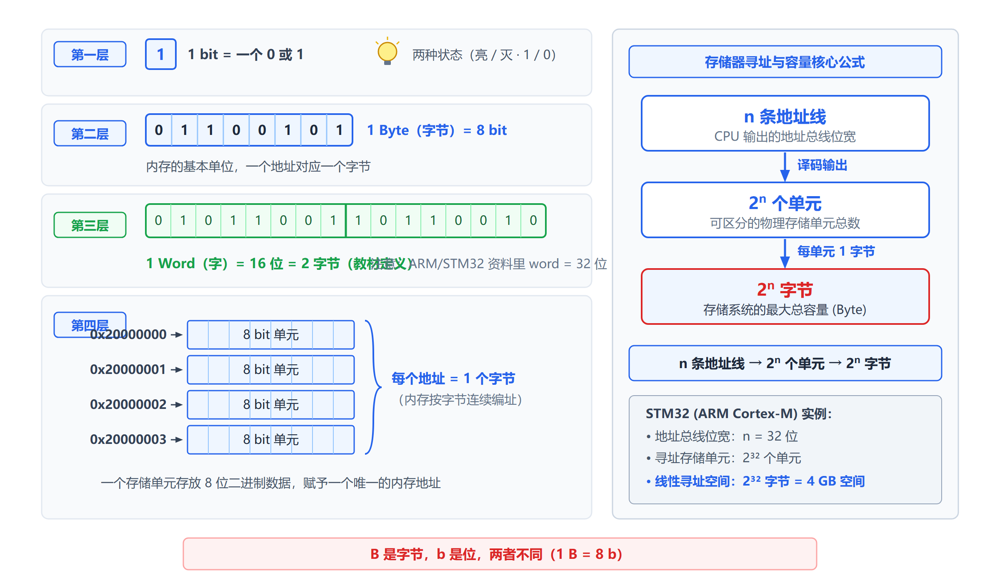

**看图方法**：
1. **从上往下看，一层比一层"大"**：
   - **最上层是一个小格**——`1 bit`，只能是一个 0 或一个 1；
   - **第二层是 8 个小格连成的横条**——`1 Byte = 8 bit`；
   - **第三层是两个横条**——`1 Word = 16 位 = 2 字节`（教材的定义）。
2. **注意第三层右边那行灰色小字**："ARM/STM32 资料里 word = 32 位"。这就是前面反复提醒过的**定义不一致**问题，看图时要记住这个"参照对象不同"。
3. **最下面一层是"存储器格子"**：4 个格子上下排，左边标着地址 `0x20000000`、`0x20000001`、`0x20000002`、`0x20000003`，每个格子里画了 8 个小格。这强调了两件事：**① 一个地址对应 1 个字节；② 字节是由 bit 组成的**。
4. **图右侧那行大字**"n 条地址线 → 2ⁿ 个单元 → 2ⁿ 字节"，就是第 7 条"地址"的公式，把它和"字节"这个单位联系了起来。
5. **这张图要你记住什么**：**bit 是最小单位，Byte 是内存的基本单位，Word 和字长是"机器一次处理多少位"的概念，地址是"格子的编号"**。这四个是四个不同维度的概念，不是同一类东西——这正是初学者最容易把它们混成一锅粥的地方。

---

### 1.3.2 微型计算机的基本构成

#### 先别急着看教材：这一小节要解决什么？

前面讲了那么多"零件"（CPU、存储器、I/O），这一小节回答：

> **这些零件是怎么拼成一台计算机的？它们之间靠什么连起来？**

答案只有一句话：

> **靠三组总线连起来。**

---

#### 先看教材原图：图 1-7 微型计算机的基本结构

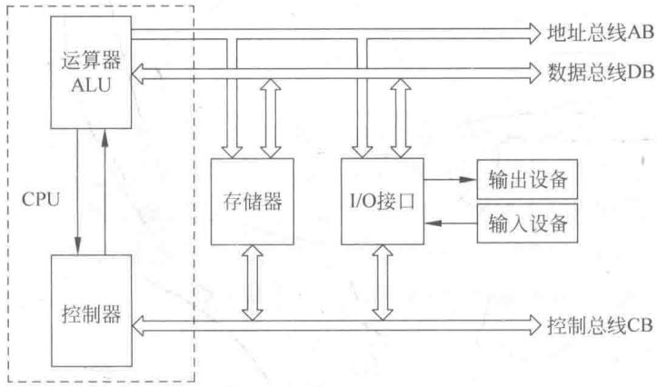

**这张图信息量不小，我们按"逐层搭积木"的方式看三遍。**

##### 第一遍：只看三个"住户"

先别管所有的箭头和线，只找三个大方框：

```
┌─────────────┐        ┌───────────┐   ┌───────────┐
│   CPU       │        │  存储器   │   │  I/O接口  │
│ (左边虚线框) │        │           │   │           │
└─────────────┘        └───────────┘   └───────────┘
    干活的                存东西的         跟外界打交道的
```

- **左边那个大虚线框，标着 CPU**：这是"大脑"，负责运算和控制。
- **中间方框"存储器"**：存放程序和数据的地方（相当于内存）。
- **右边方框"I/O接口"**：I/O = Input/Output（输入/输出）。它是 CPU 和外部设备之间的"中转站"。它右边还接着两个小框：**输出设备**（箭头从 I/O 接口指向它）和**输入设备**（箭头从它指向 I/O 接口）。

> **先记住这三样东西**：**CPU、存储器、I/O**。任何计算机，不管多复杂，拆到最粗的粒度，都只有这三块。

##### 第二遍：加上三条"横向的线"

现在看图中间横穿的三条长线，它们就是**三总线**：

| 图中位置 | 名称 | 图中箭头的特点 |
|---|---|---|
| 最上面一条 | **地址总线 AB** | 右端只有一个**指向右边**的箭头 → **单向** |
| 中间一条 | **数据总线 DB** | 左右两端都有箭头 → **双向** |
| 最下面一条 | **控制总线 CB** | 左右两端都有箭头 → 有出有入 |

**这三条线把所有"住户"都连在了一起**——CPU、存储器、I/O 接口都挂在这三条线上。这就是"**总线**"的含义：**一条公共通道，大家一起用**。

##### 第三遍：看 CPU 内部的两个小框

把左边的虚线大框（CPU）放大看，里面有两个小方框：

- **运算器 ALU**（在上方）：真正做算术和逻辑运算的地方；
- **控制器**（在下方）：负责"指挥"——决定下一步做什么、给别的部件发控制信号。

而且注意：**控制器有一条箭头指向下面那条控制总线 CB**，说明"指挥信号"是从控制器发出去的。ALU 则与数据总线、地址总线都有连接。

##### 这张图要你理解什么

> **一台计算机 = 三个部件（CPU、存储器、I/O） + 三条总线（AB、DB、CB）。**
> 后面所有章节，本质上都是在给这"三个部件 + 三条总线"加细节：
> - 第 2 章：把 CPU 内部拆开看；
> - 第 3 章：把 STM32 内部的存储器和外设展开看；
> - 第 6 章以后：把 I/O 接口里的一个个外设展开看。

【辅助理解图】

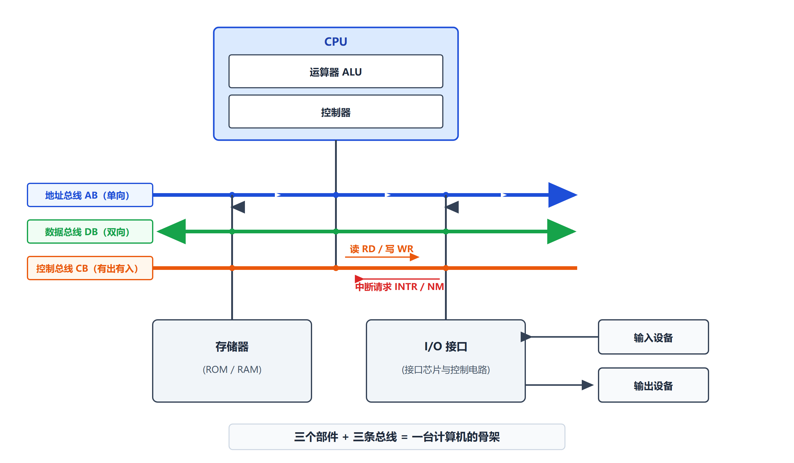

**看图方法**：
1. 图的正中间横着画**三条平行的粗线**，从上到下依次标注"**地址总线 AB（单向）**""**数据总线 DB（双向）**""**控制总线 CB（有出有入）**"。
2. 三条线的**上方**画一个"**CPU**"大方框（内部再分两小块：**运算器 ALU**、**控制器**）；三条线的**下方**并排画"**存储器**"和"**I/O 接口**"两个方框。
3. 每个方框都画一根"竖线"接到三条总线上，表示"大家都挂在这条公共通道上"。
4. **地址总线**上的箭头统一朝**右/朝外**（表示 CPU 发出地址）；**数据总线**上的箭头**两端都有**；**控制总线**上画两种箭头（控制器发出的读/写信号朝外，外设送来的中断请求朝内）。
5. 图右侧写一行总结："**三个部件 + 三条总线 = 一台计算机的骨架**"。
6. **这张图要你记住**：以后看到任何 STM32 的结构图，先在心里把它拆成"**主（CPU）+ 从（存储器/外设）+ 总线**"这三块，就不会迷路。

---

**正式知识：三总线各自干什么**

#### 地址总线（Address Bus，AB）

【教材内容】**地址总线 AB 是单向的，输出地址信号**，即输出将要访问的存储器单元或 I/O 口的地址。**地址线的多少决定了系统直接寻址存储器的范围。**

【教材内容】例如，Intel 8086 CPU 共有 **20 条地址线**，分别用 **A19～A0** 表示，其中 **A0 为最低位**。20 位地址线可以确定 **2²⁰ = 1024×1024 个**不同的地址（称为 **1MB** 内存单元）。20 位地址用十六进制数表示时，范围为 **00000H～FFFFFH**。

【补充解释】

> **为什么是"单向"的？**
> 因为"我要访问哪里"这个信息，**永远是 CPU 说、别的部件听**。存储器不会对 CPU 说"你来访问我第 5 号单元吧"。所以地址信号只能从 CPU 往外流，是单向的。
>
> **为什么地址线的条数决定容量？**
> 这个问题在 1.3.1 第 7 条已经一步一步算过了：n 条地址线 → 2ⁿ 种组合 → 2ⁿ 个单元 → 2ⁿ 字节。**20 条 → 1MB，就是这里来的。**
>
> **A19～A0 是什么意思？**
> 就是给 20 条线起的名字：A 表示 Address（地址），后面的数字是编号，**A0 是最低位（对应 2⁰ = 1），A19 是最高位（对应 2¹⁹）**。数据线也同理，用 D15～D0、D7～D0 这样的名字。

#### 数据总线（Data Bus，DB）

【教材内容】数据总线 DB 是**传输数据或代码**的一组信号线，数据线的数目一般**与处理器的字长相等**。

【教材内容】这里所说的传输的数据是广义的，就是说，数据的实际含义可能是表示数字的数据，也可能是二进制数字表示的指令，甚至有时可能是某些特定地址，因为它们都是用二进制数表示，都可以在数据总线上传输。

【教材内容】数据线的多少决定了**一次能够传送数据的位数**。16 位微处理器的 DB 是 16 条，分别表示为 **D15～D0**，**D0 为最低位**。8 位微处理器的数据总线 DB 是 8 条，分别表示为 **D7～D0**。

【教材内容】数据在 CPU 与存储器（或 I/O 接口）间的传送可以是**双向**的，因此 **DB 称为双向总线**。

【教材内容】另外，所有读写数据的操作，都是指 CPU 进行读写。CPU 读操作时，外部数据通过数据总线送往 CPU；CPU 写操作时，CPU 数据通过数据总线送往外部。

【教材内容】存储器、接口电路都和数据总线相连，它们都有各自不同的地址，CPU 通过不同的地址确定与之联系的器件。**任何时刻，数据总线上都不能同时出现两个数据**，换言之，各个器件是在**分时使用数据总线**。

【补充解释】这段里有三个关键点，逐个说：

**（1）"数据"是广义的**

> 数据总线上跑的东西，可能是：
> - **数据**：比如你要存的数字 100；
> - **指令**：CPU 要执行的命令（指令也是 0/1，也能在这条线上跑）；
> - **地址**：有时候地址也会作为"数据"被搬来搬去。
>
> 所以"数据总线"这个名字里的"数据"，是"**一切用二进制表示的信息**"的意思。

**（2）为什么是"双向"的？**

> 因为数据**既要读进来，又要写出去**：
> - **读操作**：存储器/外设 → 数据总线 → CPU；
> - **写操作**：CPU → 数据总线 → 存储器/外设。
>
> 方向有两个，所以画成双向箭头。

**（3）"分时使用"是什么意思？**

> 教材说"任何时刻，数据总线上都不能同时出现两个数据"。
> 因为总线是**共享**的：如果存储器和 I/O 接口同时往总线上送数据，两股数据混在一起，CPU 就分不清了。
> 所以必须**排队**：这一时刻让存储器送，下一时刻让 I/O 接口送。这就是"**分时使用**"。

#### 控制总线（Control Bus，CB）

【教材内容】控制总线 CB 用来传送各种**控制信号和状态信号**。

【教材内容】CPU 发给存储器或 I/O 接口的控制信号，称为**输出控制信号**，如微处理器的**读信号 RD**、**写信号 WR** 等。CPU 通过接口接收的外设发来的信号，称为**输入控制信号**，如**外部中断请求信号 INTR**、**非屏蔽中断请求输入信号 NMI** 等。

【教材内容】控制信号间是相互独立的，其表示方法采用能表明含义的缩写英文字母符号，**若符号上有一条横线，则表示该信号为低电平有效，否则表示高电平有效**。

【补充解释】三点说明：

**（1）控制总线管"什么时候做什么"**

> 地址总线说"去哪"，数据总线搬"什么"，**控制总线说"是读还是写、现在能不能开始"**。
> 三者配合，一次访问才能完成。

**（2）"低电平有效"是什么意思？**

> 信号名上面画一条横线（比如 R̄D̄），表示这个信号**变成低电平（0）时才算"生效"**。
> 没画横线的（比如 RD 写成没有横线的形式），表示**高电平（1）时生效**。
>
> 为什么要这样设计？这是数字电路里的惯例，和电路内部用什么器件实现有关。你现在只需要记住这个**读法约定**：**有横线 = 低电平有效**。

**（3）中断请求信号（INTR、NMI）是"从外面进来"的信号**

> 注意这两个信号的方向是**从外设到 CPU**：外面有事情发生了，外设通过控制总线"敲门"通知 CPU。
> **这就是"中断"的最初形态**。第 7 章会专门讲中断，现在只要知道"控制总线上既有 CPU 发出去的指挥信号，也有外面送进来的通知信号"。

#### 三总线速查表

| 总线 | 传什么 | 方向 | 谁决定"宽度" | 宽度的意义 |
|---|---|---|---|---|
| **AB 地址总线** | 地址 | **单向**（CPU → 外） | 地址线条数 | 决定能寻址多大空间（n 条 → 2ⁿ 字节） |
| **DB 数据总线** | 数据/指令/地址 | **双向** | 一般等于字长 | 决定一次能传多少位 |
| **CB 控制总线** | 控制信号、状态信号 | 有出有入 | 由设计决定 | 决定能发/收哪些控制命令 |

---

#### 【先补一个前置知识：什么叫寄存器？】

【教材内容】（教材原文）**寄存器一般包含在 CPU 内部，用于临时存取运算数据，最大的特点是存取时一般不需要经过外部总线，存取速度很快，寄存器有 8 位、16 位或者 32 位之分。**

【类比】

> 你在做数学题：
> - **草稿纸**（存储器/内存）放在书包里，拿一次要开拉链、翻半天；
> - **手边的小纸条**（寄存器）就压在胳膊底下，随手就能写、随手就能看。
>
> 寄存器就是 CPU 的"**手边小纸条**"。
>
> **类比的边界**：
> 1. 寄存器不是纸，是 CPU 内部的一组**触发器电路**（能记住 1 个 bit 的电路）；
> 2. 寄存器的数量**非常有限**（ARM Cortex-M3 一共只有十几个通用寄存器），不像纸可以随便加；
> 3. 但"**就在手边、存取极快**"这个本质是一致的。

**正式定义**：

> **寄存器（Register）= CPU 内部用于临时存放数据的小型高速存储单元。**

**为什么需要寄存器？**

> 因为**内存太慢了**。CPU 算一次只需要几纳秒，而访问一次内存要几十纳秒。如果每次运算都要跑去内存取数、存数，CPU 大部分时间都在"等"。
> 所以把当前正在用的数据放在寄存器里，**让 CPU 随手就能拿到**。

##### 寄存器长什么样？——用位图看

一个 32 位寄存器，就是**32 个能记住 0/1 的小格子并排**：

```
     R1（32 位通用寄存器）
 31                                                    0
+----+----+----+----+----+----+----+----+----+----+----+----+
| 0  | 0  | 0  | 0  | 0  | 0  | 0  | 0  | 0  | 0  | 0  | 0  |
+----+----+----+----+----+----+----+----+----+----+----+----+
  ↑                                                          ↑
 bit31（最高位）                                        bit0（最低位）
```

> **重要观念**：不要把寄存器看成一个"整体的大数字"，而要看成一排**独立的小开关**。
> 每个 bit 都可以单独为 0 或单独为 1。后面第 6 章讲 GPIO 时，你会看到"一个寄存器的 bit3 控制某个引脚"这种设计——**就是因为每个 bit 本来就是独立的小开关**。

##### 按 AGENTS 规则，把 R1 这个寄存器讲全

以教材 1.3.1 第 11 条出现的那条指令为例：`MOV R1, #0x1245`。

| 要讲清的问题 | 答案 |
|---|---|
| **① 这个寄存器属于谁？** | 属于 **CPU 内部**（ARM Cortex-M3 内核里的通用寄存器组，编号 R0～R12 等） |
| **② 它控制什么？** | 它**不控制硬件**，它只是"暂存数据"。它存放的是 CPU 当前正在算的东西 |
| **③ 为什么需要它？** | 因为寄存器在 CPU 内部，**存取不需要走外部总线，速度最快**。把常用数据放这里，CPU 不用老是去内存取数 |
| **④ 每个重要 bit / bit field 是什么？** | 对**通用寄存器**来说，**32 个 bit 整体就是数据本身，没有字段划分**（这和后面外设的"控制寄存器"完全不同——控制寄存器的每个 bit 有各自含义） |
| **⑤ 写 0 意味着什么？** | 对通用寄存器来说，"某一位是 0"只是**数据里这一位是 0**，没有额外含义 |
| **⑥ 写 1 意味着什么？** | 同理，"某一位是 1"只是数据里这一位是 1 |
| **⑦ 程序实际怎么操作？** | 汇编指令 `MOV R1, #0x1245`；在 C 语言里可能对应 `int a = 0x1245;` 编译后产生的一条指令 |
| **⑧ 操作之后硬件发生什么？** | R1 对应的 32 个触发器被置成 `0000 0000 0000 0000 0001 0010 0100 0101` 对应的电平，此后 R1 一直"记住"这个值，直到被改写 |

【补充解释】把 `0x1245` 装进 32 位 R1 的样子画出来（**注意这一步不能跳**）：

```
0x1245 是 4 位十六进制 → 4 × 4 = 16 位二进制 → 0001 0010 0100 0101

补足到 32 位（高位补 0）：

 31                              15                              0
+--------------------------------+--------------------------------+
| 0000 0000 0000 0000            | 0001 0010 0100 0101            |
+--------------------------------+--------------------------------+
                                   ↑
                            这一半装的是 0x1245，上半部分是 0
```

**验算 0x1245 的值**：

```
1 × 16³ + 2 × 16² + 4 × 16¹ + 5 × 16⁰
= 1 × 4096 + 2 × 256 + 4 × 16 + 5
= 4096 + 512 + 64 + 5
= 4677
```

所以这条指令的效果是：**把数值 4677 放进 R1**。

##### 【补充解释】通用寄存器和控制寄存器不一样（预告）

> 上面讲的 R1 是**通用寄存器**：32 个 bit 合起来表示一个数据。
>
> 后面第 6 章开始，你会遇到**外设的控制寄存器**：同样是 32 个 bit，但**每个 bit 或每几个 bit 都有专门的含义**。比如某个寄存器的 bit0 可能是"使能开关"，bit3 可能是"模式选择"。
>
> **这就是为什么本讲义反复强调"寄存器是一排小开关"**：对通用寄存器，这排开关合起来表示一个数；对控制寄存器，这排开关各自管一件事。第 2 章和第 6 章会分别展开。

---

**正式知识：CPU、存储器、I/O 接口分别是什么**

#### 1. 微处理器（CPU）

【教材内容】**微处理器**简称 **MP**（Micro Processor），也称 **μP**，μ 是微（Micro）的意思，P 是指处理器（Processor 的第一个字母），是微型机的**核心部件**。

【教材内容】微处理器通常称为**中央处理单元**（Central Processing Unit，**CPU**），是在一片硅片上集成了包括：

- **运算器**（Arithmetic Logic Unit，**ALU**）；
- **控制器**（Control Unit，**CU**）；
- **寄存器**（Register，**R**）；
- **内部总线**等电路。

【补充解释】把这四个部件的作用列成表：

| 部件 | 英文 | 大白话 | 类比 |
|---|---|---|---|
| **运算器** | ALU | 真正动手算的地方（加减乘除、与或非） | 工人的"手" |
| **控制器** | CU | 指挥调度：下一步做什么、给谁发信号 | 工人的"脑子" |
| **寄存器** | R | 手边的临时小格子，存正在用的数据 | 桌上的小纸条 |
| **内部总线** | — | CPU 内部各部件之间传数据的通道 | 工人桌边的小传送带 |

> **注意**：这里说的是"**内部总线**"，和图 1-7 里那三条系统总线**不是一回事**。
> - **内部总线**：只在 CPU 芯片**内部**用；
> - **系统总线（AB/DB/CB）**：CPU 和**外部**部件之间用。
>
> **【容易搞混】** 两个都叫"总线"，但范围完全不同。

#### 2. 存储器

【教材内容】存储器包括**程序存储器**和**数据存储器**两类，主要用来**存放程序和数据**，程序包括系统程序和用户程序。**每个存储器单元具有一个地址，单元中存储一个字节（8 个二进制位）内容。**

【补充解释】这段话要拆开看：

**（1）"程序存储器"和"数据存储器"**

> 存"指令（程序）"的叫程序存储器；存"数据"的叫数据存储器。
> **注意**：在**冯·诺依曼结构**里，这两者其实是同一块存储器（指令和数据放在一起）；在**哈佛结构**里，它们是分开的两块。1.3.4 会详细讲这个区别。

**（2）"每个单元有一个地址，单元中存一个字节"——这句极其重要**

> 这是本书后面**存储器映射、指针、地址计算**的全部基础：
>
> ```
> 存储器就像一排有编号的格子，每个格子装 1 个字节：
>
> 地址        内容（1 字节）
> 0x20000000  ┌──────────┐
>             │ 01100100 │   ← 一个字节 = 8 个 bit
> 0x20000001  ├──────────┤
>             │ 10101010 │
> 0x20000002  ├──────────┤
>             │ 00000000 │
> 0x20000003  ├──────────┤
>             │ 11110000 │
> 0x20000004  ├──────────┤
>             │ ...      │
>             └──────────┘
> ```
>
> **一个地址 = 一个字节**。这一点后面会反复用到：如果要从地址 `0x20000000` 读一个 **32 位**的数据，那要读 **4 个字节**（地址 0x20000000、0x20000001、0x20000002、0x20000003），再拼起来。

#### 3. I/O 接口

【教材内容】**I/O 接口主要用于 CPU 和外部设备之间交换数据。**

【补充解释】

| 项目 | 内容 |
|---|---|
| 英文全称 | Input/Output Interface |
| 中文名称 | 输入/输出接口 |
| 缩写 | I/O 接口 |
| 大白话意思 | CPU 和外部设备之间的"中转站/翻译官" |
| 它是干什么的 | 外部设备（按键、LED、电机、传感器）和 CPU 的"脾气"完全不同：速度不同、电压不同、信号格式不同。I/O 接口负责两边对接 |

> **为什么需要 I/O 接口，不能直接连？**
>
> 因为外设和 CPU 差别太大：
> - **速度**：CPU 每秒几千万次操作，按键可能几秒才按一次；
> - **电平**：CPU 用 3.3V 逻辑，电机可能要 24V；
> - **信号形式**：CPU 并行送 32 位，串口设备只收一位一位的。
>
> 所以中间必须有个"接口"来**缓冲、转换、握手**。第 6 章讲的 GPIO，就是 STM32 里最简单的一类 I/O 接口。

##### 术语卡片：GPIO（通用输入输出接口）

上面提到的 GPIO 会在第 6 章整章使用，这里先按"重要术语第一次出现"的规则把它交代清楚：

| 项目 | 内容 |
|---|---|
| 英文全称 | General-Purpose Input/Output |
| 中文名称 | 通用输入输出接口（也常简称"通用 I/O 口"） |
| 缩写 | **GPIO** |
| 大白话意思 | 芯片上可以"一个引脚一个引脚地自由编程"的口子：程序想让某个引脚"读一读外面的电平是高还是低"（输入），或者"往外送一个高/低电平"（输出），都靠它 |
| 它是干什么的 | 读按键、开关、传感器的状态；驱动 LED、继电器、蜂鸣器等。它是 STM32 上最基础、最常用的一类 I/O 接口 |

把名字拆开看：

- **General-Purpose（通用）**：不是为某一种设备专门定做的，这根引脚接什么、干什么，由你的程序决定；
- **Input/Output（输入/输出）**：既能"读进来"，也能"送出去"；
- **GPIO 不是某一根引脚的固定名字**，而是"这一类可以自由编程的引脚"的总称。

> **【容易搞混】** GPIO 是"一类 I/O 接口"，不是"一根引脚"。STM32 芯片上有很多根引脚，哪根引脚归哪个 GPIO 管、每根引脚怎么配置成输入或输出，是第 6 章的内容；它的内部结构图、寄存器（CRL、CRH、IDR、ODR、BSRR 等）也都在第 6 章展开。

---

#### 看教材原图：图 1-8 CPU 和存储器的连接示意图

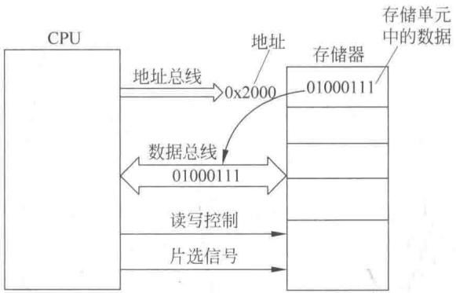

**看图方法**：
1. **先看左右两边**：左边一个大方框是 **CPU**，右边一个竖着的长条是**存储器**。图把图 1-7 简化了——**只留下 CPU 和存储器两个部件**，方便看清它们之间到底连了几根线。
2. **再看中间的几条横向通道，从上往下依次是**：
   - **地址总线**：箭头**从 CPU 指向存储器**（单向）。旁边标注了 `地址`，线上写着 `0x2000`——这就是 CPU 发出的"我要访问 0x2000 号单元"。
   - **数据总线**：箭头**两头都有**（双向）。线上写着 `01000111`，表示正在传输的 8 位数据。
   - **读写控制**：箭头从 CPU 指向存储器，告诉存储器"现在是读还是写"。
   - **片选信号**：箭头从 CPU 指向存储器，表示"**选中**这块存储器"（如果系统里有多块存储器/外设，片选信号决定"这次跟谁说话"）。
3. **注意那条从"0x2000"出发、弯过去指向存储器里某一格的曲线箭头**：它明确告诉你"**地址 0x2000 对应的就是存储器里的那一个格子**"。那一格里存着 `01000111`（十进制 71，也就是 ASCII 的 'G'）。
4. **注意存储器右侧的标注"存储单元中的数据"**：它指着那一格的内容，强调"**地址是编号，内容是数据**"——这是两个不同的东西，千万别混。
5. **这张图要你理解什么**：CPU 要读一个数据，要做三件事——**① 通过地址总线告诉对方"去哪个单元"；② 通过读写控制告诉对方"是读还是写"；③ 数据通过数据总线双向传输**。**片选信号**则决定"这次跟哪个芯片说话"。

> **【容易搞混】地址和数据的区别**
>
> | | 地址 | 数据 |
> |---|---|---|
> | 是什么 | 格子的**编号** | 格子里**装的内容** |
> | 走哪条总线 | 地址总线 | 数据总线 |
> | 方向 | 单向（CPU 发出） | 双向 |
> | 图 1-8 中的例子 | `0x2000` | `01000111` |
>
> 一句话：**地址是"门牌号"，数据是"屋里的东西"。**

---

#### 它到底是怎么工作的？——一次完整的"读"操作

把前面的知识串起来，看 CPU 读一个数据时，**先后发生了什么**：

```
① CPU 把要访问的地址放到地址总线上        →  "我要 0x2000 号单元"
        ↓
② CPU 通过控制总线发出"读"信号（RD）      →  "我要读，不是写"
        ↓
③ 存储器收到地址和读信号，把对应单元的
   数据放到数据总线上                     →  把 01000111 送出去
        ↓
④ CPU 从数据总线上取走数据，存入寄存器     →  R1 里变成了 01000111
```

**一次"写"操作则相反**：

```
① CPU 把地址放到地址总线上                →  "我要写 0x2000 号单元"
        ↓
② CPU 把要写的数据放到数据总线上           →  准备好 10101010
        ↓
③ CPU 通过控制总线发出"写"信号（WR）      →  "现在写入！"
        ↓
④ 存储器把数据总线上的值存进对应单元       →  0x2000 号单元变成 10101010
```

> **为什么要讲这个顺序？** 因为总线是共享的，必须"**先定地址，再传数据，最后发控制信号**"，各个部件才知道该在什么时候做什么。这个"时序"概念在第 8 章定时器、第 12 章 FSMC 的时序图里会以更严格的形式出现。

---

#### 本节真正要记住什么

1. **一台微型计算机 = CPU + 存储器 + I/O 接口 + 三总线**。
2. **三总线**：
   - **地址总线 AB**：单向，传地址，条数决定寻址范围（n 条 → 2ⁿ 字节）；
   - **数据总线 DB**：双向，传数据/指令，宽度一般等于字长；
   - **控制总线 CB**：传控制信号和状态信号，有出有入。
3. **CPU 内部有 ALU（算）、控制器（指挥）、寄存器（临时存）、内部总线（连）**。
4. **存储器每个单元有地址，每个单元存 1 个字节**。
5. **寄存器是 CPU 内部的"手边小纸条"，存取不走外部总线，所以最快**。
6. **总线是共享的，同一时刻只能有一个发送者，分时使用**。

---

### 1.3.3 微控制器与嵌入式系统

#### 先别急着看教材：这一小节要解决什么？

这一小节在辨析五个**名字很像、但不是一个东西**的概念：

```
微处理器（MPU）
微型计算机
微型计算机系统
微控制器（MCU）
嵌入式系统
```

> **为什么必须分清？** 因为教材后面会说"本书以 ARM 微控制器为背景"，如果你把"微处理器"和"微控制器"当成一回事，就会对"芯片上为什么还有 Flash（闪存）、还有串口"感到莫名其妙。

---

#### 1. 微处理器

【教材内容】**微处理器是计算机的核心部件，利用集成技术将运算器、控制器集成在一片芯片上。** 其功能是：

- 对指令译码并执行规定动作；
- 能与存储器及外设交换数据；
- 可响应其他部件的中断请求；
- 提供系统所需的定时和控制。

【补充解释】

> **微处理器（MPU）= 把 CPU 做在一片芯片上。**
>
> 它**只有"大脑"，没有"记忆"和"手脚"**：
> - 它自己不能存程序（需要外接存储器）；
> - 它自己不能驱动设备（需要外接 I/O 接口）。
>
> 典型的例子：你电脑里的 Intel 酷睿、奔腾 CPU 芯片，就是微处理器。

---

#### 2. 微型计算机

【教材内容】**微型计算机就是在微处理器的基础上配置存储器、I/O 接口电路、系统总线等所构成的系统。**

【补充解释】

> **微型计算机 = 微处理器 + 存储器 + I/O 接口 + 系统总线。**
>
> 也就是说，**微型计算机 = 图 1-7 那张完整的图**。
> 它有"大脑"（CPU）、有"记忆"（存储器）、有"手脚"（I/O 接口）、有"神经"（总线）。

---

#### 3. 微型计算机系统

【教材内容】以微型计算机为主体，配置**系统软件**和**外部设备**即构成**微型计算机系统**。软件部分包括系统软件（如操作系统）和应用软件（如字处理软件）。

【补充解释】

> **微型计算机系统 = 微型计算机（硬件） + 软件 + 外部设备。**
>
> 多出来的两样是：**软件**（操作系统、应用程序）和**外部设备**（键盘、鼠标、显示器、打印机）。

##### 看教材原图：图 1-9 三者关系

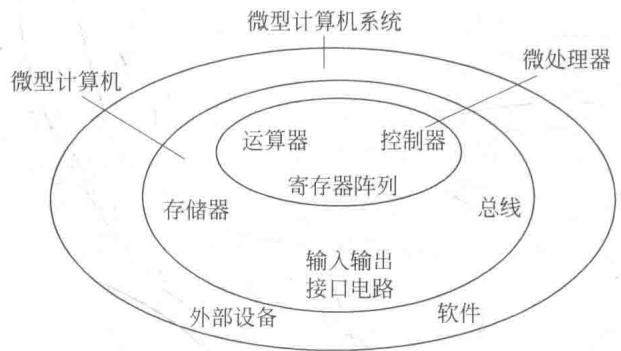

**看图方法**：
1. **这张图是"三个同心椭圆"，从里往外一层包一层**——这就是它最想表达的东西：**包含关系**。
2. **最里面那个小椭圆**，标注"**微处理器**"，里面写着"**运算器、控制器、寄存器阵列**"。也就是说：**微处理器的内部 = ALU + CU + 寄存器组**（正好对应 1.3.2 讲的 CPU 内部结构）。
3. **中间那一圈**，标注"**微型计算机**"。这一圈里除了里面的微处理器，还多了：**存储器**、**总线**、**输入输出接口电路**。**注意：这些东西都在"微处理器"外面、"微型计算机"里面**——这就是"微型计算机 = 微处理器 + 存储器 + I/O 接口 + 总线"的图形化表达。
4. **最外面那一圈**，标注"**微型计算机系统**"。这一圈里又多了：**外部设备**、**软件**。
5. **这张图要你理解什么**：这三个概念不是并列的，而是**层层包含**：
   ```
   微处理器  ⊂  微型计算机  ⊂  微型计算机系统
   ```
   每往外一层，就多加一些东西。做题时如果问"XX 属于哪个层次"，就用这张图对照。

【辅助理解图】

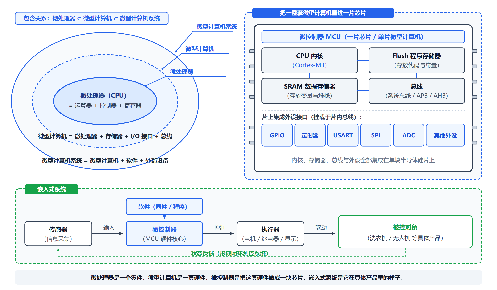

**看图方法**：
1. 图左半边画**三个同心圆**（对应图 1-9）：最内"**微处理器（CPU：ALU+控制器+寄存器）**"，中间"**微型计算机（+存储器+I/O 接口+总线）**"，最外"**微型计算机系统（+软件+外部设备）**"。
2. 图右半边单独画一个"**微控制器 MCU**"的大方框，框内并排画出：**CPU 内核**、**Flash（闪存，程序存储器）**、**SRAM**（Static Random Access Memory，**静态随机存取存储器**，数据存储器）、**总线**、**一堆外设（GPIO / 定时器 / USART / SPI / ADC …）**。
3. 用一个**虚线大框**把"微控制器"整个罩住，标注"**微控制器 = 把一整套微型计算机塞进一片芯片**"。
4. 图最下方画一个更大的虚线框，标"**嵌入式系统**"，里面包含"微控制器 + 传感器 + 执行器 + 软件 + 被控对象（如洗衣机、无人机）"。
5. 图底部写一行字："**微处理器只是一个部件；微型计算机是一套硬件；微控制器是把这套硬件做成一块芯片；嵌入式系统是它在具体产品里的样子。**"
6. **这张图要你记住**：**越往右越"完整"，越往右越"贴近实际产品"**。本书的主角 STM32，就是一个"微控制器"。

---

#### 4. 微控制器

【教材内容】**微控制器**（Micro Controller Unit，**MCU**）是指**一个集成在一块芯片上的完整计算机系统**，具有一个完整计算机所需要的部分部件：

- **中央处理单元（CPU）**；
- **存储器**；
- **内部和外部总线系统**。

【教材内容】同时，集成诸如**通信接口、定时器、实时时钟**等外围设备（简称**外设**）。而目前最强大的微控制器甚至可以将声音、图像、网络、复杂的输入/输出系统集成在一块芯片上。

【教材内容】**微控制器和微处理器的区别是：微控制器不仅包含微处理器，还包含其他更多的内容。**

【补充解释】这是本节最重要的一句话。用一个表对比：

| | 微处理器（MPU） | 微控制器（MCU） |
|---|---|---|
| 包含什么 | **只有 CPU** | **CPU + 存储器 + 总线 + 外设** |
| 能单独工作吗 | **不能**，必须外接存储器、接口 | **能**，一片芯片就是一个系统 |
| 典型用途 | 个人电脑、服务器 | 家电、玩具、工业控制、仪器仪表 |
| 典型例子 | Intel 酷睿、奔腾 | **STM32F103**、51 单片机 |
| 类比 | 只有"大脑" | "大脑 + 记忆 + 手脚"打包在一颗芯片里 |

【类比】

> - **微处理器**像一台**台式机主机**：性能强，但要接显示器、键盘、硬盘才能用。
> - **微控制器**像一台**手机**：屏幕、电池、摄像头、CPU 全都塞在一起，拿起来就能用。
>
> **类比的边界**：手机其实比微控制器复杂得多（它有操作系统、大容量存储）；真正的微控制器往往**没有操作系统**，程序直接跑在裸机上。但"**集成度高、自成一体**"这个特点是相通的。

> **术语卡片**
>
> | 项目 | 内容 |
> |---|---|
> | 英文全称 | Micro Controller Unit |
> | 中文名称 | 微控制器 |
> | 缩写 | MCU |
> | 大白话意思 | 把一整套微型计算机做进一片芯片 |
> | 它是干什么的 | 用来控制具体设备（点灯、测温度、驱动电机、和别的芯片通信） |

---

#### 5. 嵌入式系统

【教材内容】根据 **IEEE**（Institute of Electrical and Electronics Engineers，**电气与电子工程师协会**；教材译为"国际电机工程师协会"，现在更常见的译名是前者）的定义，嵌入式系统是"**控制、监视或者辅助装置、机器和设备运行的装置**"。这主要是从**应用**上加以定义的，从中可以看出嵌入式系统是**软件和硬件的综合体**，还可以涵盖机械等附属装置。

【教材内容】目前国内一个普遍被认同的定义是：**嵌入式系统是以应用为中心，以计算机技术为基础，软件硬件可裁剪，适应应用系统对功能、可靠性、成本、体积、功耗严格要求的专用计算机系统。**

【教材内容】实际上，嵌入式系统本身是一个外延极广的名词，凡是与产品结合在一起的具有嵌入式特点的控制系统都可以叫嵌入式系统。

【补充解释】两个定义，一个讲"**它干什么**"（控制/监视设备），一个讲"**它有什么特点**"（专用、可裁剪、有严格约束）。合起来理解：

> **嵌入式系统 = 藏在某个设备里面、专门为这个设备服务的计算机系统。**
>
> 它和你的笔记本电脑最大的区别是：
> - 你买笔记本，是买"一台计算机"；
> - 你买洗衣机，**不是买计算机**，但洗衣机里藏着一台（微控制器 + 程序）。
>
> **这就是"嵌入式"三个字的意思：计算机被"嵌入"到别的产品里去了。**

【教材内容】一般而言，嵌入式系统的构架可以分成 **4 个部分**：**处理器、存储器、输入/输出接口（I/O）和软件**（由于多数嵌入式设备的应用软件和操作系统都是紧密结合的，在此不加区分，这也是嵌入式系统和 Windows 系统的最大区别）。

【补充解释】

> 请注意这个 4 部分结构，它和前面"微型计算机的组成"几乎一样（CPU、存储器、I/O），只多了一个"**软件**"。
> 这也说明：**嵌入式系统的硬件部分，本质上就是一台微型计算机。**

【教材内容】嵌入式系统的硬件部分，包括处理器/微处理器、存储器及外设器件和 I/O 口、图形控制器等。嵌入式处理器一般有如下几类：

| 类型 | 英文缩写 | 说明 |
|---|---|---|
| 嵌入式微处理器 | **MPU** | 只有处理器核心，需要外接存储器和外设 |
| 嵌入式微控制器 | **MCU** | 处理器 + 存储器 + 外设集成在一片芯片上（**本书的主角**） |
| 嵌入式 DSP 处理器 | **DSP** | 全称 Digital Signal Processor（**数字信号处理器**），专门擅长数字信号处理（如音频、图像算法） |
| 嵌入式片上系统 | **SoC** | 全称 System on Chip（**片上系统**），把整个系统（甚至包括 CPU、GPU、内存控制器、各种接口）集成到一片芯片上 |

【教材内容】嵌入式系统有别于一般的计算机处理系统，它**不具备像硬盘那样大容量的存储介质**，而大多使用 **EEPROM**（Electrically Erasable Programmable Read-Only Memory，**电可擦除可编程只读存储器**）**或闪存（flash memory）**作为存储介质。

【补充解释】为什么嵌入式系统不用硬盘？

> 因为硬盘有**机械转动部件**，怕震动、体积大、耗电多。
> 而 **Flash（闪存）**是纯电子器件：没有机械部件、体积小、功耗低、断电还能保存数据。
>
> 你的手机、U 盘、STM32 开发板上的程序，都是存在 Flash 里的。

【补充解释】**EEPROM 又是什么？** 把名字拆开看就是它的脾气：

> **E**lectrically（用电）+ **E**rasable（可擦除）+ **P**rogrammable（可编程）+ **R**OM（只读存储器）
> = 一种**用电就能反复擦写、断电又不丢失内容**的存储器。
>
> 你可以把它理解成 **Flash 的"近亲"**：两者都是用电擦写的非易失存储器，原理相近，区别主要在擦写的"粒度"和用途（EEPROM 常按字节擦写、容量小；Flash 常按块擦写、容量大）。
>
> 对本书来说只要记住一句话：**它们都是"断电不丢数据"的存储器，嵌入式系统常用它们代替硬盘。**

【教材内容】软件部分包括**操作系统软件**（要求**实时**和**多任务**操作）和**应用程序**。应用程序控制着系统的运作和行为；而操作系统控制着应用程序与硬件的交互。

【教材内容】从上述描述可以看出，**微控制器是嵌入式系统的独立发展之路**。

【补充解释】这句话的意思是：嵌入式系统的发展有不同路线，而**"把整套系统做进一片芯片"（微控制器）**是其中一条独立且非常重要的路线。**本书讲的 ARM 微控制器，就是这条路线上的产物。**

---

#### 6. 五个概念一张表理清

| 概念 | 包含什么 | 类比 | 本书中的例子 |
|---|---|---|---|
| **微处理器 MPU** | 只有 CPU（ALU + 控制器 + 寄存器） | 只有大脑 | Cortex-M3 内核 |
| **微型计算机** | 微处理器 + 存储器 + I/O 接口 + 总线 | 大脑 + 记忆 + 手脚 + 神经 | 一块最小系统板 |
| **微型计算机系统** | 微型计算机 + 软件 + 外部设备 | 一台能用的电脑 | 一台台式 PC |
| **微控制器 MCU** | 把上面这些集成在**一片芯片**上 | 一台"单片电脑" | **STM32F103** |
| **嵌入式系统** | 微控制器 + 传感器 + 执行器 + 软件 + 被控对象 | 一台能洗衣的洗衣机 | 洗衣机、无人机、智能手表 |

> **一句话总结**：
> **微处理器是一个零件，微型计算机是一套硬件，微型计算机系统是"能用的电脑"，微控制器是把这套硬件做成一块芯片，嵌入式系统是它在具体产品里的样子。**

---

#### 7. 本节真正要记住什么

1. **微处理器**：把 CPU 集成在一片芯片上，是核心部件，但不能单独工作。
2. **微型计算机** = 微处理器 + 存储器 + I/O 接口 + 系统总线。
3. **微型计算机系统** = 微型计算机 + 软件 + 外部设备。
4. **微控制器（MCU）** = 微处理器 + 存储器 + 总线 + 外设，**全部集成在一片芯片上**。
5. **微控制器与微处理器的区别**：微控制器不仅包含微处理器，还包含更多内容。
6. **嵌入式系统**：藏在设备里、专用、可裁剪的计算机系统；硬件部分 = 处理器 + 存储器 + I/O，外加软件。
7. 嵌入式系统**不用硬盘，多用 Flash / EEPROM**。

---

### 1.3.4 常见技术

#### 先别急着看教材：这一小节要解决什么？

前面几节讲的是"计算机由什么组成"。这一小节讲的是"**这些组成方式有哪几种不同的设计思路**"：

| 问题 | 对应技术 |
|---|---|
| 程序和数据放在一起，还是分开放？ | **冯·诺依曼结构 vs 哈佛结构** |
| CPU 太快、内存太慢怎么办？ | **Cache（高速缓冲存储器）** |
| 一条一条串着执行太慢怎么办？ | **流水线** |
| 指令应该设计得多而全，还是少而精？ | **CISC vs RISC** |

这四件事都是后面章节的基础。

---

#### 1. 冯·诺依曼结构和哈佛结构

##### 1）冯·诺依曼结构

###### "存储程序"思想

【教材内容】冯·诺依曼提出了"**存储程序**"的思想，大大提高了计算机的速度。"存储程序"思想可以简化概括为 3 点：

① 计算机包括**运算器、控制器、存储器、输入/输出设备**。
② 计算机内部应采用**二进制**来表示指令和数据。
③ 将编写好的**程序和数据保存到存储器**，计算机**自动地逐条取出指令和数据进行分析、处理和执行**。

【补充解释】第 ③ 条是革命性的，用大白话讲清楚它"革命"在哪里：

> **在"存储程序"出现之前**：计算机要换一个任务，得**重新接线、重新拨开关**，把电路结构改成"专门做这件事"的样子。换任务就像重新装修房子。
>
> **有了"存储程序"之后**：电路结构**不用改**，程序变成**存在存储器里的数据**。换任务只要**换一份程序**，就像换一张光盘。
>
> **这一下就把计算机从"专用机器"变成了"通用机器"。** 这就是为什么它被称为计算机史上最重要的思想。

【补充解释】第 ① 条其实就是图 1-7 的内容——**运算器、控制器、存储器、输入/输出设备**，正好对应"CPU（运算器 + 控制器）、存储器、I/O"。

###### 冯·诺依曼结构的特点

【教材内容】在冯·诺依曼结构中，计算机系统由一个**中央处理单元（CPU）**和一个**存储器**组成，**数据和指令都存储在存储器中，程序指令和数据不加区分，均采用数据总线进行传输**，因此，**数据访问和指令存取不能同时在总线上传输**。CPU 可以根据所给的地址对存储器进行读或写。**程序指令和数据的宽度相同。**

【教材内容】Intel 8086、ARM7、MIPS 处理器等是冯·诺依曼结构的典型代表。

【补充解释】这段话的核心只有一个词：**"共享"**。

> 在冯·诺依曼结构里，**指令和数据住在同一个存储器里，走同一条数据总线**。
>
> 这就带来一个天生的限制：
>
> ```
> 同一时刻，总线只能干一件事：
>   要么去"取指令"（因为下一条指令还没拿到）
>   要么去"读数据"（因为要算的东西还没拿到）
>
> 两件事不能同时做 → 这就是所谓的"冯·诺依曼瓶颈"
> ```

【辅助理解图】——这个瓶颈用时间轴看最清楚：

```
冯·诺依曼结构：指令和数据挤在一条路上

时刻：   T1        T2        T3        T4        T5
        ┌──────┐  ┌──────┐  ┌──────┐  ┌──────┐  ┌──────┐
总线：  │取指令│  │读数据│  │取指令│  │读数据│  │取指令│
        └──────┘  └──────┘  └──────┘  └──────┘  └──────┘
           ↑                    ↑
        一次只能干一件，必须排队
```

##### 看教材原图：图 1-10 冯·诺依曼结构的构成示意图

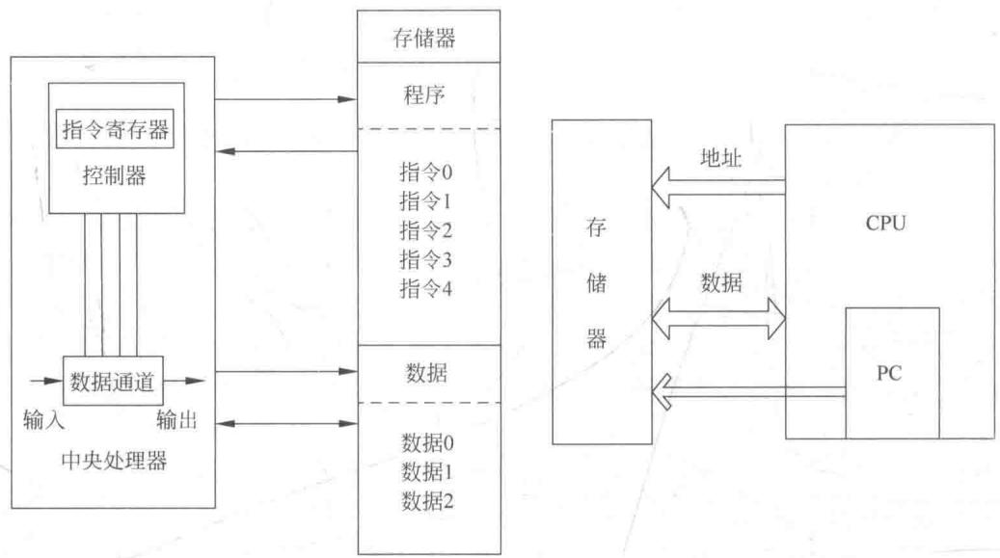

**看图方法**：
1. **这张图左右各有一半，是同一件事的两种画法**。先看**左半边**。
2. **左半边**：最左边一个方框标着"**中央处理器**"，里面有两个小框——上面是"**控制器**"（框内还嵌着一个"**指令寄存器**"），下面是"**数据通道**"（左边标"输入"、右边标"输出"）。
3. **左半边的中间**：从中央处理器引出**两条箭头**指向右边的一个大竖框"**存储器**"，同时有箭头**反向指回**控制器。注意这个"**双向**"——说明存储器里的东西能被读进 CPU。
4. **右半边的存储器框内部，被一条虚线分成上下两部分**：
   - 上面写"**程序**"，下面列着"**指令0、指令1、指令2、指令3、指令4**"；
   - 下面写"**数据**"，下面列着"**数据0、数据1、数据2**"。
5. **请特别注意那条把"程序"和"数据"分开的虚线是"虚线"**——它在暗示：**这两部分虽然画在一起，但它们住在同一块存储器里**（这是冯·诺依曼结构的关键：指令和数据不区分，都放在存储器中）。
6. **再看右半边那张小图**：左边是"**存储器**"，右边是"**CPU**"（CPU 里画了一个"**PC**"小框）。两者之间画了**三组箭头**：
   - 上面一组标"**地址**"，箭头**从 CPU 指向存储器**（单向）；
   - 中间一组标"**数据**"，箭头**两头都有**（双向）；
   - 下面一组从 **PC** 引出一条线，也指向存储器方向。
7. **"PC"是什么？** PC = **Program Counter（程序计数器）**，它专门存放"**下一条要执行的指令的地址**"。**注意它只连到存储器上**——因为指令就存在那里。这是第 2 章的重要伏笔。
8. **这张图要你理解什么**：冯·诺依曼结构的本质是"**一块存储器，装两样东西（指令和数据），共用一条数据通路**"。

##### 2）哈佛体系结构

【教材内容】在哈佛体系结构中，**数据和程序使用各自独立的存储器**。**程序计数器 PC 只指向程序存储器而不指向数据存储器**，这样做的后果是很难在哈佛体系结构的计算机上编写出一个**自修改的程序**（有时称为**在应用可编程**，In Application Programming，**IAP**）。

【教材内容】哈佛体系结构具有以下优点：

① **独立的程序存储器和数据存储器为数字信号处理提供了较高的性能**。
② **指令和数据可以有不同的数据宽度，具有较高的效率**。

如恩智浦公司的 MC68 系列、Zilog 公司的 Z8 系列、**ARM9、ARM10 系列**等。

##### 看教材原图：图 1-11 哈佛结构的构成示意图

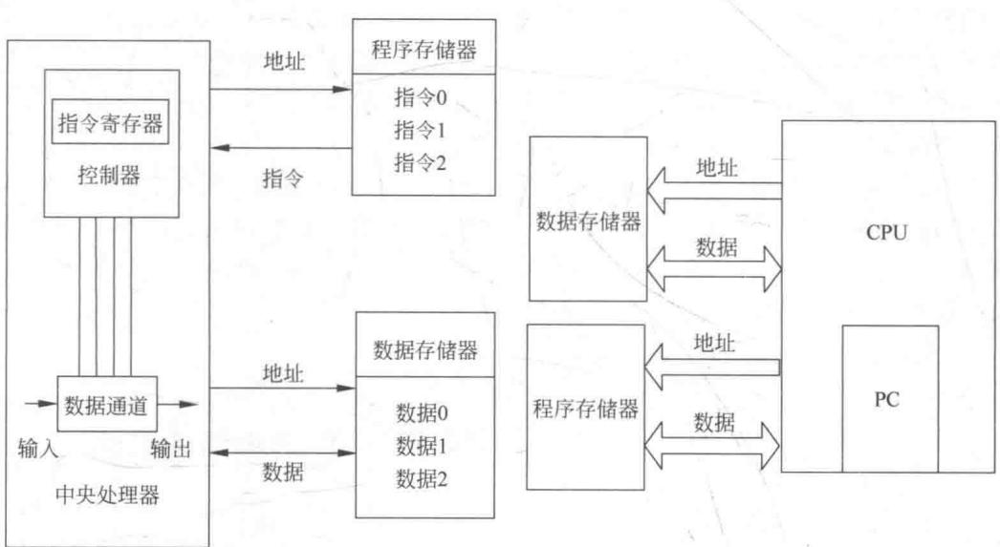

**看图方法**：
1. **这张图的布局和图 1-10 很像，但有一处关键不同——请对照着看**。
2. **左半边**：还是"中央处理器"（含控制器、指令寄存器、数据通道）。但从中央处理器引出的箭头，现在指向**两个不同的存储器**：
   - 上面一个方框标"**程序存储器**"，里面是"**指令0、指令1、指令2**"；从中央处理器到它有一条标着"**地址**"的箭头（去），还有一条标着"**指令**"的箭头（回）。
   - 下面一个方框标"**数据存储器**"，里面是"**数据0、数据1、数据2**"；同样有"**地址**"（去）和"**数据**"（回）两条箭头。
3. **关键区别在这里**：图 1-10 里只有**一个**存储器框（里面用虚线分成程序和数据）；图 1-11 里是**两个完全独立的框**。**这就是哈佛结构的全部秘密：两条路，各走各的。**
4. **右半边的小图**：左边是"**数据存储器**"和"**程序存储器**"**上下两块**，右边是"**CPU**"（里面有一个"**PC**"框）。可以看到：
   - 数据存储器 ↔ CPU 之间是"**地址**"（单向）和"**数据**"（双向）；
   - 程序存储器 ↔ CPU 之间也是"**地址**"（单向）和"**数据**"（双向）；
   - **而 PC 只连到程序存储器那一路**，完全没有连到数据存储器。
5. **"PC 只指向程序存储器"意味着什么？** 意味着 CPU 只会从"程序存储器"里取指令。**程序本身不可能被当成数据改写**——因为改写数据用的那条路（数据存储器）根本通不到程序那边去。这就是教材说的"**很难编写自修改程序**"。
6. **这张图要你理解什么**：哈佛结构 = "**指令走一条路，数据走另一条路**"。两条路互不干扰，所以可以**同时进行**。

##### 两种结构的对比

```
冯·诺依曼结构                    哈佛结构
─────────────                   ─────────────
    ┌──────┐                        ┌──────┐
    │ CPU  │                        │ CPU  │
    └──┬───┘                        └─┬──┬─┘
       │                              │  │
   ┌───┴────┐                    ┌────┘  └────┐
   │ 存储器 │                    │           │
   │ ┌────┐ │                ┌───┴───┐  ┌────┴────┐
   │ │程序│ │                │程序   │  │数据     │
   │ ├────┤ │                │存储器 │  │存储器   │
   │ │数据│ │                └───────┘  └─────────┘
   │ └────┘ │
   └────────┘
  一条路，要排队              两条路，可同时走
```

| 对比项 | 冯·诺依曼结构 | 哈佛结构 |
|---|---|---|
| 程序和数据存在哪 | **同一个存储器** | **各自独立的两个存储器** |
| 指令和数据能不能同时取 | **不能**（共用一条总线） | **可以**（各有各的通路） |
| 指令和数据的宽度 | **相同** | **可以不同** |
| PC 指向哪 | 指向那唯一的存储器 | **只指向程序存储器** |
| 能不能写自修改程序 | 相对容易 | **很难**（IAP 受限） |
| 优点 | 结构简单、灵活（程序和数据可以互相转换） | 速度快、效率高（尤其适合数字信号处理） |
| 代表 | Intel 8086、ARM7、MIPS | MC68 系列、Z8 系列、ARM9、ARM10 系列 |

【辅助理解图】

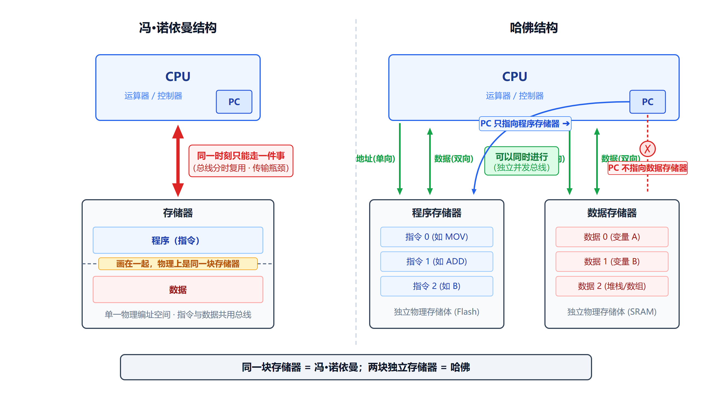

**看图方法**：
1. 图左右分栏，左栏标题"**冯·诺依曼结构**"，右栏标题"**哈佛结构**"。
2. **左栏**：中间画一个**大存储器方框**，框内用一条虚线分成"程序"和"数据"两半（虚线表示"分开只是逻辑上的，物理上是一块"）；上方画 CPU；CPU 和存储器之间只画**一条粗总线**，用红色标注"**同一时刻只能走一件事**"。
3. **右栏**：画**两个分开的存储器方框**，一个写"程序存储器（存指令）"，一个写"数据存储器（存数据）"；上方画 CPU；CPU 到两个存储器各画**一条独立总线**，用绿色标注"**可以同时进行**"。
4. 两栏的 CPU 里都画一个小框"**PC**"：
   - 左栏的 PC 用一条箭头指向那唯一的存储器；
   - 右栏的 PC **只**指向程序存储器，并用一个红色的"✗"标出"PC 不指向数据存储器"。
5. 图底部写一行结论："**同一块存储器 = 冯·诺依曼；两块独立存储器 = 哈佛。**"
6. **这张图要你记住**：判断一个结构属于哪一类，只要问一句——"**指令和数据是不是住在两个不同的存储器里？**"

> **【补充解释（预告）】** 本书的主角 Cortex-M3 属于哪一类？第 2 章会讲到它的总线结构，到那时你就会明白它的设计。这里先留个问题，学完第 2 章再回来看图 1-10 和图 1-11，会更有感觉。

---

#### 2. 高速缓冲存储器 Cache

【教材内容】为了解决**微处理器运行速度快、存储器存取速度慢的矛盾**，在两者之间加一级**高速缓冲器 Cache**。Cache 采用与制作 CPU 相同的半导体工艺，速度与 CPU 匹配，其容量约占主存的 **1% 左右**。

【教材内容】Cache 的作用是：当 CPU 要从主存储器（在个人计算机中称为内存）中读取一个数据时，先在 Cache 中查找是否有该数据：

- **若有**，则立即从 Cache 中读取到 CPU；
- **否则**，用一个主存储器访问时间从主存储器中读取这个数据送 CPU，**与此同时，将包含这个数据字的整个数据块送到 Cache 中**。

【教材内容】由于存储器访问具有**局部性**（**程序执行局部性原理**），在这以后的若干次存储器访问中要读取的数据位于刚才取到 Cache 中的数据块中的可能性很大。只要**替换算法**与**写入策略**得当，Cache 的**命中率可达 99% 以上**，它有效地减少了 CPU 访问低速内存的次数，从而提高读取数据的速度和整机的性能。

【补充解释】这一大段其实就是三句话：

**（1）问题是什么？**

> CPU 很快（一次运算几纳秒），内存很慢（一次访问几十纳秒）。
> CPU 干完一件事，要等很久才能拿到下一个数据，**大量时间浪费在"等"上**。

**（2）怎么办？**

> 在 CPU 和内存之间加一层**又小又快**的仓库（Cache）。
> 它的速度跟 CPU 差不多，但**容量很小**（只有主存的 1% 左右）。
> 把"最近常用的数据"提前搬进来，CPU 大多数时候就不用去慢内存了。

**（3）为什么这样有效？——"局部性原理"**

> 因为程序的执行有规律：
> - **时间局部性**：刚刚用过的数据，很可能马上还要用（比如循环里的计数器）；
> - **空间局部性**：刚刚用过的数据，它旁边地址的数据很可能也要用（比如数组是连续存放的）。
>
> 所以"**把一整块数据都搬进 Cache**"这个策略非常划算：搬 1 个字顺便把邻居也搬来，下次用邻居时就直接命中了。
>
> **命中率 99%** 的意思是：100 次访问里有 99 次能在 Cache 里找到，只有 1 次需要去慢内存。

【辅助理解图】

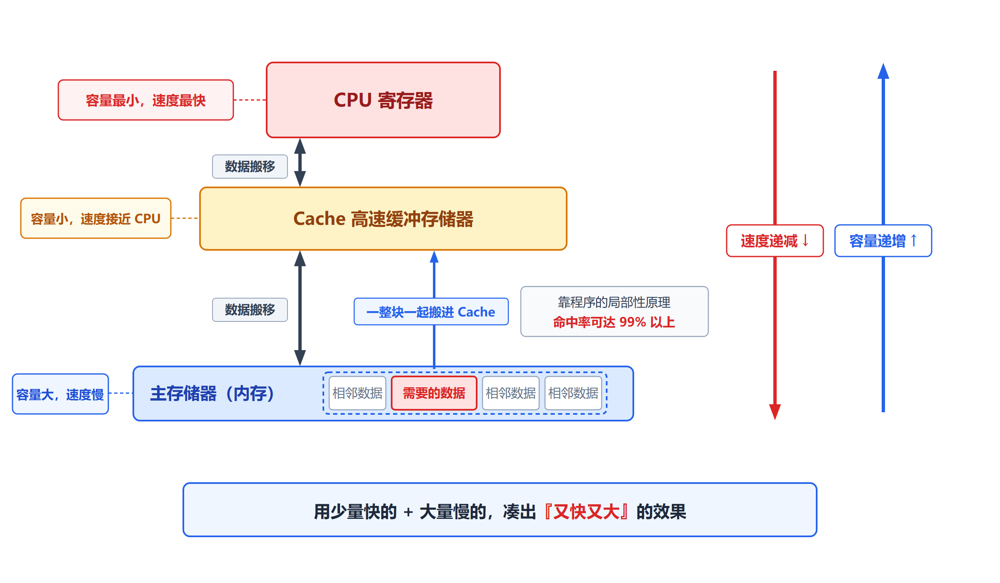

**看图方法**：
1. 图从上到下画**三个横向方框**，表示三层存储层次：
   - 最上面（最小、最快）："**CPU 寄存器**"——容量最小（几百字节），速度最快；
   - 中间："**Cache 高速缓冲存储器**"——容量小（几 KB～几 MB），速度接近 CPU；
   - 最下面（最大、最慢）："**主存储器（内存）**"——容量大（几 GB），速度慢。
2. 三个方框的**宽度从左到右逐渐变宽**（表示容量变大），**高度逐渐变矮**（表示速度变慢），并在右侧标注箭头"**容量递增 →**"和"**速度递减 ↓**"。
3. 在 CPU 和 Cache 之间、Cache 和主存之间各画一条**双向箭头**，标注"数据搬移"。
4. 在 Cache 和主存之间的箭头旁边画一个小场景：主存里一个方格标"命中失败"，旁边用虚线框圈出"**一整块数据**"一起搬进 Cache，标注"**按块搬运**"。
5. 图底部写一行字："**Cache 的作用：让 CPU 大多数时候不用去等慢内存。**"
6. **这张图要你记住**：**速度越快的东西越贵、越小**，所以存储系统一定是"**金字塔式分层**"的：用少量快的 + 大量慢的，凑出"又快又大"的效果。

---

#### 3. 流水线技术

【教材内容】**流水线**（pipeline）技术是指在程序执行时**多条指令重叠进行操作**的一种**准并行处理**实现技术。流水线的工作方式就像工业生产中的**装配流水线**。在工业制造中采用流水线可以提高单位时间的生产量；同样在 CPU 中采用流水线设计也有助于提高 CPU 的效率。

【教材内容】CPU 的工作可以大致分为**取指、译码、执行和存结果** 4 个步骤。流水线技术可以使用**时空图**来说明。时空图从时间和空间两个方面描述了流水线的工作过程。4 段指令流水线的时空图如图 1-12 所示。**在时空图中，横坐标代表时间节拍，纵坐标代表流水线的各个段。**

【补充解释】先用大白话讲清楚流水线在干什么。

【类比】

> **洗衣服的例子**：
> - **不流水**：一个人先洗第 1 件，洗完晾上；再洗第 2 件，洗完晾上……**每件衣服都要等前一件彻底做完**。
> - **流水线**：把过程分成 4 道工序（洗 → 漂 → 拧 → 晾），各安排一个工位。
>   第 1 件在第 2 道工序时，第 2 件已经在第 1 道工序了。
>   **同一时刻，4 件衣服分别在 4 道工序上同时进行。**
>
> **结果**：第一件衣服的完成时间没变（甚至更长），但**平均每件衣服的产出时间大幅缩短**。
>
> **类比的边界**：
> 1. 真实 CPU 的"工序"之间存在**依赖关系**（比如译码需要等取指的结果），可能需要"暂停"（stall）；
> 2. 遇到**分支指令**时，之前预取的指令可能全都作废，需要"清洗流水线"（第 2 章会讲）；
> 3. 但"**把一件事拆成几段、重叠进行**"这个本质完全一致。

##### 看教材原图：图 1-12 4 段指令流水线的时空图

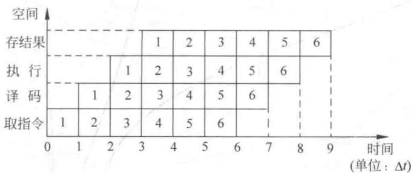

**看图方法**：
1. **先看两根轴**：
   - **横轴是"时间"**，刻度 0、1、2、3、4、5、6、7、8、9，右下角标注"单位：Δ"（Δ 表示一个时钟节拍）；
   - **纵轴是"空间"**，从上到下依次是四个阶段：**存结果、执行、译码、取指令**。
2. **横轴 + 纵轴构成的每个小方格，表示"某个时刻、某个阶段"**。格子里写的数字 **1、2、3、4、5、6** 表示"**第几条指令**"。
3. **先盯住最下面一行"取指令"**：
   - 第 1 个时间节拍（0～1）里，格子写 `1` → 第 1 条指令在被取出来；
   - 第 2 个节拍（1～2）里，格子写 `2` → **第 2 条指令开始被取了**，而此时第 1 条指令在上一行"译码"。
4. **再顺着数字 1 走一遍（这叫"跟踪一条指令"）**：
   - `1` 在"取指令"行、第 0～1 节拍；
   - `1` 在"译码"行、第 1～2 节拍；
   - `1` 在"执行"行、第 2～3 节拍；
   - `1` 在"存结果"行、第 3～4 节拍。
   **第 1 条指令用了 4 个节拍完成。**
5. **再看数字 6**：它在"取指令"行的第 5～6 节拍，在"存结果"行的第 8～9 节拍。**第 6 条指令也是 4 个节拍完成**。
6. **关键对比**：第 1 条指令从时刻 0 到时刻 4 完成；第 6 条指令从时刻 5 到时刻 9 完成。**6 条指令总共只用了 9 个节拍**。
   - 如果不流水：每条指令 4 个节拍，6 条要 **4 × 6 = 24 个节拍**；
   - 流水之后：只要 **4 + (6 − 1) = 9 个节拍**。
7. **"斜着看"是这张图的精髓**：每个数字都在图上形成一条**从左上到右下的斜线**，说明"同一条指令依次经过 4 个阶段"；而**同一列（同一时刻）里有 4 个不同的数字**，说明"同一时刻有 4 条指令在同时进行"。
8. **这张图要你理解什么**：
   - **横着看**：一条指令的"人生轨迹"（依次经过 4 段）；
   - **竖着看**：某一时刻"工厂里同时在做的 4 件活"；
   - **结论**：流水线**没有让单条指令变快**（还是 4 个节拍），但让**整体吞吐量大幅提高**。

【补充解释】把上面那个对比算清楚：

```
不流水线：
  指令1: [取][译][执][存]                      4 拍
  指令2:             [取][译][执][存]           4 拍
  指令3:                         [取][译][执][存] 4 拍
  共 4 × 3 = 12 拍

流水线：
  指令1: [取][译][执][存]
  指令2:     [取][译][执][存]
  指令3:         [取][译][执][存]
  共 4 + (3 − 1) = 6 拍
```

**公式**：n 条指令、m 段流水线，总时间 = **m + (n − 1)** 个节拍（理想情况）。当 n 很大时，平均每条指令只花约 **1 个节拍**。

【教材内容】采用流水线设计之后，指令就可以**连续不断地进行处理**。在同一个较长的时间段内，显然拥有流水线设计的 CPU 能够处理更多的指令。

【辅助理解图】

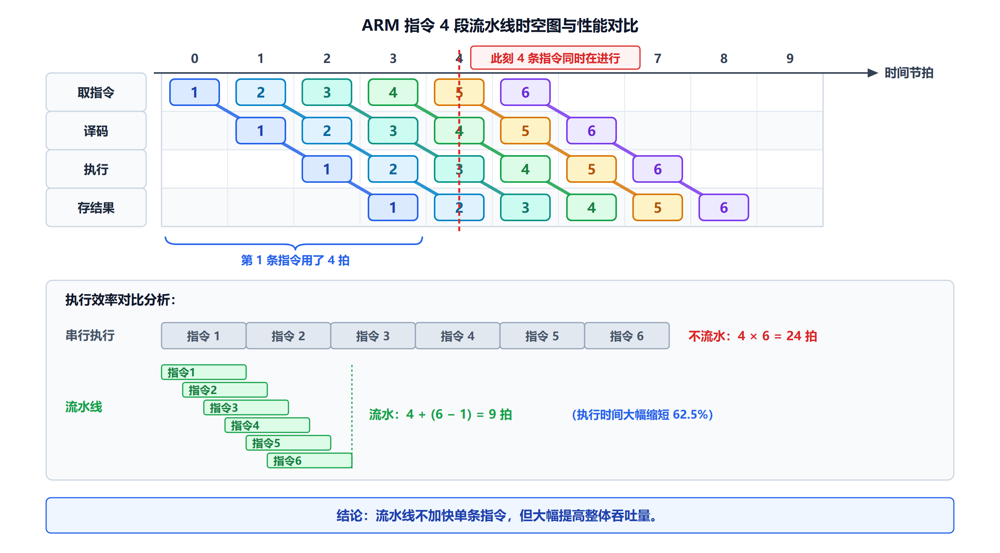

**看图方法**：
1. 图是一个**网格**：横轴标"时间节拍 0～9"，纵轴从上到下标"取指令 / 译码 / 执行 / 存结果"。
2. 网格里填数字 1～6，每个数字占据一个格子；**每个数字在图中连成一条从左上到右下的斜线**，用不同颜色区分。
3. 在"时间 = 4"的位置画一条**竖直的虚线**，标一句"**此刻 4 条指令同时在进行**"（因为这条虚线上会穿过 4 个不同的数字）。
4. 图下方并排画一个小对比条：上边写"**不流水：4 × 6 = 24 拍**"（画 6 段首尾相接的长条），下边写"**流水：4 + 5 = 9 拍**"（画 6 段相互重叠的长条）。
5. 图底部一行结论："**流水线不加快单条指令，但大幅提高整体吞吐量。**"
6. **这张图要你记住**：看图 1-12 时，**斜着看是"一条指令的一生"，竖着看是"此刻同时在干的活"**。

> **【本图说明（重绘前的提醒）】** 目前这一版 `ch01_pipeline.png` 里，红色注释框"此刻 4 条指令同时在进行"**压住了横轴的 5、6 两个刻度数字**（横轴上肉眼能看到的只有 0、1、2、3、4、7、8、9）。
> **横轴刻度本身是连续的 0～9 共十个节拍**，读数时按"5 在 4 和 7 之间"理解即可；数字 5、6 在网格里的位置仍然是标准的 4 段流水线排布。
> 该图已列入重绘作业（见 `notes/images/jobs/ch01.json` 第 15 条，spec 已修正为：注释框必须放在网格外、不得遮挡任何刻度；6 条指令轨迹线的方向为"左上 → 右下"）。重绘完成后，这段提醒即可删除。

---

#### 4. CISC 和 RISC

##### CISC：复杂指令系统计算机

【教材内容】20 世纪 70 年代末发展起来的计算机，其结构随着 VLSI（Very Large Scale Integration，**超大规模集成电路**，就是 1.1 节说的"电子管 → 晶体管 → 集成电路 → 超大规模集成电路"里的第四代）技术的飞速发展而越来越复杂，**大多数计算机的指令系统多达几百条**，这些计算机被称为**复杂指令系统计算机**（Complex Instruction Set Computer，**CISC**）。

【教材内容】在 CISC 指令集的各种指令中，大约有 **20% 的指令会被反复使用，占整个程序代码的 80%**。而余下的指令却不经常使用，在程序设计中只占 20%，这种情况造成了**硬件和资源的浪费**。

【补充解释】这就是著名的"**二八定律**"在计算机上的体现：

> 你花了 100% 的电路成本去实现 100% 的指令，结果**只有 20% 的指令真正被大量使用**。
> 剩下 80% 的指令占用了大量芯片面积和设计精力，却很少被用到——**非常不划算**。

【教材内容】CISC 结构的处理器都有一个指令集，每执行一条指令，处理器要在**几百条指令中分类查找**对应指令，因此需要一定的时间；由于指令的复杂，增加了处理器的**结构复杂性以及逻辑电路的级数，降低了时钟频率**，使指令执行的速度变慢，纯 CISC 结构的处理器执行一条指令**至少需要一个以上的时钟周期**。

##### RISC：精简指令系统计算机

【教材内容】**RISC** 是**精简指令集计算机**（Reduced Instruction Set Computer）的简称，其指令集结构**只有少数简单的指令**，使计算机硬件简化，**将 CPU 的时钟频率提得很高**，配合流水线结构可做到**一个时钟周期执行一条指令**，使整个系统的性能得到提高，性能超过 CISC 结构的计算机。

【教材内容】RISC 指令系统的特点是：

① **选取使用频率最高的一些简单指令**；
② **指令长度固定，指令格式和寻址方式种类少**；
③ **只有取数据和存数据指令访问存储器，其余指令的操作数在寄存器之间进行**。

【补充解释】三条特点逐条解释：

**① 只保留常用的简单指令**

> 既然只有 20% 的指令常用，那就**只做这 20%**。指令少了，电路就简单，就能跑得更快。

**② 指令长度固定**

> 这非常重要。如果每条指令长度都一样，CPU 就能**提前知道"下一条指令从哪开始"**，从而**边取指令边译码**——这正是流水线能顺畅工作的前提。
> 而 CISC 指令长短不一，CPU 必须先"猜"这条有多长，流水线就很难做。

**③ 只有访存指令能碰存储器**

> 这就是 **Load/Store 架构**：要算数，先把数据"装"（Load）进寄存器，在寄存器之间算，算完再"存"（Store）回内存。
> **好处**：把"访问慢内存"和"快速运算"分开，流水线不容易被打断。
> **代价**：程序里"取数、存数"的指令变多了。

【辅助理解图】——用一句比喻理解 CISC 与 RISC：

> **CISC 像一本"大词典"**：词条多、每一条都能一次说清很复杂的意思，但查起来慢、书又厚。
> **RISC 像一本"基础词汇表"**：只有少量简单词，但每个词都学得快、说得快，复杂的句子用几个简单词组合起来说。
>
> **类比的边界**：RISC 并不是"什么都做不了"，而是"用简单的指令组合完成复杂的事"，代价是需要更多条指令（但每条都快）。真实处理器里，CISC 处理器（如 x86）内部也会把复杂指令**翻译成类似 RISC 的微操作**再执行，所以两者的界限在今天已经不那么绝对。

##### CISC 与 RISC 对比表

| 对比项 | CISC | RISC |
|---|---|---|
| 全称 | Complex Instruction Set Computer | Reduced Instruction Set Computer |
| 中文 | 复杂指令系统计算机 | 精简指令系统计算机 |
| 指令数量 | 多（几百条） | 少（几十条） |
| 指令长度 | 不固定 | **固定** |
| 指令格式/寻址方式 | 多而复杂 | 少而简单 |
| 访存方式 | 很多指令都能访问存储器 | **只有 Load/Store 指令访存** |
| 时钟频率 | 较低 | **较高** |
| 一条指令需要几个时钟周期 | **≥ 1 个（通常多个）** | **可做到 1 个** |
| 流水线 | 难做 | **适合流水线** |
| 典型代表 | x86 系列 | **ARM**、MIPS、RISC-V |

【补充解释】**这对本书意味着什么？**

> 本书的主角 **ARM 是 RISC 架构**。所以后面你会看到：
> - 指令数量不多，但很规整；
> - **指令长度固定**（第 4 章会看到 ARM 指令是固定 32 位，Thumb 指令是固定 16 位）；
> - **只有专门的 Load/Store 指令（LDR / STR）能访问存储器**，其他运算都在寄存器之间进行（第 4 章会反复出现 LDR / STR，就是这个原因）；
> - **流水线**是它的重要特征（第 2 章会详细讲 Cortex-M3 的三级流水线）。
>
> **所以这一小节不是"背景知识"，而是理解 ARM 为什么长成这样的钥匙。**

---

#### 5. 本节真正要记住什么

1. **"存储程序"思想**：程序和数据都存在存储器里，计算机自动逐条取指令执行。这是现代计算机的根本思想。
2. **冯·诺依曼结构**：指令和数据**共用**一个存储器和一条总线，**不能同时取**，宽度相同。
3. **哈佛结构**：指令和数据**各用**独立的存储器，**可以同时取**，宽度可不同，PC 只指向程序存储器。
4. **Cache**：解决"CPU 快、内存慢"的矛盾；靠**局部性原理**和**按块搬运**，命中率可达 99% 以上。
5. **流水线**：把指令执行分成"**取指、译码、执行、存结果**"4 段重叠进行；**单条指令不快，但整体吞吐量大幅提高**。
6. **CISC vs RISC**：CISC 指令多而复杂；RISC 指令少而简单、长度固定、只有 Load/Store 访存、适合流水线。**ARM 是 RISC**。

---

## 1.4 ARM 概述

> 【本节按 TASK.md 第十七节要求**大幅压缩**：厂商历史、型号罗列只保留"理解后续内容必需"的部分。
> 但有几个概念必须留下，因为它们直接决定"为什么 STM32 是这样设计的"。

---

### 1.4.1 ARM 是什么？

【教材内容】ARM 过去称作**高级精简指令集机器**（Advanced RISC Machine，更早称作 Acorn RISC Machine），是一个 **32 位精简指令集（RISC）处理器架构**，其广泛地使用在许多嵌入式系统设计中。

【教材内容】现在，ARM **既可以认为是一个公司的名称，也可以认为是一类微处理器的通称，还可以认为是一种技术的名称**。

【补充解释】这三个身份要分清，否则看资料时会糊涂：

| ARM 的三种身份 | 含义 | 例子 |
|---|---|---|
| **一家公司** | 英国 ARM 公司 | "ARM 公司把内核授权给 ST" |
| **一类处理器** | 采用 ARM 架构的处理器 | "这块板子上用的是 ARM" |
| **一种技术/架构** | ARM 指令集体系结构 | "ARM 架构是 RISC" |

【补充解释】**注意"RISC"这个词**：1.3.4 刚讲过，ARM 是**精简指令集**架构。所以它的特点就是：
- 指令少、长度固定；
- 只有 Load/Store 指令访问存储器；
- 适合流水线。

> **这就是为什么后面第 4 章会反复出现 `LDR`（Load Register，取数）和 `STR`（Store Register，存数）**——因为 RISC 规定"只有这两类指令能碰存储器"。

---

### 1.4.2 ARM 的授权模式（这一点必须留下）

【教材内容】ARM 公司是一家出售 **IP（技术知识产权）**的公司。所谓的技术知识产权，就有点像是**卖房屋的结构设计图**，至于要怎样修改，哪边开窗户，以及要怎样加盖其他的花园，就由买了设计图的厂商自己决定。而有了设计图，当然还要有把设计图实现的厂商，而这些就是 ARM 架构的授权客户群。

【教材内容】ARM 公司本身**并不靠自有的设计来制造或出售 CPU**，而是将处理器架构**授权**给有兴趣的厂家。许多半导体公司持有 ARM 授权：Intel、TI、Qualcomm、华为、中兴、Atmel、Broadcom、Cirrus Logic、恩智浦半导体、富士通、IBM、NVIDIA、台湾新唐科技、英飞凌、任天堂、OKI 电气工业、三星电子、Sharp、STMicroelectronics、VLSI 等。

【补充解释】这个模式非常关键，用大白话再讲一遍：

> **ARM 卖的不是芯片，而是"图纸"。**
>
> - ARM 公司：只设计 CPU 内核（比如 Cortex-M3），然后把"设计图"授权给别的公司；
> - 半导体公司（如 ST、TI、恩智浦）：买图纸，再加上自己的东西（Flash、SRAM、GPIO、串口、ADC……），做成一片完整的芯片卖给你。
>
> **所以：STM32 里的"CPU 部分"是 ARM 设计的，"芯片的其他部分"是 ST 公司设计的。**
>
> 这就解释了一个常见疑惑："为什么不同厂家的芯片（STM32、GD32、LPC…）都能用同一套 ARM 指令？"——因为它们买的是同一份图纸里的同一个内核。

【类比】

> 就像**盖房子**：
> - ARM 画好"户型图"（CPU 内核）；
> - ST 公司买下户型图，再加上自己的装修、家具、花园（外设），盖成一套房子（STM32 芯片）卖给你。
>
> **类比的边界**：ARM 的授权还分很多等级（有的允许修改内核，有的只能照抄），而且 ARM 还提供总线、外设库等"其他 IP"。但"**卖设计、不卖芯片**"这个核心事实是准确的。

##### 看教材原图：图 1-13 在微控制器中使用 ARM 授权

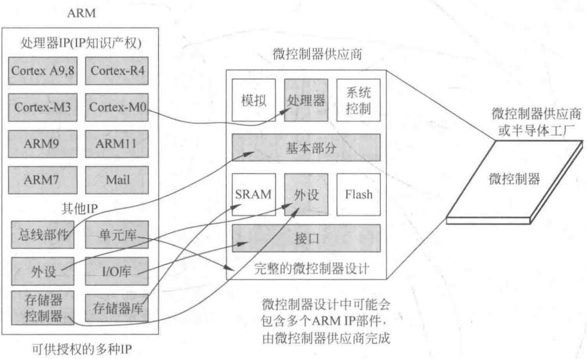

**看图方法**：
1. **图分左右两大块，中间用箭头连接**：左边是"**ARM**"（卖图纸的），右边是"**微控制器供应商**"（买图纸、造芯片的）。
2. **先看左边那个大框（ARM）**，它里面又分上下两组：
   - **上面一组标"处理器 IP（IP 知识产权）"**：里面是一格一格的方块，写着 **Cortex-A9,8、Cortex-R4、Cortex-M3、Cortex-M0、ARM9、ARM11、ARM7、Mali**。这些就是 ARM 手里"可供授权的各种 CPU 内核图纸"。
   - **下面一组标"其他 IP"**：写着**总线部件、单元库、外设、I/O 库、存储器控制器、存储器库**。这些是"配套零件图纸"。
   - 框的最下面有一行字："**可供授权的多种 IP**"。
3. **再看右边那个大框（微控制器供应商）**：里面画的是"**一块芯片的设计**"，分成好几层：
   - 最上层三个小框：**模拟、处理器、系统控制**；
   - 中间一条标"**基本部分**"；
   - 再下面三个小框：**SRAM、外设、Flash**；
   - 最下面一条标"**接口**"；
   - 这个框的右下角标注："**完整的微控制器设计**"。
4. **注意那些从左边"ARM"框里飞出来、指向右边各个小框的箭头**——它们表示"**ARM 的哪一份 IP 被用到了芯片的哪个部位**"。例如 Cortex-M3 那个方块有一根箭头指向"处理器"；总线部件指向"基本部分"；外设指向"外设"；存储器控制器指向"SRAM / Flash"。
5. **最右边**是一个立体的芯片图形，标注"**微控制器**"，下面写着"**微控制器供应商或半导体工厂**"。这说明：**图纸最终要由工厂做成真正的芯片**。
6. **图底部还有一行小字**："微控制器设计中可能会包含多个 ARM IP 部件，由微控制器供应商完成。"
7. **这张图要你理解什么**：
   ```
   ARM 提供内核图纸  →  半导体公司加上外设、存储器和接口  →  工厂做成芯片  →  你手里的 STM32
   ```
   **一句话：CPU 内核是买来的，芯片是攒出来的。**

---

### 1.4.3 ARM 架构的演变（只保留脉络）

【教材内容】1985 年以来，ARM 陆续发布了多个 ARM 内核架构版本，从 **ARM V4 架构**开始的 ARM 架构发展历程如图 1-14 所示。

【教材内容】目前，ARM 体系结构已经经历了 **6 个版本**。各个版本中还有一些**变种**，如支持 **Thumb 指令集的 T 变种**、**长乘法指令（M）变种**、**ARM 媒体功能扩展（SIMD）变种**、**支持 Java 的 J 变种**和**增强功能的 E 变种**等。

【补充解释】顺便把上面提到的几个"变种"列成一张小表，以后见到类似的型号名字不慌：

| 变种 | 字母含义 | 一句话 |
|---|---|---|
| **T** | Thumb | 支持 16 位"压缩版"指令，代码体积小（下面马上细讲） |
| **M** | 长乘法指令 | 内嵌硬件长乘法器 |
| **SIMD** | **S**ingle **I**nstruction **M**ultiple **D**ata，**单指令多数据** | 一条指令**同时处理一批数据**（而不是一次只算一个），适合音频、图像等多媒体运算 |
| **J** | Java | 支持 Java 程序（教材说"支持 Java"） |
| **E** | Enhanced，增强 | 在基础功能上做增强 |

> **SIMD 用大白话讲**：普通加法指令一次只能算一对数（`a + b`），SIMD 指令一次能算"一对"变成"一堆"（比如 4 对、8 对一起算）。它不是让电路变快，而是让**同样的电路一次干更多活**。

【教材内容】例如，**ARM7TDMI** 表示该处理器支持 **Thumb 指令集（T）**、**片上 Debug（D）**、**内嵌硬件乘法器（M）**、**嵌入式 ICE（I）**。

【补充解释】**ARM7TDMI 这个命名法要会读**，因为它是一种"型号命名规则"，后面还会遇到类似写法：

```
A R M 7  T  D  M  I
│   │   │  │  │  │
│   │   │  │  │  └─ I：Embedded ICE（嵌入式在线仿真调试）
│   │   │  │  └──── M：内嵌硬件乘法器（长乘法指令）
│   │   │  └─────── D：片上 Debug（调试支持）
│   │   └────────── T：支持 Thumb 指令集
│   └────────────── 7：ARM7 系列
└────────────────── ARM：架构名
```

> **Thumb 指令集是什么？** 简单说：ARM 原来的指令都是 32 位的，程序占用空间大；Thumb 是一套 **16 位**的"压缩版指令"，**代码体积小、省存储空间**。一个处理器同时支持两套指令集，就叫 T 变种。（第 4 章会再讲。）

##### 看教材原图：图 1-14 ARM 架构的发展历程

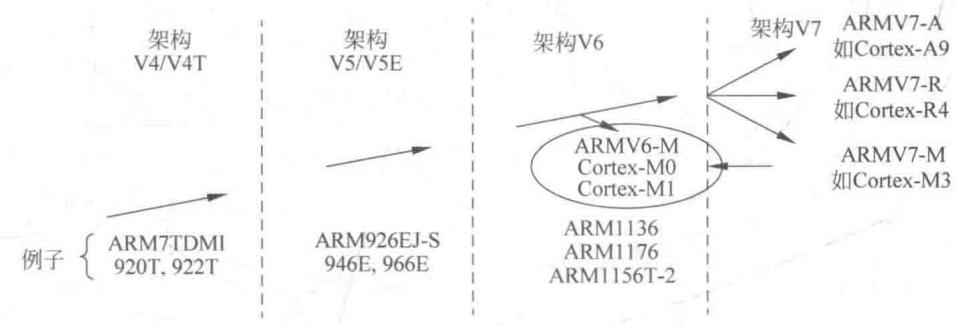

**看图方法**：
1. 图是**从左往右的四段**，每段用一种"架构版本"命名，段与段之间用**竖直虚线**隔开。**从左到右就是时间顺序**。
2. **第一段"架构 V4/V4T"**：下面用大括号列出例子——**ARM7TDMI、920T、922T**。
3. **第二段"架构 V5/V5E"**：例子是 **ARM926EJ-S、946E、966E**。
4. **第三段"架构 V6"**：例子是 **ARM1136、ARM1176、ARM1156T-2**；另外还有一个**椭圆圈**，圈里写着"**ARMv6-M / Cortex-M0 / Cortex-M1**"，并且有一根箭头指向"架构 V7"那边。
5. **第四段"架构 V7"**：这里**分叉成三条箭头**，分别指向三个子架构：
   - **架构 V7-A**（Application，应用）→ 如 **Cortex-A9**；
   - **架构 V7-R**（Real-time，实时）→ 如 **Cortex-R4**；
   - **架构 V7-M**（Microcontroller，微控制器）→ 如 **Cortex-M3**。
6. **这张图要你理解什么**：
   - ARM 的架构是**一代一代往下发展的**（V4 → V5 → V6 → V7）；
   - 到了 **V7 这一代，ARM 把它分成了三条产品线**：**A（应用）、R（实时）、M（微控制器）**；
   - **本书的主角 Cortex-M3 属于 V7-M 这条线**。

【教材内容】常见 ARM 处理器的演变过程如图 1-15 所示。每个系列都有其子集的架构。例如，用于 ARM V6-M 系列（所使用的 Cortex-M0/M0+/M1）的一个子集 ARM V7-M 架构（支持较少的指令）。

##### 看教材原图：图 1-15 常见 ARM 处理器的演变

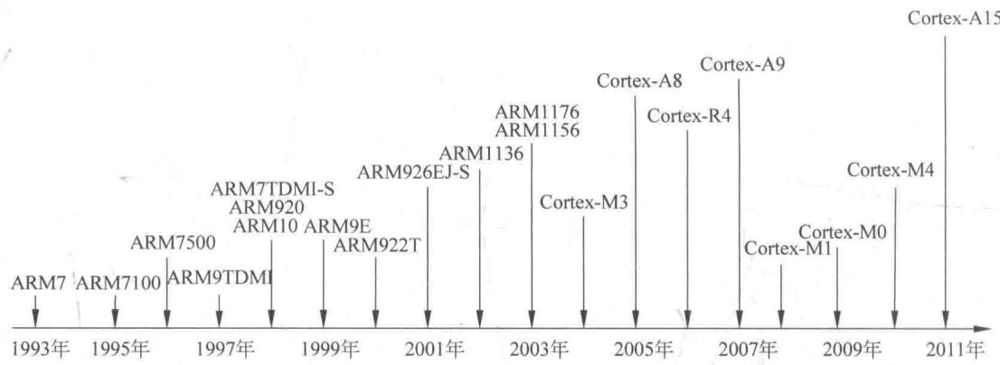

**看图方法**：
1. 图是一根**横向的时间轴**，轴上标着年份：**1993、1995、1997、1999、2001、2003、2005、2007、2009、2011**（轴上每年都有一个小刻度，偶数年份只是没有写数字）。
2. 每个型号都用一根**从上往下指的箭头**表示：**型号名写在上方（箭头的尾巴），箭头尖向下落在时间轴上**——落点在哪一年附近，就表示它大约在那一年出现：
   - 1993：**ARM7**
   - 1995：**ARM7100**
   - 1997：**ARM7500、ARM7TDMI-S、ARM920、ARM9TDMI、ARM10、ARM9E**
   - 1999：**ARM922T**
   - 2001：**ARM926EJ-S、ARM1136**
   - 约 2003 年：**ARM1176、ARM1156、Cortex-M3**（箭头尖落在 2003 刻度**附近、两个刻度之间**，所以是近似年份）
   - 2005：**Cortex-A8、Cortex-R4**
   - 2007：**Cortex-A9**
   - 约 2009 年：**Cortex-M1、Cortex-M0、Cortex-M4**（箭头尖同样落在刻度之间，是近似年份）
   - 2011：**Cortex-A15**
3. **在这张图上找两个关键点**：
   - 找"**Cortex-M3**"——它在**约 2003 年**的位置。**这就是本书主角出现的年份。**
   - 找"**Cortex-M 系列**"的其他成员：M1、M0、M4 都**在约 2009 年**附近。
4. **这张图要你理解什么**：ARM 的产品线从 ARM7 → ARM9 → ARM11 → Cortex 系列，一路演进；**Cortex-M3 是 ARM 在"微控制器"这条线上的重要产品**。

【教材内容】**Cortex** 是 ARM 的新一代处理器内核，本质上是 **ARM V7 架构的实现**。与以前的向下兼容、逐步升级策略不同，**Cortex 系列处理器是全新开发的**。正是由于 Cortex 放弃了向前兼容，老版本的程序必须经过**移植**才能在 Cortex 处理器上运行，因此，对软件和支持环境提出了更高的要求。

【教材内容】从 Cortex 系列的核心开始，存在 **3 种系列**：

| 系列 | 名称 | 适用场合 |
|---|---|---|
| **Cortex-A** | 应用系列（Application） | 需要运行复杂应用程序的场合（如手机、平板） |
| **Cortex-R** | 实时控制系列（Real-time） | 实时性要求较高的应用场合（如硬盘控制器、汽车刹车） |
| **Cortex-M** | 微控制器系列（Microcontroller） | 要求**高性能、低成本**的应用场合（**本书主角**） |

【教材内容】许多厂商提供的 Cortex-M 系列芯片内集成了大量 **Flash 存储器（数十 KB 到数百 KB）、ADC、USART、SPI、I2C、DAC、CAN、USB、定时器**等组件，在实际工程使用中非常方便，深受广大工程师的欢迎。

【补充解释】这段话其实是在提前"剧透"第 3 章和第 6～12 章的内容：

> **Cortex-M 系列芯片 = Cortex-M 内核 + 一大堆外设。**
>
> 那些缩写是什么？先混个脸熟，后面每一章都会专门讲：
>
> | 缩写 | 全称 | 一句话 | 本书章节 |
> |---|---|---|---|
> | **GPIO** | General-Purpose Input/Output | **通用输入输出接口**：让程序控制引脚读入或输出高低电平（完整定义见 1.3.2 第 3 条） | 第 6 章 |
> | Flash | 闪存 | 存程序的地方，断电不丢 | 第 3 章 |
> | ADC | Analog-to-Digital Converter | 把电压变成数字 | 第 10 章 |
> | USART | Universal Synchronous/Asynchronous Receiver/Transmitter | 通用同步/异步收发器，就是"串口" | 第 9 章 |
> | SPI | Serial Peripheral Interface | 一种高速串行通信接口 | 第 9 章 |
> | I2C | Inter-Integrated Circuit | 两根线的串行总线 | 本书未展开 |
> | DAC | Digital-to-Analog Converter | 把数字变成电压 | 第 10 章 |
> | CAN | Controller Area Network | 汽车上常用的总线 | 本书未展开 |
> | **DMA** | Direct Memory Access | **直接存储器访问**：不经过 CPU，直接把数据从一处搬到另一处 | 第 11 章 |
> | USB | Universal Serial Bus | 通用串行总线 | 本书未展开 |
> | 定时器 | Timer | 数时间、产生波形 | 第 8 章 |

##### 看教材原图：图 1-16 各种架构的 ARM 应用领域

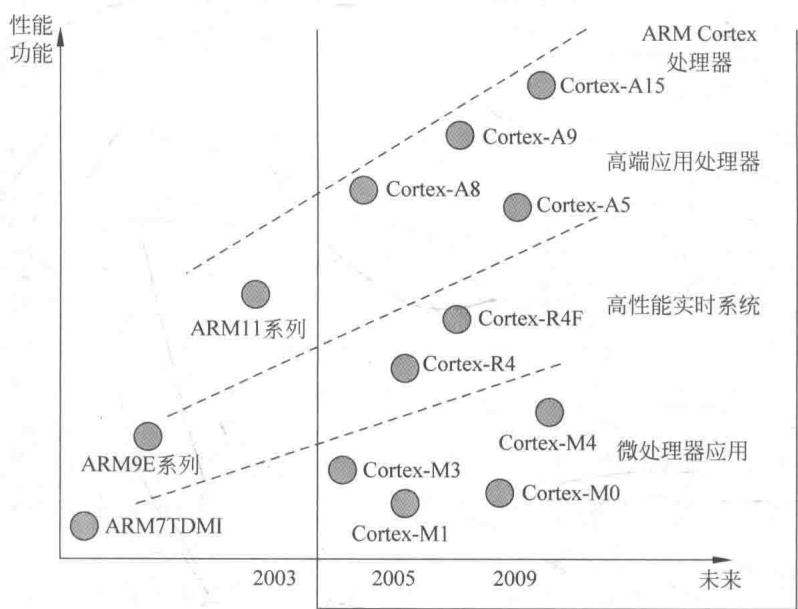

**看图方法**：
1. 图是一张**散点图**：
   - **横轴是时间**，标着 **2003、2005、2009、未来**（越往右越新）；
   - **纵轴是"性能/功能"**（越往上越强）。
2. **图上的每一个灰色圆点，代表一款处理器**，点旁边写着它的名字。
3. **注意图中有三条从左下往右上延伸的虚线**，每条虚线代表一条"产品路线"，虚线末端有文字说明：
   - **最上面那条虚线** → 末端标"**ARM Cortex 处理器 / 高端应用处理器**"，线上的点有 **Cortex-A8、Cortex-A9、Cortex-A15、Cortex-A5**。**这些是性能最强的 A 系列**（手机、平板用）。
   - **中间那条虚线** → 末端标"**高性能实时系统**"，线上的点有 **Cortex-R4、Cortex-R4F**。**这些是 R 系列**（要求"必须在规定时间内响应"的场合）。
   - **最下面那条虚线** → 末端标"**微处理器应用**"，线上的点有 **Cortex-M3、Cortex-M1、Cortex-M0、Cortex-M4**。**这些就是 M 系列，本书的主角在这一条线上。**
4. **图左侧还单独标了几个早期的系列**：**ARM7TDMI**（最左下角，最早）、**ARM9E 系列**、**ARM11 系列**。它们代表 Cortex 之前的时代。
5. **看图的关键**：**横轴越往右越新，纵轴越往上越强**。所以：
   - **A 系列**：性能最高，走的是"越做越强"的路；
   - **M 系列**：性能不是最高，但**成本低、功耗小**，走的是"够用就好"的路。
6. **这张图要你理解什么**：ARM 不是只有一种处理器，而是**按应用需求分成三条线**。你学的 STM32 属于**最下面那条 M 线**，它的定位是"**用最低的成本，满足嵌入式控制的需求**"。

---

### 1.4.4 本书为什么选 STM32

【教材内容】在 ARM 公司发出的 Cortex 内核授权中，**Cortex-M3 内核发出的授权数量最多**。在诸多获得 Cortex-M3 内核授权的公司中，**意法半导体公司（STMicroelectronics）是较早在市场上推出基于 Cortex-M3 内核微控制器的厂商**，**STM32F1 系列**是其典型的产品系列。

【教材内容】本书后续介绍的 ARM Cortex-M3 是诸多 ARM 内核架构中的一种，并以基于该内核的意法半导体公司的 **STM32F103VET6 微控制器**为背景进行原理介绍，以 STM32F103VET6 微控制器开发板为背景进行应用实例讲解。

【补充解释】把这句话里的三层关系画出来：

```
ARM 公司  ──设计并授权──▶  Cortex-M3 内核（CPU 部分）
                                │
                                ▼
ST 公司（意法半导体）──买内核 + 加外设──▶  STM32F1 系列芯片
                                │
                                ▼
                          本书用的具体型号：STM32F103VET6
                                │
                                ▼
                        开发板上的实物芯片
```

> **记住这个型号：STM32F103VET6。** 本书后面所有例子、所有寄存器地址，都以它为准。

---

### 1.4.5 ARM 开发调试工具

【教材内容】ARM 公司在同生产基于 ARM 处理器的微控制器供应商直接合作的同时，还和支持设备的生态系统供应商联系紧密。这些厂家中，既有提供包括编译器、中间件、操作系统和开发工具的厂商，同时还有设计服务公司、经销商和科研院所等。因此，可以用于 ARM 开发的调试工具也很多：

| 类别 | 常见工具 |
|---|---|
| **硬件调试工具** | **JLink**、**ULink** |
| **软件开发工具** | **Keil MDK**、**IAR**、TASKING、CodeSourcery、Rowly Associates、GNU C 编译器等 |

【教材内容】比较常见的开发调试工具是 **Keil MDK** 和 **IAR**。由于许多教师在讲授 8051 单片机时使用的开发环境一般是 **Keil μVision**，而 **Keil MDK 和 Keil μVision 的使用方法相同**，因此，本书以 **Keil MDK 开发工具**为背景进行 ARM 的开发调试讲解，如此，学过 8051 单片机的读者很容易上手。

【教材内容】Cortex-M3 非常适合使用 **C 语言**开发，可以使用现有的许多代码。另外还有许多的嵌入式操作系统支持 Cortex-M3 处理器，包括 Keil 的 **RTX**、**μCOS-Ⅱ/Ⅲ**、**FreeRTOS**、**embOS**、**ThreadX** 和 **μLinux** 等。

【补充解释】

> **"硬件调试工具"和"软件开发工具"是两样东西**，别搞混：
>
> | | 硬件调试工具 | 软件开发工具 |
> |---|---|---|
> | 是什么 | 一个插在电脑和开发板之间的小盒子 | 电脑上装的软件 |
> | 干什么 | 把程序"下载"进芯片，还能单步调试、看寄存器 | 写代码、编译、生成可执行文件 |
> | 例子 | JLink、ULink | Keil MDK、IAR、GNU |
>
> **本书用 Keil MDK 写程序、用 JLink（或类似工具）下载调试**。第 5 章会详细讲这个流程。

---

### 1.4.6 本节真正要记住什么

1. **ARM 的三重身份**：一家公司、一类处理器、一种架构（32 位 RISC）。
2. **ARM 的商业模式**：**卖 IP（设计图纸），不卖芯片**；半导体公司买内核 + 自己加外设 → 做成芯片。
3. **ARM7TDMI 的命名法**：T = Thumb，D = Debug，M = 乘法器，I = 嵌入式 ICE。
4. **Cortex 分三条线**：**A（应用）、R（实时）、M（微控制器）**。
5. **本书主角**：**Cortex-M3 内核 + ST 公司的 STM32F103VET6**。
6. **开发工具**：软件用 **Keil MDK**，硬件调试用 **JLink / ULink**。

---

## 1.5 微型计算机的应用

> 【本节按 TASK.md 第十七节要求**大幅压缩**：教材用了几页篇幅讲应用，这里压成一张表，只保留"它能干什么"的印象。

【教材内容】微型计算机的应用范围十分广阔，它不仅在科学计算、信息处理、事务管理和过程控制等方面占有重要地位，并且在日常生活中也发挥着不可缺少的作用。

| 应用领域 | 教材举的例子 | 一句话理解 |
|---|---|---|
| **1. 科学计算** | 用 30 个 Intel 80386 构成 Symmetry 计算机，速度 120MIPS；Option Red（9216 个微处理器，1.8Tflop/s）；IBM Blue Pacific（5856 个，3.888Tflop/s）；IBM Option White（8192 个，12.3Tflop/s） | 把很多微处理器连起来，就能造出超级计算机 |
| **2. 信息处理** | 连接 Internet 后对信息进行检索、传输、分类、加工、存储和打印 | 互联网时代的信息处理 |
| **3. 工业控制** | 工厂流水线智能化管理、电梯智能化控制、各种报警系统、二级控制系统 | 自动化生产线的"大脑" |
| **4. 仪器、仪表控制** | 功率计、示波器、逻辑分析仪、CT 扫描仪、超声扫描仪、医用呼吸机、监护仪、病床呼叫系统 | 让仪器更小、更便宜、更可靠、功能更强 |
| **5. 家用电器和民用产品控制** | 电饭煲、洗衣机、电冰箱、空调机、彩电、音响、电子称量设备、盲人阅读器 | 家电里几乎都有微处理器 |
| **6. 人工智能** | 机器人、语言识别、图像识别、自然语言处理、专家系统、机器学习、模式识别、智能控制 | AI 是计算机科学的一个分支 |

【补充解释】这张表不用背，只要记住一个结论：

> **微处理器（以及由它构成的微控制器）已经渗透到你能想到的每一个用电的设备里。**
>
> 教材特意强调了一句："微处理器在人们日常生活中的应用所受到的主要限制**不是技术问题，而是创造力和技巧的问题**。"
> 这句话的意思就是：**技术已经就绪，缺的是"你能用它做出什么"。**

【教材内容】当前，微型计算机技术正向**两个方向**发展：

① **高性能、多功能**，使微型计算机逐步代替价格昂贵、功能优越的中小型计算机；
② **价格低廉、功能专一**，使微型计算机在生产领域、服务部门和日常生活中得到越来越广泛的应用。

【补充解释】这两个方向，正好对应 1.4.3 里看到的 ARM 的两条产品线：

| 发展方向 | 对应 ARM 的哪条线 | 典型产品 |
|---|---|---|
| ① 高性能、多功能 | **Cortex-A / Cortex-R** | 手机、平板、服务器 |
| ② 价格低廉、功能专一 | **Cortex-M（本书主角）** | STM32、家电控制板 |

---

## 1.6 本章习题

> 教材的习题非常典型，建议**先自己做一遍**，再看下面的参考解答。
> 下面给出的解答是【补充解释】，用于自学核对，不是教材原文。

### 1-1 将下列十进制数转换为 8 位二进制数：58D、69D、136D、241D

**参考解答（除 2 取余，倒序排列）：**

**58D：**

| 算式 | 商 | 余数 |
|---|---|---|
| 58 ÷ 2 | 29 | 0 |
| 29 ÷ 2 | 14 | 1 |
| 14 ÷ 2 | 7 | 0 |
| 7 ÷ 2 | 3 | 1 |
| 3 ÷ 2 | 1 | 1 |
| 1 ÷ 2 | 0 | 1 |

倒序读：`111010` → 补足 8 位 → **`00111010B`**
验算：32 + 16 + 8 + 2 = 58 ✓

**69D：**

| 算式 | 商 | 余数 |
|---|---|---|
| 69 ÷ 2 | 34 | 1 |
| 34 ÷ 2 | 17 | 0 |
| 17 ÷ 2 | 8 | 1 |
| 8 ÷ 2 | 4 | 0 |
| 4 ÷ 2 | 2 | 0 |
| 2 ÷ 2 | 1 | 0 |
| 1 ÷ 2 | 0 | 1 |

倒序读：`1000101` → 补足 8 位 → **`01000101B`**
验算：64 + 4 + 1 = 69 ✓

**136D：**

| 算式 | 商 | 余数 |
|---|---|---|
| 136 ÷ 2 | 68 | 0 |
| 68 ÷ 2 | 34 | 0 |
| 34 ÷ 2 | 17 | 0 |
| 17 ÷ 2 | 8 | 1 |
| 8 ÷ 2 | 4 | 0 |
| 4 ÷ 2 | 2 | 0 |
| 2 ÷ 2 | 1 | 0 |
| 1 ÷ 2 | 0 | 1 |

倒序读：`10001000` → 正好 8 位 → **`10001000B`**
验算：128 + 8 = 136 ✓

**241D：**

| 算式 | 商 | 余数 |
|---|---|---|
| 241 ÷ 2 | 120 | 1 |
| 120 ÷ 2 | 60 | 0 |
| 60 ÷ 2 | 30 | 0 |
| 30 ÷ 2 | 15 | 0 |
| 15 ÷ 2 | 7 | 1 |
| 7 ÷ 2 | 3 | 1 |
| 3 ÷ 2 | 1 | 1 |
| 1 ÷ 2 | 0 | 1 |

倒序读：`11110001` → **`11110001B`**
验算：128 + 64 + 32 + 16 + 1 = 241 ✓

**答案汇总**：58D = `00111010B`，69D = `01000101B`，136D = `10001000B`，241D = `11110001B`。

> **【提示】** 136D 和 241D 都是 8 位二进制的**最高位为 1**（`10001000`、`11110001`）。如果把它们当成**有符号数原码**看，`10001000` 是 −8，`11110001` 是 −113。所以**同一串 0/1，按无符号数看和有符号数看，结果完全不同**。这就是 1.2.3 第 2 节（原码表示法）里讲的（教材原话）："**CPU 在进行运算时，并不知道参与运算的数是有符号数还是无符号数**。"

---

### 1-2 试将 1538 转换为十六进制表示

**参考解答（除 16 取余，倒序排列）：**

| 算式 | 商 | 余数 |
|---|---|---|
| 1538 ÷ 16 | 96 | 2 |
| 96 ÷ 16 | 6 | 0 |
| 6 ÷ 16 | 0 | 6 |

倒序读：`602`

**答案：1538 = 602H**

**验算**：6 × 256 + 0 × 16 + 2 = 1536 + 2 = 1538 ✓

---

### 1-3 求下列数据的原码、反码、补码

**（1）+37**

```
37 = 32 + 4 + 1 = 100101B → 补足 8 位 → 00100101B
正数三码相同：
[+37]原 = 00100101B
[+37]反 = 00100101B
[+37]补 = 00100101B
```

**（2）−11**

```
11 = 1011B → 补足 8 位 → 00001011B

① 原码：符号位写 1，数值位照抄 → 1 0001011 = 10001011B
② 反码：符号位不动，数值位 0001011 取反 → 1110100 → 1 1110100 = 11110100B
③ 补码：反码加 1 → 11110100 + 1 = 11110101B
```

| 编码 | 结果 |
|---|---|
| [−11]原 | **10001011B** |
| [−11]反 | **11110100B** |
| [−11]补 | **11110101B** |

**（3）+100**

```
100 = 64 + 32 + 4 = 1100100B → 补足 8 位 → 01100100B
正数三码相同：
[+100]原 = [+100]反 = [+100]补 = 01100100B
```

**（4）−64**

```
64 = 1000000B → 补足 8 位 → 01000000B

① 原码：1 1000000 = 11000000B
② 反码：符号位不动，数值位 1000000 取反 → 0111111 → 1 0111111 = 10111111B
③ 补码：反码加 1 → 10111111 + 1 = 11000000B
```

| 编码 | 结果 |
|---|---|
| [−64]原 | **11000000B** |
| [−64]反 | **10111111B** |
| [−64]补 | **11000000B** |

> **【注意】** −64 的**原码和补码恰好相同**（都是 `11000000B`）。这不是巧合，也不是错误——因为 64 = 2⁶ 是 2 的整数次幂。这种情况偶尔会遇到，不要以为算错了。

**答案汇总**：

| 真值 | 原码 | 反码 | 补码 |
|---|---|---|---|
| +37 | 00100101B | 00100101B | 00100101B |
| −11 | 10001011B | 11110100B | 11110101B |
| +100 | 01100100B | 01100100B | 01100100B |
| −64 | 11000000B | 10111111B | 11000000B |

---

### 1-4 用补码计算 56 − 87 的原码和真值，并写出计算过程

**参考解答：**

**第一步：把减法改成加法。**

```
56 − 87 = 56 + (−87)
```

**第二步：求两个数的 8 位补码。**

```
56 = 111000B → 补足 8 位 → 00111000B
   （正数，原码 = 反码 = 补码，所以 [56]补 = 00111000B）

87 = 1010111B → 补足 8 位 → 01010111B
   [−87]原 = 11010111B
   [−87]反 = 10101000B   （符号位不动，数值位取反）
   [−87]补 = 10101000B + 1 = 10101001B
```

**第三步：补码相加。**

```
   00111000      (56)
 + 10101001      (−87)
 ──────────
   11100001
```

（无进位产生，结果直接就是 `11100001B`）

**第四步：求真值（对结果再求一次补码）。**

```
[结果]补 = 11100001B
最高位是 1 → 结果是负数

① 符号位不动，数值位取反：1 0011110
② 加 1：10011110 + 1 = 10011111B
③ 数值部分 = 0011111B = 16 + 8 + 4 + 2 + 1 = 31
④ 符号为负
```

**第五步：写出原码和真值。**

```
[结果]原 = 10011111B       （符号位 1 表示负，数值 0011111 = 31）
真值     = −31
```

**验算**：56 − 87 = −31 ✓

**答案**：结果的**补码是 `11100001B`**，**原码是 `10011111B`**，**真值是 −31**。

---

### 1-5 汉字"春"的区位码为 20-26，计算其国标码和机内码

**参考解答：**

**第一步：把区位码的两个数字分别转成十六进制。**

```
区码 20（十进制）→ 20 ÷ 16 = 1 余 4 → 14H
位码 26（十进制）→ 26 ÷ 16 = 1 余 10 → 1AH   （10 = A）
所以区位码写成十六进制形式是 141AH
```

**第二步：求国标码。**

```
国标码 = 区位码（十六进制） + 2020H
       = 141AH + 2020H
       = 343AH

验算：141A + 2020
      14 + 20 = 34（十六进制）
      1A + 20 = 3A（十六进制）
```

**答案：国标码 = 343AH**

**第三步：求机内码。**

```
机内码 = 国标码 + 8080H
       = 343AH + 8080H
       = B4BAH

验算：34 + 80 = B4（十六进制）
      3A + 80 = BA（十六进制）
```

**答案：机内码 = B4BAH**

**第四步（检查）：验证最高位是否都为 1。**

```
国标码 343AH → 二进制 0011 0100 0011 1010  （两个字节最高位都是 0）
机内码 B4BAH → 二进制 1011 0100 1011 1010  （两个字节最高位都变成 1 ✓）
```

**答案汇总**："春"的**区位码 = 20-26**，**国标码 = 343AH**，**机内码 = B4BAH**。

---

### 1-6 简述微控制器的定义

**参考解答（答题要点）：**

> 微控制器（Micro Controller Unit，MCU）是指**一个集成在一块芯片上的完整计算机系统**，它具有一个完整计算机所需要的部分部件：**中央处理单元（CPU）、存储器、内部和外部总线系统**；同时还集成诸如**通信接口、定时器、实时时钟**等外围设备（简称外设）。
>
> 它与微处理器的区别是：**微控制器不仅包含微处理器，还包含其他更多的内容。**

---

### 1-7 什么是嵌入式系统？它与一般微型计算机系统在结构上有什么区别？

**参考解答（答题要点）：**

**（1）什么是嵌入式系统**

> IEEE 的定义：嵌入式系统是"**控制、监视或者辅助装置、机器和设备运行的装置**"。
>
> 国内普遍认同的定义：**以应用为中心，以计算机技术为基础，软件硬件可裁剪，适应应用系统对功能、可靠性、成本、体积、功耗严格要求的专用计算机系统。**
>
> 其构架可分为 **4 个部分**：**处理器、存储器、输入/输出接口（I/O）和软件**。

**（2）与一般微型计算机系统的区别（结构上）**

| 对比项 | 一般微型计算机系统 | 嵌入式系统 |
|---|---|---|
| 目的 | 通用（什么都能干） | **专用**（只为某个产品服务） |
| 硬件 | 微处理器 + 存储器 + I/O + 总线 + 外部设备 | **处理器 + 存储器 + I/O**（常集成在一片 MCU 里） |
| 软件 | 系统软件（操作系统）+ 应用软件，**界限清楚** | **应用软件与操作系统紧密结合**，不加区分（教材明确指出这是与 Windows 系统的最大区别） |
| 存储介质 | 有硬盘等大容量存储 | **不具备硬盘那样大容量的存储介质，多用 EEPROM 或 Flash** |
| 要求 | 追求性能、通用性 | 对**功能、可靠性、成本、体积、功耗**有严格要求，可裁剪 |

---

### 1-8 简述冯·诺依曼结构和哈佛结构的区别

**参考解答（答题要点）：**

> **① 存储器组织不同**：冯·诺依曼结构中，程序指令和数据**都存储在同一个存储器中，不加区分**；哈佛结构中，数据和程序**使用各自独立的存储器**。
>
> **② 传输方式不同**：冯·诺依曼结构中指令和数据**均采用数据总线传输**，因此数据访问和指令存取**不能同时进行**；哈佛结构有各自独立的通路，可以同时进行。
>
> **③ 宽度与效率**：冯·诺依曼结构中程序指令和数据的**宽度相同**；哈佛结构中指令和数据**可以有不同的数据宽度**，效率较高，尤其适合数字信号处理。
>
> **④ PC 的指向不同**：哈佛结构中**程序计数器 PC 只指向程序存储器而不指向数据存储器**，因此很难编写**自修改程序**（在应用可编程 IAP 受限）。
>
> **⑤ 典型代表**：冯·诺依曼结构——Intel 8086、ARM7、MIPS；哈佛结构——MC68 系列、Z8 系列、ARM9、ARM10 系列。

---

### 1-9 简述流水线技术的特点

**参考解答（答题要点）：**

> **① 定义**：流水线技术是指在程序执行时**多条指令重叠进行操作**的一种**准并行处理**实现技术。
>
> **② 分段**：CPU 的工作大致分为**取指、译码、执行、存结果** 4 个步骤（段）。
>
> **③ 效果**：采用流水线设计后，指令可以**连续不断地进行处理**；在同一段较长时间内，有流水线的 CPU 能处理更多的指令。
>
> **④ 本质**：它**不缩短单条指令的执行时间**，而是提高**整体吞吐量**（单位时间完成的指令数）。理想情况下，n 条指令、m 段流水线的总时间约为 m + (n − 1) 个时钟节拍。
>
> **⑤ 类比**：就像工业生产中的装配流水线，可以提高单位时间的生产量。

---

### 1-10 简述微控制器的应用

**参考解答（答题要点，按教材归纳）：**

> 微控制器的应用领域非常广泛，主要有：
>
> ① **科学计算**——多个微处理器可构成高性能计算机系统；
> ② **信息处理**——对多媒体信息进行检索、传输、分类、加工、存储和打印；
> ③ **工业控制**——流水线智能化管理、电梯控制、报警系统等；
> ④ **仪器、仪表控制**——精密测量设备、逻辑分析仪、CT 扫描仪、医用设备等；
> ⑤ **家用电器和民用产品控制**——电饭煲、洗衣机、冰箱、空调、彩电等；
> ⑥ **人工智能方面**——机器人、语言/图像识别、自然语言处理、专家系统等。
>
> 此外，导弹导航装置、飞机仪表控制、网络通信与数据传输、智能 IC 卡、汽车安全系统、摄像设备、程控玩具等都离不开微控制器。

---

## 1.7 本章知识树

把本章所有知识点串成一棵树，方便你复习时"顺藤摸瓜"：

```mermaid
graph TD
    A["第1章 基础知识"] --> B["1.2 数制与编码<br/>（数据层面）"]
    A --> C["1.3 相关概念<br/>（硬件层面）"]
    A --> D["1.4 ARM 概述"]

    B --> B1["数制：二进制 / 十进制 / 十六进制"]
    B1 --> B11["转换：除2取余、位权求和、4位一组查表"]
    B --> B2["数值数据编码"]
    B2 --> B21["无符号数 0~255"]
    B2 --> B22["原码：符号位+数值，两个零"]
    B2 --> B23["反码：负数取反，循环进位"]
    B2 --> B24["补码：取反加1，减法变加法，范围-128~127"]
    B2 --> B25["溢出：结果超出范围"]
    B2 --> B26["BCD 码：压缩 / 非压缩"]
    B --> B3["非数值数据编码"]
    B3 --> B31["ASCII：7位+校验位"]
    B3 --> B32["汉字：输入码→国标码→机内码→字形码"]
    B3 --> B33["Unicode / UTF-8"]

    C --> C1["1.3.1 常用术语"]
    C1 --> C11["位 bit / 字节 Byte / 字 Word / 字长"]
    C1 --> C12["K M G T / MIPS"]
    C1 --> C13["地址：n条地址线→2ⁿ字节"]
    C1 --> C14["总线 AB / DB / CB"]
    C1 --> C15["机器指令 / 汇编指令 / 指令系统 / 汇编与反汇编 / 高级语言"]
    C --> C2["1.3.2 基本构成"]
    C2 --> C21["CPU（ALU+控制器+寄存器）"]
    C2 --> C22["存储器：每单元1字节，有地址"]
    C2 --> C23["I/O 接口"]
    C --> C3["1.3.3 概念辨析"]
    C3 --> C31["微处理器 ⊂ 微型计算机 ⊂ 微型计算机系统"]
    C3 --> C32["微控制器 MCU = 全集成在一片芯片"]
    C3 --> C33["嵌入式系统"]
    C --> C4["1.3.4 常见技术"]
    C4 --> C41["冯·诺依曼结构 vs 哈佛结构"]
    C4 --> C42["Cache"]
    C4 --> C43["流水线"]
    C4 --> C44["CISC vs RISC"]

    D --> D1["ARM 三重身份 / IP 授权模式"]
    D --> D2["架构演变 V4→V5→V6→V7"]
    D --> D3["Cortex A / R / M 三条线"]
    D --> D4["本书主角：Cortex-M3 + STM32F103VET6"]
    D --> D5["开发工具：Keil MDK + JLink"]
```

**如果你只想用 30 秒记住本章，就记这 6 句：**

1. 计算机只认 0 和 1，所有信息都要**编码**。
2. 十六进制是二进制的"四合一速记法"，**1 个十六进制位 = 4 个二进制位**。
3. 负数的**补码 = 取反加 1**，它的意义是**让减法能用加法实现**。
4. 一台计算机 = **CPU + 存储器 + I/O + 三条总线**。
5. **地址线的条数决定容量**（n 条 → 2ⁿ 字节），**每个地址对应 1 个字节**。
6. **ARM 是 RISC**，**Cortex-M3 是微控制器内核**，**STM32 是 ST 公司用它做的芯片**。

---

## 1.8 全章"容易搞混"汇总

把本章所有容易混的地方集中列出来，考前扫一遍：

| # | 容易搞混的地方 | 正确理解 |
|---|---|---|
| 1 | 二进制转十六进制是 3 位一组还是 4 位一组？ | **4 位一组**（转八进制才是 3 位一组） |
| 2 | 十进制转二进制，余数是正序还是倒序？ | 整数**倒序**，小数**正序** |
| 3 | 正数的补码要不要"取反加 1"？ | **不要**。正数原码 = 反码 = 补码 |
| 4 | 8 位补码能表示 −127 到 +127 吗？ | 是 **−128 到 +127**，`1000 0000` 表示 −128 |
| 5 | 补码的符号位能不能参加运算？ | **能**，这正是补码的优点；而**原码的符号位必须分开处理** |
| 6 | 进位和溢出是一回事吗？ | **不是**。进位是无符号数的概念，溢出是有符号数的概念 |
| 7 | BCD 码的 `43H` 是十进制 67 吗？ | **不是**。它表示"十进制的 4 和 3"，即 43 |
| 8 | `B` 和 `b` 一样吗？ | **不一样**。B = 字节，b = 位 |
| 9 | 1KB 是 1000 字节还是 1024 字节？ | **1024**（计算机里 K = 2¹⁰） |
| 10 | 教材说的"字"是几位？ | 教材定义 **16 位**；但 ARM/STM32 资料里 **word = 32 位**，注意参照对象 |
| 11 | 地址和数据是一回事吗？ | **不是**。地址是门牌号，数据是屋里的东西 |
| 12 | 一个地址对应几个字节？ | **1 个字节**（8 位） |
| 13 | CPU 内部总线 = 系统总线吗？ | **不是**。一个在芯片内部，一个连外部部件 |
| 14 | 微处理器和微控制器一样吗？ | **不一样**。MCU = MPU + 存储器 + 总线 + 外设，全在一片芯片上 |
| 15 | 冯·诺依曼结构和哈佛结构怎么区分？ | 看**指令和数据是否共用同一个存储器**（冯：共用；哈佛：独立） |
| 16 | 流水线能让一条指令变快吗？ | **不能**。它提高的是整体吞吐量 |
| 17 | "汇编"是一个动作还是一门语言？ | 两个意思都有，看上下文（汇编语言 / 把汇编翻译成机器码） |
| 18 | 汉字机内码和国标码差多少？ | 差 **8080H**（每个字节最高位置 1） |

---

## 1.9 本章与后续章节的联系

本章的每一个概念，后面都会"长大"：

| 本章概念 | 后面在哪里"长大" |
|---|---|
| 二进制 / 十六进制 / 位运算 | 第 4 章（移位指令）、第 6 章（配置 GPIO 寄存器）、第 2 章（位带操作） |
| 补码 / 溢出 | 第 4 章（算术指令、标志位）、第 2 章（xPSR 中的标志位） |
| 位、字节、字、字长 | 第 2 章（寄存器宽度）、第 4 章（LDRB/LDRH/LDR 三种宽度） |
| 地址、地址空间 | 第 2 章（存储器映射）、第 3 章（STM32 存储器映像）、第 6 章（GPIO 基地址+偏移） |
| 三总线 | 第 2 章（Cortex-M3 总线结构）、第 3 章（AHB/APB 总线矩阵） |
| 寄存器 | 第 2 章（寄存器组）、第 6 章以后（每一个外设寄存器） |
| 指令 / 汇编 / 指令系统 | 第 4 章（ARM 汇编语言） |
| 冯·诺依曼 / 哈佛结构 | 第 2 章（Cortex-M3 的总线设计） |
| 流水线 | 第 2 章（Cortex-M3 三级流水线、分支清洗） |
| CISC / RISC | 第 4 章（ARM 指令为什么长这样：定长、Load/Store） |
| 微控制器 / 嵌入式系统 | 第 3 章（STM32 芯片整体结构） |
| Cache | 第 3 章（STM32F103 的 Flash 加速器有类似思想） |

> **所以本章不是"看完就丢"的绪论。** 建议在学完第 2 章、第 6 章之后，**回头再读一遍本章**——你会发现当初觉得抽象的东西，突然都有了具体的对应物。

---

## 待核验

本表条目尚未逐条回原 PDF 核验；核验方法见 tools/index/verification.md。

以下内容在 MinerU 解析结果中**存在疑点**，本讲义按"不猜测"的原则列出，需要回到**原始 PDF** 核对后再定稿。
（页码 pN 为原 PDF 分卷中的页码索引。）

| # | 页码 | 疑点 | 本讲义的处理 |
|---|---|---|---|
| 1 | p22 | 教材原文称"**1964 年**，冯·诺依曼简化了计算机的结构，提出了'存储程序'的思想"。按通行的计算机史，存储程序思想通常归于冯·诺依曼 1945 年起草的 EDVAC 报告（1946 年计算机问世），"1964 年"疑为教材笔误或 OCR 错误 | 本讲义在 1.3.4 中**未复述年份**，只讲"存储程序"思想本身 |
| 2 | p18 | 教材给出的 4 字节机器指令 `00001111 00100100 00010010 01000101`，与它声称的含义 `MOV R1, #0x1245` 之间的对应关系**无法从这 4 个字节直接验证**（按大端 0x0F241245、小端 0x4512240F 都不是 ARM `MOV R1,#0x1245` 的常见编码） | 本讲义照引教材原例，并说明"教材用它来说明机器码与助记符的差别"；**未断言该编码的正确性** |
| 3 | p15 | ASCII 区间：教材称"0～32 为控制字符，33～127 为可打印字符"。通行标准是 0～31 为控制字符、32（空格）为可打印字符、127（DEL）为控制字符；且"0～32"含 33 个代码 | 本讲义在正文中照引教材说法，并在【补充解释】中补充了通行的控制字符例子（0x0A 换行、0x0D 回车、0x09 Tab、0x00 NUL） |
| 4 | p17 | UTF-8：教材称"用 1～6 字节编码 Unicode 字符"。现行 RFC 3629 规定 UTF-8 最长 **4 字节**（原始 1993 年方案才允许 6 字节） | 本讲义在正文中照引"1～6 字节"，但在【补充解释】中按"英文 1 字节、常用汉字 3 字节、生僻字 4 字节"举例 |
| 5 | p25–p26 | 教材称"目前，ARM 体系结构已经经历了 6 个版本。**从 V6 版本开始**，各个版本都在实际中获得了应用"。而图 1-14 明确从 **V4** 开始列出；按常见说法应为"从 V4 版本开始各版本均获实际应用" | 本讲义在 1.4.3 中只保留"经历了 6 个版本"和"V4→V5→V6→V7"的脉络，**未复述"从 V6 开始"这一句** |
| 6 | p26 | 教材称"用于 ARM V6-M 系列（所使用的 Cortex-M0/M0+/M1）的一个子集 **ARM V7-M 架构**（支持较少的指令）"。这句话的从属关系混乱：通行说法是 **ARMv6-M 是 ARMv7-M 的子集**，且 Cortex-M0/M0+/M1 属于 ARMv6-M | 本讲义**未复述这句从属关系**，只说明"V7 分叉出 V7-A / V7-R / V7-M 三条线"（与图 1-14 一致） |
| 7 | p25 | 教材称"ARM 的前身是成立于 **1983 年**的英国 Acorn 公司"。常见说法是 Acorn 公司成立于 1978 年，ARM 项目（Acorn RISC Machine）启动于 1983 年 | 本讲义**未复述成立年份**，只保留"ARM 起源于英国 Acorn 公司" |
| 8 | p24 | 图 1-12 在 MinerU 解析结果中**无题注**（标记为"(无题注)"）。本讲义按正文"4 段指令流水线的时空图"命名 | 引用时标注为"图 1-12 4 段指令流水线的时空图"，并在图题后说明该图在原解析结果中无题注 |
| 9 | p26–p27 | 图 1-13（在微控制器中使用 ARM 授权）、图 1-14（ARM 架构的发展历程）在 MinerU 结果中出现的位置晚于引用它们的正文段落；图 1-13 内还出现 "Mail" 字样（疑为 **Mali** 的 OCR 错误） | 本讲义按题注引用图片；正文中按图片实际内容讲解（Mali 的拼写问题已在讲解中标注为疑点） |
| 10 | p13 | 表 1-2 的排版方式：以"无符号数二进制"为行序，把 `1000 0000B` 一行标为真值"−0"，把 `1111 1111B` 一行标为真值"−127"。这种对照方式容易让读者误以为"无符号数 255 就是 −127" | 本讲义在讲解中明确提示"**不要被这个排版搞晕，要看的是同一行里真值→原码→反码→补码的关系**"；建议核对原 PDF 确认表格排版是否确实如此 |
| 11 | p14 | 图 1-3、图 1-4 在 MinerU 结果中被标记为"表 图1-3 / 表 若将 8 位…"，题注与表格内容混在一起（OCR 串行） | 本讲义改用 markdown 表格重绘非压缩/压缩 BCD 的位格式，并保留原图链接信息；建议核对原 PDF 的图题 |
| 12 | p18 | **20 条地址线的地址范围**：教材原文两处都写作"20 条地址线的容量为 1MB(**00000H～FFFFFFH**)"（MinerU 解析结果的 `full.md` 第 740、799 行同样如此，`MinerU_markdown`、`MinerU_html` 两个版本也一致）。但 20 条地址线只能给出 5 位十六进制地址，正确范围应是 **00000H～FFFFFH**；`FFFFFFH` 是 6 位十六进制数（对应 24 条地址线） | 本讲义按正确的 **00000H～FFFFFH** 书写（见 1.3.1 第 7 条、1.3.2"地址总线"一段）。请回原 PDF 核对：这是教材笔误还是 OCR 问题；若教材原文确实如此，答题按教材书写时请留意这处差异 |
| 13 | p13 | **例 1-1 的表格数据**：教材例 1-1（+13、−13 的原码/反码/补码，以及反码的反码、补码的补码）在 MinerU 解析结果中只保留了表头 `X [X]原 [X]反 [X]补 [[X]反]反 [[X]补]补`，**表体数据行缺失** | 本讲义按教材给出的两条性质（`[[X]反]反=[X]原`、`[[X]补]补=[X]原`）在 1.2.3 中逐步算出全部数值，结果与 1.2.3 第 7 条速查表一致；建议回原 PDF 核对例 1-1 表格数值 |

---

## 本章自检（对照 TASK.md 第二十二节）

**内容完整性**

- [x] 数制（二进制/十进制/十六进制）及互相转换（含除 2 取余、乘 2 取整、四位一组，均一步一步推演）
- [x] 数值数据编码：原码、反码、补码、溢出、补码运算（含例 1-1、例 1-2 及补充的 56−87 减法推演；例 1-1 的表体在 MinerU 解析中缺失，已按定义补齐全过程，并列入"待核验"第 13 项）
- [x] BCD 码（8421、非压缩、压缩、4321 例子）
- [x] 非数值数据编码：ASCII、汉字四类编码、国标码/机内码公式与算例、Unicode/UTF-8
- [x] 常用单位及术语 14 条（位、字节、字、字长、K/M/G/T、MIPS、地址、总线、访问、机器指令、汇编指令、指令系统、汇编与反汇编、高级语言）
- [x] 微型计算机基本构成、三总线、CPU 内部组成、存储器、I/O 接口
- [x] 冯·诺依曼结构、哈佛结构、Cache、流水线、CISC/RISC
- [x] 微处理器/微型计算机/微型计算机系统/微控制器/嵌入式系统 的层次关系
- [x] ARM 概述（三重身份、IP 授权、架构演变、Cortex 三系列、STM32 选型、开发工具）
- [x] 教材习题 1-1～1-10 全部保留并给出参考解答
- [x] 教材未展开但后续必需的内容（ALU、寄存器、MSB/LSB、0x 与 H 后缀、指针式地址概念）已主动补充

**可理解性**

- [x] 每个知识点按"大白话 → 类比 → 图/例子 → 正式定义 → 考试式表述"三层组织
- [x] 首次出现的术语均给出英文全称、中文名、缩写、大白话、用途：**GPIO** 在 1.3.2 第 3 条给出完整术语卡片（并收入 1.4.3 的缩写表）；**VLSI、EEPROM、SIMD、IEEE** 等缩写也都在首次出现处展开
- [x] 插入【先补一个前置知识】小节共 10 处：数制、位权、0x 与 H 后缀、ALU、MSB/LSB、位（为什么 1 字节 8 位）、**位运算（与/或/异或/取反）**、地址、总线、寄存器
- [x] 全部 10 处【类比】之后均回到真实技术概念，并写出"类比的边界"（含 1.3.1 第 8 条"什么叫总线"这一处）
- [x] 进制与位运算不跳步：进制转换逐位竖式；位运算在 1.2.4 第 1 节用"大写转小写"给出"运算前 / 掩码 / 运算后"的完整推演
- [x] 寄存器按 AGENTS 第 11 节八问讲全（以教材例中的 R1 为对象），并配 ASCII 位图
- [x] 地址按 AGENTS 第 12 节建立"地址 → 地址空间 → 基地址 → 偏移 → 最终地址"链条（1.3.1 第 7 条 + 1.3.2）

**图像**

- [x] 引用教材原图 16 张（表 1-1、图 1-1、图 1-2、表 1-2、图 1-5、图 1-6、图 1-7、图 1-8、图 1-9、图 1-10、图 1-11、图 1-12、图 1-13、图 1-14、图 1-15、图 1-16），每张都逐点讲解（先看哪里、有什么、箭头含义、数据流向、当前重点、要理解什么）
- [x] 复杂图（图 1-7）采用"逐层搭积木"三层拆解
- [x] 提交 15 张辅助理解图作业（见 `images/jobs/ch01.json`），涵盖位权、进制对应、转换关系、三码对比、模与补码、减法变加法、BCD、ASCII 与汉字、单位层次、CPU-存储器-I/O、地址计算、冯·诺依曼 vs 哈佛、概念层次、Cache、流水线
- [ ] `ch01_pipeline.png` **待重绘**：现有版本的红色注释框遮住了横轴刻度 5、6（讲义正文已加读图提醒）；`images/jobs/ch01.json` 第 15 条的 spec 已修正（注释框不得遮挡任何刻度、6 条轨迹斜线方向改为"左上 → 右下"）
- [x] 位图、地址换算、栈变化类内容优先用 ASCII 图 + markdown 表格保证数值精确

**代码/软硬件联动**

- [x] 本章无 C 代码，但按 AGENTS 第 13 节解释了机器指令 `00001111 00100100 00010010 01000101` 与汇编指令 `MOV R1, #0x1245` 的对应，并说明"指令 → CPU 做什么 → 寄存器发生什么 → 硬件发生什么"

**待核验**

- [x] 13 项疑点已列入"待核验"，注明页码与疑点，未做猜测性断言
