# 第 2 章 Cortex-M3 处理器

> 本章对应教材《基于ARM的微机原理与接口技术——STM32嵌入式系统架构、编程与应用》（陈桂友）第 2 章（原书 p31～p71）。
>
> 一句话说清楚本章要干什么：
>
> **第 1 章我们知道了"计算机里有 CPU、存储器、I/O，它们用总线连起来"。本章要把那个"CPU"拆开，看看它里面到底有哪些零件、这些零件是怎么配合着一条一条执行指令的。**
>
> 学完本章，你就能回答这些问题：
>
> - CPU 里面那几十个"小格子"（寄存器）分别管什么？
> - 为什么 CPU 一次只能做一件很小的事，却能做得这么快？
> - 程序调用函数、被中断打断时，"现场"保存在哪里？怎么恢复？
> - 为什么在程序里写 `0x20000004` 就能读到内存里的数据？
> - 为什么"有人敲门"（中断）时，CPU 能立刻放下手里的活去开门，开完门还能接着干？
> - 芯片一上电，CPU 做的第一件事是什么？

> 📌 **重要：教材节号 ↔ 本讲义节号对照表**
>
> 本讲义把教材里的 **2.1.3 总线结构**单独提升为一个大节，所以从这一节开始，**讲义节号比教材节号大 1**。对照教材自学时请按下面这张表找：
>
> | 教材 | 本讲义 | 内容 |
> |---|---|---|
> | 2.1.3 总线结构 | **2.2** | 总线结构 |
> | 2.2 | **2.3** | 流水线 |
> | 2.3（2.3.1 / 2.3.2） | **2.4**（2.4.1 / 2.4.2） | 寄存器 |
> | 2.4 | **2.5** | 工作模式和工作等级 |
> | 2.5（2.5.1 / 2.5.2） | **2.6**（2.6.1 / 2.6.2） | 堆栈 |
> | 2.6（2.6.1 / 2.6.2 / 2.6.3） | **2.7**（2.7 / 2.7.1 / 2.7.2） | 存储器管理 |
> | 2.7（2.7.1～2.7.8） | **2.8**（2.8.1～2.8.8） | 异常与中断 |
> | 2.8 | **2.9** | 复位序列 |
> | 2.9 | **2.12** | 习题 |
>
> 约定 1：本讲义正文写"见 N.N 节"时，一律指**本讲义自己的节号**；如果要指教材，会明确写成"教材 N.N 节"。
>
> 约定 2：为了让你对照教材时不用来回翻这张表，**每个大节的标题后面都直接用括号标出了教材节号**，例如：
>
> ```
> ## 2.7 存储器管理（教材 2.6）      ← 讲义 2.7 = 教材 2.6
> ## 2.8 异常与中断（教材 2.7）      ← 讲义 2.8 = 教材 2.7
> ```
>
> 也就是说：**看到讲义标题里的"（教材 N.N）"，就知道这一节在教材的哪里**。

---

## 本章在知识地图上的位置

还记得全书知识地图里的六层结构吗？

```
第六层  搬运与扩展（DMA / FSMC）
第五层  模拟 ⇄ 数字（ADC / DAC）
第四层  CPU 怎么跟外界交互（GPIO / 中断 / 定时器 / 串口）
第三层  STM32 把零件组装成芯片（时钟 / 总线 / 存储器映像 / 引脚）
第二层  ★ 本章：Cortex-M3 这个 CPU 到底怎么工作（寄存器 / 流水线 / 栈 / 内存 / 中断）
第一层  计算机最基础的工作方式（数制 / 编码 / CPU / 存储器 / I/O / 总线）
```

本章在**第二层**。它是"从原理走向真实芯片"的桥梁：

- 往下看，它用到第 1 章的二进制、地址、总线、哈佛结构；
- 往上看，第 3 章会讲"STM32 芯片把 Cortex-M3 内核和一堆外设打包在一起"，第 6～12 章讲的每一个外设，都要通过本章学到的**寄存器、地址、中断**来控制。

> ⚠️ 这一章是**全书最关键的地基之一**。如果本章的"寄存器、栈、中断"没弄懂，后面看到 `GPIOA->CRL = ...`、`NVIC->ISER[0] = ...` 时就会完全不知道在干什么。
>
> 所以本章会写得比原教材细，并且在你可能卡住的地方主动停下来补前置知识。

---

## 0. 你需要先知道的东西（前置知识集中补一次）

第 1 章已经讲过一些概念，但为了不让你在本章突然卡住，这里先用最简短的方式复习一遍。**已经懂的可以跳过，只挑不熟的看。**

### 【先补一个前置知识：什么叫 CPU 内核？】

**CPU** = Central Processing Unit = 中央处理器。

大白话说：CPU 就是计算机里**真正在"算"和"指挥"的那个部件**。

但是"CPU"这个词有点笼统。在 ARM 体系里，我们还要再细分一层：

- **内核（core）**：CPU 里最核心的那部分——取指令、译码、算数、存结果的那套电路。
- **处理器（processor）**：内核 + 内核自带的一些"配套设施"（比如中断控制器、调试系统）。

打个比方：

> 【类比】
> 内核 = 车间里那台真正在加工零件的机床。
> 处理器 = 机床 + 旁边配套的配电箱、报警器、监控摄像头。
> 芯片 = 整个工厂，除了这台机床，还有仓库、传送带、各种专用设备。

真实硬件不完全是这样：ARM 公司只设计"机床和配套设施"（内核 + 调试系统），工厂里其余的仓库、传送带由**芯片制造商**（比如意法半导体 ST）自己设计并加进去。

教材第 1 章讲过"微处理器、微型计算机、微型计算机系统"的关系，本章的"处理器 / 内核 / 芯片"就是同一个思路往下一层细分。

### 【先补一个前置知识：什么叫指令？什么叫执行一条指令？】

**指令（instruction）**：CPU 能听懂的、一条最小的命令。

比如"把 R0 里的数加 1"是一条指令，"跳到地址 0x8000 去执行"也是一条指令。

**指令集（Instruction Set）**：一台 CPU 能听懂的全部指令的集合。就像一个人会的全部词汇。

CPU 执行一条指令，大致要经过三步：

```
① 取指令（fetch）  ：从存储器里把这条指令"读"进来
② 译码（decode）   ：看懂这条指令到底要干什么
③ 执行（execute）  ：真的去干（做加法、读写内存、跳转……）
```

这三步在本章会反复出现，请先记住这三个词。

### 【先补一个前置知识：什么叫时钟？什么叫时钟周期？】

芯片内部有一个不断"打拍子"的信号，叫**时钟（clock）**。

- 一个"拍子"叫一个**时钟周期（clock cycle）**。
- 时钟频率越高，拍子打得越快，CPU 在同样时间里能干的活就越多。

> 【类比】
> 时钟就像工厂里的广播："叮！"响一下，所有工人同时动一下手。
> 没有这个"叮"，谁也不知道什么时候该动手，整个工厂就瘫了。

**重要**：本章讲"流水线有几个周期""中断延迟几个周期"时，说的就是"叮"了几下。后面第 3 章会专门讲 STM32 的时钟怎么来的。

### 【先补一个前置知识：复习"寄存器"】

第 1 章讲过：**寄存器（register）就是 CPU 内部的一小排存储单元，容量极小（每个 32 位），但速度极快。**

> 【类比】
> 内存（RAM）像办公室旁边的文件柜：能装很多东西，但每次去拿要走两步。
> 寄存器像你摊在桌面上的便利贴：只能写几条，但一伸手就够到。
> CPU 做运算，永远先把数据从内存"搬"到寄存器，算完再搬回去。

**为什么本章要花很大篇幅讲寄存器？**

因为对写程序的人来说，**CPU 的"性格"几乎完全由它的寄存器决定**。你知道有哪些寄存器、每个寄存器管什么，就能看懂任何一条汇编指令在干什么。

### 【先补一个前置知识：复习"地址"和"地址空间"】

**地址（address）**：存储器里每个"格子"的门牌号。

**地址空间（address space）**：一台 CPU 能表示的全部地址的集合。

Cortex-M3 是 32 位 CPU，地址也是 32 位。32 位地址能表示多少个不同的地址？

```
2^32 = 4 294 967 296 个
```

也就是说，Cortex-M3 能区分约 43 亿个格子。每个格子放 1 个字节（8 位），所以总共能寻址：

```
4 294 967 296 字节 = 4GB
```

> 【类比】
> 想象一条无限长的走廊，两侧全是带门牌号的抽屉。
> 门牌号从 0x00000000 排到 0xFFFFFFFF，一共 4GB 个抽屉。
> 有的抽屉里装的是内存条，有的抽屉里"装的是某个外设的开关"——在 CPU 眼里它们没有区别，都只是"某号抽屉"。

这条"**地址 → 地址空间 → 某个区 → 偏移 → 最终地址**"的链条，本章 **2.7 节**会用具体数字完整演算一遍，后面每一章都会用到。

### 【先补一个前置知识：什么叫"位带"、什么叫"原子操作"？（本节末尾会详细讲，这里只先埋个印象）】

- **位（bit）**：1 个 0 或 1。
- 想只改一个字节里的**某一位**，传统做法要三步：读出来 → 改那一位 → 写回去。这三步之间如果被中断打断，就可能出错。
- **原子操作（atomic operation）**：一个"要么全做完、要么完全没做"的操作，中间不许被打断。
- **位带（bit-band）**：Cortex-M3 提供的一种硬件功能，让你**用一条普通的写指令，就能原子地改某一位**。

这些在 **2.7.1 节**详细展开。现在只要记住"位带 = 硬件帮你把'改一位'变成一条指令"。

---

## 2.1 Cortex-M3 处理器简介及其组件（教材 2.1）

### 先别急着看教材：这一节到底要干什么？

这一节的目标非常朴素：

> **先让你认识 Cortex-M3 这个"处理器"是由哪几个零件组成的，每个零件大致负责什么。**

注意：本节**不要求**你搞懂每个零件的细节。就像刚认识一台新手机，先知道"这是屏幕、这是电池、这是摄像头"，不需要立刻知道屏幕怎么发光。

### 先看一张图

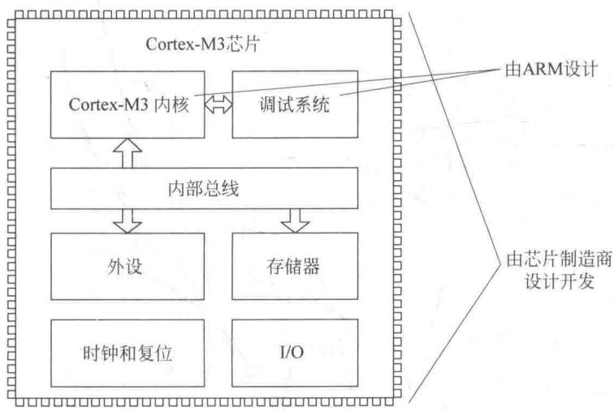

**这张图怎么读？先只看三件事：**

1. **左边那个大方框**：它代表"一颗 Cortex-M3 芯片"。注意图里特意画了芯片外面的引脚（方框周围的小方块），说明我们是在看"芯片内部有什么"。
2. **虚线右边的两个大括号**：
   - 上面那个括号圈住"**Cortex-M3 内核**"和"**调试系统**"，标注是"**由 ARM 设计**"；
   - 下面那个括号圈住"**外设**""**存储器**""**时钟和复位**""**I/O**"，标注是"**由芯片制造商设计开发**"。
3. **中间的"内部总线"**：内核和外设、存储器之间所有的数据都要经过它。

**这张图到底想让我理解什么？**

> 一颗 STM32 芯片 ≠ ARM 公司做的。
>
> **ARM 公司只卖"内核 + 调试系统"这套设计图纸；仓库、传送带、专用设备（外设、存储器、时钟、I/O）是 ST 这样的芯片厂商自己加上去的。**

这就解释了一个你可能困惑过的现象：为什么不同厂家（ST、NXP、TI……）的芯片都叫"Cortex-M3"，但外设数量、存储器大小完全不同？——因为内核是同一个，外面的配置各家不同。

> 【补充解释】教材原话是："Cortex-M3 处理器包括 ARM 公司提供的 Cortex-M3 内核和调试系统，另外配置了相应的时钟、存储器、外设以及 I/O 组件等部件……不同半导体厂商会有不同的配置，包括存储器容量、类型、外设等。"说的就是上面这件事。

### 再看一张更细的结构图

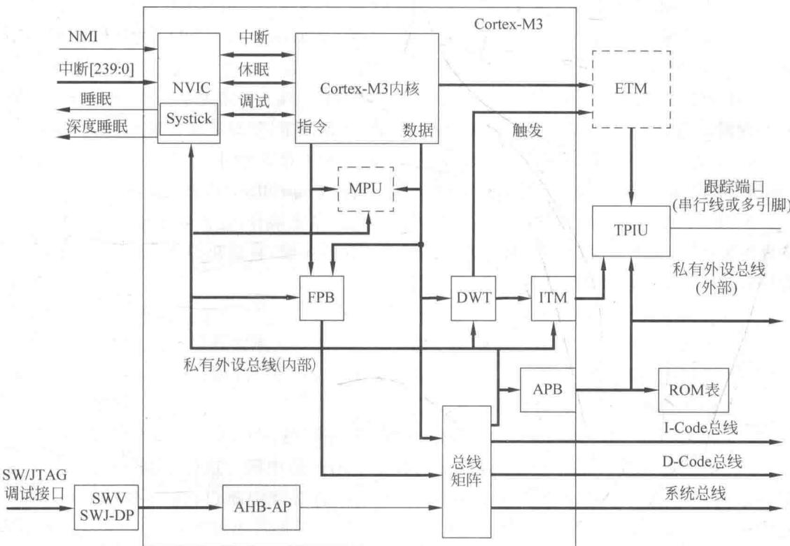

这张图信息量大得多。**不要一次看完**，我们按"逐层搭积木"的方式拆成三步。

#### 第一层：只看最上面的"内核"

图的最上方是 **Cortex-M3 内核（Cortex-M3 core）**，它是整个处理器的核心——**也就是平常所说的 CPU**。

教材说内核内部包含：

```
指令取指单元  →  译码单元  →  寄存器组  →  运算器
（把指令拿进来）  （看懂它）  （暂存数据）  （真的算）
```

正好对应前面讲的"取指令 → 译码 → 执行"三步。

#### 第二层：看内核旁边挂着的"专用设施"

内核周围挂着一圈"帮手"，教材列了这些（先把名字认下来，细节后面章节或本节稍后展开）：

| 名称 | 全称 / 中文 | 大白话说它是干什么的 |
|---|---|---|
| **NVIC** | Nested Vectored Interrupt Controller / 嵌套向量中断控制器 | 中断的"总调度室"：谁敲门、该不该开门、先开哪个门，它管 |
| **SysTick** | System Tick Timer / 系统滴答定时器 | 一个 24 位倒计时计数器，能定时产生中断，像"每 1ms 响一次的闹钟"；**即使系统处于睡眠模式也能正常工作**（教材 2.1.2） |
| **总线矩阵** | Bus Matrix | 一堆总线的"立交桥"，让多条总线能同时通；此外还负责**非对齐访问转换**、**位带支持**，并提供**写缓冲区**（用来缓冲写数据）（教材 2.1.2） |
| **FPB** | Flash Patch and Breakpoint unit / Flash 修补和断点单元 | 调试用：下硬件断点、把某段代码"补丁"到别处 |
| **DWT** | Data Watchpoint and Trace unit / 数据观察点和触发单元 | 调试用：监视某个变量/地址什么时候被访问 |
| **ITM** | Instrumentation Trace Macrocell / 仪表跟踪宏单元 | 调试用：把程序里的信息"打印"出来（类似 printf 调试） |
| **MPU** | Memory Protection Unit / 内存保护单元 | 可选件：给存储器划"禁区"，防止程序乱写 |
| **ETM** | Embedded Trace Macrocell / 嵌入式跟踪宏单元 | 可选件：记录 CPU 执行过哪些指令 |
| **TPIU** | Trace Port Interface Unit / 跟踪端口接口单元 | 把上面那些跟踪数据"送出去"给分析仪 |
| **ROM 表** | ROM Table | 一张"说明书"，告诉调试器芯片里有哪些调试部件、在什么地址 |

> 【补充解释】看到这么多英文缩写不用慌。这张表里**只有 NVIC、SysTick、总线矩阵**是本章和后面章节真正要用的；FPB/DWT/ITM/ETM/TPIU/ROM 表全是**调试（debug）**用的，属于"开发工具链"范畴，知道有这么回事就够了。本讲义后续讲中断时会重点讲 NVIC。

**教材 2.1.2 还列了这几个部件的特性，讲义之前漏掉了，这里补上（都是教材原文里明确写出的）：**

- **NVIC 的 7 条特性**（教材 p33）：
  1. 外部中断可配置为 **1～240 个**；
  2. **优先级位可配置为 3～8 位**（3 位 = 8 级，8 位 = 256 级）；
  3. **支持电平和边沿中断**（外部来的中断请求可以是"高电平一直有效"，也可以是"一个跳变沿触发一次"）；
  4. 中断优先级可**动态重新配置**（运行时还能改）；
  5. **优先级分组**，分为占先（抢占）中断等级和非占先中断等级（见 2.8.1）；
  6. 支持**咬尾**（tail-chaining）和**迟来**（late arrival）中断，使能"背对背"中断处理（见 2.8.7）；
  7. 处理器状态在进入中断时**自动保存**、退出时**自动恢复**，不需要多余的指令（见 2.8.5）。
- **SysTick**：它是一个 **24 位**倒计时计数器，所有 Cortex-M3 处理器都有它；**即使系统处于睡眠模式，它也能正常工作**（这一点很实用：可以用它把系统从睡眠中"叫醒"）。
- **总线矩阵**：除了"立交桥"作用，它还负责：① 把**非对齐访问**转换成对齐访问；② 把**位带别名访问**转换成对位带区的访问（读是"位域提取"，写是"原子的读-改-写"，见 2.7.1）；③ 提供**写缓冲区**，用来缓冲写数据。
- **内核集成了分支预测**（教材 2.1.1）：流水线会"猜"分支往哪边走（见 2.3 节的分支惩罚），猜对了就不用清洗流水线。

> 【补充解释】"电平/边沿""背对背中断"这些词现在看不懂没关系——它们分别在 2.8.3（中断输入）、2.8.7（高级中断技术）里展开。这里只要先知道"NVIC 不只是'能分优先级'，还有这些具体能力"。

【辅助理解图】

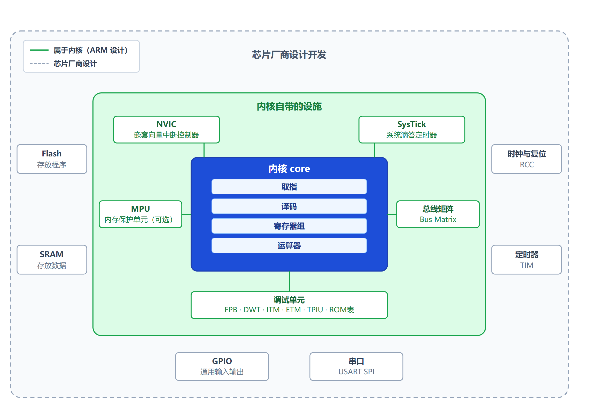

**看图方法**：图分成三圈。

- **最内圈（深蓝）**：内核，写"取指 / 译码 / 寄存器组 / 运算器"。
- **中间圈（绿色）**：内核自带的"贴身设施"，围着内核画五个小方块，分别写 **NVIC（中断总调度）**、**SysTick（系统节拍）**、**总线矩阵（总线立交桥）**、**MPU（内存保护）**、**调试单元（FPB/DWT/ITM/ETM/TPIU）**。用实线连到内核，表示"属于内核"。
- **最外圈（灰色虚线框）**：芯片厂商加的东西，写 **Flash（程序）**、**SRAM（数据）**、**外设（GPIO/定时器/串口…）**、**时钟与复位**、**I/O 引脚**。

**图的关键标注**：在内圈和外圈之间画一条竖虚线，左侧标"**由 ARM 设计**"，右侧标"**由芯片制造商设计开发**"。

**这张图要我理解**：**哪些是"所有 Cortex-M3 都一样"的（内圈），哪些是"各家芯片自己配"的（外圈）。** 本章只讲内圈。

#### 第三层：看总线矩阵往外连的"外部世界"

内核不直接跟外设、存储器说话，中间隔着一层**总线矩阵**。总线矩阵往外连出几条总线（I-Code、D-Code、系统总线、外设总线），这些总线再连到 Flash、SRAM、各种外设上。

这部分内容就是**教材 2.1.3 总线结构**要讲的。本讲义把这一小节**单独提升成了一个大节（本讲义 2.2 节）**——所以从这里开始，讲义节号比教材节号大 1（对照表在本章开头）。

> 📌 **看教材时请注意**：本讲义正文写"见 N.N 节"一律指**本讲义**的节号；凡是指教材的，都会明确写成"教材 N.N 节"。例如本句里的"教材 2.1.3"就是教材的编号，对应本讲义 **2.2 节**。

### 用大白话理解：整个处理器像什么？

> 【类比】
> 把 Cortex-M3 处理器想象成一家**小型快递站**：
>
> - **内核** = 站长本人。他只干一件事：处理一件件"运单"（指令）。
> - **寄存器组** = 站长桌面上的一小排格子，临时放正在处理的运单。
> - **总线矩阵** = 站里的立交桥，让"进货的车"和"送货的车"不用抢一条道。
> - **NVIC** = 前台接待。有人来敲门（中断），由它决定先接待谁。
> - **SysTick** = 墙上的挂钟，每"滴答"一次就提醒站长一次。
> - **调试系统** = 装在站里的摄像头和记录仪，方便工程师事后复盘。
>
> **类比的边界**：真实硬件里没有"站长"这个会思考的人，一切都是电路按固定时序自动完成的；"立交桥"也不是真的桥，而是总线互联网络。这个类比只是帮你记住**谁在跟谁打交道**。

### 正式知识：Cortex-M3 内核的 10 条特性

教材列出了内核的 10 条特性。逐条翻译成大白话：

**（1）采用 ARM V7-M 架构，包括所有 16 位 Thumb 指令集和基本的 32 位 Thumb-2 指令集；Cortex-M3 不能执行 ARM 指令。**

- **架构（architecture）** = 一整套"规定"：有哪些指令、寄存器怎么编号、异常怎么处理。ARM V7-M 就是这套规定的名字。
- **Thumb 指令集**：ARM 的一种指令编码方式，**把指令重新编码成 16 位**，好处是同样多的功能占用更少的存储空间（**代码密度高**）。
- **Thumb-2**：在 Thumb 基础上改进，**同时支持 16 位和 32 位指令**——既有 16 位指令的"省空间"，又有 32 位指令的"高性能"。
- **Cortex-M3 不能执行 ARM 指令**：这是一条硬性事实。ARM 指令是 32 位定长的老指令集，Cortex-M3 只认 Thumb/Thumb-2。所以如果你看到"ARM 状态"，在 Cortex-M3 上是不可用的。

> 【先补一个前置知识：什么叫"指令是 16 位 / 32 位"？】
> 一条指令在存储器里也要占地方。16 位指令占 2 字节，32 位指令占 4 字节。
> 同样一段程序，用 16 位指令写，占的 Flash 空间更少——这就是"代码密度高"。
> 但 16 位能表达的信息少（能用的寄存器少、能写的立即数范围小），所以复杂操作还得用 32 位指令。

**（2）哈佛处理器架构，在加载/存储数据的同时能够执行指令取指。**

哈佛结构 = **指令和数据走两套独立的总线**，所以"取指令"和"读/写数据"可以同时进行。第 1 章讲过，这里直接用。

**（3）三级流水线。**

见 **2.3 节**，本章重点。另外教材 2.1.1 提到内核**集成了分支预测**：流水线会"猜"跳转的方向，猜对了就不用清洗管线（见 2.3 节的分支惩罚），这也是 Cortex-M3 缩短分支损失的手段之一。

**（4）32 位单周期乘法，硬件除法指令 SDIV 和 UDIV（Thumb-2 指令）。**

- "单周期乘法"：一条 32 位乘法指令 1 个时钟周期就能算完。
- **SDIV** = Signed Divide，有符号除法；**UDIV** = Unsigned Divide，无符号除法。有硬件除法电路，不用软件慢慢凑。

**（5）具有分组的堆栈指针（SP）。**

就是有 **MSP** 和 **PSP** 两个堆栈指针，共用 R13 这个名字。R13 在 **2.4.1 节**讲，双堆栈机制在 **2.6.2 节**详细展开。

**（6）处理模式（handler mode）和线程模式（thread mode）。**

见 **2.5 节**。

**（7）Thumb 状态和调试状态。**

**（8）可中断-可继续（interruptible-continued）的 LDM/STM、PUSH/POP，实现低中断延迟。**

意思是：像"一次搬 8 个寄存器"这种多寄存器操作，如果中途来了中断，可以**先暂停、记住搬到哪了，中断处理完再接着搬**，不用从头再来。

**（9）可以实现低延迟地进入和退出中断服务程序（ISR）；无需多余指令，自动保存和恢复处理器状态，在保存状态的同时从存储器中取出异常向量。**

**ISR** = Interrupt Service Routine = 中断服务例程 = "被打断后要去执行的那段处理程序"。

这条是 Cortex-M3 最漂亮的设计之一：**入栈（保存现场）和取向量（找到处理程序的入口）是同时进行的**。因为入栈走的是系统总线，取向量走的是 I-Code 总线——两条路，可以并行。这就是哈佛结构带来的好处。

**（10）支持 ARM V6 架构的 BE8/LE 和非对齐访问。**

- **BE8/LE**：大端 / 小端两种字节顺序（见 **2.7.2 节**）。
- **非对齐访问**：比如一个 32 位数存在地址 0x1001（不是 4 的倍数）上，CPU 也能读，硬件会自动拆成两次对齐访问再拼起来。

### 用一张图把总体结构再捋一遍

【辅助理解图】

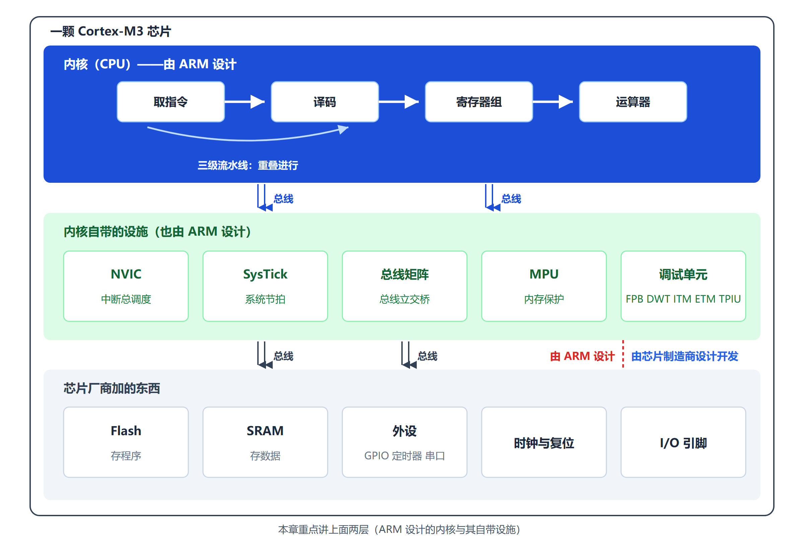

**看图方法（分三层看）：**

1. **最上面一层（蓝色）**：ARM 公司设计的内核，里面就是"取指 → 译码 → 寄存器组 → 运算器"这条主干。**这是本章的主角。**
2. **中间一层（绿色）**：内核自带的设施——总线矩阵、NVIC、SysTick、MPU、调试单元。它们"贴着"内核，不属于外设。
3. **最下面一层（灰色）**：芯片厂商加的东西——Flash、SRAM、GPIO、定时器、串口等等。这些要到第 3 章以后才详细讲。

**这张图要我理解的核心是**：本章只讲上面两层（ARM 设计的那部分）；下面那一层是"别家厂商自己加的"，所以不同芯片不一样。

### 本节真正要记住什么

1. 一颗 Cortex-M3 芯片 = **ARM 设计的内核 + 调试系统** 与 **芯片厂商设计的外设/存储器/时钟/IO**，中间靠**总线**连接。
2. 内核内部就是"**取指 → 译码 → 执行**"这条主干。
3. 内核自带的关键设施：**NVIC（中断）、SysTick（定时）、总线矩阵（总线互联）、MPU（保护）**。
4. Cortex-M3 是 **ARMv7-M 架构、Thumb-2 指令集、32 位、哈佛结构、三级流水线**。

---

## 2.2 总线结构（教材 2.1.3）

### 先别急着看教材：这一节到底要干什么？

第 1 章你已经知道"总线 = 公共道路"。这一节要回答：

> **Cortex-M3 内部到底有几条"路"？每条路分别通向哪里？为什么需要这么多条？**

答案是：**有三个不同的原因，各自要分出一条路**：

1. 因为 Cortex-M3 是**哈佛结构**，所以"取指令"和"读数据"要分路走（→ I-Code / D-Code）；
2. 因为内核既要访问存储器，又要访问**挂在系统总线上的各种设备**（SRAM、片上外设、片外 RAM、片外设备），这些访问合成一条主路（→ 系统总线）；
3. 因为内核还有一批**只属于它自己的控制/状态寄存器**（NVIC、SysTick、MPU、调试部件），这些"自己的东西"走一条**专用小路**（→ 外设总线 PPB）。

> ⚠️ 特别注意第 3 条：**"快慢"不是分这两条路的原因。** 片上外设（GPIO、定时器等）不管快慢都挂在**系统总线**上；真正的"快慢分档"发生在系统总线的**下游**——高速设备用 AHB，慢速外设要经过 **AHB-APB 桥**转成 APB（下面会讲）。PPB 分出来的原因只有一个：它是**内核私有的**，普通外设不许挂上去。

### 用大白话理解：为什么不能只有一条路？

> 【类比】
> 一个城市如果只有一条主干道，会发生什么？
>
> - 拉货的大卡车（数据）和送快递的小电驴（指令）堵在一起；
> - 结果谁都快不了。
>
> 所以城市要修**多条分工不同的路**：货运专线、城市主干道、内部办公区的小路。
>
> **类比的边界（重要）**：这个类比只用来说明"多条路分工"这一层意思。Cortex-M3 里分出 PPB 这条路，**不是因为它是"小区支路所以慢"**，而是因为它**只服务于内核自己的寄存器**——所以下面"为什么分路"的三条理由才是本体，城市类比只是帮你看个大概。

Cortex-M3 就是这么干的。它把总线分成几条：

| 总线名 | 通向哪里 | 典型用途 |
|---|---|---|
| **I-Code 总线** | 代码区（存程序的 Flash） | **取指令** |
| **D-Code 总线** | 代码区（存程序的 Flash） | 从代码区**读数据**、调试访问 |
| **系统总线** | SRAM、片上外设、片外 RAM、片外设备 | 读/写内存和外设 |
| **外设总线（PPB，Private Peripheral Bus，私有/专用外设总线）** | 内核自带的"私有外设"和调试部件（整段 `0xE0000000～0xE00FFFFF`） | **内部段** `0xE0000000～0xE003FFFF`：访问 NVIC、SysTick、MPU（= SCS）；**外部段** `0xE0040000～0xE00FFFFF`：访问 TPIU、ETM、ROM 表 |

> 【术语】**PPB** = **Private Peripheral Bus** = **私有外设总线**（教材也译作"专用外设总线"）。"私有"的意思是：这条总线专门给内核自己用，普通外设（GPIO、定时器、串口）不挂在这条路上。

**为什么 I-Code 和 D-Code 要分开？** 因为它们通向同一个地方（Flash），但用途不同——一个是"拿指令"，一个是"拿数据"。分开之后，取指令和取数据可以**同时**进行，这就是哈佛结构的意义。

**为什么系统总线和外设总线（PPB）要分开？** 因为这两条路服务的对象完全不同：

```
系统总线（AHB-Lite = Advanced High-performance Bus 的精简版）＝ 主路
   ├─ SRAM、片上外设（GPIO/定时器/串口…，0x40000000 起）、片外 RAM、片外设备
   └─ 所有"存数据、用外设"的访问都走这里

外设总线 PPB（内核私有通道）
   ├─ 内部段 0xE0000000～0xE003FFFF：NVIC、SysTick、MPU（= SCS）
   └─ 外部段 0xE0040000～0xE00FFFFF：TPIU、ETM、ROM 表
       （只通向"CPU 自己的设置面板"和调试部件，不挂普通外设）
```

分开的好处是：**内核访问自己的控制/状态寄存器时，不必和满负荷的存储器访问去抢同一条路**。而且这条"私有小路"上只挂内核自己的少量部件——内部段（NVIC、SysTick、MPU）走 **AHB 专用外设总线**，外部段（TPIU、ETM、ROM 表，都是调试用）走 **APB 专用外设总线**就够了；两种总线之间由总线桥/总线矩阵连接。

> ⚠️ 【容易搞混，这次一次说清】**"片上外设"（GPIO、定时器、串口……）挂在系统总线上，不是在 PPB 上。** PPB 上只有"内核自己的东西"（NVIC、SysTick、MPU、调试部件）。这就是为什么 NVIC 的地址（`0xE000E000`）和 GPIO 的地址（`0x40010800`）看起来"离得很远"——它们本来就在两条不同的路上。
>
> **一句话记牢这两条线（考试常问"NVIC 挂在哪条总线上"）：**
>
> ```
> 地址 0x40000000 起（GPIO、定时器、串口…）  →  系统总线（AHB-Lite）
>       └─ 慢速外设再经过 AHB-APB 桥，转到 APB 上
>
> 地址 0xE0000000 起（NVIC 0xE000E000、SysTick、MPU）→  PPB 的"内部段"（= SCS）
> 地址 0xE0040000 起（TPIU、ETM、ROM 表）        →  PPB 的"外部段"
> ```
>
> 也就是说：**NVIC 挂在 PPB（外设总线）上**；PPB 不是"慢速外设总线"，它是**内核专用的私有总线**。

### 正式知识：AMBA 总线标准

【教材内容】

由 ARM 公司推出的 **AMBA**（**A**dvanced **M**icrocontroller **B**us **A**rchitecture，先进微控制器总线架构）片上总线已成为一种流行的片上结构工业标准，主要包括：

> 【术语】**AMBA** = **Advanced Microcontroller Bus Architecture** = **先进微控制器总线架构**。
> 注意：AMBA 不是"某一条总线"，而是 ARM 规定的一整套"片上总线怎么设计、怎么互联"的**标准族**；下面表里的 AHB、APB 就是符合这套标准的两种总线。

| 缩写 | 英文全称 | 中文 | 特点 |
|---|---|---|---|
| **AHB** | Advanced High performance Bus | 高性能总线 | 用于高性能模块（CPU、DMA 等）之间的连接 |
| **APB** | Advanced Peripheral Bus | 外设总线（**注意：这个"外设总线"指的是低速外设用的总线协议，不要和内核私有的 PPB 混为一谈**） | 用于低带宽（低速）外设之间的连接 |
| **AHB-Lite** | Advanced High performance Bus **Lite** | 精简版 AHB | 定义了一种没有"多主"总线功能的纯 AHB 接口子集 |

> 【先补一个前置知识：什么叫"多主（multi-master）"？】
> "主（master）"指能主动发起传输的一方，比如 CPU、DMA 控制器。
> "多主"就是允许同时有多个设备都能发起传输（需要仲裁谁先谁后）。
> AHB-Lite 砍掉了这个复杂功能，只允许一个主设备——对 Cortex-M3 内核这种简单场景足够了。

Cortex-M3 内核通过**总线矩阵**对外提供四条总线。其中：

- I-Code、D-Code、系统总线 → 基于 **AHB-Lite** 协议，**32 位**；
- 外设总线 → 基于 **APB** 协议，**32 位**。

### 四条总线的地址范围（重点，要会算）

这是本章第一个"地址 + 偏移"的实例，我们一步步来。

**【先补一个前置知识：怎么读这种"地址段"？】**

```
0x00000000 ～ 0x1FFFFFFF
```

- `0x` 表示后面是十六进制数（第 1 章讲过）。
- 每个十六进制位 = 4 个 bit，8 个十六进制位 = 32 bit = 4 字节。
- 所以 `0x00000000` 和 `0x1FFFFFFF` 都是 32 位地址。
- 从 `0x00000000` 到 `0x1FFFFFFF` 一共有多大？

算一下：

```
0x1FFFFFFF - 0x00000000 + 1
= 0x20000000
= 2 × 16^7
= 2 × 268 435 456
= 536 870 912 字节
= 512MB
```

> 记一个小技巧：**`0x20000000` 字节 = 512MB**，`0x40000000` = 1GB，`0x80000000` = 2GB，`0xFFFFFFFF`+1 = 4GB。
> 因为地址每多一位十六进制，容量就乘 16。

四条总线的地址范围如下：

| 总线 | 默认映射地址段 | 大小 | 说明 |
|---|---|---|---|
| **I-Code 指令总线** | `0x00000000 ～ 0x1FFFFFFF` | 512MB | 从代码区取指令和向量 |
| **D-Code 数据总线** | `0x10000000 ～ 0x1FFFFFFF` | 256MB | 对代码区做数据加载/存储及调试访问 |
| **系统总线** | `0x20000000 ～ 0xDFFFFFFF` 和 `0xE0100000 ～ 0xFFFFFFFF` | 3GB + 512MB−1MB | 访问 SRAM、片上外设、片外 RAM、片外设备 |
| **外设总线（PPB）** | **整段** `0xE0000000 ～ 0xE00FFFFF`<br>（教材只列了外部段 `0xE0040000 ～ 0xE00FFFFF`，实际可用 `0xE0042000 ～ 0xE00FF000`） | 1MB | **内部段** `0xE0000000～0xE003FFFF`：NVIC（`0xE000E000`）、SysTick、MPU（= SCS）；**外部段** `0xE0040000～0xE00FFFFF`：TPIU、ETM、ROM 表 |

> 📌 **这两张表为什么长得不一样？**
> 第一张（"通向哪里"）按**实际结构**写：PPB 从 `0xE0000000` 起，内部段放 NVIC/SysTick/MPU，外部段放调试部件。第二张（"教材给的地址段"）**照录教材**——教材 2.1.3 只写了 PPB 的外部段 `0xE0040000～0xE00FFFFF`。
> **两处不矛盾**：`0xE0040000～0xE00FFFFF` 只是 PPB 的**后半段**；前半段 `0xE0000000～0xE003FFFF` 就是 NVIC 所在的"内部专用外设区（SCS）"。**NVIC 确实挂在 PPB 上**（见 2.7 节的存储器映射表）。
>
> 【待核验】教材 p34 把 D-Code 总线的地址段写作 `0x10000000～0x1FFFFFFF`；多数资料与 ARM 官方描述为 D-Code 覆盖**整个代码区** `0x00000000～0x1FFFFFFF`。此处照录教材，疑点已记入文末"待核验"。
>
> 【待核验】教材 p35 把 PPB 写作 `0xE0040000～0xE00FFFFFF`（多了一个 F）；按同页"共 768KB"计算应为 `0xE0040000～0xE00FFFFF`。教材 p35 系统总线第二段写作 `0xE0100000～0xFFFFFFF`（只有 7 个 F），应为 `0xFFFFFFFF`。
>
> 【待核验】教材 p35 写 PPB 时只给了外部段 `0xE0040000～0xE00FFFFF`，**没有提内部段 `0xE0000000～0xE003FFFF`**（NVIC 就在那里）。按教材 2.6.1 的存储器映射（本讲义 2.7 节）和 ARM 架构定义，PPB 的完整范围是 `0xE0000000～0xE00FFFFF`（共 1MB）。本讲义的"通向哪里"表按完整范围写，此处照录教材的写法并标注差异。

### I-Code 总线的两个重要细节

**细节 1：取指令总是"按字（4 字节）"取，即使指令只有 16 位。**

为什么？

```
CPU 一次从 I-Code 总线拿 32 位 = 4 字节
                ↓
    一次就能装下 2 条 16 位的 Thumb 指令
```

所以教材说"CPU 一次可以取出 2 条 16 位的 Thumb 指令"。这一点在讲流水线时非常重要。

**细节 2：D-Code 总线上的地址总是"对齐"的。**

- **对齐（aligned）**：地址是数据宽度的整数倍。比如读 4 字节（字）时地址是 4 的倍数，读 2 字节（半字）时地址是 2 的倍数。
- 即使你写了一条"非对齐"的访问（比如从 0x1001 读 4 字节），**总线上的地址依然是 0x1000**，硬件会把它拆成两次对齐访问，再把结果拼装成你要的数据。

> 【类比】
> 你要从书架上抽"第 3 页到第 6 页"这 4 页，但书架规定"每次只能整叠地抽"。
> 于是管理员抽了"第 1～4 页"和"第 5～8 页"两叠，再把你要的那 4 页挑出来给你。
> 结果一样，只是多动了一次手。

### 看教材原图：一个典型的总线连接范例

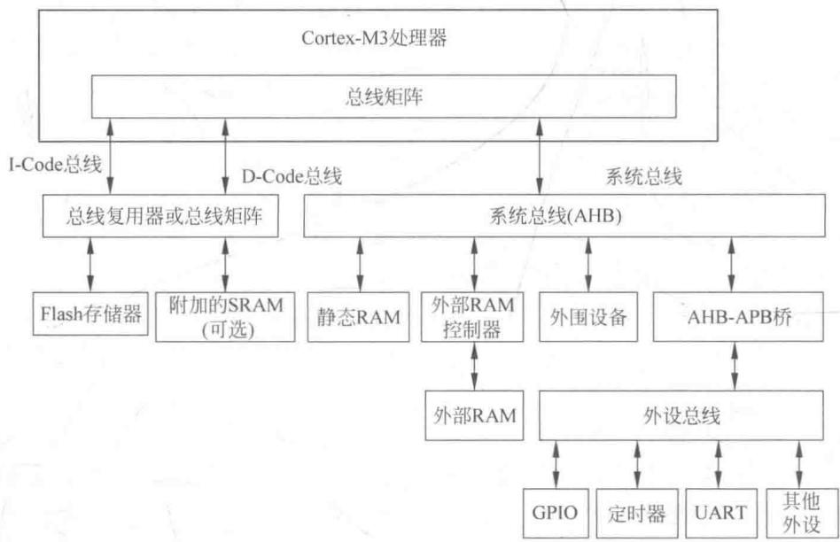

**这张图怎么读？**

1. **先看最上面**：Cortex-M3 内核。它是整个图的"源头"。
2. **从内核往下的箭头**：标着 I-Code、D-Code、System（系统总线）、PPB（外设总线）——这就是四条总线从内核"伸出来"。
3. **中间那个大方块**：**总线矩阵（Bus Matrix）**。四条总线全部进入它，再由它连到不同的存储器/外设上。它就是"立交桥"。
4. **最下面一排方块**：Flash（存程序）、SRAM（存数据）、各种外设。
5. **注意"AHB-APB 桥"**：高速的 AHB 总线要连到低速的 APB 外设上，中间必须过一座"桥"。

**这张图到底想让我理解什么？**

> **内核不直接连任何存储器或外设。所有访问都要先经过总线矩阵，由总线矩阵决定"这次访问该走哪条路、去哪个地址"。**

这就解释了一个后面会反复用到的事实：**你写一条访问 `0x40010800` 的指令，硬件会自动把它送到"系统总线"上，因为 0x40010800 属于片上外设区**。地址本身就决定了走哪条路。

### 用一张图看清四条路

【辅助理解图】

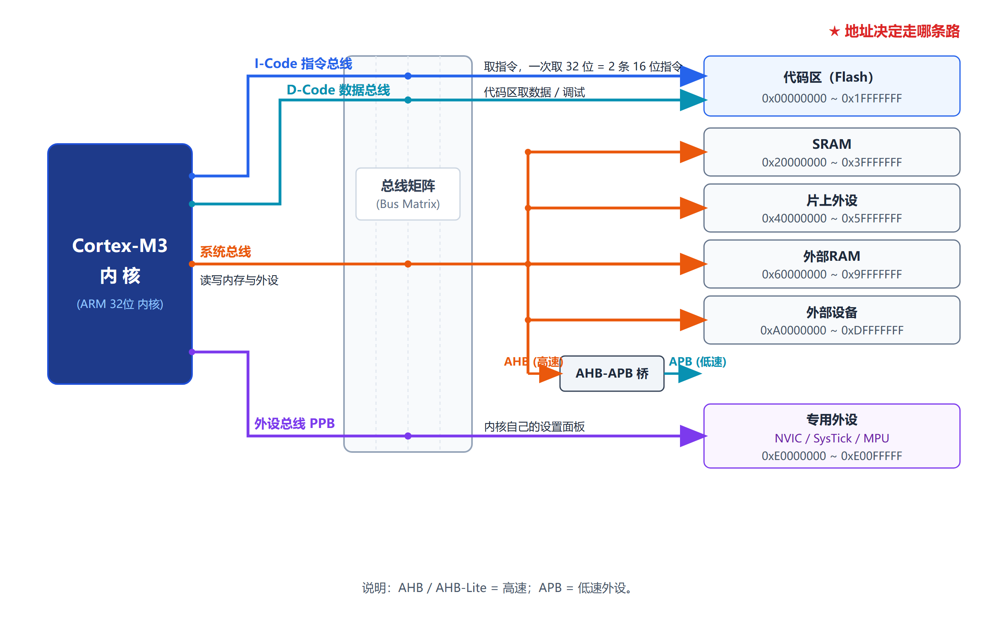

**看图方法：**

1. 左边是内核，右边是各种存储器/外设，中间是总线矩阵。
2. 从上往下看四条彩色的"路"：
   - **蓝色 I-Code**：只走"指令"，通向代码区；
   - **青色 D-Code**：走"数据"，也通向代码区；
   - **橙色系统总线**：走 SRAM 和外设，是后面章节最常用的一条；
   - **紫色 PPB**：只通到内核自己的专用外设（NVIC 等）。
3. 图右侧标出每条路对应的地址段——**记住"地址决定走哪条路"这句话**。

### 本节真正要记住什么

1. Cortex-M3 是**哈佛结构**：指令和数据走不同的总线，可以并行。
2. 四条总线：**I-Code（取指令）、D-Code（代码区取数据）、系统总线（SRAM/外设）、PPB（内核专用外设）**。
3. **NVIC 挂在 PPB 上**（地址 `0xE000E000`，属于 PPB 的内部段 = SCS）；**GPIO、定时器、串口这些片上外设挂在系统总线上**（`0x40000000` 起）。PPB 是"内核私有"，不是"慢速总线"。
4. 总线协议分两档：**AHB/AHB-Lite（快）** 和 **APB（慢）**，中间用 AHB-APB 桥连接；慢速外设是在系统总线**下游**经桥转到 APB 的。
5. **I-Code 一次取 32 位**，所以能一次拿到 2 条 16 位指令。
6. 地址段本身决定了这次访问走哪条总线。

---

## 2.3 流水线（教材 2.2）

### 先别急着看教材：这一节到底要干什么？

这一节回答一个非常关键的问题：

> **CPU 一次只能做一件很小的事，为什么它看起来这么快？**

答案是：**流水线（pipeline）**。

这是本章最"聪明"的一个设计，也是理解后续"中断延迟""PC 为什么 +4"的关键。

### 用大白话理解：洗衣服的流水线

> 【类比】
> 假设洗一桶衣服要三步：**洗 → 烘 → 叠**，每步各 1 小时。
>
> **没有流水线（串行）**：
> ```
> 第1桶：洗(1h) → 烘(1h) → 叠(1h)      → 3 小时出 1 桶
> 第2桶：洗(1h) → 烘(1h) → 叠(1h)      → 又是 3 小时
> 第3桶：洗(1h) → 烘(1h) → 叠(1h)      → 又是 3 小时
> 3 桶一共 9 小时
> ```
>
> **有流水线**：让洗衣机、烘干机、叠衣台同时开工，每 1 小时就有一桶完成一步：
> ```
> 时刻1：洗第1桶
> 时刻2：烘第1桶  洗第2桶
> 时刻3：叠第1桶  烘第2桶  洗第3桶      → 第1桶好了！
> 时刻4：        叠第2桶  烘第3桶      → 第2桶好了！
> 时刻5：                 叠第3桶      → 第3桶好了！
> 3 桶一共 5 小时
> ```
>
> 每桶衣服的处理时间**没有变**（还是 3 小时），但**整体吞吐量提高了**——因为三台机器在同时干不同的活。

CPU 的流水线是完全一样的思路：

- "洗/烘/叠"换成"**取指令 / 译码 / 执行**"；
- "每桶衣服"换成"**每条指令**"。

> **类比的边界**：真实 CPU 的流水线是由寄存器（流水线寄存器）在时钟边沿"锁存"上一级的结果来推进的，不是靠传送带；而且各级耗时并不完全相等，有时还要"暂停"（后面会讲）。但"重叠执行提高吞吐量"这个核心思想是完全对应的。

### 正式知识：三级流水线

【教材内容】

Cortex-M3 处理器执行指令时，采用一个**三级流水线**。单条指令的执行过程分为 3 个阶段：

| 阶段 | 英文 | 中文 | 干什么 |
|---|---|---|---|
| 1 | fetch | 取指令 | 从存储器（代码区）把指令读进来 |
| 2 | decode | 译码 | 看懂这条指令要干什么，准备操作数 |
| 3 | execute | 执行 | 真的去算 / 读写内存 / 跳转 |

### 看教材原图：单条指令的三个阶段


**看图方法**：

1. 从左到右是**时间**（时钟周期）。
2. 三个方块依次是"取指令 → 译码 → 执行"，说明**一条指令要花 3 个时钟周期才能走完**。
3. 注意这是"**只看一条指令**"的情况——它自己独占 3 个周期，中间没有别的指令插进来。

**这张图要我理解**：一条指令的"寿命"是 3 个周期。这只是起点，下面才是重点——把多条指令叠起来看。

### 看教材原图：三级流水线时间轴

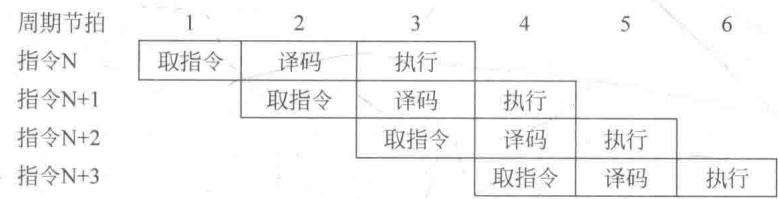

教材这张图本身是一张表格。**为了让 bit 号和时序更精确，这里用 ASCII 表格重排一遍（内容与教材一致）：**

```
周期节拍      1        2        3        4        5        6
──────────────────────────────────────────────────────────────
指令 N      取指令    译码     执行
指令 N+1              取指令    译码     执行
指令 N+2                       取指令    译码     执行
指令 N+3                                取指令    译码     执行
```

**这张表怎么读？**

1. **先看对角线**：`取指令`、`译码`、`执行` 三个动作沿着对角线向右下方排开——这就是"重叠执行"。
2. **再看每一列（每个周期）**：第 3 个周期里，**同时**在做"指令 N 的执行、指令 N+1 的译码、指令 N+2 的取指令"——三条指令同时在流水线的不同阶段。
3. **看总效果**：
   - 如果不用流水线：4 条指令 × 3 周期 = **12 个周期**；
   - 用三级流水线：第 6 个周期结束时 4 条指令全部完成 = **6 个周期**。
   - 指令越多，差距越大。稳定后**每个周期都能完成一条指令**（理想情况）。

**这张图到底想让我理解什么？**

> **单条指令的执行时间没有缩短（还是 3 个周期），但"每周期完成的指令数"提高了。**
>
> 这就是"CPU 看起来很快"的核心原因。

【辅助理解图】

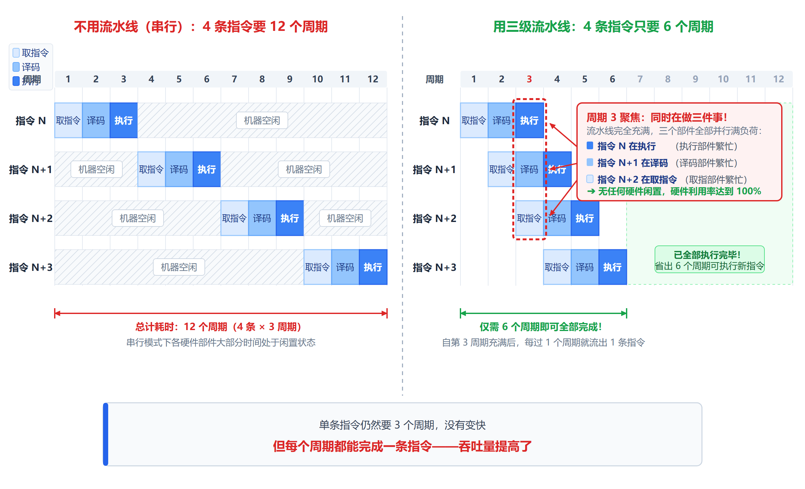

**看图方法**：左半边是"不用流水线"，每条指令独占 3 格，中间大片空白（机器在等）；右半边是"用流水线"，三格错开，机器一直不空闲。对比两张图的总时间，就能直观感受到提速从哪来。

### 为什么有时"隔一个周期才取一次指"？

教材提到一个细节：

> 当运行的指令大多数都是 16 位时，处理器会**每隔一个周期做一次取指**。

为什么？前面 2.2 节讲过：**I-Code 总线一次取 32 位**。

```
一次取指拿到 32 位：
+----------------+----------------+
|   指令 N (16位) | 指令 N+1 (16位) |
+----------------+----------------+
```

一次取指就顺带把**两条** 16 位指令都拿回来了，所以下一次取指可以歇一个周期再取。如果取回来的指令还排在缓冲区里没消化完，总线接口干脆就空闲下来。

> 【补充解释】这不等于"CPU 变快了"或"变慢了"——只是说明**取指不需要每个周期都做**，总线有空闲时间。这个空闲时间后面会被 DMA（第 11 章）等模块利用。

### 流水线的"暂停"（冒险）

教材说：

> 有些指令的执行需要多个周期，在这期间流水线就会暂停。

**为什么会暂停？**

看那个洗衣服的类比：如果"洗"这一步突然要花 3 小时（因为某件衣服特别脏），那么"烘"和"叠"就只能干等——后面没东西可做了。

CPU 里也一样：有些指令（比如除法、访问慢速外设）执行阶段要花好几个周期，后面的指令虽然已经取回来、译码好了，但**必须等前面这条执行完才能往下走**（否则可能算错），于是流水线"停顿"几个周期。

> 【先补一个前置知识：为什么后面的指令不能先执行？】
> 因为指令之间常常有**依赖**：
> ```
> 指令1：R0 = R1 + R2
> 指令2：R3 = R0 + 5     ← 它要用指令1算出的 R0
> ```
> 指令2 必须等指令1 算完 R0 才能开始执行。这种依赖关系会强制流水线等待。
> 在体系结构里，这类"冲突"叫**冒险（hazard）**。

### 分支惩罚与流水线清洗（重点）

**问题**：流水线有一个天生的麻烦——**它总是"猜"下一条指令在哪里**。

正常情况下，指令是一条接一条排着的（地址连续）。所以流水线取完地址 0x8000 的指令，就顺手去取 0x8002、0x8004……但是**分支指令（跳转指令）**会说："别往下走了，去 0x8FEC 那里！"

这时候，流水线之前"顺手取回来、顺手译码好"的那几条指令就**全白干了**，必须扔掉。这个过程叫**流水线的清洗（pipeline flushing）**。

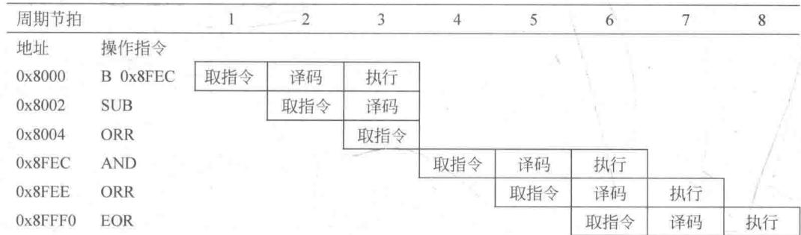

**这张图怎么读？**（这是本章最重要的时序图之一）

先看最左边一列，它是**指令地址**；第二列是**指令**；右边的数字 1～8 是**周期节拍**。

```
周期节拍        1        2        3        4        5        6        7        8
──────────────────────────────────────────────────────────────────────────────
0x8000  B 0x8FEC   [取指令] [译码]  [执行]
0x8002  SUB                [取指令] [译码]  ✗ 丢弃
0x8004  ORR                         [取指令] ✗ 丢弃
0x8FEC  AND                                  [取指令] [译码]  [执行]
0x8FEE  ORR                                           [取指令] [译码]  [执行]
0x8FF0  EOR                                                    [取指令] [译码] [执行]
```

**逐点解读**：

1. **第 1～3 周期**：CPU 取回地址 `0x8000` 处的指令 `B 0x8FEC`（B = Branch，跳转），译码后发现"这是条跳转指令，目标是 0x8FEC"。
2. **但在此之前，流水线已经按"地址连续"的假设，顺手取了 `0x8002` 的 SUB 和 `0x8004` 的 ORR。**
   - `0x8002 SUB` 已经**取指令 + 译码**（第 2、3 周期）；
   - `0x8004 ORR` 只**取指令**（第 3 周期）。
3. **第 3 周期执行完跳转后**，CPU 发现"这两条根本不该执行"，于是**把它们全部丢弃**。
   - 注意地址是 `0x8000`、`0x8002`、`0x8004`——**相差 2**，说明它们是 **16 位指令**（每条 2 字节）。这个小细节教材没强调，但正好印证了前面"16 位指令"的说明。
4. **第 4 周期**，CPU 从 `0x8FEC` 重新开始取指令，流水线重新"灌满"。
5. **代价**：被丢掉的是 **3 个流水线动作**——第 2 周期取回的 `SUB`、第 3 周期译码的 `SUB` 和取回的 `ORR`（都挤在第 2～3 周期里）。它们占用了流水线的时间却没有任何产出；从第 4 周期起流水线才重新"灌"进有用的指令，一直要到第 6 周期才执行出 `AND`。这种浪费就叫**分支惩罚（branch penalty）**。

> ⚠️ 【容易搞混】不要笼统地说"第 3～5 周期都在白干"——对照上面的表看清楚：**被丢弃的工作集中在第 2～3 周期**（第 2 周期：取回 SUB；第 3 周期：译码 SUB + 取回 ORR），**第 4 周期已经在取 AND 了**，第 5 周期在译 AND，第 6 周期 AND 执行完成。图 2-6 里画得明明白白，别记反。
>
> **顺便把一个数字关系理清楚**：白做的是 **3 个流水线动作**，但它们只占用 **2 个时钟周期**——因为第 3 周期里"译码 SUB"和"取回 ORR"这两件白做的事是**同时**发生的。所以从"吞吐量"看，损失相当于 **2 个周期**（第 4、5 周期没有任何指令执行完成）；不要把"3 个动作"直接说成"3 个周期"。

**这张图到底想让我理解什么？**

> **跳转是要付出代价的**：流水线越深，猜错的代价越大。
> 所以现代 CPU 会想各种办法**减少跳转**、**提前猜对跳转方向**（分支预测）。

教材提到：为了改善这种情况，Cortex-M3 支持一定数量的 ARM V7-M 新指令，可以避免很多微型跳转，如 **IF-THEN 语句块**。

> 【补充解释：IF-THEN 语句块是什么？】
> 传统写法里，`if (a > b) { x = 1; }` 这种小小的条件执行，编译后常常会生成一条跳转指令——为了执行一两条指令就要付一次"流水线清洗"的代价，很不划算。
> ARMv7-M 提供了 IF-THEN（IT）指令：**让后面 1～4 条指令"带条件执行"**——条件不满足时它们就当作没执行（相当于空操作），但流水线**不用跳转、不用清洗**。
> 这就是"避免微型跳转"的意思。

【辅助理解图】

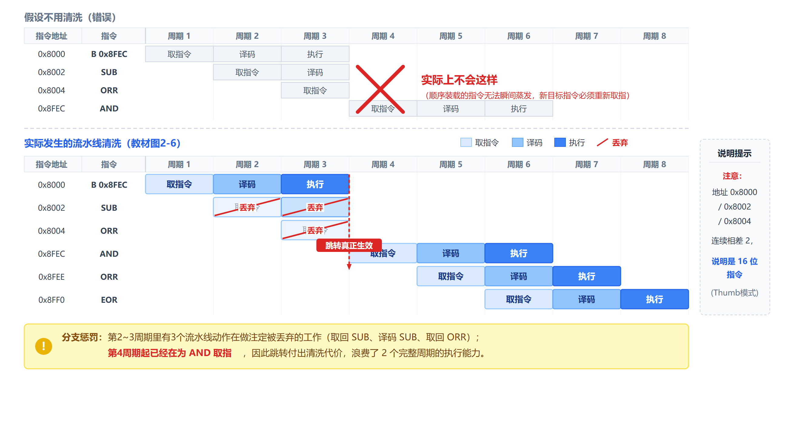

**看图方法**：这张图分上下两栏，横轴都是周期节拍（1～8）。

- **上栏**："**假设不用清洗**"（错误的情况，只用来对比）。画出 `B 0x8FEC`、`SUB`、`ORR` 依次执行，然后在第 4 周期"无缝"接上 `AND`。用一个大红叉标出"**实际上不会这样**"。
- **下栏**："**实际发生的清洗**"（对应教材图 2-6）。画出：
  - `B 0x8FEC`（0x8000）：取指(1)、译码(2)、执行(3)；
  - `SUB`（0x8002）：取指(2)、译码(3)，然后用**红色斜线划掉**，标"**丢弃**"；
  - `ORR`（0x8004）：取指(3)，也用红色斜线划掉，标"**丢弃**"；
  - `AND`（0x8FEC）：取指(4)、译码(5)、执行(6)；
  - `ORR`（0x8FEE）：取指(5)、译码(6)、执行(7)；
  - `EOR`（0x8FF0）：取指(6)、译码(7)、执行(8)。
- **下栏底部**用一段浅黄底标注"**分支惩罚**：第 2～3 周期里有 3 个流水线动作在做"注定被丢弃"的工作（取回 SUB、译码 SUB、取回 ORR）；**第 4 周期起已经在为 AND 取指**"。
- **图右侧**标注一列地址：0x8000、0x8002、0x8004、0x8FEC、0x8FEE、0x8FF0，并在旁边小字写"**地址相差 2 = 16 位指令**"。

**这张图要我理解**：**跳转不是免费的。流水线越"贪心"地预取指令，跳转时浪费的就越多。**

### 一个必须记住的结论：读 PC 得到的是"当前指令地址 + 4"

教材说：

> 由于流水线的存在以及出于对 Thumb 代码兼容的考虑，读取 PC 时，会返回**当前指令地址 + 4** 的值。这个偏移量**总是 4**，不管是执行 16 位指令还是 32 位指令。

**为什么？**

因为在三级流水线里，当一条指令正在"执行"阶段时，**PC 早就已经指向后面了**：

```
第 1 周期：取指令 N     → PC 指向 指令N
第 2 周期：译码 N，同时取指令 N+1  → PC 指向 指令N+1
第 3 周期：执行 N，译码 N+1，取指令 N+2 → PC 指向 指令N+2
```

**关键点**：Cortex-M3 的 PC 设计成在"执行阶段"读出来的值 = 当前指令地址 + 4。

> 为什么是 4 而不是 2？教材的解释是"为了保证 Thumb 和 Thumb2 之间的一致性"——不管是 16 位还是 32 位指令，偏移量都固定是 4，这样写程序时不用去分辨"这条指令是几个字节"。

教材给的例子（原书 p38）：

```asm
0x1000:  MOV R0, PC      ; 教材注释：R0 = 0x1004
```

逐步推演：

```
① 这条指令放在地址 0x1000
② 它要做的事是"把 PC 的值读出来放进 R0"
③ 执行这条指令时，PC 的值已经是 0x1004 = 0x1000 + 4
④ 所以执行完后：R0 = 0x1004
```

> ⚠️ 【容易搞混】很多人第一次看到这里会觉得"PC 不是应该指向当前指令吗？"
> 在**概念上** PC 确实是"当前指令地址"；但在**三级流水线的实际硬件上**，当你去"读"它的时候，它已经指向后面了，所以读回的值是"当前指令地址 + 4"。
> **考试时记住：读 PC → 得到当前指令地址 + 4。**

### 指令缓冲区

教材还提到：内核的预取单元里有一个**指令缓冲区**，允许后续的指令在执行前先在里面排队，能在执行未对齐的 32 位指令时避免流水线"断流"。

> 【补充解释】
> 缓冲区的思路和"超市收银台前的排队区"一样：取指单元提前把指令拿回来放进缓冲区，执行单元需要时直接从缓冲区拿，不用等总线。
> 好处是"缓冲一下波动"——某次取指慢一点，也不至于让执行单元饿着。
> 教材特别说明：**这个缓冲区并不会在流水线中添加额外的级数**，所以不会使跳转导致的性能下降（因为它不是一级流水线，不参与"清洗"）。

### 本节真正要记住什么

1. 三级流水线 = **取指令 / 译码 / 执行**，三级**重叠**进行。
2. 提速的本质：**单条指令耗时不变，但整体吞吐量提高**（理想情况每周期完成 1 条）。
3. 16 位指令可以"隔周期取指"，因为 I-Code 一次取 32 位 = 2 条 16 位指令。
4. 遇到**分支/异常/断点**要**清洗流水线**，被丢弃的取指和译码工作白做 → **分支惩罚**。
5. **读 PC 得到"当前指令地址 + 4"**（这个 +4 后面讲中断入栈时还要用）。
6. 指令缓冲区能"缓冲"取指的波动，但不增加流水线级数。

---

## 2.4 寄存器（教材 2.3）

### 先别急着看教材：这一节到底要干什么？

这一节是**本章最重要的一节**。

> 前面说过：对写程序的人来说，**CPU 的"性格"几乎完全由它的寄存器决定**。
> 所以这一节要把 Cortex-M3 的寄存器**一个不落地介绍清楚**：叫什么、管什么、怎么用。

学完这一节，你再看第 4 章的汇编指令时，就能明白"`MOV R0, #5`"到底动了什么。

### 看教材原图：Cortex-M3 的寄存器组

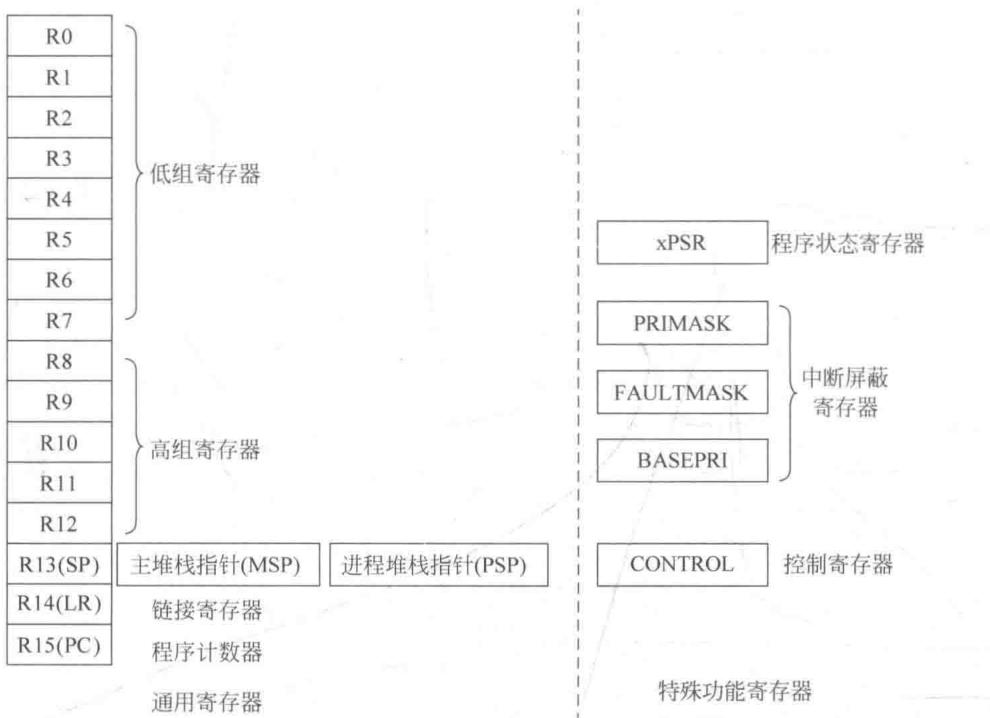

**这张图怎么读？** 图被中间的竖虚线分成了**左右两栏**。

**左栏 = 通用寄存器（General-Purpose Register）**：

```
R0   ┐
R1   │
R2   │
R3   │  低组寄存器（low registers）
R4   │
R5   │
R6   │
R7   ┘
R8   ┐
R9   │
R10  │  高组寄存器（high registers）
R11  │
R12  ┘
R13(SP)  → 主堆栈指针 MSP  /  进程堆栈指针 PSP
R14(LR)  → 链接寄存器
R15(PC)  → 程序计数器
```

**右栏 = 特殊功能寄存器（Special Register）**：

```
xPSR                         程序状态寄存器
PRIMASK  ┐
FAULTMASK├  中断屏蔽寄存器
BASEPRI  ┘
CONTROL                      控制寄存器
```

**这张图到底想让我理解什么？**

> **CPU 手边一共只有这么多"小格子"。**
> 左栏是"随便用来存数据的"，右栏是"控制 CPU 自身行为的开关"。
> 右栏这些寄存器**不能用普通指令随便改**，必须用专门的 `MRS` / `MSR` 指令——因为它们是"设置项"，乱改会让 CPU 行为失控。

【辅助理解图】

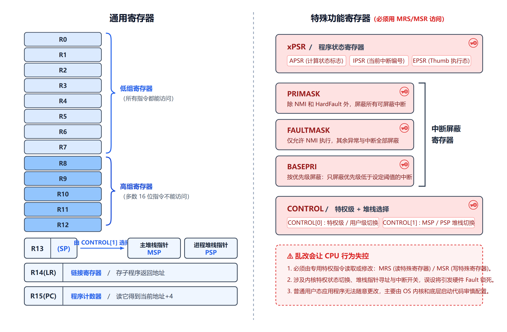

**看图方法**：左边 13 个并排的"便利贴"是 R0～R12，分成浅蓝（R0～R7 低组）和深蓝（R8～R12 高组）两块；下面三个特殊位置是 SP / LR / PC；右边单独一列是四个"控制面板"（xPSR、PRIMASK/FAULTMASK/BASEPRI、CONTROL）。**注意右栏的边框画成"需要钥匙才能打开"的样式**，表示它们必须用 MRS/MSR 访问。

### 2.4.1 通用寄存器

教材说：

> Cortex-M3 的寄存器分为通用寄存器和特殊功能寄存器。其中 R0～R15 为通用寄存器。R0～R7 为低组寄存器，R8～R12 为高组寄存器。

#### 低组寄存器 R0～R7

| 项目 | 内容 |
|---|---|
| 属于谁 | Cortex-M3 内核 |
| 控制什么 | **不控制任何硬件**，只是用来暂存数据 |
| 为什么需要 | CPU 做运算必须先把数据放到寄存器里，没有它们寸步难行 |
| 位宽 | 32 位 |
| 复位后初值 | **随机的**（芯片刚上电时里面是垃圾值，不要假设它是 0） |
| 谁能访问 | **所有指令都能访问**（包括 16 位和 32 位指令） |

**注意最后一条**：绝大多数 16 位 Thumb 指令**只能访问 R0～R7**。为什么？因为 16 位指令编码空间太小，寄存器编号只能占 3 个 bit：

```
3 个 bit → 只能表示 0～7 → 只能指向 R0～R7
```

#### 高组寄存器 R8～R12

| 项目 | 内容 |
|---|---|
| 位宽 | 32 位 |
| 复位后初值 | 随机的 |
| 谁能访问 | **只有少数 16 位 Thumb 指令能访问；32 位指令不受限制** |

**为什么要有"低组/高组"这个区分？**

因为 16 位指令"地方太小"（前面算过，只能编码 8 个寄存器编号），所以把最常用的 8 个（R0～R7）留给 16 位指令用，剩下的 R8～R12 只在需要时由 32 位指令访问。

> 【类比】
> 就像办公室里有两排柜子：前排 8 个（R0～R7）离你最近，随手就能拿到，所以最常用；后排 5 个（R8～R12）要走两步，只有需要时才去拿。
> **类比的边界**：真实硬件里这个区分不是"距离"造成的，而是**指令编码位数不够**造成的。

#### 堆栈指针 R13（SP）

**这是本章第一个"一个名字、两个实体"的寄存器**，请务必看清楚。

【教材内容】

> 堆栈寄存器又称堆栈指针（Stack Pointer，SP）。R13 映射到**两个**堆栈指针：
>
> （1）**主堆栈指针（MSP）**，或写作 `SP_main`，默认堆栈指针，由 OS 内核、异常服务例程以及所有需要特权访问的应用程序代码使用。
>
> （2）**进程堆栈指针（PSP）**，或写作 `SP_process`，由常规的用户应用程序代码使用（即不运行异常服务例程时使用）。

**关键点**：R13 这个名字是"**共用**"的。

```
        你写 R13 / SP
              │
              ▼
      ┌───────────────┐
      │  当前是哪个堆栈？ │   ← 由 CONTROL[1] 决定（见 2.4.2 节）
      └───────────────┘
         │            │
         ▼            ▼
    ┌─────────┐  ┌─────────┐
    │   MSP   │  │   PSP   │
    └─────────┘  └─────────┘
```

**当作为 R13（SP）使用时，只能使用"当前系统状态确定的那个堆栈"**；另一个堆栈寄存器**只能通过特殊指令 MRS 和 MSR 访问**。

- **MRS** = Move from Special register to Register：把特殊寄存器的值读到通用寄存器。
- **MSR** = Move from Register to Special register：把通用寄存器的值写到特殊寄存器。

> 【类比】
> 想象一个办公室里有两张桌子，桌上各有一个"文件堆"（堆栈）。
> 你手上只有一支笔（R13），你写下的"当前文件堆位置"永远是**正在用的那一堆**。
> 想看看另一张桌子的文件堆到哪儿了，必须专门走过去看（MRS）。

为什么需要两个堆栈？**2.6.2 节**会详细讲机制（理由在 2.5 节已经给出：**让操作系统的堆栈和应用程序的堆栈分开，程序出错不会毁掉系统**）。

#### 链接寄存器 R14（LR）

**R14 = Link Register = 链接寄存器。**

| 项目 | 内容 |
|---|---|
| 属于谁 | 内核 |
| 控制什么 | 不控制硬件；**用来存"子程序返回地址"** |
| 为什么需要 | 调用子程序后要能回到原来的地方，得有人记住"回来的路" |
| 位宽 | 32 位 |
| 汇编写法 | **LR 和 R14 可以互换**（写哪个都行） |

**它到底怎么工作？**

看教材给的例子（原书 p38）：

```asm
main                       ; 主程序
    ...
    BL function1           ; 用"分支并连接"指令调用 function1
    ; PC = function1, 并且 LR = main 中当前行指令的下一条地址
function1
    ...                    ; function1 的代码
    BX LR                  ; 函数返回
    ;（如果 function1 要使用 LR，必须在使用前 PUSH，
    ;  否则返回时程序就可能跑飞了）
```

**逐行解释"代码 → CPU 做什么 → 寄存器发生什么 → 硬件发生什么"：**

| 代码 | CPU 做什么 | 寄存器发生什么 | 硬件发生什么 |
|---|---|---|---|
| `BL function1` | ① 把"下一条指令的地址"写进 LR<br>② 把 `function1` 的地址写进 PC | `LR = BL 的下一条指令地址`<br>`PC = function1 的地址` | 流水线**清洗**（因为 PC 被改了，前面预取的指令作废）；下一次取指从 `function1` 处开始 |
| `BX LR` | 把 LR 的值搬到 PC，于是"跳"回原来那里 | `PC = LR`（也就是回到 `main` 的下一行） | 流水线再次清洗；从返回地址继续取指 |

- **BL** = Branch with Link = 分支并连接。"连接"的意思就是**顺手把返回地址记到 LR 里**。
- **BX** = Branch and eXchange = 分支并交换（切换指令集状态）。`BX LR` 就是"跳到 LR 指向的地方"。

**为什么 Cortex-M3 要把返回地址放在 LR 里，而不是像有些 CPU 那样直接压栈？**

教材的解释：**为了减少访问内存的次数**。

> 只做"一级子程序调用"时（A 调 B，B 直接返回 A），返回地址就放在 LR 里，**根本不用碰内存**，速度快得多。
>
> 只有当出现"嵌套调用"（A 调 B，B 又调 C）时，LR 会被覆盖，才需要**先把 LR 压栈保存**，然后再调 C。

> ⚠️ 【容易搞混】教材特意加了一句提醒：**"如果 function1 要使用 LR，必须在使用前 PUSH"**。
> 意思是：如果 `function1` 里面还要调用别的函数（或者自己要用 LR 做别的事），就必须**先把 LR 压进堆栈保护起来**，否则调用完回来时 LR 已经被改掉，`BX LR` 就会跳到错误的地方——教材说这叫"程序跑飞"。
>
> **"跑飞"** 是嵌入式开发的常用口语，指程序执行到不该去的地方，行为完全失控。

#### 程序计数器 R15（PC）

**R15 = Program Counter = 程序计数器。**

| 项目 | 内容 |
|---|---|
| 属于谁 | 内核 |
| 控制什么 | **它决定"下一条要执行的指令在哪里"** |
| 为什么需要 | 程序要按顺序执行，必须有人记住"下一条在哪" |
| 位宽 | 32 位 |
| 汇编写法 | **R15 和 PC 可以互换** |

**两个必须记住的特性：**

**特性 1：向 PC 写数据 = 一次程序跳转。**

> 如果向 PC 中写数据，则会引起一次程序的跳转，改变程序的执行流，但此时**不更新 LR 寄存器**。
>
> ——注意最后半句：写 PC 会跳转，但**不会像 BL 那样自动记录返回地址**。所以写 PC 是"有去无回"的跳转；要能回来，得用 BL，或者自己先把返回地址存起来。

**特性 2：PC 的第 0 位（LSB）用于指示 ARM/Thumb 状态。**

这是 ARM 的一个历史遗留设计，非常反直觉，请仔细看：

```
PC 的 bit0：  0 → 表示当前处于 ARM 状态
              1 → 表示当前处于 Thumb 状态
```

- Cortex-M3 只支持 Thumb-2，指令**至少是半字（2 字节）对齐**，所以 **PC 的 LSB 总是读回 0**。
- 但是，**编写分支指令时，加载到 PC 的数值必须是奇数（LSB = 1）**，用来表明"这是 Thumb 代码"。
- 如果写了 0，会被视为"想转入 ARM 模式"——而 Cortex-M3 不支持 ARM 模式，于是**产生一个 Fault 异常**。

> 【类比】
> 就像快递单上有一个"是否需要签收"的勾选框（LSB）。地址本身是"送到哪个门牌号"，勾选框表示"按哪种规矩办"。
> 由于 Cortex-M3 只认一种规矩（Thumb），所以这个勾选框**必须勾上**，否则系统认为你要求办一件它办不到的事，就报警（Fault）。
> **类比的边界**：真实硬件里 bit0 不参与"地址计算"，它纯粹是一个状态标记位，地址部分是从 bit1 开始的。

**特性 3（前面讲过，这里复习一句）：读 PC 得到的是"当前指令地址 + 4"。**

原因就是三级流水线——当你"执行"这条指令时，PC 已经指向后面了。

### 2.4.2 特殊功能寄存器

Cortex-M3 内核有以下 **3 类**特殊功能寄存器：

| 类别 | 包含 | 作用 |
|---|---|---|
| 程序状态寄存器 | **xPSR** | 记录运算结果的状态、当前正在服务的中断号 |
| 中断屏蔽寄存器 | **PRIMASK、FAULTMASK、BASEPRI** | 控制中断/异常的开关 |
| 控制寄存器 | **CONTROL** | 决定特权级别、决定用哪个堆栈指针 |

**访问方式**：这些寄存器**只能使用 MRS 和 MSR 指令**访问：

```asm
MRS <reg>, <special_reg>    ; 把特殊功能寄存器(special_reg)的值读到通用寄存器(reg)
MSR <special_reg>, <reg>    ; 把通用寄存器(reg)的值写到特殊功能寄存器(special_reg)
```

> 【补充解释】为什么特殊寄存器不能像 R0 那样直接用？
> 因为它们**不是"运算数据"，而是"设置项"**。如果允许随便参与算术运算，很容易不小心把 CPU 的配置改坏。
> 强制用 MRS/MSR 有个好处：你在代码里一眼就能看出"这里在动 CPU 的配置"，而不是普通数据搬运。

#### 1. 程序状态寄存器 xPSR

**xPSR = Program Status Register = 程序状态寄存器。**

教材说它"用于指示程序的运行状态"。它其实由**三个子寄存器"叠"在一起**组成，共用一个 32 位。

**（1）先看三个子寄存器的位置**

教材图 2-8 的位图（这里用 ASCII 重排，**bit 号与教材一致**）：

```
bit    31  30  29  28  27  26 25  24   23 20   19 16   15 10  9  8  7  6  5  4 0
      +---+---+---+---+---+-----+---+-------+-------+-------+--+--+--+--+--+----+
APSR  | N | Z | C | V | Q |     |   |       |       |       |  |  |  |  |  |    |
      +---+---+---+---+---+-----+---+-------+-------+-------+--+--+--+--+--+----+
IPSR  |                                   ...                            |异常号 |
      +------------------------------------------------------------------+-------+
EPSR  |                       |ICI/IT| T |       | ICI/IT  |                     |
      +------------------------------------------------------------------+-------+
```

- **APSR**（Application PSR，应用程序 PSR）：占据 **第 27～31 位**，包含条件代码标志。
- **IPSR**（Interrupt PSR，中断号 PSR）：占据 **第 0～8 位**，包含当前激活的异常 ISR 编号。
- **EPSR**（Execution PSR，执行 PSR）：占据 **第 10～15 位和 24～26 位**。

**（2）APSR 的 5 个标志位——这是本章最需要记的位**

| 位 | 名称 | 英文 | = 1 表示 | = 0 表示 |
|---|---|---|---|---|
| bit31 | **N** | Negative（负数/小于） | 运算结果为负（或"小于"） | 运算结果为正（或"大于"） |
| bit30 | **Z** | Zero（零） | 运算结果为 0 | 运算结果非 0 |
| bit29 | **C** | Carry（进位/借位） | 运算过程产生了进位或借位 | 没有进位或借位 |
| bit28 | **V** | oVerflow（溢出） | 溢出（一种运算错误） | 没有溢出 |
| bit27 | **Q** | sticky saturation（粘着饱和） | —— | —— |

> ⚠️ 教材特别注明：**Q 标志在 Cortex-M3 中没有使用**。

**这 5 个标志有什么用？** 它们是**条件跳转的依据**。

> 【类比】
> 就像你做算术时在草稿纸边上记的记号："结果是负数（打了个勾）""结果刚好是 0（打了个圈）"。
> 后面遇到"如果结果为零就跳转"这类指令时，CPU 不用重新算一遍，直接看你之前打的记号就行了。

> 【先补一个前置知识：什么叫"溢出"？】
> 32 位有符号数能表示的范围大约是 −21 亿 ～ +21 亿。
> 如果 `2 000 000 000 + 2 000 000 000`，真实结果 40 亿超出了这个范围，寄存器里放不下，就会"绕回去"变成一个错误的负数。
> 这种情况就是**溢出**，V 标志会被置 1 提醒你"这次运算的结果不可信"。

**（3）IPSR 的"异常号"——它告诉你"现在在服务哪个中断"**

IPSR 的 bit[8:0]（共 9 位）存的是**当前激活的异常 ISR 编号**。

教材举的例子：

```
Reset 异常的 ISR 编号 = 1
NMI 异常的 ISR 编号   = 2
SVCall 的 ISR 编号    = 11
...
```

**为什么需要它？** 因为**多个中断可能共用同一个处理程序**。处理程序一进来就看看 IPSR："哦，现在编号是 11，那就是 SVCall 把我叫醒的。"

> 【类比】
> 前台接待员（NVIC）按门铃叫你去处理事情，但不告诉你"是谁按的"。
> 你进门前先看一眼门口的登记表（IPSR），就知道"这次是 11 号窗口的事"。

**（4）EPSR 的两个区域：ICI 区和 IT 区**

**ICI 区（可中断-可继续指令区）**：

教材解释：多寄存器加载（LDM）和存储（STM）操作是**可中断的**。如果执行 LDM/STM 时产生中断，操作**暂停**，EPSR 用位 [15:12] 保存"下一个要操作的寄存器编号"。中断返回后，处理器从那个编号继续，而不是从头再来。

> 【先补一个前置知识：什么叫"多寄存器加载/存储"？】
> 一条 `LDM`（Load Multiple）指令可以一次把**好几个寄存器**从内存里装回来，比如"从 SP 指向的地方连续取 8 个字，分别放进 R0～R7"。
> 这种指令执行时间长，如果中途来中断，硬件的做法是**记住做到第几个了**，回来接着做。

**IT 区（If-Then 状态区）**：保存 IF-THEN 指令块的执行状态——包括这个块里有几条指令、它们的执行条件是什么。（还记得 2.3 节讲的 IF-THEN 用来避免微型跳转吗？就是它。）

教材特别提醒：**ICI 区和 IT 区是重叠的**，If-Then 模块内的多寄存器加载/存储操作**不具有**可中断-可继续功能。

**T 位（bit24）**：指示处理器当前是 ARM 状态还是 Thumb 状态。因为 ARMv7-M 只支持 Thumb 指令，所以 **T 位一直是 1**。

**（5）用户不能直接访问 EPSR**

教材说：想修改 EPSR，必须发生以下两个事件之一：

1. 在执行 LDM 或 STM 指令时产生一次中断；
2. 执行 If-Then 指令。

如果出现下列情况，LDM/STM 操作**重新开始**而不是继续执行：
1. LDM/STM 错误；
2. LDM/STM 指令位于 IT 内。

> 【补充解释】这三段话的意思是：**EPSR 是"硬件自己维护的状态"，不是给你手动改的**。
> 你唯一能"间接触发"它的方式，就是做那些会用到 ICI/IT 区的操作（多寄存器操作被中断、执行 IT 块）。这也是为什么它必须用 MRS 才能读、不能直接写。

**（6）三个子寄存器可以组合访问**

教材说：使用 MRS/MSR 指令，这 3 个状态寄存器**既可以单独访问，也可以组合访问**（两个或者 3 个组合都可以）。三个一起访问时用名字 **"xPSR"**，或者笼统地叫 **"PSR"**。

教材图 2-9 就是"合体后"的 xPSR 位图：

```
bit    31  30  29  28  27  26 25  24   23 20   19 16   15 10  9  8   7 6 5 4 0
      +---+---+---+---+---+-----+---+-------+-------+-------+--+--+--+--+--+-------+
xPSR  | N | Z | C | V | Q |ICI/IT| T |       |       | ICI/IT|     | 异常号        |
      +---+---+---+---+---+-----+---+-------+-------+-------+--+--+--+--+--+-------+
```

**注意 N/Z/C/V/Q 就是 APSR，T 就是 EPSR 的 T 位，"异常号"就是 IPSR**——三个子寄存器并没有真的"拼"起来，它们本来就是同一个 32 位寄存器的不同位段。

【辅助理解图】

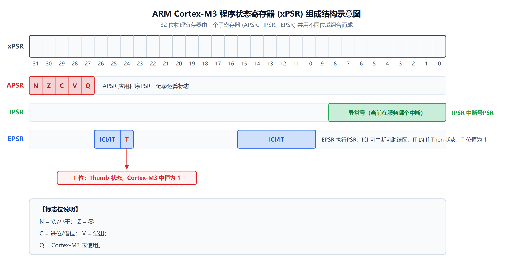

**看图方法**：最上面一条是完整的 32 位 xPSR，下面三条彩色的"带子"分别覆盖在它上面，表示"这个子寄存器占了哪几位"。**注意三条带子有重叠**（EPSR 的 ICI/IT 和 T 在 bit24～26，APSR 的 Q 在 bit27，两者不重叠；但 EPSR 自己在 bit26:25 和 bit15:10 两处都有 ICI/IT）。看这张图时只记住一句话：**一个 32 位寄存器，三拨人共用不同的位**。

#### 2. 中断屏蔽寄存器 PRIMASK / FAULTMASK / BASEPRI

**先看教材表 2-2 的准确描述（这张表比表 2-1 清楚得多，以表 2-2 为准）：**

| 寄存器 | 位数 | 置 1 时发生什么 | 默认值 |
|---|---|---|---|
| **PRIMASK** | 只有 **1 位** | **关闭所有可屏蔽的异常**，只剩下 **NMI** 和**硬 Fault（Hard Fault）**可以响应 | 0（表示允许中断） |
| **FAULTMASK** | 只有 **1 位** | 只有 **NMI** 才能响应；所有其他异常，包括中断和故障（Fault），**统统被禁止** | 0（表示允许中断） |
| **BASEPRI** | 最多 **9 位**（由优先级的位数决定） | 定义"被屏蔽优先级的阈值"：**所有优先级号 ≥ 此值的中断都关闭**（优先级号越大，优先级越低）；若设为 **0**，则不关闭任何中断 | 0 |

> ⚠️ 【待核验】教材表 2-1 把这三个寄存器的功能写成"使能所有的中断""使能所有的 Fault 异常"，**这个表述会误导**（应为"屏蔽/关闭"）。已核对原 PDF p39，教材原文确实如此。本讲义以表 2-2 为准，并把疑点记入文末。

**这三个寄存器的"谁管什么"用一张图看清：**

```
                          谁能响应？
┌──────────────────────────────────────────────────────────┐
│ PRIMASK = 1 ： 只有  NMI  +  硬Fault         可以响应     │
│ FAULTMASK = 1：只有  NMI                      可以响应     │
│ BASEPRI = X ： 优先级号 < X 的中断可以响应                │
│               优先级号 ≥ X 的中断被屏蔽                    │
└──────────────────────────────────────────────────────────┘
                优先级号越小 → 优先级越高
```

> 【先补一个前置知识：什么叫"可屏蔽"？】
> **可屏蔽（maskable）** = 可以用软件开关关掉的。
> **不可屏蔽（non-maskable）** = 关不掉的，永远有效。
> **NMI** = Non-Maskable Interrupt = 不可屏蔽中断。它连 PRIMASK 都关不掉——因为它是给"天塌下来"级别的事件准备的（比如电源掉电预警）。
> **硬 Fault** 也关不掉，因为它是"CPU 自己出错了"，你把它关掉的话错误就没人处理了。

**为什么要分三个？各自的使用场景：**

- **PRIMASK**：最常用。"我现在要干一件几分钟不能被打断的事，谁都别来敲门。" 教材说：对**时间敏感的关键任务**，PRIMASK 和 BASEPRI 用于**暂时关闭中断**非常重要。
- **BASEPRI**：更精细。"只把优先级低于某个档次的中断关掉，高优先级的紧急中断还是可以进来。" 例如：关掉所有普通中断，但电源故障中断必须保留。
- **FAULTMASK**：教材说"**专门留给 OS 用的**"——操作系统在某个任务崩溃时，常常伴随一大堆故障，需要**暂时关闭故障（fault）处理机能**，先收拾现场。

**怎么访问它们？（用 MRS/MSR）**

教材给的例子（注意原书有两处笔误，这里已修正为正确写法）：

```asm
MRS  R0, BASEPRI        ; 读取 BASEPRI 寄存器内容到 R0 中
MRS  R0, FAULTMASK      ; 读取 FAULTMASK 寄存器内容到 R0 中
MSR  BASEPRI, R0        ; 将 R0 寄存器内容写入到 BASEPRI 中
MSR  FAULTMASK, R0      ; 将 R0 寄存器内容写入到 FAULTMASK 中
MSR  PRIMASK, R0        ; 将 R0 寄存器内容写入到 PRIMASK 中
```

> ⚠️ 【容易搞混】教材原文在 p40 写成 `MSR R0, BASEPRI`（"读取 BASEPRI 内容到 R0"），**这条指令是错的**：读出来应该用 `MRS`。
> 记住口诀：
> - **MRS** = **M**ove from special register to **R**egister（特殊 → 通用）→ 读
> - **MSR** = **M**ove from **R**egister to **S**pecial register（通用 → 特殊）→ 写
>
> 也就是说：**MRS 用来读，MSR 用来写。** 只要记住"MRS 里有 R（Register）在最后，所以结果是进寄存器"，就不会混。

**只有特权级才能访问**：教材明确说"只有在特权级下，才允许访问这 3 个寄存器"。（特权级见 2.5 节。）

**为了快速开关中断，Cortex-M3 专门提供了一条 CPS 指令：**

```asm
CPSID I     ; PRIMASK = 1，关中断
CPSIE I     ; PRIMASK = 0，开中断
CPSID F     ; FAULTMASK = 1，关异常
CPSIE F     ; FAULTMASK = 0，开异常
```

- **CPS** = Change Processor State = 改变处理器状态。
- **CPSID** = CPS Interrupt Disable（关）；**CPSIE** = CPS Interrupt Enable（开）。
- 后缀 **I** 表示操作 PRIMASK，后缀 **F** 表示操作 FAULTMASK。

> 【补充解释】为什么要有 CPS 这条专门指令？因为用 MRS + 改位 + MSR 需要三条指令，还要占用一个通用寄存器。CPS 一条就搞定，**关中断本身要快**——不然你"准备关中断"的这段时间里可能就被中断了。

#### 3. 控制寄存器 CONTROL

**CONTROL 寄存器只使用了最低两位**，用来做两件事：**定特权级别** 和 **选用哪个堆栈指针**。

教材表 2-3 的内容（这里用位图形式重排）：

```
bit     31                              2   1   0
       +---------------------------------+---+---+
CONTROL|           未使用（保留）          | 1 | 0 |
       +---------------------------------+---+---+
                                          │   │
                        CONTROL[1] ───────┘   └─────── CONTROL[0]
                     堆栈指针选择                   特权级别选择
```

| 位 | 名称 | = 0 表示 | = 1 表示 |
|---|---|---|---|
| **bit1** | CONTROL[1] 堆栈指针选择 | 选择**主堆栈指针 MSP**（**复位后的默认值**） | 选择**进程堆栈指针 PSP** |
| **bit0** | CONTROL[0] 特权级别 | **特权级**的线程模式 | **用户级**的线程模式 |

**教材对这两位的补充说明（非常重要，请逐条读）：**

**关于 CONTROL[1]：**

> 在 Cortex-M3 的处理模式中，CONTROL[1] **总是 0**。在线程模式中则可以为 0（特权级）或 1（用户级）。
>
> 特别注意的是，**仅当处于特权级的线程模式下，此位才可以写**，其他场合禁止写此位。

拆开说：

```
处理模式（Handler）   → CONTROL[1] 永远是 0，永远用 MSP（不许改）
线程模式（Thread）    → CONTROL[1] 可以是 0 或 1（用 MSP 还是 PSP）
                        但只有"特权级线程模式"才能改它
```

**关于 CONTROL[0]：**

> 仅当处于特权级下操作时才允许写该位。**一旦进入了用户级，唯一返回特权级的途径就是触发中断异常，再由中断服务例程改写该位。**

这条是理解"特权/用户级"的关键：**用户级程序没法自己"升级"回特权级**，必须"打报告申请"（触发一个异常），由特权级的服务例程批准。

**CONTROL 也通过 MRS 和 MSR 访问：**

```asm
MRS  R0, CONTROL
MSR  CONTROL, R0
```

**操作之后硬件发生什么？** 写 CONTROL[0]/CONTROL[1] 之后，硬件**立刻改变当前的特权级别和当前使用的堆栈指针**。这不是"下一个周期生效"，而是从这条指令之后，CPU 就已经在新的等级/新的堆栈上工作了。

### 寄存器讲解小结：一张表看全

| 寄存器 | 属于谁 | 控制什么 | 关键点 |
|---|---|---|---|
| R0～R7 | 内核 | 暂存数据 | 所有指令都能访问；复位后随机 |
| R8～R12 | 内核 | 暂存数据 | 多数 16 位指令不能访问；32 位指令可以 |
| R13（SP） | 内核 | 指向当前堆栈顶 | **一个名字两个实体**：MSP / PSP |
| R14（LR） | 内核 | 存子程序返回地址 | BL 自动填；嵌套调用前要 PUSH |
| R15（PC） | 内核 | 指向下一条指令 | 写它 = 跳转（不改 LR）；读它 = 当前地址 + 4；LSB 必须为 1 |
| xPSR | 内核 | 记录运算状态 + 当前中断号 | N/Z/C/V/Q + 异常号 + T 位 |
| PRIMASK | 内核 | 关掉除 NMI/硬 Fault 外的所有异常 | 1 位；CPSID I / CPSIE I |
| FAULTMASK | 内核 | 只留 NMI | 1 位；留给 OS 用；CPSID F / CPSIE F |
| BASEPRI | 内核 | 按优先级阈值屏蔽 | ≤9 位；0 = 不屏蔽任何中断 |
| CONTROL | 内核 | 定特权级 + 选堆栈指针 | 只用 bit1、bit0 |

### 本节真正要记住什么

1. **R0～R7 低组**（所有指令可用）、**R8～R12 高组**（多数 16 位指令不可用）。
2. **R13 = SP**，但对应 **MSP / PSP 两个实体**，靠 CONTROL[1] 选择。
3. **R14 = LR**，存返回地址；`BL` 自动填 LR，`BX LR` 返回；嵌套调用前必须 PUSH LR。
4. **R15 = PC**，写它跳转（不改 LR），读它得到**当前指令地址 + 4**，LSB 必须为 1（Thumb）。
5. **xPSR** 由 APSR（N/Z/C/V/Q，bit27～31）+ IPSR（异常号，bit0～8）+ EPSR（ICI/IT、T 位）组成。
6. **PRIMASK / FAULTMASK / BASEPRI** 是中断开关；**MRS 读、MSR 写**；**CPS 指令快速开关**。
7. **CONTROL[1]** 选堆栈（0=MSP，1=PSP）；**CONTROL[0]** 选等级（0=特权，1=用户）；处理模式永远是特权级 + MSP。

---

## 2.5 工作模式和工作等级（教材 2.4）

### 先别急着看教材：这一节到底要干什么？

这一节回答：

> **CPU 在"正常干活"和"处理突发事件"时，是不是同一种状态？它能不能被"降权"？**

答案是：Cortex-M3 有 **2 种工作模式** 和 **2 个工作等级**，组合起来有 **3 种合法状态**。这套机制的目的是：**让不可信的、还没调试好的程序无法破坏系统**。

### 用大白话理解：公司里的两种身份

> 【类比】
> 把 CPU 想象成一家公司的员工，有两种**岗位**和两种**权限**：
>
> **岗位（模式）**：
> - **线程模式（Thread mode）** = 日常上班，做本职工作（执行主程序）。
> - **处理模式（Handler mode）** = 突发情况处理岗（执行异常服务例程）。
>
> **权限（等级）**：
> - **特权级（privileged level）** = 有全部钥匙，能进任何房间、动任何设备。
> - **用户级（user level）** = 只有自己工位的钥匙，进不了机房、动不了总闸。
>
> **规则**：
> - 日常上班时，你**可能**有特权（老员工），也**可能**只有用户权限（实习生）。
> - 但**处理突发情况时，你一定得有特权**——不然你连报警器都按不动。
>
> **类比的边界**：真实硬件里没有"身份"这种主观概念，而是**硬件电路在每条指令执行时检查"当前等级是否允许访问这个资源"**，不满足就直接拒绝或产生异常。

### 正式知识：2 种模式 × 2 种等级 = 3 种合法组合

教材表（图 2-10）用一张小表概括了这件事：

| 运行时段 | 特权级 | 用户级 |
|---|---|---|
| 运行**异常服务例程**时 | **处理模式** | ❌ 错误的用法 |
| 运行**主程序**时 | **线程模式** | **线程模式** |

所以合法的组合只有 3 种：

```
① 线程模式 + 用户级      ← 普通应用程序（受限）
② 线程模式 + 特权级      ← 主程序，但权限很高（复位后的默认状态）
③ 处理模式 + 特权级      ← 异常服务例程（必须）
```

> **"处理模式 + 用户级"为什么是"错误的用法"？**
> 因为异常服务例程必须能访问系统控制空间、必须能改特殊功能寄存器，用户级做不到。硬件上这个组合根本不会出现。

**复位后的默认状态**：教材说"复位后，处理器默认进入**线程模式，特权级**访问"。

也就是：**芯片一上电，CPU 是以"特权级的普通上班状态"开始工作的。** 这也合理——刚上电时还没什么"用户程序"可言，一切从最高权限开始，由启动代码自己决定要不要降权。

### 用户级到底被限制了什么？

教材说：在用户级下，对有些资源的访问会受到限制或不允许访问：

1. **禁止访问"系统控制空间（SCS）"**——包括配置寄存器和调试组件寄存器组。
2. **禁止使用 MRS/MSR 访问除 APSR 外的特殊功能寄存器。**

后果分两种：

- 对特殊功能寄存器的访问操作**被忽略**（写了等于没写，不报错）；
- 对 SCS 空间的访问会**产生异常**（直接报错）。

> 【先补一个前置知识：什么叫"系统控制空间 SCS"？】
> **SCS** = System Control Space = 系统控制空间。
> 它是 **2.7 节**要讲的存储器映射里，**"专用外设总线区"内部**的一块地址区域，里面放着 NVIC、SysTick、MPU、调试控制等寄存器的"门牌号"。
> 换句话说：**SCS 就是"CPU 自己的设置面板所在的地址区间"**。
> 用户级程序不许碰它，就相当于"实习生不能进机房动总闸"。

### 怎么在等级之间切换？

这是本节最需要理清的部分。

**（1）从特权级 → 用户级：改 CONTROL[0]**

> 在特权级下，可通过置位 CONTROL[0] 进入用户级。

```asm
; 在特权级线程模式下
MRS  R0, CONTROL
ORR  R0, R0, #1        ; 把 bit0 置 1
MSR  CONTROL, R0       ; 从此进入用户级
```

（`ORR` 是"按位或"，第 4 章会详细讲；这里只要看出"把最低位设成 1"这个动作。）

**（2）从用户级 → 特权级：不能直接改，必须走异常**

> 用户级下的代码**不能再试图修改 CONTROL[0] 来回到特权级**。
> 用户级的程序如想进入特权级，通常使用一条**系统服务调用指令（SVC）**来触发 SVC 异常，在该异常的服务例程中修改 CONTROL[0]，从而重新进入特权级。

> 【类比】
> 实习生（用户级）发现自己需要机房权限，他**不能自己给自己发权限**，只能走正式流程：
> 提交申请（执行 `SVC` 指令）→ 主管审批（SVC 异常服务例程运行，此时是特权级）→ 主管把权限批给他（服务例程里改 CONTROL[0]）。

- **SVC** = Supervisor Call = 系统服务调用。一条指令，执行它就"主动触发一次异常"。
- **SVCall 异常**：编号 11 的异常，专门用来处理这种"申请"。

**（3）异常发生时，等级怎么变？**

> 不管是任何原因产生了任何异常，Cortex-M3 都将**以特权级**运行其服务例程，异常返回后将**回到产生异常之前的工作级**。

也就是说：

```
用户级线程模式  ──异常发生──▶  特权级处理模式
       ▲                              │
       └────────异常返回──────────────┘
       （回到原来的等级）
```

**关键点**：异常是"临时升权"，处理完就**自动降回去**，不会留下后遗症。

（也可以在返回前通过修改 CONTROL[0]，指定返回后的工作等级——这是操作系统常用的手法。）

### 看教材原图：状态切换


**这张图怎么读？**

1. 先找图里的**三个"状态方块"**：线程模式+特权级、线程模式+用户级、处理模式+特权级。
2. 再看**箭头**：
   - 从"线程+特权"到"线程+用户"的箭头 → 靠**置位 CONTROL[0]**；
   - 从"线程+用户"到"处理+特权"的箭头 → 靠**异常**（如 SVC）；
   - 从"处理+特权"回到"线程"的箭头 → 靠**异常返回**。
3. **注意"处理模式+用户级"这个格子是空的**——前面说过，这是非法组合。

**这张图要我理解**：**用户级 → 特权级的唯一通道是"异常"**，没有别的路。

![图 2-12 CONTROL[0]=0 时，中断前后的状态转换](images/textbook/fig2-12.jpg)

![图 2-13 CONTROL[0]=1 时，中断前后的状态转换](images/textbook/fig2-13.jpg)

**这两张图对比着看**（它们只差一位，但结果差很多）：

- **图 2-12（CONTROL[0] = 0）**：主程序本来就在**特权级线程模式**。中断来时变成**特权级处理模式**，返回时回到**特权级线程模式**。
  → **只有"模式"变了，"等级"没变。**
- **图 2-13（CONTROL[0] = 1）**：主程序在**用户级线程模式**。中断来时变成**特权级处理模式**（升权了！），返回时回到**用户级线程模式**（降权了）。
  → **"模式"和"等级"都变了。**

教材的原话："若 CONTROL[0]=1（线程模式+用户级），则在中断响应的始末，处理模式和特权等级都要发生变化。"

### 为什么要搞这么复杂？（这才是重点）

教材给了两个非常实际的理由：

**理由 1：限制不可信/未调试好的程序**

> 通过引入特权级和用户级，就能够在硬件水平上限制某些不受信任的或者还没有调试好的程序，不让它们随便地配置涉及要害的寄存器，因而系统的可靠性得到了提高。
>
> 例如，当用户代码出问题时，因其被禁止写特殊功能寄存器和 NVIC 中寄存器，不会影响系统中其他代码的正常运行。

**理由 2：保护系统堆栈不被应用程序毁坏**

> 为了避免系统堆栈因应用程序的错误使用而毁坏，可以给应用程序专门配一个堆栈，不让它共享操作系统内核的堆栈。在这个管理制度下，运行在线程模式的用户代码使用 **PSP**，而异常服务例程则使用 **MSP**。这两个堆栈指针的切换是**全自动的**，在出入异常服务例程时由硬件处理。

这段话是理解 2.5 节"双堆栈"的钥匙：**用户程序用自己的 PSP，一旦出错把 PSP 用爆了，操作系统的 MSP 依然完好**——系统还能继续跑。

> 【类比】
> 就像公司里每个员工有自己的废纸篓（PSP），公司的总档案柜（MSP）单独锁起来。
> 员工把自己的废纸篓塞爆了，顶多自己那摊乱掉，公司的档案不会丢。
>
> **类比的边界**：真实硬件里两个堆栈都在同一片 SRAM 中，只是**用两个不同的指针分别管理**；"保护"是靠"指针不越界"实现的，而不是物理隔离。如果两个堆栈在内存里挨得太近，依然可能互相踩到——正是"堆栈溢出"危险的原因（**2.8.6 节**会讲）。

【辅助理解图】

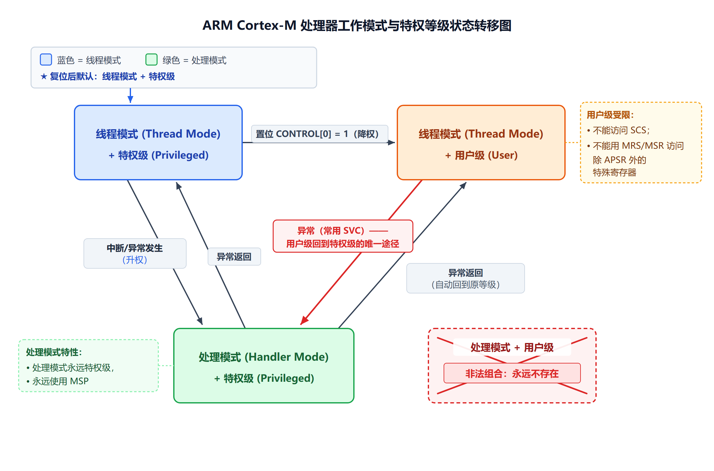

**看图方法**：图中有三个圆角方块，分别写"线程+特权""线程+用户""处理+特权"，用带标签的箭头连起来。重点看**标着"异常"的那条箭头**——它是从"线程+用户"通往"处理+特权"的唯一出路；再看"异常返回"箭头，它回到原来的等级。图的右下角用红字标出"处理+用户级 = 非法组合"。

### 本节真正要记住什么

1. **2 种模式**：线程模式（跑主程序）/ 处理模式（跑异常服务例程）。
2. **2 种等级**：特权级（权限全）/ 用户级（受限）。
3. **3 种合法组合**；"处理模式 + 用户级"非法。
4. **复位后默认：线程模式 + 特权级。**
5. **异常总是以特权级运行**，返回时回到原来的等级。
6. **用户级 → 特权级的唯一途径是异常**（常用 `SVC`）。
7. 用户级受限：**不能访问 SCS 空间**（访问会异常）、**不能用 MRS/MSR 访问除 APSR 外的特殊寄存器**（写了被忽略）。
8. 这套机制的目的是**保护系统不被不可信程序破坏**，典型用法是"用户程序用 PSP，系统用 MSP"。

---

## 2.6 堆栈（教材 2.5）

### 先别急着看教材：这一节到底要干什么？

这一节要讲清楚三件事：

1. **栈到底是什么、怎么长、怎么用**；
2. **PUSH 和 POP 到底对内存和 SP 做了什么**（要能一个字节一个字节地算出来）；
3. **Cortex-M3 为什么有两个栈（MSP / PSP），它们什么时候切换**。

栈是本章后面"中断"的基石——**中断自动保存现场，保存的就是栈**。所以这一节必须弄扎实。

### 先补前置知识：什么叫栈？

**栈（stack）** = 一块连续的内存 + 一个"栈顶指针"。

它遵守一条规则：**先进后出（First In Last Out，FILO）**——最后放进去的，最先被拿出来。

> 【类比：一摞盘子】
> 食堂里洗好的盘子一只只往上叠：
> - 放盘子：只能放在**最上面**；
> - 拿盘子：也只能从**最上面**拿。
> - 所以你**最后**放上去的那只盘子，会**最先**被拿走——这就是"先进后出"。
>
> 那根"指着最上面那只盘子"的手指，就是**栈顶指针（SP）**。

**类比的边界（重要）**：真实计算机里的"盘子摞"是**往低地址方向长的**（下面会讲），而且每只"盘子"固定是 4 字节。类比只帮你记住"只能在一头进出"这条规则。

**为什么计算机需要栈？** 教材说得很清楚：

> 堆栈的典型应用是在**数据处理前先保存寄存器的值**，再在处理任务完成后**从中恢复先前保存的这些值**。

具体用在两个地方：

1. **调用子程序**时：保存返回地址和"现场"（正在用的寄存器值）；
2. **中断**时：保存"断点"和"现场"。

### 2.6.1 堆栈的基本操作

#### Cortex-M3 的栈模型：向下生长的满栈

教材说：

> Cortex-M3 使用的是"**向下生长的满栈**"模型。堆栈是**按字操作**的，即每次入栈和出栈都是 32 位数据，因此 SP 值总是执行**自增 4 / 减 4** 操作，而不是加 1 和减 1。堆栈指针指向**最后一个被压入堆栈的 32 位数值**。

这句话里有三个术语，逐个拆开：

**【术语 1】向下生长（descending）**

栈的"生长方向"指：**新压入的数据放在比原来更低的地址，还是更高的地址。**

```
向上生长（ascending）：       向下生长（descending）：
高地址                        高地址
+----------+                  +----------+
| 空       |                  | 已压入的 |  ← 先压的
+----------+  ← 新数据放这      +----------+
| 已压入的 |                  | 已压入的 |
+----------+                  +----------+  ← 新数据放这（地址更低）
| 已压入的 |  ← 先压的         | 空       |
+----------+                  +----------+
低地址                        低地址
```

**Cortex-M3 是"向下生长"**：PUSH 时 SP **减小**，POP 时 SP **增大**。

**【术语 2】满栈（full）**

**满栈**指：**SP 指向"最后一个被压入的数据"**（也就是 SP 指的位置里已经有有效数据）。

对比一下：

```
满栈（full）：SP 指着"有数据的那个格子"
空栈（empty）：SP 指着"下一个空着的格子"
```

**【术语 3】按字操作**

每次 PUSH/POP 都是 **32 位（4 字节）**，所以 SP 的变化量永远是 **±4**，不会是 ±1 或 ±2。

> 【先补一个前置知识：为什么是 4 字节？】
> 因为 Cortex-M3 是 32 位 CPU，寄存器是 32 位，栈里主要存的就是寄存器的值。
> 一个寄存器 32 位 = 4 字节，所以一次压一个寄存器就移动 4 字节。

把三个术语合起来：**Cortex-M3 的栈 = 向下生长的满栈 = "压数据时 SP 先减 4 再存；取数据时先从 SP 处读再 SP 加 4"。**

#### PUSH 和 POP 的精确动作

教材说：

> **PUSH 操作时，SP 先自减 4，再存入数据到 SP 所指存储器位置；POP 操作正好相反，先从 SP 所指存储器位置读出数据，SP 再自增 4。**

用 ASCII 图把这两步画出来（设当前 `SP = 0x20001000`，要压入 `R0 = 0x12345678`）：

**PUSH {R0} 的两步：**

```
第 1 步：SP = SP - 4 = 0x20000FFC
第 2 步：把 R0 的值写进 0x20000FFC

  执行前                          执行后
  地址        内容                地址        内容
0x20001000  ┌────────┐          0x20001000  ┌────────┐
            │ 旧数据  │                      │ 旧数据  │
0x20000FFC  ├────────┤          0x20000FFC  ├────────┤
            │  ?     │ ← 空闲    SP ──────▶ │0x12345678│ ← R0 的值
0x20000FF8  ├────────┤          0x20000FF8  ├────────┤
            │  ?     │                      │  ?     │
            └────────┘                      └────────┘
              ▲
              SP = 0x20001000（执行前）
```

**POP {R0} 的两步：**

```
第 1 步：读出 SP 所指位置的数据 → R0
第 2 步：SP = SP + 4 = 0x20001000

  执行前                          执行后
0x20000FFC  ┌────────┐          0x20000FFC  ┌────────┐
      SP ─▶ │0x12345678│                  │(已作废) │
0x20000FF8  ├────────┤          0x20000FF8  ├────────┤
            │  ?     │                      │  ?     │
            └────────┘                      └────────┘
                                        SP ─▶ 0x20001000
                              R0 = 0x12345678
```

> ⚠️ 【容易搞混】POP 之后，原来那个格子里的数据**并没有被清掉**（还是 0x12345678），只是 SP 移开了，这块空间**被认为可以重新使用**。
> 这就像你从盘子摞里拿走一只盘子，盘子本身还在你手里，但"盘子摞"已经不认它了。下次 PUSH 会覆盖掉它。

**顺序口诀（务必背下来）：**

```
PUSH：先减 SP，再存数据        （减 → 存）
POP ：先取数据，再增 SP        （取 → 增）
```

#### 看教材原图

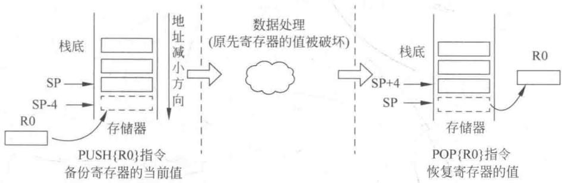

**这张图怎么读？**

1. **先看中间那行字**："**地址减小方向 ↓**"——这是整张图的"方向标"，说明越往下地址越小。
2. **左半张（PUSH {R0}）**：
   - 左边的竖条是存储器（栈），最上面标着"**栈底**"；
   - 两个箭头：`SP` 指向当前栈顶，`SP-4` 指向更低的地址；
   - 虚线框标出"**即将被写入的位置**"，也就是 `SP-4` 那里；
   - 一条弧线从 R0 指向这个虚线框，标注"**备份寄存器的当前值**"。
3. **中间那个云朵**："数据处理（原先寄存器的值被破坏）"——表示这段时间里程序继续跑，**R0 里原来的值被新计算覆盖了**。
4. **右半张（POP {R0}）**：
   - 现在 `SP` 指向虚线框（里面有刚存的值），`SP+4` 指向它上面；
   - 一条弧线从虚线框指回 R0，标注"**恢复寄存器的值**"；
   - POP 完成后 SP 移回 `SP+4` 的位置。

**这张图到底想让我理解什么？**

> **"保存现场"就是 PUSH，"恢复现场"就是 POP。**
> 中间那朵云提醒你：在 PUSH 和 POP 之间，寄存器里的值**会被改掉**——所以必须靠栈来"存底"。

【辅助理解图】

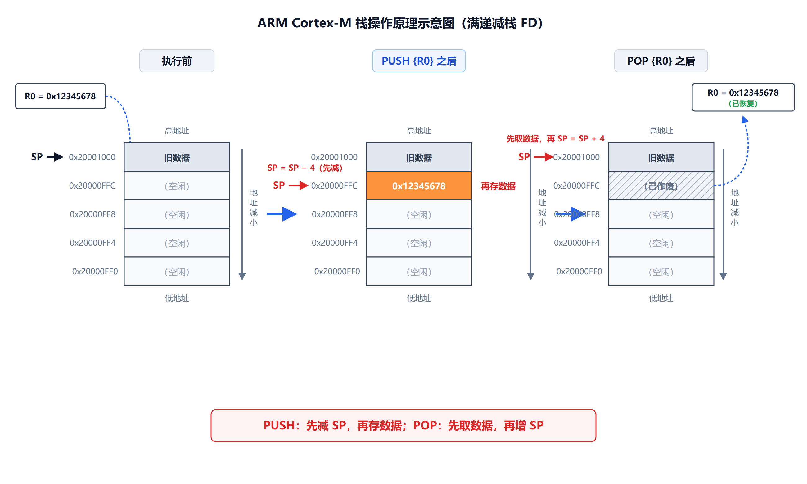

**看图方法**：这张图把 PUSH 和 POP 各画成"三个时刻"（操作前 / 中间态 / 操作后），每格里标出 SP 指向哪里、哪个格子里有数据。**重点看 SP 的移动方向**：PUSH 时 SP 往**下**（地址变小）走，POP 时 SP 往**上**（地址变大）走。

#### 看教材代码：PUSH/POP 成对使用

教材给了一段完整的"主程序调用子程序"的代码（原书 p44）：

```asm
main(主程序)
    ; 假设执行子程序 Fx1 之前的 R0 = X, R1 = Y, R2 = Z
    BL Fx1

Fx1(子程序)
    PUSH {R0}    ; 把 R0 存入栈并调整 SP
    PUSH {R1}    ; 把 R1 存入栈并调整 SP
    PUSH {R2}    ; 把 R2 存入栈并调整 SP
    ...          ; 执行 Fx1 的功能，中途可以改变 R0～R2 的值
    POP  {R2}    ; 恢复 R2 早先的值并再次调整 SP
    POP  {R1}    ; 恢复 R1 早先的值并再次调整 SP
    POP  {R0}    ; 恢复 R0 早先的值并再次调整 SP
    BX   LR      ; 返回
    ; 回到主程序；R0 = X, R1 = Y, R2 = Z（Fx1 前后 R0～R2 的值没有被改变）
```

**这段代码想完成什么？**

> **让子程序 `Fx1` 可以随便使用 R0、R1、R2，但主程序里这三个寄存器的值不能受影响。**

**逐行解释（代码 → CPU 做什么 → 寄存器发生什么 → 硬件发生什么）：**

| 代码 | CPU 做什么 | 寄存器变化 | 硬件/内存发生什么 |
|---|---|---|---|
| `BL Fx1` | 跳转到 Fx1，同时记下返回地址 | `LR = 返回地址`，`PC = Fx1` | 流水线清洗；开始取 Fx1 的指令 |
| `PUSH {R0}` | 保存 R0 | `SP = SP - 4` | 把 R0 的值写进新 SP 指向的 4 字节内存 |
| `PUSH {R1}` | 保存 R1 | `SP = SP - 4` | 把 R1 的值写进新 SP 指向的内存 |
| `PUSH {R2}` | 保存 R2 | `SP = SP - 4` | 把 R2 的值写进新 SP 指向的内存 |
| `...`（函数体） | 正常干活，**随便改 R0～R2** | R0/R1/R2 的值被改掉 | 无（但栈里的备份没被碰） |
| `POP {R2}` | 恢复 R2 | 先从 SP 读→R2，再 `SP = SP + 4` | 从内存读回那个 4 字节 |
| `POP {R1}` | 恢复 R1 | 先从 SP 读→R1，再 `SP = SP + 4` | 从内存读回 |
| `POP {R0}` | 恢复 R0 | 先从 SP 读→R0，再 `SP = SP + 4` | 从内存读回；**此时 SP 回到 PUSH 之前的值** |
| `BX LR` | 返回主程序 | `PC = LR` | 流水线清洗；从返回地址继续执行 |

**注意 PUSH 和 POP 的顺序是"反着的"！**

```
PUSH 顺序：R0 → R1 → R2        （R0 在最低地址）
POP  顺序：R2 → R1 → R0        （R2 在最低地址，先出来）

栈里从低地址到高地址的内容：  [R0][R1][R2]
                              ↑
                         SP 最后回到这里
```

> ⚠️ 【容易搞混】教材特意提醒："正常情况下，PUSH 和 POP **必须成对使用**，而且还要特别注意**进出栈数据的顺序**。"
> 如果 PUSH 是 R0,R1,R2 而 POP 写成 R0,R1,R2（顺序相同），那么 POP 时就会把 R2 的值弹给 R0、R0 的值弹给 R2——**数据全串了**！
> **口诀：PUSH 和 POP 的顺序必须相反（后进先出）。**

**还有一个重要事实**（教材在 2.6.1 末尾提到）：

> 在进入中断服务例程（ISR）时，Cortex-M3 **会自动**把一些寄存器压栈，此时使用的是**进入 ISR 之前使用的 SP 指针**（MSP 或者 PSP）。离开 ISR 后，只要 ISR 没有更改过 CONTROL[1]，就使用先前的 SP 指针来执行出栈操作。

这是"**硬件自动压栈**"——不需要你写 PUSH 指令。这是 Cortex-M3 中断延迟短的重要原因之一（2.8.5 节详讲）。

### 2.6.2 Cortex-M3 的双堆栈机制

#### 为什么有两个栈？

教材说：

> Cortex-M3 的堆栈有两个：**主堆栈（MSP）** 和 **进程堆栈（PSP）**，MSP 和 PSP 都被称为 R13，在程序中可以通过 MRS/MSR 指令设置 CONTROL[1] 来指定选用的堆栈指针。

**为什么要这样设计？** 回到 2.5 节讲的那个理由：

> **为了避免系统堆栈因应用程序的错误使用而毁坏，可以给应用程序专门配一个堆栈，不让它共享操作系统内核的堆栈。**

用大白话说：

```
不用双栈（只有一个 MSP）：
  用户程序 ┐
           ├── 共用同一个栈 ── 用户程序把栈写爆 → 整个系统崩溃
  操作系统 ┘

用双栈：
  用户程序 ── PSP ── 用户程序把 PSP 写爆 → 操作系统部分不受影响，还能收拾残局
  操作系统/异常 ── MSP
```

> 【类比】
> 就像公司给"实习生"和"正式员工"各配一个废纸篓。实习生把自己的废纸篓堆爆了，不会把正式员工的资料埋掉。

#### 两种配置方式

**配置 1：CONTROL[1] = 0 → 只用 MSP**

教材原话：

> 当 CONTROL[1] = 0 时，只使用 MSP，此时**用户程序和异常处理共享同一个堆栈**。这也是**复位后的默认使用方式**。

![图 2-15 CONTROL[1]=0 时，堆栈指针的使用情况](images/textbook/fig2-15.jpg)

**看图方法**：图里只有**一个**堆栈，主程序和中断服务程序（ISR）都用它。所以：

```
      主程序  ──┐
                ├──▶  同一个堆栈（MSP）
      ISR     ──┘
```

**这张图要我理解**：这是**最简单、也是复位后的默认**用法。简单的裸机程序（比如第 6 章点灯）就属于这种情况——**只用 MSP 就够**。

**配置 2：CONTROL[1] = 1 → 线程模式用 PSP，异常用 MSP**

教材原话：

> 当 CONTROL[1] = 1 时，线程模式使用的是进程堆栈（PSP），**进入异常服务例程后自动改为 MSP**，退出异常时**切换回 PSP**，并且从进程堆栈上弹出数据。

![图 2-16 CONTROL[1]=1 时，堆栈指针的使用情况](images/textbook/fig2-16.jpg)

**看图方法**：图里现在是**两个**堆栈，左右分开画：

```
      主程序（线程模式）──▶  PSP（进程堆栈）
      ISR（处理模式）  ──▶  MSP（主堆栈）
```

**关键点**：这个切换是**硬件自动完成**的，不是靠你写代码。教材原话："这两个堆栈指针的切换是**全自动的**，在出入异常服务例程时由硬件处理。"

> 【容易搞混】这里有个细节："**进入异常用 MSP，从 PSP 弹栈**"。
> 具体说：入栈时，因为中断发生在"用 PSP 的线程模式"下，所以现场被压进 **PSP 指向的栈**；进入 ISR 后，ISR 内部自己 PUSH/POP 用的是 **MSP**。**出栈时**，硬件根据 LR 里的 EXC_RETURN 值知道"原来是用 PSP 的"，于是从 **PSP** 把现场弹回来。（EXC_RETURN 见 2.8.8 节。）

【辅助理解图】

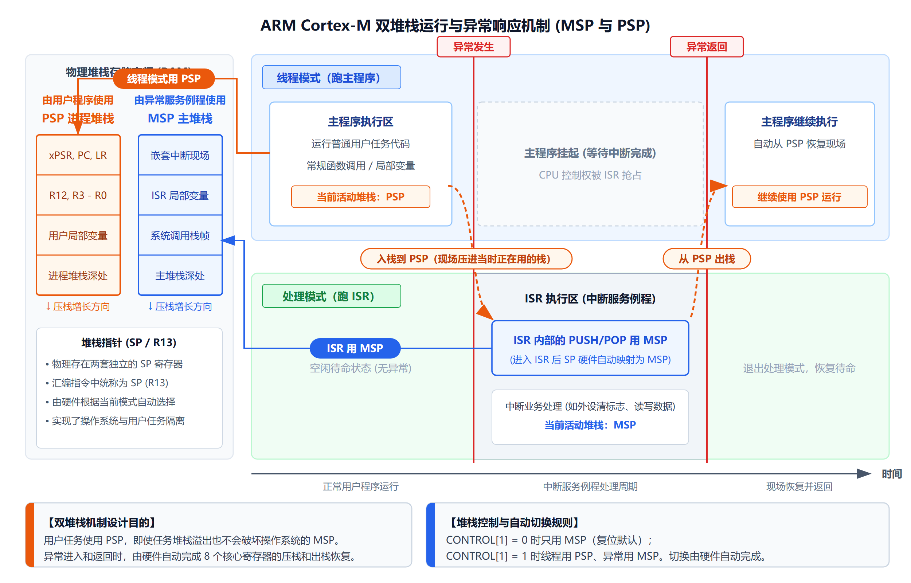

**看图方法**：图分上下两条"泳道"：上面是"线程模式"泳道，下面是"处理模式（异常）"泳道。左边画两个栈（PSP 和 MSP），用不同颜色区分。中间用一个"异常发生 / 异常返回"的竖直分界线，看 SP 指针如何在两个栈之间跳转。**重点看**：异常发生那一刻，硬件把现场压进**当时正在用的那个栈**；而 ISR 内部用的是 MSP。

#### 特权级下可以"跨栈"访问

教材说：在特权级下，可以使用特定的堆栈指针，而不受当前使用堆栈的限制：

```asm
MRS  R0, MSP     ; 读取主堆栈指针到 R0
MSR  MSP, R0     ; 写入 R0 的值到主堆栈中
MRS  R0, PSP     ; 读取进程堆栈指针到 R0
MSR  PSP, R0     ; 写入 R0 的值到进程堆栈中
```

> ⚠️ 【容易搞混】教材原文把最后一行印成 `MSP PSP, RO`（原书 p45），**这是排印错误**，应为 `MSR PSP, R0`。已核对原 PDF。本讲义已修正。

**这两条 MRS 有什么用？** 教材说：

> 通过读取 PSP 的值，操作系统（OS）就能获取用户应用程序使用的堆栈，进而知道发生异常时被压入堆栈的寄存器内容。OS 还可以**修改 PSP，用于实现多任务中的任务上下文切换**。

> 【补充解释：什么叫"上下文切换"？】
> 操作系统要"轮流"运行多个任务。切换任务时，需要把当前任务的"进度"（寄存器值、堆栈位置等，合称**上下文 context**）保存起来，再把下一个任务的上下文恢复回去。
> **换 PSP 就等于换了一整套"任务进度"**——因为每个任务有自己的堆栈，堆栈里存着它的现场。
> 这是操作系统（如 FreeRTOS）实现多任务的核心手法，本章只需要知道"PSP 是干这个用的"。

#### 两条关于堆栈的实用提醒

**提醒 1**：教材说"**并不是每个应用程序都能用到两个堆栈指针，简单应用程序只使用 MSP 即可。**"

也就是说：**做课程实验时，你大概率只需要 MSP**。PSP 是给跑操作系统的场景准备的。看到"双堆栈"不要紧张。

**提醒 2（很重要，关于地址对齐）**：

> 由于 R13 的**最低两位被硬件连接到 0**，因此堆栈的 PUSH 和 POP 操作**永远都是 4 字节对齐**的，即堆栈指针指向的内存起始地址必定是 0x4、0x8、0xC，诸如此类。

用二进制看清楚：

```
R13 的 bit1 和 bit0 被硬连线到 0：

bit31 ......................... bit3  bit2  bit1  bit0
┌───────────────────────────────────┬─────┬─────┬─────┐
│            任意值                  │ 任意 │  0  │  0  │
└───────────────────────────────────┴─────┴─────┴─────┘
                                            ↑     ↑
                                     硬件强制为 0
```

所以 SP 的值**永远是 4 的倍数**：

```
0x20001000  ✓ 是 4 的倍数
0x20001001  ✗ 不可能出现
0x20001002  ✗ 不可能出现
0x20001003  ✗ 不可能出现
0x20001004  ✓ 是 4 的倍数
```

**为什么要这样设计？** 因为栈里存的是 32 位数据，如果 SP 是 4 的倍数，**每次访问都恰好落在"字边界"上**，一次就能读完，不用拆成多次访问。这是"用硬件保证效率"的典型手法。

> 【类比】
> 就像停车位都按车身长度画好线，车永远停在格子中间——不用每次挪来挪去。
> **类比的边界**：硬件不是"建议"对齐，而是**物理上强制**：bit1、bit0 这两根线根本没接到寄存器上，写进去也会被忽略。

### 本节真正要记住什么

1. **栈 = 一块连续内存 + 栈顶指针 SP**，规则是**先进后出**。
2. Cortex-M3 用 **"向下生长的满栈"**：PUSH 时 SP **减 4**，POP 时 SP **加 4**；SP 指向**最后一个压入的数据**。
3. **PUSH：先减 SP，再存数据；POP：先取数据，再增 SP。**
4. PUSH 和 POP **必须成对、顺序相反**。
5. **双堆栈**：**MSP**（默认、异常用、特权代码用）和 **PSP**（用户线程用），由 **CONTROL[1]** 选择。
6. 进出异常时**硬件自动切换** MSP/PSP，不用写代码。
7. **简单程序只用 MSP** 就够了。
8. **R13 最低两位恒为 0**，所以栈操作永远 4 字节对齐。
9. 读 PSP 可以知道用户任务用了多少栈；写 PSP 可以**切换任务**（OS 的用法）。

---

## 2.7 存储器管理（教材 2.6）

### 先别急着看教材：这一节到底要干什么？

这一节要回答：

> **Cortex-M3 能寻址 4GB，这 4GB 是怎么分配的？为什么地址 0x20000004 是内存，地址 0xE000E100 却是一个"开关"？**

这是全书最"实用"的一节之一——**第 3 章以后的每一个外设寄存器，都要靠这套地址规则来定位**。

### 先补前置知识：4GB 是怎么来的？（复习）

Cortex-M3 是 32 位 CPU：

```
地址宽度 32 位
  ↓
能表示 2^32 = 4 294 967 296 个不同的地址
  ↓
每个地址对应 1 个字节
  ↓
总共能寻址 4GB
```

教材说："Cortex-M3 支持访问 4GB 存储空间，有一个**单一固定的存储器映射**。"

**"单一固定"是什么意思？** 意思是：**这 4GB 空间怎么划分，是 ARM 在架构里规定死的，所有 Cortex-M3 芯片都一样。** 好处是：

- 所有 Cortex-M3 芯片的 NVIC 和 MPU 都在**相同的位置**布设寄存器；
- 代码从一款 Cortex-M3 芯片移植到另一款时，至少内核层面的访问方式不变。

> 【补充解释】这叫**代码可移植性**。就像所有城市的"门牌号规则"都一样，你换个城市送快递，找路的方法不用重新学。

### 用大白话理解：CPU 眼里的"一条 4GB 长街"

> 【类比】
> 把 4GB 地址空间想象成一条极长的街道，门牌号从 `0x00000000` 排到 `0xFFFFFFFF`。
> 这条街被分成了**七个街区**：
>
> | 街区 | 门牌号范围 | 里面住着谁 |
> |---|---|---|
> | 代码区 | 0x00000000 起 | 你的程序（Flash） |
> | 片上 SRAM 区 | 0x20000000 起 | 运行时的数据（RAM） |
> | 片上外设区 | 0x40000000 起 | 芯片上的各种外设寄存器 |
> | 外部 RAM 区 | 0x60000000 起 | 芯片外面接的 RAM |
> | 外部设备区 | 0xA0000000 起 | 芯片外面接的设备 |
> | 专用外设总线区 | 0xE0000000 起 | CPU 自己的设置面板（NVIC 等） |
> | 厂商指定区 | 0xE0100000 起 | 留给芯片厂商 |
>
> **类比的边界（非常重要）**：
> 真实硬件里，**"住在某个门牌号里的"并不是一栋房子，而可能只是一个 32 位寄存器的某几位**。
> 比如你往 `0xE000E100` 写一个 1，硬件并不会"存下"这个 1，而是**立刻把某个中断开关打开**。
> 所以这个类比要这样修正：**CPU 眼里所有东西都是"有门牌号的格子"，但有的格子是存储器（存下来），有的格子是开关（写下去就立刻生效）。**

**这就是本节最重要的一句话：**

> **CPU 眼里，内存和外设没有区别，都只是"地址"。地址决定了这次访问是"存东西"还是"操作开关"。**

### 正式知识：4GB 存储器空间分配

教材图 2-17 是完整的存储器映射表。这张表很密，我们**分成两张表**来看，先看主干，再看细节。

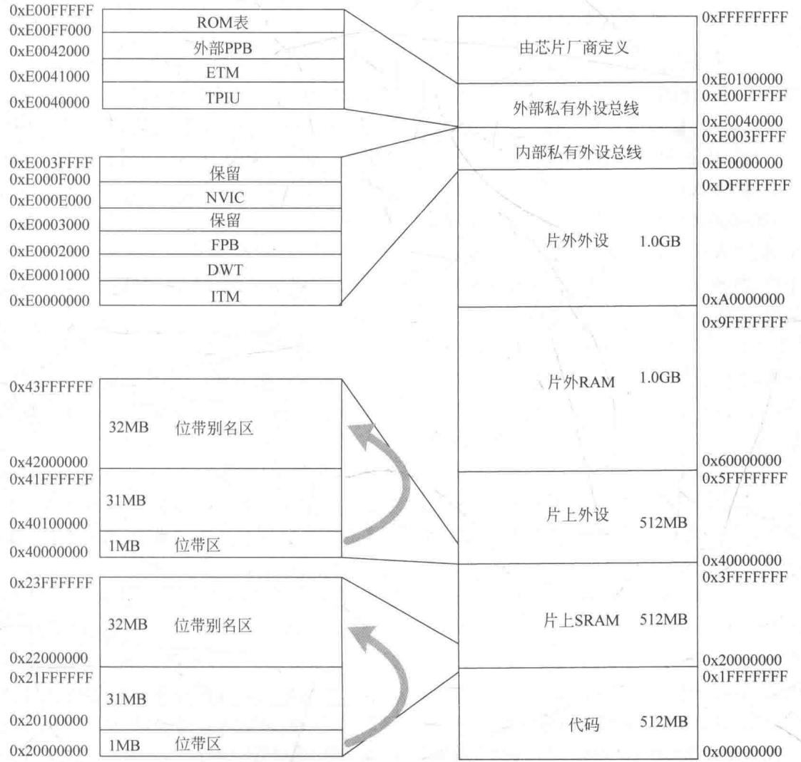

**这张图怎么读？**

1. **左边一列数字**是从高到低的地址分界线（`0xE00FFFFF`、`0xE00FF000`、`0xE0042000`……），**每一行是一个"边界"**。
2. **中间一列**是每一段里放的东西（ROM 表、外部 PPB、ETM、TPIU、NVIC、位带别名区……）。
3. **右边一列**是"这个区总共多大"以及"属于哪一类"（如"片外外设 1.0GB""片上外设 512MB""代码 512MB"）。
4. **注意看**：位带区（1MB）和位带别名区（32MB）在图里是**成对出现**的——每出现一个"1MB 位带区"，上面就跟着一个"32MB 位带别名区"。

**这张图要我理解**：**4GB 空间被切成很多段，段与段之间用"整数关口"地址隔开；每一段都有明确的用途，而且这个划分是 ARM 规定死的。**

**如果你觉得这张图太密**——没关系，**先用下面这张"主干表"建立框架，再回头看原图就清楚了。**

#### 第一层：主干七个区

| 区名 | 地址范围 | 大小 | 用来干什么 |
|---|---|---|---|
| **代码区** | `0x00000000 ～ 0x1FFFFFFF` | 512MB | 存放程序代码（Flash） |
| **片上 SRAM 区** | `0x20000000 ～ 0x3FFFFFFF` | 512MB | 连接片上的 SRAM（运行时数据） |
| **片上外设区** | `0x40000000 ～ 0x5FFFFFFF` | 512MB | 映射片上外设寄存器 |
| **外部 RAM 区** | `0x60000000 ～ 0x9FFFFFFF` | 1GB | 连接外部 RAM |
| **外部设备区** | `0xA0000000 ～ 0xDFFFFFFF` | 1GB | 连接外部设备 |
| **专用外设总线区** | `0xE0000000 ～ 0xE00FFFFF` | 1MB | NVIC、SysTick、MPU、调试部件 |
| **芯片厂商指定区** | `0xE0100000 ～ 0xFFFFFFFF` | 约 512MB | 芯片厂商自己安排 |

**几个必须注意的细节（教材原话）：**

1. **代码区**：主要用于存放程序代码。**程序可以在代码区、内部 SRAM 区以及外部 RAM 区中执行。** 但是因为指令总线与数据总线是分开的，**最理想的是把程序放到代码区**，从而使取指和数据访问各自使用自己的总线。

2. **片上 SRAM 区**：用于让芯片制造商连接片上的 SRAM，这个区**通过系统总线访问**。**该区最底部 1MB 地址范围是位带区**（`0x20000000～0x200FFFFF`），可存放 8Mb 变量（= 1MB，见下文解释）。

3. **片上外设区**：用于映射片上外设寄存器。同样有 32MB 的位带别名区。**特别注意：外设区内不允许执行指令。**

4. **外部 RAM 区**和**外部设备区**：**这两个存储区不包含位带**。两者的区别在于——**外部 RAM 区允许执行指令，而外部设备区不允许**。

5. **专用外设总线区**：分两部分：

   | 子区 | 地址范围 | 大小 | 挂什么 |
   |---|---|---|---|
   | **内部专用外设区** | `0xE0000000 ～ 0xE003FFFF` | 256KB | NVIC、FPB、DWT、ITM、SysTick（走 AHB 专用外设总线） |
   | **外部专用外设区** | `0xE0040000 ～ 0xE00FFFFF` | 768KB | TPIU、ETM、ROM 表（走 APB 专用外设总线） |

   **内部专用外设区中 NVIC 所处的区域也叫"系统控制空间（SCS）"**，映射有 SysTick、MPU 以及代码调试控制所用的寄存器。

   > 还记得 2.5 节说"用户级禁止访问 SCS"吗？SCS 就是这里。

6. **芯片厂商指定区**：也通过系统总线访问，但**不允许在其中执行指令**。

#### 第二层：为什么"1MB 位带区"能存"8Mb 变量"？

教材有一句话容易让人困惑：

> 该区最底部 1MB 地址范围是位带区（0x20000000～0x200FFFFF），**可存放 8Mb 变量**。

这里有个"位（bit）"和"字节（Byte）"的大小写陷阱：

```
1MB（大写 B = Byte = 字节）= 1 × 1024 × 1024 字节 = 1 048 576 字节
1Mb（小写 b = bit = 位）   = 1 048 576 位
                          = 1 048 576 ÷ 8 字节
                          = 131 072 字节
                          = 128KB
```

等等，那"1MB 可存放 8Mb 变量"是什么意思？我们换个角度算：

```
位带区大小 = 1MB = 1 048 576 字节 = 8 388 608 位 = 8Mb
```

所以教材的意思是：**这 1MB 的位带区里一共有 8Mb 个"位"，每一个位都可以被位带机制单独操作**。换句话说，"8Mb 变量"指的是"8 兆个可以单独操作的位"。

> 【补充解释】这种"位/字节"混着说的表述在教材里很常见，读的时候**注意看 B 是大写还是小写**：
> - `B` = Byte = 字节 = 8 位
> - `b` = bit = 位
> - 1B = 8b，1MB = 8Mb
> 看到"Mb"就先在脑子里换成"÷8 = 多少 MB"，能避免很多困惑。

### 地址 → 地址空间 → 区 → 偏移 → 最终地址（完整链条演算）

这是 AGENTS.md 和 TASK.md 都要求建立的**核心逻辑链**。我们用一个具体例子从头走一遍。

**任务：找出 AIRCR（应用程序中断及复位控制寄存器）的地址。**

**第 ① 步：确定"地址"总长什么样**

```
32 位地址 = 8 个十六进制位
例：0xE000ED00
    └──┬───┘
    8 个十六进制位 = 32 bit
```

**第 ② 步：在"地址空间"里找到它属于哪个区**

```
0xE000ED00 落在这个范围里：
0xE0000000 ～ 0xE00FFFFF   ← 专用外设总线区
```

怎么判断的？看**最高几位十六进制**：

```
0xE000ED00
└┬┘
 E  → 高 4 位是 E，落在 0xE0000000 这一段
```

**第 ③ 步：确定这个区的"基地址"**

```
专用外设总线区基地址 = 0xE0000000
```

**第 ④ 步：算出"偏移"（offset）**

```
偏移 = 目标地址 - 基地址
     = 0xE000ED00 - 0xE0000000
     = 0x0000ED00
```

**第 ⑤ 步：得到最终寄存器地址**

```
最终地址 = 区基地址 + 偏移
         = 0xE0000000 + 0x0000ED00
         = 0xE000ED00
```

**第 ⑥ 步：验证一下这是不是对的位置**

```
0xE0000000 起是"内部专用外设区"
  ├─ 0xE0000000  ITM
  ├─ 0xE0001000  DWT
  ├─ 0xE0002000  FPB
  ├─ 0xE000E000  NVIC 的起点  ← 注意这一行
  └─ ...
0xE000E000 + 0xD00 = 0xE000ED00   ← AIRCR 就在这里
```

（`0xE000ED00 - 0xE000E000 = 0xD00`。）

**再举一个例子（第 3 章会遇到的 GPIOA）：**

```
目标：GPIOA 的基地址 0x40010800

① 属于哪个区？
   0x40010800 → 高 4 位是 4 → 落在 0x40000000～0x5FFFFFFF
   → 片上外设区

② 区基地址 = 0x40000000

③ 偏移 = 0x40010800 - 0x40000000 = 0x00010800

④ 最终地址 = 0x40000000 + 0x00010800 = 0x40010800  ✓
```

**这条链条就是本书后面所有"地址计算"的通用方法：**

```
看到地址
   ↓
看高几位十六进制 → 判断属于哪个区
   ↓
区基地址 + 偏移 = 最终地址
   ↓
这个地址对应哪个外设的哪个寄存器
```

> 【补充解释】为什么"偏移"这个概念有用？
> 因为芯片手册通常这样写：
> "GPIOA 基地址：0x40010800；ODR 寄存器偏移：0x0C"
> 于是 ODR 的地址 = 0x40010800 + 0x0C = 0x4001080C。
> **手册用"基地址 + 偏移"是为了省纸、也让结构更清楚**——同一类外设的寄存器排布规律是一样的，写一次偏移就够了。

【辅助理解图】

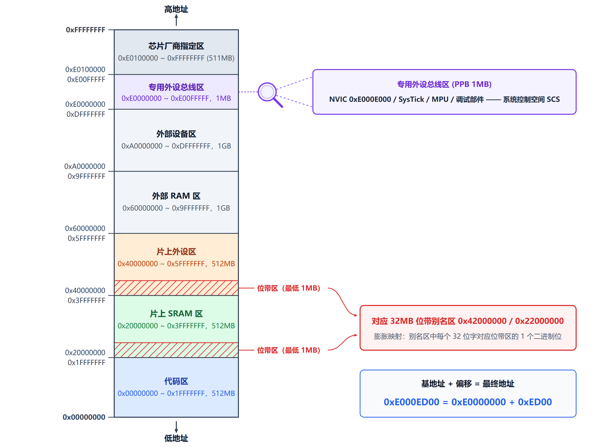

**看图方法**：

1. 左边是一根从 `0x00000000` 到 `0xFFFFFFFF` 的竖直"地址轴"，**越往上地址越大**。
2. 轴上用不同颜色标出七个区，每个区旁边写"地址范围 + 大小 + 住着什么"。
3. **重点看两处**：
   - `0x20000000` 和 `0x40000000` 这两个"低位 1MB"处，用斜线阴影标出**位带区**；
   - `0xE0000000` 附近单独放大一个小框，标出 **NVIC / SysTick / MPU（SCS）**。
4. 图的右下角用一条示例标出"**0xE000ED00 = 0xE0000000 + 0xED00**"这个加法，帮你把"基地址 + 偏移"这条链条和这张图挂上钩。

**这张图要我理解的核心**：**4GB 不是平均分配的，而是按"用途"切成几大块；每块的起点都是"整数关口"（0x20000000、0x40000000…），方便记忆和计算。**

### 2.7.1 位带操作（bit-band）

#### 先补前置知识：为什么"改一位"很麻烦？

假设内存地址 `0x20000000` 里存着一个字节 `0x33`：

```
0x20000000:  0x33 = 0011 0011
                     ││││ ││││
                   bit7 ...  bit0
```

现在你想把 **bit2 改成 0**。传统做法要三步：

```
① 读出整个字节       → 得到 0x33
② 修改 bit2          → 0x33 的 bit2 是 0，本来就是 0，换个数举例：
                       假设原来是 0x37 = 0011 0111，要把 bit2 清 0
                       → 0011 0011 = 0x33
③ 写回整个字节       → 把 0x33 写回 0x20000000
```

**问题在哪？**

> 【补充解释】问题在于"读-改-写"这三步**不是原子的**。如果在第 ① 步和第 ③ 步之间来了一个中断，中断服务程序也去改同一个字节，那么：
> ```
> 主程序：读 → 0x37
>         （中断来了）
> ISR   ：读 → 0x37，改 bit1 → 0x37|0x02 = 0x37（假设 bit1 已是1）… 改别的位 → 写回 0xXX
>         （中断返回）
> 主程序：改 bit2 → 0x33，写回 0x33   ← ISR 的修改被覆盖了！丢失！
> ```
> 这就是教材图 2-20 讲的"**非原子操作的潜在风险**"。

**位带就是来解决这个问题的：它把"读-改-写"三步做成硬件支持的、不可被打断的一条操作。**

#### 位带的两个术语

教材的定义：

| 术语 | 定义 |
|---|---|
| **位带区** | 支持位带操作的地址区 |
| **位带别名** | 位带区中位的别名。对别名的访问最终映射到位带区中某一位的访问上 |

**支持位带操作的两个内存区：**

```
① 0x20000000 ～ 0x200FFFFF    （内部 SRAM 区中的最低 1MB）
② 0x40000000 ～ 0x400FFFFF    （片上外设区中的最低 1MB）
```

**对应的别名区：**

```
① 0x22000000 ～ 0x23FFFFFF    （32MB）
② 0x42000000 ～ 0x43FFFFFF    （32MB）
```

**"膨胀"关系：每一位 → 一个字（32 位）**

```
位带区（1MB）                      位带别名区（32MB）
┌──────────────────┐              ┌──────────────────┐
│  字节 0           │              │  字 0  ← bit0 的别名  │
│  ┌─┬─┬─┬─┬─┬─┬─┬─┐│   膨胀 32倍  │  字 1  ← bit1 的别名  │
│  │b7│b6│…│b1│b0││  ───────────▶ │  字 2  ← bit2 的别名  │
│  └─┴─┴─┴─┴─┴─┴─┴─┘│              │  ...                  │
│  字节 1           │              │  字 7  ← bit7 的别名  │
│  ...             │              │  字 8  ← 下一字节的bit0│
└──────────────────┘              └──────────────────┘
   1MB × 8 位 = 8M 个位          8M 个字 × 4 字节 = 32MB
```

**算一下这个 32 倍是怎么来的：**

```
位带区：1MB = 1 048 576 字节 = 8 388 608 个位
别名区：每个位占 1 个字 = 4 字节
        8 388 608 位 × 4 字节 = 33 554 432 字节 = 32MB

32MB ÷ 1MB = 32 倍
```

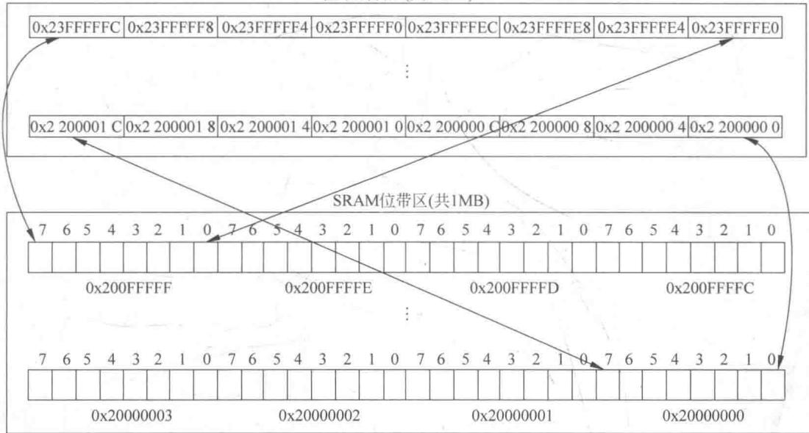

**这张图怎么读？**

1. **左边**画的是**位带区**：一串小格子，每个格子里是 0/1（一位）。
2. **右边**画的是**位带别名区**：一串**大得多的格子**，每个格子是一个 32 位的"字"。
3. **中间的箭头**从左边**每一个小格子**分别指向右边**一个完整的字**——这就是"膨胀（放大 32 倍）"。
4. **注意右边每个字里只有最低位（bit0）有效**，其余 31 位是"陪衬"（硬件不关心）。

**这张图要我理解**：**"1 位 → 1 个字"这个膨胀关系是位带的全部秘密。** 记住它，公式就好理解了（`×8` 是"每字节 8 位"，`×4` 是"每位占 4 字节"）。

#### 别名地址换算公式（本章必考内容）

教材给出两个公式（这里按可读性重排）：

**（1）内部 SRAM 位带区**

```
AliasAddr = 0x22000000 + ((A - 0x20000000) × 8 + n) × 4
          = 0x22000000 + (A - 0x20000000) × 32 + n × 4
```

**（2）片上外设位带区**

```
AliasAddr = 0x42000000 + ((A - 0x40000000) × 8 + n) × 4
          = 0x42000000 + (A - 0x40000000) × 32 + n × 4
```

**每个符号是什么：**

| 符号 | 含义 |
|---|---|
| `A` | 位带区中，这个位**所在字节的地址** |
| `n` | 位序号，`0 ≤ n ≤ 7`（字节内的第几位） |
| `AliasAddr` | 这个位在别名区的对应地址 |

**公式为什么长这样？** 教材的解释很简洁：

> 式中，"**×4**"是因为一个字为 4 字节，"**×8**"表示一个字节为 8 位。

拆开推导：

```
(A - 0x20000000)          → 这个字节是位带区里的第几个字节（字节编号）
(A - 0x20000000) × 8      → 这个字节之前一共有多少个位（因为每字节 8 位）
(A - 0x20000000) × 8 + n  → 这个位是位带区里的第几个位（位编号）
× 4                        → 每个位在别名区占 4 字节
```

#### 逐位演算：教材表 2-4 是怎么来的？

我们**手算三行**，验证教材表 2-4 的正确性。

**例 1：`0x20000000` 的第 0 位 → 别名地址？**

```
A = 0x20000000
n = 0

AliasAddr = 0x22000000 + (0x20000000 - 0x20000000) × 32 + 0 × 4
          = 0x22000000 + 0 + 0
          = 0x22000000          ✓ 教材表 2-4 第一行：0x22000000.0
```

**例 2：`0x20000000` 的第 2 位 → 别名地址？**

```
A = 0x20000000
n = 2

AliasAddr = 0x22000000 + 0 × 32 + 2 × 4
          = 0x22000000 + 0 + 8
          = 0x22000008          ✓ 教材表 2-4 第三行：0x22000008.0
```

**例 3：`0x20000004` 的第 1 位 → 别名地址？**

```
A = 0x20000004
n = 1

第一步：(A - 0x20000000) = 0x20000004 - 0x20000000 = 0x4 = 4（十进制）
第二步：4 × 32 = 128 = 0x80
第三步：n × 4 = 1 × 4 = 4
第四步：AliasAddr = 0x22000000 + 0x80 + 4 = 0x22000084

✓ 教材表 2-4 第六行：0x20000004.1 → 0x22000084.0
```

**例 4（最极端的一行）：`0x200FFFFC` 的第 31 位 → 别名地址？**

> ⚠️ 注意：教材表 2-4 里写的是 "0x20000000.31"，这里的 ".31" 指的是**位序号 31**——但一个字节只有 8 位（0～7），哪来的 bit31？
> 【补充解释】表 2-4 里 "0x20000000.31" 这种写法，指的是**从 0x20000000 开始的第 31 位**（也就是第 4 个字节 0x20000003 的 bit7）。**表 2-4 的 ".n" 是"第 n 位"的意思，不是"字节内第 n 位"。**
> 但教材给出的公式里 `n` 是"字节内位序号（0～7）"。两者并不矛盾——**表 2-4 用的是"位带区内的第几个位"这个视角**，公式用的是"字节地址 + 字节内位号"这个视角。本讲义统一用公式的视角，避免混淆。

用公式的视角算最后一行（教材表 2-4 最后一行写作 `0x200FFFFC.31 → 0x23FFFFFC.0`）。

**第一步：先把 ".31" 换算成公式要的"字节地址 A + 字节内位号 n"**

```
".31" 是"从 0x200FFFFC 数起的第 31 个位"（从 0 开始数）：
    它所在的字节   = 0x200FFFFC + ⌊31 ÷ 8⌋ = 0x200FFFFC + 3 = 0x200FFFFF
    它在字节内的位号 = 31 mod 8 = 7
→ A = 0x200FFFFF，n = 7
```

> ⚠️ 【第一次尝试为什么算错？】讲义特意把"错误过程"也写出来，免得你照着错的方法模仿：
>
> 初次看到 `0x200FFFFC.31`，很容易**直接把 ".31" 前面的那个地址当成 A**，写成 `A = 0x200FFFFC、n = 7`，于是算出：
>
> ```
> A - 0x20000000 = 0xFFFFC
> 0xFFFFC × 32   = 0x1FFFF80
> n × 4          = 0x1C
> AliasAddr      = 0x22000000 + 0x1FFFF80 + 0x1C = 0x23FFFF9C   ✗ 与教材不符
> ```
>
> **错在哪里？** 错在把 `0x200FFFFC` 当成了"**那个位所在字节的地址**"。可 `0x200FFFFC.31` 说的是"**从** 0x200FFFFC **数起**的第 31 个位"——这个位根本不在 0x200FFFFC 这个字节里，而在它**后面 3 个字节**（0x200FFFFF）的 **bit7** 上。
>
> **判断小窍门**：公式里的 `n` 只能是 **0～7**。看到 ".31" 这种"大于 7 的位号"，必须**先除以 8** 换算成"字节地址 + 0～7 的位号"，绝不能直接当作 `n` 用。

**第二步：用正确的 A、n 再算一次**（这就是教材表 2-4 最后一行的来历）

```
A = 0x200FFFFF
n = 7

A - 0x20000000 = 0xFFFFF
0xFFFFF × 32   = 0x1FFFFE0
n × 4          = 0x1C
AliasAddr      = 0x22000000 + 0x1FFFFE0 + 0x1C
               = 0x23FFFFFC
```

**得到 `0x23FFFFFC`** ✓ 与教材一致！

所以教材表 2-4 最后一行的意思是：**"位带区的最后一个字节（0x200FFFFF）的最后一位（bit7）"**，别名地址是 `0x23FFFFFC`。

> 【容易搞混】这类表格的 `.31` 写法确实容易误读。**最稳妥的做法：不要背表格，直接套公式。**
>
> **套公式的标准流程（务必记住）：**
> ```
> ① 找到这个位所在的"字节地址" A
> ② 找到它在字节内的位号 n（0～7）
> ③ 判断它在哪个位带区：
>    0x20000000 起 → 别名基地址 0x22000000
>    0x40000000 起 → 别名基地址 0x42000000
> ④ AliasAddr = 别名基地址 + (A - 位带区基地址) × 32 + n × 4
> ```

**再来一个"片上外设区"的例子**（教材表 2-5 第二行）：

```
0x40000000 的第 1 位 → 别名地址？

A = 0x40000000
n = 1
别名基地址 = 0x42000000

AliasAddr = 0x42000000 + (0x40000000 - 0x40000000) × 32 + 1 × 4
          = 0x42000000 + 0 + 4
          = 0x42000004        ✓ 与教材表 2-5 一致
```

【辅助理解图】

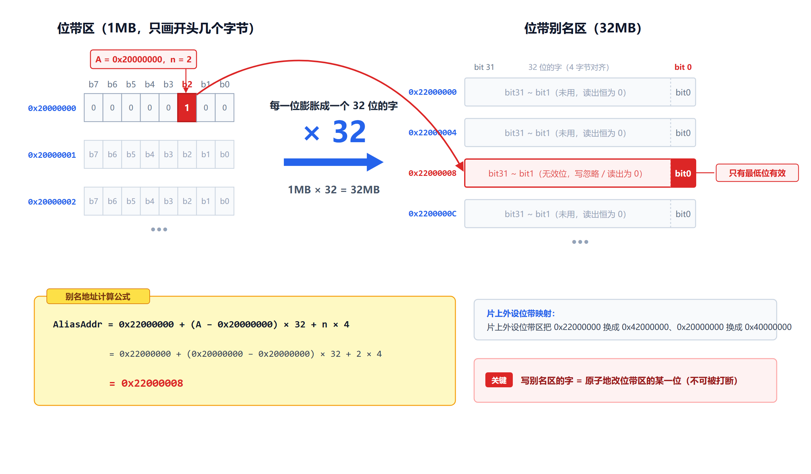

**看图方法**：

1. **左边**画一小段位带区：3 个字节的方格，每个字节里画 8 个小格（标 b7…b0）。其中**某一个位用红色高亮**（比如 0x20000000 的 bit2）。
2. **中间**画一个"放大镜"符号和"×32 膨胀"的标注，箭头从红色位指向右边。
3. **右边**画别名区：一串 4 字节的字（标着"字 0、字 1、字 2…"），其中**与红色位对应的那个字**（字 2，地址 0x22000008）也用红色高亮，字里只画最低位（bit0）有效。
4. **图的下方**写一行公式：`AliasAddr = 0x22000000 + (A - 0x20000000) × 32 + n × 4`，并在公式下方用具体数字演算 `A=0x20000000, n=2 → 0x22000008`。
5. **图右下角**加一个小注："写别名区的字 = 原子地改位带区的某一位"。

**这张图要我理解**：**位带区里的"1 位"，在别名区里被"撑"成了"1 个字"；操作那个字，就等于操作那一位。**

#### 位带操作到底带来什么好处？

教材图 2-19 用一张对比图把"传统做法"和"位带做法"并排画了出来，我们先看这张图。

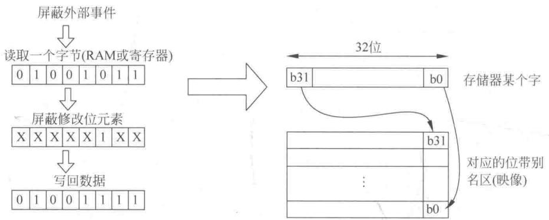

**这张图怎么读？**

**左半边（传统做法，从上到下的流程）**：

```
① 屏蔽外部事件              ← 先关中断，防止被打断
② 读取一个字节              ← 比如读到 01001011
③ 屏蔽修改位元素            ← 用一个掩码 XXXXXX1XX 挑出要改的那一位
④ 写回数据                  ← 01001111（改完之后写回去）
```

**右半边（位带做法）**：

```
一个 32 位的字（存储器某个字）  ← 位带别名区里的"一个字"
        b31 ... b0
              ↑
        （只关心 b0）
```

**图里最关键的一个箭头**：从右边的"存储器某个字"里，有一条弧线从 **b0** 连到下面一张表的 **b31/b0** 那一行，标注"**对应的位带别名区（映像）**"。

**这张图要我理解**：

> **左边要 4 步（还要"屏蔽外部事件"），右边只要 1 步。**
> 而且左边的 4 步之间**可能被中断打断**（所以它才需要"屏蔽外部事件"来保护自己），右边**天然不可被打断**。

**教材总结的三大好处：**

**好处 1：省事。** 传统做法要"屏蔽外部事件 → 读 → 改 → 写回 → 开放外部事件"，位带只需"**把别名地址写 1 或写 0**"。

**好处 2：安全（原子性）。** "该过程**不会受到外部事件的干扰**，故称为**原子化操作**"。

**好处 3：简化跳转判断。** 教材说，以前判断某个位然后跳转要三步：

```
① 读取整个寄存器
② 屏蔽不需要的位
③ 比较并跳转
```

现在只需两步：

```
① 从位带别名区读取状态
② 比较并跳转
```

**好处 4：多任务中的"互锁"访问。**

教材给了完整的对比案例。**先看"不用位带"的出错过程**（教材图 2-20）：

| 步骤 | 主程序 | 中断服务程序 ISR | 输出端口的值 |
|---|---|---|---|
| ① | 读端口值 → 得到 `0x01` | | `0x01` |
| ② | 准备清除 bit0；**此时中断发生，主程序挂起** | | `0x01` |
| ③ | | 读端口值 → 得到 `0x01` | `0x01` |
| ④ | | 设置 bit1 → 值变为 `0x03` | `0x03` |
| ⑤ | | 写回 `0x03` | `0x03` |
| ⑥ | | 返回 | `0x03` |
| ⑦ | 继续执行，清除 bit0 → 基于它自己读到的 `0x01` 算出 `0x00` | | `0x00` |
| ⑧ | 写回 `0x00` | | **`0x00`** ← ISR 改的 bit1 **丢了**！ |

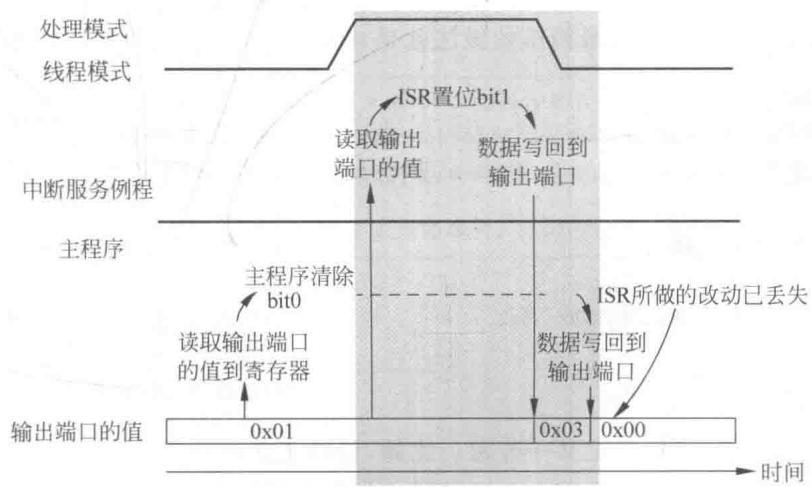

**这张图怎么读？**

1. **横轴是时间**（图右下角标着"时间"箭头）。
2. **最上面两条水平线**分别是"处理模式"和"线程模式"的状态——中间鼓起的那块表示**中断期间处于处理模式**。
3. **中间两条线**分别是"中断服务例程"和"主程序"的进度。
4. **最下面一条**是"输出端口的值"，上面标出了它随时间的变化：`0x01` → （中断期间）`0x03` → `0x00`。
5. **最关键的标注**："ISR 所做的改动已丢失"——箭头指向 `0x03` 变成 `0x00` 的那一刻。

**这张图要我理解**：**非原子操作的"读-改-写"会把别人的修改覆盖掉。** 这在多任务、中断、多核环境下都是致命的。

**再看"用位带"之后的正确过程**（教材图 2-21）：

| 步骤 | 发生了什么 | 输出端口的值 |
|---|---|---|
| ① | 主程序执行"读-改-写"的**位带操作**读取端口 | `0x01` |
| ② | 出现中断，**因为是原子操作，不能被中断**。主程序取出 `0x01`，清除 bit0，返回 | `0x00` |
| ③ | 主程序的位带操作完成，开始响应中断，ISR 读端口 | `0x00` |
| ④ | ISR 执行位带操作，取出 `0x00`，设置 bit1，返回 | **`0x02`** ← ISR 的修改保留了 ✓ |

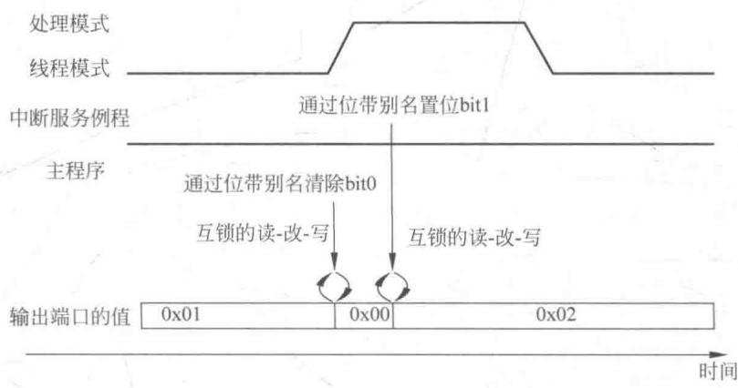

**两张图对比着看**：图 2-20 的最后端口值是 `0x00`（ISR 白干了），图 2-21 的最后值是 `0x02`（ISR 的修改保住了）。**差别就来自"原子性"这三个字。**

#### 教材实例：位带区操作实例（原书 p44）

教材给了一个完整的小例子，我们一步步演算（**这里采用已核对过 PDF 的正确数值**）：

**（1）在地址 `0x20000000` 处写入 `0x3355AACC`。**

```
0x20000000 的内容 = 0x3355AACC

二进制展开（每个十六进制位 = 4 个 bit）：
0x3355AACC
= 0011 0011 0101 0101 1010 1010 1100 1100
  └─3─┘ └─3─┘ └─5─┘ └─5─┘ └─A─┘ └─A─┘ └─C─┘ └─C─┘

只看最低那个字节（0xCC）：
0xCC = 1100 1100
        ││││ ││││
      b7 ...     b0

bit2 在哪里？
0xCC 的 bit2 = 1（从右边数第 3 个）
        1100 1100
           ↑
          bit2
```

**（2）读写地址 `0x22000008`。本次读访问将读取 `0x20000000`，并提取 bit2，值为 1。**

先验证别名地址算得对不对：

```
A = 0x20000000, n = 2
AliasAddr = 0x22000000 + 0 × 32 + 2 × 4 = 0x22000008  ✓

读 0x22000008 → 硬件自动去读 0x20000000，把 bit2 移到最低位返回
              → 返回 1
```

**（3）往地址 `0x22000008` 处写 0。本次操作将被映射成对地址 `0x20000000` 的"读-改-写"操作（原子操作），把 bit2 清零。**

```
硬件做的事（全部在一条指令内完成，中间不可被打断）：
① 读 0x20000000     → 0x3355AACC
② 清 bit2           → 0x3355AAC8
③ 写回 0x20000000   → 0x3355AAC8
```

**bit2 清零的过程看清楚：**

```
运算前：  0xCC = 1100 1100
掩码：    0xFB = 1111 1011   （bit2 为 0，其余为 1）
运算后：  0xC8 = 1100 1000
                 ↑
             bit2 已经是 0

（这是"按位与"运算：任何位 & 1 = 原值；任何位 & 0 = 0）
```

**（4）再读取 `0x20000000`，将返回 `0x3355AAC8`（bit2 清零）。**

```
0x3355AACC   →   0x3355AAC8
        └┬┘              └┬┘
       0xCC              0xC8
     (1100 1100)      (1100 1000)
                            ↑ bit2 变 0
```

> 【待核验】原始索引文件 `tools/index/ch02_source.md` 把这一步写成 `0x3355AACC8`（9 个十六进制位）。已核对原 PDF p49，教材原文为 **`0x3355AAC8`**（8 位）。本讲义采用正确值。

#### 代码到底做了什么？（C 语言里的位带操作）

教材给了 C 语言的用法。我们分三段看。

**第一段：最朴素的做法——直接 `#define` 别名地址**

```c
#define DEVICE_REG0      ((volatile unsigned long *) (0x40000000))
#define DEVICE_REG0_BIT0 ((volatile unsigned long *) (0x42000000))
#define DEVICE_REG0_BIT1 ((volatile unsigned long *) (0x42000004))
...
*DEVICE_REG0 = 0xAB;                  // 使用正常地址访问寄存器
...
*DEVICE_REG0 = *DEVICE_REG0 | 0x2;    // 使用传统方法设置 bit1
...
*DEVICE_REG0_BIT1 = 0x1;              // 通过位带别名地址设置 bit1
```

**先说这段代码要完成什么**：

> 用两种方式给"地址 0x40000000 处的 bit1"置 1：一种用传统位操作（第 6 行），一种用位带别名（第 8 行）。

**逐行拆解：**

| 代码 | 含义 | 硬件发生什么 |
|---|---|---|
| `#define DEVICE_REG0 ((volatile unsigned long *) (0x40000000))` | 定义宏：`DEVICE_REG0` 就是"指向 0x40000000 的 `unsigned long` 指针" | 无（编译期的事） |
| `#define DEVICE_REG0_BIT0 ((volatile unsigned long *) (0x42000000))` | 定义宏：别名地址 0x42000000 就是 bit0 | 无 |
| `#define DEVICE_REG0_BIT1 ((volatile unsigned long *) (0x42000004))` | 别名地址 0x42000004 就是 bit1 | 无 |
| `*DEVICE_REG0 = 0xAB;` | 往 0x40000000 写 0xAB | 一条 store 指令，32 位数据写进该地址 |
| `*DEVICE_REG0 = *DEVICE_REG0 \| 0x2;` | 读出、或上 0x2（bit1）、写回 | **三条动作：load → or → store**，中间可能被中断 |
| `*DEVICE_REG0_BIT1 = 0x1;` | 往别名地址 0x42000004 写 1 | **一条 store 指令**，硬件自动完成"读-改-写"，不可被打断 |

**关键对比（这就是位带的价值）：**

```
传统做法：  load → or → store       （3 条指令，中间可被中断）
位带做法：  store                    （1 条指令，原子）
```

**第二段：用宏自动算别名地址**

```c
// 把"位带地址 + 位序号"转换成别名地址的宏（教材原文，掩码 0xFFFF 有问题，见下方【待核验】）
#define BITBAND(addr, bitnum) \
    ((addr & 0xF0000000) + 0x2000000 + ((addr & 0xFFFF) << 5) + (bitnum << 2))
```

**这个宏要完成什么？** 把公式 `别名基地址 + (A - 区基地址) × 32 + n × 4` 写成一行位运算。

**逐块拆解：**

| 片段 | 作用 | 为什么这样写 |
|---|---|---|
| `addr & 0xF0000000` | 取出地址的**最高 4 位**（十六进制），也就是"属于哪个大区" | 0x20000000 的最高位是 2，0x40000000 的最高位是 4 |
| `+ 0x2000000` | 加上 `0x02000000`，得到别名区的基地址 | 0x20000000 + 0x02000000 = 0x22000000 ✓<br>0x40000000 + 0x02000000 = 0x42000000 ✓ |
| `(addr & 0xFFFF)` | 取地址的**低 16 位**。⚠️ 教材这里写的掩码是 **`0xFFFF`**（照录教材原文，已核对原 PDF p51 / 书页 46） | 本意是"取区内的偏移"，相当于公式里的 `(A - 区基地址)`。但这个掩码**只保留了 16 位**，对"偏移 ≥ 0x10000"的地址会算错——原因见下面的【待核验】 |
| `<< 5` | 左移 5 位 = **乘以 32** | 因为 `(A - 基地址) × 32` |
| `(bitnum << 2)` | 左移 2 位 = **乘以 4** | 因为 `n × 4` |

**用具体数字验证一下这个宏：**

```
BITBAND(0x40000000, 1)

addr = 0x40000000, bitnum = 1

① addr & 0xF0000000 = 0x40000000
② + 0x02000000      = 0x42000000
③ addr & 0xFFFF     = 0x0000
④ 0x0000 << 5       = 0x0000
⑤ bitnum << 2 = 1 << 2 = 4 = 0x4
⑥ 结果 = 0x42000000 + 0x0000 + 0x4 = 0x42000004  ✓

（与前面手算结果一致）
```

> ⚠️ 【待核验 / 重要】**教材这个宏的掩码有问题：`0xFFFF` 应为 `0xFFFFF`。**
>
> 位带区是 **1MB = 0x100000**，所以"区内的偏移"最多要 **20 位**（0 ～ 0xFFFFF，即 0～1048575）。而 `addr & 0xFFFF` 只保留低 **16 位**（0 ～ 0xFFFF，即 64KB）：凡是偏移 ≥ `0x10000` 的地址，掩码会把 bit16～bit19 抹掉，算出**错误的别名地址**。
>
> **用本讲义反复举例的 GPIOA 验算一下**（A = 0x40010800，取它的 bit0）：
>
> ```
> 教材宏：0x42000000 + ((0x40010800 & 0xFFFF) << 5) + 0
>       = 0x42000000 + (0x0800 << 5)      ← 偏移 0x10800 被砍成了 0x0800
>       = 0x42000000 + 0x10000
>       = 0x42010000                      ✗ 错！
>
> 正确值：0x42000000 + 0x10800 × 32 + 0
>       = 0x42000000 + 0x210000
>       = 0x42100000                      ✓
> ```
>
> **再用本小节"例 4"的最后一个位验算**（A = 0x200FFFFF，n = 7）：
>
> ```
> 教材宏：0x22000000 + ((0x200FFFFF & 0xFFFF) << 5) + 7×4
>       = 0x22000000 + (0xFFFF << 5) + 0x1C
>       = 0x22000000 + 0x1FFFE0 + 0x1C
>       = 0x221FFFFC                      ✗ 错！（正确答案是 0x23FFFFFC）
> ```
>
> **正确写法**（掩码多留一个 F，凑满 20 位）：
>
> ```c
> // 修正版：位带区 1MB = 0x100000，区内偏移最多 20 位
> #define BITBAND(addr, bitnum) \
>     ((addr & 0xF0000000) + 0x2000000 + ((addr & 0xFFFFF) << 5) + (bitnum << 2))
> ```
>
> **教材的宏什么时候碰巧是对的？** 当"区内偏移 < 0x10000"（地址落在位带区的**头 64KB**）时——例如 `0x40000000`、`0x20000000`～`0x2000FFFF`、`0x4000xxxx` 范围内的地址。一旦偏移超过 64KB（比如 GPIOA `0x40010800` 的偏移 0x10800、GPIOC `0x40011000` 的偏移 0x11000），它就会算错。
>
> **考试 / 写代码时怎么办？** 记住**公式本身**（`别名基地址 + (A − 区基地址) × 32 + n × 4`），**不要照抄教材这个有问题的宏**；如果要用宏，就把掩码写成 `0xFFFFF`。本讲义表 2-4 前几行那种"偏移很小"的例子（0x20000000、0x20000004、0x40000000）用教材宏也能算对，但**例 4 的 0x200FFFFF 就会算错**——所以一律按公式算最保险。疑点已记入文末"待核验"。

**为什么宏里用 `<< 5` 而不是 `× 32`？**

因为**移位比乘法快**（在硬件层面，移位就是"把线往旁边挪几根"，乘法要专门的乘法电路）。编译器其实也能把 `× 32` 优化成 `<< 5`，但写宏的人习惯直接写移位，表示"这里就是位操作"。

> 【先补一个前置知识：`<<` 和 `>>` 是什么？】
> - `x << 5`：把 x 的二进制整体向左移 5 位，右边补 0。效果 = x × 2^5 = x × 32。
> - `x >> 5`：向右移 5 位，左边补 0。效果 = x ÷ 32（取整）。
> - 例：`1 << 2` → `0001` 左移 2 位 → `0100` = 4。
> 第 4 章会详细讲移位指令，这里只要会算"左移 n 位 = 乘 2^n"。

**第三段：把别名地址变成指针**

```c
// 把该地址转换成一个指针
#define MEM_ADDR(addr) * ((volatile unsigned long *) (addr))
```

（教材原文此处写作 `(adr)`，是排印错误，应为 `addr`。已核对原 PDF p52。）

**这个宏要完成什么？** 把"一个地址数字"变成"可以读写的内存单元"。

拆解：

```
* ((volatile unsigned long *) (addr))
│      └──────────┬──────────┘
│                 │
│    把 addr 强制转换成"指向 unsigned long 的指针"
│                 （unsigned long = 32 位无符号整数）
│
└─ 解引用：读写这个地址上的 32 位数据
```

**于是就能这样写代码：**

```c
MEM_ADDR(DEVICE_REG0) = 0xAB;
// 使用正常地址访问寄存器

MEM_ADDR(DEVICE_REG0) = MEM_ADDR(DEVICE_REG0) | 0x2;   // 传统做法

MEM_ADDR(BITBAND(DEVICE_REG0, 1)) = 0x1;               // 使用位带别名地址
```

**这三行分别做了什么？**

| 代码 | 效果 |
|---|---|
| `MEM_ADDR(DEVICE_REG0) = 0xAB;` | 往 0x40000000 写 0xAB |
| `MEM_ADDR(DEVICE_REG0) = MEM_ADDR(DEVICE_REG0) \| 0x2;` | 读出 → 或上 0x2 → 写回（**非原子**） |
| `MEM_ADDR(BITBAND(DEVICE_REG0, 1)) = 0x1;` | 往 `BITBAND(0x40000000, 1) = 0x42000004` 写 1（**原子**，等价于把 0x40000000 的 bit1 置 1） |

#### 为什么必须用 volatile？

教材最后给了这个非常重要的提醒：

> 注意：当使用位带功能时，**要访问的变量必须用 volatile 来定义**。因为 C 编译器并不知道同一位可以有两个地址。通过 volatile，使得编译器每次都如实地把新数值写入存储器，而不再会出于优化的考虑，在中途使用寄存器来操作数据的副本，直到最后才把副本写回——这会导致按不同的方式访问同一个位会得到不一致的结果。

**【先补一个前置知识：volatile 是什么？】**

`volatile` 是 C 语言的一个关键字，意思是"**易变的、不稳定的**"。

它的作用是告诉编译器：

> **"这个变量的值随时可能被别的东西改掉，你每次用它都必须老老实实去内存里重新读一遍，不许把它缓存到寄存器里优化掉。"**

**为什么位带特别需要它？** 因为位带有"**一个位、两个地址**"的特点：

```
0x40000000 的 bit1     ←→     0x42000004（别名地址）
```

编译器的"视角"是：**它只看得到地址，看不到"这两个地址指的是同一个位"**。于是编译器可能这样"优化"：

```c
// 程序员写的：
MEM_ADDR(BITBAND(DEVICE_REG0, 1)) = 0x1;   // 通过别名地址把 bit1 置 1
x = MEM_ADDR(DEVICE_REG0);                  // 通过普通地址读回来

// 编译器"聪明"的优化（错误！）：
// "我刚写过 0x42000004，但那和 0x40000000 是两个不同的地址，
//  所以我之前读 0x40000000 的缓存值还能用，不用重新读。"
// → 结果 x 拿到的是旧值
```

**加上 `volatile` 之后**，编译器被强制"每次都去内存重新读"，就不会出错了。

> 【类比】
> 就像你让助理去档案室取资料。
> 助理（编译器）很勤快，说："这份资料我刚才已经拿过一份复印件了，就在我桌上，直接给你这份吧。"
> 但如果那份资料在档案室里被别人改过了，他桌上的复印件就是**过期的**。
> `volatile` 就是你对助理说："**每次都必须亲自去档案室取，不许用你桌上的复印件。**"
> **类比的边界**：编译器并不是"偷懒"，它做的是**合法且通常正确的优化**；只是在"同一块内存有多个地址"这种特殊情况下，它的假设（"一个地址对应一份数据"）不成立，才需要 `volatile` 来纠正。

#### 位带操作的两个限制

教材明确说了两条：

1. **位带操作只适用于数据访问，不适用于取指。** 也就是说，你不能靠位带别名地址去"取指令"。
2. **只有两个区的低位 1MB 支持位带**：`0x20000000～0x200FFFFF` 和 `0x40000000～0x400FFFFF`。其他区域（包括外部 RAM 区、外部设备区）都没有位带。

教材还提到位带的一个实际用途：

> 位带操作可以为 Cortex-M3 通过 GPIO 的引脚来单独控制每盏 LED 的点亮与熄灭，也为操作串行接口器件提供了很大的方便。总之，位带操作对于**硬件 I/O 密集型的底层程序极为有用**。

> 【补充解释】第 6 章讲 GPIO 时，你会看到 STM32 提供了 **BSRR 寄存器**来实现"原子地置位/复位某个引脚"——它和位带是"两种解决同一个问题的方案"。位带是**内核级**的通用机制，BSRR 是**外设级**的专用机制。两个都值得了解。

### 2.7.2 端模式（Endianness）

#### 先补前置知识：什么叫"端模式"？

**端模式（endianness）**：一个多字节数据在内存里，**字节的排列顺序**。

一个 32 位数 `0x12345678` 由 4 个字节组成：

```
0x12  0x34  0x56  0x78
 ↑     ↑     ↑     ↑
最高字节            最低字节
(bit31~24)        (bit7~0)
```

现在把它存到从地址 `0x1000` 开始的 4 个字节里，有两种存法：

```
【小端模式（Little-endian）】
地址    内容
0x1000  0x78    ← 最低字节放在最低地址
0x1001  0x56
0x1002  0x34
0x1003  0x12    ← 最高字节放在最高地址

【大端模式（Big-endian）】
地址    内容
0x1000  0x12    ← 最高字节放在最低地址
0x1001  0x34
0x1002  0x56
0x1003  0x78    ← 最低字节放在最高地址
```

> 【类比】
> 把"年月日"写成 2026-10-04（大单位在前）还是 04-10-2026（小单位在前）？
> 两种写法都有人用，只要**双方约定一致**就不会出错。
> 计算机里也一样：**大端 = 大单位在前，小端 = 小单位在前。**
> **类比的边界**：真实硬件里这个顺序是由**地址译码电路**决定的，是"物理上怎么接线"的问题，不是"怎么写"的问题。

#### 教材的端模式表

教材说：

> Cortex-M3 **同时支持小端模式和大端模式**。在绝大多数的情况下，基于 Cortex-M3 的微控制器都是用小端模式（即**数据的高位字节保存在高位地址，数据的低位字节保存在低位地址**）。

**小端模式：存储器视图（教材表 2-6）**

| 地址，长度 | bit31~24 | bit23~16 | bit15~8 | bit7~0 |
|---|---|---|---|---|
| `0x1000`，字（4 字节） | D[31:24] | D[23:16] | D[15:8] | D[7:0] |
| `0x1000`，半字（2 字节） | | | D[15:8] | D[7:0] |
| `0x1002`，半字 | D[15:8] | D[7:0] | | |
| `0x1000`，字节 | | | | D[7:0] |
| `0x1001`，字节 | | | D[7:0] | |
| `0x1002`，字节 | | D[7:0] | | |
| `0x1003`，字节 | D[7:0] | | | |

**这张表怎么读？** 以"32 位数 `0x12345678` 从地址 0x1000 开始存放"为例：

```
地址 0x1000：D[7:0]   = 0x78   ← 最低字节在最低地址
地址 0x1001：D[15:8]  = 0x56
地址 0x1002：D[23:16] = 0x34
地址 0x1003：D[31:24] = 0x12
```

**大端模式：存储器视图（教材表 2-7）**

| 地址，长度 | bit31~24 | bit23~16 | bit15~8 | bit7~0 |
|---|---|---|---|---|
| `0x1000`，字 | D[7:0] | D[15:8] | D[23:16] | D[31:24] |
| `0x1000`，半字 | D[7:0] | D[15:8] | | |
| `0x1002`，半字 | | | D[7:0] | D[15:8] |
| `0x1000`，字节 | D[7:0] | | | |
| `0x1001`，字节 | | D[7:0] | | |
| `0x1002`，字节 | | | D[7:0] | |
| `0x1003`，字节 | | | | D[7:0] |

同样用 `0x12345678` 举例：

```
地址 0x1000：D[31:24] = 0x12   ← 最高字节在最低地址
地址 0x1001：D[23:16] = 0x34
地址 0x1002：D[15:8]  = 0x56
地址 0x1003：D[7:0]   = 0x78
```

**教材原话**："可以看出，大端模式的数据存储高低位顺序与小端模式**相反**。"

#### 几条关于端模式的硬性规则（教材原文）

1. **建议统一使用小端模式。**
2. **Cortex-M3 是在复位时确定使用哪种端模式的，且运行时不得更改。**
3. **指令预取永远使用小端模式。**
4. **配置控制存储空间的访问也永远使用小端模式**（包括 NVIC、FPB 等）。
5. **专用外设总线区 `0xE0000000～0xE00FFFFF` 也永远使用小端模式。**
6. 针对采用大端模式工作的外设时，可以使用 **REV / REVH 指令**来完成端模式的转换。

> 【补充解释】第 3 条到第 5 条的意思可以概括成：**"内核自己的东西永远是小端，不管你把芯片配成什么模式。"**
> 因为 NVIC、SysTick 这些寄存器都是内核的一部分，它们的行为不能随芯片配置而变，否则代码就没法移植了。
> **REV** = Reverse bytes，字节反转；**REVH** = Reverse Halfwords，半字反转。它们是"数据搬过来时顺手把字节顺序倒一倒"的指令，第 4 章会讲。

#### 怎么判断当前是什么端模式？

教材提到 NVIC 的 **AIRCR 寄存器**（地址 `0xE000ED00`）里有一位 **ENDIANESS**（bit15）：

```
bit15 = 1 → 大端
bit15 = 0 → 小端
（只读；复位时确定，不能更改）
```

（AIRCR 的完整内容见 2.8.1 节。）

### 本节真正要记住什么

1. Cortex-M3 有 **4GB = 2^32 字节** 的单一固定存储器映射，分七个区：**代码 / 片上 SRAM / 片上外设 / 外部 RAM / 外部设备 / 专用外设总线 / 厂商指定**。
2. 每个区的起点都是"整数关口"：`0x00000000`、`0x20000000`、`0x40000000`、`0x60000000`、`0xA0000000`、`0xE0000000`、`0xE0100000`。
3. **地址计算链条：看高位判断区 → 区基地址 + 偏移 = 最终地址。**
4. **位带**把"1 位"膨胀成"1 个字"，让"改一位"变成**一条原子的写操作**；两个位带区是 `0x20000000` 和 `0x40000000` 各自的最低 1MB。
5. **别名地址公式**：
   ```
   SRAM  ：AliasAddr = 0x22000000 + (A - 0x20000000) × 32 + n × 4
   外设  ：AliasAddr = 0x42000000 + (A - 0x40000000) × 32 + n × 4
   ```
6. 位带操作**只适用于数据访问，不适用于取指**；访问位带变量**必须用 volatile**。
7. **小端**：低字节放低地址（STM32 绝大多数情况）；**大端**：高字节放低地址。
8. **端模式复位时确定，运行时不能改；内核自己的东西（NVIC、PPB 区）永远小端。**

---

## 2.8 异常与中断（教材 2.7）

### 先别急着看教材：这一节到底要干什么？

这一节是**本章篇幅最大、也最重要的一节**。它回答：

> **CPU 正在老老实实按顺序执行程序，突然有件"急事"需要它立刻处理，怎么办？**

答案是**中断（interrupt）**。

这一节还会引出一个更宽的词——**异常（exception）**。在 ARM 的世界里，"中断"只是"异常"的一种。

**先打个预防针**：这一节术语多、图多、细节多。建议你**先通读一遍建立整体印象，再回头抠细节**。特别是"中断的具体行为"那一小节（2.8.5），是本章的重中之重。

### 用大白话理解：什么叫中断？

教材用的类比非常好，这里照抄并展开：

> 【类比】
> 当一位工作人员正处理文件时，**电话铃响了**（中断请求）。
> 他就需要在文件上正在处理的位置**做一个记号**（返回地址），以便接完电话回来继续处理文件。
> 然后**暂停文件处理的工作，去接电话**（响应中断）。
> 并告诉对方"**按某个方案办**"（中断处理程序）。
> 然后，再**从接听电话的状态返回到处理文件的状态**（恢复中断前的状态），接着处理文件（中断返回）。

教材还给了第二个例子：

> 当一个控制系统在正常监测和控制系统的运行时，如果工作现场某处**失火**，火焰传感器将传感到的失火信号送到计算机，要求计算机立即处理（中断请求）。
> 这时计算机系统应当**记住当前正在运行的程序的地方**（返回地址），立即**暂停当前运行的程序**，进入事先编好的**失火报警程序段**运行（响应中断）。
> 在中断程序中**启动失火报警器报警**（中断处理程序），然后再**返回到刚才正常运行的程序**继续工作（中断返回）。

**类比的边界**：
- 真实硬件里没有"工作人员"在"做记号"，而是**硬件电路自动把返回地址和现场压进堆栈**；
- "电话铃响"也不是声音，而是**某根引脚上的电平变化**或**某个外设寄存器里某一位变成 1**。

### 为什么需要中断？（教材讲的历史背景，很值得读）

教材说：最初引进中断技术的目的是为了**增强计算机的实时性，提高计算机输入/输出的效率**。

它举了一个非常直观的例子：

```
【没有中断时】
CPU 要给外部设备送一批数据：
  送第 1 组 → 等设备慢慢处理完 → 送第 2 组 → 等 → 送第 3 组 → ...
              ↑
        CPU 在这里"空转"等待，白白浪费

【有中断之后】
CPU 送第 1 组 → 不等了，去干别的活 → 设备处理完，主动"报告"（申请中断）
              → CPU 回来送第 2 组 → 又去干别的活 → ...
```

**核心思想**：**CPU 比外设快得多，不要让快的等慢的。**

> 【类比】
> 你是公司里最快的员工。如果每次让打印机干活你都要站在旁边等它打完，那你的时间全浪费了。
> 正确做法：把文件丢给打印机，去干别的事；打印机打完"叮"一声通知你（中断），你再回来处理。

### 正式知识：中断的定义和五个术语

教材的正式定义：

> 所谓**中断**，是指计算机在执行程序的过程中，出现某些事件需要立即处理时，**CPU 暂时中止正在执行的程序，转去执行对某种请求的处理程序**。当处理程序执行完毕后，CPU 再回到先前被暂时中止的程序继续执行。

这一句话里藏了 **5 个必须掌握的术语**：

| 术语 | 含义 |
|---|---|
| **中断系统** | 实现"中断"这种功能的部件 |
| **中断源** | 请求 CPU 中断的**请求源**（比如某个外设） |
| **中断响应** | 中断源向 CPU 发出中断申请，CPU 暂停当前工作转去处理该事件 |
| **中断服务** | 对整个事件的处理过程 |
| **中断返回** | 事件处理完毕，CPU 返回到被中断的地方 |

**用一条时间轴把它们串起来：**

```
时间 ────────────────────────────────────────────────────────────▶

主程序:  A → B → C ──┐                            ┌── D → E → F
                     │                            │
                     │ ① 中断源发出申请（中断请求） │
                     │                            │
                     ▼                            │
              ② CPU 响应中断                     │
                     │                            │
                     ▼                            │
              ③ 保存断点 + 保护现场               │
                     │                            │
                     ▼                            │
              ④ 执行中断服务程序（ISR）───────────┘ ⑤ 恢复现场 + 中断返回
                     │
                 （这段时间叫"中断服务"）
```

**这张时间轴要我理解**：中断不是"重新开始"，而是"**打一个岔再回来**"——`D` 接着 `C` 继续，程序的数据和进度都没丢。

### 中断的两个关键问题

**问题 1：多个中断源同时来，先处理谁？**

教材说：

> 计算机的中断系统一般允许多个中断源，当几个中断源同时向 CPU 请求中断，要求为其服务的时候，就存在 CPU 优先响应哪一个中断源请求的问题。
> 通常根据中断源的**轻重缓急**排队，优先处理最紧急事件的中断请求源，即规定每一个中断源有一个**优先级别**。CPU 总是先响应优先级别最高的中断请求。

> 【类比】
> 你正在写作业，门铃响了、电话响了、室友喊你吃饭——三件事同时发生。
> 你不可能三个一起处理，只能排个序：门铃（可能是快递，不能等）→ 电话 → 吃饭。
> 这个"排序"就是**优先级**。

**问题 2：正在处理一个中断，又来了个更急的怎么办？**

教材说：

> 当 CPU 正在处理一个中断源请求的时候（执行相应的中断服务程序），发生了另外一个优先级比它更高的中断源请求，CPU 暂停原来中断源的服务程序，转而去处理优先级更高的中断请求源，处理完以后，再回到原低优先级中断的服务程序，这样的过程称为**中断嵌套**。
>
> 这样的中断系统称为**多级中断系统**；没有中断嵌套功能的中断系统称为**单级中断系统**。

```
时间 ──────────────────────────────────────────────────────────────▶

主程序:  A → B ──┐                                    ┌── C → D
                 │                                    │
                 ▼                                    │
        ISR(低优先级) ──┐                    ┌── 继续 ─┘
                       │                    │
                       │ 来了更高优先级的   │
                       │ 中断 → 嵌套        │
                       ▼                    │
                ISR(高优先级) ──────────────┘
```

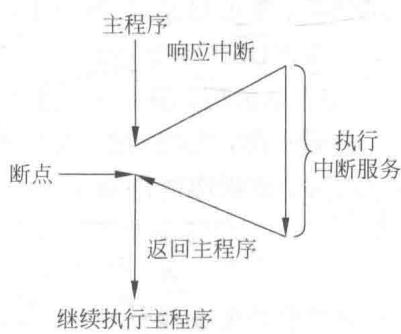

**图 2-22 怎么读**：

1. **横向是时间**。
2. **上下两条水平线**代表两种"状态"（正常程序执行 / 中断处理）。
3. **中间那条折线**是程序的"执行轨迹"：正常执行 → 跳下去执行中断服务 → 再跳回来。
4. **转折点上的标注**是"中断请求""响应""返回"这些关键事件。

**这张图要我理解**：**中断让程序的执行轨迹"凹"下去一块，然后又接回原来的位置。**

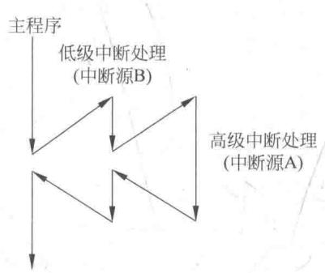

**图 2-23 怎么读**：

1. 和图 2-22 结构一样，但**多了一层"凹陷"**。
2. 从正常程序凹下去进入"低优先级 ISR"，**还没走完**就又凹下去进入"高优先级 ISR"。
3. 高优先级 ISR 结束后，**回到低优先级 ISR 的断点**继续；低优先级 ISR 结束后，才回到主程序。

**这张图要我理解**：**嵌套 = 凹坑里还有凹坑，一层层"还回来"。**

【辅助理解图】

（说明：本节的"中断响应与返回"和"咬尾/迟来"辅助图见 2.8.5 与 2.8.7 小节，本节不重复配图。）

### 中断带来的三大好处

教材总结了三条：

1. **可及时处理控制系统中许多随机发生的事件**（比如温度异常、按键按下）；
2. **较好地解决了快速 CPU 和慢速外部设备之间的矛盾**，可使 CPU 和外部设备**并行工作**；
3. **具备了处理故障的能力**，提高了系统自身的可靠性。

### 中断 vs 调用子程序（教材表 2-8，容易考）

这两件事"看起来很像"（都是"跳出去、做完再回来"），但有三点本质区别：

| 中断 | 调用子程序 |
|---|---|
| 产生时刻是**随机的** | 程序中**事先安排好的** |
| **既保护断点（自动实现），又保护现场（需要用户编程实现）** | **可只保护断点**（自动实现） |
| 处理程序的**入口地址是单片机硬件确定的，用户不能改变** | 子程序的入口地址是**程序编排的** |

**逐条理解：**

**区别 1（时机）**：调用子程序是你主动写的 `BL`；中断是"不知道什么时候会来"。

**区别 2（保护什么）**——这条最容易考，也最容易搞混：

> 【先补一个前置知识：什么叫"断点"？什么叫"现场"？】
> - **断点（断点地址 / 返回地址）**：被中断的那条指令的**下一条**指令的地址。要能回来，必须记住它。
> - **现场（现场条件）**：被中断时**各个寄存器的值**。因为中断服务程序会用到这些寄存器，会把它们改掉，所以必须先把原值存起来。
>
> 教材的原话很到位：
> "进入子程序或中断处理程序后，还需要**保护子程序或中断处理程序所用到的通用寄存器中的数据**，因为这些寄存器中可能存放着主程序正在使用和将要使用的数据，尤其是中断处理程序，它的发生时刻往往是随机的，进入中断处理程序后，使用寄存器就可能会覆盖掉其中的原值，这样结束中断处理后返回主程序，原来的主程序运行状态就可能已经被破坏了。"

**关键点**：

- **断点**：调用子程序（`BL`）和中断，**都由硬件自动保存**。
- **现场**：调用子程序时**可以不保护**（因为是你自己写的代码，你知道它改了什么，甚至可以约定"这个子程序只改 R0"）；但**中断必须保护**（因为你不知道中断会什么时候来、改了什么），而**这部分需要用户编程实现**（写 PUSH/POP）。

> ⚠️ 【容易搞混】**很多人以为"中断的现场保护也是硬件自动做的"——这是对的！**
> 教材表 2-8 说的是"**需要用户编程实现**"，指的是"**在通用的中断概念里**"。而 **Cortex-M3 恰好是个例外**——它在进入 ISR 时会**自动把 8 个寄存器压栈**（见 2.8.5），这是 Cortex-M3 相对传统单片机的一大优势。
> **考试时如果题目问"中断和调用子程序的区别"，按教材表 2-8 回答；如果题目问"Cortex-M3 中断有什么特点"，要答"自动保存和恢复现场"。**

**区别 3（入口地址谁定）**：

- 子程序入口地址是你在代码里写死的（`BL function1` 里的 `function1`）；
- 中断服务程序的入口地址是**硬件从"向量表"里查出来的**（见 2.8.2），你只能通过修改向量表来改，不能"在指令里指定"。

### 中断相关的四个基本概念

**1. 开中断和关中断**

教材说：中断的开放（**开中断** / 中断允许）和中断的关闭（**关中断** / 中断禁止）可以通过**指令设置相关特殊功能寄存器的内容**来实现。

> 在 Cortex-M3 上，这就是前面讲的 **PRIMASK / FAULTMASK / BASEPRI** 和 **CPS 指令**。
> **只有在开中断的情况下，才有可能接受中断源的请求。**

**2. 堆栈**（教材这一小节把"为什么需要栈"讲得很透，值得精读）

教材原话要点：

> 在主程序调用子程序或中断处理过程时，分别要保存**返回地址（断点地址）**和**保护现场**……
> 保存返回地址的方法是**将返回地址（断点地址）保存到堆栈中**，返回主程序前从堆栈中取出上述地址**放回到指令计数器（PC）中**，按照放回后的 PC 值，从程序存储器中取指令执行就返回到了主程序中被中断的地方。
>
> 保护现场的方法是**将现场条件（寄存器的值）先推入（使用 PUSH 命令）堆栈保存**，然后再使用这些寄存器，返回主程序前，**弹出（使用 POP 指令）**寄存器的值。

**这段话把 2.6 节的栈和本节的中断连起来了：**

```
保存断点  →  把"下一条指令的地址" PUSH 进栈
保护现场  →  把"寄存器的值" PUSH 进栈
─────────────────────────────────────────
中断返回  →  POP 恢复现场 → POP 恢复 PC（或直接把 EXC_RETURN 写进 PC）
```

**一个重要区分**（教材特别点出）：

> 其中**通用寄存器的保存和恢复需要由堆栈操作指令来完成**；**返回地址的保存与恢复的堆栈操作都是在相应的子程序的调用和返回指令的操作中自动完成的**，无须再用专门的堆栈操作指令。

**3. 中断的响应**

教材说：CPU 响应中断源请求时，由**中断系统硬件**控制 CPU 从主程序转去执行中断服务程序，同时把**断点地址自动送入堆栈**进行保护。各个中断源的中断服务程序**入口地址由中断系统确定**。

**4. 中断的撤除**

教材说：在响应中断请求后，返回主程序之前，该**中断请求标志应该撤除**；否则 CPU 执行完中断服务程序会**误判为又发生了中断请求而错误地再次进入中断服务程序**。

> 【补充解释】"撤除"就是"把请求标志清掉"。
> 在 Cortex-M3 里，这件事**大部分由硬件自动完成**：中断服务例程一开始执行，硬件就把挂起标志清掉（见 2.8.3）。但如果你的外设本身有个"中断标志位"（比如定时器的更新标志），**那个标志需要你在 ISR 里手动清**——否则 ISR 一返回就立刻又进来，程序会卡死。
> **这是初学者最容易踩的坑之一**，第 7、8 章会反复强调。

### 从"中断"到"异常"：ARM 的术语体系

教材有一段重要的术语说明：

> 在 ARM 开发领域中，凡是**打断程序顺序执行的事件**，都被称为**异常（exception）**。
> Cortex-M3 处理器将**外部中断、SVC 和 Reset 等均称为异常**。异常会引起程序控制的变化。
> 在异常发生时，处理器停止当前的任务，转而执行被称作**异常处理**的程序；异常处理完成返回后，还会继续执行刚才暂停的正常程序流程。
>
> **异常分为很多种，中断只是其中的一种。** 由于异常的处理过程是通过中断服务进行的，因此，**本书对异常和中断不加以特别的区分**。

**这是本节最需要记住的"术语关系"：**

```
异常（exception）  ← 最宽的概念：所有"打断程序顺序执行"的事件
   ├── Reset（复位）           ← 芯片上电/复位
   ├── NMI（不可屏蔽中断）
   ├── HardFault（硬故障）
   ├── MemManage Fault、BusFault、UsageFault
   ├── SVCall（系统服务调用）
   ├── PendSV、SysTick
   └── 外部中断（IRQ）          ← 狭义的"中断"，来自芯片引脚或外设
```

**为什么教材要"不加以区分"？** 因为 Cortex-M3 用**同一套硬件机制**处理所有这些事件：都走 NVIC、都查向量表、都自动压栈、都用 EXC_RETURN 返回。所以**把 Reset 也叫"异常"在实现上是合理的**。

> 【容易搞混】教材说"常见的异常如下：外部中断、非法指令操作、非法数据访问、错误、不可屏蔽中断等"。
> **注意"非法指令操作""非法数据访问"这些不是"有人来敲门"，而是"CPU 自己出错了"。** 它们也会触发异常——因为"出错"也必须立刻处理，不能让 CPU 带着错误继续跑。

### NVIC：中断的"总调度室"

**NVIC** = Nested Vectored Interrupt Controller = 嵌套向量中断控制器。

它是 Cortex-M3 **内建**的中断控制器，"与 CPU 紧密耦合"（意思是它就长在内核里，不是外挂的）。

**教材列出的 5 大功能（这是本节的重点，请逐条读）：**

**（1）可嵌套中断支持**

> 通过赋予中断优先级提供可嵌套中断支持，即当一个异常发生时，硬件会**自动比较**该异常的优先级是否比当前正在运行的程序的优先级更高，如果发生的异常优先级更高，处理器就会中断当前的程序，而服务于新来的异常。

**关键词：硬件自动比较**。你不用写代码判断"谁更急"，NVIC 替你比。

**（2）向量中断支持**

> 中断发生并开始响应后，Cortex-M3 **自动定位一张向量表**，并根据中断号从表中找出中断服务程序 ISR 的入口地址，然后跳转过去执行。

**关键词：自动查表**。你不用写"如果中断号是 5 就跳去 A，是 6 就跳去 B"这样的判断——硬件查一次表就完事。这就是"向量（vector）"的含义。

> 【先补一个前置知识：什么叫"向量"？】
> **向量（vector）** 在这里的意思是"**一个地址**"。
> "向量表"就是"一张地址表"；"向量中断"就是"CPU 通过查一张地址表来找到该跳到哪里"。
> 类比：向量表就像餐厅的"点菜单对应出餐窗口"——你报了菜名（中断号），服务员查表告诉你该去几号窗口（ISR 入口地址）。

**（3）动态优先级调整支持**

> 软件可以在运行时期更改中断的优先级，即如果在某 ISR 中修改了自己所对应中断的优先级，而且这个中断又有新的实例处于**挂起（pending）**中，也**不会自己打断自己**，从而没有**重入（reentry）**风险。

> 【先补一个前置知识：什么叫"挂起"和"重入"？】
> - **挂起（pending）**：中断已经"申请"了，但 CPU 还没开始处理，处于"排队等着"的状态。
> - **重入（reentry）**：同一个中断服务程序**自己又进入自己**（第一次还没执行完，第二次又开始了）。
>   **重入非常危险**——就像你正在用一支笔写字，写到一半笔被抢走又塞回来一支新的，写出来的东西就乱了。
>
> 这条功能说的是：**Cortex-M3 保证同一个异常不会重入**（同一个异常的上一次实例没执行完，新的请求只能等着）。

**（4）中断延迟大大缩短**

> Cortex-M3 为了缩短中断延迟，引入了几个新特性，包括**自动的现场保护和恢复、咬尾机制和晚到异常处理**等措施，用于缩短中断嵌套时的时间延迟。

**中断延迟（interrupt latency）** = 从"中断发生"到"ISR 的第一条指令开始执行"之间的时间。

这个时间越短，系统响应越及时。Cortex-M3 的三大法宝：
- 自动现场保护/恢复（不用软件 PUSH/POP）；
- 咬尾（tail-chaining）；
- 晚到异常（late arrival）。

后两个在 2.8.7 详讲。

**（5）中断可屏蔽**

> 既可以屏蔽优先级低于某个阈值的中断/异常（设置 **BASEPRI** 寄存器），也可以全部屏蔽（设置 **PRIMASK** 和 **FAULTMASK** 寄存器），这是为了让**时序要求苛刻的任务能在截止期（deadline）到来前完成**，而不被干扰。

**NVIC 支持多少个中断？**

教材说：

> Cortex-M3 内核中的 NVIC 支持总共 **256 种**异常和中断，其中，编号为 **1～15** 的对应**系统异常**，**大于或等于 16** 的则全部是**外部中断**。通常外部中断写作 **IRQ**。此外，NVIC 还有一个**非屏蔽中断（NMI）输入**。
>
> 芯片设计商可以修改 Cortex-M3 的硬件描述源代码，所以**最终芯片支持的中断数目和优先级的位数由芯片设计商决定**。

> 【补充解释】"256 种"是**内核的最大能力**，实际芯片不会做这么多。教材在 2.1.2 提到"外部中断可配置为 1～240 个"，也是这个意思。
> 例如 STM32F103 系列实际只有 **60 个可屏蔽中断**（第 7 章会讲）。

**怎么访问 NVIC？**

教材说：

> NVIC 的**访问地址是 `0xE000E000`**，除**软件触发中断寄存器**可以在用户级下访问外，其他所有 NVIC 的中断控制/状态寄存器都**只能在特权级下访问**。所有的中断控制/状态寄存器均可按**字/半字/字节**的方式访问。

> 【补充解释】`0xE000E000` 这个地址你现在应该能自己解释了：
> ```
> 0xE000E000 落在 0xE0000000～0xE00FFFFF（专用外设总线区）
> 再往下细分，落在 0xE0000000～0xE003FFFF（内部专用外设区 = SCS）
> 所以 NVIC 属于"CPU 自己的设置面板"——这也解释了为什么用户级不许访问它。
> ```

### 2.8.1 中断号与优先级

#### 系统异常清单（教材表 2-9）

教材说：编号为 **1～15** 的是系统异常（**注意：没有编号为 0 的异常**），大于或等于 16 的全部是外部中断。

**表 2-9 系统异常清单（已修正教材的一处排印错误）：**

| 编号 | 类型 | 优先级 | 简介 |
|---|---|---|---|
| 0 | N/A | N/A | 没有异常在运行，此为正常状态 |
| 1 | **复位（Reset）** | **−3（最高）** | 复位 |
| 2 | **NMI** | **−2** | 不可屏蔽中断（来自外部 NMI 输入脚） |
| 3 | **Hard Fault（硬 Fault）** | **−1** | 所有被除能的 Fault 都将"上访"（escalation）成硬 Fault。只要 FAULTMASK 没有置位，硬 Fault 服务例程就强制执行 |
| 4 | **MemManage Fault** | 可编程 | 存储器管理 Fault。MPU 访问犯规以及访问非法位置均可触发，企图在"非执行区"取指也会引发此 Fault |
| 5 | **总线 Fault（BusFault）** | 可编程 | 从总线结构收到错误**响应**，原因可以是预取终止（abort）或数据中止，或者企图访问协处理器 |
| 6 | **Usage Fault** | 可编程 | 由于程序错误导致的异常。通常是使用了一种无效指令，或者是非法的状态转换，例如尝试切换到 ARM 状态 |
| 7～10 | 保留 | N/A | N/A |
| 11 | **SVCall** | 可编程 | 执行系统服务调用指令（SVC）引发的异常 |
| 12 | **调试监视器** | 可编程 | 调试监视器（断点、数据观察点，或者是外部调试请求） |
| 13 | 保留 | N/A | N/A |
| 14 | **PendSV** | 可编程 | 为系统设备而设的"可悬挂请求"（pendable request） |
| 15 | **SysTick** | 可编程 | 系统滴答定时器（也就是周期性溢出的时基定时器） |

> 【待核验】教材表 2-9 把编号 5 的类型印成"**总线 Flash**"、把"响应"印成"相应"。已核对原 PDF p56，教材原文如此，应为"**总线 Fault**"。本讲义已修正，疑点记入文末。

**这张表怎么记？** 抓三个关键：

```
① 1、2、3 号是"三巨头"：复位、NMI、硬 Fault
   —— 优先级固定为 −3、−2、−1（负数！），比所有其他异常都高

② 4、5、6 号是"三种 Fault"：MemManage、BusFault、UsageFault
   —— 都是"程序或硬件出错"

③ 11、14、15 号是"系统服务三件套"：
   SVCall（打报告）、PendSV（可挂起的系统请求）、SysTick（系统节拍）
   —— 这三个是操作系统最常用的
```

#### 外部中断清单（教材表 2-10）

| 编号 | 类型 | 优先级 | 简介 |
|---|---|---|---|
| 16 | IRQ#0 | 可编程 | 外部中断 #0 |
| 17 | IRQ#1 | 可编程 | 外部中断 #1 |
| ... | ... | ... | ... |
| 255 | IRQ#239 | 可编程 | 外部中断 #239 |

**注意编号规律**：

```
系统异常：编号 1  ～ 15      （15 个）
外部中断：编号 16 ～ 255     （240 个）
                ↓
        IRQ 编号 = 异常编号 − 16

例：IRQ#0  的异常编号 = 0 + 16 = 16
    IRQ#1  的异常编号 = 1 + 16 = 17
    IRQ#239 的异常编号 = 239 + 16 = 255
```

> 【容易搞混】芯片手册里有时用"IRQ 编号"，有时用"异常编号"，**两者差 16**。看到数字先想清楚是哪一种编号。

#### 优先级的核心规则（必考）

教材说：

> 在 Cortex-M3 中，**优先级对于异常来说很关键**，它会影响一个异常能否被响应，以及何时可以得到响应。**优先级的数值越小，优先级越高。** Cortex-M3 支持中断嵌套，高优先级异常可以抢占低优先级异常。**3 个系统异常（复位、NMI 以及硬 Fault）有固定的优先级，并且它们的优先级号是负数，从而高于所有其他异常。** 所有其他异常的优先级则都是**可编程的，但不能为负数**。

**把这段话画成一条"优先级数轴"：**

```
优先级数值：  −3      −2      −1     0      0x20    0x40   ...   0xE0   0xFF
             │       │       │      │       │       │            │      │
            复位     NMI    硬Fault  │       │       │            │      │
                                （可编程区开始）                    │      │
                                                                  最低优先级
             └─────────┬─────────┘   └────────────┬──────────────┘
              固定优先级（负数，最高）        可编程优先级（0 及以上）

         优先级数值越小 ────────────────────────────▶ 优先级越高
```

> 【类比】
> 排队叫号时，**号码越小越先被叫到**。1 号最优先，999 号最后。
> 复位是"−3 号"，比 1 号还小，所以它是"绝对最优先"。
> **类比的边界**：这里的"负数"不是数学上的排序，而是 ARM 架构特意留出的"保留区间"，用来保证这三个异常永远无法被软件调低优先级。

#### 优先级有几位？（教材图 2-24、2-25）

教材说：

> 原则上，Cortex-M3 支持 **3 个固定的高优先级**和**多达 256 级的可编程优先级**，并且支持 **128 级抢占**。
> 但是**绝大多数 Cortex-M3 芯片在设计时会裁掉表达优先级的几个低端有效位**，以达到减少优先级数的目的，实际上支持的优先级数会较少，如 **8 级、16 级、32 级**等。

> 【补充解释】教材 2.1.2 给过 NVIC 的一条特性：**"优先级位可配置为 3～8 位"**。也就是说：
> - **最少 3 位** → 2^3 = **8 级**可编程优先级（本小节后面图 2-24～2-27 用的就是这个"3 位"的例子）；
> - **最多 8 位** → 2^8 = **256 级**（内核的上限）；
> - 具体做成几位由**芯片厂商**决定。STM32 用的是 **4 位**（16 级），所以优先级值总是 0x00、0x10、0x20、0x30……0xF0（第 7 章会细讲）。
> 这也解释了为什么本节一会儿说"3 位"、一会儿说"256 级"——**位数是芯片裁出来的，3 位只是教材为了讲分组而举的最小例子**。

**"裁掉低端有效位"是什么意思？** 我们看教材图 2-24 的例子（假设只使用 3 位表达优先级）：

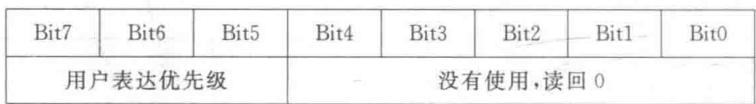

**教材图 2-24 的位图（ASCII 重排）：**

```
bit      7     6     5     4     3     2     1     0
       +-----+-----+-----+-----+-----+-----+-----+-----+
       |使用 |使用 |使用 | 没使用 | 没使用 | 没使用 | 没使用 | 没使用 |
       |     |     |     |（读回 0，写入被忽略）        |
       +-----+-----+-----+-----+-----+-----+-----+-----+
         └─────┬─────┘   └──────────────┬──────────────┘
          有效的 3 位                5 位被裁掉
```

教材原话：

> 在图 2-24 中，Bit[4:0] 没有使用，读它们总是返回零，写它们则忽略写入的值。因此 **8 个优先级为 0x00（优先级最高）、0x20、0x40、0x60、0x80、0xA0、0xC0 以及 0xE0（优先级最低）**。

**为什么这 8 个值是 0x00、0x20、0x40…？** 因为有效的 3 位在 bit7～bit5：

```
优先级 = 0x00 → bit7:5 = 000 → 第 0 档
优先级 = 0x20 → bit7:5 = 001 → 第 1 档   （0x20 = 0010 0000）
优先级 = 0x40 → bit7:5 = 010 → 第 2 档
优先级 = 0x60 → bit7:5 = 011 → 第 3 档
优先级 = 0x80 → bit7:5 = 100 → 第 4 档
优先级 = 0xA0 → bit7:5 = 101 → 第 5 档
优先级 = 0xC0 → bit7:5 = 110 → 第 6 档
优先级 = 0xE0 → bit7:5 = 111 → 第 7 档（最低）
```

**验证一下 `0x20` 的二进制：**

```
0x20 = 0010 0000
       ││││ ││││
       bit7 ...  bit0
       
bit7=0, bit6=0, bit5=1  →  bit[7:5] = 001 = 1
```

**再看图 2-25：3 位表达 vs 4 位表达的对比**

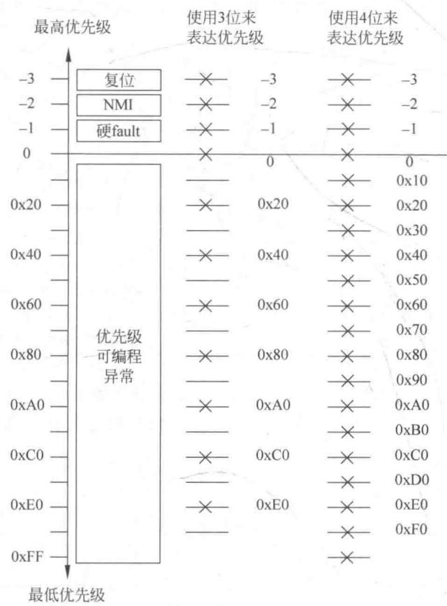

**这张图怎么读**：

1. **最左边一根竖直的数轴**是"优先级从高到低"（最上面最高）。
2. **中间一列**是"使用 3 位来表达优先级"时的 8 个档位：0x00、0x20、0x40…0xE0。
3. **右边一列**是"使用 4 位来表达优先级"时的 16 个档位：0x00、0x10、0x20、0x30…0xF0。
4. **每个档位旁边有个小叉号（×）**，表示"这个优先级值对应一个可用的优先级"。
5. **最上面三个（−3、−2、−1）** 标着"复位、NMI、硬 fault"，它们的叉号位置在数轴最上方，**不管用几位表达，它们都在最顶上**。

**这张图要我理解**：**优先级的"档位数"取决于芯片实际用了几个 bit**；位数越少，能区分的优先级档次越少。但"三巨头"的位置永远最高。

**一个非常重要的实际结论**：STM32 用的是 **4 位**（16 个档位），所以你会看到优先级值总是 **0x00、0x10、0x20、0x30…0xF0** 这样的"以 16 为步长"的值。第 7 章会详细讲 STM32 的优先级配置。

#### 抢占优先级和副优先级（教材表 2-11）

这是本节**最容易搞混**的概念，请慢慢看。

教材说：

> Cortex-M3 除配置优先级外，还把 256 级优先级分为**抢占优先级**和**副优先级**（也称为子优先级），支持最多 **128 个抢占优先级**。
>
> **抢占优先级决定了抢占行为**，例如，当系统正在响应某异常 E5 时，如果来了抢占优先级更高的异常 E2，则 E2 可以抢占 E5。
>
> **副优先级则处理"内务"**，即当抢占优先级相同的异常不止有一个挂起时，在当前任务完成后就优先响应副优先级最高的异常。

**用大白话理解这两个概念：**

> 【类比】
> 医院急诊分诊：
> - **抢占优先级** = "病情的紧急程度分类"。如果医生正在看一个"轻症"病人，来了一个"重症"，重症**可以立刻插队**（抢占）。
> - **副优先级** = "同一紧急程度内部的排序"。如果医生面前同时排着两个"轻症"，那么谁先看？按副优先级——**副优先级高的先看**，但**它不能插到重症前面**。
>
> **关键区别**：
> - 抢占优先级**不同** → 可以**打断**正在运行的 ISR（形成嵌套）；
> - 抢占优先级**相同** → **不能打断**，只能**排队**，等当前 ISR 结束后按副优先级顺序处理。

**表 2-11：抢占优先级和副优先级的表达、位数与分组位置的关系**

| 优先级组 | 表达抢占优先级的位段 | 表达副优先级的位段 |
|---|---|---|
| 0 | [7:1] | [0:0] |
| 1 | [7:2] | [1:0] |
| 2 | [7:3] | [2:0] |
| 3 | [7:4] | [3:0] |
| 4 | [7:5] | [4:0] |
| 5 | [7:6] | [5:0] |
| 6 | [7:7] | [6:0] |
| 7 | **无** | [7:0]（所有位） |

**怎么读这张表？** 以"优先级组 = 5"为例：

```
优先级组 = 5
   ↓
抢占优先级 = 位段 [7:6]   → 2 位 → 2^2 = 4 级抢占
副优先级   = 位段 [5:0]   → 6 位 → 2^6 = 64 级副优先级
```

教材原话：

> 优先级分组规定：**副优先级至少是 1 位，抢占优先级最多是 7 位**，有 128 级抢占优先级。
>
> Cortex-M3 允许从 Bit7 处分组，此时**所有的位用来表达副优先级，没有任何位表达抢占优先级，因而所有优先级可编程的异常之间就不会发生抢占**，Cortex-M3 的中断嵌套机制失效。
>
> 这对于复位、NMI 和硬 Fault 3 个最高优先级**无效**，即它们无论何时出现，都立即无条件抢占所有优先级可编程的异常。

**"从 Bit7 处分组"（优先级组 = 7）为什么会让嵌套失效？**

```
优先级组 = 7：
  抢占优先级 = 无
  副优先级   = [7:0]

结果：所有可编程异常的"抢占优先级"都是"无"——也就是全都一样
     → 谁都抢占不了谁 → 不能嵌套，只能排队
```

**教材给的具体例子（图 2-26、2-27）：**

> 例如，若采用 3 位来表示优先级（[7:5]），并且优先级组的值是 5（从 Bit5 处分组），则可得到 **4 级抢占优先级**，且在每个抢占优先级的内部有**两个副优先级**。

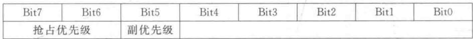

**图 2-26 的位图（ASCII 重排）：**

```
bit      7     6     5     4     3     2     1     0
       +-----+-----+-----+-----+-----+-----+-----+-----+
       | 抢占优先级 | 副  |  未使用（被裁掉，读回 0）        |
       |  [7:6]    |[5]  |                              |
       +-----+-----+-----+-----+-----+-----+-----+-----+
         └──┬──┘   └┬┘
         2 位      1 位
        4 级       2 级
```

**验证一下"4 级抢占 × 2 级副 = 8 个优先级"：**

【补充解释】这是对教材例子的算术展开（教材图 2-27 展示的就是这 8 个值）：

```
有效的 3 位在 bit[7:5]，把 bit[7:6] 当抢占、bit[5] 当副：

优先级值   二进制(bit7:5)   抢占(bit7:6)   副(bit5)    说明
─────────────────────────────────────────────────────────────
0x00       000             00 (第0级)     0         抢占0，副0  ← 最高
0x20       001             00 (第0级)     1         抢占0，副1
0x40       010             01 (第1级)     0         抢占1，副0
0x60       011             01 (第1级)     1         抢占1，副1
0x80       100             10 (第2级)     0         抢占2，副0
0xA0       101             10 (第2级)     1         抢占2，副1
0xC0       110             11 (第3级)     0         抢占3，副0
0xE0       111             11 (第3级)     1         抢占3，副1  ← 最低
```

**这张表怎么用？**

```
例：优先级 0x40 和 0x60 谁先？
  0x40 抢占=1，0x60 抢占=1  → 抢占相同，不能互相打断
  0x40 副=0，0x60 副=1      → 0x40 副优先级更高
  → 两个同时挂起时，先响应 0x40

例：优先级 0x20 和 0x40 谁先？
  0x20 抢占=0，0x40 抢占=1  → 0x20 抢占优先级更高（0 < 1）
  → 0x20 可以抢占正在执行的 0x40
```

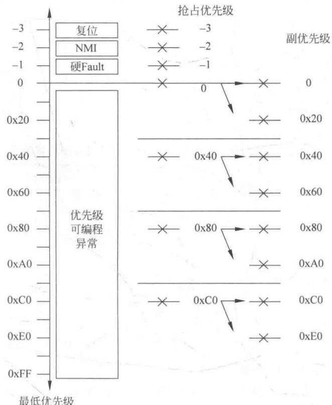

**图 2-27 怎么读**：它把上面那张表画成了一张"分组树"——竖直的是优先级数轴（越往上优先级越高），右边分成两列：**左列是"抢占优先级"的档位，右列是"副优先级"的档位**。整张图一共 4 个抢占等级（0x00、0x40、0x80、0xC0），每个抢占等级用**箭头**向右"分出"同一等级内的两个副优先级：

```
优先级数轴（上=高）
  −3/ −2/ −1  × 复位、NMI、硬Fault（固定优先级，永远最高）

  0x00  抢占0 ──┬──▶ 副0x00   ← 这两个共用"抢占等级 0"
                └──▶ 副0x20
  ────────────────────────────────────────────  ← 横线：两个抢占等级的分界
  0x40  抢占1 ──┬──▶ 副0x40   ← 共用"抢占等级 1"
                └──▶ 副0x60
  ────────────────────────────────────────────
  0x80  抢占2 ──┬──▶ 副0x80
                └──▶ 副0xA0
  ────────────────────────────────────────────
  0xC0  抢占3 ──┬──▶ 副0xC0
                └──▶ 副0xE0   （最低）
```

**这张图要怎么看才不搞混（请对着上面的 ASCII 重述核对原图）：**

1. **箭头**连接的是"**同一个抢占等级**"里的抢占档位和它的两个副档位（0x00 → 0x00 / 0x20，0x40 → 0x40 / 0x60，0x80 → 0x80 / 0xA0，0xC0 → 0xC0 / 0xE0）。箭头表示"**这两档的抢占优先级相同，只是副优先级不同**"→ 所以它们之间**不能互相抢占**，同时挂起时只是按副优先级**排队**。
2. **横线**分隔的是"**不同的抢占等级**"（0x00/0x20 与 0x40/0x60 之间、0x40/0x60 与 0x80/0xA0 之间……）。横线两边没有任何箭头，因为它们**不属于同一个抢占等级**——它们的抢占优先级数值不同，数值小的那一组**可以抢占**数值大的那一组（例如 0x00～0x20 这一组能抢占 0x40～0x60 那一组）。
3. 最上面 3 个 ×（复位、NMI、硬 Fault）在数轴最顶端，**任何情况下都能抢占所有可编程优先级**。

> ⚠️ 【最容易搞混的一点】别把这张图读成"同一等级内部有箭头=能互相抢占"。**能抢占靠的是"抢占优先级数值更小"，而不是同一档内互相抢**；图里的箭头恰恰是在告诉你"这几档的抢占优先级是**同一个值**"。

#### AIRCR：控制优先级分组的寄存器（重点寄存器）

**AIRCR** = Application Interrupt and Reset Control Register = 应用程序中断及复位控制寄存器。

**地址：`0xE000ED00`**（前面 2.7 节已经算过这个地址是怎么来的）。

**位图（教材表 2-12）：**

```
bit    31                            16 15      10  9   8   7   6   5   4   3   2   1   0
      +-------------------------------+---+-------+---+---+---+---+---+---+---+---+---+---+
AIRCR |         VECTKEY               |END|  (保留)   |    PRIGROUP   | 保留  |SRQ|VCA|VR |
      |       （访问钥匙）             |IAN|           |（优先级分组）  |       |   |   |   |
      +-------------------------------+---+-------+---+---+---+---+---+---+---+---+---+---+
```

**逐个字段解释：**

| 位段 | 名称 | 读写 | 复位值 | 描述 |
|---|---|---|---|---|
| **31:16** | **VECTKEY** | RW | — | **访问钥匙**：任何对该寄存器的写操作，都**必须同时把 `0x05FA` 写入此段**，否则写操作被忽略。若读取此半字，则为 `0xFA05` |
| **15** | **ENDIANESS** | R | — | 指示端设置：**1 = 大端；0 = 小端**。此值在**复位时确定，不能更改** |
| **10:8** | **PRIGROUP** | RW | 0 | **优先级分组**，表示当前从第几位开始分组 |
| **2** | **SYSRESETREQ** | W | — | 请求芯片控制逻辑产生一次复位 |
| **1** | **VECTCLRACTIVE** | W | — | 清零所有异常的活动状态信息。通常只在调试时用，或者在 OS 从错误中恢复时使用 |
| **0** | **VECTRESET** | W | — | 复位 Cortex-M3 处理器内核（调试逻辑除外），但是此复位**不影响芯片上在内核以外的电路** |

**这个寄存器要按 AGENTS.md 第 11 节的方式讲清楚：**

**① 它属于谁？** 属于 NVIC（也就是内核的一部分），地址 `0xE000ED00`。

**② 它控制什么？** 三件大事：
- 优先级怎么分组（PRIGROUP）；
- 芯片当前是大端还是小端（ENDIANESS，只读）；
- 怎么复位（SYSRESETREQ / VECTRESET）。

**③ 为什么需要它？** 因为"优先级怎么分组"必须在**开机时一次性设置好**，之后所有中断的优先级解释方式都按这个来。

**④ VECTKEY 为什么要"钥匙"？**

> 【补充解释】这是一种**防误写保护**机制。
> 芯片运行时，程序可能因为指针跑飞而往随机地址写数据。如果碰巧写到 `0xE000ED00`，就可能把系统复位或把优先级分组改乱——后果严重。
> 加上"必须同时写 0x05FA 才生效"这道门槛后，**随机数据碰巧凑成 0x05FA 的概率极低**，误写就被挡住了。
> 类比：**保险箱的密码**。不是防坏人（硬件层面防不住），而是防"手滑"。

**⑤ 程序实际怎么操作？**

```c
// 把优先级分组设置为 5（从 bit5 开始分组）
// 注意：必须同时把 VECTKEY(0x05FA) 写到高 16 位，否则写操作被忽略

#define SCB_AIRCR  (*(volatile unsigned long *)0xE000ED00)

SCB_AIRCR = (0x05FA << 16) | (5 << 8);
//           └────┬────┘        └──┬──┘
//          VECTKEY = 0x05FA    PRIGROUP = 5
```

**逐块拆解这个赋值：**

```
要写入的值 = (0x05FA << 16) | (5 << 8)

第 1 步：0x05FA << 16
        0x05FA = 0000 0101 1111 1010
        左移 16 位 → 0000 0101 1111 1010 0000 0000 0000 0000
        = 0x05FA0000

第 2 步：5 << 8
        5 = 101
        左移 8 位 → 0000 0101 0000 0000
        = 0x00000500

第 3 步：或运算（把两部分合起来）
        0x05FA0000
      | 0x00000500
      = 0x05FA0500
```

**最终写入 AIRCR 的值 = `0x05FA0500`。**

用位图检查一下这个值对不对：

```
0x05FA0500
= 0000 0101 1111 1010 0000 0101 0000 0000
  └────────┬────────┘ └──┬──┘ └──┬──┘
      VECTKEY=0x05FA   bit15=0  PRIGROUP=101=5
                      (小端)     ↑
                            优先级组 = 5
```

✓ 完全正确。

**⑥ 操作之后硬件发生什么？**

- **写 PRIGROUP** → 之后所有可编程中断的优先级位段划分方式立刻改变（抢占位段/副优先级位段的边界变了）；
- **写 SYSRESETREQ = 1** → 芯片控制逻辑产生一次**系统复位**（整个芯片重启）；
- **写 VECTRESET = 1** → **只复位内核**，不影响芯片上内核以外的电路。

**⑦ 教材的重要提醒：**

> 虽然优先级分组的功能很强大，但需要认真对待，**若设计不当，常常会改变系统的响应特性，导致某些关键任务有可能得不到及时响应**。因此，**优先级的分组要预先经过论证，并在开机初始化时一次性设置好**。

> 【补充解释】为什么"要一次性设置好"？
> 因为**改了分组，所有中断的优先级含义都会变**。如果你在运行中途改分组，之前配好的优先级全都"变味"了——本来"抢占优先级高的"可能突然变成"副优先级高的"，系统的响应特性就乱了。

### 2.8.2 向量表

#### 什么是向量表？

教材说：

> Cortex-M3 的**向量表**用于在发生中断并做出响应时，从表中查询与中断对应的处理例程**入口地址**。默认情况下，该表位于**零地址处**，且各向量占用 **4 字节**。

> 【类比】
> 向量表就像一本"**通讯录**"：
> - 第 1 页第 1 行是"复位时该打给谁"；
> - 第 2 行是"NMI 该打给谁"；
> - 第 N 行是"IRQ#N 该打给谁"。
> 中断来了，NVIC 翻到对应那一行，读出电话号码（入口地址），直接拨过去。
>
> **类比的边界**：真实硬件里这个"翻书"动作是**电路直接译码**完成的，不是逐页查找——所以只要 1 个周期左右就能拿到地址（这正是"中断延迟短"的原因之一）。

#### 向量表的内容（教材表 2-13）

**表 2-13 上电后的向量表（已修正教材的一处排版错位）：**

| 地址 | 异常编号 | 值（32 位整数） |
|---|---|---|
| `0x00000000` | — | **MSP 的初始值** |
| `0x00000004` | 1 | **复位向量（PC 初始值）** |
| `0x00000008` | 2 | **NMI 服务例程的入口地址** |
| `0x0000000C` | 3 | **硬 Fault 服务例程的入口地址** |
| ... | ... | 其他异常服务例程的入口地址 |

> ⚠️ 【待核验】教材表 2-13 的排版有错位：它把"复位向量（PC 初始值）"和"NMI 服务例程的入口地址"挤在同一行（`0x00000004`），然后 `0x00000008` 那一行又写成"硬 Fault 服务例程的入口地址"，**导致 NMI 这一行丢失、硬 Fault 重复**。已核对原 PDF p60，教材原文确实如此。
> **正确的对应关系**（也是 ARM 架构规定死的）：
> ```
> 0x00000000 → MSP 初值
> 0x00000004 → 异常 1（复位）的入口地址
> 0x00000008 → 异常 2（NMI）的入口地址
> 0x0000000C → 异常 3（硬 Fault）的入口地址
> ```
> 本讲义采用正确值，疑点记入文末。

**注意第一条的特殊性**：`0x00000000` 处放的不是"入口地址"，而是 **MSP 的初始值**。这是 Cortex-M3 的一个独特设计，2.9 节会详细讲。

【辅助理解图】

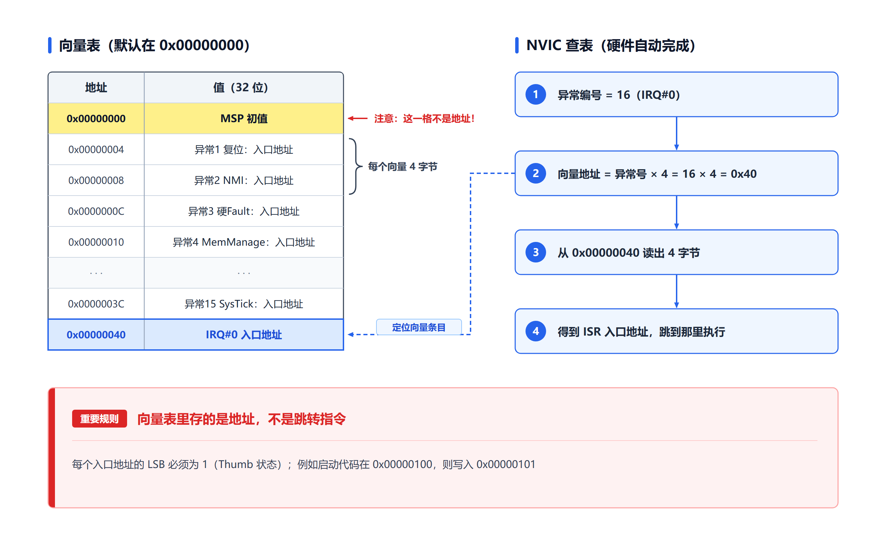

**看图方法**：

1. **左半边**画一张"表"：左边一列是**地址**（`0x00000000`、`0x00000004`、`0x00000008`、`0x0000000C`、…、`0x00000040`），右边一列是**值**。第一行特别用黄色高亮，写"**MSP 初值**"（并加一个小注："这一格不是地址！"）；后面几行依次写"复位入口地址""NMI 入口地址""硬Fault 入口地址""…""IRQ#0 入口地址"。
2. **中间**画一个"放大镜 + 计算"的框，里面写公式：`向量地址 = 异常号 × 4`，下面举两个例子：`IRQ#0 → 16 × 4 = 0x40`。
3. **右半边**画一个"NVIC 查表"的小流程：一个方框写"异常编号 = 21"，一条箭头指向"计算 21 × 4 = 0x54"，再一条箭头指向左侧表中 `0x54` 那一行，最后一条箭头从那一格拉出来，写"**跳到 ISR 入口地址**"。
4. **图的底部**用红字写："**向量表里存的是"地址"，不是"跳转指令"**"，并附一行小注"每个入口地址的 LSB 必须为 1（Thumb）"。

**这张图要我理解**：**"查表"是硬件做的，一个乘法（其实只是移位）+ 一次读内存，就找到了该去哪。**

#### 向量地址怎么算？（必考）

**规则：每个中断向量的地址都等于"异常号 × 4"。**

教材的例子：

```
外部 IRQ 0 的异常类型为 16
  ↓
IRQ 0 的向量地址 = 16 × 4 = 0x40
```

**为什么是 ×4？** 因为每个向量占 **4 字节**（一个 32 位地址）。

**多算几个验证一下：**

```
异常号 1（复位）  → 向量地址 = 1 × 4 = 0x04   ✓
异常号 2（NMI）   → 向量地址 = 2 × 4 = 0x08   ✓
异常号 3（硬Fault）→ 向量地址 = 3 × 4 = 0x0C   ✓
异常号 11（SVCall）→ 向量地址 = 11 × 4 = 44 = 0x2C
异常号 15（SysTick）→ 向量地址 = 15 × 4 = 60 = 0x3C
异常号 16（IRQ#0） → 向量地址 = 16 × 4 = 64 = 0x40
异常号 17（IRQ#1） → 向量地址 = 17 × 4 = 68 = 0x44
```

**换算小技巧**：十进制转十六进制时，"×4"相当于"左移 2 位"。

```
16 × 4 = 16 << 2 = 64 = 0x40
```

**还有一个细节**（教材在 **2.8 节（复位序列）**讲到，这里先提一句）：

> 这些向量的**最低位都被置 1**，表明异常处理执行时使用 **Thumb 指令**。

回忆 2.4.1 节讲 PC 时的结论：**PC 的 LSB 必须为 1 才表示 Thumb 状态**。所以向量表里存的入口地址**都是奇数**。

#### 向量表重定位与 VTOR

教材说：

> Cortex-M3 允许**向量表重定位**——从其他地址处开始定位各异常向量。这些地址对应的区域**可以是代码区，也可以是 RAM 区**。在 RAM 区可以**修改向量的入口地址**。
>
> 为了实现这个功能，NVIC 中有一个**向量表偏移量寄存器（VTOR）**（在地址 `0xE000ED08` 处），通过修改它的值就能定位向量表。

> 【补充解释】为什么要"重定位向量表"？
> 最常见的场景是**带操作系统的系统**：
> - 上电时，向量表在 Flash（0x00000000），指向"启动代码"；
> - 启动完成后，操作系统把向量表**复制到 RAM** 里，并让 VTOR 指向 RAM；
> - 之后就能**动态修改**某个中断的处理程序（因为 RAM 可写）。
>
> 还有一个场景是**多份固件**（比如 Bootloader + 应用程序）：两段代码各自有自己的向量表，靠 VTOR 切换。

**VTOR 寄存器（教材表 2-14）：**

**地址：`0xE000ED08`**

| 位段 | 名称 | 读写属性 | 复位值 | 描述 |
|---|---|---|---|---|
| **29** | **TBLBASE** | RW | 0 | **0 = 向量表在 Code 区；1 = 向量表在 RAM 区** |
| **28:7** | **TBLOFF** | RW | 0 | 向量表**相对于 Code 区或者 RAM 区的偏移地址** |

**位图：**

```
bit    31  30  29  28                                    7    6          0
      +---+---+---+---------------------------------------+----+-----------+
VTOR  |保留|保留|TBL|            TBLOFF                    |  保留          |
      |    |    |BASE|                                      |                |
      +---+---+---+---------------------------------------+----+-----------+
               │
               └─ 0 = 向量表在 Code 区
                  1 = 向量表在 RAM 区
```

**VTOR 地址的演算（复习 2.7 节那条链）：**

```
① VTOR 地址 0xE000ED08
② 高 4 位是 E → 落在专用外设总线区（0xE0000000 起）
③ 区基地址 = 0xE0000000
④ 偏移 = 0xE000ED08 - 0xE0000000 = 0x0000ED08
⑤ 最终地址 = 0xE0000000 + 0xED08 = 0xE000ED08  ✓
⑥ 对比 AIRCR 的 0xE000ED00：
   VTOR 比 AIRCR 大 8 → 说明它们是相邻的两个寄存器
```

#### 向量表起始地址的对齐要求（教材的例子，很重要）

教材说：

> 必须注意的是，**向量表的起始地址是有要求的**：必须先求出系统中共有多少个向量，再把这个数字**向上增大到 2 的整数次幂**，而起始地址必须**对齐到后者的边界上**。
>
> 例如，如果一共有 **32 个中断**，则共有 **32 + 16（系统异常）= 48 个向量**，向上增大到 2 的整数次幂后，值为 **64**，因此地址必须能被 **64 × 4 = 256** 整除，从而合法的起始地址可以是 **0x0、0x100、0x200** 等。

**把这段推演一遍：**

```
第 1 步：数一共有多少个向量
   32 个外部中断 + 16 个系统异常 = 48 个向量
   （为什么是 16？因为异常编号 0～15 是系统异常区，虽然有保留位，
     但向量表里这一段是"整段"占用的，所以按 16 算）

第 2 步：向上取到 2 的整数次幂
   48 → 需要找一个 ≥ 48 的 2 的幂
   2^5 = 32（不够）
   2^6 = 64（够）✓
   所以是 64

第 3 步：算对齐要求
   64 个向量 × 4 字节/向量 = 256 字节
   → 起始地址必须能被 256 整除

第 4 步：列举合法地址
   0x000 = 0      ✓ 能被 256 整除
   0x100 = 256    ✓
   0x200 = 512    ✓
   0x300 = 768    ✓
   ...
```

> 【先补一个前置知识：什么叫"对齐到边界"？】
> "能被 256 整除"等价于"**地址的最低 8 位是 0**"（因为 256 = 0x100）。
> ```
> 0x00000100  → 最低 8 位是 00  ✓
> 0x00000200  → 最低 8 位是 00  ✓
> 0x00000150  → 最低 8 位是 50  ✗
> ```
> **为什么要对齐？** 因为硬件取向量时的做法是"**把 VTOR 的高位和异常号拼起来**"（而不是真的做一次乘法加法）。如果 VTOR 的低位不是 0，拼接就会出错。
> 类比：**书架每一层必须从整页开始放书**，不能从半页中间开始，否则"第 n 本"的算法就乱了。

#### 动态向量表必须包含的四项

教材说：

> 如果需要动态地更改向量表，则对于任何器件来说，**向量表的起始处都必须包含**：
> - **主堆栈指针（MSP）的初始值**；
> - **复位向量**；
> - **NMI**；
> - **硬 Fault 服务例程**。
>
> 后两者也是必需的，因为有可能在**引导过程中**发生这两种异常。

**为什么这四项必须"复制"到新向量表里？**

```
MSP 初值 + 复位向量  → 因为新向量表也可能被用于"从头启动"
NMI + 硬 Fault      → 因为在"切换向量表"这段引导过程中，
                       万一发生 NMI 或硬 Fault，
                       必须保证有地方可去（不能是空地址）
```

> 【类比】
> 就像搬家：新家必须至少具备"水电、门锁、灭火器"这几样——因为搬家的过程中也可能出事，不能等到搬完再装。

### 2.8.3 中断输入及挂起

#### 三种状态：挂起、活跃、撤销

一个中断从"被申请"到"被处理完"，会经历几种状态。教材用 6 张图（图 2-28～2-33）把这几种情况全画了。我们逐个看。

**先补前置知识：三个状态词**

| 状态 | 英文 | 含义 |
|---|---|---|
| **挂起** | pending | 中断已经"申请"了，但 CPU 还没开始处理（在排队） |
| **活跃** | active | 中断正在被处理（ISR 正在执行） |
| **撤销** | — | 中断请求在得到响应之前被取消，不再处理 |

**情况 1：中断被挂起（图 2-28）**

教材说：

> 若当前中断优先级较低，该中断就**被挂起**，并对其挂起状态进行标记。**即使后来中断源取消了中断请求，在系统中它的优先级最高的时候，也会因为其挂起状态标记而得到响应**。

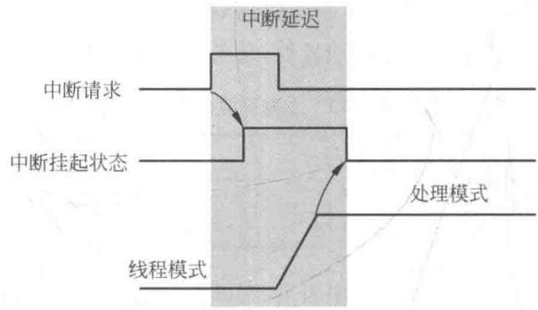

**这张图怎么读**：

1. 图里有两条/三条时间线：**中断请求信号**（一个脉冲）、**挂起标志**、**ISR 执行**。
2. 中断请求来了，但因为优先级不够，**没有立刻执行 ISR**，而是把**挂起标志置 1**。
3. 请求信号可能很快就消失了（脉冲结束），**但挂起标志还在**。
4. 等当前的事情忙完、轮到它了，**ISR 开始执行**。

**这张图要我理解**：**"挂起标志"是一个"备忘"，它记住了"有人来过"。** 只要挂起标志在，请求就"欠着"，早晚会被处理。

**情况 2：挂起被清除 = 中断被撤销（图 2-29）**

教材说：

> 但是，如果中断得到响应之前，其**挂起状态被清除了**（例如，在 PRIMASK 或 FAULTMASK 置位的时候软件清除了挂起状态标志），则**中断被撤销**。

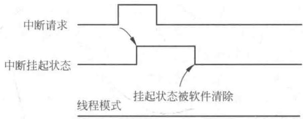

**这张图怎么读**：中断请求来了 → 挂起标志置 1 → **但有人把挂起标志清了** → 即使请求还在，ISR 也**不会执行**。

**这张图要我理解**：**挂起标志是"是否处理"的唯一依据。** 清了它，就等于"这件事不办了"。

> 【补充解释】为什么要有"撤销"这个功能？
> 典型场景：你在关中断期间（PRIMASK=1）发现"这个中断的请求已经过期了、不用处理了"，就可以顺手把挂起标志清掉，避免开中断后白白跑一次 ISR。

**情况 3：进入 ISR 后，硬件自动清挂起、置活跃（图 2-30）**

教材说：

> 当某中断的服务例程**开始执行**时，此中断进入"**活跃**"状态，并且其**挂起标志位会被硬件自动清除**。中断服务例程执行完毕并且中断返回后，才能对该中断的新请求予以响应（即**单实例**）。当然，新请求的响应也是由硬件自动清零挂起标志位。**中断服务例程也可以在执行过程中把自己对应的中断重新挂起。**

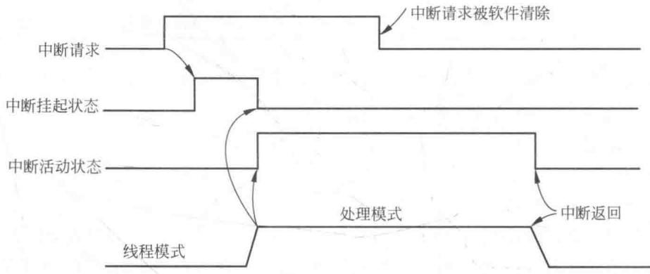

**这张图怎么读**：

1. **请求脉冲**来了。
2. **挂起标志**从 0 → 1（申请被记住）。
3. **ISR 开始执行**的那一刻，**挂起标志自动变回 0**，同时**活跃标志变成 1**。
4. ISR 结束时，**活跃标志变回 0**。

**这张图要我理解（这条非常重要）**：

> **"挂起 → 活跃"这个交接是硬件自动做的，不需要你写任何代码。**
> 这也是"中断的撤除"（2.8 节讲过的概念）在 Cortex-M3 上的实现方式。

**注意"单实例"这个词**：同一个中断，在它的 ISR 执行期间，**新的请求只能排队（重新置挂起），不能重入**。

**情况 4：请求一直保持 → 返回后再次挂起（图 2-31）**

教材说：

> 如果中断请求信号**一直保持**，则该中断就会在其上次服务例程**返回后再次被置为挂起状态**。

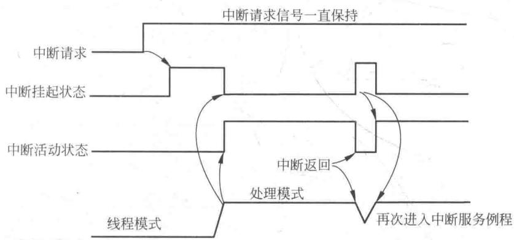

**这张图怎么读**：请求信号是一条**高电平持续不变**的直线（不是脉冲）。ISR 执行期间，挂起标志是 0；**ISR 一返回，硬件发现请求还在，立刻又把它置成挂起**，于是**马上又进一次 ISR**。

**这张图要我理解**：

> **如果外设的中断请求信号不撤除，CPU 会被反复拉进 ISR——程序会"卡"在这个中断里出不来。**
>
> 这就是为什么教材在 **2.7 节（异常与中断）**强调"**中断的撤除**"：**响应中断请求后，返回主程序之前，该中断请求标志应该撤除**。
>
> 对 Cortex-M3 来说，NVIC 的挂起位是硬件自动清的；但**外设自己的中断标志位必须由你在 ISR 里手动清**（第 7、8 章会反复见到 `TIM_ClearITPendingBit()` 这类调用）。

**情况 5：请求是多个脉冲 → 只算一次（图 2-32）**

教材说：

> 如果某个中断在得到响应之前，其请求信号以**多个脉冲**形式呈现，则被视为**只有一次中断请求，多出的请求脉冲全部忽略**。

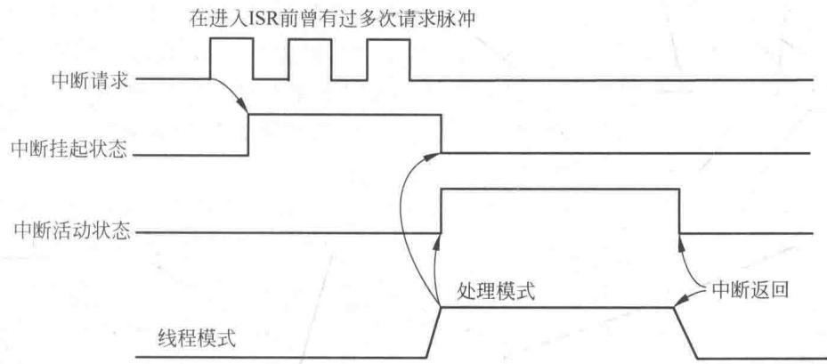

**这张图怎么读**：请求线上来了 3 个脉冲，但**挂起标志只被置 1 一次**，所以 ISR **只执行一次**。

**这张图要我理解**：

> **"挂起"是"是/否"的布尔量，不是计数器。** 来 100 次请求也只算 1 次。
> 所以如果你的外设"每次来一个脉冲都需要处理一次"，就**必须让 CPU 处理得足够快**，或者用 DMA/硬件缓冲来兜住——否则会丢事件。

**情况 6：ISR 执行中请求又来了 → 记住它（图 2-33）**

教材说：

> 如果在服务例程执行时，中断请求释放了，但是在服务例程返回前又**重新被置为有效**，则 Cortex-M3 会**记住此动作，重新挂起该中断**。

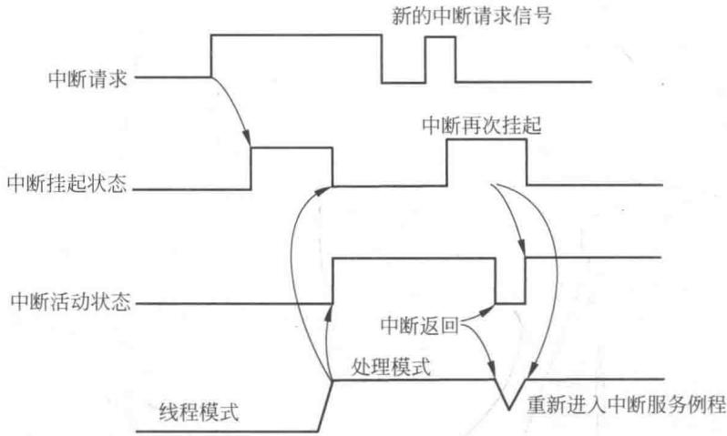

**这张图怎么读**：ISR 正在执行（活跃=1，挂起=0）→ 请求线又动了一下 → **挂起标志被重新置 1** → ISR 返回后，**立刻又进一次 ISR**。

**这张图要我理解**：**"活跃"和"挂起"是两个独立的标志**，可以同时为 1（正在处理上一次，同时已经欠着下一次）。

**六张图总结成一张状态表：**

| 请求 | 挂起标志 | 活跃标志 | 结果 |
|---|---|---|---|
| 来了（优先级不够） | 1 | 0 | 排队等待 |
| 被软件清除 | 0 | 0 | **撤销**，不处理 |
| ISR 开始执行 | 0（硬件自动清） | 1（硬件自动置） | 正在处理 |
| 请求一直保持 | ISR 返回后重新置 1 | 返回后清 0 | 返回后**立刻再进** |
| 多个脉冲 | 只置 1 一次 | — | **只处理一次** |
| ISR 执行中又来 | 重新置 1 | 1 | 返回后再进一次 |

【辅助理解图】

（说明：中断的"响应/返回/咬尾/迟来"辅助图集中在 2.8.5 和 2.8.7 两小节，本小节用上表代替配图。）

### 2.8.4 Fault 类异常

#### Fault 是什么？

**Fault** = 故障。指 **CPU 在执行过程中"出错了"**。

> 【补充解释】"Fault"这个词在英文里有"过错、缺陷、故障"的意思。在这里，它是"**程序或硬件犯了错，需要立刻处理**"这一类异常的统称。
> 它和"中断"最大的区别：**中断是"外面有事找你"，Fault 是"你自己出问题了"。**

**Fault 和中断的共同点**：都走同一套机制（NVIC、向量表、自动压栈、EXC_RETURN）。所以教材说"本书对异常和中断不加以特别的区分"。

#### 四类 Fault（教材逐一讲解）

**（1）总线 Fault（BusFault）**

教材说：

> 当 AHB 接口上正在传送数据时，如果回复了一个**错误信号**，则会产生总线 Fault，如：
> - 指令预取中止
> - 数据读写中止
> - 入栈错误
> - 出栈错误
> - 无效存储区段访问
> - 设备数据传送未准备好等

> 【类比】
> 总线 Fault 就像"**快递送不到**"：地址是有的，但那边回话说"这单送不了"。
> 可能是路封了（无效存储区）、收件人不在（设备没准备好）、包裹破了（传送中止）。

**（2）存储器管理 Fault（MemManage Fault）**

教材说：

> 存储器管理 Fault 多与 **MPU** 有关，其诱因常常是某次访问触犯了 MPU 设置的保护策略。另外，某些**非法访问**也会触发该 Fault，如：
> - 在**不可执行的存储器区域**试图取指（**没有 MPU 也会触发**）
> - 访问了 MPU 设置区域覆盖范围之外的地址
> - 访问了**没有存储器与之对应的空地址**
> - **只读区域写数据**
> - 用户级状态下访问了只允许在特权级下访问的地址等

**注意括号里那句"没有 MPU 也会触发"**——意思是"在不可执行区取指"是**硬件硬性规定**的违规行为，不依赖 MPU。

**（3）用法 Fault（UsageFault）**

教材说：若出现以下情况会触发用法 Fault：

- 执行了**未定义的指令**；
- 执行了**协处理器指令**（Cortex-M3 不支持协处理器，但可以通过 Fault 异常机制来**用软件模拟协处理器**的功能，从而方便地在其他 Cortex 处理器之间移植）；
- **尝试进入 ARM 状态**（因为 Cortex-M3 不支持 ARM 状态，所以用法 Fault 会在切换时产生，**软件可以利用此机制来测试某处理器是否支持 ARM 状态**）；
- 存在**无效的中断返回**（LR 中包含了无效/错误的值）；
- 使用**多重加载/存储指令**时，以及**没有对齐地址**时。

> 【补充解释】这三条括号里的内容很有"工程智慧"，值得体会：
> - "用 Fault 模拟协处理器"：Cortex-M3 没有浮点运算单元（FPU），但你写 `VADD.F32` 这类浮点指令时，硬件会报"用法 Fault"，你的 Fault 处理程序就可以**用软件算一遍浮点**，再把结果填回去——程序"看起来"支持浮点了。这是"**用异常机制做功能扩展**"的经典手法。
> - "用 Fault 测试是否支持 ARM 状态"：写一段"尝试切到 ARM 状态"的代码，**如果没触发 Fault，说明这个 CPU 支持 ARM 状态**。这是"**用异常做探测**"的手法。

**（4）硬 Fault（HardFault）**

教材说：

> 硬 Fault 是上面所述的总线 Fault、存储器管理 Fault 和用法 Fault **上访**的结果。如果这些 Fault 的服务例程**无法执行**，它们就会成为"硬伤"——**上访（escalation）** 成为硬 Fault。
>
> 在**取向量**（异常处理是对异常向量表的读取）时产生的总线 Fault 也**按硬 Fault 处理**。
>
> 另外，NVIC 中有一个**硬 Fault 状态寄存器（HFSR）**，由它指出产生硬 Fault 的原因。如果不是由于取向量造成的，则硬 Fault 服务例程**必须检查其他的 Fault 状态寄存器**，以最终决定是谁上访的。

**【先补一个前置知识：什么叫"上访（escalation）"？】**

> 教材用"上访"这个词，很形象：**下级解决不了的问题，交给上级**。
>
> ```
> 总线 Fault / 存储器管理 Fault / 用法 Fault
>              ↓ 如果它们的服务例程无法执行（比如被禁用、或者处理时又出错）
>          硬 Fault（Hard Fault）
>              ↓ 如果硬 Fault 也解决不了
>           系统复位
> ```
>
> **硬 Fault 是"最后一道防线"**：它**永远启用**（只要 FAULTMASK 没置位），而且优先级固定为 −1（最高档）。

> 【类比】
> 就像公司里的问题处理流程：员工处理不了 → 找组长 → 组长处理不了 → 找经理。
> 硬 Fault 就是那个"永远会接电话的经理"——不管下面的层级怎么配置，它总是在。
> **类比的边界**：硬 Fault 不是"更高级的人"，而是"**同一个处理机制在最后兜底**"——它和普通 Fault 用的是同一套 NVIC 机制，只是优先级被固定在最高、且无法被屏蔽。

**Fault 状态寄存器（FSR）的一个关键特性**（教材强调）：

> 各个 Fault 状态寄存器（FSR）都会**保持住它的状态，直到手工清除为止**。因此 Fault 服务例程在处理了相应的 Fault 后**不要忘记清除这些状态**，否则当下次又有新的 Fault 发生时，服务例程检视 Fault 源又将看到早先已经处理过的 Fault 状态标志，**无法判断哪个 Fault 是新发生的**。
>
> **FSR 采用写 1 时清除机制，即写 1 时清除。** 芯片厂商可以再添加自己的 FSR，以表示其他 Fault 情况。

**【先补一个前置知识：什么叫"写 1 清除"？】**

这是嵌入式里非常常见的一种寄存器操作方式，**和普通寄存器完全不同**，必须记住：

```
普通寄存器：
   写什么，就存什么。写 1 就变 1，写 0 就变 0。

"写 1 清除"寄存器（W1C, Write 1 to Clear）：
   只有你写 1 的那些位会被清成 0；
   你写 0 的那些位保持原样不变。

例：某状态寄存器当前 = 0b1010
    你写 0b0010
    结果 = 0b1000
         （只有 bit1 被清了，其他位不变）
```

**为什么要设计成"写 1 清除"？** 因为如果设计成"写 0 清除"，那么：

```
当前状态 = 0b1010
我想只清 bit1，于是写 0b0000（希望"清掉"所有 0 的位置）
→ 但这样一来 bit3 也会被清掉！
```

用"写 1 清除"就避免了这个问题：**你想清哪位就写哪位，其他位写 0 表示"别动"。**

> 【类比】
> 就像打勾销账：**只有你打了勾的项目才会被划掉**，没打勾的项目保持原样。
> 如果设计成"打叉才保留"，你就得给每一项都打上标记，很容易漏掉。

#### Fault 的三种应对方法

教材说：在软件开发过程中，可以根据各种 Fault 状态寄存器的值来判断程序错误，并且改正它们。**然而在一个实时系统中，情况则大不相同。如果不对 Fault 加以处理常会危及系统的运行。** 因此，在找出了导致 Fault 的原因后，软件必须决定下一步该怎么办。

教材给了三种常用方法：

| 方法 | 做法 | 适用场景 |
|---|---|---|
| **复位** | 设置 NVIC 的 AIRCR 中的 **VECTRESET** 位，将**只复位处理器内核**而不复位其他片上设施；有些 Cortex-M3 芯片的复位设计可以使用该寄存器的 **SYSRESETREQ** 位来复位 | 系统已经不可靠，只能重启 |
| **恢复** | 在一些场合下，还是有希望解决产生 Fault 问题的。例如，如果程序尝试访问了**协处理器**，可以通过一个**协处理器的软件模拟器**来解决此问题 | 已知原因、有对应补救方案 |
| **中止相关任务** | 如果系统运行了一个 **RTOS**，则相关的任务可以被**终结或者重新开始** | 有操作系统的系统 |

> 【补充解释】**RTOS** = Real-Time Operating System = 实时操作系统（如 FreeRTOS、μC/OS）。
> 有了 RTOS，就可以"只杀掉出问题的那个任务，其他任务继续跑"——这就是"**容错**"。
> 没有 RTOS 的裸机程序，一旦出错通常只能整体复位。

### 2.8.5 中断的具体行为（本章最重要的部分）

#### 先别急着看教材：这一小节要干什么？

前面讲的都是"中断是什么""有什么规则"。这一小节要回答最实际的问题：

> **中断真的发生时，硬件一个时钟周期一个时钟周期到底干了什么？**

教材说：当 Cortex-M3 响应一个中断时，将依次执行以下操作。**下面这张 7 步清单就是后续小节标题的顺序**（照着它跳读不会找错位置）：

```
① 取向量
② 更新寄存器（选择 MSP/PSP，更新 SP、PSR、PC、LR）
③ 入栈操作（自动保存现场，8 个寄存器）
④ 执行中断服务例程（ISR）
⑤ 异常返回（把 EXC_RETURN 写进 PC，启动返回序列）
⑥ 出栈（恢复现场）
⑦ 更新 NVIC 寄存器（清活动位）
```

> 📌 【与教材对号入座】教材 2.7.5 的"操作过程如下"一共列了 **5 条**：取向量 → 更新寄存器 → 异常返回 → 出栈 → 更新 NVIC（"入栈"写在更上面那段"自动保存现场是入栈操作的必要部分"里，"执行 ISR"则夹在"更新寄存器"和"异常返回"之间）。
> **本讲义把它拆成 7 步**（把"入栈"和"执行 ISR"各单独列为一步），因为这样讲时序更清楚；步骤内容与教材完全一致，只是编号更细。

我们**一步一步**走一遍。假设：主程序正在 `0x08000100` 处执行，突然某个中断（假设是 IRQ#5，异常编号 21）来了。

#### 第 ① 步：取向量

教材说：

> **取向量**：从向量表中找出对应的服务程序入口地址。

```
① NVIC 得知"异常编号 = 21"
② 计算向量地址 = 21 × 4 = 84 = 0x54
③ 从 0x00000054 处读出 4 个字节 → 得到 ISR 的入口地址（假设是 0x08001234）
④ 这个地址就是待会儿要跳过去的地方
```

**关键点（教材在"操作过程"里特别强调）**：

> **取向量**。当**数据总线（系统总线）开始入栈操作**时，**指令总线（I-Code 总线）也启动响应中断流程**，开始从向量表中找出正确的异常向量，随后在中断服务程序的入口处预取指令。**此时，入栈与取指这两个工作能同时进行。**

**这就是哈佛结构的威力：**

```
              ┌──────────────────────────────┐
              │      中断响应的两个动作        │
              └──────────────┬───────────────┘
                             │
              ┌──────────────┴───────────────┐
              ▼                              ▼
    ┌──────────────────┐          ┌──────────────────┐
    │  入栈（保存现场）  │          │  取向量 + 预取指令 │
    │  走系统总线       │          │  走 I-Code 总线    │
    └──────────────────┘          └──────────────────┘
              └────────── 同时进行 ──────────┘
```

**这直接解释了为什么 Cortex-M3 的中断延迟特别短**——它把"保存现场"和"找到去哪"这两件必须做的事**并行**了。

#### 第 ② 步：更新寄存器

教材说：在入栈和取向量操作完毕、中断服务例程执行之前，有些寄存器的内容需要更新：

| 寄存器 | 更新成什么 | 大白话 |
|---|---|---|
| **SP** | 在入栈中会把堆栈指针（PSP 或 MSP）**更新到新的位置** | 栈顶下移了 32 字节 |
| **PSR** | **IPSR 位段**（PSR 的最低部分）会被更新为**新响应的异常编号** | "登记一下现在在服务谁" |
| **PC** | 在向量取出完毕后，PC 将**指向服务例程的入口地址** | 下一条要执行的指令在 ISR 里 |
| **LR** | LR 的用法将会被**重新解释**，其值也被更新成一种特殊的值，称为 **EXC_RETURN**，并且在异常返回时使用 | LR 不再存"返回地址"，而是变成一张"返回说明书" |

**注意最后一行（非常重要）**：

> 进入 ISR 之后，**LR 里存的不是"被打断程序的返回地址"，而是 EXC_RETURN**。
> 被打断程序的返回地址（PC 的原值）已经被**压进堆栈**了。
> 这是 Cortex-M3 一个独特的设计：**用 LR 来告诉硬件"返回时该怎么恢复"**，详见 2.8.8 节。

教材还补充：

> EXC_RETURN 的二进制值**除了最低 4 位外全为 1**，而其最低 4 位则有特殊含义。

```
EXC_RETURN 的样子：
1111 1111 1111 1111 1111 1111 1111 xxxx
└──────────────┬──────────────┘ └──┬─┘
        高 28 位全是 1           最低 4 位有含义
```

**同时，NVIC 也更新相关的寄存器**：例如，新响应异常的**挂起位将被清除**，同时其**活动位将被置位**（就是 2.8.3 节讲的那套）。

#### 第 ③ 步：入栈操作（自动保存现场）

**这是 Cortex-M3 最"贴心"的地方。**

教材说：

> **入栈操作**：自动保存现场是入栈操作的必要部分，即依次把 **xPSR、PC、LR、R12 以及 R3～R0 共 8 个寄存器**内容由硬件**自动**压入适当的堆栈中。
>
> 当响应异常时，如果当前的代码正在使用 PSP，则**压入 PSP**，即使用线程堆栈；否则**压入 MSP**，使用主堆栈。一旦进入了服务例程，就将**一直使用主堆栈**。

**数一数这 8 个寄存器：**

```
① xPSR    ← 程序状态（N/Z/C/V/Q + 异常号）
② PC      ← 被打断处的下一条指令地址（"断点"）
③ LR      ← 被打断前的 LR 值
④ R12
⑤ R3
⑥ R2
⑦ R1
⑧ R0
```

**为什么是这 8 个？**

> 【补充解释】因为 ARM 架构规定：**R0～R3、R12、LR、PC、xPSR 是"调用者保存（caller-saved）"寄存器**——也就是说，被调用的函数（这里是 ISR）可以随便用它们，不保证原值。
> 那么"调用者"（被打断的程序）想保住自己的值，就得自己存。
> **Cortex-M3 把这个"该存"的活儿用硬件替你干了。**
>
> 而 R4～R11 是"被调用者保存"寄存器——**ISR 如果想用它们，必须自己 PUSH/POP**。硬件不管。所以你会看到：**汇编写的 ISR 里如果用到 R4～R11，必须自己写 PUSH/POP**。

**为什么"一旦进入服务例程就一直使用主堆栈"？**

因为**中断可能嵌套**。如果嵌套时还在用 PSP，多个 ISR 就可能把用户堆栈搞乱。统一用 MSP 之后：

```
用户程序 ── PSP（自己的栈，自己管）
所有 ISR ── MSP（系统的栈，中断专用）
```

这就是 2.5 节讲双堆栈的原因。

#### 入栈后堆栈里到底是什么样？（教材表 2-15，含修正）

**假设入栈开始时 SP 的值是 N**（注意：因为是"向下生长的满栈"，所以新数据放在比 N **更低**的地址）。

**修正后的表 2-15：**

| 地址 | 寄存器 | 教材"保存顺序"列 |
|---|---|---|
| **旧 SP = N** | 原先已压入的内容 | — |
| `N − 4` | **xPSR** | 2 |
| `N − 8` | **PC** | 1 |
| `N − 12` | **LR** | 8 |
| `N − 16` | **R12** | 7 |
| `N − 20` | **R3** | 6 |
| `N − 24` | **R2** | 5 |
| `N − 28` | **R1** | 4 |
| **新 SP = N − 32** | **R0** | 3 |

> ⚠️ 【待核验】教材表 2-15 把第一行印成"旧 SP（N−0）"、最后一行印成"新 SP（N−0）"。已核对原 PDF p64，教材原文如此。按"向下生长的满栈"规则，压入 8 个寄存器（8 × 4 = 32 字节）后：
> ```
> 旧 SP = N
> 新 SP = N − 32
> ```
> 教材此处**疑似笔误**（新 SP 不可能等于旧 SP）。本讲义采用正确值，疑点记入文末。

**用一张 ASCII 图把入栈前后的内存画出来**（设 N = 0x20001000）：

```
             入栈前                        入栈后
地址          内容                地址          内容
0x20001000  ┌──────────┐        0x20001000  ┌──────────┐
            │ 旧数据    │                    │ 旧数据    │
0x20000FFC  ├──────────┤        0x20000FFC  ├──────────┤
            │  空闲     │                    │  xPSR    │ ← N−4
0x20000FF8  ├──────────┤        0x20000FF8  ├──────────┤
            │  空闲     │                    │  PC      │ ← N−8  （断点地址！）
0x20000FF4  ├──────────┤        0x20000FF4  ├──────────┤
            │  空闲     │                    │  LR      │ ← N−12
0x20000FF0  ├──────────┤        0x20000FF0  ├──────────┤
            │  空闲     │                    │  R12     │ ← N−16
0x20000FEC  ├──────────┤        0x20000FEC  ├──────────┤
            │  空闲     │                    │  R3      │ ← N−20
0x20000FE8  ├──────────┤        0x20000FE8  ├──────────┤
            │  空闲     │                    │  R2      │ ← N−24
0x20000FE4  ├──────────┤        0x20000FE4  ├──────────┤
            │  空闲     │                    │  R1      │ ← N−28
0x20000FE0  ├──────────┤        0x20000FE0  ├──────────┤
            │  空闲     │                    │  R0      │ ← N−32
            └──────────┘                    └──────────┘
  ▲                                          ▲
  SP = N = 0x20001000                        SP = N−32 = 0x20000FE0
                                             （栈顶下移了 32 字节）
```

**从这张图能看出几件重要的事：**

1. **8 个寄存器 = 8 × 4 字节 = 32 字节**，所以每次中断至少要消耗 32 字节栈空间。
2. **PC 在 `N−8` 处**——这就是"断点地址"保存的位置。中断返回时把它弹回 PC，程序就从被打断的地方继续。
3. **xPSR 在 `N−4` 处**（最上面、最靠近旧 SP 的位置）——这样设计是为了让"弹栈"时**最后一个弹出的正好是 xPSR**，和硬件的流水线配合。
4. **R0 在最下面**（`N−32`），它是最后被"写进去"的一个。

#### 教材图 2-34：内部入栈序列

教材说：

> 由于 AHB 接口上的**流水线操作本质**，地址和数据都在经过一个流水线周期后才进入堆栈。同时，由于 Cortex-M3 的入栈操作是在**内核中完成**的，并不是严格按照堆栈操作的顺序。因此，表中寄存器保存的顺序与地址顺序有所不同，但是 **Cortex-M3 可保证正确的寄存器被保存到正确的栈地址位置**。

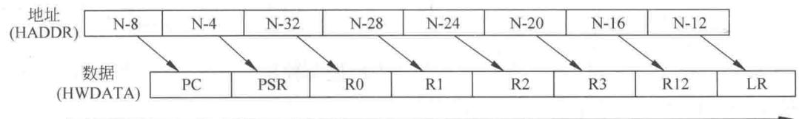

**这张图怎么读？**

这张图是**两条并排的时间轴**：

```
地址
(HADDR)   ┌────┐┌────┐┌─────┐┌─────┐┌─────┐┌─────┐┌─────┐┌─────┐
          │N−8 ││N−4 ││N−32 ││N−28 ││N−24 ││N−20 ││N−16 ││N−12 │
          └────┘└────┘└─────┘└─────┘└─────┘└─────┘└─────┘└─────┘
            │     │     │      │      │      │      │      │
            ▼     ▼     ▼      ▼      ▼      ▼      ▼      ▼
数据
(HWDATA)  ┌────┐┌────┐┌────┐┌────┐┌────┐┌────┐┌─────┐┌────┐
          │ PC ││PSR ││ R0 ││ R1 ││ R2 ││ R3 ││ R12 ││ LR │
          └────┘└────┘└────┘└────┘└────┘└────┘└─────┘└────┘
          └────────────────── 时间 ──────────────────────────▶
```

**逐点解读：**

1. **上面一条线是"地址"**（HADDR = Hardware Address，硬件地址总线）：写出的顺序是 `N−8, N−4, N−32, N−28, N−24, N−20, N−16, N−12`。
2. **下面一条线是"数据"**（HWDATA = Hardware Write Data，硬件写数据总线）：写出的顺序是 `PC, PSR, R0, R1, R2, R3, R12, LR`。
3. **每对"地址 + 数据"上下对齐**，表示"这个数据写到了这个地址"：
   ```
   PC  → N−8
   PSR → N−4
   R0  → N−32
   R1  → N−28
   R2  → N−24
   R3  → N−20
   R12 → N−16
   LR  → N−12
   ```
4. **对照表 2-15 的"保存顺序"列**：
   ```
   PC 是第 1 个写的
   PSR 是第 2 个
   R0 是第 3 个
   R1 是第 4 个
   R2 是第 5 个
   R3 是第 6 个
   R12 是第 7 个
   LR 是第 8 个
   ```
   ✓ 完全吻合！

**这张图到底想让我理解什么？**

> **"写入的时间顺序"和"最终的内存地址顺序"不是一回事。**
> 内存里最终从低到高是 `R0, R1, R2, R3, R12, LR, PC, xPSR`；
> 但硬件"写出去"的顺序是 `PC, xPSR, R0, R1, R2, R3, R12, LR`。
>
> **这不影响正确性**——因为硬件保证了"每个寄存器都写到它该在的地址上"。
> 教材特意说明这一点，是为了解释"为什么表 2-15 里保存顺序和地址顺序看起来是乱的"。

> 【补充解释】为什么硬件要按这个"奇怪"的顺序写？
> 因为入栈是**边入栈边取向量**的，硬件要在最短时间内把"最关键的信息"先送出去。
> **PC 先写**是因为它是"断点"，最关键；**xPSR 第二**是因为它和 PC 一起构成"完整的返回信息"（返回时硬件要知道从哪个状态恢复）。
> 剩下的 R0～R3、R12、LR 可以慢慢写。
> 这属于"**硬件实现的优化**"，作为程序员你**不需要记顺序**，只要知道"8 个寄存器会被自动、正确地保存"就够了。

【辅助理解图】

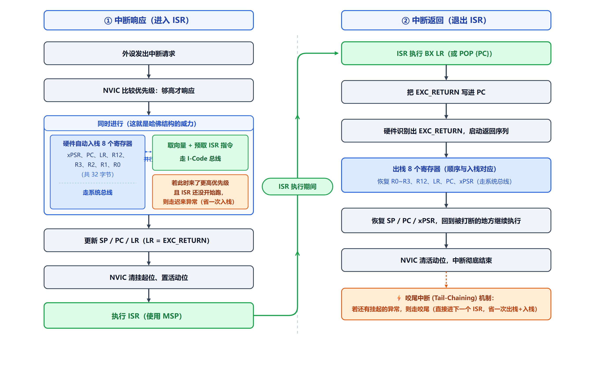

**看图方法**（这张图分左右两栏）：

**左栏"中断响应（进入 ISR）"**，从上到下六个步骤：
1. **中断请求到来**（外设发信号）；
2. **NVIC 比较优先级**（够高才响应）；
3. **同时做两件事**（画两条并行的箭头）：
   - 左箭头：**硬件自动入栈 8 个寄存器**（走系统总线），旁边标出"xPSR、PC、LR、R12、R3～R0"；
   - 右箭头：**取向量 + 预取指令**（走 I-Code 总线）；
4. **更新 SP / PC / LR**，其中 LR 被写成 **EXC_RETURN**；
5. **进入 ISR 执行**（此时用 MSP）。

**右栏"中断返回（退出 ISR）"**：
1. **ISR 执行 `BX LR`**（或 `POP {PC}`），把 EXC_RETURN 送进 PC；
2. **硬件识别出这是 EXC_RETURN** → 启动返回序列；
3. **出栈 8 个寄存器**（顺序与入栈相反）；
4. **恢复 SP / PC / xPSR**，回到被打断的地方继续执行；
5. **NVIC 清除活动位**。

**图的关键标注**：在"入栈"和"取向量"两条并行箭头之间写一句"**同时进行——这就是哈佛结构的威力**"。

#### 第 ④ 步：执行中断服务例程（ISR）

ISR 就是你的代码。它要做的事通常是：

```
① （如果是外设中断）读取外设状态，判断是什么事件
② 处理这个事件（读数据、发数据、改状态……）
③ 清除外设的中断标志（否则会反复进入！）
④ 返回
```

**关于 ISR 的编写方式**，教材给了一个重要结论：

> 在 Cortex-M3 中，通过把 EXC_RETURN 写入 PC 来识别返回动作。因此，**在 C 语言中，无须使用特殊的编译器命令（如 interrupt 关键词）就可以编写中断服务例程。**

> 【补充解释】这句话含金量很高。在**传统的 8 位/16 位单片机**上，写中断函数通常要加特殊关键字，例如：
> ```c
> void Timer0_ISR(void) interrupt 1   // Keil C51 的写法
> {
>     ...
> }
> ```
> 这个 `interrupt 1` 是告诉编译器"帮我生成保护现场、恢复现场的代码，并且用 `RETI` 返回"。
>
> **Cortex-M3 不需要**——因为硬件自动压栈/出栈，而"返回"就是一条普通的 `BX LR`。所以 Cortex-M3 的 ISR **就是一个普通的 C 函数**：
> ```c
> void EXTI0_IRQHandler(void)   // 名字由启动文件/向量表决定
> {
>     ...
> }
> ```
> 这是 Cortex-M 系列"**对 C 语言友好**"的一个重要体现。

#### 第 ⑤ 步：异常返回

教材说：

> **异常返回**：在异常服务例程执行完毕后，借助"异常返回"操作恢复先前的系统状态，使先前被中断的程序得以继续执行。有 **3 种途径**可以触发异常返回操作，**不管使用哪一种，都需要用到先前存储的 LR 值**。

**表 2-16 触发中断返回的三种途径：**

| 指令 | 工作原理 |
|---|---|
| **`BX <reg>`** | 当 LR 存储 EXC_RETURN 时，使用 **`BX LR`** 指令即可返回 |
| **`POP {PC}` 和 `POP {..., PC}`** | 在服务例程中，LR 的值通常会被压入栈。此时可利用 POP 指令把 LR 存储的 EXC_RETURN **往 PC 里弹**，从而引起处理器做中断返回 |
| **`LDR` 与 `LDM`** | 把 **PC 作为目的寄存器**，也可启动中断返回序列 |

**为什么这三种"看起来完全不同"的指令都能触发返回？**

因为它们**都会把一个值写进 PC**。硬件在写 PC 的那一刻检查："这个值是不是长得像 EXC_RETURN（高 28 位全是 1）？"

- **是** → 这是一次"异常返回"，启动出栈流程；
- **不是** → 这是一次"普通跳转"，直接跳过去。

> 【类比】
> 就像寄快递时，快递单上如果写着"**退回**"两个字，快递员就走"退货流程"；否则就走"派送流程"。
> 硬件就是看"写进 PC 的这个值是不是 EXC_RETURN 这个暗号"。
> **类比的边界**：这不是"字符串匹配"，而是**检查高 28 位是否全为 1**——一个非常快的电路判断。

#### 第 ⑥ 步：出栈

教材说：

> **出栈**：恢复压入栈中的寄存器内容。内容的出栈顺序与入栈时**相对应**，**堆栈指针的值也改回去**。

**出栈后：**

```
① 8 个寄存器全部恢复（R0～R3、R12、LR、PC、xPSR）
② PC 恢复成"被打断处的下一条指令地址"→ 程序从断点继续
③ SP 恢复到入栈前的值（N）
④ 如果原来用的是 PSP，SP 切回 PSP；如果原来用的是 MSP，SP 保持 MSP
```

**第 ⑦ 步：更新 NVIC 寄存器**

教材说：

> **更新 NVIC 寄存器**。中断返回后，NVIC 的**活动位也被硬件清除**。
> 对于外部中断，**若中断输入再次被置位有效，挂起位也将再次置位**，新一次的中断响应序列也将再次开始。

**这就闭环了**：活跃位清零 → 这个中断"空闲"了 → 如果请求又来了，重新挂起 → 重新响应。

#### 中断延迟到底有多短？（一个直观的数量级）

> 【补充解释】Cortex-M3 的**中断延迟**（从中断请求到 ISR 第一条指令开始执行）在理想情况下是 **12 个时钟周期**。
>
> 这 12 个周期主要是"入栈 8 个寄存器"占用的（因为一次写一个，加上流水线开销）。
> 对比一下：传统 8 位单片机的中断延迟通常在 **几十个周期**；如果还要软件 PUSH 一堆寄存器，那就更长了。
>
> **为什么 Cortex-M3 能这么快？** 三个原因：
> 1. **入栈和取向量并行**（哈佛结构）；
> 2. **硬件自动压栈**（不用取指令、译码、执行一堆 PUSH）；
> 3. **自动压栈是在内核里"批量"完成的**，不是一条一条执行 PUSH 指令。

### 2.8.6 中断嵌套控制

教材说：Cortex-M3 内核配合 NVIC 提供了完备的中断嵌套控制。在程序中，通过为每个中断建立适当的优先级，就可以实施中断嵌套控制。

**两条基本规则：**

**（1）优先级决定能不能抢占**

> 通过对 NVIC 以及 Cortex-M3 处理器相关寄存器的设置，可以方便地确定中断源的优先级。**系统正在响应某个异常时，所有优先级不高于它的异常都不能抢占它，且它自己也不能抢占自己。**

**用一句话概括：**

```
新来的异常优先级 "更高"（数值更小）  →  可以抢占
新来的异常优先级 "相同或更低"        →  排队等待
```

**（2）自动入栈和出栈保护现场**

> 自动入栈和出栈能及时保护相关寄存器内容，不至于中断嵌套发生时寄存器内容受损。

**然后是两条必须警惕的"坑"（教材专门用一整段讲）：**

#### 坑 1：堆栈溢出

教材说：

> 但是需要注意**堆栈溢出**的现象。由于**所有服务例程都只使用主堆栈**，**每嵌套一级，就至少再需要 8 个字，即 32 字节的堆栈空间**（不包括中断服务程序自身状态保存对堆栈的额外需求）。
>
> 因此，当中断嵌套层次很深时，对主堆栈的容量空间压力会增大，甚至出现**堆栈容量用光导致堆栈溢出**的情况。
>
> 堆栈溢出对系统的运行是**很致命的**，因为入栈数据会**持续入栈而越过栈底**，使入栈数据与主堆栈前面的数据区发生**混叠**而破坏数据区内容。这样，在中断返回后，系统极可能功能紊乱，造成**程序跑飞或死机**。

**把这段话画出来：**

```
主堆栈区域（从高地址往低地址生长）
高地址 0x20008000  ← MSP 初始值（栈顶/栈底，取决于叫法）
       ┌──────────────┐
       │   ISR 第 3 层  │  ← 第 3 次嵌套：再吃 32 字节
       ├──────────────┤
       │   ISR 第 2 层  │  ← 第 2 次嵌套：再吃 32 字节
       ├──────────────┤
       │   ISR 第 1 层  │  ← 第 1 次中断：吃 32 字节
       ├──────────────┤
       │  ← 栈底（分配给你的栈的下边界）
       ├──────────────┤  ← ⚠️ 如果继续往下压……
       │  别的变量的地盘 │  ← 栈溢出！把别人的数据踩了
       └──────────────┘
低地址
```

**怎么防止堆栈溢出？** 三个办法：

1. **把栈开大一点**（最简单，但浪费 RAM）；
2. **限制中断嵌套层数**（合理设置优先级，不要让所有中断都能互相抢占）；
3. **用 MPU 保护栈区**（越界访问就触发 MemManage Fault，能被发现）。

> 【类比】
> 就像往杯子里倒水：杯子有刻度，你每次倒 32ml。倒得次数多了就溢出来，流到旁边的电器上——**不是"水不够"的问题，是"水漫出来破坏了别的设备"**。
> **类比的边界**：真实硬件里"漫出来"不会触发任何报警（除非你专门配了 MPU），所以**栈溢出往往是"静默的灾难"**——程序可能跑很久才出错，很难查。

#### 坑 2：相同异常不可重入

教材说：

> 同时，还需注意**相同异常的不可重入特性**。因为每个异常都有自己的优先级，并且在异常处理期间，**同级或低优先级的异常要阻塞（等待）**，所以对于同一个异常，**只有在上次实例的服务例程执行完毕后，方可继续响应新的请求**。

**这就是 2.8.3 节讲的"单实例"。**

**为什么这个特性很重要（工程意义）？**

```
好处：你不用给 ISR 写"防重入"的锁——硬件已经保证了同一个 ISR 不会自己嵌套自己。
坏处：如果事件来得太快、处理得太慢，会"丢事件"（因为挂起标志只有一个位，见 2.8.3 情况 5）。
```

### 2.8.7 高级中断技术

教材说：Cortex-M3 为缩短中断延迟做了许多努力，包括**咬尾、迟来异常处理**等。

这两个技术是本章的"亮点知识"，也是考试常考的。我们用时间轴讲清楚。

#### 技术 1：咬尾（tail-chaining）

**先看"没有咬尾"时的浪费**（教材原文）：

> 当处理器在响应某异常时，如果又发生其他中断，若其优先级不高，则被阻塞。那么中断返回时，**正常操作流程**如下：
> （1）执行 **POP** 操作以恢复系统现场；
> （2）系统处理挂起的异常；
> （3）执行 **PUSH** 操作以保护系统现场。
>
> 显然，**POP 和 PUSH 操作所涉及的系统现场是一样的**，这个操作会白白浪费 CPU 时间。

**画成时间轴（没有咬尾）：**

```
时间 ─────────────────────────────────────────────────────────────────▶

ISR#1 执行完毕
   │
   ├──▶ POP（出栈 8 个寄存器，恢复现场）   ← 白干！
   │
   ├──▶ 发现还有 ISR#2 挂着
   │
   ├──▶ PUSH（入栈 8 个寄存器，保存现场）  ← 又白干！而且存的是刚恢复的同一批值
   │
   └──▶ ISR#2 开始执行
```

**"同样的 8 个寄存器，刚弹出来又压回去"——完全是浪费。**

**Cortex-M3 的咬尾机制**：

> 正因为如此，Cortex-M3 提供了**咬尾机制**来缩短这些不必要的操作，通过**继续使用上一个异常已经 PUSH 好的系统现场**，在本次异常完成后才执行现场恢复操作，形象地讲，**后一个异常把前一个的尾巴咬掉了**，因此称为咬尾，**前前后后只进行了一次入栈/出栈操作**。

**画成时间轴（有咬尾）：**

```
时间 ─────────────────────────────────────────────────────────────────▶

ISR#1 执行完毕
   │
   ├──▶ 发现还有 ISR#2 挂着
   │
   ├──▶ 直接跳到 ISR#2（栈里的现场原封不动，接着用）  ← 省掉 POP + PUSH！
   │
   └──▶ ISR#2 执行完毕
          │
          └──▶ POP（这时才出栈一次）
```

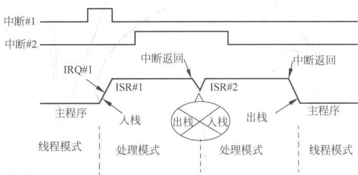

**这张图怎么读**：

1. **横向是时间**。
2. 图里有**两条 ISR 的"阶梯"**：ISR#1 结束后，**没有"落回"主程序那条线**，而是**直接横着连到 ISR#2**。
3. **关键标注**："**出栈**"只出现在 **ISR#2 的末尾**——前面 ISR#1 结束处**没有出栈**。
4. 图中标出了"入栈"在 ISR#1 开始处，然后一路沿用。

**这张图要我理解**：**"咬尾"就是让两个 ISR 共用一次入栈/出栈。** 省下的是"一次 POP + 一次 PUSH"（也就是一次完整的现场出栈 + 一次完整的现场入栈）的硬件开销——在实时系统里，能省掉一次"8 个寄存器搬出又搬回"是很可观的一笔。

> 📌 【补充解释：这里为什么不写具体周期数？】教材原文只说 POP/PUSH"会白白浪费 CPU 时间"，**没有给出具体是几个时钟周期**。本讲义的旧版本曾自行写上"大约 12 个时钟周期"，这个数字在教材里没有出处，现已删去。如果你需要具体数值，请以 ARM 官方的 Cortex-M3 技术参考手册（TRM）"咬尾/中断延迟"一节的表述为准——**本讲义不采用未核实的数字**。

**"咬尾"这个名字怎么理解？**

> 【类比】
> 两只猫排队走路，后面的猫**咬住前面猫的尾巴**，于是它们**连成一串**，中间不用停下来"重新对齐"。
> 前一个 ISR 不"落地"，后一个 ISR 直接接上——就是"咬尾"。

**什么情况下会发生咬尾？** 教材说："当处理器在响应某异常时，如果又发生其他中断，**若其优先级不高，则被阻塞**"。也就是说：

```
ISR#1 正在执行
   ↓
中断 #2 来了，但优先级不高于 #1 → 被阻塞（挂起）
   ↓
ISR#1 执行完 → 发现 #2 还挂着 → 咬尾：直接进 ISR#2
```

#### 技术 2：迟来异常（late arrival）

**"咬尾"作用于中断"结束"时；"迟来"作用于中断"开始"时。**

教材说：

> 咬尾是在中断结束**出栈**时起作用的，与之对应，Cortex-M3 在**入栈**时也提供一种高效的操作模式，称为"**迟来异常**"。
>
> 当 Cortex-M3 对某异常的响应序列还处在**入栈阶段**，且**尚未执行其服务例程**时，如果此时收到了**高优先级异常的请求**，则**本次入栈就成了为高优先级中断所做的了**——入栈后，将执行**高优先级异常**的服务例程。

**用大白话解释：**

```
正常抢占的情况：
  ISR#1 已经开始执行了，来了 #2（优先级更高）
  → 需要"再入栈一次"（把 ISR#1 的现场存起来）→ 多花时间、多花 32 字节栈

迟来的情况：
  ISR#1 的现场刚压了一半 / 刚压完，但 ISR#1 的第一条指令还没执行
  → 此时来了 #2（优先级更高）
  → "反正栈里存的是主程序的现场，还没开始跑 ISR#1 呢"
  → 直接把这次入栈当作"为 #2 准备的"，然后执行 ISR#2！
  → 省掉一次入栈
```

教材说：

> 如图 2-36 所示，若在响应某低优先级异常 #1 的早期检测到了高优先级异常 #2，则只要 **#2 没有太晚**，就能以晚到中断的方式处理，在**入栈完毕后再执行 ISR#2**。
>
> 若异常 #2 来得**太晚**，以至于 **ISR#1 的指令已经开始执行**，则以**普通的抢占**处理，但这会需要**更多的处理器时间和额外 32 字节的堆栈空间**。

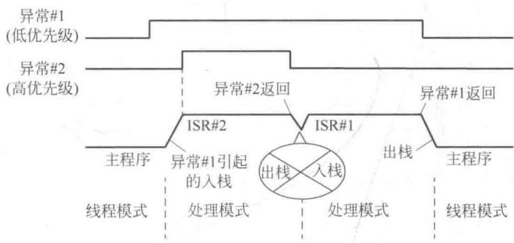

**这张图怎么读？**

1. **横向是时间**，最上面两条线是"异常 #1（低优先级）"和"异常 #2（高优先级）"的请求信号。
2. **中间是 ISR 的阶梯**：可以看到 **ISR#2 先执行，ISR#1 后执行**（尽管 #1 是先请求的！）。
3. **下面的阶段标注**：
   ```
   主程序 │ 异常#1引起的入栈 │ 处理模式 │ ... │ 出栈 │ 主程序
          └───────┬────────┘
                  │
        图里用一个交叉的圆圈标注："出栈"和"入栈"在这里"交叉/合并"
   ```
4. **最下面一行标注了模式切换**："线程模式 → 处理模式 → ... → 线程模式"。
5. **关键点**：图里 **ISR#2 的入栈没有单独发生**——它复用了"为 #1 做的那次入栈"。

**这张图要我理解**：

> **迟来异常 = "抢在 ISR#1 开始跑之前插队进来，并把已经做好的入栈工作'收编'给自己用"。**
> 效果：**响应了更高优先级的异常，但没有额外的时间开销。**
>
> 教材最后说："在 ISR#2 执行完毕后，则以刚刚讲过的'**咬尾中断**'方式来启动 ISR#1 的执行。"——**迟来和咬尾是配合使用的**：迟来负责"进来"，咬尾负责"接着走"。

**总结：两个技术的分工**

| 技术 | 作用时机 | 省掉什么 |
|---|---|---|
| **迟来（late arrival）** | 异常**入栈阶段** | 省掉一次入栈（抢占时不用重存现场） |
| **咬尾（tail-chaining）** | 异常**出栈阶段** | 省掉一次出栈 + 一次入栈 |

```
时序上：
   [入栈] ← 迟来在这里起作用
     ↓
   [ISR#2 执行]
     ↓
   [出栈] ← 咬尾在这里起作用（不落地，直接接 ISR#1）
     ↓
   [ISR#1 执行]
     ↓
   [出栈]
```

【辅助理解图】

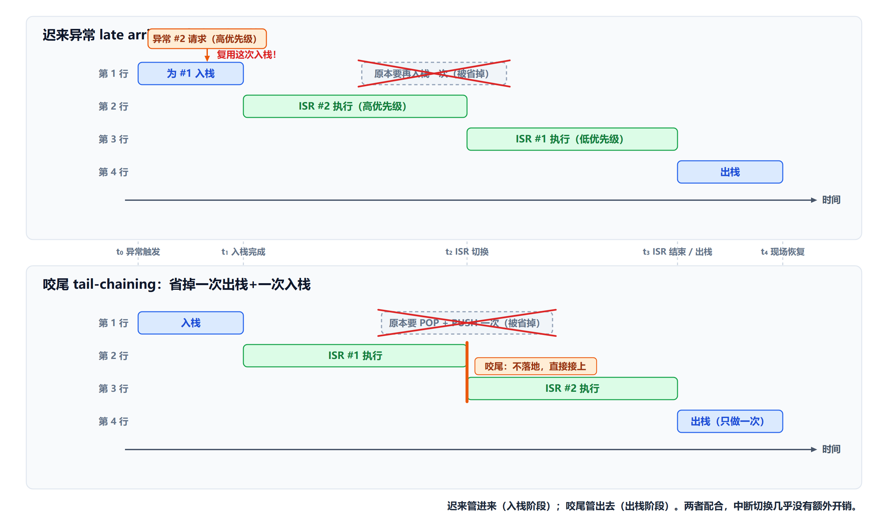

**看图方法**：这张图分**上下两栏**。

**上栏"迟来异常"**：画两条"入栈"的柱子。左边一条标"为 #1 入栈"，右边**不画第二条柱子**，而是画一个箭头从"高优先级 #2 请求"指向左边那条柱子，标"复用这次入栈"。然后依次是 ISR#2、ISR#1。

**下栏"咬尾"**：画 ISR#1 的方块，紧接着**直接**接上 ISR#2 的方块（中间不画"出栈/入栈"），只在 ISR#2 结束后画一次"出栈"。旁边用灰色虚影标出"**被省掉的 POP + PUSH**"。

**图的右下角**写一行总结："迟来省一次入栈；咬尾省一次出栈+入栈。两者配合，中断切换几乎没有额外开销。"

### 2.8.8 异常返回值 EXC_RETURN

#### 先别急着看教材：这一小节要干什么？

前面反复提到"LR 被写成 EXC_RETURN"，但一直没说它到底长什么样、有什么含义。这一小节把它彻底讲清楚。

**这一小节的核心问题：**

> **中断返回时，硬件怎么知道"该从哪个栈弹出数据"？"该回到哪个等级"？**

答案：**全都编码在 EXC_RETURN 那 32 位里。**

#### EXC_RETURN 是什么？

教材说：

> 进入异常服务程序后，LR 的值被自动更新为特殊的 **EXC_RETURN**，这是一个**高 28 位全为 1** 的值，**只有位段 [3:0] 的值有特殊含义**。当异常服务例程把这个值送到 PC 时，就会启动处理器的中断返回序列。
>
> **因为 LR 的值是由 Cortex-M3 自动设置的，所以只要没有特殊需求，就不要改动它。**

**"不要改动 LR"这句话非常重要**：

```
ISR 里如果要用 LR（比如调用别的函数，BL 会把 LR 覆盖掉）
→ 必须先把 LR 压栈保存，最后再弹回 LR
→ 否则中断返回时就找不到"返回说明书"了
```

> 【类比】
> EXC_RETURN 就像**酒店房卡**：
> - 卡上编码了"该开哪个房间门（用哪个栈）""走员工通道还是客人通道（哪种模式）"。
> - 你把卡丢了或弄坏了，就回不去了。
> - 所以**别乱动它**。

#### EXC_RETURN 的位段详解（教材表 2-17，含修正）

**位图：**

```
bit    31                              4   3   2   1   0
      +--------------------------------+---+---+---+---+
      |      必须全为 1（标识）           |   |   |   |   |
      +--------------------------------+---+---+---+---+
                                         │   │   │   │
                          bit3 ──────────┘   │   │   └── bit0
                          bit2 ──────────────┘   └────── bit1
```

**表 2-17 EXC_RETURN 位段详解（已修正教材 bit2 的描述）：**

| 位段 | 定义 |
|---|---|
| **[31:4]** | EXC_RETURN 的**标识：必须全为 1** |
| **3** | **0 = 返回后进入处理模式；1 = 返回后进入线程模式** |
| **2** | **0 = 从主堆栈中做出栈操作，返回后使用 MSP；1 = 从进程堆栈中做出栈操作，返回后使用 PSP** |
| **1** | **保留，必须为 0** |
| **0** | **0 = 返回后 ARM 状态；1 = 返回后 Thumb 状态。在 Cortex-M3 中必须为 1** |

> ⚠️ 【待核验】教材表 2-17 中 bit2 的描述把"1"那一支印成"从进程堆栈中做出栈操作，返回后使用 **MSP**"。已核对原 PDF p67，教材原文如此。**按上下文（2.6.2 节图 2-16 和表 2-18 都说明"用进程堆栈时返回后是 PSP"），此处应为 PSP。** 教材**疑似笔误**，本讲义已修正，疑点记入文末。

**把这 4 位记住的窍门：**

```
bit3 → 回到"线程模式"还是"处理模式"？  （Thread 有 5 个字母，1 表示 Thread？记住：1 = 线程）
bit2 → 用哪个栈？                     （1 = PSP，2 和 P 都像？记住：1 = 进程堆栈）
bit1 → 永远 0
bit0 → 永远 1（Thumb）
```

#### 三个合法的 EXC_RETURN 值（教材表 2-18）

| EXC_RETURN 数值 | 功能 |
|---|---|
| **`0xFFFFFFF1`** | **返回处理模式** |
| **`0xFFFFFFF9`** | **返回线程模式，并使用主堆栈（SP = MSP）** |
| **`0xFFFFFFFD`** | **返回线程模式，并使用线程堆栈（PSP）** |

**验证一下这三个值的二进制（把最低 4 位展开）：**

```
0xFFFFFFF1  →  最低 4 位 = 0001
               bit3=0（处理模式）, bit2=0（MSP）, bit1=0, bit0=1  ✓

0xFFFFFFF9  →  最低 4 位 = 1001
               bit3=1（线程模式）, bit2=0（MSP）, bit1=0, bit0=1  ✓

0xFFFFFFFD  →  最低 4 位 = 1101
               bit3=1（线程模式）, bit2=1（PSP）, bit1=0, bit0=1  ✓
```

**十六进制 → 二进制的换算（不跳步）：**

```
0xF1 = 1111 0001
0xF9 = 1111 1001
0xFD = 1111 1101

（每个十六进制位 = 4 个 bit：
  F = 1111
  1 = 0001
  9 = 1001
  D = 1101）
```

#### 什么时候会是哪一个值？

**这是本节最实用的部分。**

**情况 1：主程序在线程模式下、使用 MSP 时被中断**

> 如果主程序在线程模式下运行，并且在使用 **MSP** 时被中断，则在服务例程中 **LR = `0xFFFFFFF9`**（主程序被打断前的 LR 已被自动入栈）。

```
被打断前：
   线程模式 + MSP
        ↓ 中断
ISR 中：
   LR = 0xFFFFFFF9
   （bit3=1 → 回线程模式；bit2=0 → 用 MSP 出栈）
```

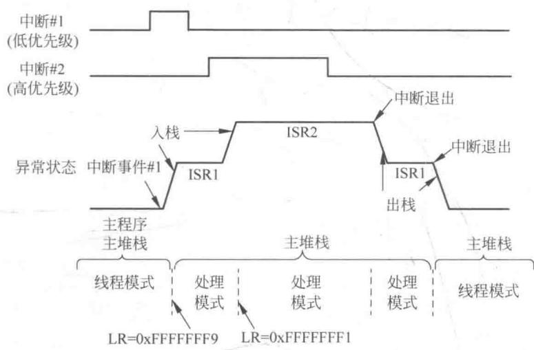

**图 2-37 怎么读**：图中左边是"线程模式（用 MSP）"，右边是"处理模式"。中间的箭头标出"中断"和"返回"，并在 ISR 的位置标出 **LR = 0xFFFFFFF9**。**重点看返回时用的栈**——和进入时的栈是同一个（MSP）。

**情况 2：主程序在线程模式下、使用 PSP 时被中断**

> 如果主程序在线程模式下运行，并且在使用 **PSP** 时被中断，则在服务例程中 **LR = `0xFFFFFFFD`**（主程序被打断前的 LR 已被自动入栈）。

```
被打断前：
   线程模式 + PSP
        ↓ 中断
ISR 中：
   LR = 0xFFFFFFFD
   （bit3=1 → 回线程模式；bit2=1 → 用 PSP 出栈）
```

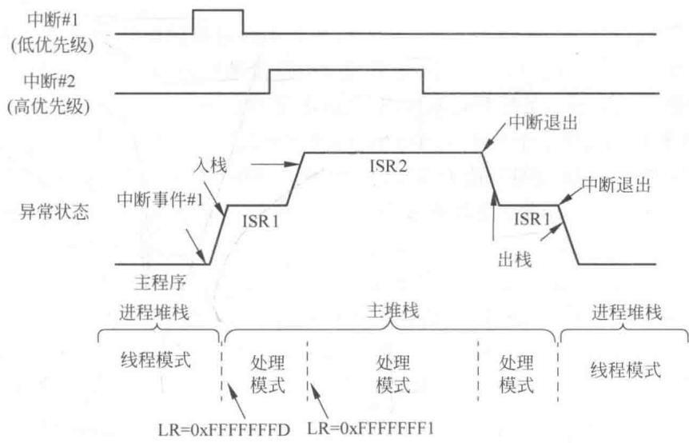

**图 2-38 怎么读**：和图 2-37 结构一样，但**栈标成了 PSP**，**LR 标成了 0xFFFFFFFD**。**对比两张图**，就能看出"EXC_RETURN 的 bit2 记录了该用哪个栈"。

**情况 3：主程序在处理模式下运行时被中断（即中断嵌套）**

> 如果主程序在**处理模式下**运行，则在服务程序中 **LR = `0xFFFFFFF1`**（主程序被打断前的 LR 已自动入栈），这时的"主程序"其实更可能是**被抢占的服务例程**。
>
> 事实上，**在嵌套时，更深层 ISR 所看到的 LR 总是 `0xFFFFFFF1`**。

```
第 1 层 ISR 正在执行（处理模式）
        ↓ 高优先级中断来了
第 2 层 ISR 中：
   LR = 0xFFFFFFF1
   （bit3=0 → 回处理模式；bit2=0 → 用 MSP 出栈）
```

**为什么"更深层 ISR 的 LR 总是 0xFFFFFFF1"？** 因为：

1. 所有 ISR 都在**处理模式**下运行；
2. 处理模式**只能用 MSP**。

所以嵌套时永远是 `0xFFFFFFF1`。

**三个值总结成一张表：**

| 被中断时的状态 | ISR 中的 LR | 返回后回到 |
|---|---|---|
| 线程模式 + MSP | `0xFFFFFFF9` | 线程模式 + MSP |
| 线程模式 + PSP | `0xFFFFFFFD` | 线程模式 + PSP |
| 处理模式（嵌套） | `0xFFFFFFF1` | 处理模式 + MSP |

#### 一个巧妙的设计：EXC_RETURN 的地址范围不可执行

教材说：

> 由 EXC_RETURN 的格式可见，**不能把 `0xFFFFFFF0～0xFFFFFFFF` 中的地址作为任何返回地址**。其实也不用担心会弄错，因为 Cortex-M3 已经把这个范围标记成"**非可执行区域**"了。

**为什么？** 因为高 28 位全为 1 的地址，只可能落在 `0xFFFFFFF0～0xFFFFFFFF` 这 16 个地址里。ARM 干脆把这一小段标记为"不许执行代码"，这样：

- **误把普通地址当 EXC_RETURN** → 不可能（普通地址不在这个范围）；
- **误把 EXC_RETURN 当普通地址跳过去** → 硬件会拦住（非可执行区）。

> 【补充解释】这是一个"**把特殊值和特殊地址范围绑定**"的设计技巧。
> 好处：硬件判断"这是不是 EXC_RETURN"只需要看**高 28 位是否全为 1**（一个极快的电路判断），不需要额外的状态位。
> 这体现了硬件设计里常见的思路：**用"地址空间的保留区"来编码"特殊含义"**。

### 2.8 节总结：把中断这一整套串起来

**先看教材最后一张总图**，它把本节所有概念画成了一条流程：

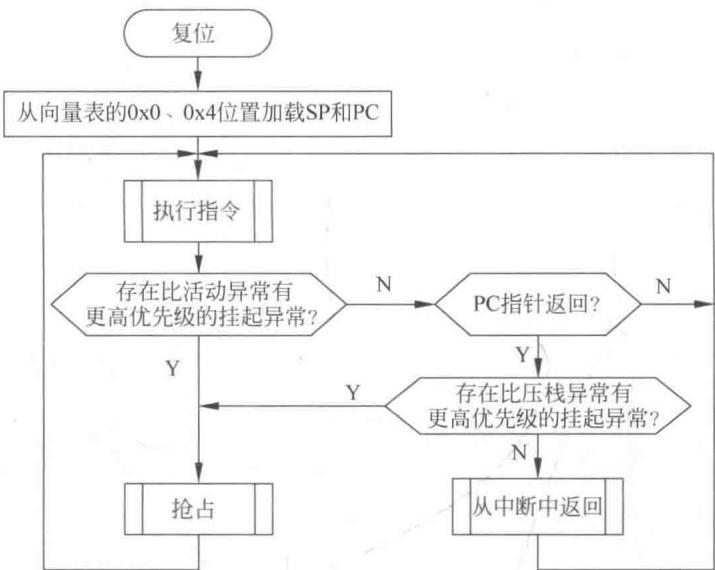

**这张图怎么读？**

1. **从上往下**看，它是一条"程序执行的主线"。
2. **中间的分叉**标出了"发生异常"这个事件，程序主线在这里"拐下去"。
3. **拐下去之后**依次是：**保存现场（入栈）→ 取向量 → 执行 ISR → 恢复现场（出栈）→ 返回主线**。
4. **图里的判断框**处理了"优先级够不够""是否有嵌套"这类分支。
5. **回到主线**的位置就是"断点"，程序从这里继续。

**这张图要我理解**：**整个中断过程就是"主线 → 拐下去 → 处理 → 拐回来"这一个模式。** 前面讲的所有细节（NVIC、向量表、优先级、自动压栈、EXC_RETURN、咬尾、迟来）都只是这个模式的**优化和补充**。

**然后把细节串成一条完整的时间轴（从"无事发生"到"回到原处"）：**

```
主程序正常执行
    │
    │ ① 外设发出中断请求
    ▼
NVIC 记录"挂起"（如果优先级不够就先排队）
    │
    │ ② NVIC 比较优先级 → 够高
    ▼
同时开始两件事：
    ├─ 硬件自动入栈 8 个寄存器（xPSR、PC、LR、R12、R3~R0）  ← 走系统总线
    └─ 取向量 + 预取 ISR 指令                              ← 走 I-Code 总线
    │
    │ （若此时来了更高优先级异常且 ISR 还没开始跑 → 迟来异常）
    ▼
更新 SP / PC / LR（LR = EXC_RETURN）；NVIC 清挂起位、置活动位
    │
    ▼
③ 执行 ISR（用 MSP）
    │
    │ （若此时来了中断但优先级不够 → 挂起，等会儿处理）
    ▼
④ ISR 执行 `BX LR`（或 POP {PC}）→ 把 EXC_RETURN 写进 PC
    │
    ▼
硬件识别 EXC_RETURN → 启动返回序列
    ├─ 出栈 8 个寄存器（顺序与入栈对应）
    └─ 恢复 SP / PC / xPSR
    │
    │ （若还有挂起的异常 → 咬尾，直接进下一个 ISR）
    ▼
NVIC 清活动位 → 中断彻底结束
    │
    ▼
主程序从断点继续执行
```

**一张表汇总本节的所有关键数字：**

| 项目 | 数值 |
|---|---|
| 自动入栈的寄存器个数 | **8 个** |
| 自动入栈占用的栈空间 | **32 字节** |
| 异常/中断总数（内核最大） | **256 种** |
| 系统异常编号 | **1～15**（没有 0 号） |
| 外部中断编号 | **16～255**（IRQ#0～IRQ#239） |
| 固定优先级异常 | **复位（−3）、NMI（−2）、硬 Fault（−1）** |
| 可编程优先级最大级数 | 256 级（**芯片实际会裁剪**，如 8/16/32 级） |
| 抢占优先级最大级数 | **128 级**（7 位） |
| 优先级分组数 | **8 组**（0～7） |
| 每个向量的字节数 | **4 字节** |
| 向量地址公式 | **异常号 × 4** |
| 合法 EXC_RETURN | **0xFFFFFFF1 / 0xFFFFFFF9 / 0xFFFFFFFD** |
| NVIC 访问地址 | **0xE000E000** |
| AIRCR 地址 | **0xE000ED00** |
| VTOR 地址 | **0xE000ED08** |
| AIRCR 写操作的钥匙 | **VECTKEY = 0x05FA**（读回 0xFA05） |

---

## 2.9 复位序列（教材 2.8）

### 先别急着看教材：这一节到底要干什么？

这一节回答一个很朴素但很关键的问题：

> **芯片刚上电（或按下复位键）的那一瞬间，CPU 做的第一件事是什么？**

**为什么这个问题重要？** 因为**程序是从这里开始跑的**。第 5 章讲"开发流程"、第 6 章讲"启动文件"时，都要回到这一节。

### 正式知识：程序映像与向量表

教材说：

> Cortex-M3 处理器的**程序映像**是从地址 `0x00000000` 开始的。**程序映像的开始处为向量表**。

**"程序映像"是什么？** 就是**烧写进 Flash 的那份完整程序**（代码 + 常量 + 向量表等）。

**它在地址空间里的样子：**

```
地址
0x00000000  ┌────────────────────────────┐
            │  MSP 的初始值（4 字节）      │ ← 第 1 个字
0x00000004  ├────────────────────────────┤
            │  异常 1（复位）的入口地址     │ ← 复位向量
0x00000008  ├────────────────────────────┤
            │  异常 2（NMI）的入口地址      │
0x0000000C  ├────────────────────────────┤
            │  异常 3（硬 Fault）的入口地址  │
0x00000010  ├────────────────────────────┤
            │  异常 4（MemManage）的入口地址 │
            │  ...                       │
0x0000003C  ├────────────────────────────┤
            │  异常 15（SysTick）的入口地址  │
0x00000040  ├────────────────────────────┤
            │  IRQ#0 的入口地址            │
0x00000044  ├────────────────────────────┤
            │  IRQ#1 的入口地址            │
            │  ...                       │
            └────────────────────────────┘
                    ↓ 向量表结束之后
            ┌────────────────────────────┐
            │  真正的程序代码               │
            │  （启动代码 / main 函数等）    │
            └────────────────────────────┘
```

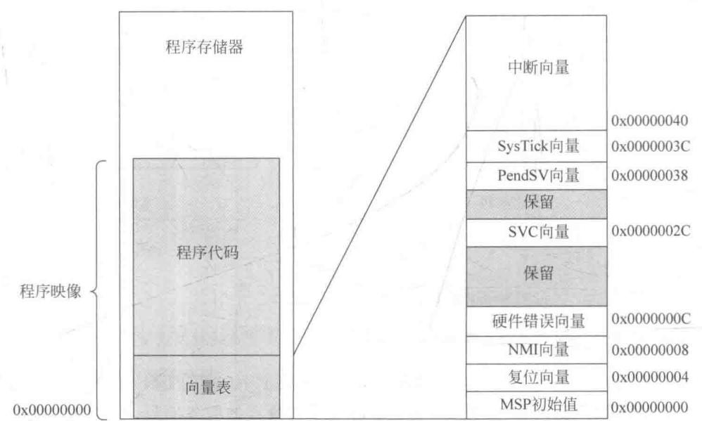

**这张图怎么读**：

1. **左边是地址列**，从 `0x00000000` 往下递增。
2. **第 1 行（`0x00000000`）** 标着 **MSP 的初始值**——**注意它不是"入口地址"，而是一个"栈顶地址"**。
3. **第 2 行起**才是各个异常的入口地址，**每行 4 字节**。
4. **每一行的地址 = 异常号 × 4**（教材原话："每个中断向量的地址都等于'异常号×4'"）。

**这张图要我理解**：**向量表就在程序的最开头，硬件一上电就到这里来找"往哪跳、栈在哪"。**

### 复位向量为什么要"最低位置 1"？

教材说：

> 这些向量的**最低位都被置 1**，表明异常处理执行时使用 **Thumb 指令**。
>
> 例如，如果启动代码位于地址 `0x00000100`，则需要在复位向量处写入这个地址，并且将地址的**最低位置为 1**，以表明当前为 Thumb 代码。因此，**地址 `0x00000004` 处的值被置为 `0x00000101`**。

**把这段推演一遍：**

```
启动代码的真实地址 = 0x00000100

要在 0x00000004 处写入的值：
   真实地址：    0x00000100
   最低位置 1：  0x00000101
                 └───┬───┘
                 最后一位从 0 变 1

所以 0x00000004 处的值 = 0x00000101
```

**为什么是"最低位"而不是"加 1"？**

```
0x00000100 = 0000 0000 0000 0000 0000 0001 0000 0000
                                                  ↑
                                                bit0 = 0

0x00000101 = 0000 0000 0000 0000 0000 0001 0000 0001
                                                  ↑
                                                bit0 = 1
```

**注意**：因为 Thumb 指令至少是**半字（2 字节）对齐**，所以地址的 bit0 本来就是 0。**置 1 相当于"加 1"**——但语义上是"标记状态"，不是"改地址"。

> 【类比】
> 就像信封上除了写地址，还要在角落盖一个"加急"的章。
> 邮局（CPU）看地址决定送到哪，看那个章决定"按哪种方式处理"。
> **类比的边界**：真实硬件里 bit0 被"借走"当了状态标记，所以**真正的地址是 bit31～bit1**。

### 复位后 CPU 做的两件事

教材说：

> 离开复位状态后，Cortex-M3 做的第一件事就是从**地址 `0x00000000` 处取出 MSP 的初始值**（两个字，即 8 字节）；从**地址 `0x00000004` 处取出复位向量**（PC 的初始值，LSB 必须是 1），它表示程序执行的起始地址（复位处理），然后从这个值所对应的地址处取指。

**注意教材这里有个笔误**："取出 MSP 的初始值（**两个字，即 8 字节**）"。

- MSP 的初始值只占 **1 个字 = 4 字节**（地址 `0x00000000`）；
- 复位向量占**另 1 个字 = 4 字节**（地址 `0x00000004`）；
- 所以"两个字 8 字节"指的是 **MSP 初值 + 复位向量** 这两项合起来。

> ⚠️ 【待核验】教材 p70 原文写"从地址 0x00000000 处取出 MSP 的初始值（两个字，即 8 字节）"。按上下文（MSP 初值占 `0x00000000`，复位向量占 `0x00000004`），应为"MSP 初始值占 4 字节，MSP 初值 + 复位向量共 8 字节"。教材表述**容易引起误解**，疑点记入文末。

**所以复位后 CPU 做了两件事：**

```
① 从 0x00000000 读 4 字节 → 装进 SP（MSP）
② 从 0x00000004 读 4 字节 → 装进 PC
③ 从 PC 指向的地址开始取指令执行
```

**画成时间轴：**

```
上电/复位
   │
   ├─▶ ① 读 0x00000000 → SP = MSP 初值（栈就绪）
   │
   ├─▶ ② 读 0x00000004 → PC = 复位向量（去掉 LSB 后是真实地址）
   │
   ├─▶ ③ 从 PC 处取指 → 开始执行启动代码
   │
   └─▶ ④ 启动代码里再调用 main()
```

### 看教材原图：复位流程

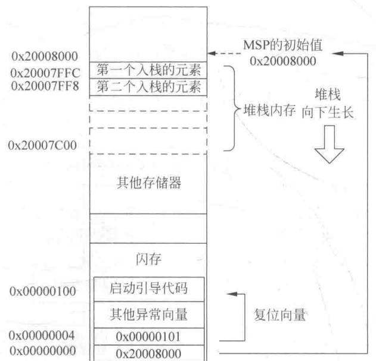

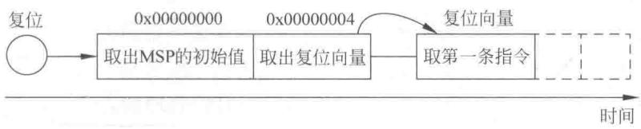

**图 2-40 怎么读**：它展示的是**内存里的具体数值**——`0x00000000` 处写着 MSP 初值，`0x00000004` 处写着 `0x00000101`（复位向量，LSB=1），然后从 `0x00000100` 开始是真正的代码。**重点看那个 `0x00000101`**：它和 `0x00000100` 只差最后一位。

**图 2-41 怎么读**：它是一条**流程图**：

```
上电/复位
   │
   ▼
从 0x00000000 取 MSP 初值
   │
   ▼
从 0x00000004 取复位向量
   │
   ▼
PC = 复位向量（清掉 LSB 得到真实地址）
   │
   ▼
从该地址取指，开始执行
```

### MSP 的初始值该怎么填？（教材的实例）

教材说：

> 复位流程会初始化主栈指针（MSP），假定内存位于 `0x20000000～0x20007FFF`，可以将 `0x20008000` 写在地址 `0x0000000` 处，这样就实现了把主栈**置于内存的顶部**。

**这里有个关键点必须理解：为什么写的是 `0x20008000` 而不是 `0x20007FFF`？**

> 因为 Cortex-M3 使用的是**向下生长的满栈**，所以 **MSP 的初始值必须是堆栈内存的末地址加 1**。
>
> 举例来说，如果堆栈区域在 `0x20007C00～0x20007FFF` 之间，那么 **MSP 的初始值必须是 `0x20008000`**。

**用图看清楚：**

```
内存范围：0x20000000 ～ 0x20007FFF（共 32KB）
                    ↓
栈要放在"最上面"（高地址端），往低地址生长

0x20008000  ← MSP 初始值（= 末地址 + 1）★ 注意：这个地址本身不属于栈！
0x20007FFF  ┌──────────────────┐ ← 栈的"顶"（第一个压入的数据放这里）
            │  第 1 个压入的数据  │   （实际地址 0x20007FFC~0x20007FFF）
0x20007FFC  ├──────────────────┤
            │  第 2 个压入的数据  │
            │  ...             │
            │                  │   栈往这个方向生长（地址减小）
            │  ↓↓↓↓↓↓↓         │
            │                  │
0x20000000  └──────────────────┘ ← 栈的"底"（下边界）
```

**为什么"末地址 + 1"？**

因为**满栈 + 向下生长**意味着：**第一次 PUSH 时，SP 要先减 4**。

```
如果 MSP 初值 = 0x20007FFF：
   第一次 PUSH → SP = 0x20007FFF - 4 = 0x20007FFB
   ⚠️ 不是 4 的倍数！违反"SP 最低两位恒为 0"的规则！

如果 MSP 初值 = 0x20008000：
   第一次 PUSH → SP = 0x20008000 - 4 = 0x20007FFC  ✓ 4 的倍数
   ⚠️ 注意：它落在 0x20007FFF 之下，也就是**没有越界**
```

**所以"末地址 + 1"正好保证了"第一次压栈落在有效范围内，且地址对齐"。**

> 【类比】
> 就像一摞盘子放在桌上，你的手指（SP）**先指向盘子摞的"上方一个盘子厚度"的位置**，等放第一只盘子时手指下移一格，正好指到那只盘子上。
> **类比的边界**：真实硬件里"末地址+1"是一个**必须精确计算**的数值——填错了，第一次压栈就会写到非法地址上（可能触发总线 Fault，也可能悄悄踩坏别的数据）。

### 为什么 MSP 必须"先"初始化？

教材说：

> **在此之前初始化 MSP 是必需的，因为可能第 1 条指令还没来得及执行，就发生了不可屏蔽中断（NMI）或是其他 Fault。MSP 初始化好后就为它们的服务例程准备好了堆栈。**

**这句话很重要**：因为异常随时可能发生，而**处理异常需要压栈**。如果 MSP 还是随机值（复位后寄存器初值是随机的，见 2.4.1），压栈就会写到随机地址上——**后果不堪设想**。

**所以复位序列的第一步就是"把栈准备好"，这是有硬道理的。**

### 与其他单片机的关键区别（教材特别强调）

教材说：

> 请注意，这与绝大多数的其他微处理器或单片机不同。**绝大多数的其他微处理器或单片机架构总是从 0 地址开始执行第一条指令。它们的 0 地址处总是存放一条跳转指令。**
>
> 在 Cortex-M3 中，**在 0 地址处存放 MSP 的初始值，然后紧跟着就是向量表**（向量表在以后还可以被移至其他位置）。**向量表中的数值是 32 位的地址，而不是跳转指令。** 向量表的第一个条目指向复位后应执行的第一条指令所在的地址。

**用对比表看清这个区别：**

| | 传统单片机（如 8051、AVR、C51 系统） | Cortex-M3 |
|---|---|---|
| `0x00000000` 处放什么 | **一条跳转指令**（`JMP` 到真正的启动代码） | **MSP 的初始值** |
| 程序怎么开始 | CPU 从 0 地址取指，执行那条跳转指令 | CPU 从 `0x00000004` 读一个**地址**装进 PC |
| 向量表是什么 | 通常是一串跳转指令 | 一串**32 位地址** |

> 【补充解释】Cortex-M3 这样设计的好处：
> 1. **省掉一条跳转指令**（更少的启动开销）；
> 2. **栈在第一条指令执行前就绪**（前面讲的 NMI/Fault 安全性）；
> 3. **向量表可以被重定位**（通过 VTOR），而"0 地址放跳转指令"的架构很难做到这点。

### 看教材代码：向量表在汇编里长什么样？

教材说："对于不同的开发工具，需要使用不同的格式来设置 MSP 初值和复位向量——有些则由开发工具自行计算并生成。"

【补充解释】为了让你看到"真实的向量表"，这里给一个**典型 STM32 启动文件的片段**（示意，不是教材原文；具体名字随芯片型号不同）：

```asm
; 向量表（放在 Flash 最开头）
                AREA    RESET, DATA, READONLY
                EXPORT  __Vectors
__Vectors       DCD     __initial_sp        ; 0x00000000  MSP 初值
                DCD     Reset_Handler       ; 0x00000004  异常1：复位
                DCD     NMI_Handler         ; 0x00000008  异常2：NMI
                DCD     HardFault_Handler   ; 0x0000000C  异常3：硬Fault
                DCD     MemManage_Handler   ; 0x00000010  异常4
                DCD     BusFault_Handler    ; 0x00000014  异常5
                DCD     UsageFault_Handler  ; 0x00000018  异常6
                DCD     0                   ; 0x0000001C  保留
                DCD     0
                DCD     0
                DCD     0
                DCD     SVC_Handler         ; 0x0000002C  异常11
                DCD     DebugMon_Handler    ; 0x00000030  异常12
                DCD     0                   ; 0x00000034  保留
                DCD     PendSV_Handler      ; 0x00000038  异常14
                DCD     SysTick_Handler     ; 0x0000003C  异常15
                ; 后面接外部中断 IRQ#0 开始...
```

**逐行解释（代码 → CPU 做什么 → 硬件发生什么）：**

| 代码 | 含义 | 硬件/内存发生什么 |
|---|---|---|
| `AREA RESET, DATA, READONLY` | 声明一段只读数据区，名字叫 RESET | 编译期的事 |
| `EXPORT __Vectors` | 让这个符号可以被别的文件引用 | 编译期的事 |
| `__Vectors DCD __initial_sp` | 在当前位置放一个 32 位数，值是 `__initial_sp`（栈顶地址） | 烧写后，这个值出现在 `0x00000000` |
| `DCD Reset_Handler` | 放"复位处理函数的地址" | 出现在 `0x00000004` |
| `DCD NMI_Handler` | 放"NMI 处理函数的地址" | 出现在 `0x00000008` |
| `DCD HardFault_Handler` | 放"硬 Fault 处理函数的地址" | 出现在 `0x0000000C` |
| `DCD 0` | 保留位，填 0 | 出现在对应地址 |
| ... | ... | ... |

- **DCD** = Define Constant Doubleword = 定义 32 位常量（在存储器里占一个"字"）。

**注意 `__initial_sp` 和 `Reset_Handler` 的区别：**

```
__initial_sp  → 是一个"数据"（栈顶地址），复位后装进 SP
Reset_Handler → 是一个"函数"（启动代码），它的地址装进 PC
```

**启动代码 `Reset_Handler` 通常做这几件事：**

```asm
Reset_Handler
    ; ① 初始化时钟（第 3 章讲）
    ; ② 把 .data 段从 Flash 复制到 RAM（已初始化的全局变量）
    ; ③ 把 .bss 段清零（未初始化的全局变量）
    ; ④ 调用 SystemInit()
    ; ⑤ 调用 __main（C 库的入口，最终会调用 main()）
    LDR  R0, =SystemInit
    BLX  R0
    LDR  R0, =__main
    BX   R0
```

> 【补充解释】这些内容第 5 章会详细讲。这里只要建立一个大印象：
> **复位后 CPU 不是直接跳到 `main()`，而是先跳到 `Reset_Handler`，由它做一堆"准备工作"（配时钟、搬数据、清内存），最后才调用 `main()`。**

### 复位序列的完整时间轴

【辅助理解图】

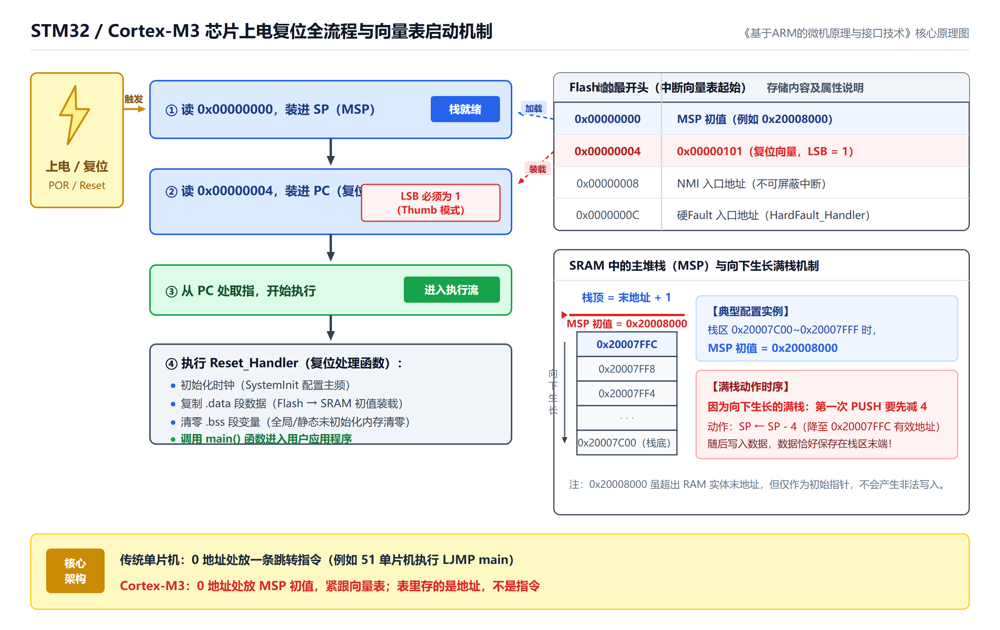

**看图方法**：

1. **最左边**画一个"上电/复位"的闪电符号。
2. **中间从上到下**排四个方框，用向下箭头连接：
   - **方框 1**：`读 0x00000000 → SP（MSP）`，旁边画一个小小的栈示意图，标出"栈顶 = 末地址+1"；
   - **方框 2**：`读 0x00000004 → PC（复位向量）`，旁边标注"**LSB 必须为 1（Thumb）**"；
   - **方框 3**：`从 PC 处取指`，画一个小箭头指向右侧的"Flash 中的程序代码"；
   - **方框 4**：`执行 Reset_Handler`，下面列出它做的几件事（初始化时钟、复制 .data、清零 .bss、调用 main）。
3. **最右边**画一小段"内存开头的内容"，标出 `0x00000000: MSP初值`、`0x00000004: 0x00000101`，并用一条虚线箭头连到方框 2。
4. **图的底部**写一行对比提示："传统单片机：0 地址放一条跳转指令；Cortex-M3：0 地址放 MSP 初值 + 向量表。"

**这张图要我理解**：**复位不是"从 0 开始执行指令"，而是"先装 SP、再装 PC，然后才开始执行"。**

### 本节真正要记住什么

1. 程序映像从 **`0x00000000`** 开始，**开头就是向量表**。
2. **`0x00000000` 处是 MSP 的初始值**（不是入口地址！）；**`0x00000004` 处是复位向量**。
3. 向量地址 = **异常号 × 4**；每个向量 **4 字节**。
4. 向量里存的入口地址 **LSB 必须为 1**（表示 Thumb）；例如启动代码在 `0x00000100`，则写入 `0x00000101`。
5. **MSP 初值 = 栈内存的末地址 + 1**（因为向下生长的满栈，第一次 PUSH 要先减 4）。例：栈在 `0x20007C00～0x20007FFF` → MSP 初值 `0x20008000`。
6. 复位后 CPU：**读 `0x00000000` → SP；读 `0x00000004` → PC；从 PC 处取指执行**。
7. **MSP 必须先初始化**，因为 NMI 或 Fault 可能在第一条指令前就发生，它们需要栈。
8. **与其他单片机的区别**：别人的 0 地址放跳转指令，Cortex-M3 放 MSP 初值 + 向量表（存的是**地址**，不是指令）。

---

## 2.10 本章总结

### 一张图记住本章

```
                    ┌─────────────────────────────────────────────┐
                    │   Cortex-M3 处理器（ARM 设计）               │
                    │                                             │
                    │   ┌─────────────────────────────────────┐   │
                    │   │  内核（CPU）                        │   │
                    │   │  ┌──────┐  ┌──────┐  ┌──────────┐  │   │
                    │   │  │取指  │→│译码  │→│执行+运算器│  │   │
                    │   │  └──────┘  └──────┘  └──────────┘  │   │
                    │   │       ↑ 三级流水线（重叠进行）        │   │
                    │   │  ┌─────────────────────────────┐   │   │
                    │   │  │ 寄存器组                     │   │   │
                    │   │  │ R0~R12 / SP(MSP,PSP) /       │   │   │
                    │   │  │ LR / PC / xPSR / PRIMASK /   │   │   │
                    │   │  │ FAULTMASK / BASEPRI / CONTROL│   │   │
                    │   │  └─────────────────────────────┘   │   │
                    │   └─────────────────────────────────────┘   │
                    │                     │                       │
                    │   ┌─────────────────┴─────────────────┐     │
                    │   │            总线矩阵               │     │
                    │   │  I-Code │ D-Code │ 系统总线 │ PPB │     │
                    │   └─────────────────┬─────────────────┘     │
                    │                     │                       │
                    │   ┌─────────────────┴─────────────────┐     │
                    │   │  NVIC │ SysTick │ MPU │ 调试单元   │     │
                    │   └───────────────────────────────────┘     │
                    └─────────────────────────────────────────────┘
                                     │
        ┌────────────────────────────┼────────────────────────────┐
        ▼                            ▼                            ▼
   代码区 0x00000000             SRAM 0x20000000             外设 0x40000000
   （程序、向量表）              （栈、变量）                 （各种寄存器）
```

### 本章知识结构一览

| 小节 | 核心问题 | 关键结论 |
|---|---|---|
| 2.1 简介与组件 | 处理器由什么组成？ | 内核 + 调试系统（ARM 设计）+ 外设/存储器/时钟/IO（厂商设计），靠总线连接 |
| 2.2 总线结构 | 有几条路？ | 哈佛结构；I-Code / D-Code / 系统总线 / PPB；AHB 快、APB 慢 |
| 2.3 流水线 | 为什么快？ | 三级（取指/译码/执行）重叠；分支要清洗；**读 PC = 当前地址 + 4** |
| 2.4 寄存器 | CPU 手边有什么？ | R0～R12 通用；SP/LR/PC；xPSR、PRIMASK/FAULTMASK/BASEPRI、CONTROL |
| 2.5 模式与等级 | CPU 有几种"身份"？ | 线程/处理 × 特权/用户 = 3 种合法组合；异常是升权的唯一途径 |
| 2.6 堆栈 | 现场存哪里？ | 向下生长的满栈；PUSH 先减 SP 再存；双堆栈 MSP/PSP；4 字节对齐 |
| 2.7 存储器管理 | 4GB 怎么分？ | 七个区；基地址 + 偏移；位带（1 位 → 1 字，原子操作）；小端/大端 |
| 2.8 异常与中断 | 有人敲门怎么办？ | NVIC；向量表；优先级；自动压栈 8 个寄存器；EXC_RETURN；咬尾/迟来 |
| 2.9 复位序列 | 上电先干什么？ | 读 `0x0` → MSP；读 `0x4` → PC；从 PC 取指 |

### 本章与后续章节的联系

```
本章（第 2 章）                          后续章节
────────────────────────────────────────────────────────────────
寄存器（R0～R15、xPSR）        →   第 4 章汇编语言的所有指令都在操作它们
三级流水线 / 读 PC = 地址+4     →   第 4 章理解跳转指令、第 5 章理解反汇编
堆栈 MSP / PUSH / POP         →   第 4 章函数调用、第 7 章中断现场
存储器映射 / 地址计算           →   第 3 章 STM32 存储器映像、第 6 章 GPIO 寄存器
位带操作                       →   第 6 章 GPIO 的 BSRR / 位带控制 LED
NVIC / 优先级 / 向量表         →   第 7 章中断和事件（全面展开）
SysTick                        →   第 8 章定时器、第 7 章系统节拍
特权级 / 用户级 / SVC          →   第 7 章、RTOS 相关内容
EXC_RETURN / 咬尾 / 迟来       →   第 7 章理解中断延迟和嵌套
复位序列 / 向量表              →   第 5 章开发流程、启动文件分析
```

**一句话概括本章的地位**：

> **第 1 章告诉你"计算机有什么"，本章告诉你"CPU 内部怎么转"。
> 从第 3 章开始，我们就用本章学到的"寄存器、地址、栈、中断"这四把钥匙，去打开 STM32 的每一个外设。**

---

## 2.11 容易搞混的地方（汇总）

这一节把本章所有"初学者最容易错"的点集中列出来，**考前扫一遍非常有用**。

### 寄存器类

| 容易搞混的点 | 正确的理解 |
|---|---|
| 以为 R13 就是"一个"寄存器 | R13 是**一个名字、两个实体**（MSP 和 PSP），由 CONTROL[1] 选择 |
| 以为 LR 里存的是"被打断程序的返回地址" | **进入 ISR 后，LR 存的是 EXC_RETURN**；真正的返回地址已经压进堆栈了 |
| 以为读 PC 得到"当前指令地址" | 读 PC 得到 **当前指令地址 + 4**（三级流水线） |
| 以为 PC 的 LSB 是地址的一部分 | LSB 是 **Thumb/ARM 状态标记**；真实地址在 bit31～bit1 |
| 以为写 PC 会像 BL 一样记录返回地址 | **写 PC 不更新 LR**；要能回来必须用 BL 或自己保存返回地址 |
| 以为 R0～R12 复位后是 0 | **复位后初值是随机的**，绝不能不初始化就使用 |
| 混淆 MRS 和 MSR | **MRS = 读（特殊 → 通用）；MSR = 写（通用 → 特殊）** |
| 以为 EPSR 可以直接写 | **不能**，只能通过"LDM/STM 被中断"或"执行 IT 指令"间接触发 |

### 模式与堆栈类

| 容易搞混的点 | 正确的理解 |
|---|---|
| 以为"处理模式可以是用户级" | **处理模式永远是特权级**；"处理模式 + 用户级"是非法组合 |
| 以为用户级可以自己改 CONTROL[0] 回到特权级 | **不能**；唯一途径是**触发异常**（常用 SVC） |
| 以为异常返回后会留在特权级 | **异常返回后回到产生异常之前的工作级** |
| 以为 PUSH 是先存数据再减 SP | **PUSH：先减 SP，再存数据**；**POP：先取数据，再增 SP** |
| 以为 POP 会把内存清掉 | POP **只移动 SP**，内存里的旧值还在（下次 PUSH 会覆盖） |
| PUSH 和 POP 顺序写反 | **必须顺序相反**（后进先出） |
| 以为 MSP 初值 = 栈的末地址 | **MSP 初值 = 栈内存末地址 + 1** |
| 以为简单程序也要用两个栈 | **简单程序只用 MSP 就够了**，PSP 是给 OS 用的 |

### 存储器与地址类

| 容易搞混的点 | 正确的理解 |
|---|---|
| 以为地址空间是平均分的 | 按用途切成七块，每块起点是"整数关口"（0x20000000、0x40000000…） |
| 把 `B` 和 `b` 混为一谈 | **B = 字节（8 位）；b = 位**；1MB = 8Mb |
| 位带别名地址算错 | 公式：`别名基地址 + (A − 区基地址) × 32 + n × 4`；**别背表，套公式** |
| 以为所有地址都能位带 | **只有两个区的低位 1MB**：`0x20000000`、`0x40000000` |
| 位带变量忘了加 volatile | **必须加**，否则编译器优化会导致读写不一致 |
| 以为大端小端随时能改 | **复位时确定，运行时不能改**；内核自己的东西（NVIC、PPB）**永远小端** |
| 以为外设区可以执行指令 | **片上外设区、外部设备区、厂商指定区都不允许执行指令** |

### 中断与异常类

| 容易搞混的点 | 正确的理解 |
|---|---|
| 以为"中断"和"异常"是两回事 | **异常是更宽的概念，中断只是其中一种**；本书不严格区分 |
| 以为优先级数值越大优先级越高 | **数值越小优先级越高**；复位/NMI/硬Fault 是负数（−3/−2/−1） |
| 以为优先级可以是任意负数 | **只有那三个固定异常是负数**；其他异常可编程但**不能为负** |
| 把"抢占优先级"和"副优先级"搞反 | **抢占优先级决定能不能打断**；**副优先级决定同档内的排队顺序** |
| 以为"优先级分组"可以随时改 | 应当**开机时一次性设置好**；中途改会改变所有中断的响应特性 |
| 以为"IRQ 编号"就是"异常编号" | 两者**差 16**：异常编号 = IRQ 编号 + 16 |
| 混淆 AIRCR 和 VTOR 的地址 | **AIRCR = 0xE000ED00；VTOR = 0xE000ED08**（差 8） |
| 算不清 NVIC 挂在哪条总线上 | **NVIC（0xE000E000）挂在 PPB 上**（内部段 = SCS）；**GPIO、定时器、串口等片上外设挂在系统总线上**（0x40000000 起）。PPB 是"内核私有总线"，不是"慢速总线"；慢速外设是在系统总线下游经 AHB-APB 桥转成 APB 的 |
| 把图 2-27 的箭头读反（以为同一抢占等级内能互相抢占） | 图里的**箭头**表示"这几档的**抢占优先级相同**、只有副优先级不同"（所以不能互相抢占，只能排队）；**横线**才是不同抢占等级的分界，数值小的一组可以抢占数值大的一组 |
| 写 AIRCR 忘了 VECTKEY | **必须同时写 0x05FA 到高 16 位**，否则写操作被忽略 |
| 以为向量表里 `0x00000000` 是入口地址 | 那是 **MSP 的初始值**，不是地址 |
| 以为向量表里的地址可以是偶数 | **LSB 必须为 1**（Thumb）；偶数会被当成"想进 ARM 状态"→ Fault |
| 以为自动压栈保存了所有寄存器 | **只自动保存 8 个**（xPSR、PC、LR、R12、R3～R0）；**R4～R11 要自己 PUSH** |
| 以为中断返回要写特殊指令 | 只要把 **EXC_RETURN 写进 PC** 即可（`BX LR` / `POP {PC}` / `LDR PC`） |
| 以为 ISR 里可以随便用 LR | **LR 存的是 EXC_RETURN**，ISR 要用它必须先 PUSH 保存 |
| 以为咬尾和迟来是一回事 | **迟来管"入栈"（进来时）；咬尾管"出栈"（出去时）** |
| 以为中断请求的多个脉冲会执行多次 | **挂起标志只有 1 位，多个脉冲只算一次** |
| 以为外设的中断标志会自动清 | **NVIC 的挂起位是硬件自动清的；外设自己的标志位要你在 ISR 里手动清** |
| 忘记考虑栈溢出 | 每嵌套一层至少 **32 字节**；栈开太小会"静默地"踩坏别的数据 |

---

## 2.12 教材习题解答思路（教材 2.9 习题）

（教材 p71 第 2 章习题，这里给出**答题要点**，你可以对照自查。）

### 2-1 试画出 Cortex-M3 的内核体系结构。

**答题要点**（画出这些模块和它们的关系）：

```
Cortex-M3 内核
├── 指令取指单元（fetch）
├── 译码单元（decode）
├── 寄存器组（R0~R12、SP、LR、PC、xPSR、中断屏蔽寄存器、CONTROL）
├── 运算器（ALU）
├── 指令缓冲区
└── 对外接口：I-Code 总线、D-Code 总线、系统总线、PPB
```

**注意**：题目问的是"**内核**体系结构"，所以**不要画外设、存储器、时钟**（那是"处理器"或"芯片"的结构）。这是本题最常见的失分点。

### 2-2 Cortex-M3 内核有哪几种工作模式？

**答题要点**：

- **两种工作模式**：**处理模式（handler mode）** 和 **线程模式（thread mode）**。
- **两个工作等级**：**特权级（privileged level）** 和 **用户级（user level）**。
- **三种合法组合**：
  1. 线程模式 + 特权级；
  2. 线程模式 + 用户级；
  3. 处理模式 + 特权级。
- **"处理模式 + 用户级"是非法组合**（异常服务例程必须在特权级下执行）。
- **复位后默认进入线程模式 + 特权级。**

### 2-3 异常和中断有什么不同？Cortex-M3 内核中可以管理的异常和中断有哪些？

**答题要点**：

**区别**：在 ARM 领域，**凡是打断程序顺序执行的事件都叫异常**；**中断只是异常的一种**（特指来自外部/外设的请求）。异常还包括复位、NMI、各种 Fault、SVCall、PendSV、SysTick 等。由于处理过程都通过中断服务机制，本书对两者不严格区分。

**清单**：

- **系统异常（编号 1～15）**：复位(1)、NMI(2)、硬 Fault(3)、MemManage Fault(4)、总线 Fault(5)、Usage Fault(6)、保留(7～10)、SVCall(11)、调试监视器(12)、保留(13)、PendSV(14)、SysTick(15)；
- **外部中断（编号 16～255）**：IRQ#0～IRQ#239；
- 注意**没有编号为 0 的异常**（0 表示"没有异常在运行"）。

### 2-4 简述 Cortex-M3 中断的特点。

**答题要点**（从 NVIC 的 5 大功能 + 具体行为两方面答）：

1. **可嵌套**：硬件自动比较优先级，高优先级可抢占低优先级；
2. **向量化**：自动查向量表得到 ISR 入口地址，无需软件判断；
3. **动态优先级**：运行时可改优先级，且同一异常不可重入；
4. **中断延迟短**：
   - **入栈与取向量并行**（哈佛结构）；
   - **硬件自动保存/恢复 8 个寄存器**，无需软件 PUSH/POP；
   - **咬尾（tail-chaining）** 省掉相邻中断间的一次出栈+入栈；
   - **迟来异常（late arrival）** 省掉抢占时的一次入栈；
5. **可屏蔽**：用 PRIMASK / FAULTMASK / BASEPRI 控制屏蔽范围；
6. **EXC_RETURN 机制**：返回靠把 EXC_RETURN 写进 PC，因此 C 语言里 ISR 就是普通函数，不需要特殊关键字。

### 2-5 Cortex-M3 的中断优先级如何设置？

**答题要点**：

1. **优先级数值越小，优先级越高**；
2. **复位(−3)、NMI(−2)、硬 Fault(−1)** 三个优先级固定，且高于所有其他异常；
3. 其他异常的优先级**可编程，但不能为负数**；
4. 优先级寄存器中**实际有效的位数由芯片厂商裁剪**（NVIC 的优先级位可配置为 **3～8 位**，即最少 8 级、最多 256 级；常见 4 位 = 16 级）；
5. 通过 **AIRCR 的 PRIGROUP 位段**把有效优先级位分成**抢占优先级**和**副优先级**两部分，共 8 种分组方式（0～7）；
6. 写 AIRCR 必须同时把 **VECTKEY = 0x05FA** 写入高 16 位；
7. **抢占优先级决定能否抢占；副优先级决定同抢占档内的响应顺序**；
8. **优先级分组应在开机初始化时一次性设置好。**

### 2-6 简述 Cortex-M3 位带操作的基本原理和作用。

**答题要点**：

**原理**：

- 有两个位带区：`0x20000000～0x200FFFFF`（SRAM 最低 1MB）和 `0x40000000～0x400FFFFF`（外设最低 1MB）；
- 每个位带区对应一个 32MB 的**位带别名区**（SRAM → `0x22000000`，外设 → `0x42000000`）；
- **位带区中的每一位，膨胀成别名区中的一个 32 位字**（只有最低位有效）；
- 换算公式：
  ```
  SRAM ：AliasAddr = 0x22000000 + (A − 0x20000000) × 32 + n × 4
  外设 ：AliasAddr = 0x42000000 + (A − 0x40000000) × 32 + n × 4
  ```
- 对别名的**读**：读出对应字后把目标位右移到最低位返回；对别名的**写**：把值左移到对应位序号，然后执行**不会被中断的"读-改-写"**。

**作用**：

1. 用普通的 load/store 指令就能操作**单个位**，不必写"屏蔽外部事件 → 读 → 改 → 写回 → 开放外部事件"；
2. **原子操作**：消除了"读-修改-写"被中断打断的风险，可用于多任务共享资源的互锁访问；
3. 简化"按某个位跳转"的判断（原来 3 步，现在 2 步）；
4. 对**硬件 I/O 密集型的底层程序**（如用 GPIO 单独控制每盏 LED）极为有用；
5. **只适用于数据访问，不适用于取指**；访问位带变量**必须用 volatile**。

### 2-7 Cortex-M3 的堆栈有哪些特点？

**答题要点**：

1. **向下生长的满栈**：PUSH 时 SP 先减 4 再存；POP 时先取再 SP 加 4；SP 指向最后一个压入的 32 位数值；
2. **按字操作**：每次入栈/出栈都是 32 位，SP 变化量恒为 ±4；
3. **两个堆栈**：主堆栈 **MSP**（默认、异常服务例程、特权代码使用）和进程堆栈 **PSP**（用户线程代码使用），都叫 R13，由 **CONTROL[1]** 选择；
4. **切换自动**：进出异常时硬件自动切换 MSP/PSP，无需软件干预；
5. **R13 最低两位恒为 0**，因此栈操作**永远 4 字节对齐**；
6. **中断时自动入栈 8 个寄存器**（xPSR、PC、LR、R12、R3～R0），占 32 字节；R4～R11 需要软件自己保存；
7. 双堆栈的目的是**保护系统堆栈不被应用程序的错误使用毁坏**；简单程序只用 MSP 即可。

---

## 2.13 待核验

以下条目是**在核对原始 PDF 时发现的可疑之处**。凡标注"已核对 PDF"的，表示本讲义已经用 PyMuPDF 渲染原书对应页并人工确认过，**是教材原文如此**（多为教材排印错误）；讲义正文中已按正确值书写，并把疑点记录在此。

### 一、教材原文疑似笔误（已核对 PDF 确认教材原文如此）

| 编号 | 页码 | 位置 | 教材原文 | 疑点 / 本讲义采用值 |
|---|---|---|---|---|
| 1 | **p56** | 表 2-9 异常编号 5 | 类型写作"**总线 Flash**"；简介中"收到错误**相应**" | 应为"**总线 Fault**"、"错误**响应**"。已核对原 PDF（第 1 分卷第 56 页，书页 51）。本讲义已修正 |
| 2 | **p60** | 表 2-13 上电后的向量表 | `0x00000004` 行的"值"列同时写了"复位向量（PC 初始值）"和"NMI 服务例程的入口地址"；`0x00000008` 行写"硬 Fault 服务例程的入口地址" | 排版错位：**NMI 那一行丢失、硬 Fault 重复**。正确应为：`0x04`→复位、`0x08`→NMI、`0x0C`→硬 Fault。已核对原 PDF（书页 55）。本讲义已修正 |
| 3 | **p64** | 表 2-15 入栈顺序及入栈后堆栈中内容 | 首行写"旧 SP（**N−0**）"，末行写"新 SP（**N−0**）" | 按"向下生长的满栈"规则，压入 8 个寄存器（32 字节）后应为 **旧 SP = N，新 SP = N − 32**；"新 SP = N"在逻辑上不可能。已核对原 PDF（书页 59）。本讲义已修正 |
| 4 | **p67** | 表 2-17 EXC_RETURN 位段详解，bit 2 | "1：从进程堆栈中做出栈操作，返回后使用 **MSP**" | 应为"返回后使用 **PSP**"（与表 2-18 的 `0xFFFFFFFD` = "返回线程模式，并使用线程堆栈"矛盾）。已核对原 PDF（书页 62）。本讲义已修正 |
| 5 | **p39** | 表 2-1 特殊功能寄存器的功能 | PRIMASK 写"**使能**所有的中断，但非屏蔽中断除外"；FAULTMASK 写"**使能**所有的 Fault 异常…"；BASEPRI 写"**使能**所有的优先级不高于某个具体数值的中断" | 三处均应为"**屏蔽/关闭**"而非"使能"。表 2-2 的描述才是正确的。已核对原 PDF（书页 34）。本讲义以表 2-2 为准 |
| 6 | **p40** | 中断屏蔽寄存器的访问示例 | `MSR R0, BASEPRI`，注释"读取 BASEPRI 寄存器内容到 R0 中" | 读取应用 **`MRS R0, BASEPRI`**；`MSR` 是写入。已核对原 PDF（书页 35）。本讲义已修正 |
| 7 | **p45** | 特权级下访问堆栈指针的示例 | 第 4 行写作 `MSP PSP, RO` | 应为 **`MSR PSP, R0`**。已核对原 PDF（书页 40）。本讲义已修正 |
| 8 | **p52** | 位带宏定义 | `#define MEM_ADDR(addr) * ((volatile unsigned long *) (adr))` | 宏参数写作 `adr`，与形参 `addr` 不一致，应为 **`addr`**。已核对原 PDF（书页 47）。本讲义已修正 |
| 9 | **p70** | 复位序列描述 | "从地址 0x00000000 处取出 MSP 的初始值（**两个字，即 8 字节**）" | MSP 初始值本身只占 **1 个字 = 4 字节**；"两个字 8 字节"指的是 **MSP 初值 + 复位向量**这两项合计。已核对原 PDF（书页 65）。本讲义按"两项合计 8 字节"表述 |
| 10 | **p51** | 2.6.2 位带操作中的 `BITBAND` 宏 | `((addr & 0xF0000000) + 0x2000000 + ((addr & 0xFFFF) << 5) + (bitnum << 2))` | 掩码 `addr & 0xFFFF` 只保留**低 16 位**，而位带区 1MB 的"区内偏移"需要 **20 位**（最大 `0xFFFFF`）：凡偏移 ≥ `0x10000` 的地址都会算错。如 GPIOA `0x40010800` 的 bit0：教材宏得 `0x42010000`，正确应为 `0x42100000`；教材表 2-4 最后一行的 `0x200FFFFF`：教材宏得 `0x221FFFFC`，正确应为 `0x23FFFFFC`。应为 **`addr & 0xFFFFF`**。已核对原 PDF（书页 46）确认教材原文如此。本讲义照录教材，并在 2.7.1 节给出修正写法与验算 |

### 二、教材表述与常见资料不一致，待进一步核对

| 编号 | 页码 | 位置 | 教材写法 | 疑点 |
|---|---|---|---|---|
| 11 | **p34** | 2.1.3 总线结构（2）D-Code 总线 | "默认映射到 **0x10000000～0x1FFFFFFF** 地址段" | 多数资料与 ARM 官方描述为 D-Code 总线覆盖**整个代码区** `0x00000000～0x1FFFFFFF`。已核对原 PDF（书页 29）确认教材原文如此。**本讲义照录教材并标注疑点**，未擅自替换 |
| 12 | **p35** | 2.1.3 总线结构（4）外设总线 | "默认映射到 **0xE0040000～0xE00FFFFFF** 地址段" | 地址只有 8 位十六进制位，`0xE00FFFFFF` 是 9 位，多了一个 F；按同页"共 768KB"计算应为 **`0xE0040000～0xE00FFFFF`** |
| 13 | **p35** | 2.1.3 总线结构（4）外设总线 | 只给出 `0xE0040000～0xE00FFFFF` | 这**只是 PPB 的外部段**；PPB 的完整范围是 `0xE0000000～0xE00FFFFF`（内部段 `0xE0000000～0xE003FFFF` 放 NVIC、SysTick、MPU，即 SCS）。教材 2.6.1 的存储器映射表里写了内部段，两处需合起来看，否则会误以为"NVIC 不在 PPB 上"。本讲义 2.2 节按完整范围写，并标注差异 |
| 14 | **p35** | 2.1.3 总线结构（3）系统总线 | "0x20000000～0xDFFFFFFF 和 **0xE0100000～0xFFFFFFF**" | 第二段只有 7 个 F，应为 **`0xFFFFFFFF`** |
| 15 | **p39** | 图 2-8 程序状态寄存器（xPSR）各位的定义 | IPSR 的"异常号"位段在表头中横跨 bit9～bit0 若干列 | 按教材正文"中断号 PSR（IPSR）：占据第 0～8 位"应为 **bit8:0**。表格列标题（9、8、7、6、5、4:0）与正文略有出入，属表格排版问题，本讲义按正文 bit8:0 处理 |

### 三、索引文件转录误差（非教材问题，已用 PDF 核对并采用正确值）

`tools/index/ch02_source.md` 是从 MinerU 的 `content_list.json` 自动重建的，个别数值在转录/OCR 时出错。以下三处**已渲染原 PDF 页面确认教材原文正确**，本讲义采用正确值：

| 编号 | 位置（索引文件） | 索引文件中的值 | 教材原文（正确值） | 核对页 |
|---|---|---|---|---|
| 16 | 2.6.2 位带区操作实例第 (4) 步 | `0x3355AACC8`（9 个十六进制位） | **`0x3355AAC8`**（8 位） | PDF p49（书页 44） |
| 17 | 表 2-4 SRAM 区的位带地址映射 最后一行 | `0x23FFFFFFC.0` | **`0x23FFFFFC.0`** | PDF p49（书页 44） |
| 18 | 表 2-5 片上外设区中的位带地址映射 最后一行 | `0x43FFFFFFC.0` | **`0x43FFFFFC.0`** | PDF p49（书页 44） |

### 四、其他需要说明的解析损失

- **图 2-5（Cortex-M3 的三级流水线示意图）** 在 MinerU 输出中是一张表格 + 一张图片的混合体（图片文件 `33d323ead93da0d92d5635991b44380b94668e8e34cfe7fa60abb28231a49ba2.jpg`）。本讲义正文用 **ASCII 表格重排**了它的内容（与教材一致），并保留了图片引用，以保证 bit 号与周期号准确。
- **表 2-2 / 表 2-11 / 表 2-12 / 表 2-17 / 表 2-18** 等表格在 MinerU 输出中均为"图片 + HTML 表格"混合形式。本讲义已用 ASCII 位图或 markdown 表格重排，并逐项与 PDF 原文核对。
- **图 2-10、图 2-24、图 2-26** 在 MinerU 输出中被解析为"表格"，实际是带文字的示意图/位图。本讲义按位图重排。

---

## 本章自检清单（对照 TASK.md 第二十二节）

**内容完整性**

- [x] Cortex-M3 简介与组件（2.1）——含内核 10 条特性、NVIC/SysTick/总线矩阵/MPU/调试部件/ROM 表；教材 2.1.2 的细节（NVIC 的 7 条特性、SysTick 睡眠模式可用、总线矩阵写缓冲区、内核集成分支预测）已补入
- [x] 总线结构（2.2）——哈佛结构、I-Code/D-Code/系统总线/PPB、AMBA/AHB/APB
- [x] 流水线（2.3）——三级流水线、时间轴、冒险、分支惩罚与清洗、PC+4、指令缓冲区
- [x] 寄存器（2.4）——R0～R12、SP(MSP/PSP)、LR、PC、xPSR、PRIMASK/FAULTMASK/BASEPRI、CONTROL
- [x] 工作模式与特权等级（2.5）——Thread/Handler、特权/用户、3 种组合、切换途径
- [x] 堆栈（2.6）——基本操作、PUSH/POP、满/空、递增/递减、双堆栈机制
- [x] 存储器管理（2.7）——4GB 分配、地址链演算、位带、端模式
- [x] 异常与中断（2.8）——中断概念、中断号与优先级、向量表、挂起、Fault、中断具体行为、嵌套控制、咬尾/迟来、EXC_RETURN
- [x] 复位序列（2.9）
- [x] 习题（2.12，对应教材 2-1～2-7）
- [x] 没有自行加入教材不支持的结论（所有【补充解释】均已明确标注）

**可理解性**

- [x] 每个大节都有"先别急着看教材：这一节到底要干什么？"
- [x] 前置知识以【先补一个前置知识】显式标出（寄存器、地址、时钟周期、位带、原子操作、volatile、SCS、溢出、多主、MSP/PSP、栈、上访、写 1 清除、RTOS 等）
- [x] 首次出现的术语给出英文全称 + 中文 + 缩写 + 大白话 + 用途
- [x] 类比之后都回到真实技术概念，并说明类比的边界
- [x] 位运算不跳步（位带 bit2 清零、AIRCR 的 `0x05FA0500` 构造、别名地址四则演算）
- [x] 地址与存储器映射可视化，建立"地址 → 地址空间 → 区 → 偏移 → 最终地址"链条并数值演算
- [x] 寄存器按"属于谁 / 控制什么 / 为什么需要 / 位含义 / 写 0 写 1 / 怎么操作 / 硬件变化"讲解并配 ASCII 位图

**图像**

- [x] 引用教材原图 **39 张**（图 2-1、2-2、2-3、2-4、2-5、2-6、2-7、2-11、2-12、2-13、2-14、2-15、2-16、2-17、2-18、2-19、2-20、2-21、2-22、2-23、2-24、2-25、2-26、2-27、2-28、2-29、2-30、2-31、2-32、2-33、2-34、2-35、2-36、2-37、2-38、2-39、2-40、2-41、2-42），每张都有"怎么读 / 要我理解什么"；其中图 2-5、2-17、2-24、2-25、2-26 在 MinerU 输出中被解析为表格，本讲义以"原图 + ASCII 重排"双轨呈现
- [x] 提交 **16 张**辅助理解图作业（见 `notes/images/jobs/ch02.json`），覆盖：总体结构分层拆解、组件、总线结构、流水线时间轴、分支清洗、寄存器组、xPSR 位图、模式与等级、PUSH/POP、双堆栈、存储器分配、位带换算、向量表、中断响应与返回、咬尾与迟来、复位序列；其中 `ch02_pipeline_flush.png` 的"分支惩罚"标注已按教材图 2-6 更正（被丢弃的工作在第 2～3 周期，第 4 周期已在取 AND）
- [x] 位图、地址换算、栈变化等要求数值精确的内容，**优先用 ASCII 图 + 表格**保证 bit 号准确，生成图只作"直观理解版"（例：图 2-27 的分组树用 ASCII 重排 + 逐条读图说明，避免再次把箭头方向读反）

**代码**

- [x] `BL` / `BX LR`（2.4.1）——逐行解释代码 → CPU → 寄存器 → 硬件
- [x] PUSH/POP 子程序现场保护（2.6.1）——逐行表格
- [x] 位带 C 宏（`DEVICE_REG0`、`BITBAND`、`MEM_ADDR`）——逐块拆解 + 具体数字验证
- [x] AIRCR 写入 `0x05FA0500` 的构造——逐位演算
- [x] 向量表汇编片段——逐行解释（并明确标注为补充示意，非教材原文）

**待核验**

- [x] 文末"## 待核验"列出 **18 项**，分三类（教材疑似笔误 10 项、与常见资料不一致 5 项、索引文件转录误差 3 项），每项写明页码与疑点，并说明本讲义采用值

