# 第 3 章 STM32F1 系列微控制器

> **本章在整张地图上的位置**
>
> 第 2 章我们学的是 **Cortex-M3 内核**——那是"CPU 本身"。
> 但一块能用的芯片，绝不只是 CPU。
>
> 打个比方：
> Cortex-M3 内核就像一台**发动机**；
> 而 STM32 芯片是一辆**整车**——发动机、油箱、仪表盘、变速箱、轮子，全都装好了。
>
> 本章要回答的就是：
>
> > **发动机外面那圈东西，到底是什么？它们是怎么连起来的？**
> > **芯片里那么多硬件，地址是怎么分的？**
> > **时钟从哪儿来，怎么就变成了 72MHz？**
> > **100 根引脚都是干什么用的？**
> > **我要焊一块板子，最少得接哪些东西，它才能跑起来？**
>
> 学完这一章，你在后面写 GPIO、定时器、串口代码时，
> 就不会再有"我操作的这个寄存器到底住在芯片的哪个角落"这种迷茫。

---

## 3.0 先别急着看教材：这一章到底要干什么？

先复习一句话：

> **Cortex-M3 是 ARM 公司设计的 CPU 内核（core），它只是一份"图纸"。**
> **STM32F103 是 ST（意法半导体）公司买下这份图纸后，做出来的一块实际芯片。**

ARM 公司自己不卖芯片，它只卖"设计授权"。ST 拿到 Cortex-M3 的设计后，在它周围加了一堆东西：

- 加了几百 KB 的 **Flash**（存程序）和 **SRAM**（存变量）；
- 加了 **时钟电路**（让芯片有节奏地工作）；
- 加了几十个 **外设**（GPIO、定时器、串口、ADC……）；
- 加了 **总线**（把上面这些连起来）；
- 加了 **引脚**（让外面能接进来）；
- 加了 **复位、电源、启动控制** 电路。

**内核 + 这些东西 = 微控制器（MCU）。**

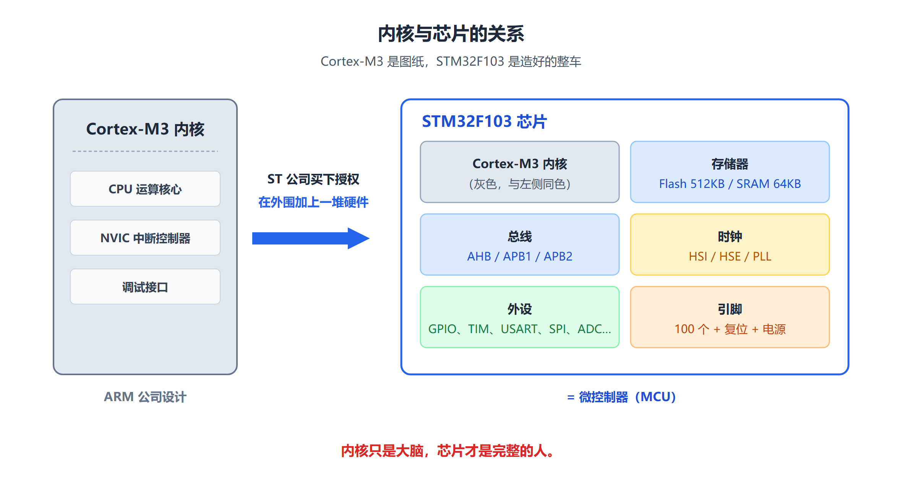

**这张图要看什么？**

- 图左边是一个小方框，写着 **Cortex-M3 内核**，旁边画一个齿轮/发动机的图标；
- 图右边是一个大方框，写着 **STM32F103 芯片**，内部包含"内核 + 存储器 + 外设 + 总线 + 时钟 + 引脚"；
- 中间用一个粗箭头表示"ST 公司把内核装进芯片"。

**这张图要让我理解**：
> **内核只是 CPU 的"大脑"，芯片才是完整的"人"。**
> 第 2 章学的是大脑怎么思考，本章学的是身体的其他部分怎么配合。

### 3.0.1 本章要回答的 6 个问题

| 编号 | 问题 | 对应小节 |
|---|---|---|
| ① | STM32F1 有哪些型号？`STM32F103VET6` 这串字母数字每一位什么意思？ | 3.1 |
| ② | 内核外面都有什么？它们用什么总线连起来？ | 3.2 |
| ③ | 芯片里的 Flash、SRAM、外设，地址是怎么排的？为什么外设从 `0x40000000` 开始？ | 3.3 |
| ④ | 时钟从哪来？8MHz 晶振怎么变成 72MHz？各条总线最高能跑多快？ | 3.4 |
| ⑤ | 100 根引脚都分几类？什么叫"复用功能"？ | 3.5 |
| ⑥ | 让芯片能跑起来，最少要接哪些外围器件？为什么？ | 3.6 |

**一句话概括本章**：

> 本章讲的是"**内核外面那一圈**"——
> ST 是怎么把一颗 CPU 内核，包装成一块能接电源、能跑程序、能驱动 LED 和串口的完整芯片的。

---

## 3.1 STM32F1 系列微控制器简介

### 3.1.1 先看一段历史（只看结论）

【教材内容】

2007 年 6 月，意法半导体（ST）公司宣布了第一款基于 Cortex-M3、内嵌 32～128KB 闪存的 STM32 微控制器。

STM32F1 系列包含 **5 个产品线**，它们的**引脚、外设和软件互相兼容**。

> 【补充解释】"引脚、外设和软件兼容"这句话很重要，翻译成大白话就是：
> 你在 F103 上学的东西，换到 F107 上大体还能用；
> 同一份程序，稍微改改就能在同一个系列的不同型号上跑。
> 这就是为什么教材只讲一个系列，你就能举一反三。

### 3.1.2 五个产品线

【教材内容】各产品线的基本特点：

| 产品线 | 定位 | CPU 最高频率 | 特色 |
|---|---|---|---|
| STM32F100 | 超值型 | 24MHz | 具有电机控制和 CEC 功能 |
| STM32F101 | 基本型 | 36MHz | 具有高达 1MB 的 Flash |
| STM32F102 | 连接型 | 48MHz | 具备 USB FS device 接口 |
| **STM32F103** | **增强型** | **72MHz** | **高达 1MB Flash、电机控制、USB、CAN** |
| STM32F105/107 | 互联型 | 72MHz | 以太网 MAC、CAN、USB 2.0 OTG |

> 本书后面主要讲的就是**增强型 STM32F103**，它是这一系列里用得最广的一款。

### 3.1.3 型号命名规则：把 `STM32F103VET6` 拆开看

#### 【先补一个前置知识：芯片型号为什么写得像密码？】

芯片型号看起来像乱码，其实是**厂商把芯片的各项参数编成了固定位置的字母**。
只要你会"对表拆解"，看一眼型号就知道这颗芯片：

- 属于哪个系列；
- 有多少个引脚；
- 有多大 Flash；
- 用什么封装；
- 能工作在什么温度。

这就像看身份证号：前几位是地区，中间是生日，最后是校验位——**每一位都有固定含义**。

#### 看教材原图

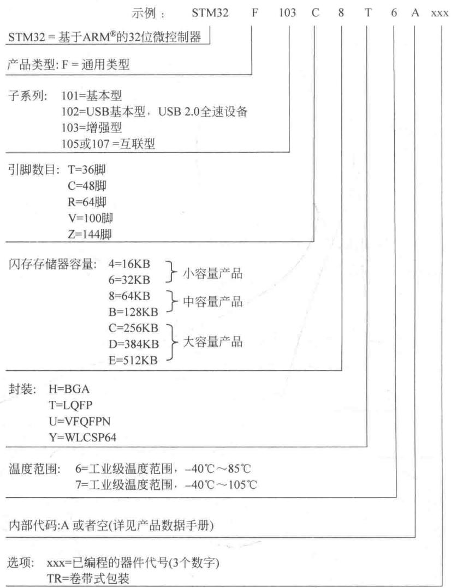

**怎么读这张图？**

这张图的排版是"上面一行示例，下面用竖线连到说明"。

1. **先看最上面一行**：`STM32` `F` `103` `C` `8` `T` `6` `A` `xxx`。
   这就是一个完整型号被切成了 9 段。
2. **再顺着每一段的竖线往下看**，每一段下面都写清了它代表什么。
3. 图的左侧是"段"，右侧是"这段的取值表"。

**逐段拆解这张图**（教材原文）：

| 位置 | 取值 | 含义 |
|---|---|---|
| 第 1 段 | `STM32` | 基于 ARM® 的 32 位微控制器 |
| 第 2 段 | `F` | 产品类型：F = 通用类型 |
| 第 3 段 | `101` / `102` / `103` / `105` / `107` | 子系列：101 = 基本型；102 = USB 基本型（USB 2.0 全速设备）；103 = 增强型；105 或 107 = 互联型 |
| 第 4 段 | `T` / `C` / `R` / `V` / `Z` | 引脚数目：T=36 脚；C=48 脚；R=64 脚；**V=100 脚**；**Z=144 脚** |
| 第 5 段 | `4`/`6`/`8`/`B`/`C`/`D`/`E` | 闪存容量：4=16KB；6=32KB；8=64KB（以上为**小容量产品**）；B=128KB（**中容量产品**）；C=256KB；D=384KB；E=512KB（以上为**大容量产品**） |
| 第 6 段 | `H`/`T`/`U`/`Y` | 封装：H=BGA；T=LQFP；U=VFQFPN；Y=WLCSP64 |
| 第 7 段 | `6`/`7` | 温度范围：6 = 工业级 −40℃～85℃；7 = 工业级 −40℃～105℃ |
| 第 8 段 | `A` 或空 | 内部代码（详见产品数据手册） |
| 第 9 段 | `xxx` / `TR` | 选项：xxx = 已编程的器件代号（3 个数字）；TR = 卷带式包装 |

#### 现在来拆本课程的主角

**`STM32F103VET6`**：

```
STM32  F  103  V    E    T   6
  │    │   │   │    │    │   │
  │    │   │   │    │    │   └─ 6  = 工业级温度范围 −40℃～85℃
  │    │   │   │    │    └───── T  = LQFP 封装
  │    │   │   │    └────────── E  = 512KB Flash（大容量产品）
  │    │   │   └─────────────── V  = 100 个引脚
  │    │   └─────────────────── 103 = 增强型子系列
  │    └─────────────────────── F  = 通用类型
  └──────────────────────────── STM32 = 基于 ARM 的 32 位微控制器
```

**`STM32F103ZET6`**：

```
STM32  F  103  Z    E    T   6
                │    │    │   │
                │    │    │   └─ 6  = 工业级 −40℃～85℃
                │    │    └───── T  = LQFP 封装
                │    └────────── E  = 512KB Flash
                └─────────────── Z  = 144 个引脚
```

> **看出来了没有？**
> 这两个型号只差一位：`V`（100 脚）和 `Z`（144 脚）。
> 也就是说：**它们的 Flash 一样大（512KB）、系列一样（F103）、封装一样（LQFP）、温度等级一样**，
> 唯一区别就是**引脚数量不同**。

【教材内容】教材原话：

> STM32F103VET6 比 STM32F103ZET6 少了两个口：**PF 口和 PG 口**，其他资源一样。

【补充解释】为什么教材从 3.5 节开始改用 `STM32F103VET6` 讲？

因为它是 100 脚的 LQFP 封装，**引脚少、板子好画、芯片好焊**，
而且做实验用的最小系统板基本都用它。
后面教材（以及本讲义）统一以 `STM32F103VET6` 为例。

#### 【辅助理解图】命名规则拆解

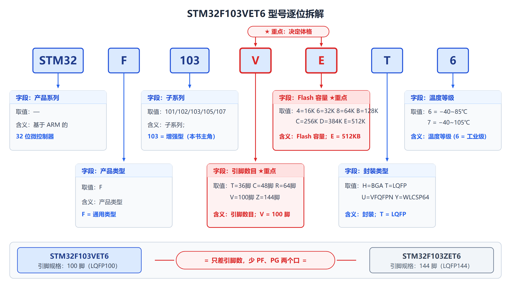

**这张图要看什么？**

- 图的中轴是型号字符串 `STM32 F 103 V E T 6`，每一位被单独框出来；
- 每一位下面引出一条线，连到一个说明框，写着"这位代表什么 + 有哪些取值"；
- 当前重点看 **`V`** 和 **`E`** 两位：`V` 决定"有多少根引脚"，`E` 决定"Flash 有多大"。

**这张图要让我理解**：型号不是随机字母，而是**参数表**。会拆型号，就能一眼判断一颗芯片的"体格"。

### 3.1.4 教材内容 vs 图 3-1 的两处不一致（先记着，别背错）

> ⚠️ 下面两处教材本身对不上，请以**原始 PDF** 为准，本讲义按"图 3-1 为准、正文存疑"处理，并列入文末《待核验》。

1. **温度等级**：教材 p75 说 STM32F103ZET6 的工作温度是 **−40℃～+105℃**；
   但 p73 图 3-1 的命名规则写的是 **6 = 工业级 −40℃～85℃**，**7 才是 −40℃～105℃**。
   按型号后缀是 `6`，应该是 −40℃～85℃。
2. **产品线列表**：p72 正文里列了"超值型 STM32F100"，但图 3-1 的"子系列"框里只列了 101/102/103/105/107，**没有 100**。
   另外正文把 F102 叫"连接型"，图 3-1 叫"USB 基本型"——**同一条产品线两个叫法**。

### 3.1.5 本节真正要记住什么

- STM32 = **ST 公司 + 基于 ARM Cortex-M3 的 32 位 MCU**。
- F1 系列 5 条产品线：100 超值 / 101 基本 / 102 连接 / **103 增强（本书主角）** / 105·107 互联。
- 型号每一位：`STM32` — `F` — `103` — `V(100脚)/Z(144脚)` — `E(512KB Flash)` — `T(LQFP)` — `6(−40～85℃)`。
- VET6 和 ZET6 的区别只是**少了 PF、PG 两个 GPIO 口**。

---

## 3.2 STM32F1 产品系统架构与 STM32F103ZET6 内部结构

### 3.2.1 先别急着看教材：这一节要解决什么？

这一节要回答一个问题：

> **芯片里有 CPU、Flash、SRAM、十几个外设，它们之间靠什么互相传数据？**

答案只有两个字：**总线**。

但"总线"这个词，前面第 1 章、第 2 章已经出现过好几次了。这里要更具体一点：
STM32 里的总线不是一个等级，而是**分了好几个等级、速度不一样**，
中间还要靠一个叫**总线矩阵**的"交通枢纽"来协调。

### 3.2.2 你需要先知道的东西

#### 【先补一个前置知识：什么叫外设？】

**外设**（Peripheral）= **"CPU 旁边干活的那些专业小模块"**。

CPU 本身只会做三件事：读数据、算数据、写数据。
但现实世界需要的是：点亮 LED、收发串口数据、测量电压、输出 PWM 波形……
这些 CPU 干不了（或者说干起来太慢），所以芯片里专门做了一批**专用硬件模块**：

| 外设 | 大白话 | 英文全称 |
|---|---|---|
| GPIO | 控制引脚读/写高低电平的模块 | General-Purpose Input/Output（通用输入输出） |
| USART | 串口收发数据的模块 | Universal Synchronous/Asynchronous Receiver/Transmitter（通用同步/异步收发器） |
| TIM | 会数数的计时模块 | Timer（定时器） |
| ADC | 把模拟电压变成数字的模块 | Analog-to-Digital Converter（模数转换器） |
| DAC | 把数字变成模拟电压的模块 | Digital-to-Analog Converter（数模转换器） |
| SPI | 一种高速串行通信模块 | Serial Peripheral Interface（串行外设接口） |
| I2C | 一种两线串行通信模块 | Inter-Integrated Circuit（集成电路间总线） |

**关键点**：外设是"硬件电路"，不是"软件函数"。
你在程序里写一行 `GPIOA->ODR = 0x20;`，本质上是在**给 GPIOA 这个硬件模块里的某个寄存器写值**。

#### 【先补一个前置知识：什么叫总线？】

**总线**（Bus）= **芯片内部一条"公共数据公路"**。

- 如果每两个模块之间都单独拉一套线，芯片内部会变成一团蜘蛛网；
- 所以大家**共用一套线**，谁要用谁申请，用完让开——这就是总线。

总线在物理上其实是**一组并排的信号线**，可以分成三类（第 1 章讲过）：

| 总线类型 | 传输什么 | 类比 |
|---|---|---|
| 地址总线 | "我要访问哪个地址" | 门牌号 |
| 数据总线 | 真正搬运的数据 | 货物 |
| 控制总线 | 读/写、时钟、使能等控制信号 | 红绿灯 + 指挥手势 |

STM32 内部的这些总线，具体叫 **AMBA 总线**。

#### 【先补一个前置知识：什么叫 AMBA、AHB、APB？】

**AMBA**（Advanced Microcontroller Bus Architecture，先进微控制器总线架构）
= **ARM 公司定义的一套"片上总线标准"**。

> 大白话：ARM 不只卖 CPU 图纸，还规定了"你买我的 CPU，得用我规定的这套总线把外设连起来"。
> 这样各家芯片厂商做出来的东西才能互相兼容，AMBA 也因此成了业界流行的片上总线标准。

AMBA 里有两个最常用的成员：

| 名字 | 全称 | 中文 | 角色 | 速度 |
|---|---|---|---|---|
| **AHB** | Advanced High-performance Bus | 先进高性能总线 | **系统总线**，接高速部件（Flash、SRAM、DMA、内核） | 全速（STM32F103 最高 72MHz） |
| **APB** | Advanced Peripheral Bus | 先进外设总线 | **外设总线**，接低速外设（串口、I2C、定时器……） | 较低速（APB1 最高 36MHz） |

**为什么要分成 AHB 和 APB 两种？**

> 【类比】
> 城市道路分"主干道"和"小街巷"。
> 主干道（AHB）车速快、修得贵，给大流量用；
> 小街巷（APB）车速慢、修得便宜，给家门口通行用。
> 串口、I2C 这些外设本来就慢，没必要占用昂贵的高速总线。

**真实硬件并不是完全如此**：AHB 和 APB 并不是物理上两条独立的路，
而是同一套总线体系里**不同层级、由桥（bridge）连接的两个协议段**。
"桥"的作用就是：把 AHB 上的高速读写请求，转换成 APB 能懂的慢速时序。

#### 【先补一个前置知识：什么叫总线矩阵、什么叫仲裁？】

- **总线矩阵**（Bus Matrix）：一个**交叉开关**。它让多个"主设备"（想发起访问的）可以同时连到多个"从设备"（被访问的），而不是排队走同一条路。
- **仲裁**（Arbitration）：如果两个主设备**同时**要访问**同一个**从设备，就得有人决定"谁先来"。这个决定规则就叫仲裁。STM32F1 用的是**轮换算法**（轮流优先，谁都不饿死）。

### 3.2.3 看教材原图：STM32F1 系列产品系统架构

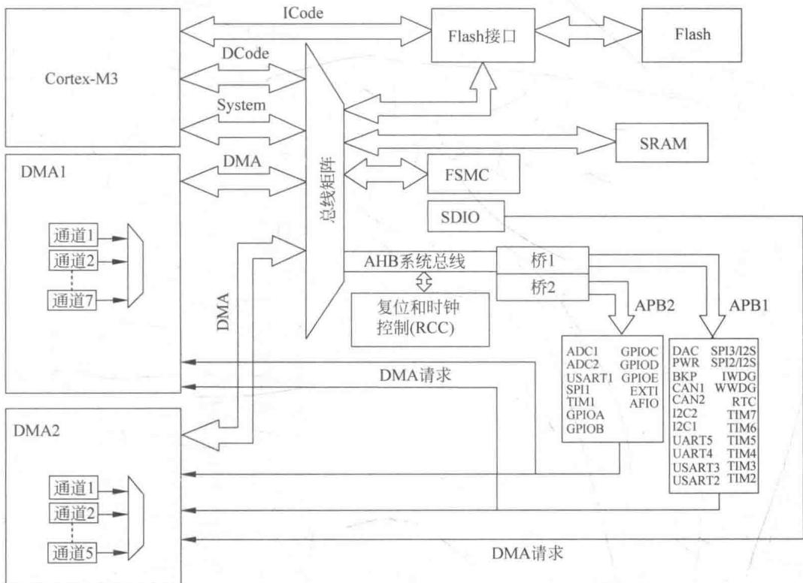

#### 第一层：只看 3 个核心区域

**先别管图里所有的缩写，第一遍只看这三块：**

```
┌──────────────────────────────────────────────────────────┐
│                                                          │
│   ① 左上方：Cortex-M3         ② 中间：总线矩阵           │
│      （干活的 CPU）              （交通枢纽）             │
│                                                          │
│   ③ 右下方：一堆小方块          ← 外设（挂在 APB1/APB2）  │
│                                                          │
└──────────────────────────────────────────────────────────┘
```

**这张图到底想让我理解什么？**

> **CPU 不直接连外设。**
> CPU 和外设之间，隔着一个"总线矩阵 + 桥"的中间层。
> 所有访问都要先过这个中间层。

#### 第二层：加上"四条主总线"

现在再看图里从 Cortex-M3 框向右伸出的**四组双向箭头**：

| 图上标注 | 名称 | 它把内核连到哪里 | 传什么 |
|---|---|---|---|
| `ICode` | 指令总线（Instruction bus） | 内核 → **Flash 指令接口** | **取指令**；指令预取在这条总线上完成 |
| `DCode` | 数据总线（Data bus） | 内核 → **Flash 数据接口** | **常量加载**（读 const 数据）和调试访问 |
| `System` | 系统总线 | 内核 → 总线矩阵 → 各外设 | 访问外设寄存器、SRAM |
| `DMA` | DMA 总线 | DMA → 总线矩阵 | DMA 替 CPU 搬数据 |

> 【补充解释】为什么取指令和数据访问要分成 ICode、DCode 两条？
> 因为 Cortex-M3 是**哈佛结构**（第 2 章讲过）：取指令和取数据可以同时进行。
> 分成两条总线后，CPU 一边取指令、一边读常量，互不干扰。

**图里还有两个 DMA 框**（DMA1、DMA2）：

- **DMA**（Direct Memory Access，直接存储器访问）
  = **一个"专门替 CPU 搬数据"的搬运工**。
  没有 DMA 时，串口每收到一个字节都要打断 CPU 让它来搬；
  有了 DMA，CPU 只要说一句"数据来了你搬到内存去"，就可以继续干别的。
- 图里 DMA1 有**通道 1～7**，DMA2 有**通道 1～5**。
  每个通道对应一路搬运任务，图右下角的 `DMA 请求` 线就是各外设向 DMA 发出的"帮我搬一下"信号。

#### 第三层：总线矩阵到底连了谁？

【教材内容】教材原话：

> 总线矩阵协调内核系统总线和 DMA 主控总线之间的访问仲裁，仲裁采用**轮换算法**。
> 总线矩阵包含 **4 个主动部件**（CPU 的 DCode、系统总线、DMA1 总线、DMA2 总线）
> 和 **4 个被动部件**（闪存存储器接口、SRAM、FSMC、AHB2APB 桥）。

**把这句话画成表：**

| | 主动部件（发起访问的"甲方"） | 被动部件（被访问的"乙方"） |
|---|---|---|
| 1 | CPU 的 DCode 总线 | 闪存存储器接口（Flash） |
| 2 | CPU 的系统总线（System） | SRAM |
| 3 | DMA1 总线 | FSMC（外部存储器控制器） |
| 4 | DMA2 总线 | AHB2APB 桥（通往所有 APB 外设） |

> 【类比】
> 总线矩阵像一个**电话交换机**：
> 4 部电话（主）可以同时打给 4 个分机（从）。
> 如果两部电话同时打同一个分机，交换机就按"轮换"规则让它们轮流说。

#### 第四层：AHB 到 APB 的桥

图中间偏右有两个并排的方块：**桥 1** 和 **桥 2**。
它们就是 **AHB2APBx 桥**（AHB 到 APB 的桥）。

【教材内容】

> 两个 AHB/APB 桥在 AHB 和两个 APB 总线间提供同步连接。
> **APB1 操作速度限于 36MHz，APB2 操作于全速（最高 72MHz）**。

也就是说：

```
                 ┌──────────── APB2（高速外设总线，最高 72MHz）
AHB 系统总线 ──桥1┤   ADC1/2/3、USART1、SPI1、TIM1、TIM8、
（最高 72MHz）    │   GPIOA~G、EXTI、AFIO
                 │
                 └──────────── APB1（低速外设总线，最高 36MHz）
                  桥2┤   TIM2~TIM7、USART2/3、UART4/5、
                     │   SPI2/3、I2C1/2、CAN、USB、RTC、
                     │   IWDG、WWDG、PWR、BKP、DAC
```

**为什么 GPIO 在 APB2、定时器 TIM2～TIM7 在 APB1？**
因为 GPIO 翻转要快（APB2 有 72MHz），而 TIM2～TIM7 只需要 36MHz 的接口速度
（但定时器本身计数时钟可以到 72MHz，详见 3.4 节的"定时器时钟 ×2 规则"）。

### 3.2.4 【辅助理解图】总线矩阵与 AHB/APB 桥

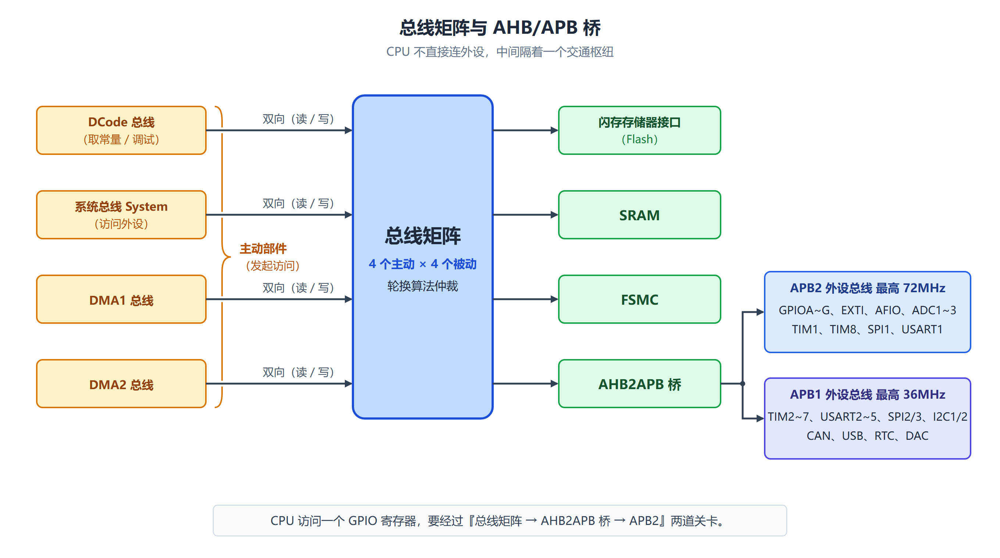

**这张图要看什么？**

1. **先看左边一列**：4 个主动部件（Cortex-M3 的 DCode、System，以及 DMA1、DMA2）。
2. **中间是总线矩阵**：一个大方框，左边 4 个入口，右边 4 个出口，表示"交叉开关"。
3. **右边一列是 4 个被动部件**：Flash 接口、SRAM、FSMC、AHB2APB 桥。
4. **最右边**：AHB2APB 桥再往下分成 APB2 和 APB1 两条支路，各自挂着外设。

**箭头代表什么？** 双向箭头表示"数据可以来回走"（读和写）。

**这张图要让我理解**：CPU 访问一个 GPIO 寄存器，路径是
`内核 System 总线 → 总线矩阵 → AHB2APB 桥 → APB2 → GPIO 外设`，
**中间至少要过两道"关卡"**。

### 3.2.5 看教材原图：STM32F103ZET6 的内部架构

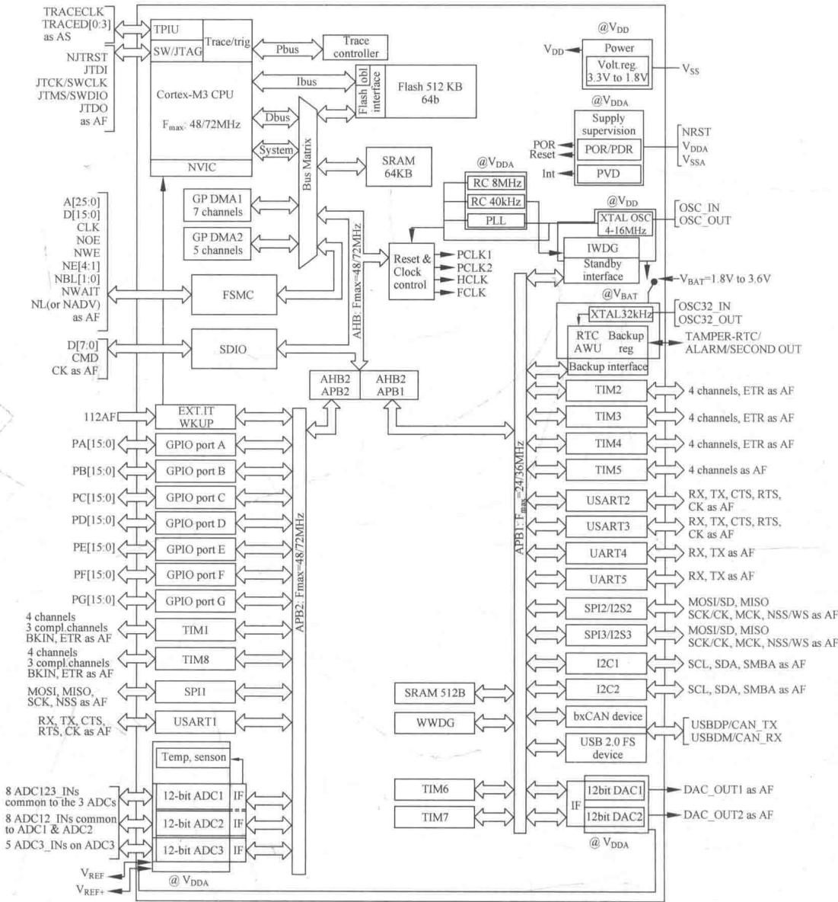

这张图信息量极大，**千万不要试图一次看懂**。我们用"逐层搭积木"的方式拆。

#### 第一层：先只找 4 个"大区域"

| 区域 | 在图上的位置 | 里面是什么 |
|---|---|---|
| ① **内核区** | 左上角大方框 | Cortex-M3 CPU、NVIC、SW/JTAG 调试、Trace 跟踪 |
| ② **总线与存储区** | 中间 | 总线矩阵、Flash 512KB、SRAM 64KB、FSMC、SDIO、DMA1/2 |
| ③ **外设区** | 左下一大片 + 右下两列 | GPIOA～G、TIM1～TIM8、SPI、USART、I2C、ADC、DAC、CAN、USB、RTC、看门狗…… |
| ④ **时钟与电源区** | 右上角 | Power、POR/PDR、PVD、RC 8MHz、RC 40kHz、PLL、XTAL OSC、XTAL32kHz、IWDG、RTC/AWU、Backup reg |

#### 第二层：内核区

左上角大框里写着 **Cortex-M3 CPU**，旁边标着 `Fmax: 48/72MHz`。

> 【补充解释】这里标"48/72MHz"是因为这张框图覆盖**整个 F1 系列**：
> 低端型号（如 F102）最高 48MHz，增强型（F103）最高 72MHz。
> **本课程用的 F103 是 72MHz**。

框里还有：
- **NVIC**：嵌套向量中断控制器（第 2 章讲过）——所有中断都先汇总到它这儿。
- **SW/JTAG**：调试接口——下载程序和在线调试走这里。
- **Trace controller / TPIU**：跟踪调试用的模块（本课程不深入）。

#### 第三层：存储器和 DMA

- **Flash 512KB**：程序住的地方。注意图里写的是 `Flash interface` 框接出去，再接一个 `Flash 512KB 64b` 方块。
- **SRAM 64KB**：变量住的地方。
- **FSMC**：灵活静态存储器控制器（Flexible Static Memory Controller）——用来扩展外部存储器、接 LCD（第 12 章讲）。
- **SDIO**（Secure Digital Input/Output，**安全数字输入输出接口**）：就是"读写 SD / TF 卡"的接口。
  大白话：手机、相机里那种小存储卡，STM32 想读写它，就得靠这个模块。
- **GP DMA1（7 通道）/ GP DMA2（5 通道）**：通用 DMA。

#### 第四层：外设区（图上最长的那几列）

**左侧一列（APB2 外设）**：

```
EXTI / WKUP     ← 外部中断和唤醒
GPIO A ~ GPIO G ← 7 组通用输入输出口
TIM1、TIM8      ← 高级控制定时器（各 4 通道，带互补输出 BKIN、ETR）
SPI1            ← 串行外设接口 1
USART1          ← 串口 1
12-bit ADC1/2/3 ← 三个 12 位模数转换器
```

**右下两列（APB1 外设）**：

```
TIM2~TIM7       ← 通用/基本定时器
USART2、USART3、UART4、UART5
SPI2/I2S2、SPI3/I2S3
I2C1、I2C2
bxCAN           ← CAN 总线接口
USB 2.0 FS device
SRAM 512B       ← USB/CAN 共享的 512 字节 SRAM
WWDG            ← 窗口看门狗
12bit DAC1/DAC2 ← 两个 12 位数模转换器
```

**这张图要让我理解**：
> ST 在 Cortex-M3 内核外面，挂了一大批外设；
> 这些外设不是直接连 CPU 的，而是**分组挂在 APB2（快）和 APB1（慢）两条外设总线上**，
> 再由 AHB2APB 桥接到 AHB 系统总线，最后通过总线矩阵连到内核。

#### 第五层：时钟与电源区（右上角）

- **Power / Volt reg**：内部稳压器，把 3.3V 降到内核用的 1.8V。
- **POR/PDR**：上电复位/掉电复位（Power-On Reset / Power-Down Reset）——电压不够时自动把芯片复位。
- **PVD**：可编程电压监测器——可以设置一个电压门限，电压低于门限时产生中断，提醒你"快没电了"。
- **RC 8MHz / RC 40kHz**：芯片内部自带的两个 RC 振荡器（不用外接晶振就能工作）。
- **PLL**：锁相环，负责把频率"倍频"上去（3.4 节详细讲）。
- **XTAL OSC 4~16MHz / XTAL32kHz**：接外部晶振的地方。
- **RTC/AWU + Backup reg**：实时时钟 + 自动唤醒 + 后备寄存器（由 VBAT 供电，主电源断了时间也不丢）。

### 3.2.6 STM32F103ZET6 主要特性清单（教材 ①～⑮ 整理）

【教材内容】把教材罗列的 15 条特性整理成表，方便查阅：

| 类别 | 具体内容 |
|---|---|
| **内核** | ARM 32 位 Cortex-M3 CPU，最高 72MHz；0 等待周期访问时 1.25 DMips/MHz（Dhrystone 2.1）；单周期乘法和硬件除法 |
| **存储器** | 512KB Flash；64KB SRAM；带 4 个片选信号的 FSMC，支持 Compact Flash、SRAM、PSRAM、NOR、NAND |
| **LCD 接口** | 并行接口，支持 8080/6800 模式 |
| **时钟/复位/电源** | 供电 2.0～3.6V；POR/PDR；PVD；4～16MHz 晶体振荡器；内嵌出厂调校 8MHz RC；内嵌 40kHz RC；带校准的 32kHz RTC 振荡器 |
| **低功耗** | 睡眠、停机、待机模式；V<sub>BAT</sub> 给 RTC 和后备寄存器供电 |
| **ADC** | 3 个 12 位 ADC，1μs 转换时间，多达 16 个输入通道；范围 0～3.6V；采样保持；温度传感器 |
| **DAC** | 2 个 12 位 DAC |
| **DMA** | 12 通道 DMA 控制器；支持定时器、ADC、DAC、SDIO、I2S、SPI、I2C、USART |
| **调试** | 串行单线调试（SWD）和 JTAG；Cortex-M3 嵌入式跟踪宏单元（ETM） |
| **GPIO** | 多达 7 个快速 I/O 端口（PA～PG），每端口 16 根线，共 112 根；所有 I/O 可映像到 16 个外部中断；几乎所有端口可容忍 5V 信号 |
| **定时器** | 共 11 个：4 个 16 位通用定时器 + 2 个 16 位高级控制定时器（带死区控制和紧急刹车，用于电机控制）+ 2 个看门狗（独立/窗口）+ 系统滴答定时器（24 位自减）+ 2 个 16 位基本定时器（驱动 DAC） |
| **通信接口** | 共 13 个：2×I²C（支持 SMBus/PMBus）、5×USART（支持 ISO7816/LIN/IrDA/调制解调控制）、3×SPI（18Mbit/s，其中 2 个带 I²S）、1×CAN（2.0B）、1×USB 2.0 全速、1×SDIO（安全数字输入输出，即 SD 卡接口） |
| **其他** | CRC 计算单元；96 位芯片唯一代码 |
| **封装/温度** | LQFP144；工作温度 −40℃～+105℃（⚠️ 与命名规则图中"6 = −40～85℃"矛盾，见《待核验》） |

> 【补充解释】"**112 根 I/O**"是怎么来的？
> 7 个端口 × 16 根 = 112 根。但这是 **ZET6（144 脚）** 的数字；
> **VET6（100 脚）少了 PF、PG 两个口**，所以是 5 × 16 = **80 根**。

### 3.2.7 本节真正要记住什么

1. 内核外面那一圈，靠 **AMBA 总线**连起来：
   **AHB（系统总线，72MHz）+ APB1（36MHz）+ APB2（72MHz）**。
2. 内核通过 **ICode / DCode / System / DMA** 四条总线接入**总线矩阵**；
   总线矩阵有 **4 主 4 从**，用**轮换算法**仲裁。
3. APB 外设要经过 **AHB2APB 桥**才能连上 AHB。
4. **CPU 访问外设 = 过两道关**：总线矩阵 → AHB2APB 桥 → APB 外设。
5. F103ZET6：512KB Flash + 64KB SRAM + 112 根 I/O + 11 个定时器 + 13 个通信接口。

---

## 3.3 STM32F103ZET6 的存储器映像

### 3.3.1 先别急着看教材：这一节要干什么？

这一节要回答：

> **CPU 眼里的世界是什么样子的？**
> **芯片里那么多东西——Flash、SRAM、GPIO、串口、定时器——CPU 怎么区分它们？**

答案是：

> **CPU 不给它们起名字，只给它们发"门牌号"（地址）。**
> 每个硬件模块都占着一段地址，CPU 想操作谁，就往谁的地址上写/读。

【教材内容】教材原话：

> 程序存储器、数据存储器、寄存器和输入/输出端口被组织在**同一个 4GB 的线性地址空间**内。
> 可访问的存储器空间被分成 **8 个主要的块，每块为 512MB**。

### 3.3.2 你需要先知道的东西

#### 【先补一个前置知识：0x 是什么意思？（快速复习）】

第 1 章讲过，这里用一句话复习：

- `0x` 是"**后面这个数是十六进制**"的标记。
- 十六进制的每一位可以是 `0~9`、`A~F`，**一位十六进制 = 4 个二进制位（4 bit）**。
- 所以 **8 位十六进制数 = 32 位**，正好是一个 32 位地址的长度。

```
0x4001 0800
└┬┘ └──┬──┘
 │     └── 8 位十六进制数字 = 32 bit
 └── 标记：这是十六进制
```

**一个 32 位地址的取值范围**：

```
0x0000 0000  ~  0xFFFF FFFF
     ↓                ↓
  最小地址         最大地址
```

从 0 数到 0xFFFFFFFF，一共有多少个地址？

```
0x1 0000 0000 = 2^32 = 4 294 967 296 ≈ 4G（4 吉）
```

**这就是"4GB 地址空间"的来历。**（这里 GB 指的是 4G 个**字节**的寻址能力，不是 4G 字节内存，见下。）

#### 【先补一个前置知识：什么叫"存储器映像"（Memory Map）？】

**存储器映像**（也叫**存储器映射**）= **把整个 4GB 地址空间画成一张"分区地图"**。

【类比】

> 整个 4GB 地址空间像一座城市的**门牌号总表**。
> 城市里不同的区域分配给不同的用途：
> 这一片是住宅区（Flash），那一片是仓库区（SRAM），
> 还有一片是工厂区（外设），最边上一片是政府机关（内核自己的 NVIC、SysTick）。
> 每栋楼在哪个区、门牌号是多少，都是**规划好的**，不能乱盖。

**真实硬件并不是完全如此**：城市的门牌号是人为分配的，而这里的地址分配是由 **ARM 架构规定 + 芯片厂商细化**共同决定的，CPU 硬件会**真的根据地址去选总线**——地址落在哪个区，CPU 就走哪条总线去访问。

#### 【先补一个前置知识：什么叫"小端"（Little Endian）？】

【教材内容】教材原话：

> 数据字节以**小端格式**存放在存储器中。一个字中的**最低地址字节**被认为是该字的**最低有效字节**，而最高地址字节是最高有效字节。

【补充解释】用一个具体例子看：

假设有个 32 位数据 `0x12345678`，要存到地址 `0x2000 0000` 开始的地方。

```
地址          存放的字节
0x20000000    0x78   ← 最低有效字节（Least Significant Byte）
0x20000001    0x56
0x20000002    0x34
0x20000003    0x12   ← 最高有效字节（Most Significant Byte）
```

**规律**：**地址越低，放的是越不重要的字节**。
这个规矩就叫**小端**（little endian，小字节在前）。
Cortex-M3 同时支持小端和大端，但 STM32 实际使用的是**小端**。

### 3.3.3 看教材原图：4GB 地址空间怎么分

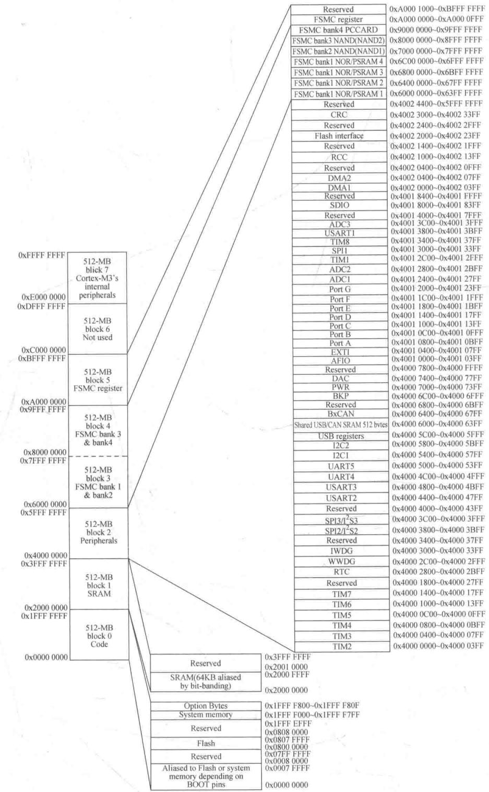

**先看哪里？**

这张图是**竖着排**的：左边一列是**大块分区**，中间用斜线连到右边一列是**更细的划分**。

1. **先只看最左边那一列**：从下往上，一共 8 个大块，每块 512MB。
2. **再看中间那条斜线**：它从"512-MB block 2 Peripherals（外设）"引出来，指向右边一整列——**外设区内部还有几十个更小的格子**。
3. **最下面还有两个小斜线**：分别从 block 0（Code）和 block 1（SRAM）引出来，表示这两个区内部也有细节。

**8 个大块分别是：**

| 块号 | 地址范围 | 名称 | 里面放什么 |
|---|---|---|---|
| 0 | `0x0000 0000 ~ 0x1FFF FFFF` | Code（代码区） | 启动时映射 Flash/系统存储器；正常运行时主要是"别名区" |
| 1 | `0x2000 0000 ~ 0x3FFF FFFF` | SRAM | 片内 64KB SRAM 在最低端，其余保留 |
| 2 | `0x4000 0000 ~ 0x5FFF FFFF` | **Peripherals（片上外设）** | **所有外设寄存器都在这里** |
| 3 | `0x6000 0000 ~ 0x7FFF FFFF` | FSMC bank1 & bank2 | 外扩存储器（第 12 章） |
| 4 | `0x8000 0000 ~ 0x9FFF FFFF` | FSMC bank3 & bank4 | 外扩存储器 |
| 5 | `0xA000 0000 ~ 0xBFFF FFFF` | FSMC register | FSMC 自己的寄存器 |
| 6 | `0xC000 0000 ~ 0xDFFF FFFF` | Not used | 未使用 |
| 7 | `0xE000 0000 ~ 0xFFFF FFFF` | Cortex-M3 internal peripherals | 内核自己的东西：NVIC、SysTick、调试单元 |

#### 现在重点看右边那一列：外设区内部

图右侧那一长列，就是把 block 2（`0x4000 0000` 起）内部再细分。
从上往下读（地址从高到低）：

```
0xA000 1000 ~ 0xDFFF FFFF  Reserved（保留）
0xA000 0000 ~ 0xA000 0FFF  FSMC register          ← 注意：FSMC 寄存器在 0xA000 0000
0x9000 0000 ~ 0x9FFF FFFF  FSMC bank4 PCCARD
0x8000 0000 ~ 0x8FFF FFFF  FSMC bank3 NAND(NAND2)
0x7000 0000 ~ 0x7FFF FFFF  FSMC bank2 NAND(NAND1)
0x6C00 0000 ~ 0x6FFF FFFF  FSMC bank1 NOR/PSRAM 4
0x6800 0000 ~ 0x6BFF FFFF  FSMC bank1 NOR/PSRAM 3
0x6400 0000 ~ 0x67FF FFFF  FSMC bank1 NOR/PSRAM 2
0x6000 0000 ~ 0x63FF FFFF  FSMC bank1 NOR/PSRAM 1
...
0x4002 3000 ~ 0x4002 33FF  CRC
0x4002 2000 ~ 0x4002 23FF  Flash interface（闪存接口）
0x4002 1000 ~ 0x4002 13FF  RCC（复位和时钟控制）
0x4002 0400 ~ 0x4002 07FF  DMA2
0x4002 0000 ~ 0x4002 03FF  DMA1
0x4001 8400 ~ 0x4001 FFFF  Reserved
0x4001 8000 ~ 0x4001 83FF  SDIO
0x4001 3C00 ~ 0x4001 3FFF  ADC3
0x4001 3800 ~ 0x4001 3BFF  USART1
0x4001 3400 ~ 0x4001 37FF  TIM8
0x4001 3000 ~ 0x4001 33FF  SPI1
0x4001 2C00 ~ 0x4001 2FFF  TIM1
0x4001 2800 ~ 0x4001 2BFF  ADC2
0x4001 2400 ~ 0x4001 27FF  ADC1
0x4001 2000 ~ 0x4001 23FF  Port G
0x4001 1C00 ~ 0x4001 1FFF  Port F
0x4001 1800 ~ 0x4001 1BFF  Port E
0x4001 1400 ~ 0x4001 17FF  Port D
0x4001 1000 ~ 0x4001 13FF  Port C
0x4001 0C00 ~ 0x4001 0FFF  Port B
0x4001 0800 ~ 0x4001 0BFF  Port A
0x4001 0400 ~ 0x4001 07FF  EXTI
0x4001 0000 ~ 0x4001 03FF  AFIO
0x4000 7800 ~ 0x4000 FFFF  Reserved
0x4000 7400 ~ 0x4000 77FF  DAC
0x4000 7000 ~ 0x4000 73FF  PWR
0x4000 6C00 ~ 0x4000 6FFF  BKP
0x4000 6400 ~ 0x4000 67FF  bxCAN
0x4000 6000 ~ 0x4000 63FF  Shared USB/CAN SRAM 512 bytes
0x4000 5C00 ~ 0x4000 5FFF  USB registers
0x4000 5800 ~ 0x4000 5BFF  I2C2
0x4000 5400 ~ 0x4000 57FF  I2C1
0x4000 5000 ~ 0x4000 53FF  UART5
0x4000 4C00 ~ 0x4000 4FFF  UART4
0x4000 4800 ~ 0x4000 4BFF  USART3
0x4000 4400 ~ 0x4000 47FF  USART2
0x4000 3C00 ~ 0x4000 3FFF  SPI3/I2S3
0x4000 3800 ~ 0x4000 3BFF  SPI2/I2S2
0x4000 3400 ~ 0x4000 37FF  Reserved
0x4000 3000 ~ 0x4000 33FF  IWDG
0x4000 2C00 ~ 0x4000 2FFF  WWDG
0x4000 2800 ~ 0x4000 2BFF  RTC
0x4000 1800 ~ 0x4000 27FF  Reserved
0x4000 1400 ~ 0x4000 17FF  TIM7
0x4000 1000 ~ 0x4000 13FF  TIM6
0x4000 0C00 ~ 0x4000 0FFF  TIM5
0x4000 0800 ~ 0x4000 0BFF  TIM4
0x4000 0400 ~ 0x4000 07FF  TIM3
0x4000 0000 ~ 0x4000 03FF  TIM2
```

**这张图要让我理解**：

> CPU 眼里，**所有硬件设备都像一排有地址的格子**。
> 想操作 GPIOA，就去 `0x4001 0800` 这个格子；
> 想操作 TIM2，就去 `0x4000 0000` 这个格子。
> 根本不需要"特殊指令"——**用访问内存的方式就能访问硬件**。

### 3.3.4 为什么外设地址从 `0x4000 0000` 开始？

这是初学者最常问的问题之一。

**答案不在 ST 的文档里，而在 ARM 的架构规定里。**

第 2 章讲过，Cortex-M3 有一个**固定的（预定义的）存储器映射**，规定好了 4GB 怎么切：

| 地址范围 | 用途 | 谁规定 |
|---|---|---|
| `0x0000 0000 ~ 0x1FFF FFFF` | 代码区（512MB） | ARM |
| `0x2000 0000 ~ 0x3FFF FFFF` | 片上 SRAM 区（512MB） | ARM |
| **`0x4000 0000 ~ 0x5FFF FFFF`** | **片上外设区（512MB）** | **ARM** |
| `0x6000 0000 ~ 0x9FFF FFFF` | 外部 RAM 区（1GB） | ARM |
| `0xA000 0000 ~ 0xDFFF FFFF` | 外部设备区（1GB） | ARM |
| `0xE000 0000 ~ 0xE00F FFFF` | 内核私有外设（NVIC、SysTick 等） | ARM |

**所以答案是：**

> **ARM 规定 `0x4000 0000` 到 `0x5FFF FFFF` 这 512MB 是"片上外设区"。**
> **ST 作为芯片厂商，只能把外设寄存器往这个区里放。**
> 于是 STM32F103 的所有外设（GPIO、串口、定时器……）都从 `0x4000 0000` 开始往上排。

**这样做还有一个巨大的好处**：

> 【教材内容·第 2 章原文精神】通过把片上外设的寄存器映射到外设区中的某个位置，
> 就可以**用访问内存的方式来访问这些寄存器**，从而对外设进行控制。

也就是说：**"读内存"和"读外设"用的是同一套指令**。
C 语言里那个看起来莫名其妙的写法：

```c
*(volatile unsigned int *)0x4001080C = 0x20;
```

其实就是"**往地址 0x4001080C 写 0x20**"——和往普通内存写数据**没有任何语法区别**。

> 【补充解释】另外还有一个细节：**外设区（`0x4000 0000` 起）不允许执行指令**。
> 你只能在这里读/写数据，不能把程序放在这里跑。这是 ARM 架构规定的。

#### 【辅助理解图】4GB 地址空间分区

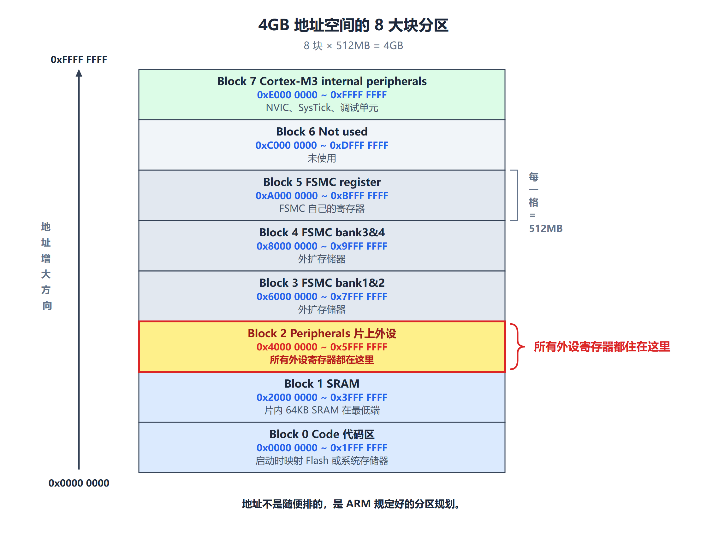

**这张图要看什么？**

- 图是一条从下到上的**竖直长条**，代表 `0x0000 0000 → 0xFFFF FFFF` 的 4GB 空间；
- 长条被分成 8 个等高的色块，每块写着地址范围 + 名称 + 一句话用途；
- 右侧用一条**红色大括号**把 block 2（外设区）单独标出来，写"**所有外设寄存器都住在这里**"；
- 长条旁边标一个比例尺：**每一格 = 512MB**。

**这张图要让我理解**：地址不是随便排的，是**分区规划**出来的。
背下这 8 块的大致位置，后面看到任何地址都能立刻判断"这是 Flash 还是 SRAM 还是外设"。

### 3.3.5 STM32F103ZET6 内置外设的地址范围（教材表 3-1）

【教材内容】教材表 3-1 列出了每个外设的地址范围。整理如下（按地址从低到高）：

**挂在 APB1 上的外设（低速，最高 36MHz）**

| 地址范围 | 外设 |
|---|---|
| `0x4000 0000 ~ 0x4000 03FF` | TIM2 定时器 |
| `0x4000 0400 ~ 0x4000 07FF` | TIM3 定时器 |
| `0x4000 0800 ~ 0x4000 0BFF` | TIM4 定时器 |
| `0x4000 0C00 ~ 0x4000 0FFF` | TIM5 定时器 |
| `0x4000 1000 ~ 0x4000 13FF` | TIM6 定时器 |
| `0x4000 1400 ~ 0x4000 17FF` | TIM7 定时器 |
| `0x4000 2800 ~ 0x4000 2BFF` | RTC |
| `0x4000 2C00 ~ 0x4000 2FFF` | 窗口看门狗（WWDG） |
| `0x4000 3000 ~ 0x4000 33FF` | 独立看门狗（IWDG） |
| `0x4000 3800 ~ 0x4000 3BFF` | SPI2/I2S2 |
| `0x4000 3C00 ~ 0x4000 3FFF` | SPI3/I2S3 |
| `0x4000 4400 ~ 0x4000 47FF` | USART2 |
| `0x4000 4800 ~ 0x4000 4BFF` | USART3 |
| `0x4000 4C00 ~ 0x4000 4FFF` | UART4 |
| `0x4000 5000 ~ 0x4000 53FF` | UART5 |
| `0x4000 5400 ~ 0x4000 57FF` | I2C1 |
| `0x4000 5800 ~ 0x4000 5BFF` | I2C2 |
| `0x4000 5C00 ~ 0x4000 5FFF` | USB 全速设备寄存器 |
| `0x4000 6000 ~ 0x4000 63FF` | USB/CAN 共享的 512B SRAM |
| `0x4000 6400 ~ 0x4000 67FF` | bxCAN |
| `0x4000 6C00 ~ 0x4000 6FFF` | 后备寄存器（BKP） |
| `0x4000 7000 ~ 0x4000 73FF` | 电源控制（PWR） |
| `0x4000 7400 ~ 0x4000 77FF` | DAC |

**挂在 APB2 上的外设（高速，最高 72MHz）**

| 地址范围 | 外设 |
|---|---|
| `0x4001 0000 ~ 0x4001 03FF` | AFIO（复用功能 IO） |
| `0x4001 0400 ~ 0x4001 07FF` | EXTI（外部中断） |
| `0x4001 0800 ~ 0x4001 0BFF` | GPIO 端口 A |
| `0x4001 0C00 ~ 0x4001 0FFF` | GPIO 端口 B |
| `0x4001 1000 ~ 0x4001 13FF` | GPIO 端口 C |
| `0x4001 1400 ~ 0x4001 17FF` | GPIO 端口 D |
| `0x4001 1800 ~ 0x4001 1BFF` | GPIO 端口 E |
| `0x4001 1C00 ~ 0x4001 1FFF` | GPIO 端口 F |
| `0x4001 2000 ~ 0x4001 23FF` | GPIO 端口 G |
| `0x4001 2400 ~ 0x4001 27FF` | ADC1 |
| `0x4001 2800 ~ 0x4001 2BFF` | ADC2 |
| `0x4001 2C00 ~ 0x4001 2FFF` | TIM1 定时器 |
| `0x4001 3000 ~ 0x4001 33FF` | SPI1 |
| `0x4001 3400 ~ 0x4001 37FF` | TIM8 定时器 |
| `0x4001 3800 ~ 0x4001 3BFF` | USART1 |
| `0x4001 3C00 ~ 0x4001 3FFF` | ADC3 |

**挂在 AHB 上的外设**

| 地址范围 | 外设 |
|---|---|
| `0x4001 8000 ~ 0x4001 83FF` | SDIO |
| `0x4002 0000 ~ 0x4002 03FF` | DMA1 |
| `0x4002 0400 ~ 0x4002 07FF` | DMA2 |
| `0x4002 1000 ~ 0x4002 13FF` | 复位和时钟控制（RCC） |
| `0x4002 2000 ~ 0x4002 23FF` | 闪存存储器接口 |
| `0x4002 3000 ~ 0x4002 33FF` | CRC |
| `0x4002 8000 ~ 0x4002 9FFF` | 以太网 ⚠️ |
| `0x5000 0000 ~ 0x5003 FFFF` | USB OTG 全速 ⚠️ |

> ⚠️ 表中最后两行"以太网"和"USB OTG 全速"是**互联型（F105/107）**才有的资源，
> 而图 3-4 把这两段地址都标成了 Reserved。
> 教材表 3-1 可能是从"F1 系列通用表"里抄来的。详见文末《待核验》。

> 【补充解释】**每个外设的地址范围是 1KB（0x400）**，只有少数例外。这两个例外顺便帮你复习"地址范围怎么算大小"：
>
> | 例外 | 地址范围 | 实际大小 | 一步一步算 |
> |---|---|---|---|
> | 以太网 | `0x4002 8000 ~ 0x4002 9FFF` | **8KB** | `0x9FFF − 0x8000 + 1 = 0x2000`，`0x2000 = 8192 字节 = 8KB` |
> | USB OTG 全速 | `0x5000 0000 ~ 0x5003 FFFF` | **256KB** | `0x5003 FFFF − 0x5000 0000 + 1 = 0x0004 0000`，`0x40000 = 262144 字节 = 256KB` |
>
> （"末尾 − 开头 + 1"才是范围内**字节的个数**：因为开头那个字节自己也算一个。）
>
> 1KB 对一个外设来说够用吗？够——一个外设通常只有十几个 32 位寄存器，1KB 能放下 256 个。

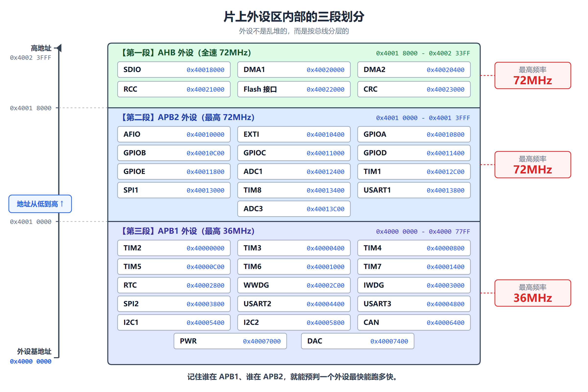

**这张图要看什么？**

- 图是一个**竖直的地址长条**，从上到下依次标出外设区的三个"楼层"：
  - 最上面一段：**AHB 外设**（DMA1/2、RCC、Flash 接口、CRC、SDIO）；
  - 中间一段：**APB2 外设**（GPIOA~G、EXTI、AFIO、ADC1~3、TIM1、TIM8、SPI1、USART1）；
  - 下面一段：**APB1 外设**（TIM2~7、USART2~5、SPI2/3、I2C1/2、CAN、USB、RTC、看门狗、DAC、PWR、BKP）；
- 每段右侧标出该段的**地址范围**和**最高频率**（72MHz / 72MHz / 36MHz）；
- 每段内画几个小格子代表具体外设，并写上基地址。

**这张图要让我理解**：外设区不是乱堆的，而是**按总线分层的**。
记住"谁在 APB1、谁在 APB2"，就能预判一个外设最快能跑多快。

### 3.3.6 重点：地址链是怎么算出来的

教材有一句非常关键的话：

【教材内容】

> 其中每个地址范围的**第一个地址**为对应外设的**首地址**，
> 该外设的相关寄存器地址都可以用"**首地址 + 偏移量**"的方式找到其**绝对地址**。

这句话就是 STM32 编程的**核心公式**：

```
最终寄存器地址 = 外设基地址 + 寄存器偏移量
```

【类比】

> 外设基地址像"小区门牌号"（比如幸福路 100 号），
> 寄存器偏移量像"小区里几号楼"（比如 3 号楼）。
> 合起来才是完整地址：幸福路 100 号 3 号楼。

#### 一步一步算：GPIOA 的 ODR 寄存器在哪？

**第 1 步**：查表 3-1，找到 GPIO 端口 A 的首地址。

```
GPIOA 基地址 = 0x4001 0800
```

**第 2 步**：查 GPIO 的寄存器偏移表（第 6 章会给完整表，这里先用）：

| 寄存器 | 偏移量 | 作用 |
|---|---|---|
| GPIOx_CRL | `0x00` | 配置低 8 位引脚 |
| GPIOx_CRH | `0x04` | 配置高 8 位引脚 |
| GPIOx_IDR | `0x08` | 输入数据寄存器 |
| **GPIOx_ODR** | **`0x0C`** | **输出数据寄存器** |
| GPIOx_BSRR | `0x10` | 位设置/清除 |
| GPIOx_BRR | `0x14` | 位清除 |

**第 3 步**：相加。

```
  0x4001 0800      （GPIOA 基地址）
+ 0x0000 000C      （ODR 偏移量）
──────────────
  0x4001 080C      （GPIOA_ODR 的绝对地址）
```

**所以 `GPIOA->ODR` 这个 C 语言写法，翻译成硬件动作就是"访问地址 0x4001080C"。**

#### 再算一个：RCC 的 APB2ENR

```
RCC 基地址        = 0x4002 1000     （查表 3-1）
RCC_APB2ENR 偏移  = 0x18            （查第 6 章 RCC 寄存器表）
──────────────────────────────
RCC_APB2ENR 绝对地址 = 0x4002 1018
```

【辅助理解图】地址链的每一级

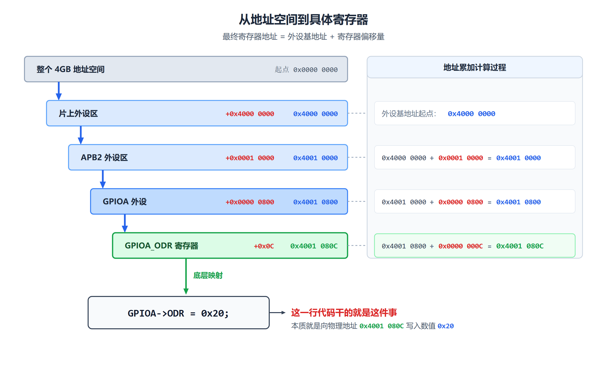

**这张图要看什么？**

- 图是一条**从上到下的五级阶梯**，每往下一级就"缩窄"一点，表示范围越来越小；
- 每一级右侧写着这一级的地址和一个红色"**+多少**"；
- 最下面一级用绿色框标出"**最终寄存器地址**"，旁边配一行 C 代码 `GPIOA->ODR = 0x20;`。

**这张图要让我理解**：

```
整个 4GB 空间（0x00000000 起）
    ↓ +0x40000000
片上外设区（0x40000000 起）
    ↓ +0x10000
APB2 外设区（0x40010000 起）
    ↓ +0x0800
GPIOA 外设（0x40010800 起）
    ↓ +0x0C
GPIOA_ODR 寄存器（0x4001080C）
```

**这条链必须背下来。** 后面每一章讲外设，都是这条链的重复。

### 3.3.7 嵌入式 SRAM

【教材内容】

> STM32F103ZET6 内置 **64KB 的静态 SRAM**。它可以以**字节、半字（16 位）或字（32 位）**访问。
> SRAM 的起始地址是 **`0x2000 0000`**。

**几个要点：**

1. **起始地址固定为 `0x2000 0000`**，这是 ARM 规定的 SRAM 区起点。
2. **64KB 覆盖的范围**是 `0x2000 0000 ~ 0x2000 FFFF`。
   这个范围是怎么算出来的？**一步一步来，不要跳步**：
   ```
   0x2000 0000 + 64KB
   = 0x2000 0000 + 0x0001 0000
   = 0x2001 0000        ← 这是"范围的结尾 + 1"，也就是"最后一个字节的后面一个地址"
   ```
   所以真正**最后一个字节的地址**要再减 1：
   ```
   0x2001 0000 − 1 = 0x2000 FFFF
   ```
   即：**64KB 的范围 = `0x2000 0000 ~ 0x2000 FFFF`**（`0x2000 FFFF` 是最后一个字节的地址）。
   从图 3-4 也能看到：`SRAM(64KB) 0x2000 0000 ~ 0x2000 FFFF`，再往上是 Reserved。

   > **小提醒**：十六进制加法一位一位地对齐加。
   > `0x2000 0000 + 0x0001 0000`，只有"从右数第 5 位十六进制数"要加 1：
   > `0x2000 0000 → 0x2001 0000`。
   > 千万不要写成 `0x2000 FFFF`——那已经是"减 1 之后"的结果了。
3. **可以按字节、半字、字访问**：意思是你可以一次读 1 字节（8 位）、2 字节（16 位）或 4 字节（32 位）。

> 【先补一个前置知识：字节、半字、字】
>
> | 名称 | 英文 | 位数 | 字节数 |
> |---|---|---|---|
> | 字节 | Byte | 8 位 | 1 B |
> | 半字 | Half-word | 16 位 | 2 B |
> | 字 | Word | 32 位 | 4 B |
>
> **注意**：在 ARM 的世界里，"字"默认指 **32 位**，不是 16 位。这一点和某些老教材（x86 里"字"=16 位）不同。

### 3.3.8 嵌入式闪存（Flash）

【教材内容】

> 高达 **512KB** 闪存存储器，由**主存储块**和**信息块**组成：
> 主存储块容量为 64K × 64 位，每个存储块划分为 **256 个 2KB 的页**。
> 信息块容量为 258 × 64 位。

**教材表 3-2 整理（闪存模块的组织）：**

| 模块 | 名称 | 地址 | 大小 |
|---|---|---|---|
| 主存储块 | 页 0 | `0x0800 0000 ~ 0x0800 07FF` | 2KB |
| 主存储块 | 页 1 | `0x0800 0800 ~ 0x0800 0FFF` | 2KB |
| 主存储块 | 页 2 | `0x0800 1000 ~ 0x0800 17FF` | 2KB |
| 主存储块 | 页 3 | `0x0800 1800 ~ 0x0800 1FFF` | 2KB |
| 主存储块 | …… | …… | …… |
| 主存储块 | 页 255 | `0x0807 F800 ~ 0x0807 FFFF` | 2KB |
| 信息块 | 系统存储器 | `0x1FFF F000 ~ 0x1FFF F7FF` | 2KB |
| 信息块 | 选择字节 | `0x1FFF F800 ~ 0x1FFF F80F` | 16B |
| 闪存接口寄存器 | FLASH_ACR | `0x4002 2000 ~ 0x4002 2003` | 4B |
| 闪存接口寄存器 | FLASH_KEYR | `0x4002 2004 ~ 0x4002 2007` | 4B |
| 闪存接口寄存器 | FLASH_OPTKEYR | `0x4002 2008 ~ 0x4002 200B` | 4B |
| 闪存接口寄存器 | FLASH_SR | `0x4002 200C ~ 0x4002 200F` | 4B |
| 闪存接口寄存器 | FLASH_CR | `0x4002 2010 ~ 0x4002 2013` | 4B |
| 闪存接口寄存器 | FLASH_AR | `0x4002 2014 ~ 0x4002 2017` | 4B |
| 闪存接口寄存器 | 保留 | `0x4002 2018 ~ 0x4002 201B` | 4B |
| 闪存接口寄存器 | FLASH_OBR | `0x4002 201C ~ 0x4002 201F` | 4B |
| 闪存接口寄存器 | FLASH_WRPR | `0x4002 2020 ~ 0x4002 2023` | 4B |

**几个必须看懂的细节：**

1. **Flash 从 `0x0800 0000` 开始**，不是从 `0x0000 0000`。
   那为什么启动时 CPU 又能从 `0x0000 0000` 取到程序？
   → 因为 **`0x0000 0000` 是 Flash 的"别名"**（详见 3.6 节 BOOT 配置）。
2. **一页 2KB，一共 256 页**：
   ```
   256 × 2KB = 512KB   ✓ 正好对上型号里的 E
   ```
3. **页 255 的起始地址验证**：
   ```
   页号 × 每页大小 = 255 × 0x800 = 0x7F800
   0x0800 0000 + 0x0007 F800 = 0x0807 F800   ✓
   ```
4. **信息块里的"系统存储器"**：`0x1FFF F000 ~ 0x1FFF F7FF`。
   里面存着 ST 出厂时烧好的**内嵌自举程序**（bootloader），
   用来通过串口（USART1）给 Flash 重新编程——这就是"串口下载程序"的原理。
5. **"选择字节"（Option Bytes）**：`0x1FFF F800`，只有 16 字节，用来配置读保护、写保护、看门狗硬件使能等。

**Flash 接口的特性**（教材原文）：

- 带预取缓冲器的读接口（每字为 2 × 64 位）；
- 选择字节加载器；
- 闪存编程/擦除操作；
- 访问/写保护。

**预取缓冲区是什么？**

【教材内容】

> 预取缓冲区（2 个 64 位）：在每一次复位以后被自动打开。
> 由于每个缓冲区的大小（64 位）与闪存的带宽相同，因此只需一次读闪存的操作即可更新整个缓冲区的内容。
> 由于预取缓冲区的存在，CPU 可以工作在更高的主频。
> **CPU 每次取指最多为 32 位的字，取一条指令时，下一条指令已经在缓冲区中等待。**

> 【类比】
> 你在食堂打饭，窗口一次只能出一份菜（Flash 一次读 64 位）。
> 如果每次都要现炒现打，队伍就慢（CPU 得等 Flash）。
> 预取缓冲区就像**提前盛好一份放在台面上**：
> 你刚端走这份，下一份已经在台面上了，不用等。
>
> **真实硬件**：预取缓冲区是 Flash 接口里的一小块高速缓存，
> 它根据 CPU 的取指顺序，**提前把后面的指令从 Flash 读出来存好**。
> 这样 CPU 就不必每个周期都去等慢速的 Flash。

### 3.3.9 位带（Bit-Banding）

> 位带在第 2 章已经讲过原理，这里只讲 **STM32F103 里它具体落在哪些地址上**。
> 忘了的话，一句话复习：**位带 = 把"某一位"膨胀成"一个字（4 字节）"，
> 这样就能用一条普通的写内存指令，原子地修改单个 bit。**

【教材内容】

> Cortex-M3 存储器映像包括**两个位带区**。这两个位带区将**别名存储器区中的每个字**映射到**位带存储器区的一个位**，
> 在别名存储区写入一个字，具有对位带区的目标位执行**读-改写**操作的相同效果。
>
> 在 STM32F103ZET6 中，**外设寄存器和 SRAM 都被映射到位带区里**，允许执行位带的写和读操作。

**两个位带区分别在哪儿：**

| | 位带区（原始位所在） | 大小 | 别名区（每个 bit 膨胀成一个字） | 大小 |
|---|---|---|---|---|
| SRAM | `0x2000 0000 ~ 0x200F FFFF` | 1MB | `0x2200 0000 ~ 0x23FF FFFF` | 32MB |
| 外设 | `0x4000 0000 ~ 0x400F FFFF` | 1MB | `0x4200 0000 ~ 0x43FF FFFF` | 32MB |

**为什么别名区是 32MB？** 一步一步算：

```
位带区大小 = 1MB = 1024 × 1024 = 1 048 576 字节
一个字节有 8 个位
→ 位带区里一共有  1 048 576 × 8 = 8 388 608 个位

别名区里，每个位要用 1 个字（4 字节）来表示
→ 别名区大小 = 8 388 608 × 4 = 33 554 432 字节

33 554 432 字节 ÷ 1024 ÷ 1024 = 32MB   ✓
```

**所以 32MB 是对的**：1MB 的位带区，膨胀后正好变成 32MB 的别名区（放大了 32 倍）。

**教材给的映射公式：**

```
bit_word_addr = bit_band_base + (byte_offset × 32) + (bit_number × 4)
```

| 参数 | 含义 |
|---|---|
| `bit_word_addr` | 别名区中那个"字"的地址 |
| `bit_band_base` | 别名区的起始地址（SRAM 是 `0x22000000`，外设是 `0x42000000`） |
| `byte_offset` | 目标位所在**字节**在位带区中的序号（从位带区起点算起） |
| `bit_number` | 目标位在字节中的位置（**0～7**）⚠️ 教材这里写的是"位置(0~31)"，见下方【补充解释】 |

**为什么是 ×32？** 因为**位带区的一个字节有 8 个位，每个位在别名区占 4 个字节**：
```
8 × 4 = 32
```
**为什么是 ×4？** 因为别名区里**每个位占一个字 = 4 字节**。

> 【补充解释·教材与公式的矛盾】`bit_number` 到底能填 0～7 还是 0～31？
>
> **教材 p79 原文写的是："bit_number 是目标位所在位置(0~31)。"**
> 但按公式本身推，它应该是 **0～7**：
>
> - `byte_offset` 已经**按"字节"计数**（一个字节 = 8 位）；
> - 所以 `bit_number` 只需要再指出"这个字节里的第几位"，而一个字节只有 8 位，只能是 **0～7**；
> - 教材自己举的例子用的是 bit 2，两种说法都能满足，所以例子看不出区别；
> - 如果真按 0～31 填，算出来的地址就会跑到别的字节的别名区去，是错的。
>
> 本讲义按 **0～7** 使用（与教材的例子、以及 STM32F103 参考手册一致），
> 并把这条矛盾列入文末《待核验》，请自行核对原 PDF。

#### 教材的演算例子（一定要跟着算一遍）

**问题**：SRAM 中地址 `0x2000 0300` 这个字节的 **bit 2**，它的别名地址是多少？

**代入公式：**

```
bit_band_base = 0x2200 0000        （SRAM 位带别名区起点）
byte_offset   = 0x0000 0300        （0x20000300 - 0x20000000 = 0x300）
bit_number    = 2
```

**第一步**：算 `byte_offset × 32`。

```
0x300 × 32
= 0x300 × 0x20
= 0x6000
```

（用十进制验算：`0x300 = 768`，`768 × 32 = 24576`，而 `0x6000 = 24576` ✓）

**第二步**：算 `bit_number × 4`。

```
2 × 4 = 8 = 0x8
```

**第三步**：三项相加。

```
  0x2200 0000
+ 0x0000 6000
+ 0x0000 0008
──────────────
  0x2200 6008
```

**结论（教材原文）：**

> 对 `0x22006008` 地址的**写**操作，与对 SRAM 中地址为 `0x20000300` 的字节的 **bit 2** 执行**读-改-写**操作有着相同的效果。
> **读** `0x22006008` 地址，返回 SRAM 中地址为 `0x20000300` 的字节的 bit 2 的值（`0x01` 或 `0x00`）。

#### 【补充解释】再算一个外设的例子

**问题**：想让 GPIOA 的 ODR 寄存器的 **bit 5**（也就是 PA5 引脚）输出高电平，
用位带别名地址怎么写？

```
外设位带区起点 = 0x4000 0000
GPIOA_ODR 地址 = 0x4001 080C
byte_offset    = 0x4001 080C - 0x4000 0000 = 0x0001 080C
bit_number     = 5
bit_band_base  = 0x4200 0000
```

```
0x1080C × 32 = 0x1080C × 0x20 = 0x210180
5 × 4 = 20 = 0x14
0x4200 0000 + 0x210180 + 0x14 = 0x4221 0194
```

于是：

```c
*(volatile unsigned int *)0x42210194 = 1;   // PA5 输出高
*(volatile unsigned int *)0x42210194 = 0;   // PA5 输出低
```

**一条普通的"写内存"指令，就精确改动了 GPIOA_ODR 的第 5 位，而且这个过程是原子的（不会被中断打断）。**

> ⚠️ 上面这个外设例子是【补充解释】，教材第 3 章只给了 SRAM 的例子。
> 公式和位带区地址来自教材，数值计算由本讲义补充，请自行验算。

#### 【辅助理解图】位带映射

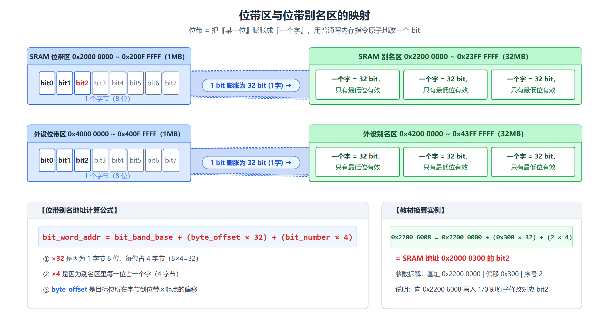

**这张图要看什么？**

- 左边一列是**位带区**（`0x2000 0000` 起 / `0x4000 0000` 起），画成一个个小格子，每格 1 bit；
- 右边一列是**别名区**（`0x2200 0000` 起 / `0x4200 0000` 起），画成一个个大格子，每格 32 bit（一个字）；
- 中间用**扇形连线**表示"膨胀"：左边 1 个小 bit → 右边 1 个 4 字节的字；
- 图上标出公式 `别名地址 = 基地址 + 字节偏移×32 + 位号×4`。

**这张图要让我理解**：位带不是"另一种存储器"，而是**同一块存储器的另一种访问入口**。
你从别名区进去，实际改的还是原来那个 bit。

### 3.3.10 本节真正要记住什么

1. 4GB 地址空间分 **8 块 × 512MB**：Code / SRAM / **外设** / FSMC×3 / 未用 / 内核私有外设。
2. **外设区从 `0x4000 0000` 开始，是 ARM 规定的**，ST 只能往这里放外设。
3. 核心公式：**最终地址 = 外设基地址 + 寄存器偏移量**。
   - GPIOA = `0x4001 0800`，ODR 偏移 `0x0C` → `0x4001 080C`
   - RCC = `0x4002 1000`，APB2ENR 偏移 `0x18` → `0x4002 1018`
4. SRAM：`0x2000 0000`，64KB。Flash：`0x0800 0000`，512KB，256 页 × 2KB。
5. 信息块：系统存储器 `0x1FFF F000`（自举程序）、选择字节 `0x1FFF F800`。
6. 位带：SRAM `0x2000 0000`→别名 `0x2200 0000`；外设 `0x4000 0000`→别名 `0x4200 0000`；
   公式 `别名地址 = 基地址 + 字节偏移×32 + 位号×4`。
7. 数据按**小端**存放：低地址放低字节。

---

## 3.4 STM32F103ZET6 的时钟结构

### 3.4.1 先别急着看教材：这一节要干什么？

这一节要回答：

> **芯片里没有一个"中央时钟源"能直接给所有模块用。**
> **那 72MHz 的主频是怎么来的？为什么有的外设 72MHz、有的只有 36MHz？**

先给一个整体印象：

```
外部 8MHz 晶振  →  PLL 倍频 ×9  →  72MHz  →  分频器  →  各路频率
                                          ├─ AHB  72MHz
                                          ├─ APB2 72MHz
                                          └─ APB1 36MHz
```

**这一节的重点不是背数字，而是理解"分频/倍频"这条链。**

### 3.4.2 你需要先知道的东西

#### 【先补一个前置知识：什么叫时钟、时钟周期、频率？】

**时钟**（Clock）= **芯片里一串不停跳动的方波信号**。

```
       ┌───┐   ┌───┐   ┌───┐   ┌───┐
       │   │   │   │   │   │   │   │
  ─────┘   └───┘   └───┘   └───┘   └────
       ↑       ↑       ↑       ↑
       上升沿  上升沿  上升沿  上升沿
       ├───────┤
        一个周期
```

- **时钟周期**（Clock Period）：一个完整方波占用的时间，单位秒（s）。
- **频率**（Frequency）：1 秒内有多少个周期，单位赫兹（Hz）。
  ```
  频率 = 1 / 周期
  ```
- **1MHz = 1 000 000 Hz**，表示每秒 100 万个周期。

**例**：72MHz 的时钟，周期是多少？
```
T = 1 / 72 000 000 s ≈ 13.9 纳秒（ns）
```
也就是说：**CPU 每 13.9 纳秒就能执行一步动作**。

> 【类比】
> 时钟像**工厂的下班铃**。
> 铃响一次，流水线上的工人（各个硬件模块）就完成一步动作。
> 铃响得越快（频率越高），单位时间干的活越多，但耗电也越多、对电路要求也越高。
>
> **真实硬件**：时钟不是"命令"，而是**节拍基准**。
> 数字电路里所有触发器都在时钟边沿（上升沿或下降沿）统一更新状态。
> 没有时钟，芯片里的一切都静止不动。

#### 【先补一个前置知识：为什么芯片需要时钟？没有时钟行不行？】

不行。数字电路的状态变化必须**同步**：
如果每个模块想什么时候变就什么时候变，信号就会互相打架（比如一个模块还在读旧值，另一个已经写了新值）。

有了统一的时钟，所有模块都遵守同一条规矩：

> **只在时钟边沿这一刻更新状态，其余时间保持稳定。**

这样整个芯片才能像一支训练有素的队伍，动作整齐。

#### 【先补一个前置知识：RC 振荡器和晶体振荡器有什么区别？】

| | RC 振荡器 | 晶体振荡器（Crystal） |
|---|---|---|
| 怎么产生振荡 | 用电阻 + 电容 + 内部电路 | 用石英晶体的机械谐振 |
| 需不需要外接元件 | **不需要**，芯片内部就有 | **需要**，要在引脚上接晶体和电容 |
| 精度 | 较差（±1% 甚至更多） | **很好**（几十 ppm，百万分之几十） |
| 启动速度 | 快 | 慢一些 |
| 成本 | 低（省掉外部器件） | 高一点 |
| 典型用途 | 快速启动、备用时钟 | 需要精确时序的场合（串口、USB） |

**缩写对照：**

| 缩写 | 英文全称 | 中文 | 大白话 |
|---|---|---|---|
| **HSI** | High Speed Internal | 高速内部时钟 | 芯片自带的 8MHz RC 振荡器 |
| **HSE** | High Speed External | 高速外部时钟 | 外接 4～16MHz 晶体 |
| **LSI** | Low Speed Internal | 低速内部时钟 | 芯片自带的约 40kHz RC 振荡器 |
| **LSE** | Low Speed External | 低速外部时钟 | 外接 32.768kHz 晶体 |
| **PLL** | Phase Locked Loop | 锁相环 | 把输入频率"倍频"上去的电路 |
| **SYSCLK** | System Clock | 系统时钟 | 整个芯片的主时钟 |
| **HCLK** | AHB Clock | AHB 时钟 | 送给 AHB 总线、内核、存储器的时钟 |
| **PCLK1** | APB1 Clock | APB1 时钟 | 送给 APB1 外设的时钟（≤36MHz） |
| **PCLK2** | APB2 Clock | APB2 时钟 | 送给 APB2 外设的时钟（≤72MHz） |
| **FCLK** | Free-running Clock | 自由运行时钟 | 送给 Cortex-M3 内核的自由运行时钟 |

### 3.4.3 五个时钟源

【教材内容】

> STM32 系列微控制器中，有 **5 个时钟源**：
> 高速内部时钟（HSI）、高速外部时钟（HSE）、低速内部时钟（LSI）、低速外部时钟（LSE）、锁相环倍频输出（PLL）。

| 时钟源 | 频率 | 来源 | 主要用途 |
|---|---|---|---|
| **HSI** | 8MHz | 内部 RC 振荡器 | 复位后的默认系统时钟；HSE 失效时的备用时钟 |
| **HSE** | 4～16MHz（板上一般用 **8MHz**） | 外部晶体/陶瓷谐振器，接在 OSC_IN / OSC_OUT | 精确主时钟；经 PLL 倍频后作系统时钟 |
| **LSI** | 约 40kHz（30～60kHz） | 内部 RC 振荡器 | 独立看门狗（IWDG）；可驱动 RTC |
| **LSE** | 32.768kHz | 外部晶体，接在 OSC32_IN / OSC32_OUT | RTC 实时时钟 |
| **PLL** | 可配置（×2～×16） | 对 HSI/2 或 HSE 倍频 | 产生高频（如 72MHz） |

**关于 LSI、LSE 的教材原文：**

> LSI、LSE 作为**二级时钟源**。40kHz 低速内部 RC 时钟可以用于驱动**独立看门狗**和通过程序选择驱动 RTC。
> RTC 用于从**停机/待机模式**下自动唤醒系统。
> 32.768kHz 低速外部晶体也可用来通过程序选择驱动 RTC（RTCCLK）。

> 【补充解释】为什么 RTC 用 **32.768kHz** 这个奇怪的数字？
> 因为 `32768 = 2^15`。把它连续 15 次二分频，就正好得到 **1Hz**（每秒一次）——标准的"秒"信号。
> 这是电子表、RTC 芯片的行业惯例。

#### 【教材内容】RTC 时钟从哪来？（教材 p83"7. RTC 时钟"）

前面说 LSI/LSE"可以驱动 RTC"，那到底怎么选？教材给了完整答案。

**RTC**（Real-Time Clock，**实时时钟**）= 芯片里那个"一直数秒"的模块。它和别的外设不一样：
**别的外设可以停，它不能停**——哪怕芯片主体在睡觉、甚至主电源被拔掉，它也要继续走。
所以它的时钟源是**单独一套选择逻辑**。

【教材内容】教材原文：

> 通过设置**备份域控制寄存器（RCC_BDCR）**里的 **RTCSEL[1:0]** 位，
> RTCCLK 时钟源可以由 **HSE/128、LSE 或 LSI** 时钟提供。
> **除非备份域复位，此选择不能被改变。**
> LSE 时钟在**备份域**里，但 HSE 和 LSI 时钟不是。因此：

**把教材列的三种选择整理成表：**

| RTCSEL[1:0] 选的源 | 送给 RTC 的频率 | 关键特性（教材原文） |
|---|---|---|
| **LSE**（32.768kHz） | 32.768kHz | LSE 在**备份域**里。**只要 VBAT 维持供电，尽管 VDD 供电被切断，RTC 仍可继续工作** ✅ 想"断电还走时"就选它 |
| **LSI**（约 40kHz） | 约 40kHz | LSI **不在**备份域。LSI 被选为**自动唤醒单元（AWU）**时钟时，**如果切断 VDD 供电，不能保证 AWU 的状态** |
| **HSE/128**（8MHz ÷ 128） | 62.5kHz | HSE **不在**备份域。**VDD 被切断、或内部 1.8V 调压器被关闭时，RTC 状态不确定**；必须先把电源控制寄存器里的 **DPB 位**（取消后备区域的写保护）置 1 |

**用大白话总结这三条：**

> - **LSE + VBAT 电池** = 最稳的组合：主电源拔了，时间照样走（这就是手机、电脑主板上那颗小纽扣电池的作用）。
> - **LSI** = 省一颗晶振，但精度差（内部 RC 的误差可能有百分之几），而且主电源断了它就不一定靠得住。
> - **HSE/128** = 用主晶振分频来"顺便"给 RTC 用，但它不在备份域，断电/关调压器会出问题，还必须先解除后备区域写保护。

> 【补充解释】"备份域"和"VBAT"这两个词，本讲义 3.2.5 和 3.5.4 都出现过，这里连起来看一眼：
> **备份域（Backup domain）** = 芯片里一小块"由 VBAT 单独供电的区域"，里面住着 RTC、后备寄存器（BKP）等。
> **VBAT** = 专门给这块区域供电的引脚（板上一般接一颗纽扣电池）。VDD 有电时它闲着；VDD 一断，它就顶上。
> 这也是为什么"想让时钟不断电"，必须把 LSE 晶振和 VBAT 电池都接好。

#### 【教材内容】看门狗时钟（教材 p83"8. 看门狗时钟"）

【教材内容】教材原文：

> 如果**独立看门狗（IWDG）**已经由硬件选项或软件启动，
> **LSI 振荡器将被强制在打开状态，并且不能被关闭。**
> 在 LSI 振荡器稳定后，时钟供应给 IWDG。

**这段话的意思（一句话就是"关门放狗，狗粮不许断"）：**

- 独立看门狗靠 **LSI（约 40kHz）** 计时；
- 它一旦被启动，**LSI 就被硬件"锁死"在开的状态**——就算程序里想把 LSI 关掉，硬件也不允许；
- **为什么这么设计？** 因为看门狗的任务是"程序跑飞了就复位芯片"。
  如果程序（哪怕是因为跑飞而乱执行的代码）能顺手把看门狗的时钟关掉，看门狗就形同虚设了。
  所以硬件干脆规定：**只要狗在跑，它的口粮（LSI）就不能停。**

#### 【辅助理解图】RTC 和看门狗的时钟从哪来

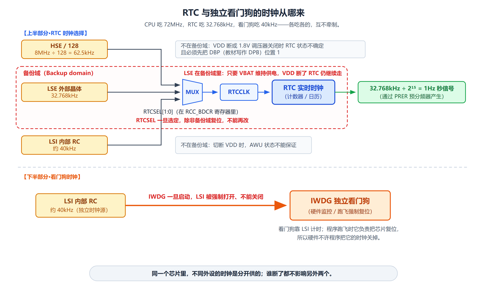

**这张图要看什么？**

1. **上半部分讲 RTC**：左边三个候选时钟源（HSE 经 ÷128、LSE 32.768kHz、LSI 约 40kHz），
   经过一个**多路选择开关 `RTCSEL[1:0]`**（住在 `RCC_BDCR` 寄存器里），选出 **RTCCLK** 送给 **RTC**；
2. **重点标出**：LSE 那个方框画在**备份域**的虚线框里，旁边写着"配 VBAT 电池 → VDD 断了 RTC 还走"；
3. **下半部分讲看门狗**：LSI 另有一条箭头 → **IWDG**，箭头上标注"**IWDG 一旦启动，LSI 被强制打开、不能关闭**"；
4. 图右侧顺便标出 RTC 的输出：32.768kHz ÷ 2¹⁵ = **1Hz 秒信号**。

**这张图要让我理解**：
> **同一个芯片里，不同外设的"口粮"是分开供的。**
> CPU 吃 HSE×9 的 72MHz；RTC 吃 LSE 的 32.768kHz（还可能有电池兜底）；看门狗吃 LSI 的 40kHz。
> 谁断了都不影响另外两个——这正是低功耗设计的基础。

### 3.4.4 看教材原图：STM32F103ZET6 的时钟树

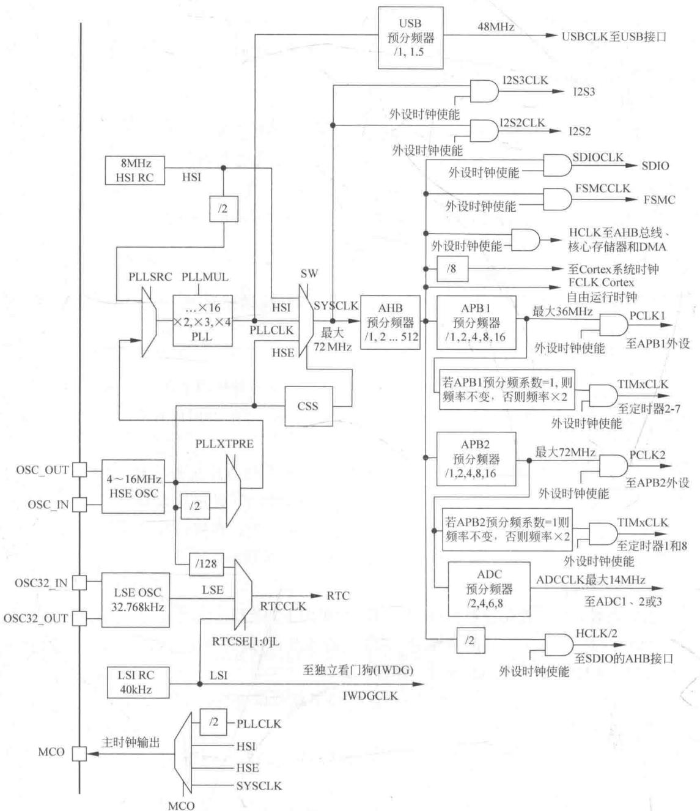

> ⚠️ **图片已核对**：MinerU 素材里把图 3-5、图 3-6 两张图的文件名对应反了。
> 这里用的 `bd6727e2…jpg` 才是**真正的时钟树**（HSI RC、HSE OSC、LSE、LSI、PLL、SW、SYSCLK、AHB/APB 预分频、
> TIMxCLK ×2 规则、ADCCLK、USBCLK、以及 RTCSEL / IWDGCLK / MCO 都在图上）。
> 详见文末《待核验》第 7 条。

**为什么叫"树"？**

因为信号像树枝一样**从一个根分叉出去**：

```
                          时钟源  →  选择/倍频  →  分频  →  分发到各外设
（左侧根须）              （中间主干）            （右侧枝杈）
```

#### 第一层：只看左半边的"时钟源"

图最左边（从上到下）：

| 图上位置 | 内容 | 频率 |
|---|---|---|
| 左上 | `HSI RC` | 8MHz |
| 左中 | `HSE OSC`，接 `OSC_IN` / `OSC_OUT` | 4～16MHz |
| 左下 | `LSE OSC`，接 `OSC32_IN` / `OSC32_OUT` | 32.768kHz |
| 左下 | `LSI RC` | 40kHz |
| 最左下 | `MCO`（主时钟输出） | 由开关选择输出哪一路时钟 |

> 图的最左下方还有三路"支流"，正好对应上一小节讲的内容：
> **RTC 的时钟源选择**（`RTCSEL[1:0]`：HSE/128、LSE、LSI → `RTCCLK` → RTC）、
> **独立看门狗时钟**（LSI → `IWDGCLK` → IWDG）、
> 以及最下面的 **MCO 主时钟输出**（把芯片内部时钟送到外部引脚，用来给示波器测量或给别的芯片当时钟）。
> 第一遍可以先不管它们，等回头复习 3.4.3 再看。

#### 第二层：看中间的"选择与倍频"

**PLL 部分**（图中偏左上）：

```
HSI 8MHz ──/2──┐
               ├──→ PLLSRC 选择 ──→ PLL（×2,×3,×4 …×16）──→ PLLCLK
HSE 4~16MHz ───┤        ↑
        └─/2───┘   PLLXTPRE（HSE 是否先 2 分频）
```

- **PLLSRC**：选谁作为 PLL 的输入——`HSI/2` 还是 `HSE`。
- **PLLXTPRE**：如果选 HSE，是否先做 2 分频。
- **PLLMUL**：倍频系数，可选 ×2～×16。

**SYSCLK 选择开关**（图中标 `SW`）：

```
HSI ────┐
HSE ────┼──→ SW 选择 ──→ SYSCLK（最大 72MHz）
PLLCLK ─┘
```

图里还画了一个 **CSS** 框（Clock Security System，时钟安全系统）：
如果 HSE 突然坏了（比如晶振虚焊），CSS 会自动把系统时钟切回 HSI，并产生中断，避免芯片"死机"。

#### 第三层：看右半边的"分频与分发"

这是时钟树最重要的部分，直接决定每个外设跑多快：

```
SYSCLK ──→ AHB 预分频器(/1,2,…512) ──→ HCLK
                                        ├──→ 内核 FCLK
                                        ├──→ /8 ──→ Cortex 系统定时器（SysTick 外部时钟）
                                        └──→ /2 ──→ SDIO
                    ┌───────────────────┴───────────────────┐
                    ↓                                        ↓
          APB1 预分频器(/1,2,4,8,16)              APB2 预分频器(/1,2,4,8,16)
                    ↓                                        ↓
                 PCLK1（最大 36MHz）                     PCLK2（最大 72MHz）
                    ↓                                        ↓
          APB1 外设（TIM2~7、USART2/3…）          APB2 外设（GPIO、ADC、USART1…）
```

**图上还有两个特别的框：**

```
APB1 预分频器旁：若 APB1 预分频系数 = 1，则频率不变；否则频率 ×2  ──→ TIMxCLK（定时器 2~7）
APB2 预分频器旁：若 APB2 预分频系数 = 1，则频率不变；否则频率 ×2  ──→ TIMxCLK（定时器 1 和 8）
```

**这就是著名的"定时器时钟 ×2 规则"。**

【教材内容】教材原文：

> 定时器时钟频率分配由硬件按以下两种情况自动设置：
> （1）如果相应的 APB 预分频系数是 **1**，定时器的时钟频率**与所在 APB 总线频率一致**。
> （2）否则，定时器的时钟频率被设为与其相连的 APB 总线频率的 **2 倍**。

**还有 ADC 和 USB：**

```
PCLK2 ──/2,/4,/6,/8──→ ADCCLK（最大 14MHz）
PLLCLK ──/1 或 /1.5──→ USBCLK（48MHz）
```

【教材内容】

> ADC 时钟由高速 APB2 时钟经 2、4、6 或 8 分频后获得。
> 如果需要在应用中使用 USB 接口，PLL 必须被设置为输出 48 或 72MHz 时钟，用于提供 48MHz 的 USBCLK 时钟。
> SDIO 接口的时钟频率固定为 HCLK/2。
> RCC 通过 AHB 时钟（HCLK）8 分频后作为 Cortex 系统定时器（SysTick）的外部时钟。

### 3.4.5 用具体数值演算：8MHz 怎么变成 72MHz？

**这是本节最重要的一个计算，请务必自己动手算一遍。**

**已知**：板子上焊的是 **8MHz** 晶振；我们希望 **HCLK = 72MHz**。

**第 1 步：选 HSE 作 PLL 输入，且不分频**

```
HSE = 8MHz
PLLXTPRE = 0（不分频）→ PLL 输入 = 8MHz
```

**第 2 步：设 PLL 倍频系数 = 9**

```
PLLCLK = 8MHz × 9 = 72MHz
```

**第 3 步：把 SYSCLK 切到 PLL**

```
SYSCLK = PLLCLK = 72MHz
```

**第 4 步：AHB 预分频器设 ÷1**

```
HCLK = SYSCLK ÷ 1 = 72MHz
```

**第 5 步：APB2 预分频器设 ÷1**

```
PCLK2 = HCLK ÷ 1 = 72MHz   ✓（APB2 允许到 72MHz）
```

**第 6 步：APB1 预分频器设 ÷2**

```
PCLK1 = HCLK ÷ 2 = 36MHz   ✓（APB1 最高只能 36MHz，正好顶格）
```

**第 7 步：算定时器的时钟**

- **TIM1、TIM8**（挂在 APB2）：APB2 预分频系数 = 1 → 定时器时钟 = PCLK2 = **72MHz**。
- **TIM2～TIM7**（挂在 APB1）：APB1 预分频系数 = 2 ≠ 1 → 定时器时钟 = PCLK1 × 2 = 36 × 2 = **72MHz**。

> **看到了吗？两条规则的结果都是 72MHz，但走的是完全不同的路径。**
> 这是考试和实际配置中最容易错的地方。

**第 8 步：算 ADC 时钟**

```
ADCCLK = PCLK2 ÷ 6 = 72 ÷ 6 = 12MHz   ✓（不超过 14MHz）
```

**第 9 步：算 USB 时钟**

```
USBCLK = PLLCLK ÷ 1.5 = 72 ÷ 1.5 = 48MHz   ✓
```

**汇总成一张表：**

| 时钟 | 数值 | 怎么来的 |
|---|---|---|
| HSE | 8MHz | 外部晶振 |
| PLLCLK | 72MHz | 8MHz × 9 |
| SYSCLK | 72MHz | 选 PLL |
| HCLK | 72MHz | SYSCLK ÷ 1 |
| FCLK | 72MHz | = HCLK |
| PCLK2 | 72MHz | HCLK ÷ 1 |
| PCLK1 | 36MHz | HCLK ÷ 2 |
| TIM1/TIM8 | 72MHz | PCLK2 × 1 |
| TIM2~TIM7 | 72MHz | PCLK1 × 2 |
| ADCCLK | 12MHz | PCLK2 ÷ 6 |
| USBCLK | 48MHz | PLLCLK ÷ 1.5 |
| SDIOCLK | 36MHz | HCLK ÷ 2 |
| SysTick 可选 | 72MHz 或 9MHz | HCLK 或 HCLK ÷ 8 |

**反过来想一想：如果只用内部 HSI 呢？**

```
HSI = 8MHz
HSI 必须先 ÷2 才能进 PLL：8 ÷ 2 = 4MHz
PLL 最大 ×16：4 × 16 = 64MHz
```

**结论：只用内部 HSI，最高只能到 64MHz，达不到 72MHz。**
这就是为什么最小系统板上**必须焊一颗 8MHz 晶振**——为了凑出 72MHz。

#### 【辅助理解图】72MHz 是怎么算出来的

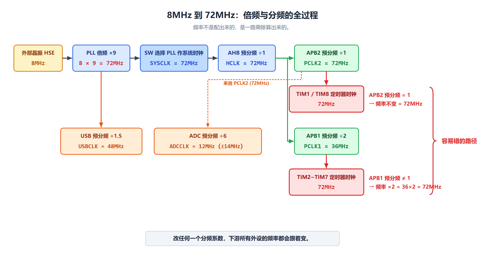

**这张图要看什么？**

- 图是一条从左到右的**流水线**，每个方框里写"运算"和"结果频率"；
- 关键节点用**红色数字**标出：`8MHz`、`×9`、`72MHz`、`÷1`、`÷2`、`36MHz`；
- 图下方单独画一个"定时器时钟"分支，标出"APB1 预分频≠1 → ×2 → 72MHz"这条容易错的路径。

**这张图要让我理解**：频率不是"配"出来的，是**一路乘除算出来的**。
改任何一个分频系数，下游所有外设的频率都会跟着变。

### 3.4.6 配置时钟靠哪些寄存器？

> 下面的寄存器位定义来自**教材第 6 章**（RCC 寄存器表，p161～p168）。
> 第 3 章只讲时钟结构，但既然要配置时钟，就必须先认识这几个寄存器。

#### 【先补一个前置知识：再复习一遍"寄存器"】

> 第 1 章说过：**寄存器 = 芯片内部的一排小开关**。
> 一个 32 位寄存器就是 **32 个小开关**，每个开关（bit）管一件事。
> 程序往寄存器里写一个数，就是把这 32 个开关**按某种组合拨动**。
> 硬件电路看到这些开关的状态，就改变自己的工作方式。

#### 寄存器 1：RCC_CR（时钟控制寄存器）

**属于谁**：RCC 模块（Reset and Clock Control，复位和时钟控制），基地址 `0x4002 1000`。
**偏移量**：`0x00`，所以**绝对地址 = `0x4002 1000`**。
**复位值**：`0x0000 XX83`（X 表示未定义）。
**它控制什么**：各个时钟源的**开/关**，以及"就绪了没有"。

**位图：**

```
位号:  31..26   25      24     23..20   19     18      17      16
      +-------+-------+-------+-------+------+-------+-------+-------+
      | 保留  |PLLRDY |PLLON  | 保留  |CSSON |HSEBYP |HSERDY |HSEON  |
      +-------+-------+-------+-------+------+-------+-------+-------+
                                                                  ↑
                                                          当前最关心：HSEON

位号:   15..8        7..3         2       1         0
      +-----------+------------+-------+---------+--------+
      |HSICAL[7:0]|HSITRIM[4:0]| 保留  | HSIRDY  | HSION  |
      +-----------+------------+-------+---------+--------+
```

**当前关心的几个 bit：**

| 位 | 名称 | 全称 | 写 0 会怎样 | 写 1 会怎样 | 硬件发生什么 |
|---|---|---|---|---|---|
| 16 | **HSEON** | HSE ON | 关闭外部高速振荡器 | **开启外部 4~16MHz 振荡器** | 晶振开始起振 |
| 17 | **HSERDY** | HSE Ready | —（只读） | — | 振荡稳定后**硬件自动置 1** |
| 24 | **PLLON** | PLL ON | 关闭 PLL | **使能 PLL** | PLL 开始工作 |
| 25 | **PLLRDY** | PLL Ready | —（只读） | — | PLL 锁定后**硬件自动置 1** |
| 19 | CSSON | Clock Security System ON | 关闭时钟监测 | 开启时钟监测（HSE 就绪时） | HSE 失效时自动切 HSI |
| 0 | HSION | HSI ON | 关闭内部 8MHz RC | 开启内部 8MHz RC | HSI 开始振荡 |
| 1 | HSIRDY | HSI Ready | —（只读） | — | HSI 稳定后硬件置 1 |

**程序怎么操作（典型流程）：**

```c
RCC->CR |= (1 << 16);            // 打开 HSE
while ((RCC->CR & (1 << 17)) == 0);   // 等 HSERDY 变 1
```

**逐行说明：**

1. `RCC->CR |= (1 << 16);`
   - **CPU 做什么**：读 `0x40021000` 的当前值，把 bit16 置 1，再写回。
   - **寄存器发生什么**：HSEON 位变成 1。
   - **硬件发生什么**：外部晶振电路被使能，开始振荡。
2. `while ((RCC->CR & (1 << 17)) == 0);`
   - **CPU 做什么**：反复读 `0x40021000`，检查 bit17。
   - **寄存器发生什么**：什么也不改（只读）。
   - **硬件发生什么**：晶振稳定后，HSERDY 硬件自动变 1，循环退出。

> **注意**：**一定要等 HSERDY**。晶振不是一通电就稳定的，
> 不等就切时钟，芯片可能跑飞。

#### 寄存器 2：RCC_CFGR（时钟配置寄存器）

**属于谁**：RCC。
**偏移量**：`0x04`，**绝对地址 = `0x4002 1004`**。
**复位值**：`0x0000 0000`。
**它控制什么**：**选哪个时钟源当系统时钟**，以及**各路分频系数**。

**位图：**

```
位号:  31..27   26 25 24   23    22      21 20 19 18    17       16
      +-------+---------+-----+-------+--------------+--------+--------+
      | 保留  |MCO[2:0] |保留 |USBPRE | PLLMUL[3:0]  |PLLXTPRE| PLLSRC |
      +-------+---------+-----+-------+--------------+--------+--------+
                                                                  ↑
                                                          当前最关心：PLLSRC

位号:   15 14     13 12 11    10 9 8     7 6 5 4      3 2      1 0
      +---------+----------+----------+-----------+---------+---------+
      |ADCPRE   | PPRE2    | PPRE1    |  HPRE     |  SWS    |   SW    |
      | [1:0]   | [2:0]    | [2:0]    |  [3:0]    | [1:0]   | [1:0]   |
      +---------+----------+----------+-----------+---------+---------+
                                                    ↑           ↑
                                              只读，反映  SW：选择时钟源
                                              当前实际源
```

**关键字段含义：**

| 字段 | 位 | 作用 | 取值 |
|---|---|---|---|
| **SW[1:0]** | 1:0 | **选系统时钟源** | `00`=HSI；`01`=HSE；`10`=PLL；`11`=不可用 |
| **SWS[1:0]** | 3:2 | 只读，反映**实际**在用的源 | 同上编码 |
| **HPRE[3:0]** | 7:4 | AHB 预分频 | `0000`=÷1；`1000`=÷2；`1001`=÷4；…… |
| **PPRE1[2:0]** | 10:8 | APB1 预分频 | `0xx`=÷1；`100`=÷2；`101`=÷4；`110`=÷8；`111`=÷16 |
| **PPRE2[2:0]** | 13:11 | APB2 预分频 | 同上 |
| **ADCPRE[1:0]** | 15:14 | ADC 预分频 | `00`=÷2；`01`=÷4；`10`=÷6；`11`=÷8 |
| **PLLSRC** | 16 | PLL 输入选择 | `0`=HSI÷2；**`1`=HSE** |
| **PLLXTPRE** | 17 | HSE 是否先 ÷2 | `0`=不分频；`1`=÷2 |
| **PLLMUL[3:0]** | 21:18 | **PLL 倍频系数** | `0000`=×2；`0001`=×3；……；**`0111`=×9**；……；`1110`=×16 |
| **USBPRE** | 22 | USB 预分频 | `0`=PLL÷1.5；`1`=PLL÷1 |
| **MCO[2:0]** | 26:24 | 把时钟**输出到 MCO 引脚**。MCO = **Microcontroller Clock Output，微控制器时钟输出引脚**（就是 PA8 那根脚，表 3-3 第 67 脚的复用功能里写着 `MCO`）。大白话：把芯片内部的时钟"引一根线出来"，方便用示波器量、或者送给别的芯片当时钟 | `0xx`=无输出；`100`=SYSCLK；`101`=HSI；`110`=HSE；`111`=PLL÷2 |

**注意 PLLMUL 的编码规律**（很容易记错）：

```
PLLMUL 的编码值 = 倍频数 - 2
0000 → ×2
0001 → ×3
...
0111 → ×9      ← 我们要用的
...
1110 → ×16
```

#### 寄存器 3：RCC_APB2ENR（APB2 外设时钟使能寄存器）

**属于谁**：RCC。
**偏移量**：`0x18`，**绝对地址 = `0x4002 1018`**。
**复位值**：`0x0000 0000`。
**它控制什么**：**APB2 上每个外设的时钟开不开**。

**位图（分成两段画）：**

```
位号:  31..16 | 15     14       13     12     11     10     9      8
      +-------+-------+--------+------+------+------+------+------+------+
      | 保留  |ADC3EN |USART1EN|TIM8EN|SPI1EN|TIM1EN|ADC2EN|ADC1EN|IOPGEN|
      +-------+-------+--------+------+------+------+------+------+------+

位号:  7      6      5      4      3      2      1      0
      +------+------+------+------+------+------+------+--------+
      |IOPFEN|IOPEEN|IOPDEN|IOPCEN|IOPBEN|IOPAEN| 保留 | AFIOEN |
      +------+------+------+------+------+------+------+--------+
                                          ↑
                                   当前最关心：IOPAEN（GPIOA 时钟）
```

**关键 bit：**

| 位 | 名称 | 管谁 | 写 0 | 写 1 |
|---|---|---|---|---|
| 0 | AFIOEN | 复用功能 IO（AFIO） | 时钟关 | 时钟开 |
| 2 | IOPAEN | GPIOA | 时钟关 | **时钟开** |
| 3 | IOPBEN | GPIOB | 时钟关 | 时钟开 |
| 4 | IOPCEN | GPIOC | 时钟关 | 时钟开 |
| 5 | IOPDEN | GPIOD | 时钟关 | 时钟开 |
| 6 | IOPEEN | GPIOE | 时钟关 | **时钟开** |
| 7 | IOPFEN | GPIOF | 时钟关 | 时钟开 |
| 8 | IOPGEN | GPIOG | 时钟关 | 时钟开 |
| 9 | ADC1EN | ADC1 | 时钟关 | 时钟开 |
| 10 | ADC2EN | ADC2 | 时钟关 | 时钟开 |
| 11 | TIM1EN | TIM1 | 时钟关 | 时钟开 |
| 12 | SPI1EN | SPI1 | 时钟关 | 时钟开 |
| 13 | TIM8EN | TIM8 | 时钟关 | 时钟开 |
| 14 | USART1EN | USART1 | 时钟关 | 时钟开 |
| 15 | ADC3EN | ADC3 | 时钟关 | 时钟开 |

> 【教材内容】教材（第 3 章 p81）特别强调过一句非常重要的话：
>
> > STM32 处理器因为低功耗的需要，各模块需要**分别独立开启时钟**。
> > 因此，当需要使用某个外设模块时，**务必要先使能对应的时钟**。
> > **否则，这个外设不能工作。**

**这就是初学者最常踩的坑**：

> 明明往 GPIOA 的寄存器里写了值，为什么引脚没反应？
> 因为**忘了开 GPIOA 的时钟**——寄存器根本"没通电"。

#### 动手算一个位操作：打开 GPIOA 和 GPIOE 的时钟

**目标**：让 `RCC_APB2ENR` 的 bit2（GPIOA）和 bit6（GPIOE）变成 1，其他位不变。

**第一步**：造掩码。

```
1 << 2  = 0x0000 0004
1 << 6  = 0x0000 0040
掩码 = 0x0000 0004 | 0x0000 0040 = 0x0000 0044
```

**第二步**：运算前 / 掩码 / 运算后。

```
运算前（RCC_APB2ENR 当前值，假设为 0）：
  0000 0000 0000 0000 0000 0000 0000 0000    = 0x00000000

掩码（|= 0x00000044）：
  0000 0000 0000 0000 0000 0000 0100 0100    = 0x00000044
                                   ↑  ↑
                                 bit6 bit2

运算后：
  0000 0000 0000 0000 0000 0000 0100 0100    = 0x00000044
```

**C 代码写法：**

```c
RCC->APB2ENR |= (1 << 2) | (1 << 6);   // 同时开 GPIOA、GPIOE 时钟
```

**硬件发生什么**：GPIOA、GPIOE 两个模块的内部时钟开始供给，它们的寄存器从此可以被正常读写。

### 3.4.7 代码到底做了什么：教材的 72MHz 时钟配置程序

【教材内容】教材第 6 章【例 6-1】里有一段汇编子程序 `RCC_CONFIG_72MHZ`，专门用来把时钟配到 72MHz。
（这里提前引用它，因为它是理解时钟树的最好例子。第 6 章还会再见到它。）

**这一段代码想完成什么？**

> 把系统时钟从复位后的默认状态（HSI 8MHz），
> 一步步切换成 **HSE 8MHz → PLL ×9 → SYSCLK 72MHz → HCLK 72MHz / PCLK2 72MHz / PCLK1 36MHz**。

**代码原文（教材 p173）：**

```asm
;RCC 时钟配置 HCLK = 72MHz = HSE * 9, PCLK2 = HCLK, PCLK1 = HCLK/2
RCC_CONFIG_72MHZ
    LDR R1, = 0x40021000        ; RCC_CR
    LDR R0, [R1]
    LDR R2, = 0x00010000        ; HSEON
    ORR R0, R2
    STR R0, [R1]

WAIT_HSE_RDY
    LDR R2, = 0x00020000        ; HSERDY
    LDR R0, [R1]
    ANDS R0, R2
    CMP R0, #0
    BEQ WAIT_HSE_RDY

    LDR R1, = 0x40022000        ; FLASH_ACR
    MOV R0, #0x12
    STR R0, [R1]

    LDR R1, = 0x40021004        ; RCC_CFGR 时钟配置寄存器
    LDR R0, [R1]
    LDR R2, = 0x001D0400
    ORR R0, R2
    STR R0, [R1]

    LDR R1, = 0x40021000        ; RCC_CR
    LDR R0, [R1]
    LDR R2, = 0x01000000        ; PLLON
    ORR R0, R2
    STR R0, [R1]

WAIT_PLL_RDY
    LDR R2, = 0x02000000        ; PLLRDY
    LDR R0, [R1]
    ANDS R0, R2
    CMP R0, #0
    BEQ WAIT_PLL_RDY

    LDR R1, = 0x40021004        ; RCC_CFGR
    LDR R0, [R1]
    MOV R2, #0x02               ; SW = 10，选 PLL 作系统时钟
    ORR R0, R2
    STR R0, [R1]

WAIT_HCLK_USEPLL
    LDR R0, [R1]
    ANDS R0, #0x08              ; SWS = 10
    CMP R0, #0x08
    BNE WAIT_HCLK_USEPLL
    BX LR
```

**按逻辑块拆解：**

**第 ① 块：打开 HSE**

```asm
LDR R1, = 0x40021000    ; R1 指向 RCC_CR
LDR R0, [R1]            ; 读出当前值
LDR R2, = 0x00010000    ; 0x00010000 = bit16 = HSEON
ORR R0, R2              ; 把 bit16 置 1（其他位不变）
STR R0, [R1]            ; 写回
```

- **CPU 做什么**：把 `0x40021000` 的值读进 R0，和 `0x00010000` 做**或运算**，再写回。
- **寄存器发生什么**：RCC_CR 的 **bit16（HSEON）变成 1**。
- **硬件发生什么**：外部 8MHz 晶振开始振荡。

```
运算前:  0000 0000 0000 0000 0000 0000 1000 0011   (复位值 0x0000XX83 的低位示意)
掩码:    0000 0000 0000 0001 0000 0000 0000 0000   = 0x00010000
                                              ↑ bit16
运算后:  0000 0000 0000 0001 0000 0000 1000 0011
```

**第 ② 块：等 HSE 稳定**

```asm
WAIT_HSE_RDY
LDR R2, = 0x00020000    ; bit17 = HSERDY
LDR R0, [R1]
ANDS R0, R2             ; 取出 bit17
CMP R0, #0
BEQ WAIT_HSE_RDY        ; 还是 0 就继续等
```

- **硬件发生什么**：晶振稳定后，硬件自动把 HSERDY（bit17）置 1，循环退出。

**第 ③ 块：设置 Flash 等待周期**

```asm
LDR R1, = 0x40022000    ; FLASH_ACR
MOV R0, #0x12
STR R0, [R1]
```

- `0x12` 是什么？把它拆成二进制：

```
0x12 = 0001 0010
       ││││ ││││
       ││││ │││└─ bit0 = 0  ┐
       ││││ ││└── bit1 = 1  ├─ LATENCY[2:0] = 010 = 2 个等待周期
       ││││ │└─── bit2 = 0  ┘
       ││││ └──── bit3 = 0     HLFCYA（半周期访问使能）= 0
       │││└────── bit4 = 1     PRFTBE（预取缓冲使能）= 1
       ││└─────── bit5 = 0     PRFTBS（预取状态，只读）
       └┴──────── bit7~6 = 00
```

- **为什么必须设 2 个等待周期？**
  因为 **Flash 的速度跟不上 CPU**。当 HCLK > 48MHz 时，CPU 一个周期内读不完 Flash，
  必须"多等 2 个周期"再取数据。这是硬件时序的硬要求。
- **bit4 = 1 是什么意思？** 打开**预取缓冲区**（3.3.8 节讲过），让 Flash 提前把指令准备好。

> 【补充解释】教材第 6 章只给出了这条指令（`LDR R1,=0x40022000` / `MOV R0,#0x12` / `STR R0,[R1]`），
> **没有列出 FLASH_ACR 的位定义**。上面这段"逐位拆解"是本讲义按 **STM32F103 参考手册（RM0008）**
> 的 FLASH_ACR 定义补充的：`LATENCY[2:0]` = bit2:0，`HLFCYA` = bit3，`PRFTBE` = bit4，`PRFTBS` = bit5。
> 请对照参考手册核对。

**第 ④ 块：配置 PLL 和分频器**

```asm
LDR R1, = 0x40021004    ; RCC_CFGR
LDR R0, [R1]
LDR R2, = 0x001D0400    ; 关键常数
ORR R0, R2
STR R0, [R1]
```

**这个 `0x001D0400` 到底设置了什么？必须逐位拆开看：**

先把它写成二进制（**一位十六进制 = 4 个二进制位**，所以 8 位十六进制正好摊成 32 位）：

```
0x 0    0    1    D    0    4    0    0
   0000 0000 0001 1101 0000 0100 0000 0000
```

再一位一位对号入座（**这张表就是"怎么把十六进制拆成 bit"的标准动作，值得照着做一遍**）：

| 十六进制位 | `0` | `0` | `1` | `D` | `0` | `4` | `0` | `0` |
|---|---|---|---|---|---|---|---|---|
| 覆盖的 bit | 31~28 | 27~24 | 23~20 | 19~16 | 15~12 | 11~8 | 7~4 | 3~0 |
| 二进制 | `0000` | `0000` | `0001` | `1101` | `0000` | `0100` | `0000` | `0000` |
| 其中是 1 的 bit | — | — | **bit20** | **bit19、bit18、bit16** | — | **bit10** | — | — |

> 怎么从 `D = 1101` 看出是 bit19、bit18、bit16？
> 这 4 个二进制位按"高位在前"排：`1 1 0 1` 依次对应 **bit19、bit18、bit17、bit16**，
> 是 1 的就是 bit19、bit18、bit16，是 0 的是 bit17。
> 记住这条对应关系，以后看任何十六进制常数都不会懵。

也就是说：**这个常数一共只把 5 个位置成了 1：bit20、bit19、bit18、bit16、bit10，其余全是 0。**

**对照 RCC_CFGR 位图，逐项翻译：**

| bit | 字段 | 值 | 含义 |
|---|---|---|---|
| 26:24 | MCO[2:0] | `000` | 不输出时钟到 MCO 引脚 |
| 22 | USBPRE | 0 | USB 时钟 = PLL ÷ 1.5 |
| **21:18** | **PLLMUL[3:0]** | **`0111`** = bit21=0、bit20=1、bit19=1、bit18=1 | **倍频 ×9** |
| 17 | PLLXTPRE | 0 | HSE 不分频 |
| 16 | PLLSRC | 1 | **PLL 输入选 HSE** |
| 15:14 | ADCPRE | `00` | ADC ÷2 |
| 13:11 | PPRE2[2:0] | `000` | APB2 **不分频** → PCLK2 = 72MHz |
| 10:8 | PPRE1[2:0] | `100` | APB1 **÷2** → PCLK1 = 36MHz |
| 7:4 | HPRE[3:0] | `0000` | AHB **不分频** → HCLK = SYSCLK |
| 3:2 | SWS[1:0] | `00` | 只读位，此时硬件还在用 HSI |
| 1:0 | SW[1:0] | `00` | 暂时还是 HSI（后面再切） |

> **注意字段边界**：`PLLMUL[3:0]` 占的是 **bit21、bit20、bit19、bit18 这 4 位**，
> 其中 **bit18 是 PLLMUL[0]（最低位）、bit21 是 PLLMUL[3]（最高位）**——
> "位数"和"bit 号"是**反着**的，这是初学者最容易看错的地方。
> 这里 `bit21=0、bit20=1、bit19=1、bit18=1`，按 [3][2][1][0] 写出来就是 `0111`：
>
> ```
> PLLMUL 编码 = 倍频数 − 2
> 0b0111 = 7（十进制） → 7 + 2 = 9 → 倍频 ×9   ✓
> ```

**再单独看 bit10 = 1：** bit10 是 PPRE1 的第 3 位（PPRE1[2]），
`PPRE1 = 100` 正好是"**HCLK ÷ 2**"的编码。

> **这一条常数把"倍频 ×9、PLL 源选 HSE、APB1 ÷2、APB2 不分频"四件事一次性配好了。**
> 为什么可以一次性写？因为 PLL 还没启动，`PLLMUL` 等参数此时改是合法的。
> 【教材内容】教材强调过：**PLL 的设置必须在它被激活前完成；一旦 PLL 被激活，这些参数就不能再改。**

**第 ⑤ 块：启动 PLL**

```asm
LDR R1, = 0x40021000    ; RCC_CR
LDR R0, [R1]
LDR R2, = 0x01000000    ; bit24 = PLLON
ORR R0, R2
STR R0, [R1]
```

- **寄存器发生什么**：RCC_CR 的 bit24（PLLON）变 1。
- **硬件发生什么**：PLL 开始工作，输出逐渐稳定到 72MHz。

**第 ⑥ 块：等 PLL 锁定**

```asm
WAIT_PLL_RDY
LDR R2, = 0x02000000    ; bit25 = PLLRDY
...
```

- **硬件发生什么**：PLL 锁定后，硬件把 PLLRDY（bit25）置 1。

**第 ⑦ 块：把系统时钟切到 PLL**

```asm
LDR R1, = 0x40021004    ; RCC_CFGR
LDR R0, [R1]            ; ★ 先把 RCC_CFGR 的当前值读进 R0（这一行不能漏！）
MOV R2, #0x02           ; SW = 10
ORR R0, R2
STR R0, [R1]
```

- `0x02 = 0b10` → 写进 SW[1:0]，表示"**用 PLL 作系统时钟**"。
- ⚠️ **`LDR R0, [R1]` 这一行千万不能漏**（本讲义前面的完整代码列表里有它，这里单独摘出来讲时同样要保留）。
  因为第 ⑤ 块借用了同一个寄存器 R0 去读 `RCC_CR`，如果这里不重新把 `RCC_CFGR` 读进 R0，
  那么 `ORR R0, R2` 就是把**残留的 RCC_CR 值**和 `0x02` 或在一起，再写进 `RCC_CFGR`——
  等于**把另一个寄存器的内容糊到了时钟配置寄存器上**，分频系数、PLL 倍频等设置全部被污染。
  这是"照着代码抄却抄漏一行"最典型的后果：语法没错，硬件行为全错。

**第 ⑧ 块：确认切换成功**

```asm
WAIT_HCLK_USEPLL
LDR R0, [R1]
ANDS R0, #0x08          ; 取 bit3
CMP R0, #0x08
BNE WAIT_HCLK_USEPLL
```

- `SWS[1:0]` 占 bit3:2。bit3 = 1 表示 SWS = `10`，即"**硬件已经真的切到 PLL 了**"。
- **为什么不能只看 SW，还要看 SWS？**
  因为 SW 是你"下的命令"，SWS 是"硬件实际状态"。
  时钟切换需要时间，必须等 SWS 确认。

> 【教材内容】教材原文：
> 只有当目标时钟源准备就绪了（经过启动稳定阶段的延迟或 PLL 稳定），
> 从一个时钟源到另一个时钟源的切换才会发生。
> 在被选择时钟源没有就绪时，系统时钟的切换不会发生。

### 3.4.8 看教材原图：外部晶体的电路连接

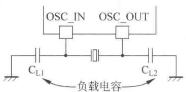

> ⚠️ **图片已核对**：这张 `17a89e94…jpg` 画的正是 **OSC_IN / OSC_OUT 之间接晶体、两侧各一个负载电容 C_L1 / C_L2、
> 下面用弧形箭头标注"负载电容"**——和本节文字一一对应。
> （MinerU 素材原来把它标成了"时钟树"，属于文件名挂错，详见文末《待核验》第 7 条。）

**这张图要看什么？**

1. **上面两个方框**：`OSC_IN` 和 `OSC_OUT`，这是 STM32 芯片上引出来的两个引脚。
2. **中间那个"夹心"符号**：石英晶体（晶振）。
3. **晶体两侧各有一个电容 `C_L1`、`C_L2`**，它们下面接地。
4. **图下方的弧形箭头**标着"**负载电容**"，说明这两个电容合起来叫负载电容。

**电路连接关系：**

```
   OSC_IN ●────────┬──────┤├──────┬────────● OSC_OUT
                   │     晶体      │
                  ─┴─            ─┴─
                  C_L1           C_L2
                   │              │
                  GND            GND
```

**教材原文要点：**

> 在 OSC_IN 和 OSC_OUT 引脚之间连接 4～16MHz 外部振荡器为系统提供精确的主时钟。
> 为了减少时钟输出的失真和缩短启动稳定时间，晶体/陶瓷谐振器和负载电容器必须尽可能地**靠近振荡器引脚**。
> 负载电容值必须根据所选择的振荡器来调整。

**为什么需要负载电容？**

> 【类比】
> 晶振像一个音叉，敲一下会以固定频率振动。
> 负载电容像"音叉周围的空气条件"——条件不对，音叉的频率就会偏。
> 所以电容值要和晶振匹配，不能随便选。

**为什么要求"尽量靠近引脚"？**

> 因为晶振信号频率高、幅度小，
> 引线长了会像天线一样引入干扰、产生寄生电容，导致时钟不稳甚至不起振。

### 3.4.9 【辅助理解图】时钟树简化版

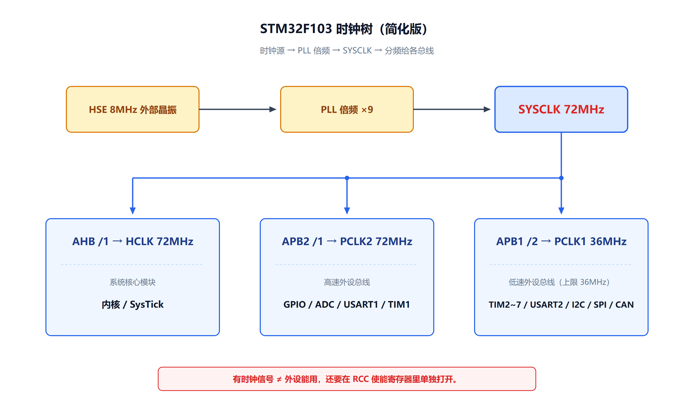

**这张图要看什么？**

- 左边一列是 **5 个时钟源**（HSI / HSE / LSI / LSE / PLL），每个画成一个方框，标上频率；
- 中间是 **SW 选择开关**，用一个大箭头表示"三选一"；
- 右边是一条**分频流水线**：SYSCLK → AHB 预分频 → HCLK → APB 预分频 → PCLK1 / PCLK2；
- 每条支路末端标出**最高频率限制**（72MHz / 36MHz / 14MHz）；
- 图下方单独标出"**每个外设还要单独开时钟**"这句话。

**这张图要让我理解**：

1. 时钟是**从源头一路分发下来**的，不是每个外设各有一个；
2. 分频系数决定了每条支路的速度；
3. **"有时钟信号" ≠ "外设能用"**——外设还得在 RCC 的使能寄存器里单独打开。

### 3.4.10 容易搞混的地方

1. **APB1 最高 36MHz，不是 72MHz。**
   教材说"APB1 操作速度限于 36MHz"，配置时如果给 APB1 分了 72MHz，外设可能工作不正常。
2. **定时器时钟不是简单的 PCLK1。**
   APB1 预分频 ≠ 1 时，定时器时钟 = PCLK1 × 2。所以 PCLK1 = 36MHz 时，TIM2~7 反而跑 72MHz。
3. **`SW` 和 `SWS` 不是一回事。**
   `SW` 是你写的命令，`SWS` 是硬件实际状态。切换时钟后要**等 SWS**。
4. **PLL 参数不能在 PLL 启动后改。**
   教材原文：一旦 PLL 被激活，这些参数就不能被改动。
5. **复位后默认时钟是 HSI 8MHz，不是 HSE。**
   教材原文：系统复位后，HSI 振荡器被选为系统时钟。
6. **忘了开外设时钟，寄存器写了也没用。**
   这是初学者 90% 的"灯不亮"问题的原因。

### 3.4.11 本节真正要记住什么

- 5 个时钟源：**HSI(8MHz) / HSE(4~16MHz) / LSI(40kHz) / LSE(32.768kHz) / PLL**。
- 主链路：**HSE 8MHz ×9 = 72MHz → SYSCLK → AHB÷1 → HCLK 72MHz**。
- **APB2 最高 72MHz，APB1 最高 36MHz，ADCCLK 最高 14MHz**。
- **RTC 的时钟单独选**：由 `RCC_BDCR` 的 `RTCSEL[1:0]` 在 **HSE/128、LSE、LSI** 里三选一；
  其中只有 **LSE 在备份域**——**LSE + VBAT 电池**能让 RTC 在 VDD 断电后继续走。选择一旦定了，**只有备份域复位才能改**。
- **独立看门狗（IWDG）吃 LSI**：IWDG 一旦启动，**LSI 被强制打开、不能关闭**（防止程序把看门狗"关掉"）。
- **定时器 ×2 规则**：APB 预分频 = 1 → 不变；否则 ×2。
- 配置时钟的寄存器：**RCC_CR（开关与就绪标志）、RCC_CFGR（选源与分频）、RCC_APBxENR（外设时钟使能）**。
- 常量 `0x001D0400` = PLLSRC 选 HSE + PLLMUL ×9 + APB1 ÷2 + APB2 ÷1。
- `FLASH_ACR = 0x12` = 2 个等待周期 + 预取缓冲使能。
- **用外设前必须先开时钟**，否则外设不工作。

---

## 3.5 STM32F103VET6 的引脚

### 3.5.1 先别急着看教材：这一节要干什么？

这一节要回答：

> **这 100 根引脚，每一根是干什么的？**
> **为什么有的引脚名字后面还跟着一长串斜杠（比如 `PA9/USART1_TX/TIM1_CH2`）？**

一句话答案：

> **引脚是芯片和外部世界唯一的物理接口。**
> **每个引脚可以"身兼数职"，具体当什么，由你配置的复用功能决定。**

### 3.5.2 你需要先知道的东西

#### 【先补一个前置知识：什么叫引脚、封装？】

- **引脚**（Pin）= 芯片外壳上伸出来的金属"腿"（或者焊盘）。
  芯片内部几亿个晶体管，最终只能通过这几十上百根引脚和外部电路连接。
- **封装**（Package）= 芯片的**外形和引脚的排列方式**。
  同一颗芯片内核，可以做成不同封装，引脚数也可能不同。

**STM32F103VET6 用的是 LQFP100 封装：**

- **LQFP** = Low-profile Quad Flat Package，**薄型四方扁平封装**。
- 特点：四边都有引脚，引脚像"蜈蚣腿"一样从四边伸出来。
- **100** 表示一共有 100 根引脚（编号 1～100）。

```
           100 ←                                        → 76
        ┌───────────────────────────────────────────────────┐
    1 → │                                                   │ ← 75
        │                                                   │
        │              STM32F103VET6                        │
        │              (LQFP100)                            │
        │                                                   │
   25 → │                                                   │ ← 51
        └───────────────────────────────────────────────────┘
             26 →                                   → 50
```

> 【补充解释】LQFP100 的引脚编号是有规律的：
> 从 **1 号脚（左上角）**开始，**逆时针**绕一圈，到 **100 号脚**结束。所以四条边分别是：
>
> | 哪条边 | 从哪到哪 | 数的方向 |
> |---|---|---|
> | 左边一列 | 1 → 25 | 从上往下 |
> | 下边一排 | 26 → 50 | 从左往右 |
> | 右边一列 | 51 → 75 | 从下往上 |
> | **上边一排** | **76 → 100** | **从右往左**（最容易记反！） |
>
> 把它和后面 3.5.3 的图 3-7 对着看：图 3-7 上边一排左边写的是 `100`，右边写的是 `76`，就是这个道理。

#### 【先补一个前置知识：什么叫复位？】

**复位**（Reset）= **把芯片的所有寄存器恢复到出厂默认状态**，让程序从头开始跑。

- 芯片刚上电时要复位（不然状态是乱的）；
- 程序跑飞了要复位；
- 手动按复位键要复位。

STM32 的复位引脚叫 **NRST**（N 表示"低电平有效"，即**拉到低电平就复位**）。

#### 【先补一个前置知识：什么叫上拉/下拉电阻？】

- **上拉电阻**：把一个引脚通过电阻连到**电源正极（VDD）**，让它在"没人管"的时候保持**高电平**。
- **下拉电阻**：把一个引脚通过电阻连到**地（GND）**，让它在"没人管"的时候保持**低电平**。

**为什么需要？** 因为如果一个引脚什么都不接（悬空），它的电平是**不确定的**，
可能因为一点点干扰就在高、低之间乱跳，导致电路误动作。
上拉/下拉电阻就是给它一个"默认答案"。

> 【类比】
> 上拉电阻像一个弹簧，把开关默认顶到"开"的位置；
> 你想关的时候用力按下去就行，松手又自动弹回"开"。

### 3.5.3 看教材原图：LQFP100 引脚图

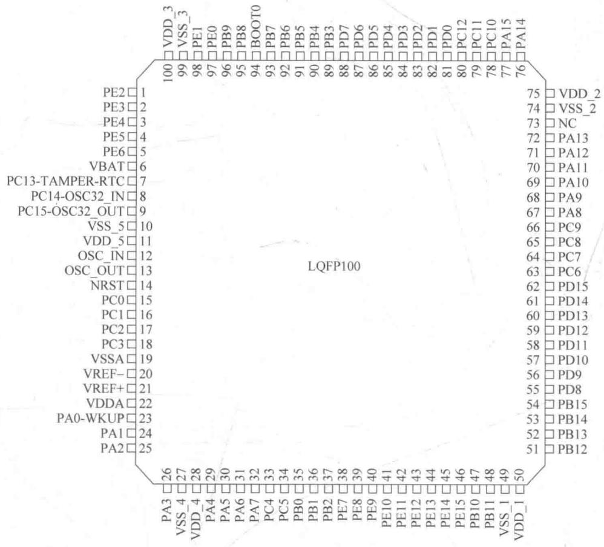

**怎么读这张图？**

1. **中间写着 `LQFP100`**，表示这是 100 脚的四方扁平封装。
2. **四个边上的小方框**就是引脚，方框旁边写着**引脚编号**（1～100）。
3. **方框外面的文字**是**引脚名称**，比如 `PE2`、`VDD_5`、`NRST`、`OSC_IN`。
4. **看编号 1 的位置**：在左上角。从 1 开始逆时针绕一圈，到 100 结束。

**第一遍不要试图记住每个引脚。** 先做一件事：**给引脚分类**。

### 3.5.4 100 根引脚分成几类？

把图 3-7 和教材表 3-3 结合起来，STM32F103VET6 的引脚可以分成下面几大类：

| 类别 | 典型引脚 | 数量 | 作用 |
|---|---|---|---|
| **电源类** | `VDD_1`~`VDD_5`、`VSS_1`~`VSS_5`、`VDDA`、`VSSA`、`VREF+`、`VREF-`、`VBAT` | **15** | 给芯片供电、给模拟部分供电、给 RTC 后备供电 |
| **复位类** | `NRST` | 1 | 低电平复位 |
| **时钟类（专用脚）** | `OSC_IN`、`OSC_OUT` | **2** | 接 4～16MHz 外部晶振（HSE）。32.768kHz 晶振接在 `PC14`/`PC15` 上，但那两根本质上是 GPIO，见下方说明 |
| **启动类** | `BOOT0`（`BOOT1` 复用为 `PB2`） | 1（+1，`BOOT1` 就是 `PB2`，已算在 GPIO 里） | 决定从哪里启动 |
| **GPIO 类** | `PA0`~`PA15`、`PB0`~`PB15`、`PC0`~`PC15`、`PD0`~`PD15`、`PE0`~`PE15` | **80** | 通用输入输出（可配置成各种复用功能） |
| **调试类** | `PA13`(JTMS/SWDIO)、`PA14`(JTCK/SWCLK)、`PA15`(JTDI)、`PB3`(JTDO)、`PB4`(NJTRST) | 5（**含在 GPIO 的 80 里**） | 下载程序和在线调试 |
| **模拟类** | `PC0`~`PC5`、`VREF±` | （**含在 GPIO 的 80 里**；`VREF±` 是电源类那 15 个里的） | ADC 输入、参考电压 |
| **未连接** | 引脚 73 标注 `Not connected` | 1 | 空脚 |

**验证一下数量**（一根一根数清楚，**不重复、不遗漏**）：

```
GPIO 口      PA0~PA15(16) + PB0~PB15(16) + PC0~PC15(16)
             + PD0~PD15(16) + PE0~PE15(16)                   = 80
电源         VDD_1~VDD_5(5) + VSS_1~VSS_5(5)
             + VDDA + VSSA + VREF+ + VREF- + VBAT            = 15
复位         NRST                                            =  1
时钟（专用） OSC_IN、OSC_OUT                                  =  2
启动         BOOT0                                           =  1
未连接       73 脚 NC（Not connected，空脚）                   =  1
─────────────────────────────────────────────────────────────────
合计                                                             100   ✓
```

> 【补充解释】数这 100 根脚时，最容易犯的**两个错**，这里专门说清楚：
>
> 1. **PC14、PC15 会被重复计算。**
>    它们确实默认接 32.768kHz 晶振（表 3-3 第 8、9 脚写的就是 `PC14-OSC32_IN`、`PC15-OSC32_OUT`），
>    但**它们本质上是 PC 口的 GPIO**，已经算在那 80 根里了。
>    所以"时钟类"只能算真正**专用的** `OSC_IN`、`OSC_OUT` **2 根**，不能再加 2。
> 2. **73 脚是 NC（Not connected，空脚）。**
>    它不接任何东西，但**同样占一个引脚编号**，必须算进去，否则总数永远差 1。
>
> 同理：5 个调试脚（PA13、PA14、PA15、PB3、PB4）和 PC0~PC5 这些"模拟脚"，
> 也都在 80 根 GPIO 里面，不要再另外加一遍。
>
> **为什么 VET6 是 80 根 GPIO？** 因为 100 脚里扣掉 20 根专用脚（15 电源 + 1 复位 + 2 时钟 + 1 BOOT0 + 1 NC），正好剩 80。
> 而 ZET6（144 脚）多了 PF、PG 两组，所以是 112 根。

#### 逐个看电源类引脚（这些最容易被忽略，但少接一个芯片就不工作）

| 引脚 | 名称 | 作用 |
|---|---|---|
| `VDD_1`~`VDD_5` | 数字电源 | 芯片数字部分的电源正极（**5 个都要接**） |
| `VSS_1`~`VSS_5` | 数字地 | 芯片数字部分的电源地（**5 个都要接**） |
| `VDDA` | 模拟电源 | 给 ADC/DAC 供电，要和 VDD 分开滤波 |
| `VSSA` | 模拟地 | 模拟部分的"干净地" |
| `VREF+` / `VREF-` | 参考电压 | ADC 的"标尺"（比如 VREF+ = 3.3V，则 ADC 满量程对应 3.3V） |
| `VBAT` | 后备电源 | 主电源断了以后，给 RTC 和后备寄存器供电（接纽扣电池） |

> 【类比】
> `VDD`/`VSS` 像家里的大电源，供所有电器使用；
> `VDDA`/`VSSA` 像给精密仪器单独拉的"干净电源"，避免数字电路开关噪声干扰模拟测量；
> `VBAT` 像手机里的纽扣电池，主电池拆了，时钟还在走。

### 3.5.5 复用功能：一根引脚为什么有好几个名字？

#### 先看一眼教材原表（表 3-3）

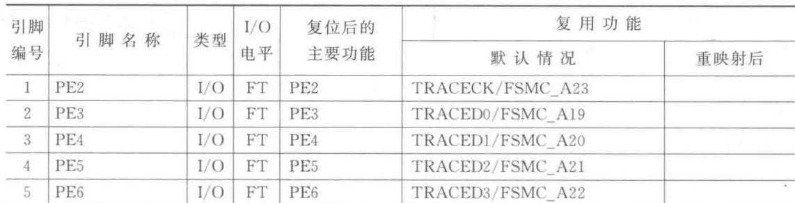

**这张图要看什么？**

1. **表头一共 7 列**，这是理解整张表（以及后面第 6 章代码）的钥匙：
   `引脚编号 | 引脚名称 | 类型 | I/O电平 | 复位后的主要功能 | 复用功能（默认情况）| 复用功能（重映射后）`。
2. **"类型"列**：`I/O` = 普通输入输出脚；`I` = 只能输入；`O` = 只能输出；`S` = 电源类（Supply）。
3. **"I/O 电平"列**：标 `FT` 的就是 5V 容忍脚（本节后面会讲什么是 FT）。
4. **最后两列是重点**：同一根脚"默认能当什么"和"重映射后能当什么"，这就是下面要讲的"复用功能"。

> ⚠️ **说明**：MinerU 从教材 p84 提取出的这张表图**只包含表头和前 5 行**（1～5 脚，PE2~PE6），不是完整表；
> 教材 p85～p87 的表没有提取出图。**完整的 100 脚表在教材 p84～p87**。
> 本讲义下面只摘录常用的"典型几行"，**要查某一根脚的全部功能，请翻教材原表**。

#### 教材表 3-3 的典型几行

看教材表 3-3 里的典型几行（教材原文数据）：

| 引脚编号 | 引脚名称 | 类型 | I/O 电平 | 复位后的主要功能 | 复用功能（默认情况） | 复用功能（重映射后） |
|---|---|---|---|---|---|---|
| 23 | `PA0-WKUP` | I/O | | PA0 | WKUP / USART2_CTS / ADC123_IN0 / TIM2_CH1_ETR / TIM5_CH1 / TIM8_ETR | |
| 68 | `PA9` | I/O | FT | PA9 | USART1_TX / TIM1_CH2 | |
| 69 | `PA10` | I/O | FT | PA10 | USART1_RX / TIM1_CH3 | |
| 72 | `PA13` | I/O | FT | **JTMS-WDIO** | | PA13 |
| 76 | `PA14` | I/O | FT | **JTCK-SWCLK** | | PA14 |
| 77 | `PA15` | I/O | FT | **JTDI** | SPI3_NSS / I2S3_WS | TIM2_CH1_ETR / PA15 / SPI1_NSS |
| 37 | `PB2` | I/O | FT | **PB2/BOOT1** | | |
| 89 | `PB3` | I/O | FT | **JTDO** | SPI3_SCK / I2S3_CK | PB3 / TRACESWO / TIM2_CH2 / SPI1_SCK |
| 90 | `PB4` | I/O | FT | **NJTRST** | SPI3_MISO | PB4 / TIM3_CH1 / SPI1_MISO |
| 94 | `BOOT0` | I | | BOOT0 | | |
| 14 | `NRST` | I/O | | NRST | | |
| 7 | `PC13-TAMPER-RTC` | I/O | | PC13 | TAMPER-RTC | |
| 8 | `PC14-OSC32_IN` | I/O | | PC14 | OSC32_IN | |
| 9 | `PC15-OSC32_OUT` | I/O | | PC15 | OSC32_OUT | |
| 81 | `PD0` | I/O | FT | **OSC_IN** | FSMC_D2 | CAN_RX |
| 82 | `PD1` | I/O | FT | **OSC_OUT** | FSMC_D3 | CAN_TX |
| 6 | `VBAT` | S | | VBAT | | |
| 19/20/21/22 | `VSSA`/`VREF-`/`VREF+`/`VDDA` | S | | 同名 | | |
| 73 | `Not connected` | | | | | |

#### 【先补一个前置知识：什么叫"复用功能"？】

**复用功能**（Alternate Function，简称 **AF**）= **同一根引脚，可以被配置成不同的用途**。

【类比】

> 一根引脚像一个**多功能插座**：
> 平时它是普通的"通用插孔"（GPIO）；
> 但只要你在配置寄存器里拨一下，它就能变成"网口"（USART）、"视频口"（TIM 的 PWM 输出）或者"AD 输入口"（ADC）。
>
> **真实硬件**：引脚内部有一组**多路选择开关（MUX）**，
> 由 GPIO 的配置寄存器和 AFIO 寄存器共同控制，决定"这根线接到哪个内部模块上"。

**教材表 3-3 的表头就说明了这套逻辑：**

- **"复位后的主要功能"**：芯片刚复位、你还没配置时，这根脚默认当什么。
- **"复用功能（默认情况）"**：不额外配置，直接就能用的其他功能。
- **"复用功能（重映射后）"**：需要额外配置 AFIO 才能启用的功能。

#### 【先补一个前置知识：什么叫"重映射"（Remap）？】

**重映射**（Remap）= **把某个外设的信号，从"默认引脚"改接到"备用引脚"上**。

【类比】

> 默认情况下，USART3 的信号从 PB10/PB11 出来。
> 但你的板子上 PB10/PB11 已经被别的电路占用了，
> 这时你就可以"重映射"，让 USART3 改从 PD8/PD9 出来。
> 相当于把一根电话线从 3 号分机改接到 8 号分机。

**控制重映射的模块叫 AFIO**（Alternate Function I/O，复用功能 IO），
它的寄存器基地址是 `0x4001 0000`（在表 3-1 里查得到）。

#### "FT" 是什么意思？

表 3-3 里有一列 **I/O 电平**，有些引脚标着 **FT**。

**FT = Five-volt Tolerant = 5V 容忍（耐 5V）。**

意思：这个引脚即使输入 5V 电压也不会烧坏。
（STM32 的工作电压是 3.3V，普通引脚输入 5V 可能损坏。）

【教材内容】教材原文：

> 几乎所有端口均可容忍 5V 信号。

**为什么这个特性很重要？**
因为很多外部器件（比如老式 5V 单片机、某些传感器、LCD 模块）输出的是 5V 电平。
如果 STM32 的引脚不能容忍 5V，中间就得加电平转换电路，多花钱、多占地方。

#### 从表 3-3 能看出的 3 个重要结论

1. **调试引脚默认被 JTAG 占用。**
   `PA13/PA14/PA15/PB3/PB4` 复位后默认是 JTAG 调试功能（JTMS/JTCK/JTDI/JTDO/NJTRST），**不是普通 GPIO**。
   想拿它们当普通 IO 用，必须先"重映射"关闭 JTAG。这是初学者经常踩的坑。
2. **`PB2` 是双重身份**：它默认是 `PB2/BOOT1`，也就是**启动模式选择引脚之一**。
   所以如果你想用 PB2 当普通 GPIO，要小心 BOOT1 的状态。
3. **`PC13/PC14/PC15` 也有默认任务**：PC14/PC15 默认接 32.768kHz 晶振（OSC32_IN/OUT），
   PC13 默认用于防篡改（TAMPER）和 RTC。

### 3.5.6 【辅助理解图】引脚分类

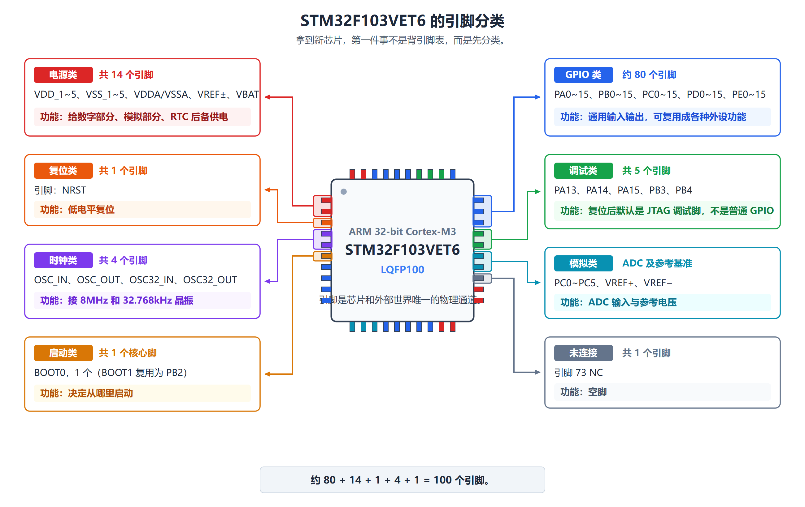

**这张图要看什么？**

- 图中央画一个 LQFP100 方形芯片，四边有引脚；
- 用不同颜色把引脚分成若干"扇形区域"：电源（红）、复位（橙）、时钟（紫）、BOOT（黄）、GPIO（蓝）、调试（绿）、模拟（青）；
- 每类用引出线连到一个说明框，写"这类引脚干什么"；
- 芯片内部画一个小方框写"内核"，标出"引脚是芯片和外部世界唯一的物理通道"。

**这张图要让我理解**：拿到一块新芯片，第一件事不是背引脚表，而是**先分类**。
分类之后，你才知道"哪些必须接对，哪些可以灵活用"。

### 3.5.7 本节真正要记住什么

- **LQFP100**：四边共 100 个引脚，从 1 号逆时针编号。
- 引脚分 8 类：**电源、复位、时钟、启动、GPIO、调试、模拟、未连接**。
- **VDD/VSS 各有 5 个，必须全接**；`VDDA/VSSA` 给模拟部分；`VBAT` 给 RTC 后备供电。
- **复用功能**：一根引脚可以有多个身份，由配置寄存器决定。
- **重映射**：把外设信号从默认引脚改到备用引脚，由 **AFIO** 控制。
- **FT = 5V 容忍**。
- **PA13/PA14/PA15/PB3/PB4 复位后是 JTAG 调试脚**，不是普通 GPIO。
- **PB2 = BOOT1**。

---

## 3.6 STM32F103VET6 最小系统设计

### 3.6.1 先别急着看教材：这一节要干什么？

这一节要回答：

> **我要自己画一块 STM32 板子，最少得接哪些东西，芯片才能跑起来？**
> **每样东西为什么必须有？**

【教材内容】教材给的定义：

> STM32F103VET6 **最小系统**是指能够让 STM32F103VET6 正常工作的**包含最少元器件的系统**。

> 【补充解释】"最小"不是"越省越好"，而是"**少一样就不工作**"的那个下限。

【教材内容】

> STM32F103VET6 片内集成了电源管理模块（包括滤波复位输入、集成的上电复位/掉电复位电路、可编程电压检测电路）、8MHz 高速内部 RC 振荡器、40kHz 低速内部 RC 振荡器等部件，
> **外部只需 7 个无源器件**就可以让 STM32F103VET6 工作。
> 然而，为了使用方便，在最小系统中加入了 USB 转 TTL 串口、发光二极管等功能模块。

**"7 个无源器件"是哪 7 个？**

（"无源器件"指电阻、电容、晶振这类不需要单独供电的元件。）

⚠️ **教材只是上面这一句话带过，并没有给出这 7 个器件的清单。**

> 【补充解释·本讲义存疑，请勿当结论背】
> 一种常见的拆法是：
>
> ```
> 1 个 8MHz 晶振 + 2 个负载电容        = 3 个
> 1 个复位电容   + 1 个复位上拉电阻    = 2 个
> 2 个 BOOT 下拉电阻                   = 2 个
> ──────────────────────────────────────
> 合计 = 7 个无源器件
> ```
>
> 但必须说清楚：**这套拆法是本讲义自己推测的，不是教材原文**，
> 而且它和本讲义 3.6.2 对图 3-8 的描述**对不上**——
> 图 3-8 里除了上面这些，还画了 **R3 1MΩ**（帮晶振起振）、**X2 32.768kHz 及 C3/C4**、
> 以及 **C9~C14 六个去耦电容**。所以"7"到底指哪 7 个，必须回原 PDF / 原理图核对。
> **本讲义不替教材下结论**，已列入文末《待核验》第 15 条。考试如涉及，请以教材和老师讲的为准。

**最小系统包含的 6 个模块**（教材原文，本节后面就按这张表讲）：

| 模块 | 作用 | 本讲义对应小节 |
|---|---|---|
| 1. 最小系统核心电路 | 复位电路 + 晶体振荡电路 + 启动设置电路（教材还在这一小节里给了 JTAG 接口电路） | 3.6.3～3.6.6 |
| 2. USB 转 TTL 串口 | 方便串口下载和通信 | 3.6.6（2） |
| 3. 独立按键 | 实现外部中断检测和待机唤醒 | 3.6.8 |
| 4. ADC 采集电路 | 用光敏电阻演示 ADC | 3.6.8 |
| 5. 流水灯电路 | 16 个 LED，演示 GPIO 输出 | 3.6.8 |
| 6. 电源电路 | 把 5V 变成 3.3V | 3.6.7 |

> **看小节标题时请注意**：本讲义下面的小节标题写作"模块一（1）""模块六"这种形式，
> 其中"模块几"就是上面这张表里的编号，括号里的"（1）（2）（3）（4）"是教材模块一内部的四个小电路（复位 / 晶振 / 启动 / JTAG）。
> 这样就不会出现"同一节里有两套编号"的混乱。

### 3.6.2 看教材原图：最小系统核心电路原理图

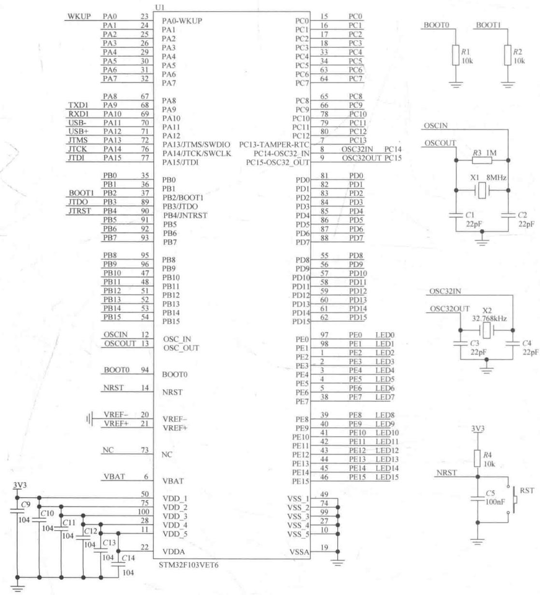

**这张图分三大块，我们先分块，再逐块看。**

```
┌────────────────────────────────────────────────────────────────┐
│                                                                │
│   ① 中间：STM32F103VET6 芯片本体（画成一个方框，引脚分四边）    │
│                                                                │
│   ② 左下：电源去耦电容（C9~C14，都是 104 = 100nF）              │
│                                                                │
│   ③ 右上：三块小电路                                            │
│         · 上方：BOOT0 / BOOT1 各接 10kΩ 电阻到地                │
│         · 中间：8MHz 晶振 X1 + C1/C2 22pF + R3 1MΩ              │
│         · 下方：32.768kHz 晶振 X2 + C3/C4 22pF                  │
│                                                                │
│   ④ 右下：复位电路（R4 10kΩ 上拉 + C5 100nF + RST 按键）        │
│                                                                │
└────────────────────────────────────────────────────────────────┘
```

**注意图里芯片方框内还标了 LED0~LED15**，接在 `PE0~PE15` 上——这对应第 5 个模块"流水灯电路"。

### 3.6.3 模块一（1）：复位电路

【教材内容】

> STM32F103VET6 的 **NRST 引脚**输入驱动使用 CMOS 工艺，
> 它连接了一个**不能断开的上拉电阻 Rpu，其典型值为 40kΩ**。
> 外部连接了一个上拉电阻 R4、按键 RST 及电容 C5，
> **当 RST 按键按下时 NRST 引脚电位变为 0**，通过这个方式实现**手动复位**。

**电路长这样（根据图 3-8 重画）：**

```
            3V3
             │
             ├──────────┐
             │          │
            ┌┴┐ R4      │  芯片内部
            │ │ 10kΩ    │  ┌─────────┐
            └┬┘         └──┤ NRST    │
             │             │ (内部   │
             ├─────────────┤  40kΩ   │
             │             │  上拉)  │
            ─┴─ C5 100nF  │         │
             │             └─────────┘
             ├───○  ○───┐
             │   RST键  │
            GND        GND
```

**三个元件各干什么？**

| 元件 | 值 | 作用 |
|---|---|---|
| R4 | 10kΩ 上拉 | 平时把 NRST 拉高，芯片**正常工作** |
| C5 | 100nF 电容 | 按键按下时**滤掉抖动**，并让复位脉冲有一定宽度 |
| RST 按键 | — | 按下时把 NRST 拉到地 → **复位** |

**工作过程（时间轴）：**

```
平时：    NRST = 高电平（3.3V）      → 芯片正常运行
按下键：  NRST 被拉到 0V             → 芯片进入复位状态
保持按：  NRST 一直 = 0V             → 芯片一直复位
松开键：  C5 通过 R4 慢慢充电        → NRST 缓慢回到高电平
          （充电需要一点时间）         → 芯片完成复位，从头开始跑程序
```

**为什么要有 C5 电容？**

> 【类比】
> 机械按键按下去的那一瞬间，金属片会"弹跳"几下，
> 电平不是干净地从 1 掉到 0，而是"1-0-1-0"抖几下。
> 电容就像一个"缓冲水池"，把这些抖动抹平，
> 让复位信号变成干净的一条下降沿。

> 【补充解释】芯片**内部**已经有一个 40kΩ 的上拉电阻，为什么外面还要再并一个 10kΩ 的 R4？
> 因为内部上拉电阻阻值较大（40kΩ），抗干扰能力弱、上升沿慢。
> 外面并一个 10kΩ 后，等效上拉电阻更小，复位信号更"结实"。
> 另外，按键和电容接在芯片外面，也方便调试时测量波形。

### 3.6.4 模块一（2）：晶体振荡电路

【教材内容】

> STM32F103VET6 一共外接了两个晶振：
> 一个 **8MHz 的晶振 X1** 提供给高速外部时钟（HSE），
> 一个 **32.768kHz 的晶振 X2** 提供给低速外部时钟（LSE）。

**从图 3-8 看具体连接：**

**8MHz 主晶振电路：**

```
        OSCIN ●──────┬────┤├──────┬──────● OSCOUT
                     │    X1 8MHz │
                    ─┴─           ─┴─
                    C1 22pF       C2 22pF
                     │              │
                    GND            GND

        （R3 1MΩ 并接在晶振两端，用来帮助起振）
```

| 元件 | 值 | 作用 |
|---|---|---|
| X1 | 8MHz 晶体 | 产生精确的 8MHz 基准频率，经 PLL ×9 得到 72MHz |
| C1、C2 | 22pF | 负载电容，让晶振工作在标称频率上 |
| R3 | 1MΩ | 反馈电阻，给晶振提供直流偏置，帮助起振 |

**32.768kHz 晶振电路：**

```
     OSC32IN ●──────┬────┤├──────┬──────● OSC32OUT
                     │  X2 32.768kHz │
                    ─┴─           ─┴─
                    C3 22pF       C4 22pF
                     │              │
                    GND            GND
```

| 元件 | 值 | 作用 |
|---|---|---|
| X2 | 32.768kHz 晶体 | 给 RTC 提供 1Hz 秒信号（32768 = 2¹⁵） |
| C3、C4 | 22pF | 负载电容 |

**为什么要两个晶振？**

> 8MHz 的是给"跑得快"的部分用（CPU、总线），
> 32.768kHz 的是给"数秒"的部分用（RTC 实时时钟）。
> 一个要快，一个要准且省电，**两种需求没法用一颗晶振同时满足**。

### 3.6.5 模块一（3）：启动设置电路（BOOT）

【教材内容】

> 启动设置电路由启动设置引脚 **BOOT1 和 BOOT0** 构成。
> 二者均通过 **10kΩ 的电阻接地**。**从用户 Flash 启动**。

**从图 3-8 看：**

```
        BOOT0 ●───────┬────── 接 BOOT0 引脚（94 脚）
                       │
                      ┌┴┐ R1 10kΩ
                      └┬┘
                       │
                      GND

        BOOT1 ●───────┬────── 接 PB2 引脚（37 脚，PB2/BOOT1）
                       │
                      ┌┴┐ R2 10kΩ
                      └┬┘
                       │
                      GND
```

**BOOT0 = 0、BOOT1 = 0 → 从主闪存（用户 Flash）启动。**
这是正常跑你自己写的程序的模式。

#### 三种启动模式

【教材内容】教材表 3-4：

| BOOT1 | BOOT0 | 启动模式 | 说明 |
|---|---|---|---|
| X（无关） | 0 | **主闪存存储器** | 主闪存存储器被选为启动区域 |
| 0 | 1 | **系统存储器** | 系统存储器被选为启动区域 |
| 1 | 1 | **内置 SRAM** | 内置 SRAM 被选为启动区域 |

#### 【先补一个前置知识：什么叫"启动模式"？为什么启动要看地址？】

第 2 章讲过：**Cortex-M3 复位后，固定从 `0x0000 0000` 取栈顶地址，从 `0x0000 0004` 取复位向量。**

【教材内容】教材原文：

> 系统复位后，在 **SYSCLK 的第 4 个上升沿**，BOOT 引脚的值将被**锁存**。
> 用户可以通过设置 BOOT1 和 BOOT0 引脚的状态，来选择在复位后的启动模式。
>
> 在启动延迟之后，CPU 从地址 `0x0000 0000` 获取**堆栈顶的地址**，
> 并从启动存储器的 `0x0000 0004` 指示的地址开始执行代码。

**问题来了**：Flash 明明在 `0x0800 0000`，为什么 CPU 能从 `0x0000 0000` 读到它？

**答案：地址别名（Aliasing）。**

【教材内容】

> 因为固定的存储器映像，代码区始终从地址 `0x0000 0000` 开始（通过 ICode 和 DCode 总线访问），
> 而数据区（SRAM）始终从 `0x2000 0000` 开始（通过系统总线访问）。
> Cortex-M3 的 CPU 始终从 ICode 总线获取复位向量，即启动仅适合于从代码区开始（典型地从 Flash 启动）。
> STM32F103VET6 微控制器实现了一个特殊的机制，系统可以不仅仅从 Flash 存储器或系统存储器启动，还可以从内置 SRAM 启动。

**三种模式下的地址映射（教材原文）：**

| 启动模式 | `0x0000 0000` 处映射的是谁 | 原地址还能访问吗 |
|---|---|---|
| 从**主闪存**启动 | 主闪存被映射到启动空间 | 能，仍在 `0x0800 0000` 访问；即 Flash 内容可**在两个地址区域**访问 |
| 从**系统存储器**启动 | 系统存储器被映射到启动空间 | 能，互联型产品原地址 `0x1FFF B000`，其他产品为 `0x1FFF F000` |
| 从**内置 SRAM**启动 | 只能在 `0x2000 0000` 开始的地址区访问 SRAM | 从 SRAM 启动时，应用程序初始化代码中必须使用 **NVIC 的异常表和偏移寄存器**，重新映射向量表到 SRAM 中 |

【教材内容】关于内嵌自举程序：

> 内嵌的自举程序存放在**系统存储区**，由 ST 在生产线上写入，
> 用于通过串行接口 **USART1** 对闪存存储器进行**重新编程**。

**这张图要让我理解**：

> **BOOT 引脚不是"选择从哪儿开始执行"，而是"选择把谁搬到 `0x0000 0000` 这个门牌号上"。**
> CPU 永远只看 `0x0000 0000`，至于那里实际站着的是 Flash、系统存储器还是 SRAM，由 BOOT 引脚在复位时决定。

#### 【辅助理解图】BOOT 启动模式

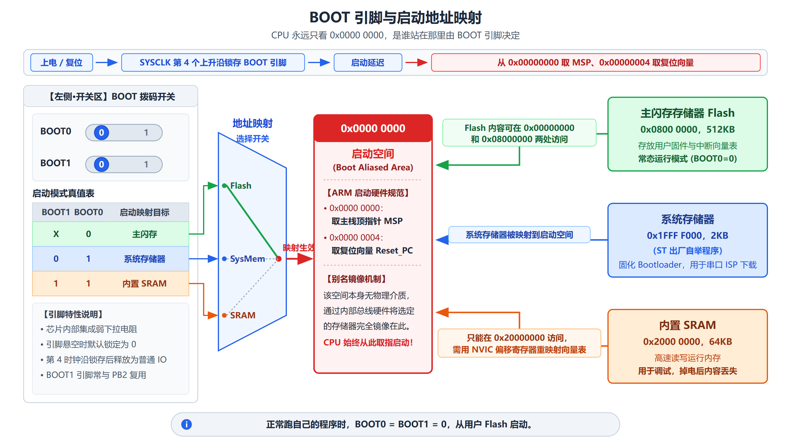

**这张图要看什么？**

- 图分左右两部分：左边是 **BOOT1/BOOT0 两个开关**（用拨码开关表示），右边是 **三种存储器的地址方框**；
- 中间画一个"**地址映射开关**"，把 `0x0000 0000` 这个门牌号指向不同的存储器；
- 每种模式用不同颜色标出，并在下方写"这种模式用来干什么"。

**这张图要让我理解**：启动模式的选择，本质是**一次地址重定向**。

### 3.6.6 模块一（4）+ 模块二：下载接口（JTAG 接口 + USB 转 TTL 串口）

#### （1）JTAG 接口电路

【教材内容】

> 为了方便系统采用 **JLink 仿真器**进行下载和在线仿真，
> 在最小系统中预留了 **JTAG 接口电路**，用来实现 STM32F103VET6 与 JLink 仿真器进行连接。

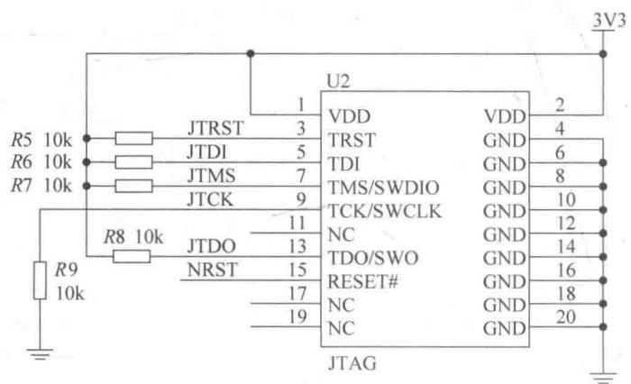

**这张图要看什么？**

1. **中间那个大方框是 JTAG 接口**，图上标着 `U2`（芯片位号）、`JTAG`，是一个 **20 针标准接口**。
   左边一列是奇数脚（1、3、5…19），右边一列是偶数脚（2、4、6…20）。
2. **电源和地怎么接**：
   - **第 1 脚**（左上）和第 **2 脚**（右上的第一个）都接到 **3V3**（图上标 `VDD`）；
     **第 2 脚是 VDD，不是地！**
   - **第 4、6、8、10、12、14、16、18、20 脚**（右边一列除第 2 脚以外的所有偶数脚）才是 **GND**。
   - 所以"**所有偶数脚都是地**"这句话是错的，第 2 脚例外。
3. **图上一共有 5 个 10kΩ 电阻（R5、R6、R7、R8、R9）**，都是给调试信号"定一个默认电平"用的：

   | 电阻 | 一端接 | 另一端接 | 效果 |
   |---|---|---|---|
   | R5 | 3V3 | `JTRST`（→ 3 脚 TRST） | **上拉**：平时把 TRST 拉成高电平 |
   | R6 | 3V3 | `JTDI`（→ 5 脚 TDI） | **上拉** |
   | R7 | 3V3 | `JTMS`（→ 7 脚 TMS/SWDIO） | **上拉** |
   | R8 | 3V3 | `JTDO`（→ 13 脚 TDO/SWO） | **上拉**：图上 R8 画在 JTDO 这条线上，从连接关系看是"给 JTDO 一个默认高电平"，不是串在信号通路中间 |
   | R9 | `JTCK`（→ 9 脚 TCK/SWCLK） | GND | **下拉**：平时把时钟线拉成低电平 |

   **为什么要这样接？** 调试器没插上时，这几根线是**悬空**的。
   悬空的线电平会乱跳，可能被芯片误当成时钟或命令，造成误动作。
   上拉 / 下拉电阻就是给它们一个确定的"默认答案"（见 3.5.2 讲的上拉/下拉电阻）。
4. **从接口引出的信号线**：`TRST`、`TDI`、`TMS/SWDIO`、`TCK/SWCLK`、`TDO/SWO`、`RESET#`。
   （图上 `JTRST`、`JTDI`、`JTMS`、`JTCK`、`JTDO` 是这些信号在网络上的名字，同一根线两个叫法。）

**这些信号分别是什么？**

| 信号 | 全称 | 中文 | 作用 |
|---|---|---|---|
| TCK / SWCLK | Test Clock / Serial Wire Clock | 测试时钟 | 调试器提供的时钟 |
| TMS / SWDIO | Test Mode Select / Serial Wire Data I/O | 模式选择 / 数据线 | 命令和数据 |
| TDI | Test Data In | 测试数据输入 | 数据进芯片 |
| TDO / SWO | Test Data Out / Serial Wire Output | 测试数据输出 | 数据出芯片 |
| TRST | Test Reset | 测试复位 | 复位调试逻辑 |
| RESET# | — | 系统复位 | 调试器可以直接复位芯片 |

> 【补充解释】现在更常用的是 **SWD**（Serial Wire Debug，串行线调试）：
> 只需要 `SWCLK` + `SWDIO` **两根线**就能下载和调试，
> 比 JTAG 的五根线省引脚。STM32 的调试脚同时支持这两种方式。

#### （2）USB 转 TTL 串口

【教材内容】

> 为了方便系统采用**串口下载**，在最小系统中，以 **CH340G** 为核心设计了 USB 转 TTL 串口，
> 并从 USB 接口中获得 +5V 电源。
> 使用两个切换开关，可以选择使用 USB 还是 UART，使用串口进行通信时，选择 UART 功能。

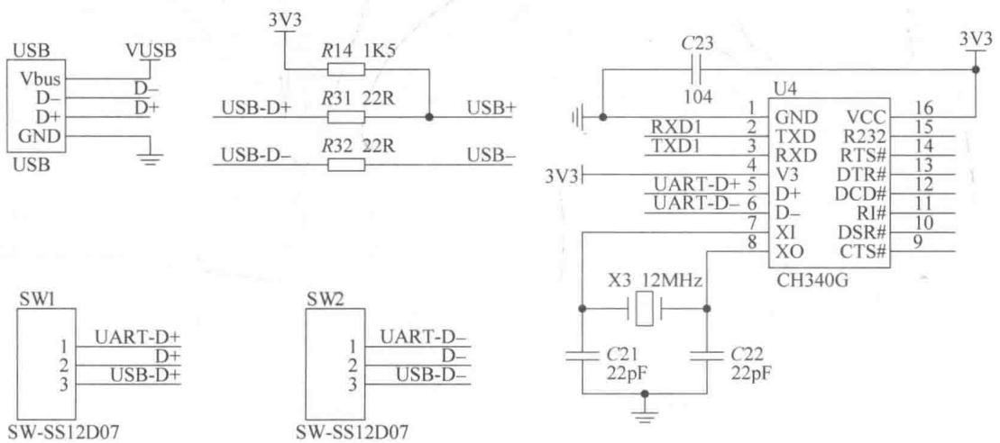

**这张图要看什么？**

1. **左上角 `USB` 框**：USB 接口，引出 `Vbus`（+5V）、`D-`、`D+`、`GND`。
2. **下方 `SW1`、`SW2` 两个开关**：用来在"USB 模式"和"UART 模式"之间切换。
3. **右上角 `U4`（CH340G）**：核心芯片，负责把 **USB 信号 ↔ 串口信号**互相转换。
4. **CH340G 右边引出的 `TXD`、`RXD`** 接向 STM32 的 `PA9`(USART1_TX)、`PA10`(USART1_RX)。
5. **X3 12MHz + C21/C22 22pF**：CH340G 自己的晶振（它需要 12MHz）。

**为什么需要 USB 转 TTL 串口？**

> 因为**电脑只有 USB 口，没有"串口"口**（老式 9 针串口早就不见了）。
> 而 STM32 的串口（USART1）用的是 TTL 电平（0V / 3.3V），
> 需要一个"翻译器"把 USB 协议翻译成 TTL 串口协议。
> CH340G 就是干这个的。

**它有什么用？**

1. **串口下载程序**：配合 BOOT0 = 1（系统存储器启动），
   利用 ST 出厂烧好的自举程序，通过 USART1 把程序烧进 Flash。
2. **串口调试**：程序运行时，可以通过串口把调试信息打印到电脑上。

### 3.6.7 模块六：电源电路

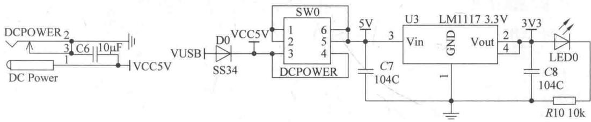

**这张图要看什么？**

1. **最左边 `DC Power` 插座** + `C6 10μF` 电容：外部直流电源输入，电容做粗滤波。
2. **`D0 SS34` 二极管**：肖特基二极管，防止电源接反烧坏电路。
3. **`SW0` 开关（DCPOWER）**：选择用 DC 电源还是 USB 的 `VUSB` 供电。
4. **`5V` 节点** + `C7 104`：得到 5V 电源，电容去耦。
5. **`U3 LM1117 3.3V`**：**低压差线性稳压器（LDO）**，把 5V 稳压成 3.3V。
6. **`3V3` 输出** + `C8 104` + `LED0 + R10 10k`：3.3V 电源，LED 做电源指示灯。

【教材内容】

> 最小系统电源可以由**外部电源、USB 电源和 JLink 电源**提供，
> 通过稳压电路得到 **3.3V 电源**提供给 STM32F103VET6 和其他外部电路。

**为什么必须把 5V 变成 3.3V？**

【教材内容】教材原文：

> 芯片和 I/O 引脚的供电电压为 **2.0～3.6V**。

直接给 5V 会**烧毁芯片**。

**LDO 是什么？**

> **LDO** = Low Dropout Regulator，低压差线性稳压器。
> 大白话：一个"自动调压阀"。
> 输入 5V，它内部自动调整，输出稳定的 3.3V；
> 输入有点波动，输出也不变。

**去耦电容（104 = 100nF）是干什么的？**

> 【类比】
> 数字电路工作时，电流是**一阵一阵**抽的（开关瞬间要很大电流）。
> 电源线又细又长，来不及供给，电压就会瞬间往下掉（叫"电源噪声"）。
> 在芯片每个电源引脚旁边放一个小电容（104 = 100nF），
> 就像在**水龙头旁边放一个小水桶**：抽水的瞬间先从桶里拿，不惊动主管道。
>
> **真实硬件**：这叫**去耦（decoupling）**，电容给高频噪声提供一条低阻抗回路。

**图 3-8 里就能看到**：`C9`~`C14` 共 6 个 `104` 电容，分别接在 `VDD_1`~`VDD_5` 和 `VDDA` 旁边，就近给芯片供电引脚滤波。

### 3.6.8 模块三、四、五：扩展功能（了解即可）

#### 独立按键电路

【教材内容】

> 为了实现外部中断检测功能和待机唤醒功能，在最小系统中设置了一个独立按键，该按键接在 **PA0**。

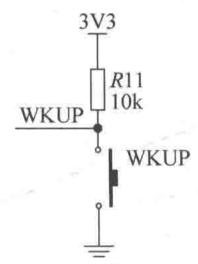

**这张图要看什么？**（从上往下、一根线一根线地看）

1. 图最上面是 **`3V3`** —— 电源正极。
2. 往下经过 **`R11`（10kΩ）**，接到中间一个**节点**上。这个 R11 就是**上拉电阻**。
3. 这个节点标着 **`WKUP`**，它连着两条去路：
   - 一条**向左引出**，通往 STM32 的 **`PA0`**（也就是表 3-3 里的 `PA0-WKUP`）；
   - 一条**向下**接到按键 `WKUP` 的一端。
4. 按键的**另一端直接接地（GND）**。

**所以它怎么工作？** 其实就是"**按键拉低、电阻拉高**"：

```
平时（没按）：  3V3 ──R11(10k)──●WKUP ── （按键断开）      → PA0 读到高电平 1
按下按键：      3V3 ──R11(10k)──●WKUP ──按键── GND         → PA0 读到低电平 0
```

- **没按的时候**：按键断开，PA0 通过 R11 被拉到 3V3，程序读到的就是 **1（高电平）**；
- **按下的时候**：按键把 `WKUP` 这个节点直接接到地，PA0 读到 **0（低电平）**；
- **松手以后**：电路又回到高电平。

这和 3.6.3 的复位电路是**同一个套路**：**按键负责"把它拉到低电平"，电阻负责"平时拉回高电平"**。
如果没有 R11，松开按键时 PA0 就是悬空的，电平不确定（见 3.5.2 讲的上拉/下拉电阻）。

**为什么接 PA0？**
因为 `PA0` 有一个特殊身份：**`PA0-WKUP`**（Wake-Up，唤醒）。
它可以把系统从待机模式唤醒——这正是表 3-3 里 `PA0` 那一行 `WKUP` 功能的用途。
（所以这个按键一个"硬件"能干两件事：**当普通按键用**可以触发外部中断；**当唤醒键用**可以把芯片从待机模式叫醒。）

#### ADC 采集电路

【教材内容】

> 为了实现 ADC 采集功能，在最小系统中集成了一个**光敏电阻**，
> 通过将 SW4 开关拨到 ON 将 ADC 采集通道接到 **PA1**，
> 通过 STM32F103VET6 的 ADC 采集功能可以实现对光敏电阻阻值的计算。

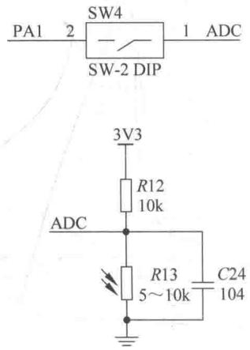

> 说明：MinerU 素材里这张图没有题注，但内容与教材"图 3-12 ADC 采集电路"完全对得上
> （SW4、PA1、R12、光敏电阻 R13、C24 都在图上），故按图 3-12 引用。

**这张图要看什么？**（图分上、下两半）

**上半部分：开关 SW4，决定"通不通"**

1. `SW4` 是一个双位拨码开关（图上标 `SW-2 DIP`）。
2. 开关的 **2 号端接到 `PA1`**（STM32 的 ADC 输入脚）；**1 号端接到 `ADC` 这个网络**（也就是下半部分的采集电路）。
3. 所以：**SW4 拨到 ON，PA1 才和下面的采集电路接通**；不拨，ADC 通道就是断开的——
   这样你在做别的实验时，光敏电阻不会"偷偷"影响 PA1。

**下半部分：一个"分压电路"，把光强变成电压**

1. 最上面 `3V3` → 经过 **`R12`（10kΩ）** → 到达中间的**节点 `ADC`**；
2. 节点 `ADC` 往下接 **`R13`（光敏电阻，5～10kΩ）**，再接地（GND）；
3. 节点 `ADC` 旁边还并了一个 **`C24`（104 = 100nF）** 电容，用来滤掉电压上的高频抖动；
4. `R13` 上面画的两个小箭头表示"**它的阻值随光照变化**"：光照越强 → 阻值越小；光照越弱 → 阻值越大。

**电压是怎么跟着变的？** 这就是两个电阻"**分压**"：

```
ADC 点电压 = 3V3 × R13 / (R12 + R13)
```

- **光照变强** → R13 变小 → 分压得到的电压**变低**；
- **光照变弱** → R13 变大 → 分压得到的电压**变高**。

（这句话默认光敏电阻是"光照越强、阻值越小"这一种——常见的光敏电阻（硫化镉）确实如此；
换用别的型号请以器件手册为准。关键不是记住"变高还是变低"，而是理解 **电压会跟着阻值变**。）

（这就是一个"光 → 电阻 → 电压"的转换过程。）

**接下来 STM32 做什么？**

> 用 ADC 把 `ADC` 点这个电压**测出来**（第 10 章讲怎么测）→
> 因为 `R12` 是已知的 10kΩ，用分压公式**反推** `R13` 的阻值 →
> 再根据光敏电阻"阻值—光照"的对应关系，就知道现在**有多亮**了。
>
> 这就是教材那句"**可以实现对光敏电阻阻值的计算**"的意思：
> **ADC 直接量到的是电压，阻值是用公式算出来的。**

#### 流水灯电路

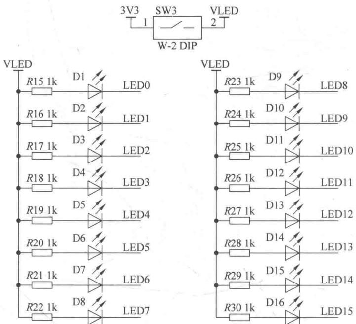

【教材内容】

> 最小系统板载 **16 位流水灯**，对应 STM32F103VET6 的 **PE0～PE15**，
> 通过将 SW3 开关拨到 ON 给 LED 提供电源。

**这张图要看什么？**

1. **最上面 `SW3`**：电源总开关，拨到 ON 后 `3V3` 变成 `VLED`，给所有 LED 供电。
2. **左右两列，各 8 个 LED**（D1～D16），分别标着 `LED0`~`LED15`。
3. **每个 LED 前面串一个 1kΩ 电阻**（R15~R30）：**限流电阻**，防止 LED 被烧。
4. **LED 的负极接向 `PE0`~`PE15`**。

**为什么 PE0 输出低电平灯会亮？**（教材第 6 章例 6-1 的关键）

```
3V3 ──[SW3]── VLED ──[1kΩ]──[LED]──→ PE0

当 PE0 输出 0（低电平）：电流从 VLED 流向 PE0 → 灯亮
当 PE0 输出 1（高电平）：两端都是 3.3V，没有电流 → 灯灭
```

【教材内容】教材原话：

> 当连接 LED0 的 PE0 引脚输出低电平 0 时，发光二极管亮；PE0 输出高电平 1 时，发光二极管灭。

> **这个"低电平点亮"的细节非常容易搞反**，考试和实验都常考。

#### 【先补一个前置知识：什么叫"灌电流"（sink current）？】

数字引脚带负载时，电流有两种流法，名字很形象：

| 说法 | 英文 | 电流怎么走 | 引脚扮演的角色 |
|---|---|---|---|
| **拉电流** | source current | 电流**从引脚流出去**，经过外部电路回到地 | 引脚当"小电源" |
| **灌电流** | sink current | 电流**从外部电路流进引脚**，再由引脚内部流到地 | 引脚当"地" |

本最小系统的 LED 用的是**灌电流**接法：

```
        VLED(3.3V) ──[1kΩ 限流电阻]──[LED]──→ PE0（引脚）
                                                │
                                         引脚内部 → GND
```

- PE0 输出 **0（低电平）**：引脚相当于接到地，电流从 VLED 一直"灌"进 PE0 → **灯亮**；
- PE0 输出 **1（高电平）**：引脚也是 3.3V，LED 两端没有电压差 → **没有电流 → 灯灭**。

> **注意两件事**：
> 1. "灌电流/拉电流"是从**芯片引脚**的角度说的，不是从 LED 的角度说的，说反了很容易绕晕；
> 2. 引脚能承受的灌电流有上限（查数据手册），所以每个 LED 前面都要串一个 **1kΩ 限流电阻**（R15~R30），
>    不能把 LED 直接怼到引脚上。

### 3.6.9 【辅助理解图】最小系统组成

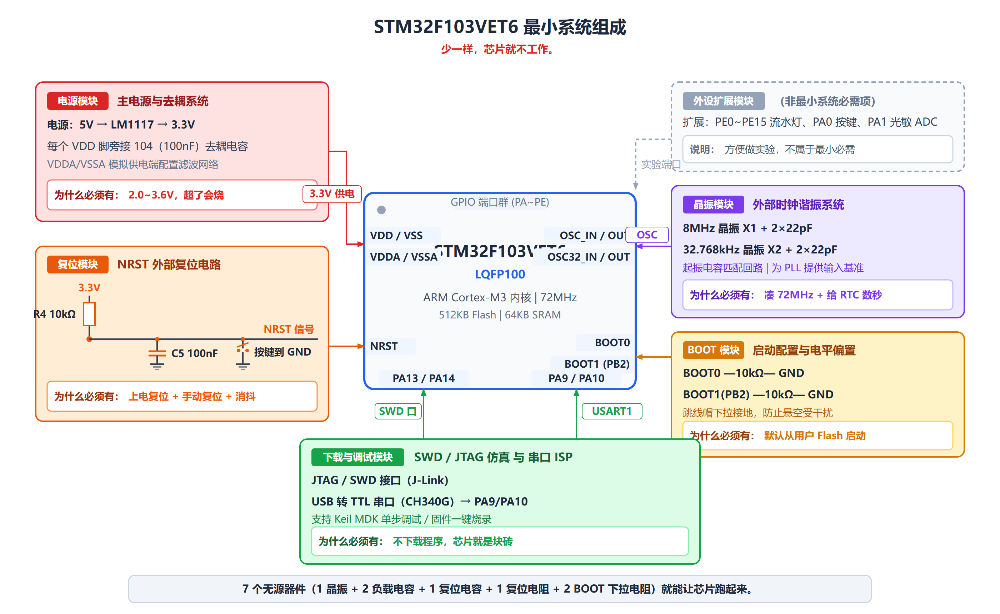

**这张图要看什么？**

- 图中央是 STM32F103VET6 芯片方框；
- 周围用不同颜色的方框标出各个必需模块，每个模块用箭头连到芯片对应引脚：
  - **电源**（3.3V LDO + 去耦电容）→ VDD/VSS/VDDA
  - **复位**（10kΩ + 100nF + 按键）→ NRST
  - **晶振**（8MHz + 22pF×2）→ OSC_IN/OSC_OUT
  - **晶振**（32.768kHz + 22pF×2）→ OSC32_IN/OSC32_OUT
  - **BOOT**（10kΩ×2 下拉）→ BOOT0/PB2
  - **下载**（JTAG/SWD + USB 转 TTL）→ PA13/PA14 等
- 每个模块旁标一句"为什么必须有"。

**这张图要让我理解**：最小系统不是"随便接接"，而是**每一块都有不可替代的理由**。

### 3.6.10 本节真正要记住什么

| 模块 | 最少要什么 | 为什么 |
|---|---|---|
| 电源 | 5V → 3.3V（LDO）+ 每个电源脚旁 100nF 去耦 | 芯片只能 2.0～3.6V；数字电路电流是脉冲式的 |
| 晶振 | 8MHz + 2 个负载电容（+32.768kHz 给 RTC） | 内部 HSI 精度差且最高只能倍频到 64MHz，凑不出 72MHz |
| 复位 | NRST 上拉 10kΩ + 电容 100nF + 按键 | 上电、手动都要能复位；电容消除按键抖动 |
| BOOT | BOOT0、BOOT1 各 10kΩ 下拉 | 默认从用户 Flash 启动 |
| 下载 | JTAG/SWD 接口（或 USB 转 TTL 串口） | 不下载程序，芯片就是块砖 |
| （扩展）流水灯 | PE0~PE15 + 1kΩ 限流电阻 | 观察程序运行结果；**PE 输出低电平灯才亮** |

---

## 3.7 本章知识地图：一页纸总结

### 3.7.1 从"内核"到"芯片"

```
        Cortex-M3 内核（第 2 章学的）
              │
              │ ST 在它外面加上：
              ▼
┌──────────────────────────────────────────────────────────┐
│                    STM32F103 芯片                         │
│                                                          │
│   ① 存储器    Flash 512KB（0x08000000）                   │
│               SRAM  64KB （0x20000000）                   │
│                                                          │
│   ② 总线      AHB（72MHz） + APB2（72MHz） + APB1（36MHz）│
│               + 总线矩阵（4 主 4 从，轮换仲裁）           │
│                                                          │
│   ③ 时钟      HSI / HSE / LSI / LSE / PLL → SYSCLK        │
│               → HCLK / PCLK1 / PCLK2 / FCLK               │
│                                                          │
│   ④ 外设      GPIO、TIM、USART、SPI、I2C、ADC、DAC、      │
│               CAN、USB、SDIO、RTC、看门狗、DMA、FSMC      │
│                                                          │
│   ⑤ 引脚      100 个（LQFP100），分 8 类                   │
│                                                          │
│   ⑥ 支持电路  电源 / 复位 / 晶振 / BOOT / 下载接口        │
│                                                          │
└──────────────────────────────────────────────────────────┘
```

### 3.7.2 四条必须记住的"链"

**链 1：地址链**

```
4GB 地址空间
  → 片上外设区 0x40000000
    → APB2 区 0x40010000
      → GPIOA 0x40010800
        → GPIOA_ODR 0x4001080C
```

**链 2：时钟链**

```
8MHz 晶振 → PLL ×9 → 72MHz → SYSCLK
  → AHB ÷1 → HCLK 72MHz
    → APB2 ÷1 → PCLK2 72MHz
    → APB1 ÷2 → PCLK1 36MHz
```

**链 3：访问链**

```
程序写寄存器
  → CPU 发出一个地址和写信号
    → 总线矩阵
      → AHB2APB 桥
        → APB 总线
          → 外设寄存器
            → 硬件电路改变工作方式
```

**链 4：启动链**

```
上电 → SYSCLK 第 4 个上升沿锁存 BOOT 引脚
  → 决定把谁映射到 0x00000000
    → CPU 从 0x00000000 取 MSP，从 0x00000004 取复位向量
      → 跳进启动代码 → 配置时钟 → 进入 main()
```

### 3.7.3 关键数字速查

| 项目 | 数值 |
|---|---|
| 地址空间 | 4GB = 8 块 × 512MB |
| 外设区起点 | `0x4000 0000` |
| SRAM | `0x2000 0000`，64KB |
| Flash | `0x0800 0000`，512KB，256 页 × 2KB |
| 系统存储器 | `0x1FFF F000`，2KB（自举程序） |
| 选择字节 | `0x1FFF F800`，16B |
| SRAM 位带区 / 别名区 | `0x2000 0000` / `0x2200 0000` |
| 外设位带区 / 别名区 | `0x4000 0000` / `0x4200 0000` |
| 位带公式 | `别名地址 = 基地址 + 字节偏移×32 + 位号×4` |
| HSI | 8MHz（内部 RC） |
| HSE | 4～16MHz（板上 8MHz） |
| LSI | 约 40kHz |
| LSE | 32.768kHz |
| RTC 时钟源（`RCC_BDCR` 的 `RTCSEL[1:0]`） | HSE/128、LSE、LSI 三选一；选定后**只有备份域复位才能改** |
| RTC 断电还能走 | 只有选 **LSE 且 VBAT 有电**才行 |
| 看门狗时钟 | IWDG 吃 LSI；**IWDG 一旦启动，LSI 被强制打开、不能关闭** |
| PLL 倍频范围 | ×2～×16 |
| SYSCLK / HCLK 最高 | 72MHz |
| PCLK2 最高 | 72MHz |
| PCLK1 最高 | 36MHz |
| ADCCLK 最高 | 14MHz |
| USB 时钟 | 48MHz（PLL ÷ 1.5） |
| SDIO 时钟 | HCLK ÷ 2 |
| Flash 等待周期 @72MHz | 2 个（`FLASH_ACR = 0x12`） |
| GPIOA 基地址 | `0x4001 0800` |
| RCC 基地址 | `0x4002 1000` |
| RCC_CFGR 绝对地址 | `0x4002 1004` |
| RCC_APB2ENR 绝对地址 | `0x4002 1018` |
| FLASH_ACR 绝对地址 | `0x4002 2000` |
| 72MHz 配置常数 | `RCC_CFGR` 按位或上 `0x001D 0400`（C 写法是 `RCC_CFGR \|= 0x001D0400`） |

---

## 3.8 容易搞混的地方（集中复习）

| # | 容易搞混的点 | 正确理解 |
|---|---|---|
| 1 | STM32 和 Cortex-M3 是一回事吗？ | 不是。Cortex-M3 是**内核**（ARM 设计），STM32 是**芯片**（ST 制造，内核 + 外设 + 存储器） |
| 2 | Flash 在 `0x0800 0000`，为什么启动又从 `0x0000 0000` 取向量？ | `0x0000 0000` 是**别名**，由 BOOT 引脚决定映射谁过去 |
| 3 | 外设地址为什么从 `0x4000 0000` 开始？ | **ARM 架构规定**片上外设区就是这一段，ST 只能在这里放外设 |
| 4 | "字"是多少位？ | 在 ARM 里**字 = 32 位**；半字 = 16 位；字节 = 8 位 |
| 5 | `SW` 和 `SWS` 一样吗？ | `SW` 是软件写的**命令**，`SWS` 是硬件**实际状态**；切换时钟后要等 SWS |
| 6 | APB1 的定时器时钟是 36MHz 吗？ | 不是。APB1 预分频 ≠ 1 时，定时器时钟 = PCLK1 × 2 = 72MHz |
| 7 | 只用内部 HSI 能跑到 72MHz 吗？ | 不能。HSI 8MHz 必须先 ÷2 再进 PLL，最高 4×16 = 64MHz |
| 8 | 写外设寄存器没反应，一定是代码错了吗？ | 先查**外设时钟开了没有**。不开时钟，寄存器写得再对也没用 |
| 9 | PA13/PA14 能当普通 GPIO 用吗？ | 默认不能，它们是 **JTAG 调试脚**，必须先重映射 |
| 10 | PB2 是普通 IO 吗？ | 它还是 **BOOT1**，复位时会被锁存 |
| 11 | 位带别名区是"另一块内存"吗？ | 不是。它是**同一块存储器的另一个访问入口**，改的还是原来的位 |
| 12 | PE0 输出高电平时 LED 亮还是灭？ | **灭**。最小系统板的 LED 是"低电平点亮"，也就是**灌电流**接法（什么叫灌电流，见 3.6.8 的【先补一个前置知识】） |
| 13 | 位带公式里为什么是 ×32 和 ×4？ | ×32 是因为 1 字节 8 位、每位占 4 字节（8×4=32）；×4 是因为别名区每位占 1 个字 |
| 14 | 最小系统为什么一定要外接 8MHz 晶振？ | 为了凑出 72MHz（HSI 只能到 64MHz）；同时 HSE 精度远高于 HSI |
| 15 | BOOT0=1、BOOT1=0 是什么模式？ | **系统存储器启动**（可以用 ST 的自举程序通过串口下载程序） |

---

## 3.9 本章真正要记住什么

**如果只允许记住 10 句话：**

1. STM32 = Cortex-M3 内核 + ST 加的一大圈存储器和外设；型号 `STM32F103VET6` 每一位都有含义。
2. 内核通过 **ICode / DCode / System / DMA** 四条总线接入**总线矩阵**（4 主 4 从，轮换仲裁）。
3. 外设分挂 **AHB（72MHz）/ APB2（72MHz）/ APB1（36MHz）**，中间由 **AHB2APB 桥**连接。
4. 4GB 地址空间分 8 块；**外设区从 `0x4000 0000` 开始是 ARM 规定的**。
5. **最终寄存器地址 = 外设基地址 + 寄存器偏移量**。
6. Flash `0x0800 0000`（512KB，256 页 × 2KB）；SRAM `0x2000 0000`（64KB）；数据按**小端**存。
7. 位带：`0x2000 0000`→`0x2200 0000`，`0x4000 0000`→`0x4200 0000`；
   公式 `别名地址 = 基地址 + 字节偏移×32 + 位号×4`。
8. 时钟链：**HSE 8MHz ×9 = 72MHz**；APB2 最高 72MHz，APB1 最高 36MHz；
   **定时器 ×2 规则**；ADC 最高 14MHz。
9. 配置时钟靠 **RCC_CR / RCC_CFGR / RCC_APBxENR**；`RCC_CFGR |= 0x001D0400`、`FLASH_ACR = 0x12`。
   **用外设前必须先开时钟。**
10. 最小系统 = **电源 + 晶振 + 复位 + BOOT + 下载接口**；BOOT0=BOOT1=0 时从用户 Flash 启动。

---

## 3.10 教材习题提示（对应教材 3.7 节习题）

> 这里不给"标准答案"，只给**答题思路和应该覆盖的要点**，方便你自测。

**3-1 简述 Cortex-M3 处理器的特点。**

> 提示：这道题答案在第 2 章。可从这几个角度答：
> ① 32 位 RISC 内核，哈佛结构；② 三级流水线 + 分支预测；
> ③ 16 个通用寄存器、MSP/PSP 双堆栈；④ 支持位带操作（原子位操作）；
> ⑤ 内置 NVIC，支持中断嵌套和优先级；⑥ 支持线程/处理两种模式、特权/非特权两个等级；
> ⑦ 支持睡眠、深度睡眠等低功耗模式；⑧ 调试方便（SWD/JTAG、ETM）。

**3-2 STM32F103VET6 的存储器结构有什么特点？**

> 提示：答题要点应包含：
> ① 程序存储器、数据存储器、寄存器和 I/O 端口统一编址在**同一个 4GB 线性地址空间**；
> ② 分成 **8 个 512MB 的块**；③ Flash `0x0800 0000`，512KB，256 页 × 2KB，有主存储块和信息块；
> ④ SRAM `0x2000 0000`，64KB，可按字节/半字/字访问；
> ⑤ 外设寄存器映射在 `0x4000 0000 ~ 0x5FFF FFFF`，可用访问内存的方式访问；
> ⑥ 数据按**小端**格式存放；⑦ 有两个**位带区**（SRAM 最低 1MB、外设最低 1MB）及对应的 32MB 位带别名区。

**3-3 STM32F103VET6 的时钟结构对于系统的功耗控制有什么作用？**

> 提示：答题要点：
> ① STM32 有 5 个时钟源（HSI/HSE/LSI/LSE/PLL），**每个时钟源都可以被独立地启动或关闭**；
> ② **每个外设的时钟也可以单独使能/关闭**（RCC_APBxENR 的各位）；
> ③ 不用某个外设时把它的时钟关掉，这部分电路就不耗电；
> ④ 通过 AHB/APB1/APB2 预分频器可以降低总线频率，动态降频省电；
> ⑤ 系统支持睡眠、停机、待机三种低功耗模式，在低功耗模式下时钟可以被关闭或切换到低速时钟（LSI/LSE）；
> ⑥ RTC 可以在停机/待机模式下由 LSE/LSI 继续运行，实现定时唤醒；
> ⑦ RTC 的时钟源可以单独选择（RCC_BDCR 的 RTCSEL[1:0]），用 LSE + VBAT 时主电源断了 RTC 仍能计时。

---

## 3.11 待核验

> 以下条目是本讲义在重构过程中发现的**教材自相矛盾、OCR 可疑或需要回原 PDF 核对**的地方。
> 按 AGENTS.md 规则，本讲义**不猜测、不杜撰**，统一列在这里。

1. **【页码 p73 vs p76】温度等级矛盾**
   教材 p73 图 3-1 命名规则写明：**6 = 工业级温度范围 −40℃～85℃；7 = −40℃～105℃**。
   但 p76 介绍 STM32F103ZET6 特性时写"工作温度：−40℃～+105℃"。
   而型号后缀是 **6**，按命名规则应为 −40℃～85℃。
   → 请核 PDF p73 与 p76，确认到底是教材笔误还是命名图有误。
   > **【已核验 2026-10-04】回原 PDF 逐页确认：p73 命名规则图为 6=−40～85℃、7=−40～105℃；工作温度 −40℃～+105℃ 出现在 p76 特性列表（原条目误记为 p75）。教材自身前后不一致属实，本讲义按【教材内容】照录并已在此说明。**

2. **【页码 p73】子系列列表不完整 / 名称不一致**
   p72 正文列出了"超值型 STM32F100"，但 p73 图 3-1 的"子系列"框里只列了 101/102/103/105/107，**没有 100**。
   另外正文把 F102 称为"**连接型**"，图 3-1 称为"**USB 基本型**"。
   → 请核 PDF p73 原图，确认 F100 是否应出现在命名规则中，以及 F102 的正式中文名。

3. **【页码 p78 表 3-1 vs p77 图 3-4】以太网、USB OTG 地址冲突**
   表 3-1 把"**以太网** `0x4002 8000~0x4002 9FFF`"和"**USB OTG 全速** `0x5000 0000~0x5003 FFFF`"列为 AHB 外设。
   但这两者是**互联型 F105/107** 的资源，F103 没有以太网、也没有 USB OTG（F103 只有 USB 2.0 FS device）。
   且图 3-4 把 `0x4002 8000` 之后和 `0x5000 0000` 都标成了 **Reserved**。
   → 表 3-1 可能是"F1 系列通用表"而非 F103ZET6 专属表。请核 PDF p78/p77。

4. **【页码 p79】保留地址列表区间首尾颠倒（OCR 可疑）**
   原文："`0x4000 1800～0x4000 27FF`、`0x4000 3400～0x4000 37FF`、**`0x4000 4000～0x4000 3FFF`**、
   `0x4000 7800～0x4000FFFF`、`0x4001 4000～0x4001 7FFF`、**`0x4001 8400～0x4001 7FFF`**、
   `0x4002 0800～0x4002 0FFF`、`0x4002 1400～0x4002 1FFF`、`0x4002 3400～0x4002 3FFF`、`0x4003 0000～0x4FFF FFFF`。"
   其中两处的**结束地址小于起始地址**（`0x4000 3FFF < 0x4000 4000`；`0x4001 7FFF < 0x4001 8400`），
   且 `0x4000FFFF` 缺空格。
   → 疑为 OCR/排版错误，正确值可能是 `0x4000 4000~0x4000 5FFF`、`0x4001 8400~0x4001 FFFF`、`0x4000 7800~0x4000 FFFF`。
   请核 PDF p79。

5. **【页码 p84 表 3-3】引脚名 OCR 错误**
   第 9 脚 OCR 为 `PC15-SC32_OUT`，按命名规律应为 `PC15-OSC32_OUT`（与第 8 脚 `PC14-OSC32_IN` 对应）。
   → 请核 PDF p84。

6. **【页码 p75 图 3-3】内核标注"Fmax: 48/72MHz"**
   图 3-3 中 Cortex-M3 CPU 框内标注 `Fmax: 48/72MHz`。
   本课程使用的 F103 最高频率为 **72MHz**。
   → 疑该框图是 F1 系列通用框图（低端 48MHz、增强型 72MHz）。请核 PDF p75 原图。

7. **【页码 p82】图 3-5、图 3-6 题注归属混乱，且 MinerU 把两张图的文件名对反了**
   MinerU 解析中，p82 出现一张无题注图片，紧随其后的题注写的是
   "**图 3-5 STM32F103ZET6 的时钟树 \* 图 3-6 外部晶体的电路连接**"，两条题注挤在一行。
   **更要紧的是两张图的文件名挂反了**。逐张读图核对的结果是：

   | 文件名 | 图上的实际内容 | 应该是哪张图 |
   |---|---|---|
   | `17a89e94…jpg` | OSC_IN / OSC_OUT 两个引脚 + 中间一个晶体 + 两侧 `C_L1` / `C_L2` 两个电容 + 下方弧形箭头标注"**负载电容**" | **图 3-6 外部晶体的电路连接** |
   | `bd6727e2…jpg` | 完整时钟树：HSI RC 8MHz、HSE OSC、LSE 32.768kHz、LSI 40kHz、PLLSRC/PLLMUL/PLLXTPRE、SW、SYSCLK 最大 72MHz、AHB/APB1/APB2 预分频、TIMxCLK ×2 规则、ADCCLK、USBCLK、RTCSEL[1:0]、IWDGCLK、MCO | **图 3-5 STM32F103ZET6 的时钟树** |

   → 本讲义 3.4.4 节改用 `bd6727e2…jpg`（时钟树）、3.4.8 节改用 `17a89e94…jpg`（晶体电路），
   与图片实际内容一致。请核 PDF p82 确认题注编号。

8. **【页码 p83】"HIS" 拼写错误**
   教材 p83 时钟输出一节写："可被选作 MCO 时钟的时钟信号有 SYSCLK、**HIS**、HSE、PLL 时钟/2。"
   → `HIS` 应为 **`HSI`**（High Speed Internal）。请核 PDF p83。

9. **【页码 p81】正文段落被误当成标题**
   MinerU 解析把"**32.768kHz 低速外部晶体也可用来通过程序选择驱动 RTC(RTCCLK)。**"单独切成一个标题。
   从上下文看，这句属于上一段（LSI/LSE 二级时钟源）的正文。
   → 内容本身无争议，仅解析分段错误。请核 PDF p81。

10. **【补充内容来源说明】RCC 寄存器位定义**
    本讲义 3.4.6 节的 **RCC_CR、RCC_CFGR、RCC_APB2ENR 位定义**，以及 3.4.7 节引用的汇编程序 `RCC_CONFIG_72MHZ`，
    均来自**教材第 6 章**（`tools/index/ch06_source.md`，原书 p161～p173），**不是**第 3 章的原文。
    第 3 章只讲时钟结构，未展开寄存器位定义。本讲义为讲清"时钟怎么配出来"而提前引用，已在正文中标注。
    其中 `0x001D0400`、`0x12` 的逐位解码为本讲义补充计算，请对照教材原文与 STM32F103 参考手册核对。
    另外，**`FLASH_ACR` 的位定义（LATENCY[2:0] / HLFCYA / PRFTBE / PRFTBS）在教材第 6 章素材中并未给出**，
    是本讲义按 STM32F103 参考手册（RM0008）补充的，已在正文中标注。

11. **【补充内容来源说明】外设位带例子**
    3.3.9 节中"GPIOA_ODR bit5 → 别名地址 `0x4221 0194`"是【补充解释】，
    教材第 3 章只给了 SRAM 的例子（`0x20000300` 的 bit2 → `0x22006008`）。
    公式与位带区地址来自教材，数值计算由本讲义补充，请自行验算。

12. **【补充内容来源说明】3.2.6 特性表中的"112 根 I/O"**
    教材 p76 原文："多达 7 个快速 I/O 端口，每个端口包含 16 根 I/O 口线，所有 I/O 口可以映像到 16 个外部中断；几乎所有端口均可容忍 5V 信号。"
    本讲义据此推算 ZET6 = 7 × 16 = **112** 根、VET6 = 5 × 16 = **80** 根。
    教材原文没有直接给出"112"和"80"这两个数字，属于本讲义的推算，请核对。

13. **【页码 p79】位带公式里 `bit_number` 的取值范围：教材写 0~31，公式要求 0~7**
    教材原文："`bit_number` 是目标位所在位置(**0~31**)。"
    但公式中 `byte_offset` 已经**按字节计数**，一个字节只有 8 位，故 `bit_number` 应为 **0～7**
    （教材自己的例子用的是 bit 2，两种说法都能满足，所以从例子看不出问题）。
    若真按 0~31 代入，别名地址会落到别的字节上，是错的。
    → 请核 PDF p79，确认"0~31"是否为教材笔误（或教材另有所指）。本讲义 3.3.9 按 0～7 使用。

14. **【页码 p84~p87】教材表 3-3 的完整表在 MinerU 素材中缺失**
    表 3-3 是 100 行的完整引脚定义表。MinerU 提取出的表图 `ce834452….jpg`
    **只包含表头和前 5 行**（1~5 脚，PE2~PE6）；p85、p86、p87 三处只留下"表"的占位，没有对应图片。
    → 请核 PDF p84~p87，用原始 PDF 补全完整表。本讲义 3.5.5 只摘录了典型几行，并已注明完整表的位置。

15. **【页码 p89】"外部只需 7 个无源器件"没有给出清单**
    教材原文只说"外部只需 **7 个无源器件**就可以让 STM32F103VET6 工作"，**没有列出是哪 7 个**。
    本讲义 3.6.1 给出的一种拆法（1 晶振 + 2 负载电容 + 1 复位电容 + 1 复位电阻 + 2 BOOT 下拉）属于
    **本讲义的推测**（正文已标注），且与图 3-8 中实际出现的元件
    （另有 R3 1MΩ、X2 32.768kHz + C3/C4、C9~C14 六个去耦电容）对不上。
    → 请核 PDF p89 及原理图，确认这 7 个器件具体指什么。

16. **【页码 p83】"DPB 位"疑为 OCR / 笔误**
    RTC 时钟一节写："必须设置电源控制寄存器的 **DPB 位**（取消后备区域的写保护）为 1。"
    常见的写法是 **DBP**（Disable Backup domain write protection，解除后备域写保护），
    教材的 `DPB` 疑为笔误（D 和 B 写反）。
    → 请核 PDF p83 确认。本讲义 3.4.3 按教材原文引用并在此备注。

---

> **本章完。**
> 下一章（第 4 章）我们回到 CPU 内部，学习**汇编语言**——
> 也就是"到底用什么指令去操作这些寄存器和地址"。
