# 第 4 章 汇编语言及其程序设计

> **本章对应教材第 4 章（原书 p93～p134）。**
> 这是全书第一次正式讲"指令"。从这一章开始，你会真正看到 CPU 到底"听什么话"。
>
> 本章在全书的位置：它不是某一层的知识，而是**贯穿全程的工具**。
> 第 2 章讲了 Cortex-M3 有哪些寄存器、栈怎么长、流水线怎么走；
> 第 3 章讲了 STM32 内部有哪些硬件、地址怎么排。
> 可是这些东西"怎么被程序指挥"？答案就在这一章：
> **CPU 只认一条一条的指令，程序就是指令排成的队。**
>
> 学完这一章，你再回头看第 6 章 GPIO 里那些 `GPIOA->CRL = ...`，就会明白：
> 那一条 C 语言语句，最后会被翻译成几条汇编指令，每一条都在动某个寄存器或某块内存。

---

## 4.0 开篇：这一章到底在讲什么？

用一句大白话：

> **这一章讲的是"怎么用 CPU 自己的母语跟它说话"。**

CPU 这种芯片，你没法像对人一样跟它说"帮我把这两个数加起来"。它只认识一串一串的 0 和 1。
这一章要回答四件事：

| 问题 | 对应小节 |
|---|---|
| 人写的程序怎么变成 CPU 认识的 0/1？ | 4.1 编程语言简介 |
| 一条指令长什么样？CPU 怎么知道它要干什么？ | 4.2 指令分类、条件域和指令格式 |
| 指令里写的"操作数"，CPU 去哪里找？ | 4.3 寻址方式 |
| Cortex-M3 一共有哪些指令？各自干什么？ | 4.4 Cortex-M3 指令集 |
| 怎么用这些指令拼出一个真正的程序？ | 4.5 汇编语言程序设计举例 |

教材在这一章开头说了一句很重要的话，先抄在这里：

> 【教材内容】Cortex-M3 的汇编语言常用来编写驱动程序，用于底层开发。如果只是做简单的应用设计，一般不用汇编写应用程序，使用 C 语言编程即可。介绍汇编语言内容的主要目的是为了加深对 Cortex-M3 结构的理解，能够阅读和设计比较简单的汇编语言程序。

**【补充解释】这句话要正确理解，不要误解成"汇编不用学"：**

- **要会读**：以后调试 GPIO、中断、启动代码时，你会看到汇编；
- **要能对上**：一条 C 语句背后到底动了几次内存、几个寄存器，只有看汇编才知道；
- **要会写一点点**：启动文件、简单的延时、极端追求速度的代码段，还是得用汇编。

所以这一章的目标不是把你训练成汇编高手，而是让你**看懂 CPU 到底在干什么**。

---

## 4.0.1 你需要先知道的东西（前置知识大礼包）

这一节是把后面会反复用到的几个基础概念一次性补上。
如果你在第 1、2 章已经学过，可以只快速扫一眼；如果没学过，请务必读完再往下走。

### 【先补一个前置知识：什么叫指令？】

**大白话**：指令就是"给 CPU 下的一条命令"。

生活里：
- 你妈跟你说"把碗洗了"——这是一条命令；
- 教练说"向左转"——这是一条命令。

计算机里，一条指令就是一件**极小极小**的事：

- "把 R1 这个格子里的数，抄到 R0 这个格子里"；
- "把 R0 和 R1 加起来，结果放回 R0"；
- "如果上一次算出来的结果是 0，就跳到第 100 行去"。

**正式一点说：**

> 【教材内容】指令是计算机完成某种指定操作的命令，程序是以完成一定任务为目的的有序指令组合。指令的集合称为指令系统。

拆开看：

| 术语 | 英文 | 大白话 |
|---|---|---|
| 指令 | instruction | 一条命令 |
| 程序 | program | 一队命令，按顺序执行 |
| 指令系统 | instruction set | 这颗 CPU 认识的**所有**命令的集合 |

**关键点**：不同的 CPU 有不同的指令系统。就像不同国家说不同语言——ARM 的 CPU 听不懂 Intel x86 的指令。

### 【先补一个前置知识：什么叫寄存器？】

（第 2 章详细讲过，这里用一句话复习。）

**寄存器（register）= CPU 内部那一小排"小格子"**，每个格子能存 32 个 bit（也就是 32 个 0/1）。
CPU 算数、比较、存中间结果，全都在这几个格子里进行。

**【类比】**：CPU 像一个正在写作业的人，寄存器就是他**桌面上随手能拿到的小纸条**。
要算 3+5，他先看两张小纸条，算完把结果写回一张小纸条。
桌面很小，只放得下十几张纸条（Cortex-M3 有 R0～R15 共 16 个通用寄存器）。

**注意边界**：真实硬件里，寄存器不是"纸条"，而是由触发器（一种能记住 0/1 的电路）组成的存储单元，
读写速度比内存快得多。类比只是帮你建立"很快、很小、很贵"的直觉。

本章最常出现的寄存器：

| 名字 | 全称 | 大白话 |
|---|---|---|
| R0～R12 | 通用寄存器 | 干活的格子，随便用 |
| R13 / SP | Stack Pointer，堆栈指针 | 记住"栈顶在哪里" |
| R14 / LR | Link Register，链接寄存器 | 记住"子程序该回到哪里" |
| R15 / PC | Program Counter，程序计数器 | 记住"下一条要执行的指令在哪" |

### 【先补一个前置知识：0x 是什么意思？】

**大白话**：`0x` 就是一个"暗号"，意思是"**后面这个数是十六进制的**"。

为什么需要暗号？因为 `10` 这个写法有两种可能：
- 十进制里它是"十"；
- 十六进制里它是"十六"。

前面加 `0x`（有些书里写成 `#x`，都是同一个意思）就明确了：**这是十六进制**。

**十六进制和 bit 的对应关系（本章会用到很多次，请记牢）：**

> **1 个十六进制位 = 4 个 bit**
> **2 个十六进制位 = 8 个 bit = 1 字节（byte）**
> **8 个十六进制位 = 32 个 bit = 1 个字（word，ARM 里"字"就是 32 位）**

举例：

```
0x00000004
   ↑↑↑↑↑↑↑↑
   8 个十六进制位 = 32 bit

把它展开成二进制：
0000 0000 0000 0000 0000 0000 0000 0100
                                    ↑
                                   bit0

再举一个：
0x0000000C = 0000 ... 0000 1100
                              ↑↑
                            bit3 bit2
```

**为什么要练这个**：本章后面会出现大量"某条指令执行后 R0 变成 0xFFFFFFC9"这种例子。
如果你不能在脑子里把十六进制和二进制对上，这些例子就变成了死记硬背。

### 【先补一个前置知识：什么叫字节、半字、字？】

在 ARM 世界里（注意：和 x86 的习惯不同）：

| 名称 | 英文 | 位数 | 字节数 | 十六进制几位 |
|---|---|---|---|---|
| 字节 | byte | 8 bit | 1 | 2 位 |
| 半字 | halfword | 16 bit | 2 | 4 位 |
| 字 | word | 32 bit | 4 | 8 位 |
| 双字 | doubleword | 64 bit | 8 | 16 位 |

**为什么本章要反复提这个**：因为加载/存储指令要区分"我搬的是一整个字，还是一个字节"。
`LDR` 搬一个字（4 字节），`LDRB` 搬一个字节，`LDRH` 搬一个半字。

### 【先补一个前置知识：什么叫地址、什么叫存储器？】

**大白话**：

- **存储器（memory）**：一大排有编号的格子，每个格子里存 8 个 bit（也就是 1 字节）。
- **地址（address）**：格子的编号。
- CPU 要拿数据，就得先报出编号："我要 0x20000004 那个格子里的东西。"

```
存储器（CPU 眼里的样子）
地址          内容（1 字节）
0x20000000  +-------------+
            |   0x12      |
0x20000001  +-------------+
            |   0x34      |
0x20000002  +-------------+
            |   0x56      |
0x20000003  +-------------+
            |   0x78      |
0x20000004  +-------------+
            |   ...       |
```

**【类比】**：地址像文件柜的抽屉编号。CPU 说"我要 3 号抽屉"，你就把 3 号抽屉的东西给它。

**注意边界**：真实硬件里，CPU 报地址走的是"地址总线"，取数据走的是"数据总线"，
而且取 4 个字节（一个字）时，通常一次就能取回来，不是真的一个一个抽屉翻。

### 【先补一个前置知识：PC、LR、SP 是什么？】

这三个寄存器在本章后半部分（子程序、栈）是主角，必须先认识。

**PC = Program Counter = 程序计数器 = R15**

**大白话**：PC 就是"**下一条要执行的指令在哪个地址**"。
CPU 每执行完一条指令，PC 自动指向下一条，程序就这么一行一行往下跑。

```
      ┌──────────────────────────┐
      │ 地址      指令            │
      │ 0x08000000  MOV R0, #1   │  ← 已经执行完
      │ 0x08000002  ADD R1, R0, #2│  ← 正在执行
      │ 0x08000004  B   NEXT     │  ← PC 现在指着这里
      │ 0x08000006  ...          │
      └──────────────────────────┘
```

**LR = Link Register = 链接寄存器 = R14**

**大白话**：LR 是"**回来时该走哪条路**"的备忘条。
调用子程序（相当于中途被叫去做别的事）之前，把返回地址写进 LR。

**SP = Stack Pointer = 堆栈指针 = R13**

**大白话**：SP 是"**栈顶在哪里**"的指针。
栈（stack）可以理解成一摞盘子：放盘子叫入栈，拿盘子叫出栈，SP 永远指着最上面那个盘子。

### 【先补一个前置知识：什么叫标志位？】

**大白话**：标志位就是 CPU 的"**上一次运算的结果小报告**"。

CPU 每做完一次运算，除了给出结果，还会顺手记下几条信息：

- 结果是 0 吗？
- 结果是负数吗？
- 无符号运算：加法"装不下"了吗（进位）/ 减法"不够减"了吗（借位）？
- 结果超出范围（溢出）了吗？

（这里先记住"无符号运算装不下 / 不够减时会记一笔"这个印象就够了；
**ARM 里减法时 C 的 1/0 写法与直觉相反**，4.2.3.1 节会专门讲清楚。）

这几条信息分别存在几个单独的 bit 里，就叫**标志位（flag）**。
它们住在 xPSR 这个特殊寄存器里，本章 4.2 节会详细画它的位图。

**为什么重要**：本章的"条件域"（BEQ、MOVNE 这种）全靠标志位工作。
**没有标志位，CPU 就不知道"相等不相等"，也就不会分支。**

---

## 4.1 编程语言简介

> 对应教材 4.1 节（p93～p94）

### 4.1.1 大白话：三种"说话方式"

假设你要让一个只会说方言的老厨师给你做一道菜。你可以：

1. **直接说方言**——他能秒懂，但你得先学会这种方言，而且换一个厨师方言就变了；
2. **写一张很规范的便条**，比如"爆炒-青菜-3分钟"，再由一个翻译念给他听——你写起来轻松，但多了一道翻译；
3. **用普通话写一整段菜谱**，再由翻译翻成方言——写得最舒服，但翻译的活更多。

计算机编程正好就是这三种：

| 层次 | 对应上面的说法 | 教材名称 | 特点 |
|---|---|---|---|
| 最低 | 直接说方言 | **机器语言** | CPU 直接懂，人几乎看不懂 |
| 中间 | 写规范便条 + 翻译 | **汇编语言** | 人能看懂，需要翻译 |
| 最高 | 写普通话菜谱 + 翻译 | **高级语言** | 最好写，翻译最复杂 |

下面逐个正式介绍。

### 4.1.2 机器语言（Machine Language）

> 【教材内容】机器语言是用二进制数表示的指令，是与计算机硬件关系最紧密的语言，是 CPU 唯一能够直接识别和执行的程序形式。机器语言的缺点是不直观，不易识别、理解和记忆，因此编写、调试程序时都不采用这种形式的语言。

**大白话**：机器语言就是**直接给 CPU 写 0 和 1**。

比如你想让 CPU 把 8 加到 R0 上，用机器语言写出来大概是：

```
0001 0001 0000 0000        （示意，真实编码见 4.2 节）
```

**问题在哪**：

- 你根本看不出这串 0/1 在干什么；
- 少写一个 0，意思全变；
- 换一颗 CPU，这套 0/1 全废。

所以：**人写程序不用机器语言，但 CPU 只吃机器语言。**

### 4.1.3 汇编语言（Assembly Language）

> 【教材内容】汇编语言是用英文缩写形式的助记符书写的指令，地址、数据也可用符号表示。与机器语言程序相比，编写、阅读和修改都比较方便，不易出错。

**术语拆解（第一次出现，按规则给全）：**

| 项目 | 内容 |
|---|---|
| 英文全称 | Assembly Language |
| 中文名 | 汇编语言 |
| 缩写 | 通常简称"汇编" |
| 大白话 | 用英文缩写代替 0/1 来写指令 |
| 干什么用 | 让人能读懂、能写对最底层的指令 |

上面那串 `0001 0001 0000 0000`，用汇编语言写就是：

```
ADD R0, R0, #8
```

是不是一眼就能猜出意思："R0 = R0 + 8"。

**关键点**：

> 【教材内容】计算机只能辨认和执行机器语言，因此用汇编语言编写的源程序必须"翻译"成机器语言程序（或称目标代码）才能执行，这种翻译称为**汇编（assemble）**。

翻译这一步由软件自动完成，这个软件叫：

| 术语 | 英文全称 | 中文名 | 大白话 |
|---|---|---|---|
| 汇编器 | Assembler | 汇编程序 | 一个把汇编"翻译"成机器码的软件工具 |

**反过来的方向**：

> 【教材内容】机器语言形式的机器指令也可以反过来翻译成汇编语言的形式，叫作**反汇编**。

**为什么汇编语言值得学：**

> 【教材内容】与高级语言相比，用汇编语言编写的程序汇编成机器语言的目标代码简洁、直接、运行速度快，在自动控制、智能化仪器仪表、实时监测和实时控制等领域的应用非常广泛。

**注意边界**：汇编语言和 CPU 是绑死的。

> 【教材内容】不同的 CPU 具有不同的汇编语言，一般不能通用。

你在 ARM 上写的汇编，拿到 x86 上一行都用不了。

### 4.1.4 高级语言（High Level Language）

> 【教材内容】高级语言不针对某种具体的计算机，通用性强，大量用于科学计算和事务处理，例如 C/C++ 语言、Java 语言等。用高级语言编程可以不需了解计算机内部的结构和原理，语言形式更接近英语，程序易读、易编写，结构比较简洁，对于非计算机专业人员比较易于掌握。用高级语言编写的源程序同样必须"翻译"成为机器语言后，计算机才能执行，所用的"翻译"软件称为**编译程序**。

**术语拆解：**

| 项目 | 内容 |
|---|---|
| 英文全称 | High Level Language |
| 中文名 | 高级语言 |
| 缩写 | 无通用缩写 |
| 大白话 | 像英语一样写程序，不用管 CPU 内部长什么样 |
| 干什么用 | 快速写出复杂的程序 |

**翻译它的软件**叫**编译程序（Compiler，编译器）**。

**注意区分"汇编器"和"编译器"**：

- **汇编器**：汇编 → 机器码，**基本一对一**（一条汇编对一条机器码）；
- **编译器**：高级语言 → 机器码，**一对多**（一条 C 语句可能变成十几条机器码）。

### 4.1.5 三种语言的关系图

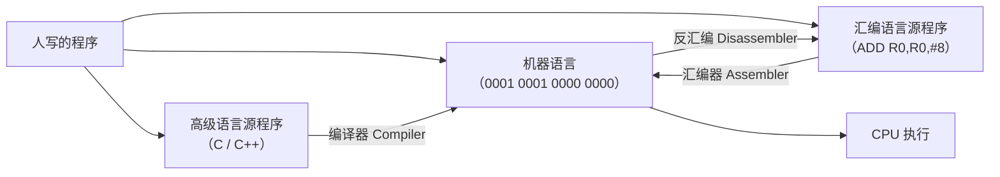

**【辅助理解图：三种语言与翻译链】**

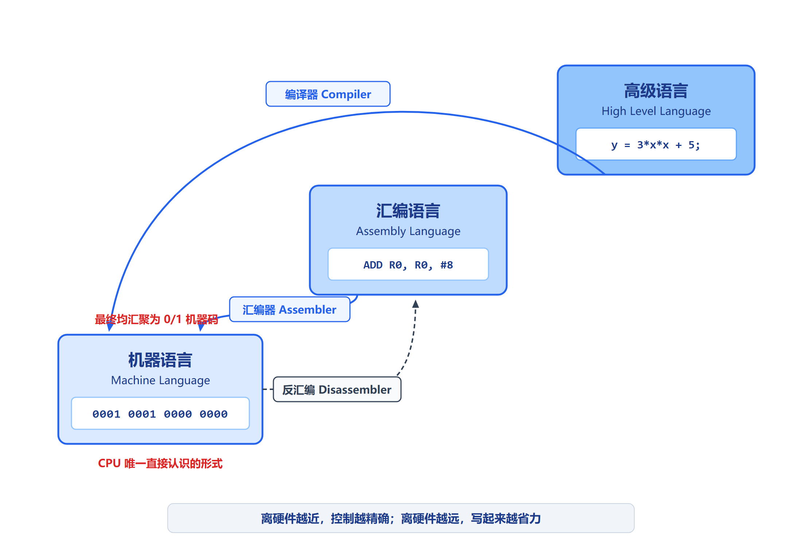

**怎么看这张图**：

1. **先看最下面一层（最粗的那条）**：机器语言。这是 CPU 唯一认识的东西，是"地面"。
2. **再看中间那层**：汇编语言。它和机器语言几乎一一对应，中间只隔着一个"汇编器"。
3. **最后看最上面那层**：高级语言。它离硬件最远，中间隔着一个更复杂的"编译器"。
4. **箭头方向**：所有箭头最终都指向机器语言——**不管你怎么写，最后都得变成 0/1**。
5. **虚线箭头（反汇编）**：是从机器语言往回走，用于分析别人写的程序或调试。
6. **这张图要你理解什么**：编程语言只是"离硬件有多近"的区别，不是"谁高级谁低级"。
   离硬件越近，越能精确控制，但写起来越费劲。

### 4.1.6 一条汇编指令长什么样：操作码 + 操作数

> 【教材内容】汇编语言的指令通常由操作码和操作数组成。操作码指出的是要对操作数进行什么操作。操作数指出的是对什么数进行操作以及将操作的结果放到何处。

**大白话拆解**：

一条指令就像一句中文："**把 8 加到 R0 上**"。

- "把……加上去" = **操作码**（要干什么）；
- "8"和"R0" = **操作数**（对谁干）。

**术语表（第一次出现）：**

| 术语 | 英文 | 大白话 |
|---|---|---|
| 操作码 | opcode / operation code | 说明"干什么" |
| 操作数 | operand | 说明"对谁干" |
| 助记符 | mnemonic | 操作码的英文缩写写法 |

> 【教材内容】为便于阅读和记忆，操作码用规定的缩写英文字母组成，称为**助记符**。例如，MOV 是数据的传送，ADD 是数据的相加运算，AND 是数据的逻辑与运算等。

**常用的几个助记符先混个脸熟：**

| 助记符 | 英文原意 | 干什么 |
|---|---|---|
| MOV | Move | 传送（搬运数据） |
| ADD | Add | 加法 |
| SUB | Subtract | 减法 |
| AND | And | 按位与 |
| ORR | OR | 按位或 |
| CMP | Compare | 比较 |
| B | Branch | 跳转 |
| LDR | Load Register | 从内存读到寄存器 |
| STR | Store Register | 从寄存器写到内存 |

> 【教材内容】每一种助记符都对应一个特定的机器代码，以区别不同的操作。任何一种用助记符编写的汇编指令，只有通过汇编程序被翻译成二进制数形式的机器代码（目标代码）后，才能让 CPU 执行其规定的操作。在机器码的格式中，操作码是二进制的形式，与一般的二进制数没有区别，但是操作码总是处在每条指令的第一个字节的位置。

**教材的例子：**

```
MOV R1, #0x1245
```

> 【教材内容】这条指令表示的是将十六进制的数据 0x1245 送到寄存器 R1 中，它所对应的二进制机器语言是：0xF241245。其中的 MOV 是操作码，R1 和 #0x1245 分别称为第一操作数和第二操作数。

**【补充解释】把这条指令掰开看：**

```
MOV   R1,  #0x1245
 │     │      │
 │     │      └── 第二操作数：要送过去的数（0x1245）
 │     └───────── 第一操作数：接收结果的寄存器
 └─────────────── 操作码（助记符）：传送
```

执行效果：

```
执行前： R1 = 0x????????   （不知道是什么）
执行后： R1 = 0x00001245   （低 16 位是 1245，高 16 位被清 0）
```

**注意**：`MOV` 只会把 R1 改成 0x1245，**不会碰任何内存**。这一点非常重要，
因为 Cortex-M3 是"加载/存储型"CPU（4.2 节细讲）：**传送数据用 MOV，搬内存用 LDR/STR**。

> 【待核验】教材写这条指令的机器码是 `0xF241245`，只有 7 个十六进制位（28 bit），
> 而一条 Thumb-2 的 `MOV R1, #0x1245` 应该是 32 位（8 个十六进制位），
> 且 0x1245 恰好是 MOVW 的编码格式（形如 0xF24x 0x1245）。此处疑为 OCR 丢字符，
> 已记入文末"待核验"清单。

### 4.1.7 立即数（Immediate）

> 【教材内容】在汇编语言指令中，用直接参与操作的数据表示操作数时，这样的数据称为**立即数**。立即数的前面有前缀 # 号。立即数可以写成十进制的格式，也可以写成十六进制数的格式。其区分是在数据的前面加上前缀以示区别：十进制数据没有前缀，十六进制数据的前缀为 0x。

**术语表：**

| 术语 | 英文 | 大白话 |
|---|---|---|
| 立即数 | immediate / immediate value | 直接写在指令里的那个数，不用去别处找 |

**"立即"是什么意思**：就是"**立刻就能拿到**"——这个数就印在指令本身里，CPU 取指令的时候顺手就拿到它了，
不用再去内存里翻。

```
MOV R0, #64       ; 64 是十进制，没有前缀
MOV R0, #0x40     ; 0x40 是十六进制，有 0x 前缀
                  ; 这两个写法的效果完全一样（都是 64）
```

验算：`0x40 = 4×16 + 0 = 64` ✔

**书写规则总结：**

| 写法 | 含义 |
|---|---|
| `#64` | 十进制的 64 |
| `#0x40` | 十六进制的 64 |
| `#'A'` | 字符 A 的 ASCII 码（0x41 = 65） |

**【容易搞混】**：`#` 是"立即数前缀"，`0x` 是"十六进制前缀"。两个都要有：
写成 `MOV R0, 0x40` 是错的（少了 `#`），写成 `MOV R0, #40` 是十进制 40（不是十六进制 0x40）。

### 4.1.8 本节真正要记住什么

| 要记住 | 内容 |
|---|---|
| 三种语言 | 机器语言（0/1，CPU 直接懂）、汇编语言（助记符，要汇编器翻译）、高级语言（接近英语，要编译器翻译） |
| 三个翻译词 | 汇编（assemble）、反汇编（disassemble）、编译（compile） |
| 指令的组成 | 操作码（干什么）+ 操作数（对谁干） |
| 立即数 | 直接写在指令里的数，前缀 `#`；十六进制还要加 `0x` |
| 最重要的一句 | **不管用什么语言写，最后都得变成机器语言，CPU 才认。** |

---

## 4.2 指令分类、条件域和指令格式

> 对应教材 4.2 节（p94～p103）

这一节要回答三个问题：

1. Cortex-M3 的指令分成几类？
2. 怎么让同一条指令"看情况执行"（比如"相等才传送"）？
3. 一条汇编指令的完整格式是什么？它变成 0/1 之后，每一位分别管什么？

### 4.2.1 先记住最关键的一句话：Cortex-M3 是"加载/存储型"的

> 【教材内容】Cortex-M3 的指令集是**加载/存储型**的，即指令集仅能处理寄存器中的数据，而且处理结果都要放回寄存器中，对存储器的访问则需要通过专门的加载/存储指令来完成，每个指令都有相对应的机器码。

**【补充解释】这是本章最容易被忽略、但最重要的一句话。** 展开讲：

**大白话**：Cortex-M3 的运算指令（加法、减法、与、或……）**只能对寄存器里的数动手**。
想对内存里的数做加法？不行。必须先：

```
第 1 步：用 LDR 把内存里的数搬进寄存器   （Load，加载）
第 2 步：在寄存器里做加法
第 3 步：用 STR 把结果搬回内存            （Store，存储）
```

**【类比】**：寄存器是**厨房的操作台**，内存是**仓库**。

- 你不能在仓库里炒菜，只能把菜搬到操作台上炒；
- 炒完再把成品搬回仓库。
- `LDR` = 从仓库搬到操作台；`STR` = 从操作台搬回仓库。

**为什么这样设计**：

- 操作台（寄存器）离厨师（运算单元）近，速度快；
- 仓库（内存）远，慢；
- 把所有运算都放在操作台上做，指令格式就能简单、统一，速度也快。

**注意边界**：真实硬件里，寄存器到运算单元之间是片内的高速通路，
内存访问要经过总线、可能还要等好几个时钟周期。类比只帮你记住"近/远、快/慢"。

**这条规则的直接后果**（本章会反复出现）：

| 你想干的事 | 不能这样写 | 应该这样写 |
|---|---|---|
| 把内存地址 0x20000000 处的数加 1 | `ADD [0x20000000], #1` ❌ | `LDR R0,[R1]` → `ADD R0,#1` → `STR R0,[R1]` ✔ |

### 4.2.2 指令的五大类

> 【教材内容】Cortex-M3 的指令集可以分为**数据传送指令、数据处理指令、跳转指令、程序状态寄存器（PSR）处理指令和异常产生指令**等几大类。

**【补充解释】** 教材还补了一句：

> 【教材内容】有些资料把加载/存储指令单独作为一类指令，本书将这类指令归到数据处理类指令的数据传送指令中进行介绍。

也就是说，本书的分类是"**五类**"，其中 LDR/STR 被放进了"数据传送类"里。
你看到别的资料把 LDR/STR 单列一类时，不要困惑——只是分法不同。

五类的分工，用一张表看懂：

| 类别 | 干什么 | 代表指令 |
|---|---|---|
| 数据传送类 | 搬数据（寄存器↔寄存器、寄存器↔内存、读写特殊寄存器、栈操作） | MOV、LDR、STR、LDM、STM、PUSH、POP、MRS、MSR |
| 数据处理类 | 算数、逻辑、比较、移位、位段处理 | ADD、SUB、AND、ORR、EOR、MUL、CMP、TST、LSL、LSR、BFI |
| 跳转类 | 改变程序的执行顺序 | B、BL、BX、BLX、CBZ、CBNZ、TBB、TBH、IT |
| PSR 处理指令 | 读/写程序状态寄存器 | MRS、MSR |
| 异常产生指令 | 主动制造一个异常（用于系统调用、调试） | SVC、BKPT |

**教材表 4-1 是一张很长的指令总表**，教材自己也说了：

> 【教材内容】其中后缀带 S 的指令是影响标志位的指令，带阴影的指令是不常用的指令。读者可以浏览每条指令的功能，不需要记忆。

**【补充解释】这句话请照做。** 表 4-1 有上百条指令，一开始就背下来是不可能的，也没必要。
本讲义会挑**最常用的**在 4.4 节详细讲，其余的你在表里查到、知道有这回事就够了。

下面把表 4-1 里"最常用的一批"整理出来，作为速查表（详细用法在 4.4 节）：

| 大类 | 常用指令 | 一句话功能 |
|---|---|---|
| 数据传送 | MOV / MOVS | 寄存器之间传送，或加载 16 位立即数 |
| | MOVW / MOVT | 分别写寄存器的低 16 位 / 高 16 位 |
| | MVN | 取反后传送 |
| | MRS / MSR | 特殊寄存器 → 通用寄存器 / 反过来 |
| | LDR / LDRB / LDRH / LDRSB / LDRSH | 从内存加载字 / 字节 / 半字（带符号扩展） |
| | STR / STRB / STRH | 把字 / 字节 / 半字存入内存 |
| | LDM / STM | 一次搬多个字（多寄存器） |
| | PUSH / POP | 入栈 / 出栈 |
| | LDREX / STREX / CLREX（及 LDREXB/H、STREXB/H） | 互斥访问：让"读-改-写"不被打断（见 4.4.4 节 3） |
| 数据处理 | ADD / ADDS、ADC / ADCS | 加法、带进位加法 |
| | SUB / SUBS、SBC / SBCS、RSB、SUBW | 减法、带借位减法、逆向减法、宽减法 |
| | ADDW | 宽加法（可带 12 位立即数） |
| | MUL、MLA、SMULL、UMULL、SDIV、UDIV | 乘法、乘加、长乘法、除法 |
| | AND / ORR / ORN / EOR / BIC | 与 / 或 / 或非 / 异或 / 位清零 |
| | CMP / CMN / TST / TEQ | 比较、反值比较、位测试、相等测试 |
| | LSL / LSR / ASR / ROR / RRX | 移位 |
| | REV / REV16 / REVSH / RBIT | 字节序反转、位反转 |
| | SXTB / SXTH / UXTB / UXTH | 数据宽度扩展 |
| | CLZ / BFC / BFI / UBFX / SBFX | 前导零、位段清零/插入/提取 |
| | SSAT / USAT | 饱和运算 |
| 跳转 | B / B&lt;cond&gt; | 无条件 / 条件跳转 |
| | BL | 带返回的跳转（调用子程序） |
| | BX / BLX | 带状态切换的跳转 |
| | CBZ / CBNZ | 等于 0 / 不等于 0 就跳（只能向前） |
| | TBB / TBH | 查表跳转 |
| | IT | 围出一个条件执行块 |
| | NOP | 空操作 |
| 其他 | SVC（教材写作 SWI） | 系统服务调用 |
| | BKPT | 断点 |
| | CPSIE / CPSID | 使能 / 除能中断屏蔽位 |
| | SEV / WFE / WFI | 发事件 / 休眠等事件 / 休眠等中断 |
| | ISB / DSB / DMB | 各种同步隔离（和流水线有关） |

**【容易搞混】**：表 4-1 里同时出现了 `SWI` 和 `SVC` 的概念。`SWI` 是传统 ARM（A32）指令集里的"软件中断"，
Cortex-M3 用的是 `SVC`（Supervisor Call，系统服务调用），功能类似但名字和编码不同。
另外表 4-1 里还列了 `STRSB`、`STRSH`（"带符号存储"）——**存储指令没有带符号不带符号之分**，
存进去的就是那串 0/1，符号是读出来时才解释的。这几处一并记入文末"待核验"。

### 4.2.3 条件域：让同一条指令"看情况执行"

> 对应教材 4.2 节第 2 部分（p98）

**先看一个生活场景：**

你给助理留一张便条："**如果**外面下雨，把伞放进我包里。"

这句话里，"把伞放进包里"是一个动作，"如果下雨"是这个动作的**条件**。

CPU 的指令也能这样：**动作 + 条件**。这就是"条件域"。

> 【教材内容】Cortex-M3 内核的微控制器几乎所有的指令均可根据 xPSR 中条件码的状态和指令的条件域有条件地执行。当执行条件满足时，指令被执行，否则指令被忽略。

**术语表：**

| 术语 | 英文 | 大白话 |
|---|---|---|
| 条件域 | condition field | 指令里"什么情况下才执行"的那部分 |
| 条件码 | condition code | 条件的具体编码（4 个 bit） |

**注意"被忽略"这三个字**：条件不满足时，这条指令**不是"报错"，而是"当作不存在"**，
程序继续往下走。这一点和"跳转"不一样：

| 做法 | 条件不满足时 |
|---|---|
| 条件执行（如 `MOVNE R0,R5`） | 这条指令不干，**继续执行下一条** |
| 条件跳转（如 `BNE LABEL`） | 不跳，**继续执行下一条** |

两者看起来结果一样，但条件执行**不会打乱流水线**（第 2 章讲过流水线），所以更快。

#### 4.2.3.1 四个标志位：N、Z、C、V

条件域是靠标志位工作的，所以先看标志位住哪儿。

> 【教材内容】表 4-2 APSR 中常用的标志位

| 标志位 | 位序号 | 功能描述 |
|---|---|---|
| N | 31 | 负数（上一次操作的结果是个负数）。N = 操作结果的最高位（MSB） |
| Z | 30 | 零（上次操作的结果是 0）。当数据操作指令的结果为 0，或者比较/测试的结果为 0 时，Z 置位 |
| C | 29 | 进位/借位（上次操作导致了进位或者借位）。C 用于无符号数据处理，最常见的就是加法进位及减法借位时 C 被置位。此外，C 还充当移位指令的中介 |
| V | 28 | 溢出（上次操作结果导致了数据的溢出）。该标志用于带符号的数据处理。比如在两个正数上执行 ADD 运算后，和的 MSB 为 1（视作负数），则 V 置位 |

**【先补一个前置知识：MSB 和 LSB 是什么？】**

上面的表 4-2 里出现了 `MSB`，后面 4.4.2 节讲位段指令时还会出现 `LSB`/`lsb`，先把这两个词一次讲清：

| 缩写 | 英文全称 | 中文名 | 是第几位 |
|---|---|---|---|
| **MSB** | **M**ost **S**ignificant **B**it | 最高有效位 | **bit31**（写出来在最左边、分量最大的那一位） |
| **LSB** | **L**east **S**ignificant **B**it | 最低有效位 | **bit0**（写出来在最右边、分量最小的那一位） |

记法：**M = Most = 最大 → 最左（bit31）；L = Least = 最小 → 最右（bit0）。**

**怎么用在标志位上**：表 4-2 说"N = 操作结果的最高位（MSB）"，
意思就是"**结果的 bit31 是几，N 就是几**"——bit31 = 1 就当成负数（见 1.2.3 节讲的原码/反码/补码）。
后面说"位段从 `#lsb` 开始"，指的就是"从第几位开始数（按 bit0 起编号）"。

**位图（这是本章第一张位图，请仔细看）：**

```
APSR（Application Program Status Register，应用程序状态寄存器）
它是 xPSR 的低 32 位里"给应用程序看"的那部分

 31 30 29 28 27 26 25 24 ...                    8  7  6  5  4  3  2  1  0
+--+--+--+--+--+--+--+--+----------------------+--+--+--+--+--+--+--+--+
|N |Z |C |V |        保留（先不用管）           |      保留/其他         |
+--+--+--+--+--+--+--+--+----------------------+--+--+--+--+--+--+--+--+
 ↑  ↑  ↑  ↑
 │  │  │  └── V = 溢出标志    (oVerflow)      bit28
 │  │  └───── C = 进位/借位标志 (Carry)        bit29
 │  └──────── Z = 零标志       (Zero)          bit30
 └─────────── N = 负数标志    (Negative)      bit31
                ↑
          本章重点只看这 4 位
```

**【补充解释】怎么记这四位：**

| 标志 | 什么时候会变成 1 |
|---|---|
| N | 结果的最高位（bit31）是 1 → 当成负数看 |
| Z | 结果所有位全是 0 → 结果就是 0 |
| C | 无符号加法"装不下了"→ C=1；**减法反过来："够减"→ C=1，"不够减（要借位）"→ C=0**（详见下面专门的一段） |
| V | 带符号运算的结果超出了能表示的范围（比如两个正数相加得到负数） |

**【补充解释】减法里的 C 是"反的"——这是全章最容易记错的一个点**

教材表 4-2 的原话是"C 用于无符号数据处理，最常见的就是加法进位及减法借位时 C 被置位"。
这句话如果只看字面，很容易得出一个**错误**的结论："减法不够减（借位）时 C=1"。
ARM 的实际规则正好相反：

| 运算 | C=1 表示 | C=0 表示 |
|---|---|---|
| 加法 | **有进位**（装不下了） | 没有进位 |
| 减法 | **没有借位**（够减） | **有借位**（不够减，向上"借"了一位） |

为什么是这样？因为 ARM 硬件做减法时，实际算的是 `A + (−B)`，
而 `−B` 用"取反加 1"（补码，第 1 章讲过）得到。这样一来，"减法"在电路里就变成了"加法"，
C 记录的仍然是**这次加法的进位输出**：结果没有向上借位，就相当于产生了进位 → C = 1。

```
例：CMP R0, R1     （相当于算 R0 − R1，只看标志位）

  R0 = 5，R1 = 3  → 5 − 3 = 2，够减          → C = 1
  R0 = 3，R1 = 5  → 3 − 5 不够减，要借位     → C = 0
```

所以 4.2.3.2 节的表里，"无符号 ≥"用 `CS`（C 置位）、"无符号 <"用 `CC`（C 清零），
和这里的规则是**自洽**的；4.4.2 节讲 SUB 指令时还会再强调一遍。
（教材表 4-2 这个措辞属于老式提法，容易和 x86 的"借位时 CF=1"混淆，
本项目已把它列入文末"待核验"。）

**【容易搞混】C 和 V 的区别**——这是初学者最容易混的一对：

- **C 管"无符号"**：把数当成 0～4294967295 来算，加法"装不下"、减法"不够减"时它就会变化
  （加法是"有进位 C=1"，减法反着记："够减 C=1、不够减 C=0"）；
- **V 管"带符号"**：把数当成 −2147483648～2147483647 来算，超范围就是 V=1。

举例：`0xFFFFFFFF + 0x00000001`

```
运算前：  1111 1111 1111 1111 1111 1111 1111 1111   (0xFFFFFFFF)
加       +0000 0000 0000 0000 0000 0000 0000 0001   (0x00000001)
─────────────────────────────────────────────────
结果：   1 0000 0000 0000 0000 0000 0000 0000 0000
         ↑
       第 33 位装不下 → 丢掉，剩下 0x00000000
结果 = 0x00000000，而 C = 1（有进位），Z = 1（结果是 0）

怎么理解：
· 无符号角度：4294967295 + 1 = 4294967296，超出 32 位范围 → C=1 ✔
· 带符号角度：-1 + 1 = 0，完全正常，没有溢出 → V=0 ✔
```

#### 4.2.3.2 16 种条件码

> 【教材内容】每一条 ARM 指令包含 4 位的条件码，位于指令的最高 4 位 [31:28]。条件码共有 16 种，每种条件码可用两个字符表示，这两个字符可以添加在指令助记符的后面和指令同时使用。例如，跳转指令 B 可以加上后缀 EQ 变为 BEQ 表示"相等则跳转"，即当 APSR 中的 Z 标志置位时发生跳转。

**教材表 4-3（完整抄录，这是本章要背的表之一）：**

| 条件码（4 bit） | 助记符后缀 | 标志条件 | 含义 |
|---|---|---|---|
| 0000 | EQ | Z 置位 | 相等 |
| 0001 | NE | Z 清零 | 不相等 |
| 0010 | CS 或 HS | C 置位 | 无符号数大于或等于 |
| 0011 | CC 或 LO | C 清零 | 无符号数小于 |
| 0100 | MI | N 置位 | 负数 |
| 0101 | PL | N 清零 | 正数或零 |
| 0110 | VS | V 置位 | 溢出 |
| 0111 | VC | V 清零 | 未溢出 |
| 1000 | HI | C 置位并且 Z 清零 | 无符号数大于 |
| 1001 | LS | C 清零或者 Z 置位 | 无符号数小于或等于 |
| 1010 | GE | N 等于 V | 带符号数大于或等于 |
| 1011 | LT | N 不等于 V | 带符号数小于 |
| 1100 | GT | Z 清零且 N 等于 V | 带符号数大于 |
| 1101 | LE | Z 置位或 N 不等于 V | 带符号数小于或等于 |
| 1110 | AL | 忽略 | 无条件执行 |
| 1111 | — | — | 系统保留 |

> 【教材内容】在 16 种条件标志码中，只有 15 种可以使用。

（第 16 种 `1111` 被系统保留，不能用。）

**【补充解释】这张表不要死背，先抓住三条规律：**

**规律一：判断"相等/不相等"看 Z。**

```
CMP R0, R1      ; 相当于算 R0 - R1
                ; 如果结果 = 0 → Z = 1 → 说明 R0 == R1
BEQ  相等处     ; Z=1 就跳
BNE  不相等处   ; Z=0 就跳
```

**规律二：判断"谁大谁小"，要分带符号还是不带符号。**

- **无符号数**（0、1、2、……、4294967295）比大小 → **看 C**（做完减法后的 C：够减 = 1、不够减 = 0）；
- **带符号数**（−2147483648～2147483647）比大小 → **看 N 和 V 的组合**。

为什么带符号比较要用 N 和 V 两个？因为**减法可能溢出**，溢出会把符号位"弄反"。
用一个具体例子说明：

```
CMP R0, R1  等价于 R0 - R1，看标志位
```

| 情况 | R0 | R1 | R0−R1 | N | V | GE (N==V) | 结论 |
|---|---|---|---|---|---|---|---|
| 正常大于 | 10 | 3 | 7 | 0 | 0 | 成立 | 10 ≥ 3 ✔ |
| 正常小于 | 3 | 10 | −7 | 1 | 0 | 不成立 | 3 ≥ 10 ✘ |
| 溢出，符号位被"翻反" | −2147483648 | 1 | 0x7FFFFFFF（溢出） | 0 | 1 | **不成立** | −2147483648 < 1 ✔（LT 成立） |

第三行正是"**为什么必须同时看 N 和 V**"的关键例子，一步一步拆开看：

```
· R0 = −2147483648（0x80000000），是 32 位带符号数里最小的负数；R1 = 1；
· 数学上 −2147483648 − 1 = −2147483649，超出了 32 位带符号数的表示范围
   → 溢出，硬件把 V 置 1；
· 硬件只能"硬算"：丢掉溢出的那一位，留下的 32 位结果是 0x7FFFFFFF，
  看上去是个正数 → 结果的 bit31 是 0 → N = 0；
· 如果只看 N，就会误以为"结果为正 → R0 更大"，结论正好反了；
· 真正判断谁大谁小，要看 N 和 V 是否相等：这里 N=0、V=1，不相等
   → 带符号比较的结论是"小于" → GE 不成立、LT 成立，
     和事实（−2147483648 < 1）一致 ✔
```

一句话理解：**V 记录的是"符号位被溢出翻反了"这件事**；
把 N 和 V 结合起来看，等于先把被翻反的符号"翻回来"，再判断正负。
所以带符号比较的公式是：

```
GE（带符号 ≥）  ⇔  N == V
LT（带符号 <）  ⇔  N != V
```

最后把结论浓缩成一句：

> **带符号比大小用 GE/LT/GT/LE，无符号比大小用 HS/LO/HI/LS。用错组合，结果就是错的。**

**规律三：常用后缀速记表。**

| 你想表达 | 无符号用 | 带符号用 |
|---|---|---|
| ≥ | HS（或 CS） | GE |
| < | LO（或 CC） | LT |
| > | HI | GT |
| ≤ | LS | LE |
| = | EQ | EQ |
| ≠ | NE | NE |

**【容易搞混】把 `HI` 和 `GT` 混用。** 举个会出错的具体例子：

```
R0 = 0xFFFFFFFF   （当成无符号数是 4294967295，当成带符号数是 −1）
R1 = 0x00000001   （两种解释下都是 1）

CMP R0, R1

· 用无符号眼光看：4294967295 > 1     → 应该用 HI，跳转
· 用带符号眼光看：−1 < 1             → 应该用 LT，不跳

如果你明明在处理"无符号数"，却写了 BGT，程序行为就会和你想的相反。
```

#### 4.2.3.3 条件后缀能用在哪？——教材的一条重要限制

> 【教材内容】在 Cortex-M3 中，对条件后缀的使用有很大的限制：只有转移指令（B 指令）才可随意使用。而对于其他指令，Cortex-M3 引入了 IF-Then 指令块，在这个块中才可以加后缀，且必须加以后缀。IF-Then 块由 IT 指令定义，本章稍后将介绍它。另外，S 后缀可以和条件后缀在一起使用。

**【补充解释】这段话要重点理解，因为它解释了为什么会有 IT 指令。**

- **B 指令**：可以随便加条件后缀 → `BEQ`、`BNE`、`BGT`……都没问题；
- **其他指令**：想在 Thumb-2 里"有条件地执行"，必须先用 `IT` 指令圈出一个块（4.4.3 节讲）。

**【类比】**：`IT` 就像给几条指令套一个"如果……就……"的框，框里的每条指令都要标明
自己是"条件成立时执行"（T，Then）还是"条件不成立时执行"（E，Else）。

> 【待核验】教材 4.5 节的例题（例 4-1、例 4-2、例 4-4）里直接写了 `MOVNE`、`MOVEQ`、
> `ADDHI`、`ADDLS`、`TEQNE` 这类条件指令，**没有配套写 IT 指令**。
> 这与 4.2 节"其他指令必须放在 IT 块中"的说法存在表面矛盾。
> 实际中，ARM 汇编器（armasm）在统一汇编语法下**会自动生成所需的 IT 指令**，
> 所以这种写法在工程里能通过。本讲义保留教材例题原样，并在此说明，
> 具体以你使用的汇编器文档为准。此项已记入"待核验"。

### 4.2.4 指令格式：一条汇编指令的解剖

> 【教材内容】用助记符表示的 Cortex-M3 指令，一般格式如下：

```
{Label}  <opcode> {S}{cond}  <operand1>, <operand2> {, operand3} {;注释}
```

> 【教材内容】其中，`<>` 中的内容是必不可少的，`{}` 中的内容为可选项（可省略不写）。

**【辅助理解图：汇编指令格式解剖】**

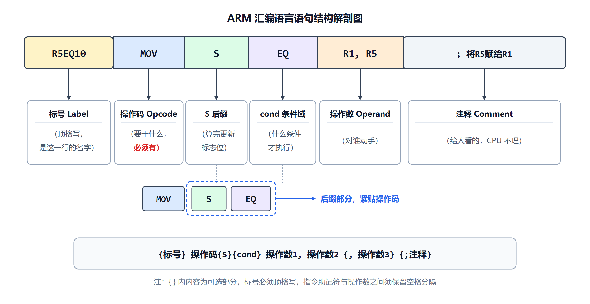

**怎么看这张图**：

1. **先看整行**：一条汇编语句从左到右分成 5 段，段与段之间用空格/TAB 隔开。
2. **第一段（标号 Label）**：顶格写的那个名字，是"这一行的地址的名字"。
3. **第二段（操作码 opcode）**：核心，必须有，说明要干什么。
4. **第三段（后缀 S 和 cond）**：紧贴在操作码后面，用来"改设定"——
   `S` 表示"算完顺手更新标志位"，`cond` 表示"什么条件下才执行"。
5. **第四、五段（操作数）**：逗号分隔，说明对谁动手、结果放哪。
6. **第六段（注释）**：分号 `;` 开头，给人看的，CPU 完全不理会。
7. **这张图要你理解什么**：一条指令的每一部分都有固定位置和固定含义，
   写错位置汇编器就会报错。看别人的汇编代码时，先按这个结构"切一刀"，就不容易晕。

教材的例子：

```
R5EQ10            ← 标号（顶格写）
    MOV R1, R5    ← 指令（前面要有空格）
;将 R5 赋给 R1
```

> 【教材内容】其中，R5EQ10 为标号（在程序文件中，顶格书写）；MOV 为指令助记符；R1 和 R5 为两个操作数；分号后面的内容为注释。

下面逐段详细讲。

#### (1) 标号（Label）

> 【教材内容】标号放在指令语句的最前面，必须顶格书写，而后面的指令、伪指令等在书写的时候需要有前导空格，一般用一个或者多个 TAB 代替。标号是其后指令所在地址的名字，用于表示某条指令跳转时的目的地址。程序在修改和调试时，指令所在的实际地址往往会随之变化，而代表地址的名字可以不变。因此，适当地使用标号，可以给程序的编写和修改带来极大的方便。不是每条指令都需要标号，只有在该指令作为跳转的目的地址时才需要标号。

**【补充解释】为什么要用标号，而不是直接写地址？**

```
❌ 不好的写法（假设 B 指令要跳到 0x08000120）
    CMP R5, #10
    BEQ 0x08000120      ; 硬写地址
    ...
0x08000120:
    MOV R1, R5

问题：以后你在前面加了一行代码，所有地址都往后挪了，
     这个 0x08000120 就指到别处去了，程序直接跑飞。
```

```
✔ 好的写法
    CMP R5, #10
    BEQ R5EQ10          ; 写标号
    ...
R5EQ10
    MOV R1, R5

好处：你随便在前面增删代码，汇编器会自动重新算出正确地址。
```

**【类比】**：标号就像给书里的章节起名字。
你说"翻到第 3 章"，比说"翻到第 87 页"安全得多——因为加了几页之后，页码会变，章节名不会变。

**标号命名规则（教材原文）：**

> ① 标号由字母（a～z 或 A～Z）、数字（0～9）或某些特殊字符（@、_、? 等）组成，但问号"?"不能单独作标号，其中"_"是下画线；
> ② 标号必须以字母（a～z 或 A～Z）或某些特殊的符号（@、_、?）开头；
> ③ 标号长度不允许超过 31 个字符；
> ④ 标号不能与指令助记符相同。

**【补充解释】翻译成人话：**

| 规则 | 人话 | 合法例子 | 非法例子 |
|---|---|---|---|
| ① | 只能用字母、数字、`@`、`_`、`?` | `Loop1`、`MY_LABEL` | `Loop-1`（减号不行） |
| ② | 不能以数字开头 | `_start`、`L1` | `1Loop`（数字开头 ✘） |
| ③ | 不能太长 | `MyLoop` | 超过 31 个字符的名字 |
| ④ | 不能和指令同名 | `MyLoop` | 取名叫 `MOV`、`ADD` ✘ |

#### (2) 指令助记符（Opcode）

> 【教材内容】指令助记符也叫作操作码，是指令名称的代表符号，它是一条指令语句中所必需的，不可缺少，表示本指令所要进行的操作。例如，ADD 指令表示执行算术加法运算。操作码的前面必须有至少一个空白符，通常使用一或两个 Tab 键来产生。

**【补充解释】** 这一条说明"为什么标号要顶格、指令要缩进"：

```
正确的写法：
START              ← 标号顶格
    MOV R0, #1     ← 指令前面有空格

错误的写法（汇编器可能把 MOV 当成标号）：
START
MOV R0, #1         ← 前面没空格，汇编器可能认为 MOV 是标号
```

这个"顶格/缩进"的习惯是从早期汇编器传下来的。
现在的汇编器通常能自动识别，但**照规矩写永远没错**。

#### (3) 指令的后缀：S 和 cond

> 【教材内容】指令的后缀包括条件域（cond）和 S 后缀。条件域表示指令有条件地执行。条件域的代码就是前面描述的指令条件标志码。若指令中包含了 S 后缀，则要求指令执行后更新 APSR 寄存器中的相关标志。

**【补充解释】S 后缀到底是干什么的？**

**大白话**：加了 `S`，就是告诉 CPU："**算完别忘了在小报告（APSR）上记一笔。**"

```
ADD  R0, R1, R2     ; R0 = R1 + R2，APSR 的标志位不变
ADDS R0, R1, R2     ; R0 = R1 + R2，同时更新 N/Z/C/V
                    ;   ↑ 多了一个 S
```

**为什么需要区分**：因为更新标志位是有代价的（要额外电路），
如果后面的代码不看标志位，就没必要更新。

**但注意**：`CMP`、`TST`、`TEQ` 这些"比较类"指令**天生就会更新标志位**，
因为它们存在的意义就是更新标志位（它们不保存结果）。所以它们不带 S 也更新。

**【辅助理解图：APS R 标志位与条件后缀的关系】**

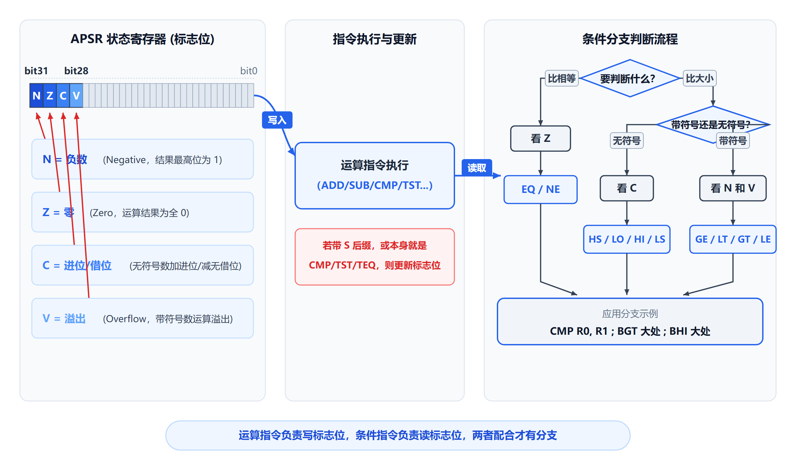

**怎么看这张图**：

1. **先看左半部分**：一个 32 位的横条，最左边 4 格高亮，标着 N、Z、C、V。这就是 APSR 的关键部分。
2. **中间**：一条指令执行完，会有箭头从"运算结果"指向这 4 个格子——表示"更新标志位"。
3. **右半部分**：一张判断流程图。先问"是比大小还是比相等？"，
   比相等 → 看 Z；比大小 → 再问"带符号还是无符号？"→ 分别看 N/V 或 C。
4. **最下方**：给出 4 条示例指令（BEQ / BNE / BHI / BGT）分别对应哪条路径。
5. **这张图要你理解什么**：标志位是"中间桥梁"——
   **运算指令负责写标志位，条件指令负责读标志位，两者配合才有分支。**

#### (4) 操作数（Operand）

> 【教材内容】operand1 为第一个操作数，一般使用寄存器，给出本指令的执行结果存储处。operand2 为第二个操作数，也是寄存器。operand3 为第三个操作数，可以是寄存器或者立即数。不同指令需要不同数目的操作数，并且对操作数的语法要求也可以不同。

**【补充解释】操作数的常见形态：**

| 形态 | 写法 | 例子 | 含义 |
|---|---|---|---|
| 寄存器 | `Rn` | `R0`、`R7`、`LR`、`SP` | 数据就在这个格子里 |
| 立即数 | `#数值` | `#10`、`#0x3F` | 数据就印在指令里 |
| 内存（间接） | `[Rn]` | `[R1]` | **R1 里装的是地址**，数据在内存那个地址上 |
| 基址+偏移 | `[Rn, #off]` | `[R1, #4]` | 地址 = R1 + 4 |
| 寄存器列表 | `{R0-R3}` | `{R0, R4-R7, LR}` | 一次点名好几个寄存器 |
| 移位 | `Rm, LSL #n` | `R3, LSL #1` | 把 R3 先左移 1 位再用 |

**【容易搞混】`R1` 和 `[R1]` 是两回事**：

```
R1        →  R1 这个格子里的数（比如 0x20000004）
[R1]      →  以 R1 里的数作为地址，去内存里那个地址上取数
              （比如去 0x20000004 这个格子取数）
```

这就像：

- `R1` 是"纸条上写的门牌号"；
- `[R1]` 是"按这个门牌号去房间里拿东西"。

#### (5) 注释（Comment）

> 【教材内容】注释是为了阅读程序方便由编程人员加上的，并不影响程序的执行和功能，注释部分不是必需的。注释部分必须用分号"；"开头，一般都写在它所注释的指令的后面或者某段程序的开始……可以用中文或者英文甚至任何便于理解的字符表示。

**【补充解释】** 注释不产生任何机器码，CPU 根本看不到它。
**但请务必写注释**——汇编代码如果不写注释，过一周你自己都看不懂。

### 4.2.5 指令的机器表示：32 个 bit 里装了什么

> 对应教材 4.2 节"2）指令的表示方法"（p100）

> 【教材内容】从形式上看，Cortex-M3 的指令在机器中的表示格式是用 32 位的二进制表示。例如：

```
ADDSEQ R0, R1, #8
```

> 其二进制代码形式为：

| 31~28 | 27~25 | 24~21 | 20 | 19~16 | 15~12 | 11~0 |
|---|---|---|---|---|---|---|
| 0000 | 001 | 0100 | 1 | 0001 | 0000 | 000000001000 |
| cond | （opcode） | （opcode） | S | operand1 | operand2 | operand3 |

> 指令代码一般可以分为 5 个域。
>
> - **[31～28]：条件域。** 4 位条件码共有 16 种组合，如表 4-3 所示。
> - **[27～21]：指令编码（操作码）。** 除了指令编码外，还包含几个重要的指令特征和可选后缀的编码。
> - **[20]：决定指令的操作是否影响 CPSR。**
> - **[19～16]：地址基址 operand1**，为 R0～R15 共 16 个寄存器编码。
> - **[15～12]：目标或源寄存器 operand2**，为 R0～R15 共 16 个寄存器编码。
> - **[11～0]：地址偏移或操作寄存器、操作数。**

**【先补一个前置知识：`CPSR` 是什么？它和上面讲的 `APSR` 是同一个东西吗？】**

教材从这里开始频繁使用 `CPSR` 这个名字，很多读者会以为"怎么又冒出来一个寄存器"。先把名字对上：

| 名称 | 英文全称 | 中文名 | 是什么 |
|---|---|---|---|
| **CPSR** | **C**urrent **P**rogram **S**tatus **R**egister | 当前程序状态寄存器 | 教材（以及很多早期资料，如 ARM7 时代的文档）沿用的**传统叫法** |
| **xPSR** | program status register | 程序状态寄存器（组合体） | Cortex-M3 官方文档的叫法：把下面三个拼在一起看 |
| **APSR** | **A**pplication **P**rogram **S**tatus **R**egister | 应用程序状态寄存器 | xPSR 中"给应用程序看"的那部分——**就是 4.2.3.1 那张位图**（N/Z/C/V 住在里面） |

**一句话**：教材说"CPSR 中的条件标志位"，指的就是我们刚讲过的 **APSR 里的 N/Z/C/V**，
不是又多出来一个寄存器；只是叫法不同。
（本书后面凡是遇到 `CPSR`，你都自动把它替换成"APSR／xPSR 里那套状态位"来理解即可。）

**【补充解释】把这条指令逐段翻译成"人话"：**

先把 `ADDSEQ R0, R1, #8` 拆开：

```
ADD   +   S   +   EQ        R0,    R1,    #8
 │        │       │          │      │      │
 │        │       └─ cond=EQ │      │      └─ 立即数 8
 │        └───────── S 后缀  │      └──────── 源寄存器 R1
 └────────────────── 操作码  └─────────────── 目标寄存器 R0
```

意思是："**如果相等（Z=1），就把 R1+8 的结果存到 R0，并更新标志位。**"

再对照二进制：

```
 31    28 27      21 20 19   16 15   12 11                     0
+--------+----------+--+--------+--------+----------------------+
|  cond  |  opcode  |S |operand1|operand2|      operand3        |
|  0000  | 001 0100 |1 |  0001  |  0000  |  0000 0000 1000      |
+--------+----------+--+--------+--------+----------------------+
    │         │      │     │        │            │
    │         │      │     │        │            └─ 十进制 8
    │         │      │     │        └────────────── 寄存器编号 0 → R0
    │         │      │     └─────────────────────── 寄存器编号 1 → R1
    │         │      └───────────────────────────── 1 = 要更新标志位
    │         └──────────────────────────────────── ADD 的编码
    └────────────────────────────────────────────── 0000 = EQ（相等）
```

**验算几个字段：**

- `cond = 0000` → 查表 4-3 → `EQ` ✔（对应助记符里的 EQ 后缀）
- `S = 1` → 表示要更新标志位 ✔（对应助记符里的 S 后缀）
- `operand1 = 0001` → 二进制 1 = 十进制的 1 → **R1** ✔
- `operand2 = 0000` → 二进制 0 = 十进制的 0 → **R0** ✔
- `operand3 = 000000001000` → 二进制 1000 = 十进制的 8 ✔

**【辅助理解图：32 位指令的域划分】**

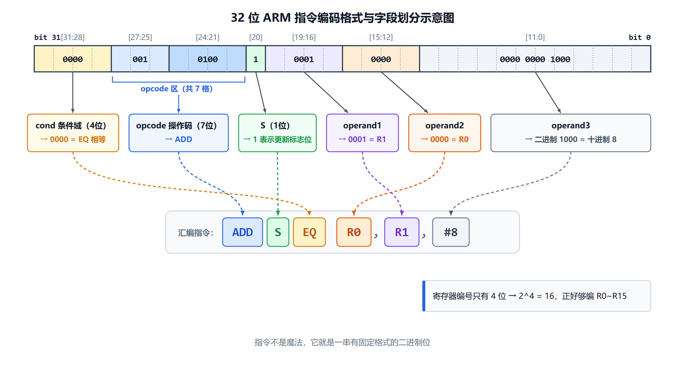

**怎么看这张图**：

1. **先看整条横带**：代表 32 个 bit，从左（bit31）到右（bit0）。**左是高位，右是低位**，这是计算机的惯例。
2. **再看被切成的几段**：最左边 4 格（bit31~28）是条件域，接着是操作码区，
   然后 1 格是 S，再往后两段各 4 格是寄存器编号，最右 12 格是立即数/偏移。
3. **注意"寄存器编号只有 4 位"**：因为 2⁴ = 16，正好够编 R0～R15 这 16 个寄存器。
   （这也是为什么 Cortex-M3 只有 16 个通用寄存器——指令里塞不下更多了。）
4. **注意"立即数只有 12 位"**：所以这种格式能直接表达的立即数范围有限
   （后面 4.4.2 节讲 ADDW 就是为了绕开这个限制）。
5. **这张图要你理解什么**：**指令不是魔法，它就是一串有固定格式的二进制位。**
   汇编器干的活，就是把你写的助记符"翻译"成这样的位串。

**【重要提醒】** 上面这种"5 个域"的划分是**教材为了建立直觉而给出的通用理解模型**。
真实的 Thumb-2 编码要复杂得多（16 位指令和 32 位指令编码不同，很多指令有多个编码形式）。
你不需要记住具体位段，只要记住这个观念：

> **指令 = 一串二进制位，不同位置上的位管不同的事。**

### 4.2.6 统一汇编语言 UAL 与 .N / .W 后缀

> 对应教材 4.2 节"3）统一汇编语言"（p100）

> 【教材内容】为了支持 Thumb-2 指令集，ARM 汇编器引入了"统一汇编语言（Unified Assembly Language，UAL）"语法机制。

**术语表：**

| 项目 | 内容 |
|---|---|
| 英文全称 | Unified Assembly Language |
| 中文名 | 统一汇编语言 |
| 缩写 | UAL |
| 大白话 | 一套"两边都能用"的汇编书写格式 |
| 干什么用 | 让程序员不用纠结"我写的这条是 16 位指令还是 32 位指令" |

**背景（教材原文）：**

> 【教材内容】以前，Thumb 的语法和 ARM 的语法不同，在有了 UAL 之后，两者的书写格式就统一了。例如：

```
ADD R0, R1        ; 使用传统的 Thumb 语法
ADD R0, R0, R1    ; 引入 UAL 后允许的等效写法 (R0 = R0 + R1)
```

**【补充解释】这两行在说什么？**

- 第一行 `ADD R0, R1`：老式 Thumb 语法，**目标寄存器同时也是第一个源寄存器**，
  所以只写两个操作数就够了（隐含 R0 = R0 + R1）。
- 第二行 `ADD R0, R0, R1`：UAL 语法，把三个操作数都写全（目标、源1、源2）。

**UAL 带来的一个"坑"（教材原文）：**

> 【教材内容】虽然引入了 UAL，但是仍然允许使用传统的 Thumb 语法。不过必须注意：如果使用传统的 Thumb 语法，有些指令会默认更新 APSR，即使没有使用 S 后缀。如果使用 UAL 语法，则必须使用 S 后缀才会更新。例如：

```
AND R0, R1        ; 传统的 Thumb 语法（可能默认更新标志位）
ANDS R0, R0, R1   ; 等效的 UAL 语法（必须有 S 后缀才更新）
```

**【容易搞混】**：**同一条指令，换个写法，标志位更新行为可能不一样。**
写汇编时，如果你关心标志位，**老老实实把 S 写清楚**，不要依赖默认行为。

**16 位还是 32 位，谁来定？**

> 【教材内容】在 Thumb-2 指令集中，有些操作既可以由 16 位指令完成，也可以由 32 位指令完成。例如，R0=R0+1 这样的操作，16 位的与 32 位的指令都提供了助记符为 ADD 的指令。在 UAL 下，汇编器能主动决定用哪个，也可以手工指定是用 16 位的还是 32 位的：

```
ADDS.N R0, #1   ; .N 后缀指定使用 16 位指令 (N = Narrow，窄)
ADDS.W R0, #1   ; .W 后缀指定使用 32 位指令 (W = Wide，宽)
```

> 【教材内容】.W（Wide）后缀指定 32 位指令。如果没有给出后缀，汇编器会先尝试用 16 位指令给代码瘦身，如果不行再使用 32 位指令。因此，.N 后缀完全可以不写，不过汇编器可能仍然允许这样的语法。

**【补充解释】为什么要关心 16 位还是 32 位？**

| 用哪种 | 好处 | 坏处 |
|---|---|---|
| 16 位（窄） | 代码占的存储空间小（省 Flash） | 能表达的范围小（比如立即数不能太大） |
| 32 位（宽） | 能表达的范围大、功能全 | 占空间多 |

**默认策略**：汇编器优先用 16 位（省空间），实在装不下才用 32 位。

### 4.2.7 伪指令（Pseudo-Instruction）

> 对应教材 4.2 节第 4 部分（p101～p103）

**术语表：**

| 项目 | 内容 |
|---|---|
| 英文全称 | Pseudo-Instruction |
| 中文名 | 伪指令（也叫"指示性语句"） |
| 缩写 | 无 |
| 大白话 | 写给汇编器看的"说明性文字"，不是给 CPU 执行的命令 |
| 干什么用 | 告诉汇编器：段怎么分、程序从哪开始、常量是多少、数据放哪 |

> 【教材内容】用户将编辑好的汇编语言源程序通过专门的软件（称为汇编程序）汇编成对应的机器语言程序时，需要有一些专门的说明性语句，例如，指定目标程序或数据存放的起始地址、给一些指定的标号赋值、表示源程序结束等指令，这些指令并不产生对应 CPU 操作的机器码，故称为**伪指令**，也叫作指示性语句；相应地，可以产生实质性操作的指令叫作**指令性语句**。

**【补充解释】一句话区分：**

| 类型 | 产生机器码吗 | 谁看 | 例子 |
|---|---|---|---|
| 指令性语句 | **产生** | CPU 执行 | `MOV R0, #1` |
| 伪指令 | **不产生** | 汇编器处理 | `AREA`、`ENTRY`、`END`、`EQU` |

**【类比】**：你给别人一份会议安排。

- "上午 9 点开会"——这是**内容**（指令）；
- "本文件用 A4 纸打印、页边距 2 厘米"——这是**格式说明**（伪指令），
  开会的人不需要知道，打印的人需要知道。

下面逐个介绍教材提到的常用伪指令。

#### (1) 段的定义：AREA

> 【教材内容】在 ARM 汇编语言程序中，段是汇编语言组织代码的基本单位。段是相对独立的指令或者代码序列，拥有特定的名称。段的种类有代码段、数据段和通用段，代码段的内容为执行代码，数据段存放代码运行时需要用到的数据，通用段不包含用户代码和数据，所有通用段共用一个空间。段使用 AREA 伪指令来定义，并且说明相关属性。

**格式：**

```
AREA  段名, 属性1, 属性2, ……
```

**常用属性（教材原文）：**

| 属性 | 含义 |
|---|---|
| CODE | 定义代码段，默认为 READONLY |
| DATA | 定义数据段，默认为 READWRITE |
| STACK | 定义栈 |
| HEAP | 定义堆 |
| READONLY | 本段只读 |
| READWRITE | 本段可读写 |
| ALIGN | 使用方式为 `ALIGN 表达式`，默认时 ELF 的代码段和数据段按字对齐，表达式取值 0～31，对齐方式为 2 的幂 |
| COMMON | 定义一个通用段，不含用户代码和数据，各源文件中同名的 COMMON 段共享同一段存储单元 |

**【补充解释】ALIGN 那一行里的 `ELF` 是什么？**

**ELF = Executable and Linkable Format，可执行与可链接格式**，是一种"目标文件格式"，
也就是**链接器眼里程序的样子**：里面按段装好了代码、数据、符号表等。
你汇编出来的 `.o`、链接出来的 `.axf`/`.elf` 都是这种格式的文件。

所以"**ELF 的代码段和数据段按字对齐**"这句话的意思是：
链接器在生成最终映像时，默认会让这些段的起始地址落在 4 字节的整数倍上
（"字"= 32 位 = 4 字节）。为什么要对齐，见下面 `ALIGN` 的说明。

**例子：**

```
AREA RESET, CODE, READONLY
```

> 【教材内容】其中，RESET 是段的名字，RESET 段是系统默认的入口，所以在代码中有且只有一个 RESET 段；CODE 表示段的属性，代表当前段为代码段；READONLY 是当前段的访问属性表示只读。

```
AREA Stack1, DATA, READWRITE, NOINIT, ALIGN = 3
```

> 【教材内容】一个汇编程序至少应该有一个代码段，可以有零或者多个数据段。

**【补充解释】"段"是什么？**

**大白话**：段就是给程序**分抽屉**。

- 代码段：装"要执行的指令"；
- 数据段：装"程序运行时要用到的数据"；
- 栈段：装"临时草稿"（第 2 章讲的栈）。

**为什么要分段**：因为不同内容的性质不同——
代码通常放在 Flash（只读，掉电不丢），数据放在 SRAM（可读写，掉电就丢）。
分成段，链接器才知道该把哪一坨放到哪种存储器里。

**【补充解释】`ALIGN = 3` 是什么意思？**

`ALIGN = 3` 表示按 2³ = 8 字节对齐，也就是"这段的起始地址必须是 8 的倍数"。
为什么要对齐？因为 CPU 一次读 4 字节或 8 字节时，地址对齐会更快（有些情况甚至不对齐就出错）。

**【补充解释】例子里的 `NOINIT` 是什么？**

`NOINIT` = **No Initialize，不初始化**。它在属性表里没单列，但意思很简单：

> **这一段不要放进映像文件（烧录文件）的初始化数据里，启动代码也不用给它赋初值。**

为什么栈段要这么写？因为栈空间的内容本来就"用完就丢"：
程序一启动马上会自己往栈里压数据，根本不在乎里面原来是什么。
这样写可以**省下烧录文件的空间**。

对照记忆：普通的 `DATA` 段如果写了初值，链接器会把初值存进映像文件，
启动时再由启动代码搬到 RAM 里；而 `NOINIT` 段不需要搬，因为它压根不需要初值。

#### (2) 程序入口：ENTRY

> 【教材内容】用于指定汇编程序的入口点。一个程序可以由一个或者多个源文件组成，一个源文件由一个或者多个程序段组成。一个程序至少有一个入口点，也可有多个入口点，但是在一个源文件中，最多只能有一个 ENTRY。当有多个 ENTRY 时，程序的真正入口点由链接器指定。编译程序在编译连接时根据程序入口点进行连接。只有一个入口点时，编译程序会把这个入口点的地址定义为系统复位后的程序起始点（相当于 C 语言中的 main 函数）。

**【补充解释】** 这句话里最重要的一句是最后一句：

> **程序入口点 ≈ C 语言里的 `main` 函数。**

也就是说，芯片一上电（复位），CPU 就从这里开始执行第一条指令。

#### (3) 源文件结束：END

> 【教材内容】汇编语言程序需要在汇编源文件结束处，写上 END 表示该源文件的结束。

**【补充解释】** `END` 后面写的东西汇编器一律不管，所以它必须放在整个文件最后。

#### (4) 等值伪指令：EQU

> 【教材内容】常量是在运行过程中不能改变的量。ARM 支持数值常量、逻辑常量和字符串常量。汇编中使用 EQU 来定义一个数值常量，其一般形式为：

```
标号  EQU  表达式
```

> 【教材内容】其功能是将语句表达式的值赋予本语句的标号。格式中的表达式可以是 1 个常数、符号、数值表达式或地址表达式等。如：

```
Test  EQU  10    ; 定义标号 Test 的值为 10
```

**【补充解释】EQU 相当于 C 语言的 `#define` 或 `const`：**

```
STACK_TOP  EQU  0x20002000    ; 以后写 STACK_TOP 就等于写 0x20002000
```

好处：这个值以后要改，只改一处，全文件都跟着变。

#### (5) 数据定义伪操作：DCB / DCW / DCD / DCFS / DCFD / SPACE

> 【教材内容】
> - **DCB** 分配一片连续的**字节**存储单元并初始化。
> - **DCW** 分配一片连续的**半字**存储单元并初始化。
> - **DCD** 分配一片连续的**字**存储单元并初始化。
> - **DCFS(DCFSU)** 为**单精度浮点数**分配一片连续的字存储单元并初始化。
> - **DCFD(DCFDU)** 为**双精度浮点数**分配一片连续的字存储单元并初始化。
> - **SPACE** 分配一片连续的存储单元并初始化为 0。

**教材例子：**

```asm
Str    DCB  "this is a test"     ; 分配一片连续的字节存储单元并初始化
Data   DCW  1,2,3                ; 分配一片连续的半字存储单元并初始化
Data   DCD  4,5,6                ; 分配一片连续的字存储单元并初始化
Fdata  DCFS 2e5, -5e-7           ; 分配一片连续的字存储单元并初始化为指定的单精度数
Dspce  SPACE 100                 ; 分配连续 100 字节的存储单元并初始化为 0
```

**【补充解释】记法**：字母的含义——

| 伪指令 | 记忆 | 分配多大 |
|---|---|---|
| DC**B** | **B**yte | 1 字节 |
| DC**W** | **W**ord？不对，这里 W 指 half**W**ord | 2 字节（半字） |
| DC**D** | **D**ouble word | 4 字节（字） |
| DC**FS** | **F**loat **S**ingle | 4 字节（单精度浮点） |
| DC**FD** | **F**loat **D**ouble | 8 字节（双精度浮点） |

**【容易搞混】ARM 里 `DCW` 是半字（2 字节），不是字（4 字节）！** 这是教材体系里的写法，
很容易和"字 = 32 位"的常识冲突。记牢：**DCW → 半字 → 16 位**。

**画个图看看这些数据在内存里长什么样：**

```
Data  DCW 1,2,3      ; 从 Data 开始的地址

Data+0  +--------+--------+
        |  0x01  |  0x00  |   ← 1 的半字（小端：低字节在前）
Data+2  +--------+--------+
        |  0x02  |  0x00  |   ← 2
Data+4  +--------+--------+
        |  0x03  |  0x00  |   ← 3
        +--------+--------+
```

**【补充解释】什么是"小端"？**

**大白话**：一个数要占好几个字节时，"低位字节放前面还是后面"这件事，不同的 CPU 有不同习惯。

- **小端（Little Endian）**：低位字节放在低地址。Cortex-M3 默认用这个。
- **大端（Big Endian）**：高位字节放在低地址。

```
0x12345678 放到地址 0x20000000 处：
小端：0x20000000=0x78, 0x20000001=0x56, 0x20000002=0x34, 0x20000003=0x12
大端：0x20000000=0x12, 0x20000001=0x34, 0x20000002=0x56, 0x20000003=0x78
```

（第 4.4.2 节的 REV 系列指令，就是专门用来在小端和大端之间转换的。）

#### (6) 地址读取伪指令：ADR 和 LDR

> 【教材内容】ADR 是小范围的地址读取伪指令，LDR 是大范围的读取地址伪指令。

> 【教材内容】实际上，ADR 是将基于 PC 相对偏移的地址值或基于寄存器相对地址值读取的伪指令，而 LDR 用于加载 32 位立即数或一个地址到指定的寄存器中。如果在程序中想加载某个函数或者某个在连接时候指定的地址时请使用 ADR；当加载 32 位立即数或外部地址时请用 LDR。

> 【教材内容】`LDR Rd, =const` 伪指令可在单个指令中构造任何 32 位数字常数。使用此伪指令可生成超出 MOV 和 MVN 指令范围的常数。

**【补充解释】为什么需要 `LDR Rd, =const` 这个伪指令？**

因为 `MOV` 能直接装的立即数**范围有限**（回想 4.2.5 节：立即数字段只有 12 位左右）。
如果你要装一个很大的数，比如 `0x20002000`，`MOV` 装不下，怎么办？

```
LDR R0, = 0x20002000    ; 让汇编器想办法帮你装进去
```

汇编器看到这种写法，会自己找一个地方把这个常量存起来，然后生成一条"从那里读出来"的指令。
**你只管写，汇编器负责想办法。**

**教材重点提醒的"一个字符之差"：**

> 【教材内容】"LDR Rd, label"和"LDR Rd, =label"的区别：
> - "LDR Rd, =label"会把 label 表示的**值**加载到寄存器中；
> - "LDR Rd, label"会把 label 当作**地址**，把 label 指向的地址中的**值**加载到寄存器中。

**【容易搞混】这一个 `=` 差别巨大：**

```
LDR R0, = 0x20000000    ; R0 ← 0x20000000（R0 里装的是这个数）
LDR R0, [R1]            ; R0 ← 内存地址 R1 处的内容（R0 里装的是内存里的数据）
```

用表格总结：

| 写法 | 你拿到的是 | 类比 |
|---|---|---|
| `LDR R0, = 0x20000000` | 数字 0x20000000 本身 | 拿到"门牌号" |
| `LDR R0, [R1]`（R1=0x20000000） | 该地址里存的数据 | 按门牌号进屋拿"东西" |

#### (7) 声明全局标号：EXPORT

> 【教材内容】格式：

```
EXPORT  标号[,WEAK]
```

> 【教材内容】声明一个全局标号，该标号在其他文件中可引用。WEAK 表示遇到其他同名标号时，其他标号优先。例如：

```
AREA INIT, CODE, READONLY
EXPORT Stest
...
END
```

**【补充解释】** 一个工程往往有好几个 `.s` 文件。
`EXPORT` 的意思是："我这个标号，允许别的文件用。"

**【类比】**：`EXPORT` 就像把函数设成"公开"——别人能调用。

#### (8) 引用全局标号：IMPORT

> 【教材内容】格式：

```
IMPORT  标号[,WEAK]
```

> 【教材内容】表示该引用的标号在其他源文件中，但要在当前文件中引用。WEAK 表示找不到该标号时，也不报错，一般将该标号值置为 0，如果是 B 或者 BL 使用到，则该指令置为 NOP。

```
AREA INIT, CODE, READONLY
IMPORT MAIN
...
END
```

**【补充解释】** `IMPORT` 是反过来："我要用别的文件里的标号。"

**EXPORT / IMPORT 配对**，就像 C 语言里的"声明外部函数"。

### 4.2.8 一个完整的汇编源程序框架

> 【教材内容】一个基本的汇编源程序框架如下：

```asm
STACK_TOP  EQU  0x20002000        ; 堆栈指针初始值，常数
AREA RESET, CODE, READONLY        ; 定义一个代码段，AREA 不能顶格写
    DCD  STACK_TOP                ; 设置栈顶（MSP 的）
    DCD  START                    ; 复位向量
    ENTRY                         ; 标记程序入口点
START                             ; START 必须顶格写
    LDR  R0, = 0x20002000         ; 测试代码
    MOV  R1, #0x5a                ; 测试代码
    STR  R1, [R0]                 ; 测试代码
DEADLOOP
    B    DEADLOOP                 ; 工作完成后，进入无穷循环
    END                           ; END 伪操作表示本源文件结束
```

**【补充解释】这个框架是本章最重要的"模板"，请逐行看懂：**

| 行 | 代码 | 干什么 | 谁处理 |
|---|---|---|---|
| 1 | `STACK_TOP EQU 0x20002000` | 定义常量：栈顶地址是 0x20002000 | 汇编器 |
| 2 | `AREA RESET, CODE, READONLY` | 开一个代码段，名叫 RESET，只读 | 汇编器 |
| 3 | `DCD STACK_TOP` | 在段里放一个字：0x20002000 | 汇编器 |
| 4 | `DCD START` | 再放一个字：START 的地址 | 汇编器 |
| 5 | `ENTRY` | 声明入口点 | 汇编器/链接器 |
| 6 | `START` | 标号，标出程序开始的位置 | — |
| 7 | `LDR R0, = 0x20002000` | R0 ← 0x20002000（一个地址） | CPU |
| 8 | `MOV R1, #0x5a` | R1 ← 0x5A | CPU |
| 9 | `STR R1, [R0]` | 把 R1 写到 R0 指向的内存（0x20002000 处） | CPU |
| 10-11 | `DEADLOOP` / `B DEADLOOP` | 死循环，停在这里 | CPU |
| 12 | `END` | 文件结束 | 汇编器 |

**重点解释第 3、4 行——这两行是第 2 章讲过的"向量表"！**

```
地址              内容                  含义
0x08000000  +------------------+
            |  0x20002000      |  ← DCD STACK_TOP：复位后 MSP 从这里取值
0x08000004  +------------------+
            |  START 的地址     |  ← DCD START：复位向量（PC 从这里取值）
0x08000008  +------------------+
            |  START 处的指令   |  ← 程序从这里开始跑
            +------------------+
```

【补充解释】回忆第 2 章：Cortex-M3 复位时，硬件会自动做两件事：

1. 从地址 0x00000000 取第 1 个字，装进 **MSP**（主堆栈指针）；
2. 从地址 0x00000004 取第 2 个字，装进 **PC**（程序计数器）。

所以上面这个框架的前两个 `DCD`，正是为这两步准备的。

**【容易搞混】图里写的是 0x08000000，上面又说从 0x00000000 取——到底哪个地址才对？**

**两个都对，因为它们是同一块存储器的两个"门牌号"**（第 3 章 3.6 节讲 BOOT 配置时说过这件事）：

```
             物理上               复位时 CPU 的视角
0x08000000  ┌──────────┐               ┌──────────┐ 0x00000000
            │ 栈顶值    │ ←── 别名 ──→  │ 栈顶值    │
0x08000004  ├──────────┤               ├──────────┤ 0x00000004
            │ START 地址│               │ START 地址│
0x08000008  ├──────────┤               ├──────────┤ 0x00000008
            │ 指令...   │               │ 指令...   │
            └──────────┘               └──────────┘
             Flash 真正的起始地址       复位向量表被"重映射"到的地址
```

- STM32 的 **Flash 物理上从 0x08000000 开始**，`AREA RESET` 段最终就被链接到那里（上面的图和实际烧写都用这个地址）；
- 但 Cortex-M3 复位时固定去 **0x00000000** 取前两个字，于是 STM32 用"重映射（别名）"把 Flash 也映射一份到 0x00000000 起；
- 所以 **0x00000000 处的第 1、2 个字和 0x08000000 处的第 1、2 个字是同一份数据**，只是从两个地址都能访问。

以后看到"程序下载到 0x08000000"和"复位从 0x00000000 取向量"，不用再纠结——
说的是同一件事（详见第 3 章 3.6 节和第 5 章 5.2.6 节）。

**第 10~11 行的"死循环"为什么必要？**

CPU 执行完 `STR` 之后，如果没有 `B DEADLOOP`，PC 会继续往下走，
走到后面可能是空内存或者别的数据——那就"跑飞"了。
**让程序停下来原地打转，是嵌入式程序的标准收尾方式。**

### 4.2.9 本节真正要记住什么

| 要记住 | 内容 |
|---|---|
| 最重要的架构特点 | Cortex-M3 是**加载/存储型**：运算只在寄存器里做，内存必须用 LDR/STR 搬 |
| 五大类指令 | 数据传送、数据处理、跳转、PSR 处理、异常产生 |
| 条件域 | 4 位条件码，位于指令最高 4 位；靠 APSR 的 N/Z/C/V 工作 |
| 四个标志 | N=负、Z=零、C=无符号（加法"有进位"/减法"够减"时为 1）、V=溢出（带符号） |
| 比大小用哪个 | 无符号用 HS/LO/HI/LS；带符号用 GE/LT/GT/LE；相等一律 EQ/NE |
| 指令格式 | `{标号} 操作码{S}{cond} 操作数1, 操作数2{, 操作数3} {;注释}` |
| 伪指令 | AREA / ENTRY / END / EQU / DCB·DCW·DCD / ADR / LDR= / EXPORT / IMPORT |
| 基本框架 | `EQU` → `AREA` → 两个 `DCD`（向量表）→ `ENTRY` → 代码 → 死循环 → `END` |

---

## 4.3 寻址方式

> 对应教材 4.3 节（p103～p107）

### 4.3.0 先搞懂：什么叫"寻址方式"？

**大白话**：一条指令说"把某个数加到 R0 上"，可 CPU 怎么知道"某个数"到底在哪？

- 是直接印在指令里的？（立即数）
- 还是在某个寄存器里？（寄存器）
- 还是在一个寄存器**指向的内存地址**上？（寄存器间接）
- 还是"某个寄存器 + 一个偏移"算出来的地址上？（基址变址）

**这一整套"怎么找到操作数"的规则，就叫寻址方式。**

> 【教材内容】所谓寻址方式，就是微控制器根据指令中给出的地址信息来寻找操作数物理地址的方式，本质上是指示如何找到要操作的数据。

**术语表：**

| 项目 | 内容 |
|---|---|
| 英文全称 | Addressing Mode |
| 中文名 | 寻址方式 |
| 缩写 | 无 |
| 大白话 | "这个数放在哪儿，怎么去找" |
| 干什么用 | 决定 CPU 取数据要走哪条路 |

**【类比】**：你要给同事送一份文件，可能有几种方式：

1. 文件直接揣你兜里了（立即数）——**就在手边**；
2. 文件在同事自己桌上（寄存器）——**就在他手边**；
3. 同事告诉你"我柜子第三格"（寄存器间接）——**他给你地址，你去拿**；
4. 同事告诉你"从我柜子第三格再往后数 2 格"（基址变址）——**他给地址，还要算偏移**。

**【辅助理解图：九种寻址方式总览】**

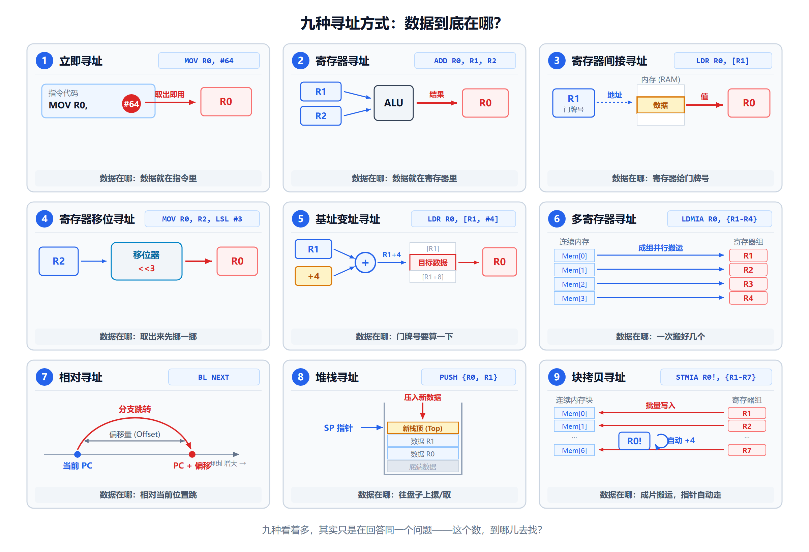

**怎么看这张图**：

1. **先看图的整体布局**：九个小卡片排成 3×3，每个卡片画一个"数据从哪来"的小场景。
2. **第一行三个**（立即、寄存器、寄存器间接）：这是最基础的三种，
   区别就在于"数在指令里 / 在寄存器里 / 在寄存器指向的内存里"。
3. **第二行三个**（寄存器移位、基址变址、多寄存器）：都是"在基础方式上加料"——
   加移位、加偏移、一次拿好几个。
4. **第三行三个**（相对、堆栈、块拷贝）：偏"程序控制"用途的寻址。
5. **每张卡片里的箭头**：箭头方向就是数据流动方向。
   注意区分"值"和"地址"两种箭头——**这是理解寻址方式的关键**。
6. **这张图要你理解什么**：九种寻址方式看着多，其实只是在回答同一个问题的不同答案：
   "**这个数，到哪儿去找？**"

**【补充解释】本章反复用到的三种箭头，先约定好：**

```
──值──→      表示"数据的值"在流动
──地址─→      表示"地址"在流动（注意：传的是门牌号，不是东西）

举例说明区别：
  R1 ──值──→ R0        R0 里装的是 R1 里那个数
  R1 ──地址─→ 内存     内存按 R1 里的数当门牌号，去找对应的格子
```

下面逐个讲。

---

### 4.3.1 立即寻址（Immediate Addressing）

> 【教材内容】立即寻址也叫立即数寻址，操作数本身就在指令中给出，只要取出指令也就取到了操作数。这个操作数被称为立即数，对应的寻址方式也就叫作立即寻址。例如：

```asm
MOV  R0, #64        ; 将立即数 64 送给 R0，即 R0←64
ADD  R0, R0, #0x3f  ; R0←R0 + 0x3f
```

> 【教材内容】在上面的指令中，立即数要求以"#"为前缀，对于以十六进制表示的立即数，还要求在"#"后加上"0x"。

**数据从哪取？**

```
  指令（在 Flash 里）
  +-----------------------------------+
  | MOV  R0, #64                      |
  |        └────┬────┘                |
  |             │ 数据就印在指令里！   |
  +-------------┼---------------------+
                │
                ▼
          +----------+
          |    R0    |
          |    64    |
          +----------+
```

**执行后发生什么：** R0 = 64，内存没有任何变化。

**演算 `ADD R0, R0, #0x3f`（假设 R0 原来是 64）：**

```
0x3F = 0011 1111 = 63（十进制）

运算前  R0 = 64 = 0x00000040
立即数      = 63 = 0x0000003F
相加         = 127 = 0x0000007F

结果：R0 = 0x0000007F（十进制 127）
```

**特点：**

| 优点 | 缺点 |
|---|---|
| 最快（不用访问内存，取指令时顺便就拿到了） | 能表示的数值范围有限（位数被指令长度限制） |

**【容易搞混】** 立即数不是"存在某处的常量"，它就是指令的一部分。
**每次执行这条指令，拿到的都是同一个值，改不了。**

---

### 4.3.2 寄存器寻址（Register Addressing）

> 【教材内容】寄存器寻址就是利用寄存器中的数值作为操作数，这种寻址方式是各类微控制器经常采用的一种方式，也是执行效率较高的寻址方式。例如：

```asm
ADD  R0, R1, R2     ; R0 ← R1 + R2
```

> 【教材内容】该指令的执行效果是将寄存器 R1 和 R2 的内容相加，结果存放在寄存器 R0 中。

**数据从哪取？**

```
  +----------+     +----------+
  |    R1    |     |    R2    |
  |  0x0005  |     |  0x0003  |
  +----┬-----+     +-----┬----+
       │                 │
       └──────┐   ┌──────┘
              ▼   ▼
          +----------+
          |   加法器  |        （不访问内存！）
          +----┬-----+
               │ 结果
               ▼
          +----------+
          |    R0    |
          |  0x0008  |
          +----------+
```

**演算（R1 = 5，R2 = 3）：**

```
运算前  R1 = 0x00000005
        R2 = 0x00000003
相加       = 0x00000008
结果：  R0 = 0x00000008，R1、R2 不变
标志位： 结果非 0 → Z=0；最高位为 0 → N=0；无进位 → C=0；无溢出 → V=0
```

**【补充解释】为什么说它"效率高"？**
因为寄存器在 CPU 内部，取数几乎不花时间；内存远得多。
所以编译器/汇编程序员总是尽量把常用的变量留在寄存器里。

---

### 4.3.3 寄存器间接寻址（Register Indirect Addressing）

> 【教材内容】寄存器间接寻址就是以寄存器中的值作为操作数的地址，而操作数本身存放在存储器中。例如：

```asm
LDR  R0, [R1]   ; 将以 R1 的值为地址的存储器中的数据传送到 R0 中，即 R0 ← [R1]
STR  R0, [R1]   ; 将 R0 的值传送到以 R1 的值为地址的存储器中，即 [R1] ← R0
```

> 【教材内容】`ADD R0, R1, [R2]`；R0←R1 + [R2]，以寄存器 R2 的值作为操作数的地址，取得操作数后与 R1 相加，结果存入寄存器 R0 中。

**【补充解释】最后这条 `ADD R0, R1, [R2]` 有问题**：ARM 的 ADD 指令**不能直接使用内存操作数**——
这正好违反了 4.2.1 节讲的"加载/存储型"原则。
教材在这里可能是为了说明"间接寻址"的概念而写的示意，实际写代码时必须先 `LDR`：

```asm
LDR  R3, [R2]      ; 先把 [R2] 处的数搬进 R3
ADD  R0, R1, R3    ; 再做加法
```

此项已记入文末"待核验"。

**数据从哪取？**（这是本章最重要的一张"数据流"示意图，请仔细看）

```
  寄存器                      存储器
  +----------+
  |    R1    |
  |0x20000004| ──地址──┐
  +----------+         │
                       │  （R1 里装的是门牌号）
                       ▼
              地址            内容
              0x20000000  +----------+
                          | 0x1111   |
              0x20000004  +----------+
                          | 0x2222   | ◄── 按门牌号找到这一格
              0x20000008  +----------+
                          | 0x3333   |
                          +----------+
                       │
                       │ 值（0x2222）
                       ▼
                  +----------+
                  |    R0    |
                  |  0x2222  |
                  +----------+
```

**【辅助理解图：立即寻址 vs 寄存器间接寻址】**

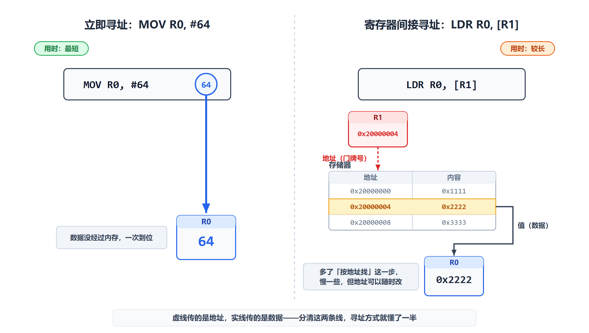

**怎么看这张图**：

1. **左右对照着看**：左边是"立即寻址"，右边是"寄存器间接寻址"，用同一套指令做对比。
2. **左图的关键**：数据直接画在指令框里面，箭头从指令框指向寄存器——
   **说明数据没经过内存**。
3. **右图的关键**：多了一层"存储器"方框。箭头分成两段：
   第一段是"寄存器里的地址 → 存储器"，第二段是"存储器里的数据 → 寄存器"。
4. **重点看右图那条从 R1 出发的箭头**：它传递的是**地址**，不是数据。
   这条箭头用虚线（或不同颜色）画，和实线的数据箭头区分开。
5. **这张图要你理解什么**：**多一次"按地址找"的动作，就多花时间。**
   立即寻址和寄存器寻址不用访存，最快；间接寻址要访存，慢一些，但灵活——
   因为地址放在寄存器里，程序运行中可以改，一个指令就能访问任意内存位置。

**【容易搞混】再强调一次 `R1` 与 `[R1]`：**

```
LDR R0, [R1]    ; R0 ← 内存[R1]     ← 方括号 = 去内存
MOV R0, R1      ; R0 ← R1           ← 没有方括号 = 直接搬
```

---

### 4.3.4 寄存器移位寻址（Register Shift Addressing）

> 【教材内容】在该寻址方式中，在寄存器寻址得到操作数后再进行移位操作，得到最终的操作数。例如：

```asm
MOV  R0, R2, LSL #3     ; R0←R2 * 8，R2 的值左移 3 位，结果赋给 R0
MOV  R0, R2, LSL R1     ; R2 的值左移 R1 位，结果放入 R0
```

**【补充解释】先说"左移 3 位为什么等于乘以 8"：**

二进制数左移一位，相当于每一位的"权"都升了一级，也就是乘以 2。

```
0000 0101   = 5
左移 1 位：
0000 1010   = 10    （5 × 2）
左移 2 位：
0001 0100   = 20    （5 × 4）
左移 3 位：
0010 1000   = 40    （5 × 8）✔
```

所以 `LSL #3` = 乘以 2³ = 乘以 8。

**数据从哪取？**

```
  +----------+
  |    R2    |  0x00000005
  +----┬-----+
       │ 值
       ▼
  +----------------+        ┌──────────────┐
  | 桶形移位器      |◄───────| 移位量 3     |
  | (Barrel Shifter)|        └──────────────┘
  +----┬-----------+
       │ 移位后的值 0x00000028
       ▼
  +----------+
  |    R0    |  0x00000028（= 40）
  +----------+
```

**术语表：**

| 项目 | 内容 |
|---|---|
| 英文全称 | Barrel Shifter |
| 中文名 | 桶形移位器 |
| 缩写 | 无 |
| 大白话 | CPU 里一个"专门负责挪位"的硬件部件 |
| 干什么用 | 在一个时钟周期内完成 0～31 位的任意移位，不用写循环 |

**【补充解释】为什么叫"桶形"？**
因为它像一个圆桶，数据在里面转。它的价值在于：**移位不额外花时间**——
在 Cortex-M3 里，很多指令可以"顺便"带一个移位操作，等于白送一次移位。

**可用的移位操作（教材原文）：**

| 助记符 | 英文全称 | 中文名 | 干什么 |
|---|---|---|---|
| LSL | Logical Shift Left | 逻辑左移 | 低位空出的位补 0 |
| LSR | Logical Shift Right | 逻辑右移 | 高端空出的位补 0 |
| ASL | Arithmetic Shift Left | 算术左移 | 和 LSL 完全相同 |
| ASR | Arithmetic Shift Right | 算术右移 | 符号位不变：正数补 0，负数补 1 |
| ROR | Rotate Right | 循环右移 | 从低端移出的位，填回高端空出的位 |
| RRX | Rotate Right eXtended | 带扩展的循环右移 | 右移一位，高端用 C 填充，低端移出的位进 C |

**注意 ASL 和 LSL 完全一样**，所以实际只有 5 种不同的行为。
详细图解见 4.4.2 节第 4 小节（那里有教材原图 4-1～4-5）。

---

### 4.3.5 基址变址寻址（Base-plus-Offset Addressing）

这是**本章最常用**的寻址方式，务必看懂。

> 【教材内容】基址变址寻址就是将寄存器（该寄存器一般称作基址寄存器）中的内容与指令中给出的地址偏移量（地址偏移量可以是正数或者负数）相加，从而得到操作数的有效地址。变址寻址方式常用于访问某基地址附近的地址单元。

**大白话**：寄存器里存一个"基准地址"（比如某个数组的开头），
指令里再给一个"偏移量"（比如第几个元素），两者相加就是真正要找的地址。

**【类比】**：你住"幸福路 100 号"，同事说"我住幸福路 100 号 3 单元 502"。
"幸福路 100 号"是**基址**（大家共享），"3 单元 502"是**偏移**（各人不同）。

**四种常见形式（教材原文）：**

| 形式 | 写法 | 有效地址 | 指令执行后基址寄存器 |
|---|---|---|---|
| 偏移量寻址（offset） | `[Rn, #offset]` | Rn + offset | 不变 |
| 预索引寻址（pre-indexed） | `[Rn, #offset]!` | Rn + offset | **变成 Rn + offset** |
| 后索引寻址（post-indexed） | `[Rn], #offset` | Rn | **变成 Rn + offset** |
| 寄存器偏移寻址 | `[Rn, Rm {, LSL #n}]` | Rn + (Rm 左移 n 位) | 不变 |

**【补充解释】三种索引方式的区别，用"取快递"来类比：**

| 方式 | 类比 |
|---|---|
| `[Rn, #offset]` | 走到"3 单元 502"取了快递，然后**回到原地** |
| `[Rn, #offset]!` | 走到"3 单元 502"取了快递，然后**就住在 502 不走了**（Rn 被更新） |
| `[Rn], #offset` | **先**在当前位置取快递，**然后**再往前走 offset 那么远（Rn 被更新） |

**关键区别一句话：**

> **有 `!` 的，地址先加再用；逗号在括号外面的，地址先用再加。**

**教材例子（逐条解释）：**

```asm
LDR  R0, [R1, #4]    ; R0 ← [R1 + 4]
LDR  R0, [R1, #4]!   ; R0 ← [R1 + 4]，然后 R1 ← R1 + 4
LDR  R0, [R1], #4    ; R0 ← [R1]，然后 R1 ← R1 + 4
LDR  R0, [R1, R2]    ; R0 ← [R1 + R2]
```

> 【教材内容】在第一条指令中，将 R1 的内容加上 4 形成操作数的地址，从中取得操作数存入 R0 中。
> 在第二条指令中，将 R1 的内容加上 4 形成操作数的有效地址，从中取得操作数存入 R0 中，然后，R1 的内容自增 4 字节。其中"!"表示指令执行完毕把最后的数据地址写到 R1。
> 在第三条指令中，以 R1 的内容作为操作数的有效地址，从中取得操作数存入 R0 中，然后，R1 的内容自增 4 字节。
> 在第四条指令中，将 R1 的内容加上 R2 的内容形成操作数的地址，从中取得操作数存入 R0 中。

**【辅助理解图：三种基址变址写法的时序对比】**

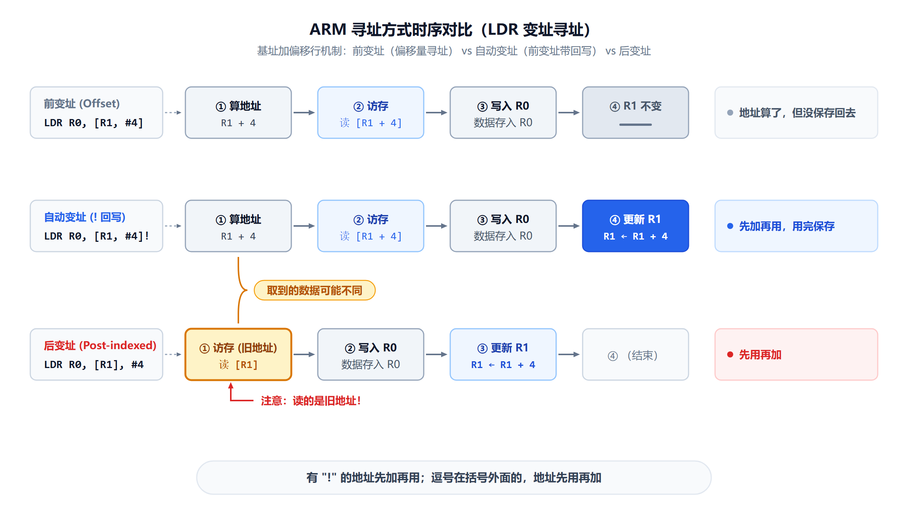

**怎么看这张图**：

1. **图分三行**，对应三种写法：`[Rn,#off]`、`[Rn,#off]!`、`[Rn],#off`。
2. **每一行从左到右是时间顺序**：先算地址 → 再访存 → 最后看 Rn 变没变。
3. **重点看每行最右边的"Rn 的值"那一格**：
   第一行不变，第二行和第三行都变成了 Rn+off。
4. **重点看第二行和第三行"访存"发生的位置**：
   第二行是在"地址加完"之后访存；第三行是在"地址加之前"访存。
5. **这张图要你理解什么**：三种写法**取到的数据可能不同**！
   第三行取的是旧地址的内容，第二行取的是新地址的内容。写错一个符号，程序就错。

**取值范围（教材原文）：**

> 【教材内容】对于字、半字、有符号半字、字节或有符号字节类指令，偏移量寻址中的 offset 取值范围是 −255～4095，预索引和后索引寻址中的 offset 取值范围是 −255～255；对于双字指令，偏移量寻址、预索引和后索引寻址中 offset 的取值范围均是 −1020～1020，并且必须为 4 的倍数。

**【补充解释】为什么范围不统一？** 因为指令长度有限（16 位或 32 位），
能塞进偏移量的位数有限。编码方式不同，范围就不同。
**你不需要背这些数字**，写代码时如果超出范围，汇编器会报错，改写法就行
（比如先把偏移算到一个寄存器里，再用 `[Rn, Rm]`）。

**一个真实的用法示例（把数组元素依次读出来）：**

```asm
        LDR  R1, = DATA_ARRAY   ; R1 指向数组开头（基址）
        LDR  R0, [R1, #0]       ; 读第 1 个元素（偏移 0）
        LDR  R2, [R1, #4]       ; 读第 2 个元素（偏移 4，因为每个字占 4 字节）
        LDR  R3, [R1, #8]       ; 读第 3 个元素
```

**注意偏移量是按"字节"算的**：第 n 个 32 位元素的偏移是 `4 × (n−1)`。

---

### 4.3.6 多寄存器寻址（Multiple Register Addressing）

> 【教材内容】采用多寄存器寻址方式，一条指令可以完成多个寄存器值的传送。这种寻址方式可以用一条指令完成传送最多 16 个通用寄存器的值。例如：

```asm
LDMIA  R0, {R1, R2, R3, R4}    ; R1 ← [R0], R2 ← [R0 + 4]
                               ; R3 ← [R0 + 8], R4 ← [R0 + 12]
```

> 【教材内容】该指令的后缀 IA 表示在每次执行完加载/存储操作后，R0 按字长度自动增加，因此，指令可将连续存储单元的值传送到 R1～R4。该指令也可以写为：

```asm
LDMIA  R0, {R1 - R4}
```

> 【教材内容】使用多寄存器寻址指令时，寄存器子集的顺序如果由小到大的顺序排列，可以使用"-"连接；否则，用"，"分隔书写。

**【补充解释】为什么需要"一次搬多个"？**

如果没有这条指令，搬 4 个字要写 4 条 LDR：

```asm
LDR  R1, [R0]
LDR  R2, [R0, #4]
LDR  R3, [R0, #8]
LDR  R4, [R0, #12]
```

有了 LDMIA，一条顶四条，**代码更短、执行更快**。

**数据从哪取？**

```
  +----------+
  |    R0    |  0x20000000  （基址）
  +----┬-----+
       │ 地址
       ▼
  存储器
  0x20000000  +----------+  ──值──→  R1 = 0x1111
              |  0x1111  |
  0x20000004  +----------+  ──值──→  R2 = 0x2222
              |  0x2222  |
  0x20000008  +----------+  ──值──→  R3 = 0x3333
              |  0x3333  |
  0x2000000C  +----------+  ──值──→  R4 = 0x4444
              |  0x4444  |
              +----------+
```

**执行后发生什么：**

| 寄存器 | 执行前 | 执行后 |
|---|---|---|
| R0 | 0x20000000 | 0x20000000（**没有 `!`，所以不变**） |
| R1 | 任意 | 0x00001111 |
| R2 | 任意 | 0x00002222 |
| R3 | 任意 | 0x00003333 |
| R4 | 任意 | 0x00004444 |

**加上 `!` 会怎样？**

```asm
LDMIA  R0!, {R1 - R4}    ; 搬完后 R0 变成 0x20000010
```

【补充解释】`!` 的作用和第 4.3.5 节的"预索引"一样：**把最后的地址写回基址寄存器**。
搬了 4 个字，地址一共走了 4×4 = 16 字节 = 0x10，所以 R0 = 0x20000000 + 0x10 = 0x20000010。

**书写规则：**

| 写法 | 含义 |
|---|---|
| `{R1 - R4}` | R1、R2、R3、R4（连续，可以用 `-`） |
| `{R0, R4 - R7, LR}` | R0、R4、R5、R6、R7、LR（不连续，用 `,` 分隔） |

---

### 4.3.7 相对寻址（PC-Relative Addressing）

> 【教材内容】与基址变址寻址方式相类似，相对寻址以程序计数器 PC 的当前值为基地址，指令中的地址标号作为偏移量，将两者相加之后得到操作数的有效地址。

**大白话**：基址不是普通寄存器，而是 **PC**——也就是"我现在执行到哪一行了"。
偏移量是"往前/往后跳多远"。

**【类比】**：你在读一本书，第 87 页。书上写着"见下页"。你不用知道具体页码，
只要知道"往后翻 1 页"就够了。

> 【教材内容】以下程序段完成子程序的调用和返回，跳转指令 BL 采用了相对寻址方式：

```asm
    BL   NEXT        ; 跳转到子程序 NEXT 处执行
NEXT
    MOV  PC, LR      ; 从子程序返回
```

**数据（地址）从哪来？**

```
  当前指令位置（PC）
  +--------------------+
  |  BL  NEXT          |  PC = 0x08000100
  +--------------------+
       │
       │ 指令里存的是"偏移量"，不是绝对地址！
       │ 比如偏移 = +0x20（向后 32 字节）
       ▼
  0x08000120  ← 目标地址 = PC + 偏移
  +--------------------+
  |  NEXT: 子程序第一条 |
  +--------------------+
```

**【补充解释】为什么用"相对"而不是"绝对"？**

| 用绝对地址 | 用相对偏移 |
|---|---|
| 程序换到别的内存位置，地址就全错了 | 程序整体搬走，相对距离不变，照样能跳 |
| 指令里要装下完整的 32 位地址，占地方 | 偏移量小，指令短 |

**这也是为什么 B 指令能"前后跳 32MB"**（4.4.3 节细讲）：
它存的是一个 24 位的有符号偏移量。

---

### 4.3.8 堆栈寻址（Stack Addressing）

> 【教材内容】堆栈是一种数据结构，按先进后出的方式工作，使用一个称作堆栈指针的专用寄存器指示当前的操作位置，堆栈指针总是指向栈顶。

**术语表：**

| 项目 | 内容 |
|---|---|
| 英文全称 | Stack |
| 中文名 | 堆栈（简称"栈"） |
| 缩写 | 无 |
| 大白话 | 一摞盘子，只能从最上面放、从最上面拿 |
| 干什么用 | 存临时数据、保存现场、传递参数 |

**【补充解释】为什么叫"先进后出"（LIFO, Last In First Out）？**

```
放盘子的顺序：先放 A，再放 B，再放 C

        ┌───────┐
        │   C   │  ← 最后放的（栈顶）
        ├───────┤
        │   B   │
        ├───────┤
        │   A   │  ← 最先放的（栈底）
        └───────┘

拿的时候只能从上面拿：先拿到 C，然后 B，最后 A。
所以是"最后放进去的最先出来"。
```

**【类比】**：食堂的一摞餐盘。阿姨往上面放，你从上面拿。**注意边界**：
真实计算机的"栈"不是盘子，而是一块普通的内存区域，只是我们用 SP 指针
人为规定"往哪个方向长、长到哪算顶"。这一点一定要区分清楚。

**四种堆栈类型（教材原文）：**

> 【教材内容】
> - 当堆栈指针指向最后压入堆栈的数据时，称为**满堆栈（full stack）**；
> - 当堆栈指针指向下一个将要放入数据的空位置时，称为**空堆栈（empty stack）**。
> - 当堆栈由低地址向高地址生成时，称为**递增堆栈（ascending stack）**；
> - 当堆栈由高地址向低地址生成时，称为**递减堆栈（decending stack）**。

组合起来就是四种：

| 类型 | SP 指向 | 生长方向 | 对应指令 |
|---|---|---|---|
| 满递增（FA） | 最后压入的数据 | 向高地址 | STMFA / LDMFA |
| 空递增（EA） | 下一个空位置 | 向高地址 | STMEA / LDMEA |
| **满递减（FD）** | 最后压入的数据 | 向低地址 | **STMFD / LDMFD** ← Cortex-M3 用这个 |
| 空递减（ED） | 下一个空位置 | 向低地址 | STMED / LDMED |

**【补充解释】用"往杯子里放球"来理解这四种：**

```
满堆栈：SP 指着"最上面那个球"     →  要放新球，先往上摞，SP 跟着上移
空堆栈：SP 指着"最上面那个空位"   →  直接放到 SP 处，SP 再上移

递增：地址越来越大（往上长）       →  像往杯子里堆
递减：地址越来越小（往下长）       →  像往地里打桩
```

**Cortex-M3 用的是"满递减"（FD）**，也就是：

- SP 指向**最后一个压入的数据**；
- 新数据压入时，SP **先减小**，再存数据。

```
满递减栈：入栈（PUSH）过程

初始：SP = 0x20002000

① 先减：SP = 0x20001FFC
        ┌──────────────┐
0x20001FFC │  <新数据>  │ ← SP 指这里
        ├──────────────┤
0x20002000 │   （空的）  │ ← 原来的 SP 位置
        └──────────────┘
```

> 【教材内容】堆栈寻址指令举例如下：

```asm
STMFD  SP!, {R1 - R7, LR}    ; 将 R1～R7、LR 入栈。满递减堆栈
LDMFD  SP!, {R1 - R7, LR}    ; 数据出栈，放入 R1～R7、LR 寄存器。满递减堆栈
```

> 【教材内容】例如：

```asm
STMFD  SP!, {R1 - R7, LR}    ; 将 R1～R7、LR 压入堆栈，满递减堆栈
LDMED  SP!, {R1 - R7, LR}    ; 将堆栈中的数据取回到 R1～R7、LR 寄存器，空递减堆栈
```

**【补充解释】记住两条等价关系（很有用）：**

```
STMFD  SP!, {...}   等价于   STMDB  SP!, {...}
LDMFD  SP!, {...}   等价于   LDMIA  SP!, {...}

PUSH  {...}         等价于   STMFD SP!, {...}
POP   {...}         等价于   LDMFD SP!, {...}
```

**【辅助理解图：满递减栈的 PUSH / POP 过程】**

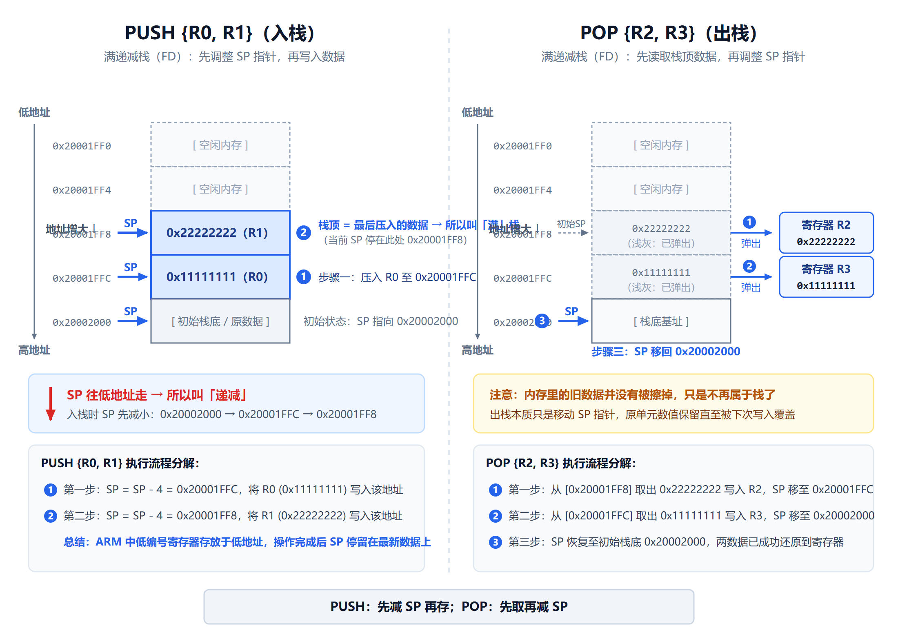

**怎么看这张图**：

1. **图分左右两半**：左边是 PUSH（入栈），右边是 POP（出栈）。
2. **先看左边**：垂直方向画内存，**上面是低地址，下面是高地址**（和教材一致）。
   先画 SP 在 0x20002000 的初始状态，再用箭头画出 SP 往下走的过程。
3. **注意箭头的方向**：满递减栈是**地址减小**的方向，所以 SP 的箭头是"往上走"（指向低地址）。
4. **再看右边**：POP 的过程正好反过来，SP 往上走，被弹出的数据从栈里消失。
5. **最后看最上面那行小结**："先减后存（PUSH）、先取后加（POP）"。
6. **这张图要你理解什么**：**栈就是一块普通内存，SP 只是一个指针。**
   入栈出栈的本质，就是"改 SP、搬数据"这两件事。

**举个具体数值演算（满递减栈，SP 初始 = 0x20002000）：**

```
执行 PUSH {R0, R1}，其中 R0 = 0xAAAAAAAA，R1 = 0xBBBBBBBB

第 1 步：SP = 0x20002000 - 4 = 0x20001FFC，把 R0 存进去
第 2 步：SP = 0x20001FFC - 4 = 0x20001FF8，把 R1 存进去

结果：
0x20001FF4  +------------+
            |   （空）    |
0x20001FF8  +------------+
            | 0xBBBBBBBB  |  ← R1（后放的，在栈顶）
0x20001FFC  +------------+
            | 0xAAAAAAAA  |  ← R0
0x20002000  +------------+
            |   （旧数据） |
            +------------+
            SP = 0x20001FF8  ▲
                             └── SP 指着最后压入的数据（满栈）
```

```
再执行 POP {R2, R3}

第 1 步：从 SP = 0x20001FF8 取出 0xBBBBBBBB → R2
第 2 步：SP = 0x20001FF8 + 4 = 0x20001FFC，取出 0xAAAAAAAA → R3
第 3 步：SP = 0x20001FFC + 4 = 0x20002000

结果：R2 = 0xBBBBBBBB，R3 = 0xAAAAAAAA，SP 回到 0x20002000
```

**【注意】** 出栈只是把 SP 移回去，**内存里的旧数据并没有被"擦掉"**，
它还在那儿，只是不再属于栈了。这是初学者常有的误解。

---

### 4.3.9 块拷贝寻址（Block Copy Addressing）

> 【教材内容】块拷贝寻址用于寄存器数据的批量复制，实现从由基址寄存器所指示的一片连续存储器到寄存器列表所指示的多个寄存器传送数据。块拷贝寻址与堆栈寻址有点类似。两者的区别在于：堆栈寻址中数据的存取是面向堆栈的，块拷贝寻址中数据的存取是面向寄存器指向的存储单元的。

> 【教材内容】在块拷贝寻址方式中，基址寄存器传送一个数据后有 4 种增长方式，即
> - **IA**（Increment After operating）——每次传送后地址增加 4；
> - **IB**（Increment Before operating）——每次传送前的地址增加 4；
> - **DA**（Decrement After operating）——每次传送后地址减少 4；
> - **DB**（Decrement Before operating）——每次传送前地址减少 4。

**【补充解释】四个后缀，其实就是两个问题的答案：**

| 后缀 | 英文 | 什么时候改地址 | 往哪个方向 |
|---|---|---|---|
| IA | Increment After | 传送**后**改 | 增加（+4） |
| IB | Increment Before | 传送**前**改 | 增加（+4） |
| DA | Decrement After | 传送**后**改 | 减少（−4） |
| DB | Decrement Before | 传送**前**改 | 减少（−4） |

**一句话记法**：**后缀第一个字母说方向（I 增 / D 减），第二个字母说时机（A 后 / B 前）。**

> 【教材内容】对于 32 位的 ARM 指令，每次地址的增加和减少的单位都是 4 字节单位。例如：

```asm
STMIA  R0!, {R1 - R7}   ; 将 R1-R7 的数据保存到 R0 指向的存储器中，
                        ; 存储器指针在保存第一个值之后增加 4，向上增长，R0 作为基址寄存器
STMIB  R0!, {R1 - R7}   ; 存储器指针在保存第一个值之前增加 4，向上增长
STMDA  R0!, {R1 - R7}   ; 存储器指针在保存第一个值之后减少 4，向下减少
STMDB  R0!, {R1 - R7}   ; 存储器指针在保存第一个值之前减少 4，向下减少
```

> 【教材内容】ARM 指令中的 `{!}` 为可选后缀，若选用该后缀，则当数据传送完毕之后，将最后的地址写入基址寄存器，否则基址寄存器的内容不改变。基址寄存器不允许为 R15，寄存器列表可以为 R0～R15 的任意组合。

**【补充解释】用一张表看清 IA/IB/DA/DB 的地址走向：**

假设 R0 初始 = 0x20000000，要存 R1、R2、R3 三个寄存器（每个 4 字节）：

| 后缀 | R1 存到 | R2 存到 | R3 存到 | 结束后 R0（带 `!`） |
|---|---|---|---|---|
| STMIA | 0x20000000 | 0x20000004 | 0x20000008 | 0x2000000C |
| STMIB | 0x20000004 | 0x20000008 | 0x2000000C | 0x20000010 |
| STMDA | 0x20000000 | **0x1FFFFFFC** | **0x1FFFFFF8** | **0x1FFFFFF4** |
| STMDB | **0x1FFFFFFC** | **0x1FFFFFF8** | **0x1FFFFFF4** | **0x1FFFFFF4** |

**注意 DA/DB 两行的地址是"往下走"的**（因为定义就是每次减 4）：
它们从 R0 开始往**低地址**方向存放，所以 R2、R3 落在比 R1 更小（更"低"）的地址上；
最后一格结束后的 R0 也是 0x20000000 − 12 = **0x1FFFFFF4**，而不是 0x20000000。
（这也是为什么同一段代码用 DA/DB 时，R0 的初始值要指在这一片区域的**高地址端**。）

**【补充解释】到底哪几种组合真的会用？**

- 教材表 4-1 里实际列出的批量指令只有 **IA 和 DB 两种**
  （`LDMIA`/`LDMDB`/`STMIA`/`STMDB`，教材还给它们列了 `LDMFD`/`LDMEA`/`STMFD`/`STMEA` 等别名）；
  ⚠️ 但表 4-1 把 `STMFD` 写成 `STMIA` 的别名、把 `STMEA` 写成 `STMDB` 的别名，
  这与 4.3.8 节"满递减栈用 STMFD（先减后存）"的说法对不上（表 4-1 这两处疑为教材笔误，已记入文末"待核验"）；
- Cortex-M3 里最常用的也是这两种：**`PUSH` 相当于 `STMDB SP!`（先减 SP 再存），
  `POP` 相当于 `LDMIA SP!`（先取再增 SP）** —— 也就是 4.3.8 节"满递减栈"那套动作；
- DA/IB 主要是用来理解上面这个规律的，实际写代码时记住 **STMIA 最常用、STMFD = STMDB 用于入栈（先减后存）** 就够了。

**【辅助理解图：LDMIA / STMIA 批量搬运】**

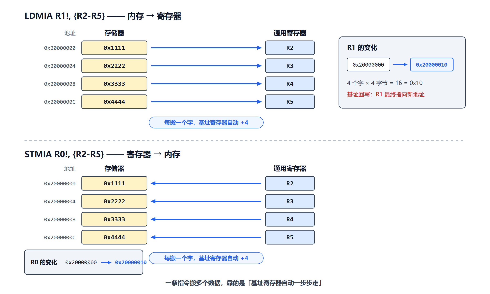

**怎么看这张图**：

1. **图分上下两半**：上半是 LDMIA（内存 → 寄存器），下半是 STMIA（寄存器 → 内存）。
2. **先看上半**：左边一排内存格子，右边一排寄存器，中间用 4 条箭头连接。
   箭头从低地址一格一格指向 R2、R3、R4、R5。
3. **注意基址寄存器的变化**：在图的右下角画出 R1 从 0x20000000 变成 0x20000010 的过程。
4. **再看下半**：箭头方向反过来，数据从寄存器流向内存。
5. **这张图要你理解什么**：**一条指令搬多个数据，靠的是"基址寄存器自动一步步走"。**
   这就是为什么它能替代好几条 LDR/STR。

### 4.3.10 寻址方式小结表

| 编号 | 寻址方式 | 典型写法 | 操作数在哪 | 一句话理解 |
|---|---|---|---|---|
| 1 | 立即寻址 | `MOV R0, #64` | 指令里 | 数据就在指令里 |
| 2 | 寄存器寻址 | `ADD R0, R1, R2` | 寄存器 | 数据就在寄存器里 |
| 3 | 寄存器间接寻址 | `LDR R0, [R1]` | 内存（地址在寄存器里） | 寄存器给门牌号 |
| 4 | 寄存器移位寻址 | `MOV R0, R2, LSL #3` | 寄存器（先移位） | 取出来先挪一挪 |
| 5 | 基址变址寻址 | `LDR R0, [R1, #4]` | 内存（基址+偏移） | 门牌号要算一下 |
| 6 | 多寄存器寻址 | `LDMIA R0, {R1-R4}` | 内存（连续一片） | 一次搬好几个 |
| 7 | 相对寻址 | `BL NEXT` | 内存（PC+偏移） | 相对当前位置跳 |
| 8 | 堆栈寻址 | `PUSH {R0,R1}` | 内存（SP 指的地方） | 往盘子上摞/取 |
| 9 | 块拷贝寻址 | `STMIA R0!, {R1-R7}` | 内存（基址+自动增减） | 成片搬运，指针自动走 |

**【补充解释】怎么记这九种？**

抓住一条主线：**数据到底在哪？**

```
数据在指令里 ──────────── 立即寻址
数据在寄存器里 ────────── 寄存器寻址（加移位 → 寄存器移位寻址）
数据在内存里 ──────────── 需要一个地址，地址从哪来？
        ├─ 从寄存器来 ──── 寄存器间接寻址
        ├─ 寄存器 + 偏移 ── 基址变址寻址
        ├─ PC + 偏移 ───── 相对寻址
        ├─ SP 自动管理 ──── 堆栈寻址
        ├─ 基址自动增减 ─── 多寄存器寻址 / 块拷贝寻址
```

---

## 4.4 Cortex-M3 指令集

> 对应教材 4.4 节（p107～p130）

**先给读者一句定心丸**：

> 这一节的指令很多，但**不要试图一次背完**。
> 教材自己也说表 4-1 只需要"浏览，不需要记忆"。
>
> 正确的学法是：**每一类先记住 2～3 条最常用的**，
> 其余的知道"有这么回事、大概干什么、需要时去哪里查"就够了。
> 后面几章（GPIO、中断、定时器）会反复用到其中一小部分，
> 那时候你自然会记住它们。

本节对每条重要指令都会回答同一个问题：

> **执行这条指令后，寄存器 / 内存发生了什么变化？**

---

### 4.4.1 数据传送类指令

> 对应教材 4.4.1 节（p107～p112）

> 【教材内容】处理器的基本功能之一就是数据传送。数据传送指令用于在寄存器和寄存器之间、寄存器和存储器之间进行数据的双向传输。Cortex-M3 中的数据传送类型包括：
> （1）在两个寄存器间传送数据或者把一个立即数加载到寄存器。
> （2）在寄存器与存储器间传送数据。
> （3）在寄存器与特殊功能寄存器间传送数据。
> （4）堆栈操作。

四类，逐个讲。

#### 1. 寄存器之间传送 / 加载立即数

##### 1) MOV 指令

> 【教材内容】MOV 指令可完成将一个寄存器、被移位的寄存器或一个立即数传送到目的寄存器。MOV 指令的格式为：

```
MOV{S}{条件}  目的寄存器, 源操作数
```

> 【教材内容】其中 S 选项决定指令的操作是否影响 CPSR 中条件标志位的值，当没有 S 时指令不更新 CPSR 中条件标志位的值。

**【补充解释】"MOV"这个名字的来源**：Move（搬）。
但注意——**它不是"搬走"，而是"复制"**：源寄存器的值**不变**，只是把值抄一份到目的寄存器。

```
执行前：  R0 = 0x000007E2      R1 = 0x????????（随便）
MOV  R1, R0
执行后：  R0 = 0x000007E2      R1 = 0x000007E2
              ↑ 没变！            ↑ 变成和 R0 一样
```

> 【教材内容】如果执行该指令前，R0 的内容是 0x000007E2（即十进制的 2018），则执行该指令后，R1 的内容变成 0x000007E2，R0 的内容不变。

**【补充解释】验算一下"0x7E2 = 2018"：**

```
0x7E2 = 7×16² + 14×16¹ + 2×16⁰
      = 7×256 + 14×16 + 2
      = 1792 + 224 + 2
      = 2018  ✔
```

**教材给的几个 MOV 例子：**

```asm
MOV  PC, R14          ; 将寄存器 R14 的值传送到 PC，常用于子程序返回
MOV  R1, R0, LSL #3   ; 将寄存器 R0 的值左移 3 位后传送到 R1
MOV  R0, #0x12        ; 将十六进制 0x12 传送给 R0
MOV  R1, #'A'         ; 将字符 'A' 的 ASCII 码值（0x41）传送给 R1
```

**【补充解释】逐条演算：**

**第 1 条 `MOV PC, R14`：**

```
R14 就是 LR。这条指令把 LR 的值送进 PC。
PC 一改，CPU 就跳到那个地址去执行 → 这就是"子程序返回"。
（4.5.3 节会详细讲这个。）
```

**第 2 条 `MOV R1, R0, LSL #3`（假设 R0 = 5）：**

```
运算前：R0 = 0x00000005 = 0000 ... 0000 0101
左移 3 位：
        0000 ... 0000 0101
        ←───────────────── 每一位往左挪 3 格，右边补 0
        0000 ... 0010 1000 = 0x00000028 = 40

执行后：R1 = 0x00000028（= 5×8 = 40 ✔），R0 不变（还是 5）
```

**第 4 条 `MOV R1, #'A'`：**

```
字符 'A' 在 ASCII 码表里对应数字 65 = 0x41
执行后：R1 = 0x00000041
```

**记忆点**：`MOV` 是最常用、最基础的指令，几乎所有程序里都有它。

##### 2) MVN 指令（数据取反传送）

> 【教材内容】MVN 指令可完成将一个寄存器、被移位的寄存器或一个立即数的内容取反后传送到目的寄存器。MVN 指令的格式为：

```
MVN{S}{条件}  目的寄存器, 源操作数
```

> 【教材内容】例如：

```asm
MVN  R0, #0x36    ; 执行指令后，R0 中的值将变为 0xFFFFFFC9
```

**【补充解释】"取反"就是每一位 0 变 1、1 变 0。演算：**

```
源操作数 #0x36
  0x36 = 0000 0000 0000 0000 0000 0000 0011 0110

逐位取反：
        1111 1111 1111 1111 1111 1111 1100 1001

写成十六进制：
        1111 = F
        1111 = F
        1111 = F
        1100 = C
        1001 = 9
所以结果 = 0xFFFFFFC9  ✔
```

**执行后**：R0 = 0xFFFFFFC9，源操作数不变。

**MVN 有什么用？**

```
MVN R0, #0     →  R0 = 0xFFFFFFFF（全 1）
MVN R0, #0x0F  →  R0 = 0xFFFFFFF0
```

用它可以方便地造出"除了某几位之外全是 1"的掩码。

##### 3) MOVW / MOVT 指令

> 【教材内容】MOVW 指令把 16 位立即数放到寄存器的低 16 位，高 16 位清零。MOVT 指令把 16 位立即数放到寄存器的高 16 位，低 16 位不影响。例如：

```asm
MOVT  R3, #0xF123    ; 将 0xF123 写入 R3 的高 16 位，低 16 位不变
```

**【补充解释】为什么要这两个指令？**

回忆 4.2.5 节：指令里的立即数字段很小，装不下完整的 32 位数。
那要往寄存器里放一个 32 位数（比如 0xF1234567）怎么办？

**分成两半，分两步放：**

```asm
MOVW  R3, #0x4567    ; 第 1 步：低 16 位 = 0x4567，高 16 位清零
                     ;   R3 = 0x00004567
MOVT  R3, #0xF123    ; 第 2 步：高 16 位 = 0xF123，低 16 位不变
                     ;   R3 = 0xF1234567
```

**位图看得更清楚：**

```
第 1 步  MOVW R3, #0x4567
 31                              16 15                               0
+----------------------------------+-----------------------------------+
|          0000 0000 0000 0000     |         0100 0101 0110 0111        |
+----------------------------------+-----------------------------------+
      ↑ 高 16 位被清 0                    ↑ 低 16 位 = 0x4567

第 2 步  MOVT R3, #0xF123
 31                              16 15                               0
+----------------------------------+-----------------------------------+
|          1111 0001 0010 0011     |         0100 0101 0110 0111        |
+----------------------------------+-----------------------------------+
      ↑ 高 16 位 = 0xF123（新写入）        ↑ 低 16 位不变

最终 R3 = 0xF1234567
```

**【容易搞混】**：`MOVT` **不会**把低 16 位清零。如果你只写 `MOVT` 不写 `MOVW`，
低 16 位保留的是寄存器里**原来的内容**（可能是垃圾值）。

#### 2. 寄存器与存储器之间传送（加载/存储指令）

> 【教材内容】ARM 微控制器支持加载（Load）/存储（Store）指令，用于在寄存器和存储器之间传送数据，加载指令（LDR 类指令）用于将存储器中的数据传送到寄存器中，存储指令（STR 类指令）则把寄存器的内容存储至存储器中。

**先记住两个词：**

| 术语 | 英文 | 方向 | 大白话 |
|---|---|---|---|
| 加载 | Load | 内存 → 寄存器 | 从仓库搬到操作台 |
| 存储 | Store | 寄存器 → 内存 | 从操作台搬回仓库 |

**教材表 4-4 常用的存储器访问指令（完整抄录）：**

| 存储器访问指令 | 功能描述 |
|---|---|
| `LDR Rd, [Rn, #offset]` | 从地址 Rn+offset 处读取一个**字**送到 Rd |
| `LDRB Rd, [Rn, #offset]` | 从地址 Rn+offset 处读取一个**字节**送到 Rd |
| `LDRH Rd, [Rn, #offset]` | 从地址 Rn+offset 处读取一个**半字**送到 Rd |
| `LDRD Rd1, Rd2, [Rn, #offset]` | 从地址 Rn+offset 处读取一个**双字**（64 位）送到 Rd1（低 32 位）和 Rd2（高 32 位） |
| `STR Rd, [Rn, #offset]` | 把 Rd 中的**字**存储到地址 Rn+offset 处 |
| `STRB Rd, [Rn, #offset]` | 把 Rd 中的**低字节**存储到地址 Rn+offset 处 |
| `STRH Rd, [Rn, #offset]` | 把 Rd 中的**低半字**存储到地址 Rn+offset 处 |
| `STRD Rd1, Rd2, [Rn, #offset]` | 把 Rd1（低 32 位）和 Rd2（高 32 位）表达的双字存储到地址 Rn+offset 处 |

**【补充解释】表 4-1 里还有一族带 `T` 的版本（LDRBT / STRBT 等），先知道有这回事**

教材表 4-1 在这几条之外，还列出了 `LDRBT`、`LDRHT`、`LDRSBT`、`LDRSHT`、`STRBT`、`STRHT`。
它们不是新动作，只是在普通指令后面加了一个 **T（Unprivileged，非特权）**：

| 指令 | 和谁对应 | 差别 |
|---|---|---|
| `LDRBT` / `LDRHT` / `LDRSBT` / `LDRSHT` | `LDRB` / `LDRH` / `LDRSB` / `LDRSH` | 读内存 |
| `STRBT` / `STRHT` | `STRB` / `STRH` | 写内存 |

- **不带 T**：按当前特权等级访问内存（程序是特权模式就按特权模式检查权限）；
- **带 T**：**强制按"非特权"身份访问内存**——不管当前程序是不是特权模式，
  这次访问都按用户级（非特权）的规则检查权限，权限不够就会产生异常。

教材表 4-1 的原文写法就是"LDRBT 用于非特权访问""STRBT 用于非特权访问"。

**初学阶段怎么办**：这几条在普通应用代码里很少见（主要出现在操作系统/底层驱动里，
用来替用户程序"代读/代写"一块内存，同时不放大用户程序的权限）。
**知道表里有这一族、知道 `T` = 非特权访问就够了**，
它们的全集是否属于 Cortex-M3 指令集，见文末"待核验"第 16 条。
（顺带区分：`LDRSB`/`LDRSH` 的 `S` 是 **Signed，带符号扩展**——
读出字节/半字后把符号位扩展到 32 位，等于"读内存 + 符号扩展"一步完成；
4.4.2 节 6) 的 `SXTB`/`SXTH` 是专门做这件事的独立指令。）

```
内存地址      字节内容
0x20000000  +--------+--------+--------+--------+
            |  0x78  |  0x56  |  0x34  |  0x12  |  ← 假设这里存了 0x12345678（小端）
0x20000004  +--------+--------+--------+--------+

LDR  R0, [R1]   ; R0 = 0x12345678   （一次搬 4 字节，高 24 位不用清）
LDRH R0, [R1]   ; R0 = 0x00005678   （只搬 2 字节，高 16 位清 0）
LDRB R0, [R1]   ; R0 = 0x00000078   （只搬 1 字节，高 24 位清 0）
```

**【辅助理解图：LDR / STR 的数据流与搬运宽度】**

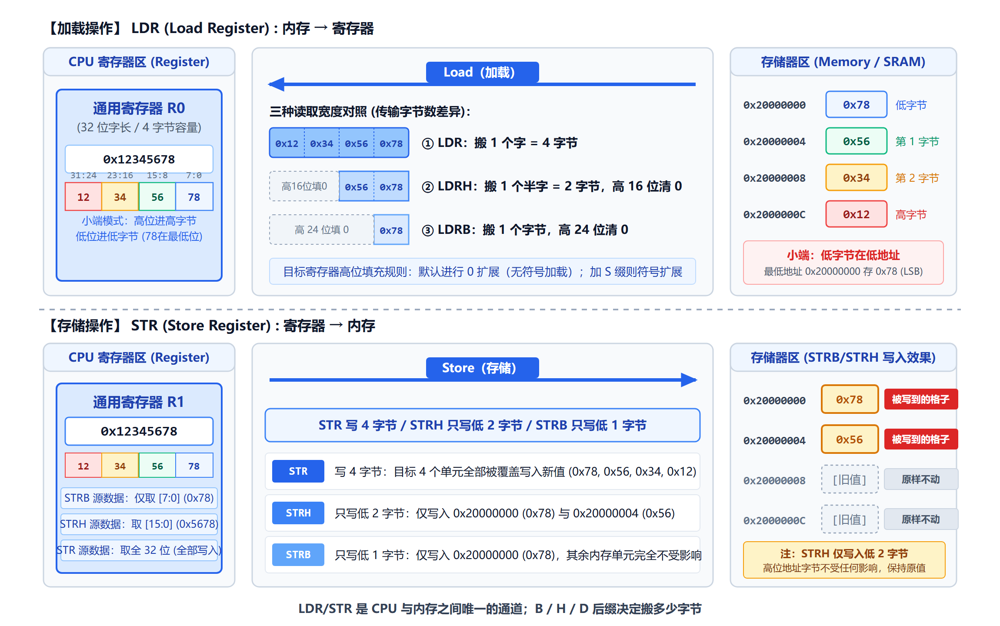

**怎么看这张图**：

1. **图左边是寄存器，右边是存储器**，中间是数据通路。
2. **上半部分画 LDR**：箭头从存储器指向寄存器，旁边标注"Load（加载）"。
3. **下半部分画 STR**：箭头反过来，从寄存器指向存储器，标注"Store（存储）"。
4. **中间特意画出三种宽度的对比**：字（4 格）、半字（2 格）、字节（1 格），
   每格代表 1 字节，让"搬多少"一目了然。
5. **重点看 LDRB / LDRH 那一侧**：箭头只覆盖内存的一小部分，
   但寄存器整格都被写——说明**高 24 位/高 16 位被自动补 0**。
6. **这张图要你理解什么**：`LDR`/`STR` 是 CPU 与内存之间唯一的通道；
   `B`/`H`/`D` 后缀决定搬多少字节。

##### 1) LDR 指令

> 【教材内容】LDR 指令的格式为：

```
LDR{条件}  目的寄存器，<存储器地址>
```

> 【教材内容】LDR 指令用于从存储器中将一个 32 位的字数据传送到目的寄存器中。该指令通常用于从存储器中读取 32 位的字数据到通用寄存器，然后对数据进行处理。当程序计数器 PC 作为目的寄存器时，指令从存储器中读取的字数据被当作目的地址，从而可以实现程序流程的跳转。例如：

```asm
LDR  R0, [R1]    ; 将存储器地址为 R1 的字数据读入寄存器 R0
```

**【补充解释】最后那句话很重要**：

> `LDR PC, [R1]` 会把内存里的那个数**当成跳转目标地址**，从而实现"跳转"。
> 这是"用数据指令实现跳转"的典型用法，也解释了 4.4.3 节说的
> "直接向程序计数器 PC 写入跳转地址值"这种方法。

##### 2) LDRB 指令

> 【教材内容】LDRB 指令用于从存储器中将一个 8 位的字节数据传送到目的寄存器中，同时将寄存器的高 24 位清零。

```asm
LDRB  R0, [R1]       ; 将存储器地址为 R1 的字节数据读入 R0，并将 R0 的高 24 位清零
LDRB  R0, [R1, #8]   ; 将存储器地址为 R1+8 的字节数据读入 R0，并将 R0 的高 24 位清零
```

##### 3) LDRH 指令

> 【教材内容】LDRH 指令用于从存储器中将一个 16 位的半字数据传送到目的寄存器中，同时将寄存器的高 16 位清零。

```asm
LDRH  R0, [R1]       ; 将存储器地址为 R1 的半字数据读入 R0，并将 R0 的高 16 位清零
LDRH  R0, [R1, #8]   ; 将存储器地址为 R1+8 的半字数据读入 R0，并将 R0 的高 16 位清零
LDRH  R0, [R1, R2]   ; 将存储器地址为 R1+R2 的半字数据读入 R0，并将 R0 的高 16 位清零
```

**【补充解释】"清零"三个字要重视。** 假设 R0 原来是 0xFFFFFFFF：

```
执行 LDRB R0, [R1] 后，R0 = 0x000000??   ← 高 24 位全变 0，只有低 8 位是新数据
执行 LDRH R0, [R1] 后，R0 = 0x0000????   ← 高 16 位全变 0，只有低 16 位是新数据
```

##### 4) STR 指令

> 【教材内容】STR 指令用于从源寄存器中将一个 32 位的字数据传送到存储器中。该指令在程序设计中比较常用，且寻址方式灵活多样，使用方式可参考指令 LDR。

```asm
STR  R0, [R1], #8    ; 将 R0 中的字数据写入以 R1 为地址的存储器中，并将新地址 R1+8 写入 R1
STR  R0, [R1, #8]    ; 将 R0 中的字数据写入以 R1+8 为地址的存储器中
```

**【补充解释】注意第一条是"后索引"写法**（4.3.5 节讲过）：
先用 R1 的旧值当地址写数据，然后把 R1 更新成 R1+8。

##### 5) STRB 指令

> 【教材内容】STRB 指令用于从源寄存器中将一个 8 位的字节数据传送到存储器中。该字节数据为源寄存器中的低 8 位。

```asm
STRB  R0, [R1]       ; 将寄存器 R0 中的字节数据写入以 R1 为地址的存储器中
STRB  R0, [R1, #8]   ; 将寄存器 R0 中的字节数据写入以 R1+8 为地址的存储器中
```

##### 6) STRH 指令

> 【教材内容】STRH 指令用于从源寄存器中将一个 16 位的半字数据传送到存储器中。该半字数据为源寄存器中的低 16 位。

```asm
STRH  R0, [R1]       ; 将寄存器 R0 中的半字数据写入以 R1 为地址的存储器中
STRH  R0, [R1, #8]   ; 将寄存器 R0 中的半字数据写入以 R1+8 为地址的存储器中
```

**【补充解释】STRB/STRH 的一个重要特点：只写一部分，不动邻居。**

```
执行 STRB R0, [R1]，R0 = 0x12345678，R1 = 0x20000000

执行前：
0x20000000  +--------+--------+--------+--------+
            |  0xAA  |  0xAA  |  0xAA  |  0xAA  |
            +--------+--------+--------+--------+

执行后：
0x20000000  +--------+--------+--------+--------+
            |  0x78  |  0xAA  |  0xAA  |  0xAA  |
            +--------+--------+--------+--------+
                ↑
            只改了这一格（R0 的低 8 位），其余三格原样不动
```

##### 7) 批量数据加载/存储指令（LDM / STM）

> 【教材内容】批量数据加载/存储指令的格式为：

```
LDM(或 STM){条件}{类型}  基址寄存器{!}, 寄存器列表{^}
```

> 【教材内容】其中，{类型} 为以下几种情况：IA、IB、DA、DB、FD、ED、FA、EA。
> {!} 和 {^} 为可选后缀。{!} 后缀表示最后的地址写回到基址寄存器中；{^} 后缀表示不允许在用户模式和系统模式下运行。

**教材表 4-5 常用的批量数据加载/存储指令：**

| 指令 | 功能描述 |
|---|---|
| `LDMIA Rd!, {寄存器列表}` | 从 Rd 处读取多个字，依次送到寄存器列表中的寄存器。每读一个字后 Rd 自增一次，16 位宽度 |
| `STMIA Rd!, {寄存器列表}` | 依次存储寄存器列表中各寄存器的值到 Rd 给出的地址。每存一个字后 Rd 自增一次，16 位宽度 |
| `LDMIA.W Rd!, {寄存器列表}` | 同上，32 位宽度 |
| `LDMDB.W Rd!, {寄存器列表}` | 从 Rd 处读取多个字。每读一个字**前** Rd 自减一次，32 位宽度 |
| `STMIA.W Rd!, {寄存器列表}` | 依次存储。每存一个字后 Rd 自增一次，32 位宽度 |
| `STMDB.W Rd!, {寄存器列表}` | 存储多个字到 Rd 处。每存一个字**前** Rd 自减一次，32 位宽度 |

> 【教材内容】例如：

```asm
STMFD  R13!, {R0, R4 - R12, LR}    ; 将寄存器列表中的寄存器（R0，R4 到 R12，LR）存入堆栈
LDMFD  R13!, {R0, R4 - R12, PC}    ; 将堆栈内容恢复到寄存器（R0，R4 到 R12，LR）
```

**【补充解释】注意第二行的最后一个寄存器写的是 `PC` 而不是 `LR`。**

这不是笔误，而是一个非常重要的技巧：

```
入栈时：把 LR（返回地址）压进栈
出栈时：把栈里的那个值直接弹进 PC

效果：PC 被改成了返回地址 → 直接完成了"子程序返回"！
```

**【类比】**：你出门前把"回家路线"写在便条上放进抽屉；
回来时直接从抽屉里拿出便条照着走——**一步到位，不用先拿在手里再看**。

**【补充解释】`R13` 就是 `SP`。** 教材这里用 R13 而不是 SP，两者完全等价。

#### 3. 寄存器与特殊功能寄存器之间传送（MRS / MSR）

> 【教材内容】特殊功能寄存器访问指令包括以下两条：
> - **MRS**：特殊功能寄存器到通用寄存器的数据传送指令。
> - **MSR**：通用寄存器到特殊功能寄存器的数据传送指令。

**【补充解释】什么叫"特殊功能寄存器"？**

前面讲的 R0～R15 是**通用**寄存器——拿来算数、搬数据，随便用。

但 CPU 还有一类寄存器，它们**各自有专门职责**，不能拿来算数，只能通过 MRS/MSR 访问：

| 名称 | 全称 | 干什么 |
|---|---|---|
| APSR | Application Program Status Register | 应用程序状态寄存器（就是 4.2.3 节讲的标志位所在） |
| IPSR | Interrupt Program Status Register | 中断程序状态寄存器（记录当前在处理哪个异常） |
| EPSR | Execution Program Status Register | 执行程序状态寄存器（和 IT 块、Thumb 状态有关） |
| xPSR | 以上三者的组合 | 把 APSR、IPSR、EPSR 拼在一起看 |
| CONTROL | 控制寄存器 | 控制特权等级、用哪个栈（第 2 章讲过） |

**【类比】**：通用寄存器像**白纸**，随便写；特殊功能寄存器像**仪表盘上的旋钮和指示灯**，
只能通过专门的接口去读/拧。

##### 1) MRS 指令

> 【教材内容】MRS 指令的格式为：

```
MRS{条件}  通用寄存器, 特殊功能寄存器(APSR、IPSR、PSR、EPSR、xPSR 或 CONTROL)
```

> 【教材内容】该指令一般用于以下几种情况：
> - 当需要改变特殊功能寄存器的内容时，可用 MRS 将特殊功能寄存器的内容读入通用寄存器，修改后再写回特殊功能寄存器。
> - 当在异常处理或进程切换时，需要保存特殊功能寄存器的值，可先用该指令读出特殊功能寄存器的值，然后保存。

```asm
MRS  R0, APSR        ; 传送 APSR 的内容到 R0
MRS  R0, EPSR        ; 传送 EPSR 的内容到 R0
MRS  R1, CONTROL     ; 传送 CONTROL 的内容到 R1
```

**执行后发生什么**：R0（或 R1）被写入特殊功能寄存器的内容，特殊功能寄存器本身不变。

**【补充解释】为什么要先读出来再改？**

因为**特殊功能寄存器不能直接用立即数或运算指令修改**。
想改它，只能：

```
第 1 步：MRS R0, APSR        ; 读出来
第 2 步：用普通指令改 R0      ; 在 R0 上做位运算
第 3 步：MSR APSR, R0        ; 写回去
```

这就像"仪表盘上的旋钮不能直接拧到某个刻度，只能先读当前值，算好新值，再整体写回"。

##### 2) MSR 指令

> 【教材内容】MSR 指令的格式为：

```
MSR{条件}  特殊功能寄存器, 通用寄存器
```

> 【教材内容】该指令通常用于恢复或改变特殊功能寄存器的内容。例如：

```asm
MSR  APSR, R0        ; 传送 R0 的内容到 APSR
MSR  PSR, R0         ; 传送 R0 的内容到 PSR
MSR  CONTROL, R0     ; 传送 R0 的内容到 CONTROL
```

#### 4. 堆栈操作指令（PUSH / POP）

> 【教材内容】堆栈操作指令包括寄存器入栈及出栈指令。实现低寄存器和可选的 LR 寄存器入栈，寄存器和可选的 PC 寄存器出栈操作，堆栈地址由 SP 寄存器设置，堆栈是**满递减堆栈**。指令格式如下：

```
PUSH  {寄存器列表[, LR]}
POP   {寄存器列表[, PC]}
```

> 【教材内容】其中寄存器列表是入栈/出栈低寄存器列表，即 R0～R7。LR 是入栈时的可选寄存器，PC 是出栈时的可选寄存器。例如：

```asm
PUSH  {R0, R4 - R7, LR}    ; 将低寄存器 R0、R4～R7 入栈，LR 也入栈
POP   {R0, R4 - R7, PC}    ; 将堆栈中的数据弹出到低寄存器 R0、R4～R7 及 PC 中
```

**【补充解释】三条必须记住的要点：**

**要点一：Cortex-M3 的栈是"满递减"。**
（4.3.8 节讲过：SP 指向最后一个压入的数据；入栈时 SP 先减小。）

**要点二：PUSH/POP 只能操作低寄存器 R0～R7，外加 LR 或 PC。**

```
PUSH {R0 - R7, LR}     ✔ 合法
PUSH {R8 - R12}        ✘ 不合法（高寄存器不能用 PUSH）
```

为什么？因为 16 位指令里放不下那么多寄存器编号。
要用高寄存器入栈，得用 `STMFD SP!, {R8-R12}`。

**要点三：POP 时把 LR 换成 PC，就等于"返回"。**

```asm
子程序:
    PUSH {R0 - R3, LR}      ; 进来先保存现场（包括返回地址）
    ...                     ; 子程序正文
    POP  {R0 - R3, PC}      ; 恢复现场，同时返回！
```

**【容易搞混】`PUSH {..., LR}` 与 `POP {..., PC}` 是成对出现的经典写法。**
入栈存 LR、出栈弹到 PC，这是 Cortex-M3 汇编里最常见的子程序框架。

**【补充解释】一个完整的数值演算（SP 初始 = 0x20002000）：**

```
执行 PUSH {R0, R1, LR}，其中 R0=0x11111111, R1=0x22222222, LR=0x08000123

第 1 步：SP = 0x20001FFC，存 R0
第 2 步：SP = 0x20001FF8，存 R1
第 3 步：SP = 0x20001FF4，存 LR

内存布局（地址从小到大）：
0x20001FF4  +------------+
            | 0x08000123  |  ← LR  （最后压入，栈顶）
0x20001FF8  +------------+
            | 0x22222222  |  ← R1
0x20001FFC  +------------+
            | 0x11111111  |  ← R0
0x20002000  +------------+
SP = 0x20001FF4
```

```
执行 POP {R2, R3, PC}

第 1 步：从 SP=0x20001FF4 取出 0x08000123 → PC   （于是跳回 0x08000123）
第 2 步：SP = 0x20001FF8，取出 0x22222222 → R3
第 3 步：SP = 0x20001FFC，取出 0x11111111 → R2
第 4 步：SP = 0x20002000

结果：PC = 0x08000123（返回主程序），R3 = 0x22222222，R2 = 0x11111111，SP 复原
```

---

### 4.4.2 数据处理类指令

> 对应教材 4.4.2 节（p112～p123）

> 【教材内容】数据处理类指令可分为算术运算指令、逻辑运算指令和比较指令等。

#### 1. 算术运算指令

> 【教材内容】算术逻辑运算指令完成常用的算术与逻辑的运算，该类指令不但将运算结果保存在目的寄存器中，同时更新 CPSR 中的相应条件标志位。

**【补充解释】"更新标志位"要加一个重要前提，别理解成"这一类指令一定会更新"**

教材这句话说的是这类指令的**能力**，但具体到某一条指令，**更不更新要看有没有 `S` 后缀**
（4.2.4 节 (3) 专门讲过这件事）：

```asm
ADD  R0, R1, R2     ; 只算，不更新标志位
ADDS R0, R1, R2     ; 算完同时更新 N/Z/C/V
AND  R0, R1, R2     ; 不更新
ANDS R0, R1, R2     ; 更新
```

| 写法 | 更新标志位吗 |
|---|---|
| 带 `S`（`ADDS`/`SUBS`/`ANDS`…） | **更新** |
| 不带 `S`（`ADD`/`SUB`/`AND`…） | **不更新** |
| `CMP`/`CMN`/`TST`/`TEQ` | **天生就更新**（它们不保存结果，存在的意义就是出标志位） |

**所以要记住**：想让后面的条件指令（`EQ`/`NE`/`GT`…）读到"刚算出来的"标志位，
要么用带 `S` 的运算指令，要么用 `CMP` 这类比较指令；写成不带 `S` 的 `ADD`，标志位还是旧值。

（顺便对一下名字：教材这里的 `CPSR`，就是 4.2.3.1 讲的 **APSR**——
Cortex-M3 官方文档把状态位叫 xPSR/APSR，教材沿用了传统 ARM 的 `CPSR` 叫法，是同一个东西。）

##### 1) 加法指令

###### (1) ADD 指令

> 【教材内容】ADD 指令的格式为：

```
ADD{S}{条件}  目的寄存器, 操作数1, 操作数2
```

> 【教材内容】ADD 指令用于把两个操作数相加，并将结果存放到目的寄存器中。操作数 1 应是一个寄存器，操作数 2 可以是一个寄存器、被移位的寄存器或一个立即数。例如：

```asm
ADD  R0, R1, R2         ; R0 = R1 + R2
ADD  R0, R1, #256       ; R0 = R1 + 256
ADD  R0, R2, R3, LSL #1 ; R0 = R2 + (R3 << 1)
```

**逐条演算（假设 R1 = 0x00000010，R2 = 0x00000020，R3 = 0x00000003）：**

```asm
ADD  R0, R1, R2
  运算前：R1 = 0x00000010（16）
          R2 = 0x00000020（32）
  相加  ：16 + 32 = 48 = 0x00000030
  执行后：R0 = 0x00000030，R1、R2 不变

ADD  R0, R1, #256
  运算前：R1 = 0x00000010（16）
  立即数：256 = 0x00000100
  相加  ：16 + 256 = 272 = 0x00000110
  执行后：R0 = 0x00000110

ADD  R0, R2, R3, LSL #1
  运算前：R2 = 0x00000020（32）
          R3 = 0x00000003（3），先左移 1 位
          R3 LSL #1 = 0000 0011 → 0000 0110 = 6
  相加  ：32 + 6 = 38 = 0x00000026
  执行后：R0 = 0x00000026
```

**【补充解释】第三条指令体现了一个重要特性**：

> **在 Cortex-M3 上，"移位"是免费的。**

数据从寄存器出来时，可以顺手经过桶形移位器（4.3.4 节讲过），
**不需要额外的指令、也不额外花时间**。所以：

```asm
R0 = R2 + R3 × 2      可以写成   ADD R0, R2, R3, LSL #1
R0 = R2 + R3 × 4      可以写成   ADD R0, R2, R3, LSL #2
```

###### (2) 带进位加法指令 ADC

> 【教材内容】ADC 指令用于把两个操作数相加，再加上 CPSR 中的 C 条件标志位的值，并将结果存放到目的寄存器中。它使用一个进位标志位，可以做比 32 位大的数的加法，注意不要忘记设置 S 后缀来更新进位标志。

**大白话**：`ADC` = ADD + Carry（加上进位）。

**【补充解释】为什么需要它？——做"大数加法"。**

32 位寄存器最大只能装 4294967295。如果要算两个 64 位数相加怎么办？

**把 64 位数拆成两半**：高 32 位 + 低 32 位，分两步加，**低半部分产生的进位传给高半部分**。

```
   高位部分            低位部分
  A_hi | A_lo    +   B_hi | B_lo

第 1 步：A_lo + B_lo     → 得到结果的低 32 位，进位进 C
第 2 步：A_hi + B_hi + C → 得到结果的高 32 位
                  ↑
            这就是 ADC 的用武之地
```

**教材的 128 位加法例子（逐行解释）：**

> 【教材内容】下面的指令序列完成两个 128 位数的加法，第一个数由高到低存放在寄存器 R7～R4，第二个数由高到低存放在寄存器 R11～R8，运算结果由高到低存放在寄存器 R3～R0。

```asm
ADDS  R0, R4, R8      ; 加低端的字
ADCS  R1, R5, R9      ; 加第二个字，带进位
ADCS  R2, R6, R10     ; 加第三个字，带进位
ADC   R3, R7, R11     ; 加第四个字，带进位
```

**【补充解释】逐行说明：**

| 行 | 代码 | 干什么 | 为什么要 S |
|---|---|---|---|
| 1 | `ADDS R0, R4, R8` | 最低 32 位相加，结果存 R0 | **必须带 S**，否则 C 标志不更新，后面白搭 |
| 2 | `ADCS R1, R5, R9` | 次低 32 位相加，**还要加上第 1 步产生的进位** | 同样要 S |
| 3 | `ADCS R2, R6, R10` | 再往上 32 位 | 同样要 S |
| 4 | `ADC R3, R7, R11` | 最高 32 位 | 最后一步不用 S 了（没有更上面的了） |

**【容易搞混】第一条如果写成 `ADD R0, R4, R8`（没有 S），
进位标志不会被更新，后面三条 ADC 全部读到旧的 C 值，整个加法就错了。**

**教材的 128 位加法用图表示：**

```
        127                            0
   R7    R6    R5    R4        第一个 128 位数
   R11   R10   R9    R8        第二个 128 位数
    ↓     ↓     ↓     ↓
   R3    R2    R1    R0        结果（128 位）

相加顺序：从右往左（从低位往高位），进位一路向左传
```

###### (3) 宽加法 ADDW

> 【教材内容】ADDW：宽加法（可以加 12 位立即数）。

**【补充解释】** `ADDW` 是 32 位 Thumb-2 指令，
能装的立即数范围比普通 `ADD` 大（12 位立即数，0～4095）。

##### 2) 减法指令

###### (1) SUB 指令

```
SUB{S}{条件}  目的寄存器, 操作数1, 操作数2
```

```asm
SUB  R0, R1, R2         ; R0 = R1 - R2
SUB  R0, R1, #256       ; R0 = R1 - 256
SUB  R0, R2, R3, LSL #1 ; R0 = R2 - (R3 << 1)
```

**演算（R1 = 0x00000030，R2 = 0x00000010）：**

```
运算前：R1 = 0x00000030（48）
        R2 = 0x00000010（16）
相减  ：48 − 16 = 32 = 0x00000020
执行后：R0 = 0x00000020
标志位：结果非 0 → Z=0；无借位 → C=1（无符号角度 48 ≥ 16）
```

**【补充解释】减法的 C 标志是"反的"，初学者最容易错：**

| 运算 | C 的含义 |
|---|---|
| 加法 | C=1 表示**有进位** |
| 减法 | C=1 表示**没有借位**（也就是"够减"） |

所以：

```
SUB R0, R1, R2    →  如果 R1 ≥ R2（无符号），则 C = 1
                  →  如果 R1 < R2（无符号），则 C = 0（需要借位）
```

这也解释了为什么"无符号 ≥"用 `CS`（C 置位）、"无符号 <"用 `CC`（C 清零）。

###### (2) 带借位减法指令 SBC

> 【教材内容】SBC 指令用于把操作数 1 减去操作数 2，再减去 CPSR 中的 C 条件标志位的反码，并将结果存放到目的寄存器中。该指令使用进位标志来表示借位，可以做大于 32 位的减法，注意不要忘记设置 S 后缀来更新进位标志。

```
SBC{S}{条件}  目的寄存器, 操作数1, 操作数2
```

```asm
SBCS  R0, R1, R2    ; R0 = R1 - R2 - !C，并根据结果设置 CPSR 的进位标志位
```

**【补充解释】"减去 C 的反码"就是"如果上一步借位了就再减 1"。**

```
!C 表示 C 取反：
  C = 1（上一步没借位）→ !C = 0 → 不用再减 1
  C = 0（上一步借位了）→ !C = 1 → 再减 1
```

这和 ADC 的"加进位"是对偶的：**ADC 把进位传上去，SBC 把借位传下去。**

###### (3) 逆向减法指令 RSB

> 【教材内容】RSB 指令称为逆向减法指令，用于把操作数 2 减去操作数 1，并将结果存放到目的寄存器中。

```asm
RSB  R0, R1, R2         ; R0 = R2 - R1
RSB  R0, R1, #256       ; R0 = 256 - R1
RSB  R0, R2, R3, LSL #1 ; R0 = (R3 << 1) - R2
```

**【补充解释】RSB 有什么用？——求负数。**

```asm
RSB  R0, R0, #0     ; R0 = 0 - R0 = 取 R0 的相反数
```

**注意方向**：`SUB R0, R1, R2` 是 `R1 - R2`；
`RSB R0, R1, R2` 是 `R2 - R1`。**顺序反过来了**，很容易写错。

###### (4) 宽减法指令 SUBW

> 【教材内容】SUBW：宽减法（可以减 12 位立即数）。

**【补充解释】** 和前面 1) 里讲的 `ADDW`（宽加法）是一对，都是 32 位 Thumb-2 指令：

| 指令 | 干什么 | 立即数范围 |
|---|---|---|
| `ADDW Rd, Rn, #imm12` | Rd = Rn + imm12 | 0～4095 |
| `SUBW Rd, Rn, #imm12` | Rd = Rn − imm12 | 0～4095 |

- 普通 `SUB` 能直接带的立即数范围有限（要挤进 16 位指令的编码里）；
- 当你要减的常数比较大（比如 `#4095`）时，就用 `SUBW`，它专门留出了 12 位放立即数。

```asm
SUBW  R0, R0, #4095    ; R0 = R0 - 4095（普通 SUB 可能装不下这个立即数）
```

（在 UAL 语法下，很多汇编器也能自动帮你选 `SUBW`；手写 `SUBW` 等于明确告诉它"用宽格式"。）

##### 3) 乘法指令

> 【教材内容】ARM 微控制器支持的乘法指令可分为运算结果为 32 位和运算结果为 64 位两类，指令中的所有操作数、目的寄存器必须为通用寄存器，**不能对操作数使用立即数或被移位的寄存器**。

**【补充解释】最后这句限制要注意：**

```asm
MUL R0, R1, #3      ✘ 不合法（不能乘立即数）
MUL R0, R1, R2, LSL #1  ✘ 不合法（不能带移位）

要乘 3 怎么办？先放一个寄存器里：
    MOV R3, #3
    MUL R0, R1, R3   ✔
```

###### (1) 32 位乘法指令 MUL

```
MUL{条件}{S}  目的寄存器, 操作数1, 操作数2
```

**演算（R1 = 0x0000000C，R2 = 0x0000000A）：**

```
运算前：R1 = 12，R2 = 10
相乘  ：12 × 10 = 120 = 0x00000078
执行后：R0 = 0x00000078
```

###### (2) 32 位乘加指令 MLA

> 【教材内容】MLA 指令完成将操作数 1 与操作数 2 的乘法运算，再将乘积加上操作数 3，并把结果保存到目的寄存器中。

```
MLA{条件}  目的寄存器, 操作数1, 操作数2, 操作数3
```

```asm
MLA  R0, R1, R2, R3    ; R0 = R1 × R2 + R3
```

**演算（R1=3，R2=4，R3=5）：**

```
运算前：R1 = 3，R2 = 4，R3 = 5
先乘  ：3 × 4 = 12
再加  ：12 + 5 = 17 = 0x00000011
执行后：R0 = 0x00000011
```

**【补充解释】MLA 的用处**：算"加权和"、多项式求值、矩阵运算时特别方便，
一条指令顶"乘 + 加"两条。

###### (3) 64 位有符号乘法 SMULL

```
SMULL{条件}  目的寄存器Low, 目的寄存器High, 操作数1, 操作数2
```

```asm
SMULL  R0, R1, R2, R3
; R0 = (R2 × R3) 的低 32 位，R1 = (R2 × R3) 的高 32 位
```

**【补充解释】为什么要 64 位结果？**

两个 32 位数相乘，结果最大可以是 64 位。例如：

```
0xFFFFFFFF × 0xFFFFFFFF ≈ 1.8 × 10^19，超过 32 位能表示的范围（约 4.3 × 10^9）

所以结果要拆成两半：
  低 32 位 → R0
  高 32 位 → R1
拼起来就是完整的 64 位乘积。
```

###### (4) 64 位有符号乘加 SMLAL

> 【教材内容】SMLAL 指令完成将操作数 1 与操作数 2 的乘法运算，并把结果的低 32 位同目的寄存器 Low 中的值相加后保存回目的寄存器 Low 中，结果的高 32 位同目的寄存器 High 中的值相加后保存回目的寄存器 High 中。

```asm
SMLAL  R0, R1, R2, R3
; R0 = (R2 × R3) 的低 32 位 + R0
; R1 = (R2 × R3) 的高 32 位 + R1
```

###### (5) 64 位无符号乘法 UMULL

```
UMULL{条件}  目的寄存器Low, 目的寄存器High, 操作数1, 操作数2
```

**【补充解释】U（Unsigned，无符号）和 S（Signed，带符号）的区别**：

| 指令 | 把操作数当作 | 适用场景 |
|---|---|---|
| UMULL / UMLAL | 无符号数（0 ～ 4294967295） | 地址计算、计数器 |
| SMULL / SMLAL | 带符号数（−2147483648 ～ 2147483647） | 有正负的物理量 |

**同样的位模式，解释方式不同，结果可能完全不同**——这一点和 4.2.3 节讲的 C/V 标志是同一个道理。

###### (6) 64 位无符号乘加 UMLAL

```
UMLAL{条件}  目的寄存器Low, 目的寄存器High, 操作数1, 操作数2
```

###### (7) 32 位乘减指令 MLS

> 【教材内容】MLS 指令完成将操作数 1 与操作数 2 的乘法运算，再将乘积减去操作数 3，并把结果保存到目的寄存器中。

```
MLS{条件}  目的寄存器, 操作数1, 操作数2, 操作数3
```

```asm
MLS  R0, R1, R2, R3    ; R0 = R1 × R2 - R3
```

##### 4) 除法指令

> 【教材内容】ARM 微控制器支持 32 位的硬件除法指令，指令中的所有操作数、目的寄存器必须为通用寄存器，不能对操作数使用立即数或被移位的寄存器，同时，目的寄存器和操作数 1 必须是不同的寄存器。除法指令共有无符号除法指令和有符号除法指令两条，格式如下：

```
UDIV.W  Rd, Rn, Rm      ; 无符号除法
SDIV.W  Rd, Rn, Rm      ; 有符号除法
```

> 【教材内容】运算结果是 Rd = Rn / Rm，余数被丢弃。例如：

```asm
LDR  r0, = 300
MOV  R1, #7
UDIV.W  R2, R0, R1
```

> 【教材内容】则 R2 = 300 / 7 = 44。

**【补充解释】演算：**

```
300 ÷ 7 = 42.857...，整数除法只取整数部分 → 42？

等等，教材写的是 44。让我们重新算：
7 × 42 = 294，300 − 294 = 6
7 × 43 = 301 > 300

所以正确的整数商应该是 42，不是 44。
教材这里 44 疑为笔误（或题目本意是 308/7 = 44）。
此项已记入文末"待核验"。
```

> 【教材内容】为了捕捉被零除的非法操作，可以在 NVIC 的配置控制寄存器中置位 DIVBYZERO 位。这样，如果出现了被零除的情况，将会引发一个用法 Fault 异常。如果没有任何措施，那么 Rd 将在除数为零时被清零。

**【补充解释】这段话要分两层理解：**

1. **除数为 0 是非法操作**——数学上没有意义；
2. **默认行为**：Rd 被清 0（程序不会崩，但结果悄悄错了）；
3. **想让它报错**：去 NVIC 里打开 `DIVBYZERO` 位，
   这样除零时会触发一个"用法错误异常"（Usage Fault），
   程序可以跳进异常处理程序里报告问题。

**【补充解释】这个位到底在哪？——按"基地址 + 偏移"把它定位出来**

教材只说"NVIC 的配置控制寄存器"，不给地址不好找。按第 3 章学的地址链条（基地址 → 偏移 → 最终地址）：

| 项目 | 值 |
|---|---|
| 寄存器名 | **CCR**（**C**onfiguration and **C**ontrol **R**egister，配置与控制寄存器） |
| 属于谁 | NVIC（嵌套向量中断控制器），在 Cortex-M3 的"系统控制空间（SCS）"里 |
| 基地址 | 0xE000E000（系统控制空间基地址，第 3 章存储器映像讲过） |
| 偏移 | 0x014 |
| **最终地址** | **0xE000ED14** |
| 关心的位 | **bit4 = DIV_0_TRP**（**D**ivide by **0** **T**ra**p**，除零陷阱） |

位图（只看 bit4）：

```
 31                              4  3  2  1  0
+--------------------------------+--+--+--+--+--+
|             保留               |  |  |  |  |  |
+--------------------------------+--+--+--+--+--+
                                   ↑
                        bit4 = DIV_0_TRP（除零陷阱）
                        写 1：除零 → 触发 Usage Fault
                        写 0：除零 → 不报错，Rd 被清零（默认）
```

程序里通常这样打开它：

```c
SCB->CCR |= (1 << 4);    /* 打开"除零报错"；CMSIS 里这个位叫 SCB_CCR_DIV_0_TRP_Msk */
```

（教材没有给出位号，这里按 ARMv7-M 的标准定义补上；用之前建议对照你手上芯片手册的 CCR 寄存器说明再确认一次。）

**这是一个很重要的工程思想**：

> **硬件默认行为往往是"悄悄出错"，想要"出错就报警"，必须自己配置。**

> 【待核验】教材 4.4.2 节写"ARM 微控制器支持 32 位的硬件除法指令"。
> 但 **Cortex-M3 内核本身并不包含 SDIV/UDIV 硬件除法指令**（ARMv7-M 里它是可选件，
> Cortex-M3 未实现，Cortex-M4/M7 才有），Cortex-M3 上做除法要靠软件库例程。
> 教材在此处可能泛指 ARM 系列，或存在错误。此项已记入"待核验"，
> 使用前请以你手上芯片的《Cortex-M3 权威指南》/《技术参考手册》为准。

#### 2. 逻辑运算指令

> 【教材内容】逻辑运算指令包括传统的逻辑运算指令和位清除指令。

**【补充解释】先复习三个位运算的真值表（本章会反复用）：**

| A | B | A AND B（与） | A OR B（或） | A EOR B（异或） |
|---|---|---|---|---|
| 0 | 0 | 0 | 0 | 0 |
| 0 | 1 | 0 | 1 | 1 |
| 1 | 0 | 0 | 1 | 1 |
| 1 | 1 | 1 | 1 | 0 |

**大白话记法：**

- **与（AND）**：两个都是 1 才是 1。像"两把钥匙都插进去才开门"。
- **或（OR）**：有一个是 1 就是 1。像"两个开关任意一个按下灯就亮"。
- **异或（EOR）**：两个不一样才是 1。像"两人意见不同才算分歧"。

##### 1) 逻辑与指令 AND

> 【教材内容】AND 指令用于在两个操作数上进行逻辑与运算，并把结果保存到目的寄存器中……该指令常用于**屏蔽**操作数 1 的某些位。例如：

```asm
AND  R0, R0, #3    ; 该指令保持 R0 的 0、1 位，其余位清零
```

**【补充解释】"屏蔽"（mask）是什么意思？**

"屏蔽"就是"把不想看的位挡住，只看想看的位"。
和 0 做与运算，结果一定是 0（被挡住）；和 1 做与运算，结果保持原样（透过去）。

**完整演算（假设 R0 = 0x000000A5）：**

```
运算前   R0    = 0x000000A5 = 1010 0101
掩码     #3    = 0x00000003 = 0000 0011
        ─────────────────────────────────
按位与         = 0000 0001 = 0x00000001
                                ↑
                        只有 bit0、bit1 可能保留下来，
                        其余位因为掩码是 0 全部被清零

执行后   R0    = 0x00000001
```

**再来一个更直观的例子（保留 bit4～bit7）：**

```
运算前   R0    = 0x000000AB = 1010 1011
掩码     #0xF0 = 0x000000F0 = 1111 0000
        ─────────────────────────────────
按位与         = 1010 0000 = 0x000000A0

执行后   R0    = 0x000000A0（低 4 位被"屏蔽"掉了）
```

##### 2) 逻辑或指令 ORR

> 【教材内容】ORR 指令用于在两个操作数上进行逻辑或运算，并把结果保存到目的寄存器中……该指令常用于**设置**操作数 1 的某些位。例如：

```asm
ORR  R0, R0, #3    ; 该指令设置 R0 的 0、1 位，其余位保持不变
```

**【补充解释】"设置"就是"把某些位强制变成 1"，不管原来是什么。**

```
运算前   R0    = 0x000000A4 = 1010 0100
掩码     #3    = 0x00000003 = 0000 0011
        ─────────────────────────────────
按位或         = 1010 0111 = 0x000000A7
                                ↑↑
                        bit0、bit1 被强制置 1，其余位不变

执行后   R0    = 0x000000A7
```

##### 3) 逻辑或非指令 ORN

> 【教材内容】ORN 指令用于在两个操作数上进行逻辑或非运算……该指令常用于设置操作数 1 的某些位。例如：

```asm
ORN  R0, R0, #3    ; 该指令将立即数 3 取反后与 R0 进行逻辑或操作，结果保存在 R0 中
```

**【补充解释】"或非"就是"先把第二个操作数取反，再做或"。**

```
运算前   R0    = 0x0000000C = 0000 0000 0000 0000 0000 0000 0000 1100
立即数   #3    = 0x00000003 = 0000 ... 0000 0011
取反           = 0xFFFFFFFC = 1111 ... 1111 1100
        ─────────────────────────────────
按位或         = 0xFFFFFFFC

执行后   R0    = 0xFFFFFFFC
```

**【补充解释】ORN 的典型用途**：把某些位**置 1**、其他位**清零**。
（对比：ORR 只能置 1，不能清 0。）

##### 4) 逻辑异或指令 EOR

> 【教材内容】EOR 指令用于在两个操作数上进行逻辑异或运算，并把结果保存到目的寄存器中……该指令常用于**反转**操作数 1 的某些位。例如：

```asm
EOR  R0, R0, #3    ; 该指令反转 R0 的 0、1 位，其余位保持不变
```

**【补充解释】"反转"就是"0 变 1，1 变 0"。**

```
运算前   R0    = 0x000000A5 = 1010 0101
掩码     #3    = 0x00000003 = 0000 0011
        ─────────────────────────────────
按位异或       = 1010 0110 = 0x000000A6
                                ↑↑
                        bit0：1→0，bit1：0→1，都翻转了

执行后   R0    = 0x000000A6
```

**异或还有一个重要性质**：

```
A EOR A = 0        （自己和自己异或，结果是 0）
A EOR 0 = A        （和 0 异或，不变）
A EOR A EOR B = B  （异或两次等于没异或）
```

**实用场景**：清零一个寄存器，用 `EOR R0, R0, R0` 比 `MOV R0, #0` 更省空间（在某些编码下）。

##### 5) 位清除指令 BIC

> 【教材内容】BIC 指令用于清除操作数 1 的某些位，并把结果放置到目的寄存器中……操作数 2 为 32 位的掩码，如果在掩码中设置了某一位，则清除这一位；未设置的掩码位保持不变。例如：

```asm
BIC  R0, R0, #0x0b    ; 该指令清除 R0 中的位 0、1 和 3，其余位保持不变
```

**【补充解释】BIC = Bit Clear（位清除），它做的是"与非"：**

```
结果 = 操作数1 AND (NOT 操作数2)
```

**完整演算（假设 R0 = 0xFFFFFFFF）：**

```
运算前   R0     = 0xFFFFFFFF = 1111 1111 1111 1111 1111 1111 1111 1111
掩码     #0x0b  = 0x0000000B = 0000 ... 0000 1011
掩码取反        = 0xFFFFFFF4 = 1111 ... 1111 0100
        ─────────────────────────────────
按位与          = 0xFFFFFFF4

执行后   R0     = 0xFFFFFFF4
                        ↑
                  bit0、bit1、bit3 被清零（原来都是 1）
                  （0x0B = 1011，其中 1 的位置是 bit0、bit1、bit3）
```

**【补充解释】"掩码里写 1 的位置，反而被清零"——这是 BIC 最容易记反的地方。**

```
BIC  =  "清除我在掩码里标出来的那些位"
ORR  =  "设置我在掩码里标出来的那些位"
```

##### 6) 取二进制补码指令 NEG

> 【教材内容】取二进制补码指令 NEG 用于取寄存器内容的二进制补码，指令格式如下：

```
NEG  <Rd>, <Rm>    ; Rd = ~Rm + 1
```

**【补充解释】"取补码"就是"取相反数"。**

```
例如 Rm = 5
~5 = 0xFFFFFFFA   （先取反）
+1 = 0xFFFFFFFB   （再加 1）  = −5 的补码表示

验证：5 + (−5) = 0
  0x00000005
+ 0xFFFFFFFB
──────────────
  0x100000000  ← 第 33 位溢出丢掉，剩下 0x00000000 ✔
```

#### 3. 比较指令

> 【教材内容】比较指令完成两个操作数的比较功能，不保存运算结果，只更新 CPSR 中相应的标志位。

**【补充解释】"不保存结果"这句话非常关键。** 也就是说：

```asm
CMP R1, R0     ; 相当于做 R1 - R0，但结果丢掉，只留标志位
```

**为什么要这样设计？** 因为大多数时候你比较两个数，只是想知道"谁大谁小"，
并不关心差是多少。省掉"保存结果"这一步，硬件更简单、速度更快。

##### 1) CMP 比较指令

> 【教材内容】CMP 指令用于把一个寄存器的内容和另一个寄存器的内容或立即数进行比较，同时更新 CPSR 中条件标志位的值。该指令进行一次减法运算，但不存储结果，只更改条件标志位。标志位表示的是操作数 1 与操作数 2 的关系（大、小、相等），例如，若操作数 1 大于操作数 2，则此后的有 GT 后缀的指令将可以执行。

```asm
CMP  R1, R0      ; 将 R1 的值与 R0 值相减，并根据结果设置 CPSR 的标志位
CMP  R1, #100    ; 将 R1 的值与立即数 100 相减，并根据结果设置 CPSR 的标志位
```

**演算（R1 = 0x00000032 = 50，R0 = 0x0000000A = 10）：**

```
运算前：R1 = 50，R0 = 10
做减法：50 − 10 = 40 = 0x00000028（结果丢弃！）
标志位：结果非 0  → Z = 0
        最高位 0  → N = 0
        无借位    → C = 1（无符号 50 ≥ 10）
        无溢出    → V = 0
执行后：R1、R0 都不变，只有标志位变了
```

**怎么用（教材强调的"此后"）：**

```asm
CMP  R1, R0
BGT  BIGGER        ; 带符号比较：R1 > R0 就跳
BHI  BIGGER_U      ; 无符号比较：R1 > R0 就跳
```

##### 2) CMN 反值比较指令

> 【教材内容】CMN 指令用于把一个寄存器的内容和另一个寄存器的内容或立即数取反后进行比较，同时更新 CPSR 中条件标志位的值。该指令实际完成操作数 1 和操作数 2 相加，并根据结果更改条件标志位。

```asm
CMN  R1, R0      ; 将 R1 的值与 R0 值相加，并根据结果设置 CPSR 的标志位
CMN  R1, #100    ; 将 R1 的值与立即数 100 相加，并根据结果设置 CPSR 的标志位
```

**【补充解释】CMN 到底在比什么？**

```
CMN R1, R2   实际上算的是 R1 + R2
             它等价于 CMP R1, -R2
```

所以 `CMN R1, R0` 相当于问："R1 和 −R0 谁大？"

**典型用途**：判断一个数是不是 0 的相反数、或者做负数比较。

```asm
CMN  R0, #1      ; 相当于 CMP R0, #-1
BEQ  是负一      ; 如果 R0 == -1 就跳
```

##### 3) TST 位测试指令

> 【教材内容】TST 指令用于把一个寄存器的内容和另一个寄存器的内容或立即数进行按位的与运算，并根据运算结果更新 CPSR 中条件标志位的值。操作数 1 是要测试的数据，而操作数 2 是一个位掩码，该指令一般用来检测是否设置了特定的位。

```asm
TST  R1, #1      ; 测试在寄存器 R1 中是否设置了最低位
TST  R1, R2      ; 将 R1 与 R2 按位与，并根据结果设置 N 和 Z 标志位
```

**【补充解释】"测试某一位"的完整演算（R1 = 0x00000005）：**

```
运算前   R1     = 0x00000005 = 0000 0000 0000 0000 0000 0000 0000 0101
掩码     #1     = 0x00000001 = 0000 0000 0000 0000 0000 0000 0000 0001
        ─────────────────────────────────
按位与          = 0x00000001（结果不保存！）
                  ↑
                结果非 0 → Z = 0

结论：R1 的 bit0 是 1
```

**再试一个 bit0 是 0 的情况（R1 = 0x00000004）：**

```
运算前   R1     = 0x00000004 = ...0100
掩码     #1     = 0x00000001 = ...0001
        ─────────────────────────────────
按位与          = 0x00000000
                  ↑
                结果为 0 → Z = 1

结论：R1 的 bit0 是 0
```

**所以"测试某一位"的标准写法是：**

```asm
TST   R1, #0x01        ; 测 bit0
BNE   BIT_IS_1         ; Z=0 说明这一位是 1
```

**【辅助理解图：CMP / TST / TEQ 与标志位的关系】**

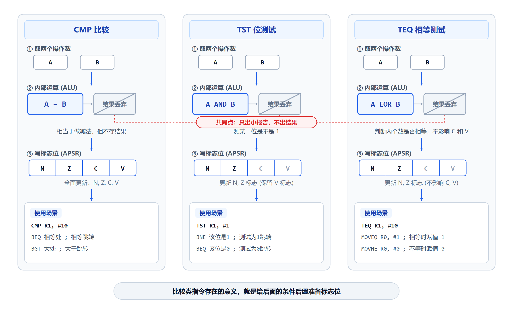

**怎么看这张图**：

1. **图分三列**，分别是 CMP、TST、TEQ 三条指令。
2. **每一列从上往下画三步**：① 拿两个操作数 → ② 做某种运算 → ③ 写标志位。
3. **注意每条指令"做什么运算"不同**：CMP 做减法，TST 做与，TEQ 做异或。
4. **注意共同点**：三条指令的最后一步都是"**只写标志位，不写结果寄存器**"，
   这一点用一个大大的"结果丢弃"标记画出来。
5. **底部画出使用场景**：CMP 配 EQ/GT，TST 配 NE/EQ 判断某位，
   TEQ 配 EQ 判断两个数是否相同。
6. **这张图要你理解什么**：**比较类指令是"只出小报告，不出结果"的指令。**
   它们的存在，就是为了给后面的条件后缀准备标志位。

##### 4) TEQ 相等测试指令

> 【教材内容】TEQ 指令用于把一个寄存器的内容和另一个寄存器的内容或立即数进行按位的异或运算，并根据运算结果更新 CPSR 中条件标志位的值。该指令通常用于比较操作数 1 和操作数 2 是否相等。

```asm
TEQ  R1, R2      ; 将 R1 与 R2 按位异或，并根据结果设置 N 和 Z 标志位
```

**【补充解释】为什么"异或"能判断相等？**

```
回忆异或的性质：A EOR A = 0

如果 R1 == R2，那么 R1 EOR R2 = 0 → Z = 1 → 说明相等
如果 R1 ≠ R2，那么结果不为 0   → Z = 0 → 说明不相等
```

**TEQ 和 CMP 的区别**：

| 指令 | 做运算 | 结果何时为 0 |
|---|---|---|
| CMP R1,R2 | 减法 | R1 == R2 |
| TEQ R1,R2 | 异或 | R1 == R2 |
| TST R1,R2 | 与 | R1 和 R2 没有一位同时为 1 |

**TEQ 的优势**：**不产生进位/溢出**，所以它只影响 N 和 Z，
不会因为加减法溢出而干扰判断。测试符号位时特别有用。

#### 4. 移位指令（操作）

> 【教材内容】ARM 微控制器内嵌的桶型移位器（barrel shifter），支持数据的各种移位操作。移位指令在 ARM 指令集中不仅可以作为单独的指令使用，也可以作为指令格式中的一个字段，在汇编语言中表示为指令中的选项。例如，数据处理指令的第二个操作数为寄存器时，就可以加入移位操作选项对它进行各种移位操作。移位操作包括如下 6 种类型：逻辑左移（LSL）、算术左移（ASL）、逻辑右移（LSR）、算术右移（ASR）、循环右移（ROR）和带扩展的循环右移（RRX）。其中，ASL 和 LSL 是等价的，可以自由互换。

**【补充解释】这段话说了两件事：**

1. **移位可以单独用**：`LSLS R1, R2, #3`
2. **移位可以作为别的指令的"配料"**：`ADD R0, R2, R3, LSL #1`

**第二种用法是 ARM 的特色**，等于白送一次移位（4.4.2 节 ADD 部分讲过）。

##### 1) 逻辑左移 LSL（或 ASL）

> 【教材内容】LSL（或 ASL）可完成对通用寄存器中的内容进行逻辑（或算术）的左移操作，按操作数所指定的数量向左移位，**低位用零来填充**。其中，操作数可以是通用寄存器，也可以是立即数（1～31）。

```asm
LSLS  R1, R2, #3       ; 将 R2 的内容逻辑左移 3 位后赋给 R1，同时更新标志位
MOV   R0, R1, LSL #3   ; 将 R1 中的内容左移 3 位后传送到 R0 中
```

**教材原图（图 4-1）：**

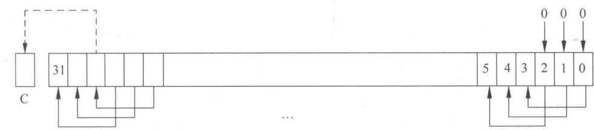

**怎么看这张图（教材原图 4-1）**：

1. **先看图的上下两条长条**：上面那条是**移位前**，下面那条是**移位后**。
2. **注意每条长条的左右方向**：左边是高位（bit31），右边是低位（bit0）。
3. **看中间的斜箭头**：它把上面长条里的每一位，连到下面长条里"往左 3 格"的位置。
4. **看最右边的空位**：低端空出来的 3 格，图上标着 0——
   这就是"低位用零来填充"的意思。
5. **看最左边被挤出去的部分**：高端的 3 位被挤出长条之外丢掉了
   （最后挤出去的那一位会进入 C 标志）。
6. **这张图要你理解什么**：**左移 = 每一位的"权"变大，整体数值乘以 2 的幂。**
   移出边界的位就丢了，空出来的位补 0。

**自己动手演算一遍（假设 R2 = 0x00000005）：**

```
移位前：  0000 0000 0000 0000 0000 0000 0000 0101   = 0x00000005（5）
左移 3：  0000 0000 0000 0000 0000 0000 0010 1000   = 0x00000028（40）
                                        ↑↑↑
                                   低 3 位补 0

验算：5 × 2³ = 5 × 8 = 40 ✔
```

**如果高位有 1 呢？（R2 = 0xC0000000）**

```
移位前：  1100 0000 0000 0000 0000 0000 0000 0000
左移 3：  (110 被挤出丢掉) 0000 0000 0000 0000 0000 0000 0000 0000
结果 = 0x00000000，被挤出的最高位（1）进入 C 标志

这说明：左移可能"丢数据"，用之前要确认不会溢出。
```

##### 2) 逻辑右移 LSR

> 【教材内容】LSR 可完成对通用寄存器中的内容进行右移的操作，按操作数所指定的数量向右移位，**左端用零来填充**。其中，操作数可以是通用寄存器，也可以是立即数（1～32）。

```asm
LSR  R4, R5, #6        ; 将 R5 的内容逻辑右移 6 位后赋给 R4
MOV  R0, R1, LSR #3    ; 将 R1 中的内容右移 3 位后传送到 R0 中，左端用零来填充
```

**教材原图（图 4-2）：**

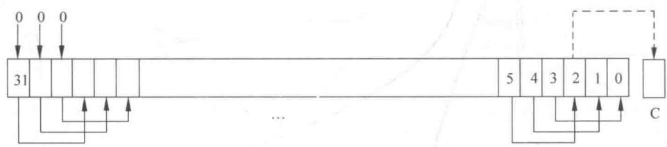

**怎么看这张图（教材原图 4-2）**：

1. **和上一张图（LSL）对比着看**：这次箭头是往**右**斜的。
2. **看左边空出的 3 格**：补的是 0（"左端用零来填充"）。
3. **看右边被挤出丢掉的部分**：低 3 位被挤出去，最后挤出的一位进 C。
4. **这张图要你理解什么**：**逻辑右移相当于"无符号除法"，每移一位除以 2。**
   注意"无符号"三个字——因为它不管符号位，一律补 0。

**演算（假设 R1 = 0x00000028 = 40）：**

```
移位前：  0000 0000 0000 0000 0000 0000 0010 1000   = 40
右移 3：  0000 0000 0000 0000 0000 0000 0000 0101   = 5
         ↑↑↑
      左端补 0

验算：40 ÷ 2³ = 40 ÷ 8 = 5 ✔
```

##### 3) 算术右移 ASR

> 【教材内容】ASR 可完成对通用寄存器中的内容进行右移的操作，按操作数所指定的数量向右移位，**左端用第 31 位的值来填充**指定数量的位。其中，操作数可以是通用寄存器，也可以是立即数（1～32）。

```asm
ASR  R7, R8, #9        ; 将 R8 中的内容算术右移 9 位后赋给 R7
MOV  R0, R1, ASR #3    ; 将 R1 中的内容右移 3 位后传送到 R0 中，左端用第 31 位的值来填充
```

**教材原图（图 4-3）：**

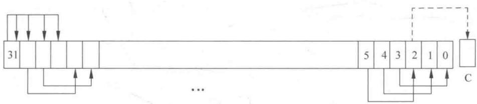

**怎么看这张图（教材原图 4-3）**：

1. **先看最左边那一格（bit31）**：它是符号位。图上应该能看出这一位的值被"复制"了。
2. **看左边空出的几格**：填的不是 0，而是**和 bit31 一样的值**。
3. **对比图 4-2（LSR）**：同样是右移，唯一区别就是"补 0"还是"补符号位"。
4. **这张图要你理解什么**：**算术右移是"带符号除法"。**
   正数右移还是正数，负数右移还是负数，符号不会被破坏。

**演算（假设 R1 = 0xFFFFFFF0，也就是 −16）：**

```
移位前：  1111 1111 1111 1111 1111 1111 1111 0000   = −16
ASR 2：   1111 1111 1111 1111 1111 1111 1111 1100   = −4
         ↑↑
      补的是符号位 1（不是 0）

验算：−16 ÷ 2² = −16 ÷ 4 = −4 ✔
```

**如果用 LSR 会怎样？**

```
LSR 2：   0011 1111 1111 1111 1111 1111 1111 1100   = 0x3FFFFFFC
          ↑↑
      补的是 0，符号被破坏，变成一个大正数

结果完全错误！所以"带符号数除以 2 的幂"必须用 ASR，不能用 LSR。
```

**【容易搞混】这是本章最容易出错的地方之一：**

| 场景 | 用哪条 |
|---|---|
| 处理无符号数（地址、计数器、位掩码） | LSR |
| 处理带符号数（有正有负的物理量） | ASR |

##### 4) 循环右移 ROR

> 【教材内容】ROR 可完成对通用寄存器中的内容进行循环右移的操作，按操作数所指定的数量向右循环移位，**左端用右端移出的位来填充**。其中，操作数可以是通用寄存器，也可以是立即数（1～31）。显然，当进行 32 位的循环右移操作时，通用寄存器中的值不变。

```asm
ROR  R4, R5, R6        ; 将 R5 的内容循环右移（R6 最低字节内容）的位数后赋给 R4
MOV  R0, R1, ROR #3    ; 将 R1 中的内容循环右移 3 位后传送到 R0 中
```

**教材原图（图 4-4）：**

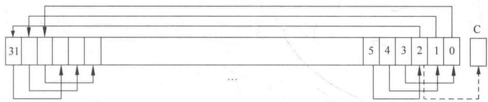

**怎么看这张图（教材原图 4-4）**：

1. **看图的形状**：它画成一条**首尾相接的环**（或用一个弯回来的箭头表示），
   这是"循环"最直观的体现。
2. **看从右端移出的那几位**：箭头把它们绕回到左端，**没有丢失**。
3. **对比 LSR**：LSR 移出去的位就丢了，ROR 移出去的位会回来。
4. **这张图要你理解什么**：**循环移位不丢数据，只是"转圈"。**
   所以转 32 次等于没转。

**演算（假设 R1 = 0x0000000F）：**

```
移位前：  0000 0000 0000 0000 0000 0000 0000 1111
ROR 4：   1111 0000 0000 0000 0000 0000 0000 0000
          ↑↑↑↑                            ↑↑↑↑
       从右边转出来的 4 个 1，绕回左边

结果 = 0xF0000000
```

##### 5) 带扩展的循环右移 RRX

> 【教材内容】RRX 可完成对通用寄存器中的内容进行带扩展的循环右移的操作，按操作数所指定的数量向右循环移位，**左端用进位标志位 C 来填充**。其中，操作数可以是通用寄存器，也可以是立即数（0～31）。

```asm
RRX  R4, R5              ; 将 R5 中的内容带扩展循环右移一次后赋给 R4
MOV  R0, R1, RRX #3      ; 将 R1 中的内容进行带扩展的循环右移 3 位后传送到 R0 中
```

**教材原图（图 4-5）：**

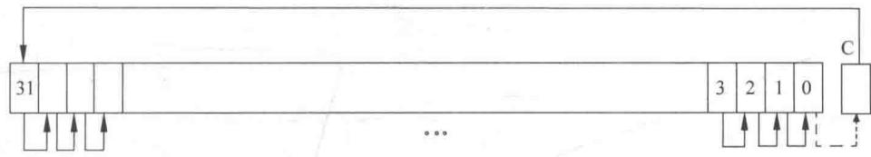

**怎么看这张图（教材原图 4-5）**：

1. **看图里除了 32 位长条，旁边还多了一个小格子**：那就是 C 标志位。
2. **看箭头**：C 里的值被"送进"最高位，同时最低位移出的值"送进"C。
3. **这张图要你理解什么**：**RRX 是"33 位的循环移位"**——
   把 C 当成第 33 位一起参与循环。

**演算（假设 C = 1，R1 = 0x00000001）：**

```
移位前：  C = 1
          0000 0000 0000 0000 0000 0000 0000 0001

RRX 一次：
  ① 最低位（1）移出 → 进入 C，所以新 C = 1
  ② 最高位空出 → 用旧 C 的值（1）填充

结果：    1000 0000 0000 0000 0000 0000 0000 0000 = 0x80000000
          ↑
      用旧 C（1）填充

新 C = 1
```

**【补充解释】RRX 的用处**：它常和 ADC 配合做"多字移位"，
把上一次移出的位接进来，实现"64 位移位"这样的操作。

> 【待核验】教材表 4-1 在描述 RRX 时写"最高位用 C 填充，**执行后不影响 C 的值**"，
> 但同一章 4.4.2 节又说 RRX 是"低端移出的位填入进位标志位"，
> 并且 `RRX` 的语义确实是**会更新 C 的**（C ← 移出的最低位）。
> 表 4-1 那句话疑为笔误。另外教材给出的 `MOV R0, R1, RRX #3` 写法中，
> RRX 本身固定只移 1 位、不带移位量，此处也记入"待核验"。

**【辅助理解图：六种移位操作对比】**

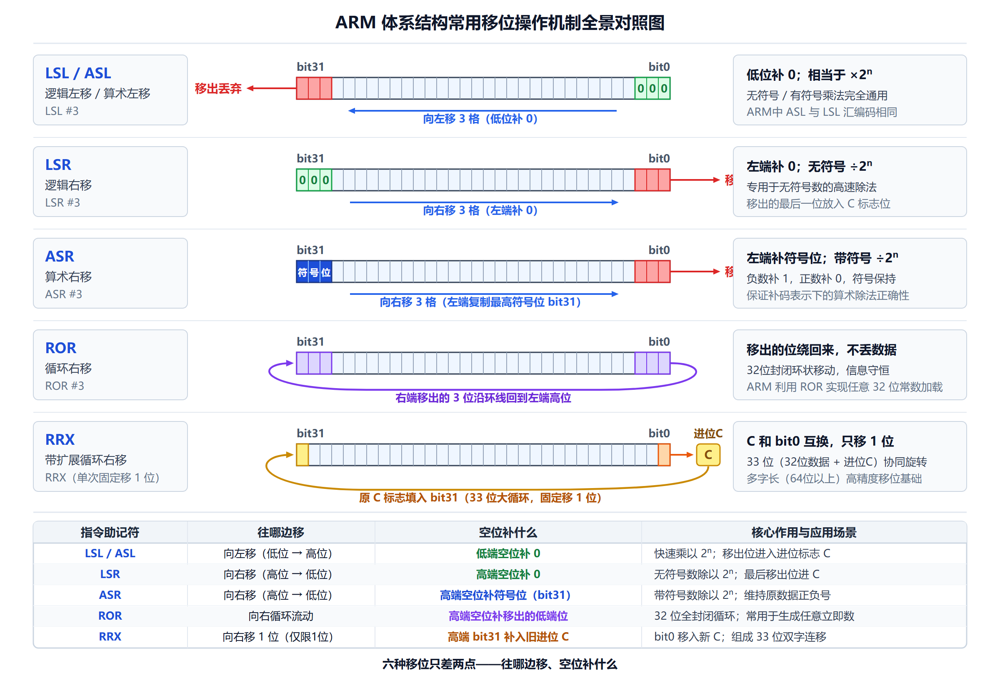

**怎么看这张图**：

1. **图分六行**，每行一种移位，左边写助记符，中间画 32 位长条和箭头，右边写结果特点。
2. **第一行 LSL / ASL**：箭头向右斜（往高位走），左端补 0。
3. **第二行 LSR**：箭头向左斜，左端补 0。
4. **第三行 ASR**：箭头向左斜，左端补的是**符号位**（画成深色，标注"符号位"）。
5. **第四行 ROR**：画成一个环，移出的位绕回来。
6. **第五行 RRX**：环上多一个 C 小格子，C 和 bit0 互换。
7. **每行右边标注"相当于什么数学运算"**：LSL = ×2ⁿ，LSR = 无符号 ÷2ⁿ，
   ASR = 带符号 ÷2ⁿ，ROR/RRX = 位循环（没有算术含义）。
8. **这张图要你理解什么**：**六种移位只差两点——往哪边移、空位补什么。**
   抓住这两点，就不会记混。

#### 5. 数据翻转指令

> 【教材内容】这些指令专门服务于小端模式和大端模式的转换，最常用于网络应用程序中（网络字节序是大端，主机字节序常是小端）。

**【补充解释】为什么需要"字节序转换"？**

回忆 4.2.7 节讲的"小端/大端"：

```
0x12345678 在内存里的排布：
小端（Cortex-M3 默认）： 78 56 34 12
大端（网络协议规定）：   12 34 56 78
```

网络上传数据时，双方约定用**大端**。可你的芯片是**小端**。
直接发出去，对方收到的数就"字节颠倒"了。所以需要专门的指令来翻转。

##### 1) REV 指令

> 【教材内容】REV 指令反转 32 位整数中的字节序。

```
REV  Rd, Rm
```

> 【教材内容】若执行指令前，R0 = 0x12345678，则执行上面的 REV 后，R1 = 0x78563412。

**演算：**

```
执行前：R0 = 0x12345678
        字节顺序： [12] [34] [56] [78]
                  高字节 ←────────→ 低字节

REV 后： 字节顺序反过来： [78] [56] [34] [12]
        R1 = 0x78563412
```

##### 2) REV16 指令

> 【教材内容】REV16 指令用于将高半字的两个字节互换，低半字的两个字节互换。

> 【教材内容】若执行指令前，R0 = 0x12345678，则执行上面的 REV16 后，R3 = 0x34127856。

**演算：**

```
执行前：R0 = 0x12345678
        分成两个半字： 高半字 = 1234，低半字 = 5678

分别把每个半字里的两个字节互换：
        高半字 1234 → 3412
        低半字 5678 → 7856

结果：  R3 = 0x34127856
```

##### 3) REVH 指令

> 【教材内容】REVH 指令则以半字为单位反转，且只反转低半字。

> 【教材内容】若执行指令前，R0 = 0x12345678，则执行上面的 REVH 后，R2 = 0x12347856。

**演算：**

```
执行前：R0 = 0x12345678
        高半字 1234 不动
        低半字 5678 → 7856

结果：  R2 = 0x12347856
```

##### 4) REVSH 指令

> 【教材内容】REVSH 在 REVH 的基础上，还把转换后的半字做带符号扩展。

> 【教材内容】若 R0 = 0x33448899，则执行上述 REVSH 指令后，R1 = 0xFFFF9988。

**演算：**

```
执行前：R0 = 0x33448899
第 1 步（REVH）：低半字 8899 → 9988
                 中间结果 = 0x33449988
第 2 步（符号扩展）：取低半字 0x9988
                 0x9988 的最高位（bit15）是 1 → 视为负数
                 符号扩展：高位全部补 1

结果：  R1 = 0xFFFF9988
              ↑↑↑↑
          高位补的 4 个 F（全是 1）
```

**教材原图（图 4-6）：**

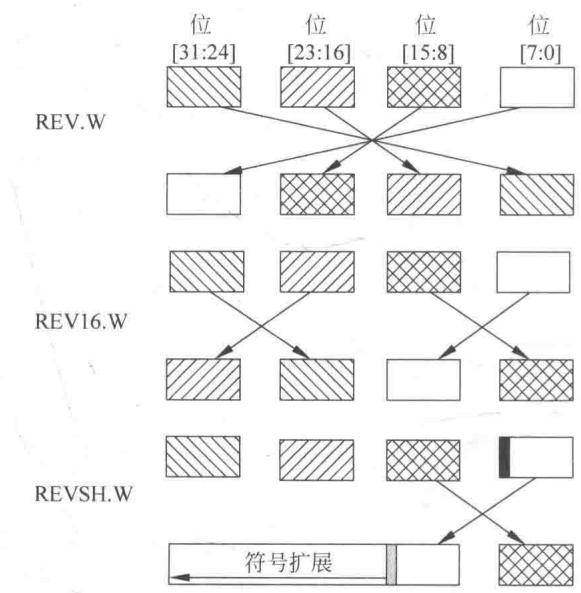

**怎么看这张图（教材原图 4-6）**：

1. **图分成三行**，分别对应 REV、REV16、REVSH。
2. **每行左边是输入，右边是输出**，中间用箭头画出"哪几个字节换了位置"。
3. **重点看 REV 那一行**：4 个字节整体反过来，箭头交叉得最厉害。
4. **重点看 REV16 那一行**：只有 2 组交叉，**组与组之间不交叉**——
   说明它是"半字内部换，半字之间不换"。
5. **重点看 REVSH 那一行**：除了换字节，右边还多出一段被"填满"的高位——
   那就是符号扩展。
6. **这张图要你理解什么**：三种指令的差别就是"翻转的范围有多大"：
   REV 全翻、REV16 半字内翻、REVSH 半字内翻 + 符号扩展。

##### 5) RBIT 指令

> 【教材内容】RBIT 比前面的 REV 类指令更精细，它是按位反转的，相当于把 32 位整数的二进制表示法水平旋转 180°，其格式为：

```
RBIT.W  Rd, Rn
```

> 【教材内容】这个指令在处理串行比特流时非常有用。例如：

```
RBIT.W  R0, R1
```

> 【教材内容】若 R1 = 0xB4E10C23（二进制数值为 1011,0100,1110,0001,0000,1100,0010,0011），则执行上述指令后，R0 = 0xC430872D（二进制数值为 1100,0100,0011,0000,1000,0111,0010,1101）。

**演算（自己动手验证一遍）：**

```
输入：0xB4E10C23
     B    4    E    1    0    C    2    3
  1011 0100 1110 0001 0000 1100 0010 0011

整个串倒过来写（从右往左读）：
  1100 0100 0011 0000 1000 0111 0010 1101
    C    4    3    0    8    7    2    D

结果：0xC430872D ✔
```

**【补充解释】RBIT 和 REV 的区别：**

| 指令 | 翻转单位 | 举例（0xB4E10C23） |
|---|---|---|
| REV | 字节（8 位一组） | 0x230CE1B4 |
| RBIT | **单个 bit** | 0xC430872D |

**【补充解释】"处理串行比特流时很有用"是什么意思？**

串口通信（第 9 章）是**一位一位**传数据的。有些设备约定"最低位先发"，
有些约定"最高位先发"。如果双方约定不一致，就需要把整个字节的位序倒过来——
这正是 RBIT 干的事。

#### 6. 数据扩展指令

> 【教材内容】数据扩展指令类似于 C 语言的强制数据类型转换，把数据宽度转换成 32 位。它们的语法如下：

```
SXTB  Rd, Rn      ; 带符号扩展字节 → 32 位
SXTH  Rd, Rn      ; 带符号扩展半字 → 32 位
UXTB  Rd, Rn      ; 无符号扩展字节 → 32 位（高 24 位清零）
UXTH  Rd, Rn      ; 无符号扩展半字 → 32 位（高 16 位清零）
```

> 【教材内容】对于 SXTB/SXTH，数据带符号位扩展成 32 位整数。对于 UXTB/UXTH，高位清零。

> 【教材内容】例如，若 R0 = 0x55aa8765，则

```asm
SXTB  R1, R0    ; R1 = 0x00000065
SXTH  R1, R0    ; R1 = 0xffff8765
UXTB  R1, R0    ; R1 = 0x00000065
UXTH  R1, R0    ; R1 = 0x00008765
```

**【补充解释】逐条演算（R0 = 0x55AA8765）：**

```
R0 的二进制（只写低 16 位，高 16 位是 55AA）：
    0101 0101 1010 1010 1000 0111 0110 0101
                        └───8765───┘

① SXTB R1, R0   —— 取低 8 位，带符号扩展
   低 8 位 = 0x65 = 0110 0101
   最高位（bit7）= 0 → 是正数 → 高位补 0
   R1 = 0x00000065

② SXTH R1, R0   —— 取低 16 位，带符号扩展
   低 16 位 = 0x8765 = 1000 0111 0110 0101
   最高位（bit15）= 1 → 是负数 → 高位补 1
   R1 = 0xFFFF8765
        ↑↑↑↑
     高位补的 4 个 F

③ UXTB R1, R0   —— 取低 8 位，高位清零
   R1 = 0x00000065（和 SXTB 一样，因为这一位恰好是 0）

④ UXTH R1, R0   —— 取低 16 位，高位清零
   R1 = 0x00008765
```

**【补充解释】S 和 U 的区别一句话：**

```
S（Signed，带符号）：如果取出来的那段最高位是 1，就在高位补 1（保持负数身份）
U（Unsigned，无符号）：不管取出来的那段最高位是什么，高位一律补 0
```

**【补充解释】教材的思考题：**

> 【教材内容】思考：若 R0 = 0x55aa8765，则执行指令"SXTH R1，R0，ROR #16"后，R1 的值为多少？

**解答：**

```
第 1 步：ROR #16 —— 把 R0 循环右移 16 位
        R0 = 0x55AA8765
        循环右移 16 位 → 高半字和低半字互换
        = 0x876555AA

第 2 步：SXTH —— 取低 16 位（0x55AA），带符号扩展
        0x55AA = 0101 0101 1010 1010
        最高位（bit15）= 0 → 正数 → 高位补 0

结果：R1 = 0x000055AA
```

#### 7. 位段处理指令

> 【教材内容】位段处理指令实现位段统计、清零、插入、提取等操作，以实现数据变换。

**术语表：**

| 项目 | 内容 |
|---|---|
| 英文全称 | Bit Field |
| 中文名 | 位段（也叫"位域"） |
| 缩写 | 无 |
| 大白话 | 32 位里"连续的某几个 bit" |
| 干什么用 | 精确地操作寄存器里的某几个开关 |

**【补充解释】为什么需要位段指令？**

回忆 4.2.5 节的位图：一个 32 位寄存器里，不同的位段管不同的事。
如果要"把 bit12～bit19 换成新值，其他位不动"，用普通的与/或指令要好几步：

```asm
BIC  R0, R0, #0xFF000        ; 先清掉 bit12~19
ORR  R0, R0, R1, LSL #12     ; 再把新值移到位、或进去
```

用位段指令，一条搞定：

```asm
BFI  R0, R1, #12, #8         ; 把 R1 的低 8 位插到 R0 的 bit12 开始的位置
```

##### 1) 计算前导 0 的数目指令 CLZ

> 【教材内容】CLZ 指令用于计算某个寄存器内容的前导 0 的数量。

```
CLZ{cond}  Rd, Rm
```

> 【教材内容】计算 Rm 寄存器中前导 0 的数量并保存在 Rd 中。例如：

```asm
CLZ  R4, R9      ; 计算 R9 中前导 0 的数量并将该数量保存到 R4 中
```

**【补充解释】"前导 0"（leading zero）就是从最高位开始数，连续有多少个 0。**

```
例 1：Rm = 0x00000001
     0000 0000 0000 0000 0000 0000 0000 0001
     ↑
     从 bit31 开始数，一共 31 个 0 才碰到第一个 1
     → CLZ = 31

例 2：Rm = 0x80000000
     1000 0000 ...
     ↑
     bit31 就是 1，一个前导 0 都没有
     → CLZ = 0

例 3：Rm = 0x00000000
     全是 0
     → CLZ = 32（特殊约定）
```

**【补充解释】CLZ 有什么用？**

- **快速求"最高位是第几位"**：`31 − CLZ` 就是最高位 1 的位置；
- **算对数**：`CLZ` 和以 2 为底的对数直接相关；
- **做归一化**：数字信号处理里要把数"移位到最高位对齐"时，
  先用 CLZ 算出要移多少位。

##### 2) 位段清零指令 BFC

> 【教材内容】位段清零指令 BFC 把 32 位整数中任意一段连续的二进制位清零，语法格式为：

```
BFC.W  Rd, #lsb, #width
```

> 【教材内容】其中，lsb 为位段的末尾，width 则指定在 lsb 和它的左边共有多少个位参与操作。

**【补充解释】参数怎么读？**

- `#lsb`：位段从第几位开始。**lsb = Least Significant Bit，最低有效位**，
  就是"编号从哪一位算起"的起点（按 bit0 起编号；MSB/LSB 的完整解释见 4.2.3.1 节）；
- `#width`：这一段一共多少位。

```
BFC.W Rd, #4, #10   →  从 bit4 开始，往左数 10 位，也就是 bit4 ~ bit13，全部清 0
```

**画成位图：**

```
 31                        14 13              4 3              0
+---------------------------+------------------+----------------+
|        保持不变            |  0000000000（清零）|   保持不变      |
+---------------------------+------------------+----------------+
                               ↑
                        这段共 10 位，全变 0
```

**教材例子：**

```
LDR  R0, = 0x1234FFFF
BFC  R0, #4, #10
```

> 【教材内容】执行完后，R0 = 0x1234C00F。

**【补充解释】动手验算一遍：**

```
执行前：R0 = 0x1234FFFF
        二进制：0001 0010 0011 0100 1111 1111 1111 1111

把 bit4 ~ bit13 清 0（共 10 位）：
        bit0~bit3   = F（1111）        ← 保留
        bit4~bit13  = 0000000000        ← 清零
        bit14~bit15 = 11（原来是 F 的高 2 位，保留）
        bit16 以上   = 0x1234 不变

重新拼起来：
        bit15~bit12 原来是 F = 1111
        现在 bit14~bit15 保留（11），bit12~bit13 清 0（00）
        → 变成 1100 = C

结果：R0 = 0x1234C00F ✔
                ↑↑
            这一位由 F 变成了 C
```

##### 3) 位段插入指令 BFI

> 【教材内容】位段插入指令 BFI 把某个寄存器按 LSB 对齐的数值，复制到另一个寄存器的某个位段中，其格式为：

```
BFI.W  Rd, Rn, #lsb, #width
```

> 【教材内容】总是从 Rn 的最低位提取，#lsb 只对 Rd 起作用。例如：

```asm
LDR  R0, = 0x12345678
LDR  R1, = 0xAABBCCDD
BFI.W  R1, R0, #8, #16
```

> 【教材内容】则执行后，R1 = 0xAA5678DD。

**【补充解释】"从 Rn 的最低位提取"是理解 BFI 的关键：**

```
BFI.W R1, R0, #8, #16 的意思是：

  ① 从 R0 的最低位开始，取 16 位        （R0 的 bit0 ~ bit15）
  ② 把这 16 位插到 R1 的 bit8 开始的位置（R1 的 bit8 ~ bit23）
  ③ R1 的其他位保持不变
```

**动手验算：**

```
R0 = 0x12345678
     取低 16 位 = 0x5678
     二进制：0101 0110 0111 1000

R1 = 0xAABBCCDD
     bit0 ~ bit7   = DD        ← 保留
     bit8 ~ bit23  = BBCC      ← 被 0x5678 覆盖
     bit24 ~ bit31 = AA        ← 保留

重新拼：
     0xAA  +  0x5678  +  0xDD
     = 0xAA5678DD ✔
```

**画成位图：**

```
插入前 R1：
 31              24 23                        8 7              0
+-----------------+---------------------------+----------------+
|      AA         |          BB CC            |      DD        |
+-----------------+---------------------------+----------------+
                                ↑
                        这 16 位要被替换

R0 的低 16 位：0x5678

插入后 R1：
 31              24 23                        8 7              0
+-----------------+---------------------------+----------------+
|      AA         |          56 78            |      DD        |
+-----------------+---------------------------+----------------+
                                ↑
                        变成了 R0 的低 16 位
```

##### 4) 位段提取指令 UBFX / SBFX

> 【教材内容】UBFX/SBFX 都是位段提取指令，语法格式为：

```
UBFX.W  Rd, Rn, #lsb, #width
SBFX.W  Rd, Rn, #lsb, #width
```

> 【教材内容】UBFX 从 Rn 中取出任一个位段，执行零扩展后放到 Rd 中。例如：

```asm
LDR   R0, = 0x5678ABCD
UBFX.W  R1, R0, #12, #16
```

> 【教材内容】则 R0 = 0x0000678A

**【补充解释】这里教材写"R0 = 0x0000678A"应该是笔误——结果应该放在 R1 里（Rd = R1）。**
已记入"待核验"。下面按"结果在 R1"来演算：

```
R0 = 0x5678ABCD
     二进制（分段看）：
     0101 0110 0111 1000 1010 1011 1100 1101

从 bit12 开始取 16 位：
     bit12 ~ bit27

     把 R0 右移 12 位：
     0000 0000 0000 0101 0110 0111 1000 1010
                       └──── 5678A ────┘

     取低 16 位 = 0x678A

零扩展（高位补 0）：
     R1 = 0x0000678A ✔
```

> 【教材内容】类似地，SBFX 也抽取任意的位段，但是以带符号的方式进行扩展。例如：

```asm
LDR   R0, = 0x5678ABCD
SBFX.W  R1, R0, #8, #4
```

> 【教材内容】则 R0 = 0xFFFFFFF

**【补充解释】同样，结果应该在 R1 里；而且 `0xFFFFFFF` 只有 7 个 F，
应该是 8 个 F 的 `0xFFFFFFFB`。两处都记入"待核验"。演算如下：**

```
R0 = 0x5678ABCD
     低 16 位 = 0xABCD = 1010 1011 1100 1101
                              └AB┘
     取 bit8 ~ bit11（共 4 位）：
     0xABCD 的 bit8~bit11 就是 0xB = 1011

带符号扩展：
     0xB = 1011，最高位（bit3）= 1 → 视为负数
     → 高位全部补 1

     R1 = 0xFFFFFFFB
              ↑
          高 28 位全补 1
```

**验证一下 0xFFFFFFFB 是不是 −5：**

```
取补码：~0xFFFFFFFB + 1 = 0x00000004 + 1 = 5
所以 0xFFFFFFFB 表示 −5 ✔
（4 位二进制 1011 在补码里确实表示 −5）
```

#### 8. 饱和运算指令

> 【教材内容】饱和运算类似于放大电路中所谓的"饱和削顶失真"。饱和运算指令分为两种：一种是"没有直流分量"的交流信号饱和——带符号饱和运算；另一种无符号饱和运算则类似于"削顶失真 + 单向导通"。

> 【教材内容】SSAT 指令用于以带符号数的边界进行饱和运算（交流），指令格式如下：

```
SSAT.W  Rd, #imm5, Rn, {, shift}
```

> 【教材内容】USAT 指令用于以无符号数的边界进行饱和运算（带纹波的直流），指令格式如下：

```
USAT.W  Rd, #imm5, Rn, {, shift}
```

**【补充解释】什么叫"饱和"？**

**大白话**：结果超出范围时，**不"绕回去"，而是"卡在边界上"**。

```
普通运算（会绕回）：
   8 位有符号数范围：−128 ~ 127
   127 + 1 = 128 → 超出 → 绕回变成 −128（正数突然变负数！）

饱和运算（卡边界）：
   127 + 1 = 128 → 超出 → 直接卡在 127
```

**【类比】**：往杯子里倒水，倒多了水会溢出来（普通溢出）；
而"饱和"就像杯子有个盖子，水满了就停在满的位置，不会溢到别处。

**【补充解释】"削顶失真"是同一个道理：**

音响开太大声，声音波形上下两端被"削平"——这就是饱和。
数字信号处理里，用饱和运算可以避免"正数突然变负数"这种刺耳的爆音。

**参数含义：**

| 参数 | 含义 |
|---|---|
| `#imm5` | 饱和的位数（例如 `#8` 表示按 8 位带符号数饱和，范围 −128~127） |
| `Rn` | 源寄存器 |
| `{, shift}` | 可选的移位（先移位再饱和） |

**例子：**

```asm
SSAT.W  R1, #8, R0      ; 把 R0 按 8 位带符号数饱和后放 R1
```

```
如果 R0 = 100   → R1 = 100  （在 −128~127 范围内，原样）
如果 R0 = 200   → R1 = 127  （超出上限，卡在 127）
如果 R0 = -200  → R1 = -128 （超出下限，卡在 −128）
```

**【补充解释】教材最后说：**

> 【教材内容】饱和运算的详细介绍请参见《Cortex-M3 权威指南》。

**这句话请照办**——饱和运算在实际项目里不算常用，
你只要知道"有这么一类指令、它防止溢出绕回"就够了。

---

### 4.4.3 跳转指令

> 对应教材 4.4.3 节（p123～p128）

> 【教材内容】跳转指令用于实现程序的跳转，ARM 指令集中的跳转指令可以完成从当前指令向前或向后的 32MB 的地址空间的跳转。在 ARM 程序中有两种方法可以实现程序的跳转：
> （1）使用专门的跳转指令。
> （2）直接向程序计数器 PC 写入跳转地址值。

**【补充解释】第 2 种方法要解释一下：**

PC 里装的就是"下一条要执行的指令的地址"。所以——

> **谁改了 PC，谁就决定了程序下一步去哪。**

```asm
MOV  PC, LR      ; 把 LR 的值写进 PC → 跳到 LR 指向的地方
LDR  PC, [R1]    ; 从内存取一个地址写进 PC → 跳到那个地址
ADD  PC, PC, #8  ; 把 PC 加 8 再写回 PC → 跳过 8 个字节
```

> 【教材内容】通过向程序计数器 PC 写入跳转地址值，可以实现在 4GB 地址空间中的任意跳转，在跳转之前结合使用 MOV LR, PC 等类似指令，可以保存将来的返回地址值，从而实现在 4GB 连续的线性地址空间的子程序调用。

**【补充解释】为什么"直接写 PC"能跳 4GB，而 B 指令只能跳 32MB？**

| 方法 | 跳转范围 | 原因 |
|---|---|---|
| `B` 指令 | ±32MB | 指令里只存了一个 24 位偏移量，地方小 |
| `MOV PC, Rn` | 4GB（整个地址空间） | 跳转目标放在寄存器里，寄存器有 32 位，够装任何地址 |

**这就是"用空间换范围"**：B 指令省地方但范围小；MOV PC 费一个寄存器但范围大。

> 【教材内容】ARM 指令集中的跳转指令包括以下 9 条指令：B、BL、BX、BLX、CBZ、CBNZ、TBB、TBH、IT。

下面逐条讲。

#### 1. B 指令

> 【教材内容】B 指令的格式为：

```
B{条件}  目的地址
```

> 【教材内容】B 指令是最简单的跳转指令。一旦遇到 B 指令，ARM 微控制器将立即跳转到给定的目的地址，从那里继续执行。注意，存储在跳转指令中的实际值是相对当前 PC 值的一个偏移量，而不是一个绝对地址，它的值由汇编器来计算（参考寻址方式中的相对寻址）。它是 24 位有符号数，左移两位后带符号扩展为 32 位，表示的有效偏移为 26 位（前后 32MB 的地址空间）。

**【补充解释】"24 位有符号数左移两位，得到 26 位"这句话算一遍：**

```
指令里存的是 24 位偏移量，记为 off。

为什么左移 2 位？
因为 Thumb 指令至少按 2 字节对齐（地址的最后一位总是 0），
所以最低 2 位不用存，用的时候补回来即可。

24 位有符号数范围：−2²³ ~ 2²³−1 = −8388608 ~ 8388607
左移 2 位后：      −2²⁵ ~ 2²⁵−4

2²⁵ = 33554432 字节 = 32 MB

所以 B 指令能跳的范围是：当前地址往前 32MB 到往后 32MB ✔
```

```asm
B     Label          ; 程序无条件跳转到标号 Label 处执行
CMP   R1, #0
BEQ   Label          ; 当 CPSR 寄存器中的 Z 条件码置位时，程序跳转到标号 Label 处执行
```

**【补充解释】`B` 的三种常见用法：**

```asm
B    Label       ; 无条件跳转（相当于 C 语言的 goto）
BEQ  Label       ; 条件跳转（相当于 C 语言的 if）
B    .           ; 跳到"自己"——死循环！
```

**【补充解释】`B .` 是什么意思？**

`.` 是"当前地址"的简写。`B .` 就是"跳到自己"，也就是**原地打转，永远不动**。
4.2.8 节的框架里写的是 `B DEADLOOP`（跳到一个标号上），
而教材 4.5 节的例 4-6 写的是 `B .`，**两者效果一样，都是死循环**。

#### 2. BL 指令（本章最重要的一条！）

> 【教材内容】BL 指令的格式为：

```
BL{条件}  目的地址
```

> 【教材内容】BL 是另一个跳转指令，但跳转之前，会在寄存器 R14 中保存 PC 的当前内容，因此，可以通过将 R14 的内容重新加载到 PC 中，返回到跳转指令之后的那个指令处执行。该指令是实现子程序调用的一个基本但常用的手段。例如：

```asm
BL   Label    ; 当程序无条件跳转到标号 Label 处执行时，同时将当前的 PC 值保存到 R14 中
```

**【补充解释】BL 的"保存返回地址"到底保存的是什么？**

**保存的是"BL 指令的下一条指令的地址"。**

为什么要保存"下一条"？因为 BL 本身已经执行完了，
回来的时候当然应该接着执行它后面的指令。

```
     地址          指令
  0x08000100   BL  FUNC1        ← 执行这一条
  0x08000104   MOV R0, #1       ← 这一条就是"返回地址"，被存进 LR
  0x08000108   ...

执行 BL 时：
  ① LR ← 0x08000104（下一条的地址）
  ② PC ← FUNC1 的地址（跳过去）
```

**【辅助理解图：BL 调用子程序的完整过程】**

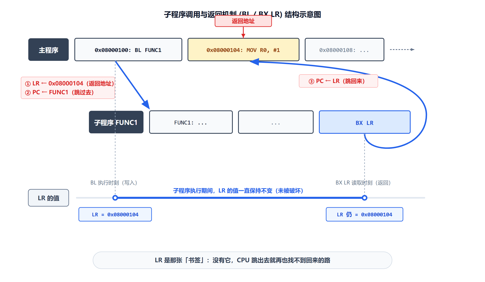

**怎么看这张图**：

1. **图分上下两条"轨道"**：上面是主程序，下面是子程序，中间用箭头连接。
2. **先看主程序那条**：`BL FUNC1` 处有一个向下的箭头，指向子程序入口。
3. **重点看箭头旁边的标注**：写着"LR ← 下一条指令地址（0x08000104）"。
   这是整张图的**核心**——跳转之前先把"回来的路"记下来。
4. **看子程序那条**：一条横线走到最后，末尾是 `MOV PC, LR` 或 `BX LR`，
   从这里有一个**向上的箭头**回到主程序的 `0x08000104`。
5. **注意时间顺序**：图应该从左到右表示时间，
   向上的返回箭头出现在 BL 箭头的右边，表示"先过去，后回来"。
6. **这张图要你理解什么**：**子程序能"回去"，靠的就是 LR 这张书签。**
   没有 LR，CPU 跳出去就再也找不到回来的路了。

**【类比】**：你在看一本很厚的书，第 87 页时被叫去接电话。
你**先夹一张书签在第 87 页**（LR ← 返回地址），再去接电话（跳到子程序）。
接完电话回来，翻开书签，继续从第 87 页读下去（MOV PC, LR）。

**【注意边界】**：真实硬件里没有"书签"，
LR 就是一个普通的 32 位寄存器，里面存的是一个**地址**。
而且**只有一张书签**——如果子程序里又调用了别的子程序，LR 会被覆盖，
所以必须先 `PUSH {LR}` 把它存到栈里（4.5.3 节细讲）。

#### 3. BLX 指令

> 【教材内容】BLX 指令的格式为：

```
BLX  目的地址
```

> 【教材内容】BLX 指令从 ARM 指令集跳转到指令中所指定的目的地址，并将微控制器的工作状态由 ARM 状态切换到 Thumb 状态，该指令同时将 PC 的当前内容保存到寄存器 R14 中。因此，当子程序使用 Thumb 指令集，而调用者使用 ARM 指令集时，可以通过 BLX 指令实现子程序的调用和微控制器工作状态的切换。同时，子程序的返回可以通过将寄存器 R14 值复制到 PC 中来完成。

**【补充解释】"状态切换"是什么意思？**

早期的 ARM 芯片有两种"工作状态"：

| 状态 | 指令长度 | 特点 |
|---|---|---|
| ARM 状态 | 32 位 | 功能强，代码占空间大 |
| Thumb 状态 | 16 位 | 代码紧凑，占空间小 |

`BLX` = BL + eXchange（交换），它在调用子程序的同时，
**顺便把状态也切过去**（ARM → Thumb，或者反过来）。

**【补充解释】在 Cortex-M3 上这条指令还有用吗？**

**基本不用了。** 因为 Cortex-M3 **只支持 Thumb / Thumb-2 状态**，
它没有传统的 ARM 状态，所以不存在"状态切换"的问题。

但 `BLX` 这个助记符还保留着——在 Cortex-M3 汇编里，
`BLX Rn` 常被用来"通过寄存器调用子程序"（跳转目标放在寄存器里，
这样能跳 4GB 范围，不受 ±32MB 限制）。

**【容易搞混】**：教材这一段的描述是以**传统 ARM7/ARM9** 为背景的。
在 Cortex-M3 上读到这里时，请记住"状态切换"这部分对本芯片不适用。

#### 4. BX 指令

> 【教材内容】BX 指令的格式为：

```
BX{条件}  目的地址
```

> 【教材内容】BX 指令跳转到指令中所指定的目的地址。

**【补充解释】BX = Branch and eXchange（跳转并交换状态）。**

在 Cortex-M3 上，BX 最常见的用法其实是**子程序返回**：

```asm
BX   LR     ; 跳回 LR 里存的地址 —— 等价于 MOV PC, LR
```

**【补充解释】BX LR 和 MOV PC, LR 有什么区别？**

| 写法 | 说明 |
|---|---|
| `MOV PC, LR` | 传统写法，把 LR 的值搬到 PC |
| `BX LR` | 更"正规"的写法，推荐使用 |

**教材 4.5.3 节把两种写法都给了**，功能上等价。
现代 ARM 汇编里推荐用 `BX LR`。

#### 5. CBZ 和 CBNZ 指令

> 【教材内容】CBZ 和 CBNZ 指令是比较并条件跳转指令，专为循环结构的优化而设，只能做前向跳转。其中：
> - CBZ 比较，如果结果为 0，就转移（只能跳到后面的指令）。
> - CBNZ 比较，如果结果非 0，就转移（只能跳到后面的指令）。

> 【教材内容】它们的语法格式为：

```
CBZ   <Rn>, <label>
CBNZ  <Rn>, <label>
```

> 【教材内容】它们的跳转范围较窄，只有 4～130。CBZ/CBNZ 不会更新标志位。

**【补充解释】逐点拆解：**

**① "只能前向跳转"**：只能往后跳，不能往前跳。

```
    CBZ R0, SKIP        ✔ 可以（SKIP 在下面）
    ...
SKIP
    ...

SKIP2:                  ✘ 不行（SKIP2 在上面）
    ...
    CBZ R0, SKIP2
```

**② "不会更新标志位"**：它只是"看看 Rn 是不是 0"，不动 APSR。

**③ "跳转范围 4～130"**：指跳转距离有限（以字节计，具体范围随指令编码而定）。
教材这里给的是大约的数值范围，实际以手册为准。

**【补充解释】为什么说它"专为循环优化"？** 看教材给的 C 语言与汇编的对应：

> 【教材内容】

```c
while (R0 != 0)
{
    Function1();
}
```

> 变成

```asm
Loop
    CBZ  R0, LoopExit
    BL   Function1
    B    Loop
LoopExit
```

**逐行解释：**

| 行 | 代码 | 干什么 |
|---|---|---|
| 1 | `Loop` | 标号，循环的入口 |
| 2 | `CBZ R0, LoopExit` | 如果 R0 == 0，跳到 LoopExit（跳出循环） |
| 3 | `BL Function1` | 否则调用 Function1 |
| 4 | `B Loop` | 跳回循环开头，再检查一次 |
| 5 | `LoopExit` | 循环结束后的第一条指令 |

**【补充解释】为什么用 CBZ 而不是 CMP + BEQ？**

```
用 CBZ：             用 CMP + BEQ：
  CBZ R0, Exit          CMP R0, #0
  （1 条指令）           BEQ Exit
                        （2 条指令）
```

**CBZ 把"比较"和"跳转"合成了一条**，省一条指令、省一点空间、快一点。
这就是它"专为循环优化"的意思。

**【容易搞混】**：CBZ 是"**等于 0 就跳**"，CBNZ 是"**不等于 0 就跳**"。
和 `BEQ`（Z=1 就跳）不是一回事——**CBZ 不看标志位，只看寄存器本身是不是 0**。

#### 6. 查表转移指令 TBB 和 TBH

> 【教材内容】高级语言都提供了"分类讨论"式控制结构，如 C 语言的 switch 语句。通常，给人们的印象是比较靠后的 case 语句块执行得晚，因为要一个一个地查。有了 TBB/TBH 后，则改善了这类结构的执行效率。

**【补充解释】先理解"为什么 switch 会慢"：**

```c
switch (n) {
    case 0: ...; break;
    case 1: ...; break;
    case 2: ...; break;
    case 3: ...; break;
}
```

**笨办法**：一个一个比。

```
n == 0 ? → 不是 → n == 1 ? → 不是 → n == 2 ? → 是！
（n = 2 时要比较 3 次）
```

n 越大，比得越多，越慢。

**聪明办法（查表）**：把所有分支的地址做成一张表，
**直接用 n 当索引，一步查到**。

```
表：
  索引 0 → branch0 的地址
  索引 1 → branch1 的地址
  索引 2 → branch2 的地址
  索引 3 → branch3 的地址

n = 2 → 直接查第 2 项 → 跳到 branch2
（不管 n 是几，都是一步！）
```

**这就是 TBB / TBH 干的事。**

> 【教材内容】TBB 为查表跳转字节范围的偏移量指令，用于从一个字节数组表中查找转移地址；TBH 为查表跳转半字范围的偏移量指令，用于从半字数组表中查找转移地址。TBH 的转移范围完全能够满足足够长度的 switch 结构。因为 Cortex-M3 的指令至少是按半字对齐的，表中的数值都是在左移一位后才作为前向跳转的偏移量。又因为 PC 的值为当前地址 +4，因此，TBB 的跳转范围可达 255 × 2 + 4 = 514；TBH 的跳转范围更可高达 65535 × 2 + 4 = 128KB + 2。请注意：TBB 和 TBH 都只能作前向跳转，也就是说，偏移量是一个无符号整数。

**【补充解释】这段文字里有两个关键点：**

**关键点 1：表中的数值为什么要"左移一位"？**

```
因为指令地址都是 2 字节对齐的（最后一位总是 0），
所以表里可以只存"地址 ÷ 2"，用的时候再 × 2 还原。
这样 8 位的表项就能表示 0~510 字节的偏移（而不是 0~255）。
```

**关键点 2：为什么范围是"255 × 2 + 4"？**

```
255   = 8 位表项能表示的最大值
× 2   = 左移一位还原
+ 4   = PC 的值 = 当前指令地址 + 4（流水线效应）
= 514 字节
```

> 【教材内容】TBB 的语法格式为：

```
TBB.W  [Rn, Rm]     ; PC += Rn[Rm] * 2
```

> 【教材内容】这里，Rn 指向跳转表的基址，Rm 则给出表中元素的下标。

**教材原图（图 4-7）：**

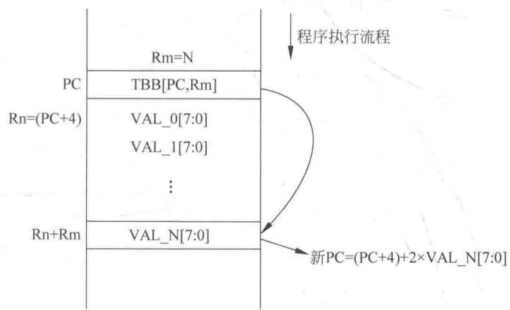

**怎么看这张图（教材原图 4-7）**：

1. **先看图中间的"表"**：它是一列小格子，每个格子里存一个 8 位数，
   这就是"跳转表"（branch table）。
2. **看左上角的两个寄存器**：Rn（表基址）和 Rm（下标）。
3. **看箭头的走法**：
   ① Rn 提供表的起始位置；
   ② Rm 提供"取第几项"；
   ③ 两者相加，定位到表里的某一格；
   ④ 取出那一格的值，乘以 2，加到 PC 上；
   ⑤ 于是程序跳到对应的分支去。
4. **注意表里的数值**：它们不是完整地址，而是**相对偏移量**
   （相对于表的起始位置，已经除以 2 了）。
5. **这张图要你理解什么**：**"查表跳转"把"多次比较"变成了"一次寻址"。**
   这就是它提高效率的原理。

**TBB 跳转表的创建方式（教材原文）：**

```asm
    TBB.W  [pc, r0]        ; 执行此指令时，PC 的值正好等于 branchtable
branchtable
    DCB  ((branch0 - branchtable)/2)   ; 注意：因为数值是 8 位的，故使用 DCB 指示字
    DCB  ((branch1 - branchtable)/2)
    DCB  ((branch2 - branchtable)/2)
    DCB  ((branch3 - branchtable)/2)
branch0
    ...                    ; r0 = 0 时执行
branch1
    ...                    ; r0 = 1 时执行
branch2
    ...                    ; r0 = 2 时执行
branch3
    ...                    ; r0 = 3 时执行
```

**【补充解释】这段代码在说什么：**

- `DCB ((branch0 - branchtable)/2)`：算出 branch0 相对表的偏移，除以 2，存成一个字节；
- 用 `DCB`（分配字节）而不是 `DCD`（分配字），因为 8 位就够了；
- **你不用手工算这些数**——教材也说了：

> 【教材内容】如果 Rn 是 R15，则由于指令流水线的影响，Rn 的值将是 PC+4。通常不用手工计算表中的偏移量，因为程序修改后要重新计算。所以，一般情况下，为各入口地址取个标号，由汇编器根据标号自动进行计算。

**TBH 指令（教材原文）：**

> 【教材内容】TBH 的操作原理与 TBB 相同，只不过跳转表中的每个元素都是 16 位的。故而下标为 Rm 的元素要从 Rn + 2 × Rm 处去找。

**教材原图（图 4-8）：**

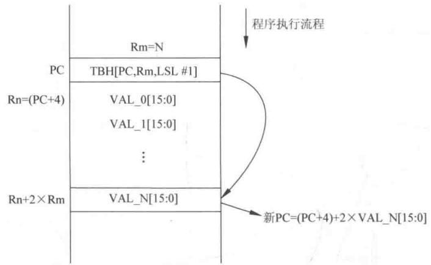

**怎么看这张图（教材原图 4-8）**：

1. **先和图 4-7（TBB）对比**：结构几乎一样，只是表的每一格变宽了。
2. **看表里每一格的宽度**：TBB 的格子是 8 位宽，TBH 的格子是 16 位宽。
3. **看下标计算**：TBH 要找第 Rm 项，地址是 `Rn + 2 × Rm`
   （因为每项占 2 字节，所以要乘 2）。
4. **这张图要你理解什么**：**TBH 是"加强版"的 TBB——
   表项更大，跳得更远（128KB），代价是表占更多空间。**

**TBH 跳转表的创建方式（教材原文）：**

```asm
    TBH.W  [pc, r0, LSL #1]        ; 执行此指令时，PC 的值正好等于 branchtable
branchtable
    DCI  ((branch0 - branchtable)/2)   ; 注意：数值是 16 位的，故使用 DCI 指示字
    DCI  ((branch1 - branchtable)/2)
    DCI  ((branch2 - branchtable)/2)
    DCI  ((branch3 - branchtable)/2)
branch0
    ...                            ; r0 = 0 时执行
branch1
    ...                            ; r0 = 1 时执行
branch2
    ...                            ; r0 = 2 时执行
branch3
    ...                            ; r0 = 3 时执行
```

**【补充解释】注意两处细节：**

- `[pc, r0, LSL #1]`：下标 R0 先左移 1 位（乘 2），
  因为每项占 2 字节；
- 用 `DCI`（分配 16 位数据）而不是 `DCB`。

#### 7. IT 指令实现 IF-Then 分支

> 【教材内容】IF-Then 指令围起一个程序块，使用 IT 指令实现，里面最多有 4 条指令，这些指令可以条件执行。

**【补充解释】IT 是什么？**

**IT = If-Then。** 它是 4.2.3.3 节讲过的"条件执行块"的实现方式。

**【类比】**：`IT` 就像给几条指令套一个"如果……就……否则……"的框，
框里的每条指令都必须标明自己是"条件成立时执行"（T）还是"条件不成立时执行"（E）。

> 【教材内容】IT 指令中可以包含 T（TRUE，对应条件成立时执行的语句）或 E（ELSE，对应条件不成立时执行的语句）。IT 指令本身已经带了一个"T"，因此还可以最多再带 3 个"T"或者"E"。并且对 T 和 E 的顺序没有要求。在 IF-Then 块中的指令必须加上条件后缀，且 T 对应的指令必须使用和 IT 指令中相同的条件，E 对应的指令必须使用和 IT 指令中相反的条件。

**IT 的使用形式（教材原文）：**

| 写法 | 围住几条指令 |
|---|---|
| `IT <cond>` | 1 条 |
| `IT <x> <cond>` | 2 条 |
| `IT <x> <y> <cond>` | 3 条 |
| `IT <x> <y> <z> <cond>` | 4 条 |

> 【教材内容】其中 `<x>、<y>、<z>` 的取值可以是"T"或者"E"。而 `<cond>` 则是在表 4-3 中列出的条件（AL 除外）。

**【补充解释】怎么读这些写法？**

```
IT      EQ          →  围 1 条，          条件：相等（隐含 1 个 T）
ITT     EQ          →  围 2 条，T、T
ITE     EQ          →  围 2 条，T、E
ITTE    EQ          →  围 3 条，T、T、E
ITTEE   EQ          →  围 4 条，T、T、E、E
```

**怎么数**：`IT` 后面跟的字母个数 = **围住的指令条数 − 1**。
因为第 1 条指令的条件固定跟着 `IT` 里的 `<cond>`（相当于一个隐含的 T），
后面第 2、3、4 条各由 `IT` 后面的第 1、2、3 个字母逐个说明（T 用同条件，E 用相反条件）。

**【容易搞混】不要凭"大概几个字母"猜条数**：

| 你想围几条 | 第 1 条 | 第 2 条 | 第 3 条 | 第 4 条 | 正确写法 |
|---|---|---|---|---|---|
| 2 条 | T | T | — | — | `ITT` |
| 2 条 | T | E | — | — | `ITE` |
| 3 条 | T | T | E | — | `ITTE` |

也就是说：**`ITT` 是"2 条都是 T"，不是"3 条两条 T"**；
想要"3 条、两条 T"必须写 `ITTE`（第 3 条是 E）。写法少一个字母、多一个字母，含义完全不同。

**教材的例子（C 代码 → 汇编）：**

> 【教材内容】

```c
if (R0 == R1)
{
    R3 = R4 + R5;
    R3 = R3 * 2;
}
else
{
    R3 = R6 + R7;
    R3 = R3 / 2;
}
```

> 可以写作：

```asm
    CMP   R0, R1        ; 比较 R0 和 R1
    ITTEE EQ            ; 如果 R0 == R1，Then - Then - Else - Else
    ADDEQ R3, R4, R5    ; 相等时加法
    LSLEQ R3, R3, #1    ; 相等时逻辑左移
    ADDNE R3, R6, R7    ; 不等时加法
    ASRNE R3, R3, #1    ; 不等时算术右移
```

**【补充解释】逐行对照：**

| 汇编行 | 对应的 C 代码 | 说明 |
|---|---|---|
| `CMP R0, R1` | `if (R0 == R1)` 的判断部分 | 设置 Z 标志 |
| `ITTEE EQ` | 框的开始，模式是 T-T-E-E | 声明后面 4 条的归属 |
| `ADDEQ R3, R4, R5` | `R3 = R4 + R5;` | 第 1 条：T（条件成立执行）→ 用 EQ |
| `LSLEQ R3, R3, #1` | `R3 = R3 * 2;` | 第 2 条：T → 用 EQ |
| `ADDNE R3, R6, R7` | `R3 = R6 + R7;` | 第 3 条：E（条件不成立执行）→ 用 NE |
| `ASRNE R3, R3, #1` | `R3 = R3 / 2;` | 第 4 条：E → 用 NE |

**【补充解释】注意最后一条用的是 `ASR` 而不是 `LSR`**——
因为 C 语言里整数除法是**带符号**的，负数除以 2 必须用算术右移
（回忆 4.4.2 节讲的 ASR 与 LSR 的区别）。

**教材的第二个例子：**

```asm
    CMP    R0, R1        ; 比较 R0, R1
    ITTET  GT            ; If R0 > R1 Then（T 代表 Then，E 代表 Else）
    MOVGT  R2, R0
    MOVGT  R3, R1
    MOVLE  R2, R1
    MOVGT  R4, R1
```

**【补充解释】`ITTET GT` 表示 4 条指令的模式是 T、T、E、T：**

```
MOVGT  R2, R0    ← T（R0 > R1 时执行）
MOVGT  R3, R1    ← T
MOVLE  R2, R1    ← E（R0 ≤ R1 时执行）
MOVGT  R4, R1    ← T
```

注意第 4 条又回到了 T——**教材明确说了"对 T 和 E 的顺序没有要求"**。
这说明 IT 块里可以任意排列"成立时执行"和"不成立时执行"的指令，
只要每条的**条件后缀**和 IT 的模式对得上就行。

> 【教材内容】IT 指令使能了指令的条件执行方式，并且使 Cortex-M3 不再预取不满足条件的指令。又因为它在使用时取代了条件转移指令，还避免了在执行流转移时，对流水线的清洗和重新指令预取的开销，所以能优化 C 语言结构中的微小 if 块和很多"?"运算符。

**【补充解释】这段话解释了 IT 的"性能优势"，值得细看：**

回忆第 2 章讲的**流水线**：CPU 会提前把后面的指令"预取"进来。
可是**跳转**会让预取白费（要"清洗流水线"，重新取指令），损失几个周期。

```
用条件跳转：              用 IT 块：
  CMP R0, R1               CMP  R0, R1
  BNE ELSE                 ITE  EQ
  ...Then 的指令...        ...Then 的指令（EQ 后缀）...
  B   END                  ...Else 的指令（NE 后缀）...
ELSE:                      END:
  ...Else 的指令...
END:
  （2 次跳转，流水线要洗 2 次）  （0 次跳转，流水线不用洗）
```

**结论**：**IT 块用"条件执行"代替"跳转"，省掉了流水线清洗的开销。**
这就是为什么编译器特别爱用 IT 来优化短小的 if 语句。

**使用 IT 指令时的注意事项（教材原文）：**

> 【教材内容】
> （1）IT 指令不允许嵌套，即在 IT 包含的指令块中不能有 IT 指令；
> （2）在 IT 指令包含的指令块中不允许包含 CBZ、CBNZ、CPSID 和 CPSIE 指令；
> （3）分支或任何改变 PC 的指令必须在 IT 指令块的外面，或者是 IT 指令块的最后一条指令；
> （4）不要跳转到 IT 指令块中的任何一条指令处，除非从异常处理程序返回；
> （5）除了带有条件的 B 指令的其他所有条件指令必须在 IT 指令块内；
> （6）IT 指令块中的每一条指令必须带有条件码后缀，可以是相同的或者相反的条件。

**【补充解释】翻译成人话：**

| 规则 | 人话 |
|---|---|
| ① | IT 块里不能再套一个 IT 块 |
| ② | IT 块里不能用 CBZ/CBNZ（它们自己就带跳转逻辑，会乱） |
| ③ | 想跳转，要么在 IT 块外面跳，要么在 IT 块的最后一条跳 |
| ④ | 别从外面跳进 IT 块中间（会破坏"当前条件"的上下文） |
| ⑤ | 反过来：**除了 B，所有带条件的指令都必须写在 IT 块里** |
| ⑥ | IT 块里每条指令都必须写条件后缀，不能漏 |

**第 ⑤ 条正好呼应了 4.2.3.3 节的限制。**

#### 8. NOP 指令

> 【教材内容】NOP 指令无操作，常用于延时。

**【补充解释】NOP = No Operation（无操作）。**

**大白话**：什么都不干，但**占一个指令周期**。

**用途**：

- **精确延时**：想等一小段时间，就连续执行几个 NOP；
- **占位**：以后要在这儿填代码，先放个 NOP；
- **流水线对齐**：某些情况下需要让指令地址对齐。

**【容易搞混】**：NOP **不是**"什么都没有"，它还是要花时间的。
在 Cortex-M3 上，一条 NOP 通常占 1 个时钟周期。

---

### 4.4.4 其他指令

> 对应教材 4.4.4 节（p128～p129）

#### 1. 异常产生指令

> 【教材内容】ARM 微控制器支持的异常指令有如下两条：
> - SWI 软件中断指令。
> - BKPT 断点中断指令。

##### 1) SWI 指令

> 【教材内容】SWI 指令的格式为：

```
SWI{条件}  24位的立即数
```

> 【教材内容】SWI 指令用于产生软件中断，以便用户程序能调用操作系统的系统例程。操作系统在 SWI 的异常处理程序中提供相应的系统服务，指令中 24 位的立即数指定用户程序调用系统例程的类型，相关参数通过通用寄存器传递，当指令中 24 位的立即数被忽略时，用户程序调用系统例程的类型由通用寄存器 R0 的内容决定，同时，参数通过其他通用寄存器传递。例如：

```asm
SWI  0x02        ; 该指令调用操作系统编号为 02 的系统例程
```

**【补充解释】"软件中断"是什么？**

**大白话**：平时"中断"是外面有事情发生，硬件通知 CPU（第 7 章讲）。
而**软件中断是程序自己主动"制造"一次中断**，目的是让 CPU 转去执行系统提供的服务。

**【类比】**：你去政务大厅办事。你不是等别人叫你，而是**主动按一个叫号按钮**，
工作人员就过来处理你的事。这个按钮就是"软件中断"。

**在 Cortex-M3 上的对应指令是 `SVC`（Supervisor Call，系统服务调用）。**

```asm
SVC  #0x02        ; Cortex-M3 的写法
```

**【待核验】** 教材这里用的是传统 ARM（A32）的 `SWI` 助记符和 24 位立即数格式。
Cortex-M3 用的是 `SVC`，编码也不同。已在文末"待核验"中记录。

##### 2) BKPT 指令

> 【教材内容】BKPT 指令的格式为：

```
BKPT  16位的立即数
```

> 【教材内容】BKPT 指令产生软件断点中断，可用于程序的调试。

**【补充解释】BKPT = BreakPoint（断点）。**

**大白话**：程序跑到这里就"停下来"，让你用调试器看看现在的状态。

**【类比】**：像在代码里插一个"暂停"按钮。调试的时候特别有用——
你可以让程序停在某个位置，然后检查各个寄存器的值对不对。

#### 2. 其他指令

> 【教材内容】其他指令还有：
> - **SEV** —— 发送事件；
> - **WFE** —— 休眠并且在发生事件时被唤醒；
> - **WFI** —— 休眠并且在发生中断时被唤醒；
> - **ISB** —— 指令同步隔离（与流水线和 MPU 有关）；
> - **DSB** —— 数据同步隔离（与流水线、MPU 和 Cache 有关）；
> - **DMB** —— 数据存储隔离（与流水线、MPU 和 Cache 有关）。

> 【教材内容】感兴趣的读者请参考《Cortex-M3 权威指南》。

**【补充解释】这六条指令分两组，用大白话说清楚：**

**第一组：省电三兄弟（SEV / WFE / WFI）**

| 指令 | 全称 | 大白话 |
|---|---|---|
| WFI | Wait For Interrupt | "我先睡一会儿，有中断再叫我" |
| WFE | Wait For Event | "我先睡一会儿，有事件再叫我" |
| SEV | Send Event | "我发一个事件，把睡着的叫醒" |

**为什么需要它们**：嵌入式设备很多是电池供电的。
CPU 空转（比如执行死循环）很费电。让它"睡觉"，有事再醒，能省很多电。

**第二组：同步隔离三兄弟（ISB / DSB / DMB）**

| 指令 | 全称 | 大白话 |
|---|---|---|
| ISB | Instruction Synchronization Barrier | "把流水线清一下，确保后面的指令按新状态取" |
| DSB | Data Synchronization Barrier | "等前面的内存访问全部做完，再往下走" |
| DMB | Data Memory Barrier | "保证内存访问的先后顺序不乱" |

**为什么需要它们**：回忆第 2 章的**流水线**——CPU 会同时处理好几条指令，
而且为了提速，可能会**调整指令的执行顺序**。

大多数时候这没问题。但在某些关键时刻（比如改了 MPU 配置、
或者多个设备共享内存），就必须**强制"按顺序来"**，
否则会出现"配置还没生效，后面的代码就执行了"这种诡异问题。

**这三条指令就是用来"踩刹车、等一等、排好队"的。**

**【补充解释】初学阶段怎么办？**

教材说了"感兴趣的读者请参考《Cortex-M3 权威指南》"——
**这几条指令初学阶段只要知道它们存在、大概干什么就行。**
以后学中断（第 7 章）和 DMA（第 11 章）时，如果遇到"为什么要插一条 DSB"，
再回来查这一节。

#### 3. 互斥访问指令：LDREX / STREX / CLREX（教材表 4-1 里的"那一族"）

教材表 4-1 里还列着 `LDREX`、`STREX`、`LDREXB`、`LDREXH`、`STREXH`、`CLREX` 六条指令。
教材正文没有展开讲，这里补一段——只要知道"有这么一类、解决什么问题"即可。

**先看它们要解决什么问题：**

假设你写了一段"把内存里某个数加 1"的程序（叫计数器 `count`），本质是三步：

```
① 读：LDR  R0, [R1]      ; 把 count 读到 R0
② 改：ADD  R0, R0, #1    ; R0 = R0 + 1
③ 写：STR  R0, [R1]      ; 写回 count
```

如果**只有一个人**在改，没问题。但如果：

- 你正在执行第 ② 步，突然来了个**中断**，中断服务程序也要把同一个 `count` 加 1：
  它读到的是**旧值**，加完写回去，把主程序还没写的结果**覆盖掉了**；
- 结果：明明加了两回，计数器却只增加了 1 —— 丢了一次。

**【类比】** 两个人共用一张白板上的数字记账：
A 看到是 5，准备写 6；还没来得及写，B 也看到是 5，也准备写 6；
两人先后写下去，最后白板上是 6，可实际上是"加了两次"——少了 1 次。

传统解决办法是"把中断关掉再做读-改-写"，但那样代价大、还影响实时性。
硬件提供的更精细的工具，就是**互斥访问（exclusive access）**。

> 【教材内容】教材表 4-1 里的原文说明：
> - **LDREX**——加载字到寄存器，并且在内核中标明一段地址进入了互斥访问状态；
> - **LDREXB / LDREXH**——同上，只是按字节 / 半字加载；
> - **STREX**——检查将要写入的地址是否已进入了互斥访问状态，如果是则存储寄存器的字；
> - **STREXB / STREXH**——同上，按字节 / 半字存储；
> - **CLREX**——在本地处理器上清除互斥访问状态的标记（先前由 LDREX/LDREXH/LDREXB 做的标记）。

**用法**：把上面的"读"换成 `LDREX`，把"写"换成 `STREX`：

```asm
    LDREX  R0, [R1]          ; ① 读：把 [R1] 读到 R0，同时"登记"：我盯上这个地址了
    ADD    R0, R0, #1        ; ② 改：R0 = R0 + 1
    STREX  R2, R0, [R1]      ; ③ 写：只有"登记"到现在没被动过，才真的写进去
                             ;    成功 → R2 = 0（写入成功）
                             ;    失败 → R2 = 1，且不写入（要重新再来一遍）
    CMP    R2, #0
    BNE    重试              ; 失败就回到开头重做"读-改-写"
```

**它聪明在哪**：`STREX` 不是"无脑写"，而是"**先检查这一小段时间里有没有人动过这个地址**"：
动过 → 拒绝写入并返回失败，你可以重试；没动过 → 才写，返回成功。
这样一来，上面那种"两个人都写、丢一次加法"的事就被硬件挡住了。

**顺带认识两条旁边的指令**：

- `CLREX`：手动清除"登记标记"。一般在异常处理/上下文切换时用，
  免得上一个程序留下的标记干扰下一个程序（CPU 自己异常返回时也会处理，通常不用你操心）；
- 带 `B`/`H` 的版本（`LDREXB`/`STREXB`、`LDREXH`/`STREXH`）：
  操作对象从"一个字"变成"一个字节 / 半字"。

**这些指令用在哪**：信号量、自旋锁、无锁数据结构（操作系统、RTOS 里到处都是）。
用 C 写程序时一般不会手写它们，而是用现成的封装，例如：
C11 的 `atomic` 系列、CMSIS 的 `__LDREXW()` / `__STREXW()` 内置函数。

**【补充解释】初学阶段怎么对待它们？**
**记住三句话就够了**：① 有这一类指令；② 它们用来实现"读-改-写"不被打断；
③ `STREX` 成功返回 0、失败返回 1，失败要重试。
具体指令编码和内存模型细节，等以后学 RTOS 或者多核时再深入。

---

### 4.4.5 Thumb 指令及应用

> 对应教材 4.4.5 节（p129～p130）

> 【教材内容】为兼容 16 位数据总线宽度的应用系统，ARM 体系结构除了支持执行效率很高的 32 位 ARM 指令集以外，同时支持 16 位 Thumb 指令集。Thumb 指令集是 ARM 指令集的一个子集，允许指令编码为 16 位长度。与等价的 32 位代码相比较，Thumb 指令集在具有 32 代码优势的同时，大大节省了系统的存储空间。

**术语表：**

| 项目 | 内容 |
|---|---|
| 英文全称 | Thumb |
| 中文名 | Thumb 指令集（无官方中文译名） |
| 缩写 | 无 |
| 大白话 | ARM 的"压缩版"指令集，一条指令只用 16 位 |
| 干什么用 | 让代码占的存储空间更小 |

**【补充解释】名字的由来**：ARM 原本指"Acorn RISC Machine"，
一条指令 32 位（像"手臂"一样粗壮）；后来推出的 16 位版本就叫 "Thumb"（拇指）——
**手臂和拇指**，这个比喻挺好记。

#### 1. Thumb 和 ARM 的关系

> 【教材内容】所有的 Thumb 指令都有对应的 ARM 指令，而且 Thumb 的编程模型也对应于 ARM 的编程模型，在应用程序的编写过程中，只要遵循一定调用的规则，Thumb 子程序和 ARM 子程序就可以互相调用。当微控制器在执行 ARM 程序段时，称 ARM 微控制器处于 ARM 工作状态；当微控制器在执行 Thumb 程序段时，称 ARM 微控制器处于 Thumb 工作状态。

**【补充解释】"编程模型相同"是什么意思？**

就是说：**Thumb 和 ARM 用的是同一套寄存器**（R0～R15、APSR 等），
栈的组织方式也一样。所以两种代码可以互相调用。

**【类比】**：同一个人，写中文用简体字、写繁体字都用同一支笔、同一个本子。
简繁转换不影响"这个人是谁"。ARM 状态和 Thumb 状态就是"简体/繁体"的区别。

#### 2. Thumb 舍弃了哪些特性

> 【教材内容】与 ARM 指令集相比较，Thumb 指令集中的数据处理指令的操作数仍然是 32 位，指令地址也为 32 位，但 Thumb 指令集为实现 16 位的指令长度，舍弃了 ARM 指令集的一些特性，如大多数的 Thumb 指令是无条件执行的，而几乎所有的 ARM 指令都是有条件执行的；大多数的 Thumb 数据处理指令的目的寄存器与其中一个源寄存器相同。

**【补充解释】用两个例子说明"舍弃"：**

**例子 1：条件执行**

```
ARM 状态（32 位指令）：
    ADDEQ R0, R1, R2     ← 指令里有 4 位条件码，随便加 EQ

Thumb 状态（16 位指令）：
    16 位太挤了，放不下 4 位条件码 → 大多数指令不能带条件
    想有条件执行？用 IT 块（这就是 IT 指令存在的原因！）
```

**例子 2：目标寄存器**

```
ARM 状态：
    ADD R0, R1, R2       ← 目标 R0，源 R1、R2，三个都不一样，随便写

Thumb 状态（老式语法）：
    ADD R0, R1           ← 目标必须和其中一个源相同
                            （隐含 R0 = R0 + R1）
```

**【补充解释】这就解释了 4.2.6 节 UAL 那一节讲的内容**——
为了让大家不用记两套写法，ARM 后来搞了统一汇编语言（UAL）。

#### 3. Thumb 与 ARM 的效率对比

> 【教材内容】由于 Thumb 指令的长度为 16 位，即只用 ARM 指令一半的位数来实现同样的功能，所以，要实现特定的程序功能，所需的 Thumb 指令的条数较 ARM 指令多。在一般的情况下，Thumb 指令与 ARM 指令的时间效率和空间效率关系为：
> - Thumb 代码所需的存储空间约为 ARM 代码的 **60%～70%**。
> - Thumb 代码使用的指令数比 ARM 代码多约 **30%～40%**。
> - 若使用 32 位的存储器，ARM 代码比 Thumb 代码快约 **40%**。
> - 若使用 16 位的存储器，Thumb 代码比 ARM 代码快约 **40%～50%**。
> - 与 ARM 代码相比较，使用 Thumb 代码，存储器的功耗会降低约 **30%**。

**【补充解释】这些数字怎么理解？**

**核心权衡**：

| | 用 ARM（32 位指令） | 用 Thumb（16 位指令） |
|---|---|---|
| 一条指令干多少活 | 多 | 少 |
| 完成同一件事要几条 | 少 | 多（多 30%～40%） |
| 占的存储空间 | 大 | 小（只有 60%～70%） |
| 配合 32 位存储器 | **快**（40% 优势） | 慢 |
| 配合 16 位存储器 | 慢 | **快**（40%～50% 优势） |
| 功耗 | 高 | **低**（省 30%） |

**为什么会这样？**

- **32 位存储器**：一次能取 32 位，ARM 指令正好一次取完 → ARM 占优；
- **16 位存储器**：一次只能取 16 位，ARM 指令要取两次 → Thumb 占优；
- **功耗**：取的位数少 → 存储器工作少 → 省电。

> 【教材内容】显然，ARM 指令集和 Thumb 指令集各有其优点，若对系统的性能有较高要求，应使用 32 位的存储系统和 ARM 指令集，若对系统的成本及功耗有较高要求，则应使用 16 位的存储系统和 Thumb 指令集。

**【辅助理解图：Thumb 与 ARM 的对比】**


**怎么看这张图**：

1. **图分左右两栏**：左边是 ARM（32 位指令），右边是 Thumb（16 位指令）。
2. **先看上半部分的"代码块"示意**：左边每条指令画成宽块，右边画成窄块，
   但右边的**条数更多**——直观体现"省空间但条数多"。
3. **再看下半部分的对比表/柱状图**：列出存储空间、指令条数、速度、功耗四项。
4. **注意"速度"那一项要分两种情况**：配 32 位存储器时 ARM 快，
   配 16 位存储器时 Thumb 快——图上应该画成两个小柱对比。
5. **这张图要你理解什么**：**没有绝对的好坏，只有"看你的应用在乎什么"。**
   要性能就 ARM，要省成本省电就 Thumb。

#### 4. Cortex-M3 用的是 Thumb-2

> 【教材内容】Cortex-M3 支持 Thumb-2 指令集，是 16 位和 32 位指令的结合，实现了 16 位指令和 32 位指令共存模式，代码密度和性能均得到提高。现代微控制器应用系统更多地使用 C 语言编写程序，C 编译器也会尽可能地使用短指令。然而，当立即数超出一定范围时，或者 32 位指令能更好地适应某个操作时，将使用 32 位指令。

**【补充解释】Thumb-2 是"两个都要"的答案。**

```
传统 ARM：     全是 32 位指令 → 性能好，但费空间
传统 Thumb：   全是 16 位指令 → 省空间，但功能受限
Thumb-2：      16 位 + 32 位混着用 → 常用的短指令用 16 位，复杂的用 32 位
```

**【类比】**：写文章时，常用词用简写，生僻词写全称。
既省纸，又不影响表达。

**这也是本课程全部代码的背景**：你在 STM32 上写的所有汇编，
都是 Thumb-2 指令，由汇编器自动决定用 16 位还是 32 位
（回忆 4.2.6 节的 `.N` / `.W` 后缀）。

#### 5. 本节真正要记住什么

| 要记住 | 内容 |
|---|---|
| Thumb 是什么 | ARM 的 16 位指令集，省空间 |
| ARM 和 Thumb 的关系 | 同一套寄存器、同一套编程模型，可以互相调用 |
| Thumb 舍弃了什么 | 条件执行（要靠 IT 补）、三操作数（老语法里目标=源） |
| 效率对比 | 省 30%～40% 空间、省 30% 功耗，但指令条数多 30%～40% |
| Cortex-M3 用什么 | **Thumb-2**（16 位 + 32 位混合） |
| 实际影响 | 你写的汇编会自动选长度，不用自己操心 |

---

## 4.5 汇编语言程序设计举例

> 对应教材 4.5 节（p130～p134）

> 【教材内容】本节介绍几个典型的汇编语言程序设计实例供读者可以参考。

**【补充解释】在动手写程序之前，先认识三种最基本的程序结构。**

任何程序，不管多复杂，都是由三种结构拼出来的：

| 结构 | 干什么 | 对应 C 语言 |
|---|---|---|
| 顺序 | 一条接一条往下走 | 普通语句 |
| 分支 | 看情况走不同的路 | if / switch |
| 循环 | 重复做同一件事 | for / while |
| 子程序 | 把一段常用代码"打包"，随时调用 | 函数 |

**【辅助理解图：三种基本程序结构】**

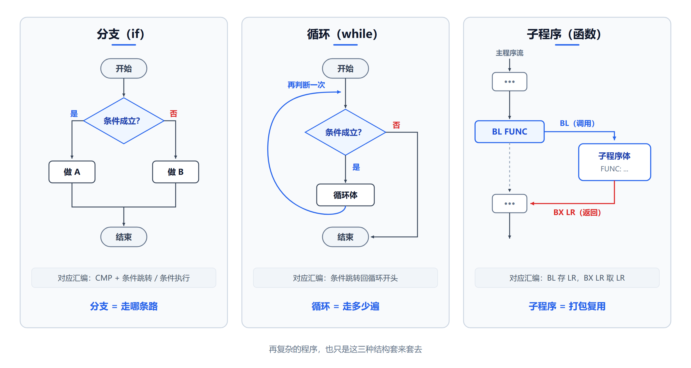

**怎么看这张图**：

1. **图分三栏**，分别是"分支""循环""子程序"。
2. **先看分支那一栏**：画一个菱形判断框，两条箭头分别指向"是"和"否"两条路。
3. **再看循环那一栏**：画一个环形路径，有一个"回头箭头"从末尾指回开头，
   旁边标着"循环条件成立"。
4. **最后看子程序那一栏**：画成主程序一条直线，
   中间伸出一个"钩子"出去又回来，形成一个"凸起"的形状。
5. **注意子程序那一栏的两个标注**：出去的地方标 `BL`（调用），
   回来的地方标 `BX LR`（返回）。
6. **这张图要你理解什么**：**再复杂的程序，也只是这三种结构套来套去。**
   学汇编，就是学会用跳转指令把这三种结构搭出来。

---

### 4.5.1 分支程序设计

> 【教材内容】具有两个或两个以上可执行路径的程序叫作分支程序。使用带有条件码的指令可以很容易地实现分支程序。

#### 【例 4-1】相等则存 R1，否则存 R0

> 【教材内容】**题目**：编写一个分支程序，如果寄存器 R5 中的数据等于 10，则把 R5 中的数据存入寄存器 R1；否则，把 R5 中的数据存入寄存器 R0。

> 【教材内容】**解**：流程图如图 4-9 所示。

**教材原图（图 4-9 例 4-1 流程图）：**

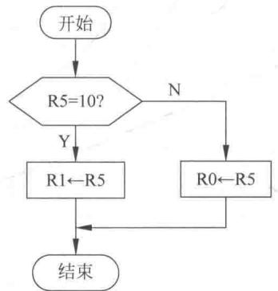

**怎么看这张图（教材原图 4-9）**：

1. **先看最上面的椭圆（或圆角框）**：那是"开始"。
2. **往下是一个菱形框**：这是**判断框**，里面写着判断条件（这里是"R5 = 10？"）。
3. **菱形框伸出两条箭头**：一条标"是"，一条标"否"。
   这就是"分支"的图形表示——**一个判断，两条路**。
4. **两条箭头各指向一个矩形框**：矩形框是**处理框**，里面写要做的事。
5. **最后两条路汇合到同一个结束框**：说明不管走哪条路，程序最终都到这里。
6. **这张图要你理解什么**：**分支程序的核心就是"判断 + 两条路"。**
   在汇编里，"判断"用 CMP 之类的比较指令，"两条路"用带条件的跳转或带条件的执行。

> 【教材内容】可以使用下面的方法实现：

**方法 (1)：使用条件指令实现。**

```asm
    CMP   R5, #10      ; R5 与立即数 10 进行比较
    MOVNE R0, R5       ; 若不相等，则将 R5 赋给 R0
    MOVEQ R1, R5       ; 若相等，将 R5 赋给 R1
```

**【补充解释】逐行说明"代码 → CPU 做什么 → 寄存器发生什么"：**

| 行 | 代码 | CPU 做什么 | 寄存器变化 |
|---|---|---|---|
| 1 | `CMP R5, #10` | 算 R5 − 10，**结果丢掉**，只写标志位 | R5 不变；若 R5=10 则 Z=1，否则 Z=0 |
| 2 | `MOVNE R0, R5` | 看 Z：Z=0（不相等）就执行传送 | 若 R5≠10，R0 ← R5 |
| 3 | `MOVEQ R1, R5` | 看 Z：Z=1（相等）就执行传送 | 若 R5=10，R1 ← R5 |

**完整演算（两种情况）：**

```
情况 A：R5 = 10
  执行 CMP R5, #10   →  10 − 10 = 0  →  Z = 1
  执行 MOVNE R0, R5  →  Z=1，NE 不成立  →  跳过，R0 不变
  执行 MOVEQ R1, R5  →  Z=1，EQ 成立    →  R1 = 10

  结果：R1 = 10，R0 保持原值

情况 B：R5 = 7
  执行 CMP R5, #10   →  7 − 10 = −3 ≠ 0  →  Z = 0
  执行 MOVNE R0, R5  →  Z=0，NE 成立  →  R0 = 7
  执行 MOVEQ R1, R5  →  Z=0，EQ 不成立  →  跳过，R1 不变

  结果：R0 = 7，R1 保持原值
```

**【补充解释】方法 (1) 的好处：**

- **没有跳转**，所以流水线不会被"清洗"，速度快；
- 代码只有 3 行，很紧凑。

**【注意】** 两条 `MOV` 是**条件执行**指令，
按 4.2.3.3 节的说法应该包在 IT 块里（教材例题省略了，见"待核验"）。

**方法 (2)：用条件跳转指令实现。**

```asm
    CMP   R5, #10      ; R5 与立即数 10 进行比较
    BEQ   R5EQ10       ; 相等就跳到 R5EQ10
    MOV   R0, R5       ; 若不相等，则将 R5 赋给 R0
    B     CMPEND       ; 跳转到比较结束标号
R5EQ10
    MOV   R1, R5       ; 否则，将 R5 赋给 R1
CMPEND
```

**【补充解释】逐行说明：**

| 行 | 代码 | 干什么 |
|---|---|---|
| 1 | `CMP R5, #10` | 比较，写标志位 |
| 2 | `BEQ R5EQ10` | 相等（Z=1）→ 跳到 R5EQ10；否则往下走 |
| 3 | `MOV R0, R5` | （不相等时执行）R0 ← R5 |
| 4 | `B CMPEND` | **关键！** 做完后必须跳过"相等分支"，否则会掉进去 |
| 5 | `R5EQ10` | 标号 |
| 6 | `MOV R1, R5` | （相等时执行）R1 ← R5 |
| 7 | `CMPEND` | 标号，两条路在这里汇合 |

**【容易搞混】第 4 行的 `B CMPEND` 千万不能漏！**

如果漏了，程序会这样跑：

```
R5 ≠ 10 时：
  CMP  →  BEQ 不跳  →  MOV R0, R5  →  【继续往下】→  MOV R1, R5
                                                      ↑
                                              这就错了！不相等的时候
                                              R1 也被改了
```

**这是初学者最常犯的错误之一：分支的"合并点"前面忘了加跳转。**

> 【教材内容】从上述例子可以看出，ARM 提供的指令条件域大大简化了分支程序设计。

**【补充解释】为什么说"大大简化"？** 对比一下两种方法的指令条数：

| 方法 | 指令条数 | 有跳转吗 |
|---|---|---|
| 条件指令 | 3 条 | 无 |
| 条件跳转 | 5～6 条 | 有（2 次） |

**这就是"条件域"的价值**：把"判断 + 跳转"压缩成"一条带条件的指令"。

#### 【例 4-2】谁大就用谁加

> 【教材内容】**题目**：编写一个分支程序实现，当寄存器 R1 中的数据大于 R2 中的数据时，将 R2 中的数据加 10 存入寄存器 R1；否则，将 R2 中的数据加 5 存入寄存器 R1。

> 【教材内容】**解**：流程图请读者自行绘制。可以使用下面的程序代码实现题目要求：

```asm
    CMP    R1, R2        ; 比较 R1 和 R2
    ADDHI  R1, R2, #10   ; 若 R1 > R2，则 R1 = R2 + 10
    ADDLS  R1, R2, #5    ; 若 R1 < R2，则 R1 = R2 + 5
```

**【补充解释】这里用的是无符号比较后缀 `HI` / `LS`。**

| 后缀 | 条件 | 含义 |
|---|---|---|
| HI | C=1 且 Z=0 | 无符号 > |
| LS | C=0 或 Z=1 | 无符号 ≤ |

**逐行演算（三种情况）：**

```
情况 A：R1 = 20，R2 = 10
  CMP R1, R2   →  20 − 10 = 10 ≠ 0  →  Z = 0
                  无符号 20 ≥ 10，无借位  →  C = 1
  ADDHI R1, R2, #10  →  HI（C=1且Z=0）成立  →  R1 = 10 + 10 = 20
  ADDLS R1, R2, #5   →  LS 不成立  →  跳过

  结果：R1 = 20

情况 B：R1 = 5，R2 = 10
  CMP R1, R2   →  5 − 10 = 需要借位  →  C = 0
  ADDHI R1, R2, #10  →  HI 不成立（C=0）  →  跳过
  ADDLS R1, R2, #5   →  LS（C=0）成立  →  R1 = 10 + 5 = 15

  结果：R1 = 15

情况 C：R1 = 10，R2 = 10
  CMP R1, R2   →  10 − 10 = 0  →  Z = 1
  ADDHI R1, R2, #10  →  HI 要求 Z=0，不成立  →  跳过
  ADDLS R1, R2, #5   →  LS（Z=1）成立  →  R1 = 10 + 5 = 15

  结果：R1 = 15
```

> 【教材内容】思考：上述代码中，若 R1 = R2，会执行哪个分支？

**【解答】执行 `ADDLS` 那条，也就是 `R1 = R2 + 5`。**

原因：相等时 Z=1，而 `LS` 的条件是"C=0 **或** Z=1"——
**只要 Z=1 就成立**，所以走 LS 分支。
这也提醒我们：`LS` 的含义是"**小于或等于**"，"等于"被归到了这一边。

**【容易搞混】** 题目原文说的是"R1 大于 R2 时……否则……"。
按字面，"否则"包括"相等"的情况，所以走 LS 是**符合题目要求**的。
但如果你本来想表达的是"R1 小于 R2 时才加 5"，那就要用 `ADDLO`（无符号小于）
而不是 `ADDLS`——这样相等时两条都不执行。

#### 【例 4-3】分段函数

> 【教材内容】**题目**：编写实现下面的算式

```
        ⎧  0                 x ≤ 5
    y = ⎨
        ⎩  x² + 3x + 8       x > 5
```

> 【教材内容】**解**：将自变量 x 使用 R0 表示，运算结果 y 使用 R1 表示，流程图如图 4-10 所示。实现代码如下：

**教材原图（图 4-10 例 4-3 流程图）：**

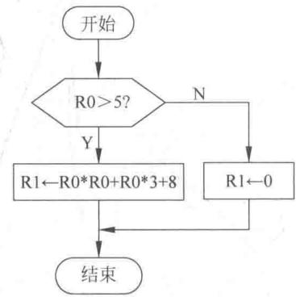

**怎么看这张图（教材原图 4-10）**：

1. **先看最上面的判断菱形**：里面写的是 `x ≤ 5?`（也就是 `R0 ≤ 5?`）。
2. **看"是"这条路（左/上分支）**：直接给 y 赋 0，然后汇合到结束。
   ——这条路**很短**，因为 x ≤ 5 时不需要计算。
3. **看"否"这条路（右/下分支）**：这条路上有**好几个处理框**串在一起：
   先算 3x，再算 x²，再相加，最后加 8。这就是 x > 5 时的计算过程。
4. **看两条路的汇合点**：都指向同一个结束框。
5. **这张图要你理解什么**：**分支程序的两条路"长短可以不一样"。**
   例 4-1 里两条路都是一条指令，例 4-3 里一条路是"赋 0"，另一条是"算一个多项式"。
   流程图能帮你看清"哪条路是主干，哪条路是例外"。

```asm
        CMP   R0, #5       ; 比较 R0 和立即数 5
        BLE   ROLE5        ; 如果 R0 ≤ 5，跳到 ROLE5
        MOV   R1, #3       ; R1 = 3
        MUL   R2, R0, R1   ; R2 = R0 × 3 = 3x
        MUL   R3, R0, R0   ; R3 = R0 × R0 = x²
        ADD   R1, R3, R2   ; R1 = x² + 3x
        ADD   R1, #8       ; R1 = x² + 3x + 8
        B     CMPEND       ; 跳过"else"分支
ROLE5
        MOV   R1, #0       ; R1 = 0
CMPEND
```

**【补充解释】逐行说明"代码 → 寄存器发生什么"：**

| 行 | 代码 | 寄存器变化 |
|---|---|---|
| 1 | `CMP R0, #5` | 只写标志位 |
| 2 | `BLE ROLE5` | R0 ≤ 5（带符号）→ 跳到 ROLE5 |
| 3 | `MOV R1, #3` | R1 = 3（准备一个常量给 MUL 用） |
| 4 | `MUL R2, R0, R1` | R2 = R0 × 3（**注意 MUL 不能直接乘立即数**，所以先放进 R1） |
| 5 | `MUL R3, R0, R0` | R3 = R0 × R0 |
| 6 | `ADD R1, R3, R2` | R1 = R3 + R2 = x² + 3x（**R1 被覆盖，原来的 3 没了，没关系**） |
| 7 | `ADD R1, #8` | R1 = x² + 3x + 8 |
| 8 | `B CMPEND` | 跳过下面的"else"分支 |
| 9 | `ROLE5` | 标号 |
| 10 | `MOV R1, #0` | R1 = 0 |
| 11 | `CMPEND` | 标号，两条路汇合 |

**【补充解释】完整演算（两种输入）：**

```
输入 A：R0 = 3（满足 x ≤ 5）
  CMP R0, #5  →  3 − 5 = −2，有借位  →  C = 0
  BLE ROLE5   →  带符号 3 ≤ 5 成立  →  跳转
  MOV R1, #0  →  R1 = 0

  结果：R1 = 0 ✔（对照公式：x = 3 ≤ 5 时 y = 0）

输入 B：R0 = 6（满足 x > 5）
  CMP R0, #5  →  6 − 5 = 1  →  BLE 不成立，继续往下
  MOV R1, #3        →  R1 = 3
  MUL R2, R0, R1    →  R2 = 6 × 3 = 18
  MUL R3, R0, R0    →  R3 = 6 × 6 = 36
  ADD R1, R3, R2    →  R1 = 36 + 18 = 54
  ADD R1, #8        →  R1 = 62
  B CMPEND          →  跳过 ROLE5

  结果：R1 = 62

  验算：x² + 3x + 8 = 6² + 3×6 + 8 = 36 + 18 + 8 = 62 ✔
```

**【补充解释】注意第 3、4 行的写法**：

```asm
MOV R1, #3          ; 先把 3 放进 R1
MUL R2, R0, R1      ; 再用 R1 参与乘法
```

**为什么不直接写 `MUL R2, R0, #3`？**
因为 4.4.2 节讲过：**乘法指令不能使用立即数**。
这是一个很容易踩的坑。

#### 【例 4-4】多分支程序

> 【教材内容】程序分支点上有两个以上的执行路径的程序叫作多分支程序。利用条件测试指令或跳转表可以实现多分支程序。
>
> **题目**：编写一个程序段，判断寄存器 R1 中的数据是否为 10、15、20、25。如果是，则将 R0 设置为 0x5a；否则，将 R0 设置为 0xff。

> 【教材内容】**解**：根据题意，流程图如图 4-11 所示。核心代码如下：

**教材原图（图 4-11 例 4-4 流程图）：**

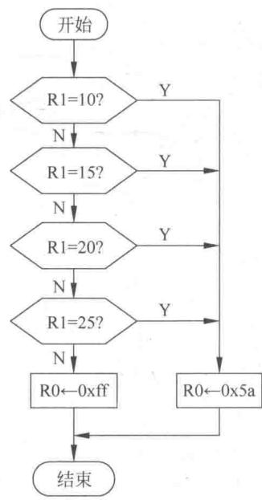

**怎么看这张图（教材原图 4-11）**：

1. **先数一数图里有几个菱形（判断框）**：应该是 4 个，对应 4 次比较。
2. **看这 4 个菱形是怎么连的**：它们**首尾串联**——一个判断完，
   "否"就走到下一个判断。
3. **看任何一个判断的"是"**：都指向同一个处理框（`R0 = 0x5a`）。
4. **看最后一个判断的"否"**：指向另一个处理框（`R0 = 0xff`）。
5. **注意判断的顺序**：10 → 15 → 20 → 25，是一个接一个试。
6. **这张图要你理解什么**：**多分支 = 一串"排除法"。**
   每问一次就排除一个可能。分支越多，问的次数越多——这就是后面 TBB/TBH 要优化的问题。

```asm
    TEQ    R1, #10         ; 比较 R1 和立即数 10
    TEQNE  R1, #15
    TEQNE  R1, #20
    TEQNE  R1, #25
    MOVEQ  R0, #0x5a
    MOVNE  R0, #0xff
```

**【补充解释】这 6 行代码非常巧妙，要仔细看：**

**先看 `TEQ`**：它做异或并更新标志位（4.4.2 节讲过）。
`R1 EOR 10 == 0` 就说明 R1 == 10。

**再看 `TEQNE`**：这是"带 NE 条件的 TEQ"——**只有 Z=0（上一次不相等）时才执行**。

**整个逻辑是这样运作的：**

```
第 1 条 TEQ R1, #10     →  如果 R1 == 10，Z=1
第 2 条 TEQNE R1, #15   →  只有 Z=0（R1 ≠ 10）才执行
第 3 条 TEQNE R1, #20   →  只有前面都没相等才执行
第 4 条 TEQNE R1, #25   →  同理
第 5 条 MOVEQ R0, #0x5a →  只要 Z=1（某一次相等了）就执行
第 6 条 MOVNE R0, #0xff →  Z=0（全都不相等）才执行
```

**【补充解释】这就像"过关游戏"**：

```
第一关：是 10 吗？  → 是 → 结束（Z=1，后面全跳过）
                    → 否 → 进入第二关
第二关：是 15 吗？  → 是 → 结束
                    → 否 → 进入第三关
...
最后一关：是 25 吗？→ 是 → R0 = 0x5a
                    → 否 → R0 = 0xff
```

**完整演算（两种情况）：**

```
情况 A：R1 = 20
  TEQ   R1, #10   →  20 EOR 10 = 30 ≠ 0  →  Z = 0
  TEQNE R1, #15   →  Z=0，执行  →  20 EOR 15 ≠ 0  →  Z = 0
  TEQNE R1, #20   →  Z=0，执行  →  20 EOR 20 = 0   →  Z = 1
  TEQNE R1, #25   →  Z=1，NE 不成立  →  跳过（Z 保持 1）
  MOVEQ R0, #0x5a →  Z=1，执行  →  R0 = 0x5A
  MOVNE R0, #0xff →  Z=1，跳过

  结果：R0 = 0x5A ✔

情况 B：R1 = 7
  TEQ   R1, #10   →  Z = 0
  TEQNE R1, #15   →  Z = 0
  TEQNE R1, #20   →  Z = 0
  TEQNE R1, #25   →  Z = 0
  MOVEQ R0, #0x5a →  Z=0，跳过
  MOVNE R0, #0xff →  Z=0，执行  →  R0 = 0xFF

  结果：R0 = 0xFF ✔
```

**【补充解释】这段代码的精妙之处**：

- **6 条指令搞定 4 个分支**，非常紧凑；
- 用 `TEQNE` 的"链式条件"代替了 4 组"比较 + 跳转"，**没有一次跳转**。

**【容易搞混】** 如果 `TEQ R1, #10` 之后写成 `TEQ R1, #15`（**漏掉 NE**），
那不管前面是否相等，都会继续比较——最后 `MOVEQ` 只看**最后一次**的结果，
逻辑就全乱了。**NE 后缀是这个技巧的关键。**

#### 跳转地址表实现多分支

> 【教材内容】当多分支程序的每个分支所对应的是一个程序段时，常常把各个分支程序段的首地址依次存放在一个叫作**跳转地址表**的存储区域，然后在程序的分支点处使用一个可以将跳转表中的目的地址传送到 PC 的指令来实现分支。

**教材原图（图 4-12 跳转地址表）：**

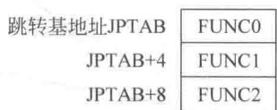

**怎么看这张图（教材原图 4-12）**：

1. **先看图的中间那一列**：这是一片连续的存储单元，
   每一格里放着一个**地址**（不是数据！）。
2. **看这些地址的内容**：它们分别是 branch0、branch1、branch2……
   这些分支程序段的**入口地址**。
3. **看左边的索引**：0、1、2、3——这是"第几个分支"。
4. **看箭头**：从索引指向表中某一格，再从那一格指向对应的程序段。
5. **这张图要你理解什么**：**跳转地址表 = 一张"索引 → 地址"的对照表。**
   有了它，程序不必一个个比较，**直接用编号查表就能找到目标**。

**【补充解释】教材还提到：**

> 【教材内容】假设要执行的程序段编号在 N 中，则可以使用下面的代码：

（教材在此处被 OCR 打断，紧接着给出的是另一张示意图。）

**教材原图（图 4-12 附图的另一部分）：**

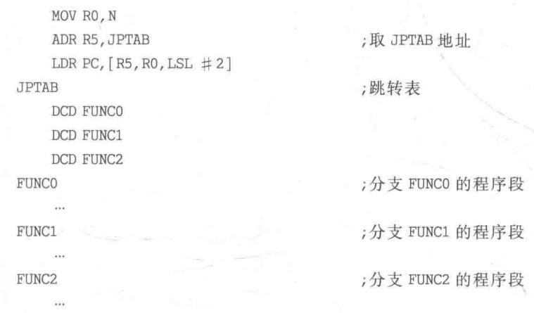

**怎么看这张图**：

1. **先找"表"在哪里**：图里应该有一串连续排列的地址值。
2. **看"编号 N"从哪进来**：它通常是一个寄存器，比如 R1。
3. **看地址怎么算**：`表基址 + N × 4`（因为每个地址占 4 字节）。
4. **看最后一步**：把算出来的那一格里的值装进 PC → 跳过去。
5. **这张图要你理解什么**：**"查表跳转"的本质是"一次内存访问 + 一次赋值给 PC"。**

**【补充解释】用汇编实现"跳转地址表"，大概长这样：**

```asm
        LDR   R2, = JMP_TABLE      ; R2 指向跳转表开头
        LSL   R3, R1, #2           ; R3 = N × 4（每个地址占 4 字节）
        LDR   PC, [R2, R3]         ; 从表中取出第 N 个地址，装进 PC → 跳过去

JMP_TABLE
        DCD   BRANCH0              ; N = 0 时跳这里
        DCD   BRANCH1              ; N = 1 时跳这里
        DCD   BRANCH2              ; N = 2 时跳这里

BRANCH0
        ...
BRANCH1
        ...
BRANCH2
        ...
```

**【补充解释】逐行解释：**

| 行 | 代码 | 干什么 |
|---|---|---|
| 1 | `LDR R2, = JMP_TABLE` | 把表的起始地址装进 R2（4.2.7 节的 LDR 伪指令） |
| 2 | `LSL R3, R1, #2` | N 乘以 4（因为每个地址 4 字节） |
| 3 | `LDR PC, [R2, R3]` | **关键**：从表里取地址，直接写进 PC → 跳转 |
| 5-7 | `DCD BRANCH0/1/2` | 用 DCD 把三个分支的地址依次放进内存 |

**【补充解释】第 3 行 `LDR PC, [R2, R3]` 是全篇最"神"的一行：**

- 它把 **4.4.1 节学的 LDR** 和 **4.4.3 节学的"直接写 PC"** 结合了起来；
- **LDR 的目标寄存器是 PC**，所以"取出来的值"直接变成了"跳转目标"；
- 这就是教材说的"**使用一个可以将跳转地址表中的目的地址传送到 PC 的指令来实现分支**"。

**【补充解释】这其实就是 TBB/TBH 的手工版。**
TBB/TBH 把"乘 2、加基址、取表项、加 PC"这几步用硬件一条搞定，
而你手写的话要三条指令。**所以 TBB/TBH 更快。**

---

### 4.5.2 循环程序设计

> 【教材内容】当条件满足时，需要重复执行同一个程序段做同样工作的程序叫作循环程序。被重复执行的程序段叫作**循环体**，需要满足的条件叫作**循环条件**。循环程序有两种结构：while 结构和 do-while 结构，流程图分别如图 4-13 和图 4-14 所示。

**教材原图（图 4-13 while 循环流程图）：**

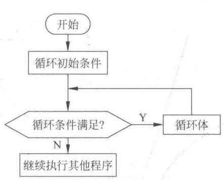

**怎么看这张图（教材原图 4-13）**：

1. **先看图的入口**：箭头直接指向一个**菱形（判断框）**。
2. **看判断框的"是"**：指向循环体（处理框）。
3. **看循环体的出口**：有一条箭头**绕回判断框**——这就是"循环"的关键。
4. **看判断框的"否"**：直接指向结束。
5. **重点**：判断在**循环体之前**。这意味着——**第一次进来就要先判断，
   如果一开始条件就不满足，循环体一次都不执行**。
6. **这张图要你理解什么**：**while 循环 = "先看条件，再干活"。**

**教材原图（图 4-14 do-while 循环流程图）：**

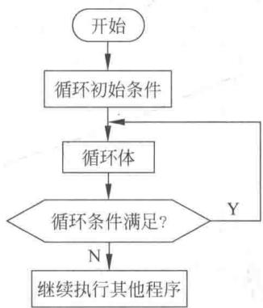

**怎么看这张图（教材原图 4-14）**：

1. **先看图的入口**：箭头直接指向**循环体**（处理框），**不是**判断框！
2. **看循环体的出口**：指向一个菱形（判断框）。
3. **看判断框的"是"**：绕回循环体开头，再来一遍。
4. **看判断框的"否"**：指向结束。
5. **重点**：判断在**循环体之后**。这意味着——**循环体至少会执行一次**，
   哪怕条件一开始就不满足。
6. **这张图要你理解什么**：**do-while 循环 = "先干一次，再看条件"。**

> 【教材内容】while 循环和 do-while 循环的区别就是：while 循环先判断是否满足循环条件，如果满足循环条件，则执行循环体；do-while 循环是先执行一次循环体，然后再判断是否满足循环条件，也就是说，do-while 循环至少执行一次。

**【补充解释】用一张表把两者的区别钉死：**

| | while | do-while |
|---|---|---|
| 判断位置 | 循环体**之前** | 循环体**之后** |
| 最少执行次数 | 0 次 | **1 次** |
| 汇编实现要点 | 循环开头放判断 | 循环开头直接干活，末尾判断 |

**用汇编表示这两种结构（教材例 4-5 是 do-while 式的）：**

```asm
; ---- while 结构 ----
LOOP
    CMP   R10, #0          ; 先判断
    BEQ   LOOPEND          ; 条件不满足就跳出
    ...循环体...
    B     LOOP             ; 回到开头
LOOPEND

; ---- do-while 结构 ----
LOOP
    ...循环体...            ; 先干活
    SUBS  R10, R10, #1     ; 再判断
    BNE   LOOP             ; 条件满足就再来一遍
LOOPEND
```

#### 【例 4-5】复制 80 个字

> 【教材内容】**题目**：编写程序，把首地址为 DATA_SRC 的 80 个字的数据复制到首地址为 DATA_DST 的目的地址块中。

> 【教材内容】**解**：实现代码如下：

```asm
        LDR   R1, = DATA_SRC    ; 将源首地址给 R1
        LDR   R0, = DATA_DST    ; 将目标首地址给 R0
        MOV   R10, #10          ; 利用批量加载/存储指令，一次可以处理 8 个字，分 10 次完成
LOOP
        LDMIA R1!, {R2 - R9}    ; 从 R1 处读取多个字，并依次送到寄存器 R2 - R9，
                                ; 每读一个字后 R1 自增一次
        STMIA R0!, {R2 - R9}    ; 依次存储 R2 - R9 的值到 R0 给出的地址，
                                ; 每存一个字后 R0 自增一次
        SUBS  R10, R10, #1
        BNE   LOOP
```

**【补充解释】先算清楚"为什么是 10 次"：**

```
要复制的数据：80 个字
一次能搬几个字：R2、R3、R4、R5、R6、R7、R8、R9 —— 数一数，8 个

80 ÷ 8 = 10 次  ✔
```

**【补充解释】逐行说明"代码 → 寄存器发生什么 → 内存发生什么"：**

| 行 | 代码 | 寄存器变化 | 内存变化 |
|---|---|---|---|
| 1 | `LDR R1, = DATA_SRC` | R1 ← DATA_SRC 的地址 | 不变 |
| 2 | `LDR R0, = DATA_DST` | R0 ← DATA_DST 的地址 | 不变 |
| 3 | `MOV R10, #10` | R10 ← 10（计数器） | 不变 |
| 5 | `LDMIA R1!, {R2-R9}` | R2～R9 ← 内存里的 8 个字；R1 ← R1 + 32 | 不变（只读） |
| 6 | `STMIA R0!, {R2-R9}` | R0 ← R0 + 32 | 8 个字被写入 |
| 7 | `SUBS R10, R10, #1` | R10 ← R10 − 1，更新标志位 | 不变 |
| 8 | `BNE LOOP` | 若 Z=0 则跳回 LOOP | 不变 |

**【补充解释】两个细节值得注意：**

**细节 1：为什么一次搬 8 个寄存器？**

因为 `LDMIA` 的寄存器列表里能放 8 个寄存器（R2～R9），
正好是 8 个字 = 32 字节。

**为什么用 R2～R9 而不是 R0、R1？**
因为 **R0 和 R1 正在当"指针"用**（分别指向源和目标），不能被覆盖。

**细节 2：`SUBS R10, R10, #1` 里的 S 为什么必须有？**

因为后面的 `BNE` 要看 **Z 标志**。
如果写成 `SUB R10, R10, #1`（没 S），Z 标志不更新，
`BNE` 就永远按旧标志判断——**循环永远不会结束（死循环）**。

**【容易搞混】循环计数器递减时忘记 S 后缀，是最常见的死循环原因之一。**

**完整演算（前两轮）：**

```
初始：R1 = DATA_SRC，R0 = DATA_DST，R10 = 10

第 1 轮：
  LDMIA R1!, {R2-R9}  →  R2~R9 装入源数据的前 8 个字
                        R1 = DATA_SRC + 32
  STMIA R0!, {R2-R9}  →  这 8 个字写入目标
                        R0 = DATA_DST + 32
  SUBS R10, R10, #1   →  R10 = 9，结果非 0  →  Z = 0
  BNE LOOP            →  Z=0，跳回

第 2 轮：
  LDMIA R1!, {R2-R9}  →  装入第 9~16 个字
                        R1 = DATA_SRC + 64
  STMIA R0!, {R2-R9}  →  写入目标
                        R0 = DATA_DST + 64
  SUBS R10, R10, #1   →  R10 = 8，Z = 0
  BNE LOOP            →  跳回

...（重复 10 次）...

第 10 轮结束：
  SUBS R10, R10, #1   →  R10 = 0，结果为零  →  Z = 1
  BNE LOOP            →  Z=1，不跳 → 循环结束
```

**最终结果：**

```
R1 = DATA_SRC + 320（80 个字 × 4 字节）
R0 = DATA_DST + 320
R10 = 0
内存：DATA_DST 开始的 320 字节 = DATA_SRC 开始的 320 字节
```

**【补充解释】这个程序为什么用"倒计数"（从 10 减到 0）而不是"正计数"？**

因为 `SUBS` 会在结果为 0 时自动把 Z 置 1，
**"减到 0" 和 "判断是否结束" 是同一步完成的**，省一条比较指令。

如果正着数（从 0 数到 10），就要额外写一条 `CMP R10, #10`。**倒计数更省。**

---

### 4.5.3 子程序的调用与返回

> 对应教材 4.5.3 节（p133～p134）

**【补充解释】这一小节是本章的**核心中的核心**。
如果你只记一件事，请记住"LR 与 PC 的关系"。**

#### 1. 什么叫子程序？

> 【教材内容】可以多次反复调用的、能完成指定功能的程序段称为"**子程序**"。把调用子程序的程序称为"**主程序**"。为了进行识别，子程序的第 1 条指令之前必须赋予一个标号（该标号称为**子程序名**），以便其他程序可以用这个标号调用子程序。

**术语表：**

| 术语 | 英文 | 大白话 |
|---|---|---|
| 子程序 | Subroutine | 一段"打包好、随时能用"的代码 |
| 主程序 | Main Program | 调用别人的那个程序 |
| 调用 | Call | "我去用一下子程序" |
| 返回 | Return | "子程序干完了，回主程序继续" |
| 子程序名 | — | 子程序开头的那个标号 |

**【类比】**：主程序像"你在写作业"，子程序像"去厨房倒杯水"。

- 你**调用**了"倒水"这个动作；
- 倒完水，你**返回**书桌继续写作业；
- 如果你要倒三次水，就调用三次——**代码只写一份，用几次都行**。

**为什么要用子程序？**

| 好处 | 说明 |
|---|---|
| 省代码空间 | 同一段代码只存一份 |
| 好维护 | 要改逻辑，只改子程序一处 |
| 好复用 | 别的程序也能调用它 |

#### 2. BL 和 LR / PC 的关系（本章最重要的一段）

> 【教材内容】在 ARM 汇编语言程序中，主程序一般通过 **BL 指令**来调用子程序。该指令在执行时完成如下操作：**将子程序的返回地址存放在链接寄存器 LR 中，同时将程序计数器 PC 指向子程序的入口点。** 为了使子程序执行完毕能够返回主程序的调用处，子程序末尾应有 **MOV、BX、STMFD** 等指令，并在指令中将返回地址重新复制到 PC 中。

**【补充解释】把这段话拆成"三步"来看，每一步都问"哪个寄存器变了"：**

```
【BL 执行前】
    PC = 0x08000100   （BL 指令自己的地址）
    LR = 随便什么值

        地址            指令
    0x08000100   BL   FUNC1        ← PC 在这里
    0x08000104   MOV  R0, #1
    0x08000108   ...

【BL 执行的第一步：把返回地址存进 LR】
    LR ← 0x08000104   （BL 的下一条指令的地址）

【BL 执行的第二步：把 PC 指向子程序入口】
    PC ← FUNC1 的地址（比如 0x08000200）

【BL 执行后】
    PC = 0x08000200   （跳到了子程序）
    LR = 0x08000104   （记住了回来的路）
```

**用位图/表格看得更清楚：**

| 时刻 | PC | LR | 说明 |
|---|---|---|---|
| BL 执行前 | 0x08000100 | ？ | 正准备执行 BL |
| BL 执行中 | 0x08000104 → 0x08000200 | 0x08000104 | 先存 LR，再改 PC |
| BL 执行后（在子程序里） | 0x08000200 | 0x08000104 | 已经在子程序里跑 |
| 执行 `BX LR` 后 | 0x08000104 | 0x08000104 | 回到主程序，接着往下跑 |

#### 3. 子程序怎么返回？

> 【教材内容】例如，使用 MOV 指令实现返回的子程序：

```asm
RELAY
    ...
    MOV  PC, LR
```

> 【教材内容】使用 BX 指令实现返回的子程序：

```asm
RELAY
    ...
    BX   LR
```

**【补充解释】为什么这两条都能"返回"？**

**关键点**：PC 决定"下一条执行哪里"。**谁写 PC，谁就决定去哪。**

```
MOV PC, LR    →  把 LR 的值（返回地址）搬进 PC  →  CPU 跳到返回地址
BX  LR        →  同样把 LR 送进 PC（顺便处理状态位）→ 效果一样
```

**【补充解释】为什么子程序返回后，程序能接着跑？**

这个问题值得单独回答，因为它把前面几个概念串起来了：

```
① 执行 BL 时，CPU 把"BL 的下一条指令的地址"存进了 LR
        ↓
② CPU 跳到子程序，开始执行子程序里的指令
   （主程序"暂停"在这里，但它执行到哪一步被 LR 记住了）
        ↓
③ 子程序执行到 BX LR / MOV PC, LR
        ↓
④ CPU 把 LR 的值写进 PC
        ↓
⑤ PC 一变，CPU 立刻去那个地址取指令
   —— 那个地址正是 BL 的下一条指令
        ↓
⑥ 主程序从这里继续往下跑，就好像"什么都没发生过"
```

**【类比】**：你看书看到第 87 页，被叫去接电话。
你**先在 87 页夹一张书签**（LR = 返回地址），去接电话（跳到子程序）。
接完电话（子程序执行完），**翻开书签**（BX LR），
从第 87 页继续读（PC = 返回地址）。
**书签就是 LR，翻书签的动作就是 BX LR。**

**【注意边界】**：真实硬件里没有"书签"，LR 就是一个普通的 32 位寄存器。
而且它**只有一张**——如果子程序里再调用别的子程序，
新调用会**覆盖** LR 的值，原来的返回地址就丢了。这就引出下面这个问题。

#### 4. 嵌套调用与保存现场

> 【教材内容】在调用子程序的同时，也可以使用 R0～R3 来进行参数的传递和从子程序返回运算结果。

> 【教材内容】在子程序中，可以使用堆栈保存在子程序中可能修改的寄存器。例如：

```asm
    STMFD  R13!, {R0 - R12, LR}    ; 压入堆栈
    ; 子程序代码
    LDMFD  R13!, {R0 - R12, LR}    ; 弹出堆栈
```

**【补充解释】这段是"子程序的标准写法"，请务必理解。**

**问题 1：为什么要保存寄存器？**

子程序里用的 R0、R1 等，**可能正是主程序正在用的**。
如果子程序随手改了它们，回到主程序后，主程序的数据就被破坏了。

**【类比】**：你去同事工位借用他的桌子。
**用完必须把东西恢复原样**，否则他回来发现东西全变了。

**问题 2：为什么必须保存 LR？**

因为**嵌套调用**会覆盖 LR：

```
主程序
    BL   FUNC1        ; LR = 0x08000104
    ...
FUNC1
    BL   FUNC2        ; LR = FUNC1 里 BL 的下一条地址 ← 把原来的值覆盖了！
    ...
    BX   LR           ; 返回 FUNC1（不是主程序！）
FUNC2
    ...
    BX   LR           ; 返回 FUNC1 的调用点
```

上面这个例子看起来还能工作，因为返回是"一级一级往回退"。
但如果 FUNC1 在调用 FUNC2 **之前**保存了 LR，情况就完全可控：

```asm
FUNC1
    PUSH {LR}          ; 先把主程序给的返回地址存到栈里
    BL   FUNC2         ; 调用 FUNC2（LR 会被覆盖，但没关系，栈里有备份）
    ...
    POP  {PC}          ; 从栈里取回原来的返回地址，直接装进 PC → 返回主程序
```

**【补充解释】`PUSH {LR}` 和 `POP {PC}` 是天生一对：**

| 动作 | 指令 | 效果 |
|---|---|---|
| 进子程序 | `PUSH {LR}` | 把返回地址存进栈（备份） |
| 出子程序 | `POP {PC}` | 把返回地址从栈里取出来直接装进 PC |

**为什么 `POP {PC}` 就能返回？** 因为 PC 被赋了新值（栈里存的返回地址），
CPU 自然就跳到那里去了。

**【容易搞混】`PUSH {LR}` 要和 `POP {PC}` 配对，不是 `POP {LR}`。**
如果写成 `POP {LR}`，那返回地址只是回到 LR 里，
**PC 没变**，程序还会继续往下跑，不会返回。

#### 5. 【例 4-6】一个子程序框架

> 【教材内容】一个子程序框架如下：

```asm
STACK_TOP  EQU  0x20002000        ; 堆栈指针初始值，常数
AREA RESET, CODE, READONLY        ; AREA 不能顶格写
    DCD  STACK_TOP                ; 设置栈顶（MSP 的）
    DCD  START                    ; 复位向量
    ENTRY                         ; 不能顶格写，指示程序从这里开始执行
START                             ; 主程序开始
    MOV  R1, #0x59
    MOV  R0, #0x28
    BL   FUNC1
    B    .                        ; 工作完成后，进入无穷循环
FUNC1
    ADDS R2, R1, R0
    MOV  PC, LR
    END                           ; 标记文件结束
```

**【补充解释】这个程序虽然短，但把本章的绝大部分知识点都用上了。逐段拆解：**

**第一部分：程序框架（1～6 行）**

```asm
STACK_TOP  EQU  0x20002000
AREA RESET, CODE, READONLY
    DCD  STACK_TOP
    DCD  START
    ENTRY
```

| 行 | 说明 |
|---|---|
| 1 | 用 EQU 定义常量（4.2.7 节） |
| 2 | 定义代码段（4.2.7 节） |
| 3-4 | **向量表前两项**：初始 MSP 和复位向量（4.2.8 节详细讲过） |
| 5 | 声明入口点 |

**第二部分：主程序（7～11 行）**

```asm
START
    MOV  R1, #0x59
    MOV  R0, #0x28
    BL   FUNC1
    B    .
```

| 行 | 代码 | 寄存器变化 |
|---|---|---|
| 7 | `START` | 标号 |
| 8 | `MOV R1, #0x59` | R1 = 0x59 = 89 |
| 9 | `MOV R0, #0x28` | R0 = 0x28 = 40 |
| 10 | `BL FUNC1` | **LR ← 第 11 行的地址**；PC ← FUNC1 |
| 11 | `B .` | 死循环（原地打转，等子程序返回后停在这里） |

**第三部分：子程序（12～15 行）**

```asm
FUNC1
    ADDS R2, R1, R0
    MOV  PC, LR
    END
```

| 行 | 代码 | 干什么 |
|---|---|---|
| 12 | `FUNC1` | 子程序名（标号） |
| 13 | `ADDS R2, R1, R0` | R2 = R1 + R0，并更新标志位 |
| 14 | `MOV PC, LR` | **返回主程序** |
| 15 | `END` | 文件结束 |

**【补充解释】完整演算一遍：**

```
① 复位后：
   MSP ← 0x20002000（从向量表第 1 个字读入）
   PC  ← START 的地址（从向量表第 2 个字读入）

② 执行 MOV R1, #0x59：
   R1 = 0x00000059（89）

③ 执行 MOV R0, #0x28：
   R0 = 0x00000028（40）

④ 执行 BL FUNC1：
   LR ← "B ." 那条指令的地址
   PC ← FUNC1 的地址

⑤ 执行 ADDS R2, R1, R0：
   R2 = 89 + 40 = 129 = 0x00000081
   标志位：结果非 0 → Z = 0
          最高位 0 → N = 0
          无进位   → C = 0
          无溢出   → V = 0

⑥ 执行 MOV PC, LR：
   PC ← LR（就是 "B ." 那条指令的地址）

⑦ 执行 B . ：
   跳到自己，死循环。程序停在这里。
```

**【补充解释】用表格对照"代码 → CPU → 寄存器 → 硬件"：**

| 代码 | CPU 做什么 | 寄存器变化 | 硬件层面 |
|---|---|---|---|
| `MOV R1, #0x59` | 把立即数写进 R1 | R1 = 0x59 | 无内存访问 |
| `MOV R0, #0x28` | 把立即数写进 R0 | R0 = 0x28 | 无内存访问 |
| `BL FUNC1` | 存返回地址、改 PC | LR = 返回地址，PC = FUNC1 | 流水线可能要清洗 |
| `ADDS R2, R1, R0` | 加法，更新标志 | R2 = 0x81，APSR 更新 | 桶形移位器不参与，ALU 工作 |
| `MOV PC, LR` | 把 LR 写进 PC | PC = 返回地址 | 流水线清洗，跳回主程序 |
| `B .` | 跳到自己 | PC 不变 | 一直取同一条指令（省电的芯片可能会进入低功耗？不会，B 是正常执行） |

**【补充解释】几个细节要提醒：**

**细节 1：这个子程序"不保存现场"。**

`FUNC1` 里用了 R2，但没保存 R2 的原值。
在这个例子里没关系（主程序没用 R2），但**在正式项目里必须保存**：

```asm
FUNC1
    PUSH {R2, LR}        ; 先保存
    ADDS R2, R1, R0
    POP  {R2, PC}        ; 恢复并返回
```

**细节 2：参数是怎么传的？**

教材说"可以使用 R0～R3 来进行参数的传递"。
这个例子里，**主程序先把参数放进 R1 和 R0**，子程序直接读它们。

```
主程序                   子程序
  MOV R1, #0x59    ──┐
  MOV R0, #0x28    ──┼──→   ADDS R2, R1, R0
  BL FUNC1         ──┘      （用 R1、R0 当输入）
```

**这是 ARM 的"约定"**（后来变成 C 语言的函数调用标准）：
**前 4 个参数用 R0～R3 传，返回值也放在 R0。**

**细节 3：结果怎么传回主程序？**

这个例子里，结果放在 **R2**，主程序可以去读 R2。
按 ARM 的约定，返回值通常放在 **R0**。

#### 6. 子程序小结：三句话记住它

```
① 调用：BL 子程序名
         （LR ← 返回地址，PC ← 子程序入口）

② 返回：BX LR  或  MOV PC, LR
         （PC ← LR）

③ 保命：进子程序先 PUSH {..., LR}，出子程序 POP {..., PC}
         （防止 LR 被嵌套调用覆盖）
```

**【辅助理解图：子程序调用、返回与 LR 的关系（时间轴）】**

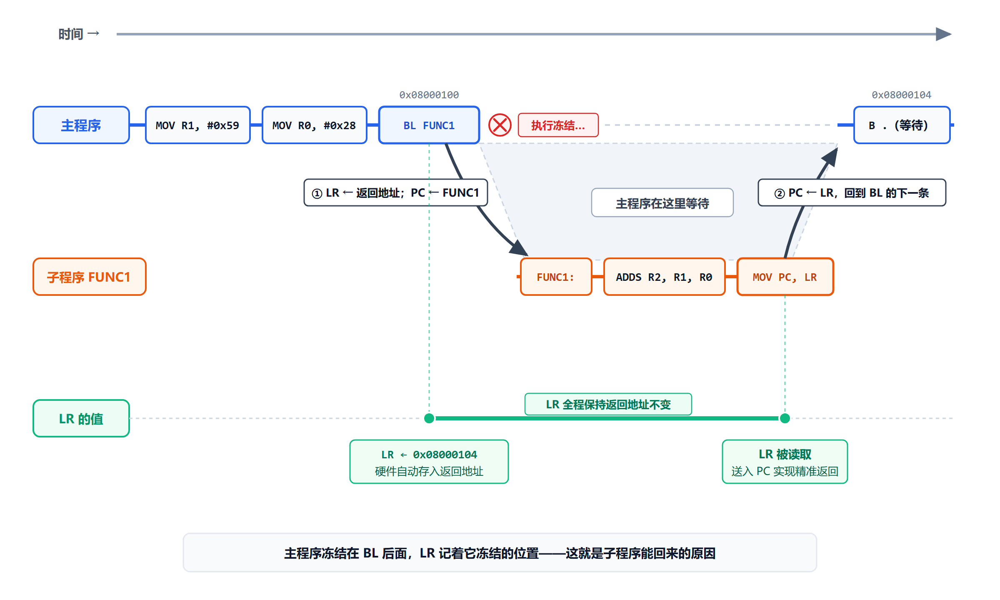

**怎么看这张图**：

1. **图是一条横向时间轴**，从左到右表示时间流逝。
2. **时间轴上方画一条"主程序"的线**，下方画一条"子程序"的线。
3. **在 `BL FUNC1` 那个时刻**：主程序的线断开，一条箭头斜向下连到子程序的线。
   箭头旁边标注"**LR ← 返回地址**"和"**PC ← FUNC1**"。
4. **子程序的线走到末尾**：出现一个 `BX LR` 的标记，
   一条箭头斜向上连回主程序的线，落点在 `BL` 之后的下一条指令处。
5. **图下方专门画一条"LR 的值"的小轨道**，显示 LR 在 BL 时被写入、
   在返回时被使用。
6. **这张图要你理解什么**：**子程序的"去"和"回"在时间上是一前一后，
   而 LR 是连接这两段的那根线。** 主程序在等待期间"冻结"在 BL 后面，
   LR 记着它冻结的位置。

---

## 4.6 教材习题思路提示

> 对应教材 4.6 节（p134）

**【补充解释】教材只给了题目，没给答案。下面给出思路和参考实现，
这部分是本讲义补充的，不是教材原文。**

### 4-1 分段函数

> 【教材内容】**题目**：编程实现下面的算式

```
        ⎧  3x² + 5          x < 0
    y = ⎨  0                x = 0
        ⎩  2x³ + 3x + 7     x > 0
```

**【补充解释】思路：**

这题有三个分支（x < 0、x = 0、x > 0），
**先用 CMP 判断，再按顺序排除**。

```
① 先判断 x < 0 吗？
     ├─ 是 → 算 3x² + 5，结束
     └─ 否 → 继续
② 再判断 x = 0 吗？
     ├─ 是 → y = 0，结束
     └─ 否 → x 只能 > 0 了
③ 算 2x³ + 3x + 7
```

**参考代码（设 x 在 R0，y 在 R1）：**

```asm
        CMP   R0, #0          ; 判断 x 是否小于 0
        BLT   NEGATIVE        ; x < 0，跳去算 3x² + 5
        BEQ   ZERO            ; x = 0，y 直接置 0

        ; ---- 分支 3：x > 0，算 2x³ + 3x + 7 ----
        MUL   R2, R0, R0      ; R2 = x²
        MUL   R2, R2, R0      ; R2 = x³
        LSL   R2, R2, #1      ; R2 = 2x³（左移 1 位 = 乘 2）
        MOV   R3, #3          ; R3 = 3（MUL 不能用立即数）
        MUL   R3, R0, R3      ; R3 = 3x
        ADD   R1, R2, R3      ; R1 = 2x³ + 3x
        ADD   R1, #7          ; R1 = 2x³ + 3x + 7
        B     DONE

NEGATIVE
        ; ---- 分支 1：x < 0，算 3x² + 5 ----
        MUL   R2, R0, R0      ; R2 = x²
        MOV   R3, #3          ; R3 = 3
        MUL   R2, R2, R3      ; R2 = 3x²
        ADD   R1, R2, #5      ; R1 = 3x² + 5
        B     DONE

ZERO
        ; ---- 分支 2：x = 0 ----
        MOV   R1, #0          ; R1 = 0

DONE
```

**【补充解释】几个要点：**

| 要点 | 说明 |
|---|---|
| `BLT` | 带符号"小于"（LT = N ≠ V），因为 x 可能是负数，**必须用带符号比较** |
| `BEQ` | 相等判断，用 Z 标志 |
| 第三个分支不用再判断 | 前两个都排除了，x 必然是正的——**这是分支程序常用的"排除法"** |
| `LSL R2, R2, #1` | 左移 1 位等于乘 2，比 `MOV R3,#2` + `MUL` 更省 |
| `MUL` 不能带立即数 | 所以 `MOV R3, #3` 那一步不能省 |

**【容易搞混】** 第一行如果用 `BLO`（无符号小于）就错了。
因为 x 是**带符号数**（题目里有 x < 0 的情况），
必须用 `BLT`。**带符号数用无符号比较，负数会被当成一个很大的正数。**

### 4-2 累加求和

> 【教材内容】**题目**：编程实现算式

```
y = 1 + 2 + 3 + … + 99 + 100
```

**【补充解释】思路：**

这是一个典型的**循环**问题：

```
y = 0
i = 1
while (i ≤ 100) {
    y = y + i
    i = i + 1
}
```

**参考代码（设 y 在 R0，i 在 R1）：**

```asm
        MOV   R0, #0          ; R0 = 0，累加器清零
        MOV   R1, #1          ; R1 = 1，从 1 开始
LOOP
        ADD   R0, R0, R1      ; R0 = R0 + i
        ADD   R1, R1, #1      ; i = i + 1
        CMP   R1, #101        ; 比较 i 和 101
        BLT   LOOP            ; i < 101 就继续（带符号比较）
        ; 循环结束，R0 = 5050
```

**【补充解释】完整演算（前几轮和最后一轮）：**

```
初始：R0 = 0，R1 = 1

第 1 轮：R0 = 0 + 1 = 1，R1 = 2，2 < 101 → 继续
第 2 轮：R0 = 1 + 2 = 3，R1 = 3，3 < 101 → 继续
第 3 轮：R0 = 3 + 3 = 6，R1 = 4，4 < 101 → 继续
...
第 98 轮：R0 = 1+2+…+98 = 4851，R1 = 99，99 < 101 → 继续
第 99 轮：R0 = 4851 + 99 = 4950，R1 = 100，100 < 101 → 继续
第 100 轮：R0 = 4950 + 100 = 5050，R1 = 101，101 < 101 不成立 → 退出

结果：R0 = 5050
```

**验算**：1 + 2 + … + 100 = 100 × 101 ÷ 2 = 5050 ✔

**【补充解释】另一种写法（倒计数，更省一条指令）：**

```asm
        MOV   R0, #0          ; R0 = 0，累加器
        MOV   R1, #100        ; R1 = 100，从 100 倒数到 1
LOOP
        ADD   R0, R0, R1      ; R0 = R0 + i
        SUBS  R1, R1, #1      ; i = i − 1，同时更新标志位
        BNE   LOOP            ; i ≠ 0 就继续
        ; 循环结束，R0 = 5050
```

**【补充解释】为什么倒计数更省？**

| 写法 | 循环体里的指令 | 条数 |
|---|---|---|
| 正计数 | `ADD` + `ADD` + `CMP` + `BLT` | 4 条 |
| 倒计数 | `ADD` + `SUBS` + `BNE` | 3 条 |

**`SUBS` 一边减一边更新标志位，"减到 0"和"判断结束"一步完成**，
所以不需要额外的 `CMP`。这是 4.5.2 节例 4-5 用过的同一个技巧。

**【容易搞混】** 倒计数时如果写成 `SUB R1, R1, #1`（没有 S），
`BNE` 就看的是**旧标志位**，循环会失控。**S 后缀千万不能漏。**

---

## 4.7 本章总复习

### 一、一张表看懂本章全貌

| 小节 | 核心问题 | 必须记住的东西 |
|---|---|---|
| 4.1 | 程序怎么变成 CPU 能懂的东西？ | 三种语言、汇编器、编译器、操作码/操作数、立即数 |
| 4.2 | 指令长什么样？ | 加载/存储型架构、五大类、条件域、N/Z/C/V、指令格式、伪指令 |
| 4.3 | 数据在哪？怎么找？ | 九种寻址方式、`R1` 与 `[R1]` 的区别、满递减栈 |
| 4.4 | 有哪些指令？ | 传送（MOV/LDR/STR/PUSH/POP）、运算（ADD/SUB/AND/CMP）、跳转（B/BL/BX） |
| 4.5 | 怎么拼成程序？ | 分支、循环、子程序（BL + LR + BX LR） |

### 二、最常用的 20 条指令速查

| 指令 | 一句话 | 典型写法 |
|---|---|---|
| MOV | 传送/装立即数 | `MOV R0, R1` / `MOV R0, #5` |
| MVN | 取反传送 | `MVN R0, #0x0F` |
| MOVW/MOVT | 分两半装 32 位数 | `MOVW R0,#0x4567` + `MOVT R0,#0xF123` |
| LDR | 内存 → 寄存器（字） | `LDR R0, [R1, #4]` |
| LDRB / LDRH | 内存 → 寄存器（字节/半字） | `LDRB R0, [R1]` |
| STR | 寄存器 → 内存（字） | `STR R0, [R1, #4]` |
| STRB / STRH | 寄存器 → 内存（字节/半字） | `STRB R0, [R1]` |
| LDMIA / STMIA | 一次搬多个字 | `LDMIA R0!, {R1-R4}` |
| PUSH / POP | 入栈 / 出栈 | `PUSH {R0-R3, LR}` / `POP {R0-R3, PC}` |
| MRS / MSR | 读写特殊寄存器 | `MRS R0, APSR` / `MSR APSR, R0` |
| ADD / SUB | 加 / 减 | `ADD R0, R1, R2` |
| ADC / SBC | 带进位加 / 带借位减 | `ADCS R1, R5, R9` |
| MUL | 乘法 | `MUL R0, R1, R2` |
| AND / ORR / EOR / BIC | 与 / 或 / 异或 / 位清零 | `AND R0, R0, #3` |
| LSL / LSR / ASR | 左移 / 逻辑右移 / 算术右移 | `LSL R0, R1, #3` |
| CMP / TST / TEQ | 比较 / 位测试 / 相等测试 | `CMP R1, #10` |
| B | 跳转 | `B LOOP` / `BEQ LABEL` |
| BL | 调用子程序 | `BL FUNC1` |
| BX | 返回（或跳转） | `BX LR` |
| CBZ / CBNZ | 为零/非零就跳（只能向前） | `CBZ R0, EXIT` |

### 三、最容易搞混的 12 个地方（汇总）

| # | 容易搞混的点 | 正确理解 |
|---|---|---|
| 1 | `R1` 和 `[R1]` | 前者是值，后者是"按 R1 里的地址去内存取" |
| 2 | `MOV` 和 `LDR` | MOV 只在寄存器间搬；访问内存必须用 LDR/STR |
| 3 | C 和 V | C 管无符号，V 管带符号；**减法时 C=1 表示"够减"（不是"借位"）、C=0 才表示"不够减"** |
| 4 | 无符号比大小用 HI/LS，带符号用 GT/LE | 用错会导致负数被当成大正数 |
| 5 | `B` 和 `BL` | B 不记返回地址，BL 记（存进 LR） |
| 6 | `BX LR` 和 `MOV PC, LR` | 功能等价，都用于子程序返回 |
| 7 | `PUSH {LR}` 配 `POP {PC}` | 不是 `POP {LR}`——要让 PC 被更新才能返回 |
| 8 | LSR 和 ASR | 负数除以 2 必须用 ASR |
| 9 | `SUBS` 的 S | 循环计数忘了 S，`BNE` 就读不到新标志位 → 死循环 |
| 10 | 分支合并点前的 `B` | 忘了它，程序会"掉进"另一个分支 |
| 11 | `MUL` 不能用立即数 | 要先 `MOV` 到寄存器 |
| 12 | 条件指令要不要 IT | 教材例题省略了 IT，实际汇编器会自动补（见待核验） |

### 四、本章和后面章节的联系

| 后面章节 | 会用到本章的什么 |
|---|---|
| 第 5 章 开发流程 | 启动文件、向量表（4.2.8 节的框架） |
| 第 6 章 GPIO | LDR/STR 读写寄存器、AND/ORR/BIC 做位操作 |
| 第 7 章 中断 | PUSH/POP 保存现场、MRS/MSR 读写 APSR、BX LR 异常返回 |
| 第 8 章 定时器 | ADD/SUB 算计数值、移位做分频 |
| 第 9 章 串口/SPI | LDRB/STRB 搬字节、REV 系列处理字节序 |
| 第 11 章 DMA | 地址运算、循环程序结构 |

**一句话总结**：

> **本章学会的"看指令、看寄存器、看标志位、看跳转"这四件事，
> 是后面每一章读代码时都要用的基本功。**

---

## 待核验

以下是本讲义在整理过程中发现的、**原教材素材中可疑或需要核对原始 PDF 的地方**。
按照项目规则，这里不猜测、不擅自修改，逐条列出，请核对 `source/` 下的原始 PDF。

| # | 页码 | 位置 | 疑点 | 本讲义的处理 |
|---|---|---|---|---|
| 1 | p94 | 4.1 节末 | `MOV R1, #0x1245` 的机器码写作 `0xF241245`，只有 7 个十六进制位（28 bit），一条 32 位 Thumb-2 指令应为 8 位。疑为 OCR 丢字符（如 `0xF2411245`）。 | 照录并加注，未采用为演算依据 **【已核验 2026-10-04】回原 PDF p94 确认：教材印出的确实是 `0xF241245`，`0x` 之后只有 7 位十六进制数字（32 位指令应为 8 位），属印刷/OCR 缺位。本讲义照录并已注明。** |
| 2 | p100 | 4.2 节指令编码表 | `ADDSEQ R0, R1, #8` 的域划分中，[19~16] 标为"地址基址 operand1"（值 0001=R1），[15~12] 标为"目标或源寄存器 operand2"（值 0000=R0）。按 ADD 语义，目标寄存器应为 R0。教材的字段命名与指令语义需要核对。 | 按教材原表照录，并在解读时补充说明字段的实际含义 |
| 3 | p104 | 4.3 节 3.寄存器间接寻址 | 给出 `ADD R0, R1, [R2]` 作为寄存器间接寻址的例子。但 Cortex-M3 是加载/存储型架构，**ADD 不能直接使用内存操作数**。疑为示意性写法或笔误。 | 照录并明确指出问题，给出正确的两步写法 |
| 4 | p107 | 4.4.1 节 1) MOV | "R0 的内容是 #x000007e2（即十进制的 #2018）"，前缀写作 `#x`，应为 `0x`。数值本身验算无误（0x7E2 = 2018）。 | 正文中按 `0x000007E2` 书写并注明 |
| 5 | p110～p112 | 4.4.1 节 4.堆栈操作 | "例如：`STMFD SP!, {R1-R7, LR}`（满递减）；`LDMED SP!, {R1-R7, LR}`（空递减）"。同一段内先写满递减、后写空递减，两者不是配对使用的指令，放在一起容易误导。 | 照录并说明 STMFD 的配对指令应是 LDMFD |
| 6 | p111 | 4.4.1 节 2) MSR | 例子写作 `MSR APSR, RO`、`MSR PSR, RO`、`MSR CONTROL, R0`，其中 `RO` 应为 `R0`（字母 O 与数字 0 混淆）。 | 正文中按 `R0` 书写 |
| 7 | p115 | 4.4.2 节 4) 除法 | 例：`LDR r0,=300; MOV R1,#7; UDIV.W R2,R0,R1`，"则 R2 = 300 / 7 = 44"。**300 ÷ 7 的整数商是 42，不是 44**（7×42=294，7×43=301）。疑为笔误或原题数值有误。 | 照录并加注说明正确结果 |
| 8 | p115 | 同上 | "ARM 微控制器支持 32 位的硬件除法指令"。**Cortex-M3 内核并不实现 SDIV/UDIV**（ARMv7-M 中为可选件，Cortex-M4/M7 才有）。教材此处可能泛指 ARM 系列。 | 照录并加注，提示以芯片手册为准 |
| 9 | p118 | 表 4-1 RRX 条目 | 表中写"最高位用 C 填充，**执行后不影响 C 的值**"，但 4.4.2 节 5) 又说"低端移出的位填入进位标志位"。RRX 的实际语义是**会更新 C**（C ← 移出的最低位），表 4-1 的说法可疑。 | 照录并在 RRX 小节加注 |
| 10 | p120 | 4.4.2 节 5) RRX | 例子 `MOV R0, R1, RRX #3` 及"按操作数所指定的数量向右循环移位"。**RRX 固定只移 1 位，不带移位量**，写法可疑。 | 照录并加注 |
| 11 | p123 | 4.4.2 节 4) UBFX | 例：`LDR R0,=0x5678ABCD; UBFX.W R1,R0,#12,#16`，"则 R0 = 0x0000678A"。结果应写入 **R1**（指令的目的寄存器是 R1），不是 R0。 | 正文按"结果在 R1"演算并加注 |
| 12 | p123 | 4.4.2 节 4) SBFX | 例：`SBFX.W R1,R0,#8,#4`，"则 R0 = 0xFFFFFFF"。结果应在 R1；且 `0xFFFFFFF` 只有 7 个 F，按 4 位带符号扩展应为 **`0xFFFFFFFB`**（= −5）。 | 正文按 `R1 = 0xFFFFFFFB` 演算并加注 |
| 13 | p122 | 4.4.2 节 5) RBIT | RBIT 例子后面紧跟着 `LDR R0, = 0x1234FFFF` / `BFC R0, #4, #10` 两行，与 RBIT 的说明混排，疑为排版错位（这两行属于 BFC 的例子）。 | 正文中把 BFC 的例子归入 BFC 小节 |
| 14 | p94～p95 | 表 4-1 | 表中列有 `STRSB / STRSBT`、`STRSH / STRSHT`（"带符号存储"）。**存储指令没有带符号/无符号之分**（符号只在读取时才解释）。疑为教材笔误。 | 照录并在正文中加注提醒 |
| 15 | p94～p95 | 表 4-1 | 表头"数据处理类指令"出现**两次**（第二处实际内容是 RBIT/SXTB/CLZ/BFC 等位操作与扩展指令），疑为分类标题重复或 OCR 分段错误。 | 正文速查表中按功能重新归类 |
| 16 | p94～p95 | 表 4-1 | 表中混入了一批**传统 ARM（A32）指令/写法**：其中 `SWI` 是确定的 A32 指令（Cortex-M3 用 `SVC`）；带 `T` 的非特权访问版本（`LDRBT/LDRHT/LDRSBT/LDRSHT/STRBT/STRHT`）和 `CLREX` 是否属于 Cortex-M3 指令集，本讲义未在本次会话中逐条核对（`LDREX/STREX` 系列是教材表 4-1 中列出的互斥访问指令，功能说明见 4.4.4 节 3）。 | 照录；4.4.4 节加注说明 SWI → SVC 的差异，4.4.4 节 3 补讲互斥访问指令，4.4.1 节补讲带 `T` 的非特权访问版本 |
| 17 | p98 | 4.2 节 2. 条件域 | "每一条 ARM 指令包含 4 位的条件码，位于指令的最高 4 位 [31:28]"。这是**传统 A32 指令**的格式；Thumb-2 的 16 位指令没有独立的条件域（要靠 IT）。 | 照录并加注说明适用范围 |
| 18 | p99 / p130～p131 | 4.2.3.3 与 4.5 节 | 4.2.3.3 明确说"只有转移指令才可随意使用条件后缀，其他指令必须在 IT 块中"；但例 4-1、4-2、4-4 直接使用了 `MOVNE/MOVEQ/ADDHI/ADDLS/TEQNE` 而没有 IT 块。 | 两处都照录，并在 4.2.3.3 节加注说明：实际 ARM 汇编器在 UAL 语法下会自动生成 IT 指令 |
| 19 | p126 | 4.4.3 节 6. TBB | 创建跳转表时用 `DCB ((branch0 - branchtable)/2)`；但 4.2.7 节说 DCB 是"分配字节"。这里"除以 2"与"8 位表项"的配合关系，以及 TBH 用 `DCI` 而非教材其他处用的 `DCW`，命名需要核对。 | 照录并加注 |
| 20 | p132 | 4.5.1 节 多分支 | "假设要执行的程序段编号在 N 中，则可以使用下面的代码："之后**正文缺失**，直接跳到图片说明。代码内容可能被 OCR 丢失。 | 本讲义补充了一份参考实现，并明确标注为【补充解释】 |
| 21 | p130 | 图 4-9 | 素材中该图**没有题注**（只标了"无题注"），但正文说"流程图如图 4-9 所示"，可确认它就是图 4-9。 | 正文按"图 4-9 例 4-1 流程图"引用 |
| 22 | p132 | 图 4-12 附近 | 素材中出现一张**无题注**的图片（`e77a7cf1...jpg`），位置在"跳转地址表"的代码说明处。推测是跳转地址表的示意图或图 4-12 的组成部分，但无法从素材确认其确切内容。 | 正文中作为"图 4-12 附图"引用，并说明推测 |
| 23 | p94 | 4.1 节 | "同一个指令系统的同一条指令有两种形式"——"指令系统"与"指令集"在本章混用，教材未作区分。 | 本讲义统一按"指令系统 = 指令集"理解 |
| 24 | p98 | 4.2.3.1 表 4-2 的 C 标志 | 表 4-2 写"C……最常见的就是当加法进位及减法借位时 C 被置位"。按 ARM 的实际规则，**减法时 C=1 表示"没有借位（够减）"、C=0 才表示"借位"**，与该句的字面理解相反（该说法更像 x86 的 CF 语义）。 | 教材原文照录；4.2.3.1 节新增一段【补充解释】说明 ARM 的正确极性，与 4.4.2 节原有的"减法 C 是反的"说明、4.2.3.2 条件码表保持一致 |
| 25 | p94～p95 | 表 4-1 的 LDM/STM 别名 | 表 4-1 写"`STMDB` 和 `STMEA` 作用相同""`STMIA` 和 `STMFD` 作用相同"；但同书 4.4.1 节的入栈例子 `STMFD SP!, {...}` 要求"先减后存"，即 `STMFD` 应对应 **`STMDB`**（满递减栈）。表 4-1 这两处疑为把别名写反（`STMIA` 的别名应为 `STMEA`）。 | 正文按"`STMFD` = `STMDB`（先减后存）"讲解（与 4.3.8 节满递减栈一致），并在 4.3.9 节加注提醒 |

**【补充说明】关于第 1、11、12 条**：这三条都涉及"结果的十六进制位数"或"结果写到哪个寄存器"，
是本讲义在逐条演算时**实际算出来**的差异，不是猜测。
建议优先核对这三处。

**【补充说明】关于第 8 条（Cortex-M3 是否有硬件除法）**：
本讲义未能在本次会话中打开《Cortex-M3 权威指南》或芯片技术参考手册核实，
仅依据 ARMv7-M 架构的通行知识提出疑问。
**请以你手上芯片的官方手册为准。** 如果教材另有所指，请以教材为准。


