# 第 5 章 ARM 微控制器开发

> **本章在整张地图上的位置**
>
> 前面第 1～3 章讲的是"计算机是什么、CPU 怎么工作、STM32 芯片上有什么"，
> 第 4 章讲的是"怎么用汇编语言指挥 CPU"。
>
> 到了第 5 章，我们要回答一个特别实际的问题：
>
> > **我在电脑上敲的那些代码，到底是怎么变成芯片里跑起来的东西的？**
> > **芯片一上电，它凭什么知道该从哪里开始跑？**
> > **我写的变量，最后被放到哪里去了？**
>
> 这一章不教你新的外设，也不教你新的指令。
> 它教你"从想法到芯片运行"的**整条流水线**。
> 学完这一章，你再看后面 GPIO、定时器、串口，就不会有"我写的代码凭什么能控制一根引脚"这种疑惑了。

---

## 5.0 先别急着看教材：这一章到底要干什么？

假设你现在要让 STM32 上的一个 LED 灯闪起来。你要做四件事：

1. 在电脑上写一个 C 文件，比如 `main.c`；
2. 用 Keil（或者别的开发工具）点一下"编译"，再点一下"下载"；
3. 开发板上的灯开始闪；
4. 你拔掉调试器、断电、再上电，灯还在闪。

**普通人是这样理解的**：我把"闪灯"这个想法写成了代码，下载进去了，它就会闪了。

**但学微机原理的人必须多问四个问题**：

| 问题 | 本章对应小节 |
|---|---|
| ① 我写的 C 文件，中间经过了哪几道工序，才变成芯片能懂的 0/1？ | 5.1 开发流程 |
| ② 芯片一通电，CPU 里的程序计数器（PC）里什么都没有，它怎么知道第一条指令在哪儿？ | 5.2 处理器的启动过程 |
| ③ 我写的 `int a = 5;`、`char buf[100];`、`malloc` 出来的内存，分别被放在 Flash 里还是 SRAM 里？谁决定的？ | 5.4 程序映像 |
| ④ 为什么别人写 `*(volatile unsigned int *)0x40010800 = 0x...;` 就能点亮一个灯？一个数字怎么就能控制硬件？ | 5.5 C 语言开发 ARM 应用 |

这四个问题就是本章的全部内容。

**一句话概括本章**：

> 本章讲的是"**程序的旅程**"——
> 从你敲下的那一行 C 代码，经过编译、链接，变成一个"程序映像"，
> 被烧进 Flash，再在芯片上电的那一刻，被 CPU 从向量表里"接上头"，
> 最后跳到你的 `main()` 开始跑。

---

## 5.1 开发流程

### 5.1.1 先别急着看教材：这一节要解决什么？

这一节要回答的是：

> **一个 .c 文件，是怎么变成能烧进芯片的"固件"的？中间每一步分别是谁在干活、产出了什么？**

教材给了一张流程图（图 5-1）和一张开发过程图（图 5-2）。
但这两张图里塞满了缩写：`.c`、`.cpp`、`.s`、`.o`、`.elf`、`.out`、`.axf`、`.ld`、`.scat`……
如果不先把这些缩写解释清楚，图就是一堆乱码。

所以我们先补前置知识，再回头看教材的图。

---

### 5.1.2 你需要先知道的东西

#### 【先补一个前置知识：什么叫"源代码"？】

**源代码**（Source Code）就是**人写给人看的程序文本**。

比如：

```c
a = b + c;
```

这一行是给**人**看的：一眼就知道"把 b 和 c 加起来，结果放进 a"。

但是 CPU 看不懂 `a = b + c`。CPU 只认识一串 0 和 1。

所以从"人写的文本"到"CPU 认识的 0/1"，中间必须有**翻译**。

#### 【先补一个前置知识：什么叫"机器码""目标文件""可执行映像"？】

用"翻译一本书"来理解这三个词：

| 词 | 大白话 | 具体是什么 |
|---|---|---|
| **源代码** | 中文原稿 | `main.c`，人写的文本 |
| **机器码** | 翻译好的外文正文 | 一串 0/1，CPU 唯一认识的东西 |
| **目标文件** | 一章一章分别翻译好的稿子 | 扩展名通常是 `.o`（object），是**半成品**，还不能直接跑 |
| **可执行映像** | 装订成册、编好目录的整本书 | 扩展名 `.elf` / `.out` / `.axf`，是**成品**，可以烧进芯片 |

**为什么要有"半成品"这一步？**
因为一个工程里可能有 10 个 `.c` 文件。如果每次改一个字就重新翻译整本书，太慢了。
所以做法是：**每个 `.c` 单独翻译成一个 `.o`（目标文件）**；改哪个就重新翻译哪个；最后再把所有 `.o` **拼**成一本完整的书（可执行映像）。

"拼"这个动作，就叫**链接**。

#### 【先补一个前置知识：什么叫"编译器""汇编器""链接器"？】

这三个都是电脑上的**软件工具**，不是硬件。它们都是"翻译官"，只是负责的段落不同：

```
编译器 (Compiler)   ：把 C 语言        → 翻译成 →  目标文件 .o
汇编器 (Assembler)  ：把汇编语言 .s    → 翻译成 →  目标文件 .o
链接器 (Linker)     ：把一堆 .o + 库文件 → 拼装成 →  可执行映像 .elf/.axf
```

用工厂打比方：

| 工具 | 工厂里的角色 | 干什么 |
|---|---|---|
| 编译器 | 把图纸（C 代码）加工成零件（机器码）的机床 | 一个 .c 出一个 .o |
| 汇编器 | 同样的机床，只是原料是汇编代码 | 一个 .s 出一个 .o |
| 链接器 | 总装车间 | 把所有零件 + 螺丝（库函数）按图纸位置装成整机 |

#### 【先补一个前置知识：什么叫"库"？】

你写程序时会用到 `printf`、`memcpy`、浮点运算、除法……
这些功能**不是你自己写的**，是别人写好放在一边的。这一堆"别人写好的、可以拿来就用的函数代码"就叫**库**（Library）。

链接器在拼装时，会把你用到的库函数**也一起搬进程序映像里**。你没用到的，一般不会搬（这叫"按需链接"）。

教材原话是：

> "当使用特定的 C/C++ 库函数时，它们的库代码就会由链接器嵌入到程序映像中。另外，有些数据处理任务需要浮点数或除法运算，在进行这些运算时，C 库代码也会被包含进来。"

这就解释了为什么你只写了一个 `main` 函数，最后生成的固件却有好几 KB —— 里面一大半是库代码和启动代码。

---

### 5.1.3 看教材原图：图 5-1 程序代码的生成流程

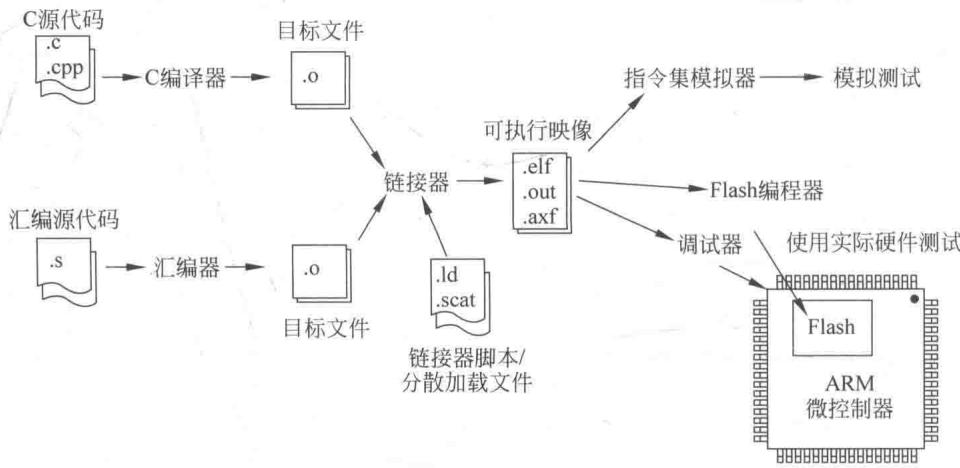

**这张图怎么看？先别管所有箭头，只看三样东西。**

**第一层：左边有两个"入口"（原料从哪来）**

- 左上角：**C 源代码**（`.c`、`.cpp`）—— 这是大多数情况下你会用的入口；
- 左下角：**汇编源代码**（`.s`）—— 第 4 章那种写法，或者启动代码那种必须用汇编的地方。

这就是教材说的"可以使用 C 语言，也可以用汇编，或者两者混合编程"。

**第二层：中间有三台"机器"（谁在加工）**

从左到右依次是：

1. **C 编译器**：把 `.c` 变成右边的 `.o`（图里写的"目标文件"）；
2. **汇编器**：把 `.s` 变成下面的 `.o`（也是"目标文件"）；
3. **链接器**：把**两个** `.o` 收拢到一起，再输出最右边的**可执行映像**（`.elf` / `.out` / `.axf`）。

注意图上有一根从下面 `.o` 向上指的箭头，和一根从上面 `.o` 向下指的箭头 —— 它们**汇合在链接器上**。这就是"混合编程"的样子：C 编出来的零件和汇编编出来的零件，最后由同一个链接器装到一起。

**第三层：右下方那个"额外的输入"（初学者最容易忽略的东西）**

图里在链接器下面画了一个文件 `.ld` / `.scat`，标注是"**链接器脚本 / 分散加载文件**"。

**这个东西极其重要**，它是本章 5.4 节的主角。现在你只需要记住一句话：

> 链接器不是自己知道"代码该放到 0x08000000、变量该放到 0x20000000"的。
> 是**你（或开发工具）通过链接脚本告诉它的**。

**第四层：最右边的三条出口（映像做出来之后干嘛）**

从"可执行映像"这个盒子往右伸出三条箭头，分别通向：

| 出口 | 通向谁 | 用途 |
|---|---|---|
| 上 | **指令集模拟器** → 模拟测试 | 电脑上假装有个 CPU，直接跑，不用真板子 |
| 中 | **Flash 编程器** | 把映像写进芯片的 Flash |
| 下 | **调试器** → 使用实际硬件测试 → ARM 微控制器（里面画着 Flash） | 在真板子上单步调试 |

注意最右下角那个大方块：**ARM 微控制器**，里面单独画了一块 **Flash**。
这张图在提醒你：**程序最终的落脚点是芯片里的 Flash**，不是电脑硬盘。

---

### 5.1.4 看教材原图：图 5-2 开发过程

图 5-1 讲的是"文件怎么变"，图 5-2 讲的是"人怎么操作"。

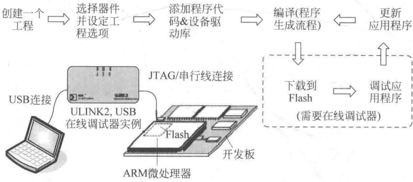

**先看中间那一排箭头（人的操作步骤）：**

```
创建一个工程
    ↓
选择器件并设定工程选项
    ↓
添加程序代码 & 设备驱动库
    ↓
编译（程序生成流程）      ←—— 这一步就是图 5-1 的全过程
    ↓
下载到 Flash（需要在线调试器）
    ↓
调试应用程序
    ↓
更新应用程序  ────────┐
    ↑                 │
    └─────────────────┘  （改代码 → 重新编译 → 重新下载，循环）
```

**再看下面那三个实物（硬件长什么样）：**

- 左下角：一台**笔记本电脑**，通过 **USB 线**连到一个叫 **ULINK2** 的小盒子；
- 中间：这个小盒子就是"**USB 在线调试器**"（图里写着"ULINK2，USB 在线调试器实例"）；
- 右边：开发板，板上有 **ARM 微处理器** 和一块 **Flash**。
  小盒子和开发板之间用 **JTAG / 串行线** 连接（图里标着 "JTAG/串行线连接"）。

**这张图到底想让我理解什么？**

> 电脑和芯片之间**不是直接相连的**。
> 中间必须有一个"翻译官兼搬运工"——**在线调试器**。
> 电脑通过 USB 跟调试器说话，调试器通过 JTAG/SWD 跟芯片说话。
> 所以教材说"下载到 Flash（需要在线调试器）"。

#### 【先补一个前置知识：IDE、ICE、JTAG、SWD 是什么？】

| 缩写 | 英文全称 | 中文名 | 大白话 |
|---|---|---|---|
| **IDE** | Integrated Development Environment | 集成开发环境 | 一个软件里把"写代码、编译、下载、调试"全包了。教材说的 Keil MDK 就是 IDE |
| **ICE** | In-Circuit Emulator | 在线仿真器 | 能"钻进"芯片里看它内部状态的工具。教材说"在线调试器（有时也被称作在线仿真器 ICE）" |
| **JTAG** | Joint Test Action Group | 联合测试行动组（一种调试接口标准） | 芯片上留的"调试口"，用 4~5 根线跟调试器通信 |
| **SWD** | Serial Wire Debug | 串行线调试 | JTAG 的精简版，只用 2 根线，STM32 上很常用 |

**一句话**：你在 Keil 里点"下载"，Keil 通过 USB 把固件交给调试器，调试器再通过 JTAG/SWD 把固件写进芯片的 Flash。

教材说：大多数开发工具都包含了一个接口友好的 IDE，当其与在线调试器配合使用时，可以分步完成"创建工程 → 编译应用程序 → 下载嵌入式应用程序到微控制器中"。

---

### 5.1.5 再画一张更容易懂的图

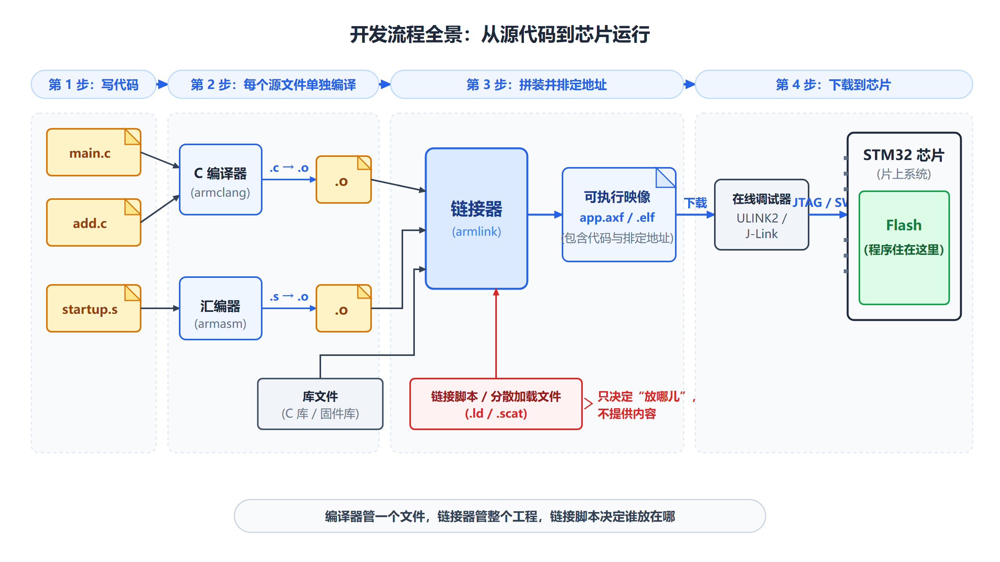

**看图方法**：从左往右，一共四段。

1. **最左（原料区）**：`main.c` 和其他 `.c/.s` 文件；
2. **第二段（翻译区）**：编译器 / 汇编器把每个源文件单独变成 `.o`；
3. **第三段（总装区）**：链接器 + 链接脚本 + 库，把 `.o` 装成一个 `.axf/.elf`；
4. **最右（落地区）**：IDE → 调试器 → JTAG/SWD → 芯片里的 Flash。

**箭头代表数据流**：每一步箭头上的小字（`.c → .o`、`.o + 库 → .axf`）就是"这一步产出了什么"。
**重点看第三段那个"链接脚本"**：它是唯一一个"不产生代码、但决定所有代码放哪儿"的输入。

---

### 5.1.6 每一步到底在干什么（逐步推演）

用一个最小的例子走一遍全过程。假设你有两个文件：

```c
/* main.c */
int add(int a, int b);      /* 声明：有个函数叫 add */
int result;                 /* 全局变量，未初始化 */
const int TABLE[3] = {1,2,3};  /* 常量表 */
int main(void) {
    result = add(1, 2);
    while (1);
}
```

```c
/* add.c */
int add(int a, int b) { return a + b; }
```

**第 ① 步：编译（每个 .c 单独编译）**

- 编译器读 `main.c`，检查语法有没有错（少分号、括号不配对等）；
- 把 C 语句翻译成 ARM 的机器指令；
- **注意**：编译器此时还不知道 `add` 函数到底在哪 —— 因为 `add` 在另一个文件里。所以 `.o` 里会留一个"**待填空**"：这里要调用一个叫 `add` 的函数，地址待定。
- 产出：`main.o`、`add.o`。

**第 ② 步：链接（把所有 .o 拼起来）**

链接器做三件事：

1. **填空**：在 `main.o` 里找到"调用 add"那个待填的位置，把 `add.o` 里 `add` 函数的真实地址填进去；
2. **搬库**：发现你用了 `printf` 之类，就从库里把对应代码搬进来；
3. **排位置**：按照**链接脚本**的规定，决定"哪段代码放在 Flash 的哪个地址、哪个变量放在 SRAM 的哪个地址"。

产出：`main.axf`（一个可执行映像）。

**第 ③ 步：转格式（可选但很常见）**

调试器/烧录器通常还需要一个纯二进制的版本：

- `.bin`：纯粹的机器码，没有任何附加信息；
- `.hex`：带地址信息的文本格式。

`.axf` / `.elf` 里除了机器码，还包含**调试信息**（变量名、行号、函数名），这样你才能单步调试、看变量值。教材说的"目标文件和可执行映像中也可能含有各种调试信息"，就是指这个。

**第 ④ 步：下载（烧写）**

调试器把 `.bin`/`.hex` 里的字节，按地址一个个写进芯片的 Flash。

**第 ⑤ 步：运行**

芯片复位（或你按复位键），CPU 开始从 Flash 取指令执行 —— 这就是下一节 5.2 的内容。

把上面五步画成一张"每一步产出什么"的图（【辅助理解图】）：

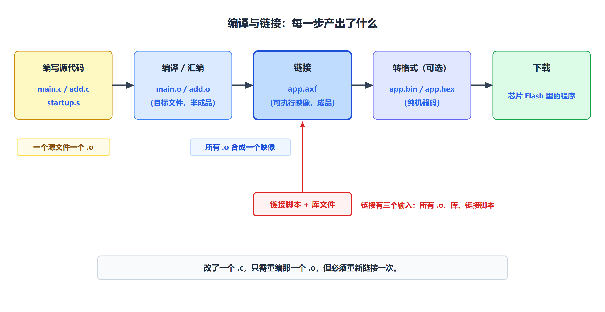

**看图方法**：从左往右五个方框，每个方框下面是"这一步的产出"。
重点看**第 2 步（链接）**：它的输入有**三个** —— 所有 `.o`、库文件、链接脚本。前两个提供"内容"，第三个提供"位置"。

#### 教材原话对照

> "需要使用汇编实现的工程，则使用汇编器将汇编源代码转换成目标文件，工程中所有的目标代码被链接生成一个可执行映像。"
>
> "大多数的简单应用程序可以完全用 C 语言编写。C 编译器将 C 程序代码编译成目标代码，然后由链接器生成程序映像文件。"
>
> "生成可执行映像之后，可以将其下载到微控制器的 Flash 存储器或内存中进行测试。"

---

### 5.1.7 容易搞混的地方

| 误解 | 真相 |
|---|---|
| "编译就是把整个工程变成固件" | 编译只处理**一个源文件**；把多个 `.o` 拼成固件是**链接器**干的 |
| "编译一次就够了" | 你改了 `add.c`，只需重编 `add.o`，但要**重新链接**一次 |
| "`.o` 可以直接烧进芯片" | 不行。`.o` 是半成品，地址还没定，也没有入口信息 |
| "`.elf` 和 `.bin` 差不多" | `.elf/.axf` 带调试信息（大），`.bin` 是纯机器码（小），烧录常用 `.bin/.hex`，调试必须用带调试信息的版本 |
| "下载就是复制到芯片的硬盘上" | 芯片里没有"硬盘"，只有 Flash（掉电不丢）和 SRAM（掉电就丢）。程序必须写进 **Flash** |

---

### 5.1.8 本节真正要记住什么

1. 源文件 `.c/.s` →（编译器/汇编器）→ 目标文件 `.o` →（**链接器 + 链接脚本 + 库**）→ 可执行映像 `.elf/.axf` →（调试器）→ 芯片 Flash。
2. **编译器管一个文件，链接器管整个工程**。
3. 链接器需要一份**链接脚本 / 分散加载文件**才知道"东西往哪儿放"。
4. 电脑和芯片之间必须有一个**在线调试器**（ULINK2/J-Link/ST-Link），通过 JTAG/SWD 连接。
5. 程序的最终落脚点是芯片里的 **Flash**。

---

## 5.2 处理器的启动过程

### 5.2.1 先别急着看教材：这一节要解决什么？

这一节要回答的是本章最核心的问题：

> **芯片刚上电的那一瞬间，CPU 里是空的。它是怎么找到你的程序的？**

第 2 章其实已经讲过一次（图 2-39、2-40、2-41），这里教材再讲一遍，是从"**开发者的视角**"讲：

- 那些"上电后自动做的事"，是谁写的代码？—— **启动代码**，开发工具自动帮你加进工程的；
- 启动代码里都干了些什么？—— 取 MSP 初值、取复位向量、初始化系统时钟、初始化变量、跳到 `main`。

---

### 5.2.2 你需要先知道的东西

#### 【先补一个前置知识：什么叫"复位"？】

**复位**（Reset）就是让芯片**从头再来一遍**。

- 你按下开发板上的复位按键 → 复位；
- 刚插上电源、电压稳定后 → 芯片内部也会自动复位一次（叫"上电复位"）。

复位之后，芯片里**几乎所有的寄存器都回到出厂默认值**，CPU 也**不知道**你之前跑到哪儿了。它必须有一套"固定动作"来重新出发。

#### 【先补一个前置知识：什么叫 PC、SP（MSP）？】

（第 2 章讲过，这里用一句话快速复习。）

- **PC** = Program Counter = **程序计数器**。
  它里面装的是"**下一条要执行的指令的地址**"。
  PC 指到哪儿，CPU 就去哪儿取指令。**PC 是 CPU 的"手指"**。

- **SP** = Stack Pointer = **堆栈指针**。
  它指向**栈顶**。栈是 CPU 的"草稿纸"，函数调用、中断保存现场都要用它。
  Cortex-M3 有两个栈指针：**MSP**（Main Stack Pointer，主堆栈指针）和 PSP（Process Stack Pointer，进程堆栈指针）。
  复位后默认使用 **MSP**。

- **向量**（Vector）= 一个**地址**。
  不是"方向"，是"往哪儿跳"的那个**地址**。所以"复位向量"就是"复位之后该跳到哪个地址"。

#### 【先补一个前置知识：什么叫"向量表"？】

**向量表**（Vector Table）就是一张**地址清单**，摆在内存的**最开头**（地址 0x00000000）。

它的内容长这样（32 位 = 4 字节一项）：

```
地址          内容
0x00000000    MSP 的初始值        ← 不是地址，是一个数值！
0x00000004    复位向量（复位处理程序的地址）
0x00000008    NMI 处理程序的地址
0x0000000C    硬 Fault 处理程序的地址
0x00000010    MemManage Fault 处理程序的地址
0x00000014    BusFault 处理程序的地址
0x00000018    UsageFault 处理程序的地址
0x0000001C    保留
...
```

**为什么要有一张表？**
因为芯片上有几十种"突发事件"（异常/中断）：复位、NMI、硬件错误、定时器到点、串口收到数据……
CPU 需要一个"通讯录"：**出了第几种事，就翻到第几行，找到对应的处理程序地址，跳过去**。
这张通讯录就是向量表。

**关键点**：表里的每一项都是 **4 字节**，第 n 项（异常号 n）的地址 = **n × 4**。
例如复位是异常号 1 → 地址 0x00000004；IRQ0 是异常号 16 → 地址 16×4 = 0x40。

用图看清楚它在内存里长什么样（【辅助理解图】）：

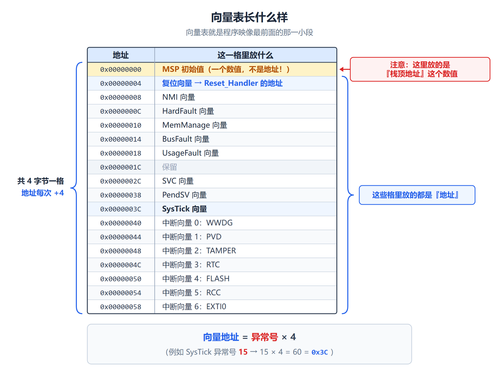

**看图方法**：左边一列是地址（从 0x00000000 往下递增），右边一列是"格子里放什么"。
- **第一格（0x00）放的是"数值"** —— MSP 的初始值，它**不是**地址；
- **从第二格（0x04）开始，每一格放的才是"地址"** —— 各个处理程序的入口地址。
- 每一格都是 **4 字节**，所以地址每次 +4。
- 图中用一条竖线把"数值区"和"地址区"分开，这是本图最想强调的一点。

---

### 5.2.3 看教材原图：图 5-3 处理器复位以后的工作过程

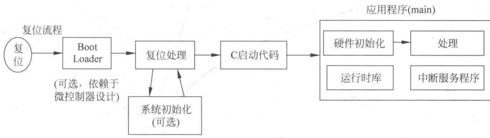

**先看最左边**：一个圆圈写着"**复位**"。这是一切的起点。

**然后沿着箭头往右走，一共 5 个盒子：**

| 顺序 | 盒子 | 关键标注 | 说明 |
|---|---|---|---|
| 1 | **Boot Loader** | 下面标"（可选，依赖于微控制器设计）" | 芯片内部固化的引导程序，先跑它，再跑你的程序 |
| 2 | **复位处理** | 下面挂着一个"系统初始化（可选）"，用**双向箭头**连接 | 复位处理程序；它可能顺手把系统初始化了，也可能把这件事留给后面 |
| 3 | **C 启动代码** | 无 | 准备 C 语言运行环境：初始化变量、清内存、准备堆 |
| 4 | **应用程序（main）** | 右边一个大方框 | 终于到你的代码了 |
| 5 | 大框内部 | 分成四块 | **硬件初始化 → 处理**（两框之间有箭头）；下面还有**运行时库**和**中断服务程序** |

**特别注意第 2 个盒子和下面那个小盒子之间的双向箭头**：

这说明教材那句话的意思 —— "启动代码中的复位处理可能还会履行系统初始化的职责（例如，时钟控制电路和锁相环 PLL 的初始化），**有些情况下，系统初始化是在 C 程序的 main() 函数中开始的**。"

也就是说：**"系统初始化"这件事，放在复位处理里做，还是放到 main 里做，取决于具体工程**。STM32 的官方启动文件是**在复位处理里**调用 `SystemInit()` 的。

**再看最右边大框里的内容**（教材原文列了 3 项，而图里画了 4 块）：

> 应用程序通常包含以下几个部分：
> - 硬件初始化（如时钟、PLL 和外设）；
> - 应用程序的处理部分；
> - 中断服务程序。

**图里比文字多出的那一块是"运行时库"**（也就是 C 库代码），对应教材紧接着的那句：

> "另外，应用程序可能还会用 C 库函数，此时，C 编译器/链接器会将所需的库函数纳入编译好的程序映像中。"

所以这张图里的"应用程序（main）"大框一共是 **4 块**：

| 块 | 作用 |
|---|---|
| **硬件初始化** | 配时钟、PLL、外设（箭头指向"处理"，表示初始化完才进处理） |
| **处理** | 你自己写的业务逻辑主体 |
| **运行时库** | 链接进来的 C 库函数代码（printf、除法、浮点等） |
| **中断服务程序** | 响应中断时才执行的代码 |

**看书时注意**：正文按"应用程序包含哪几部分"数，是 3 项（库代码被单独放在下一句讲）；看图时数方框，是 4 块。两者说的是同一件事，只是"数法"不同，不要以为图错了或书错了。

#### 【先补一个前置知识：Boot Loader 是什么？】

**Boot Loader** = 引导加载程序。
**大白话**：芯片里预装的一个"小管家"。上电后它先跑，检查一下情况（比如有没有人在通过串口给你升级程序），确认没别的事，再把控制权交给 Flash 里的用户程序。

教材原话：

> "有些微控制器可能还配备了一个独立的启动 ROM，里面有一个小的 Boot Loader 程序。微控制器启动以后，在执行 Flash 中的用户程序前，Boot Loader 会首先运行。大多数情况下，Boot Loader 都是固定的，只有 Flash 存储器中的用户程序才是可变的。"

#### 【先补一个前置知识：什么是启动代码？】

**启动代码**（Startup Code）是"**在 main 之前跑的那段程序**"。

教材原话：

> "在复位流程中，处理器会取出 MSP 的初始值和复位向量，然后开始执行复位处理，这些所需信息都放在一个叫作**启动代码**的程序文件中。"

对于 C 语言工程：

> "对于用 C 语言开发的应用程序，在进入主流程以前，启动代码就已经开始执行，并对应用程序用到的变量和内存等进行了初始化。**无须编程者考虑启动代码，因为 C 语言开发工具会将其自动插入程序映像中**。"

对于汇编语言工程：

> "而对于使用汇编语言开发的应用程序，许多工作需要开发者自行完成，例如设置堆栈、设置程序的入口等。第 4 章提供了完整的汇编语言程序框架。"

**结论**：**用 C 开发时，启动代码是"白送"的**，你不用写，但你必须知道它在干什么（否则你永远不明白变量为什么会有初值）。

---

### 5.2.4 上电后的时间轴（本章最重要的图）

先看教材第 2 章的图 2-41，它把"复位后的头几步"画成了一条时间轴：

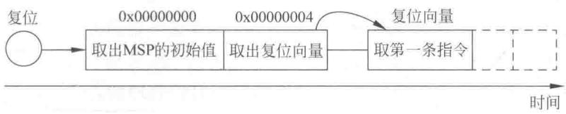

**这张图怎么看**：横轴是**时间**，从左往右。

```
复位 ──→ [ 取出 MSP 的初始值 ] ──→ [ 取出复位向量 ] ──→ [ 取第一条指令 ] ──→ ...
          ↑                          ↑                    ↑
       地址 0x00000000            地址 0x00000004        跳到复位向量指向的地址
```

- 第一个方框上标着 **0x00000000**：CPU 去这个地址，取出 **MSP 的初始值**，装进 SP。
- 第二个方框上标着 **0x00000004**：CPU 去这个地址，取出 **复位向量**。
- 然后有一个**弯回来的箭头**，从"复位向量"指向第三个方框"**取第一条指令**"。
  这个弯箭头就是**跳转**：复位向量里存的**是一个地址**，CPU 拿着这个地址去那里取第一条指令。

**为什么要有这个"弯箭头"？**
因为**复位向量里装的不是指令，是地址**。CPU 必须先把它读出来，再"跳"过去。这和"从 0 地址开始执行第一条指令"的传统单片机完全不同 —— 教材第 2 章专门强调过这一点：

> "请注意，这与绝大多数的其他微处理器或单片机不同。绝大多数的其他微处理器或单片机架构总是从 0 地址开始执行第一条指令。它们的 0 地址处总是存放一条跳转指令。在 Cortex-M3 中，在 0 地址处存放 MSP 的初始值，然后紧跟着就是向量表……向量表中的数值是 32 位的地址，而不是跳转指令。"

再看教材图 2-39，它把**程序映像**和**向量表**放在一起对照：

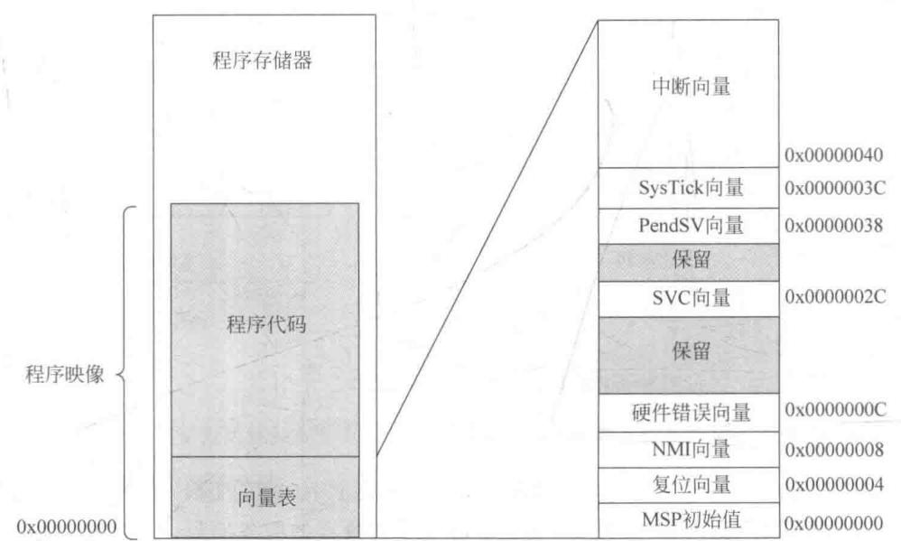

**这张图怎么看**：

- **左边**一个竖长条，是**程序存储器**（对 STM32 来说就是 Flash）。最底下标着 **0x00000000**。里面有两块：
  - 最底部一小块：**向量表**；
  - 上面一大块：**程序代码**。
  左边用一个大括号把它们括起来，标注"**程序映像**"。
- **右边**是把左边那块"向量表"**放大**了看，从下往上一行一行标着地址：
  - `0x00000000` → **MSP 初始值**
  - `0x00000004` → **复位向量**
  - `0x00000008` → **NMI 向量**
  - `0x0000000C` → **硬件错误向量**
  - `0x0000002C` → **SVC 向量**
  - `0x00000038` → **PendSV 向量**
  - `0x0000003C` → **SysTick 向量**
  - `0x00000040` → **中断向量**（从这里开始是各个外设的中断）

注意右边的地址是**从下往上递增**的，但画图时把 0x40 画在最上面。所以看图时：**越往上地址越大**。

**这张图要你理解什么？**
> 向量表**不是单独一个文件**，它是**程序映像的最前面那一小段**。
> 它和你的代码住在同一个 Flash 里，只是住在最靠前的门牌号上。

现在把这些信息拼成一条完整的时间轴（【辅助理解图】）：

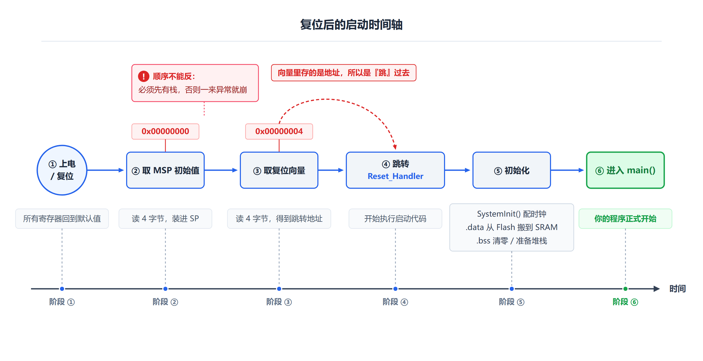

**看图方法**：从左到右共 6 个阶段。

| 阶段 | 谁在干活 | 干了什么 | 为什么 |
|---|---|---|---|
| ① 上电/复位 | 硬件 | 所有寄存器回到默认值，CPU 准备从 0 地址开始 | 一切从头开始 |
| ② 取 MSP 初值 | 硬件（自动） | 读 0x00000000 处的 4 字节，装进 SP | **必须先有栈**，因为后面一发生异常就要压栈，没栈就崩了 |
| ③ 取复位向量 | 硬件（自动） | 读 0x00000004 处的 4 字节，作为跳转地址 | CPU 需要知道"从哪儿开始跑" |
| ④ 跳到 Reset_Handler | 硬件 + 启动代码 | PC 变成复位向量的值，开始执行启动代码 | 启动代码是"main 之前的准备工序" |
| ⑤ 初始化 | 启动代码 | 调 `SystemInit()` 配时钟；把 `.data` 从 Flash 搬到 SRAM；把 `.bss` 清零；准备堆 | 让 C 语言的运行环境成立 |
| ⑥ 进入 main | 启动代码 → 你 | 跳进 `main()` | 你的程序正式开始 |

**注意 ②③ 的顺序不能颠倒**，原因就是上表"为什么"那一列：
**栈必须先准备好**。因为万一在第 ⑤ 步还没跑完的时候来了个 NMI 或者硬件错误，CPU 要压栈保存现场 —— 那时候 SP 必须已经是个合法地址了。

教材第 2 章原话：

> "在此之前初始化 MSP 是必需的，因为可能第 1 条指令还没来得及执行，就发生了不可屏蔽中断(NMI)或是其他 Fault。MSP 初始化好后就为它们的服务例程准备好了堆栈。"

---

### 5.2.5 启动代码里到底写了什么？（逐行拆解教材的汇编）

教材在 5.4 节给出了 ST 官方启动文件 `startup_stm32f10x_hd.s` 的片段。我们把最有用的几段拆开讲。

#### 第一段：定义栈和堆的大小

```asm
Stack_Size      EQU     0x00000400
                AREA    STACK, NOINIT, READWRITE, ALIGN = 3
Stack_Mem       SPACE   Stack_Size          ; 分配栈空间
__initial_sp

Heap_Size       EQU     0x00000200
                AREA    HEAP, NOINIT, READWRITE, ALIGN = 3
__heap_base
Heap_Mem        SPACE   Heap_Size           ; 分配堆空间
__heap_limit

                PRESERVE8                   ; 表明该文件中的代码预留 8 字节对齐的栈
                THUMB
```

**这段想完成什么？** 给栈和堆**划出两块地**，并给它们的边界起名字，方便后面引用。

**逐行解释**：

| 行 | 含义 |
|---|---|
| `Stack_Size EQU 0x00000400` | 定义一个常量 `Stack_Size` = 0x400 = **1024 字节**（1KB）。`EQU` 就是"等于"，相当于 C 里的 `#define` |
| `AREA STACK, NOINIT, READWRITE, ALIGN = 3` | 开一个"段"（AREA），名字叫 `STACK`。`NOINIT` = 不用初始化（栈里是垃圾值没关系）；`READWRITE` = 可读可写；`ALIGN=3` = 按 2³ = 8 字节对齐 |
| `Stack_Mem SPACE Stack_Size` | 在这个段里**留出** 1024 字节的空间（`SPACE` = 留白） |
| `__initial_sp` | **标签**，指向栈空间的**末尾**（因为 Cortex-M3 的栈是"向下生长"的，栈顶在**高地址**）。这个名字会出现在链接脚本里，用来填向量表的第 0 项 |
| `Heap_Size EQU 0x00000200` | 堆大小 = 0x200 = **512 字节** |
| `__heap_base` / `__heap_limit` | 堆的**起始**和**结束**标签 |
| `PRESERVE8` | 告诉汇编器：本文件代码要求栈保持 8 字节对齐（ARM 的 ABI 要求） |
| `THUMB` | 后面都是 Thumb 指令（Cortex-M3 只支持 Thumb 指令集） |

**【补充解释】这里出现的三个名词**

| 名词 | 英文全称 | 大白话 |
|---|---|---|
| **Thumb** | —（ARM 的一种指令编码） | ARM 指令有 32 位和 16 位两种编码。**Thumb 就是"16 位那种"**，代码更紧凑。Cortex-M3 **只会说 Thumb 这一种话**（第 2 章、第 4 章讲过） |
| **ABI** | Application Binary Interface | 应用程序二进制接口。**大白话**：一套"函数之间怎么传参数、栈怎么用"的约定。ARM 规定栈必须 8 字节对齐，所以启动文件里有 `PRESERVE8` 和 `ALIGN=3` |
| **PLL** | Phase-Locked Loop | 锁相环。**大白话**：芯片里的"倍频器"。开发板上的晶振通常是 8MHz，但 CPU 想跑 72MHz —— 靠 PLL 把 8MHz 倍频成 72MHz。所以 `SystemInit()` 里很重要的一项工作就是配置 PLL |

**【补充解释】为什么栈的标签叫 `__initial_sp`？**
因为它就是**向量表第 0 项要填的那个值**。链接器会把 `__initial_sp` 这个标签的**地址**（也就是栈顶地址）写进向量表的头 4 个字节。CPU 复位后读它，就得到了 MSP 初值。

**为什么栈顶是"末尾"而不是"开头"？**
因为 Cortex-M3 的栈是**向下生长的满栈**：
- **向下生长**：压栈时 SP **减小**（往低地址走）；
- **满栈**：SP 指向"最后一个被压入的数据"。

所以一块栈空间如果用 `0x20007C00 ～ 0x20007FFF`，那么 SP 初值应该是 **0x20008000**（末尾 +1）。教材第 2 章的原文：

> "因为 Cortex-M3 使用的是向下生长的满栈，所以 MSP 的初始值必须是堆栈内存的末地址加 1。举例来说，如果堆栈区域在 0x20007C00～0x20007FFF 之间，那么 MSP 的初始值必须是 0x20008000。"

#### 第二段：向量表（用 DCD 指令堆出来的）

```asm
                ;外部中断
                DCD     WWDG_IRQHandler     ;Window Watchdog
                DCD     PVD_IRQHandler      ;PVD through EXTI Line detect
                DCD     TAMPER_IRQHandler   ;Tamper
                DCD     RTC_IRQHandler      ;RTC
                DCD     FLASH_IRQHandler    ;Flash
                DCD     RCC_IRQHandler      ;RCC
                DCD     EXTI0_IRQHandler    ;EXTI Line 0
__Vectors_End
__Vectors_Size  EQU     __Vectors_End - __Vectors
```

**【补充解释】`DCD` 是什么？**
`DCD` = **D**efine **C**onstant **D**ata，"定义常量数据"。
它的作用是：**在当前位置放一个 32 位的数值**。

在向量表里，这些数值都是"**函数的名字**"。汇编器看到函数名，就自动把它替换成那个函数的**地址**。所以：

> 一行 `DCD xxx_Handler` = 在向量表里占一格，格子里填"`xxx_Handler` 这个函数的地址"。

这正是教材说的：

> "Keil MDK 创建 STM32 工程时，则将向量表作为汇编启动代码的一部分，并且使用定义常量数据 (DCD) 指令创建。"

`__Vectors_Size EQU __Vectors_End - __Vectors` 则是**自动算出**向量表一共多少字节（末尾减开头），不用你手数。

#### 第三段：复位处理程序（最重要的一段）

```asm
                AREA    |.text|, CODE, READONLY
; Reset handler
Reset_Handler   PROC
                EXPORT  Reset_Handler
                IMPORT  __main
                IMPORT  SystemInit
                LDR     R0, = SystemInit
                BLX     R0
                LDR     R0, = __main
                BX      R0
                ENDP
```

**这段想完成什么？** 这是**复位向量指向的那个函数**。它只做两件事：
1. 调用 `SystemInit()` —— 配置系统时钟；
2. 跳到 `__main` —— 进入 C 运行环境的初始化，最终进入你的 `main()`。

**逐行 → CPU 做什么 → 寄存器发生什么 → 硬件发生什么**：

| 代码 | CPU 做什么 | 寄存器发生什么 | 硬件/系统发生什么 |
|---|---|---|---|
| `Reset_Handler PROC` | 只是标记"函数开始" | 无 | 无 |
| `EXPORT Reset_Handler` | 告诉汇编器：这个名字要让别的文件也能看见 | 无 | 无（但链接器要把它的地址填进向量表第 1 项） |
| `IMPORT SystemInit` | 声明"SystemInit 在别的文件里" | 无 | 无 |
| `IMPORT __main` | 声明"`__main` 在 C 库里" | 无 | 无 |
| `LDR R0, = SystemInit` | 把 `SystemInit` 的**地址**装进 R0 | **R0 ← SystemInit 的地址** | 无 |
| `BLX R0` | **带链接跳转**到 R0 指向的地址 | **PC ← R0**（跳过去执行）；**LR ← 返回地址**（跳之前的下一条指令地址） | 时钟被配置（PLL 起振、SYSCLK 切换） |
| `LDR R0, = __main` | 把 `__main` 的地址装进 R0 | **R0 ← __main 的地址** | 无 |
| `BX R0` | 跳转到 R0 指向的地址 | **PC ← R0** | 进入 C 库的启动流程：搬 `.data`、清 `.bss`、初始化堆，最后调用 `main()` |

**【补充解释】`BLX` 和 `BX` 的区别？**
- `BLX` = **B**ranch with **L**ink and e**X**change：跳过去，**并且把返回地址存进 LR**。这样对方执行完 `BX LR` 就能跳回来 —— 相当于 C 里的"**函数调用**"。
- `BX` = **B**ranch and e**X**change：**只跳转，不保存返回地址** —— 相当于 C 里的"**一去不回头**"（`goto` / `jmp`）。

所以这里用 `BLX R0` 调 `SystemInit`（要回来），用 `BX R0` 跳 `__main`（不用回来，因为 `__main` 里最后会调用 `main()`，而 `main()` 通常是个死循环）。

**【补充解释】`__main` 和 `main` 有什么区别？**
这是初学者最容易搞混的地方，一定要分清楚：

| 名字 | 是谁 | 干什么 |
|---|---|---|
| **`main`** | **你写的** | 你的业务逻辑 |
| **`__main`** | **C 库里的**（注意前面有两个下划线） | 先做 C 运行环境初始化（搬 `.data`、清 `.bss`、初始化堆），**然后才调用你的 `main`** |

所以真实的调用链是：

```
复位 → Reset_Handler → SystemInit() → __main → [搬 .data / 清 .bss / 初始化堆] → main()
                                                        ↑
                                           这一段就是教材说的"C 启动代码"
```

教材说的"C 启动代码"（见 5.4 节）就是这个 `__main` 里面干的活。

#### 第四段：其他异常处理程序（默认都是死循环）

```asm
; Dummy Exception Handlers (infinite loops which can be modified)
NMI_Handler     PROC
                EXPORT  NMI_Handler [WEAK]
                B       .
                ENDP
```

**【补充解释】`B .` 是什么意思？**
`B` = 无条件跳转（Branch）。`.` 表示"**当前这一条指令自己的地址**"。
所以 `B .` 就是"**跳到我自己**"—— 一个**死循环**。

**【补充解释】`[WEAK]` 是什么意思？**
`WEAK` = **弱符号**。
意思是："这个名字我先占着，但如果工程里**别处**有一个**同名的强符号**（比如你在 C 文件里写了 `void NMI_Handler(void) {...}`），那就**用你的，不用我的**。"

**为什么要这样设计？**
因为芯片有几十个中断，启动文件必须给每一个都留个位置（否则向量表填不满）。但绝大多数中断你根本不用。所以：
- 你**不写** → 用启动文件里的弱定义（死循环）；
- 你**写了** → 自动覆盖掉弱定义，走你的函数。

**这解释了 STM32 开发的一个常见现象**：
你在 `stm32f10x_it.c` 里写了一个 `void EXTI0_IRQHandler(void)`，什么都没配置，它就自动生效了 —— 因为启动文件里那个 `[WEAK]` 版本被你的覆盖了。

**也解释了一个新手常见的 bug**：
程序跑飞了，停在某个死循环里出不来。**很可能你触发了一个没写处理函数的中断**，CPU 跳进了启动文件里那个 `B .` 的死循环。

#### 第五段：堆栈的初始化

```asm
;**************************
; User Stack and Heap initialization
;**************************
                IF      :DEF:__MICROLIB
                EXPORT  __initial_sp
                EXPORT  __heap_base
                EXPORT  __heap_limit
                ELSE
                IMPORT  __use_two_region_memory
                EXPORT  __user_initial_stackheap
__user_initial_stackheap
                LDR     R0, = Heap_Mem
                LDR     R1, = (Stack_Mem + Stack_Size)
                LDR     R2, = (Heap_Mem + Heap_Size)
                LDR     R3, = Stack_Mem
                BX      LR
                ALIGN
                ENDIF
                END
```

**这段想完成什么？** 告诉 C 库："**堆在哪里、栈在哪里**"，这样 `malloc()` 才知道该从哪里要内存。

| 寄存器 | 装的是什么 | 含义 |
|---|---|---|
| R0 | `Heap_Mem` | 堆的起始地址 |
| R1 | `Stack_Mem + Stack_Size` | 栈的结束地址（= 栈顶 = MSP 初值） |
| R2 | `Heap_Mem + Heap_Size` | 堆的结束地址 |
| R3 | `Stack_Mem` | 栈的起始地址 |

**【补充解释】`__MICROLIB` 是什么？**
MicroLIB 是 Keil 提供的一个"**精简版 C 库**"，专为单片机设计，体积小。
- 如果你在 Keil 里勾了 "Use MicroLIB"：走 `IF` 分支，直接把 `__initial_sp` 等符号导出去就行了；
- 如果没勾（用标准 C 库）：走 `ELSE` 分支，需要实现 `__user_initial_stackheap` 这个函数，用 R0~R3 返回堆栈边界。

**这解释了为什么在 Keil 里"勾不勾 MicroLIB"会导致程序跑不起来** —— 因为堆栈信息传递的方式不一样。

---

### 5.2.6 芯片上电后，向量表到底在哪？（0x00000000 还是 0x08000000？）

这是一个必须讲清楚的坑。

STM32 的 Flash 物理地址是 **0x08000000 开始**（第 3 章表 3-1 和 5.4 节的例子都印证了这一点）。
但是向量表却在 **0x00000000**。

**那 0x00000000 那里是什么？**

答案是：**STM32 有一个"地址重映射"机制**。
启动时，芯片会根据 **BOOT0 / BOOT1 两个引脚**的电平，决定把**哪一块存储器"搬"到 0x00000000 的位置**。

第 3 章表 3-4 给出的启动模式：

| BOOT1 | BOOT0 | 启动模式 | 说明 |
|---|---|---|---|
| X | 0 | **主闪存存储器** | 主闪存存储器被选为启动区域（最常用） |
| 0 | 1 | 系统存储器 | 系统存储器被选为启动区域（用来跑出厂 BootLoader） |
| 1 | 1 | 内置 SRAM | 内置 SRAM 被选为启动区域 |

教材原文：

> "从主闪存存储器启动：主闪存存储器被映射到启动空间 (0x0000 0000)，但仍然能够在它原有的地址 (0x0800 0000) 访问它，**即闪存存储器的内容可以在两个地址区域访问，0x00000000 或 0x0800 0000**。"

**这句话用图来理解**：

```
        BOOT0 = 0（从 Flash 启动）

   物理上：                        CPU 看到的：
   ┌──────────────────┐ 0x08000000
   │  Flash 第 0 页    │ ──────────────┐
   │  （向量表在这儿） │               │  （映射 / 别名）
   ├──────────────────┤               ▼
   │  Flash 第 1 页    │      ┌──────────────────┐ 0x00000000
   │  ...             │      │ 同一块 Flash      │
   └──────────────────┘      │ （向量表看起来     │
                             │   在这儿）        │
                             └──────────────────┘
```

**所以**：
- 你烧写程序时，是往 **0x08000000** 写；
- CPU 复位后，是从 **0x00000000** 读向量表；
- 而这两个地址**指向同一块物理 Flash**。

**【补充解释】为什么 ST 要这么设计？**
因为 ARM 规定 Cortex-M3 的向量表必须从 0 地址开始（或由 VTOR 重定位）。但 STM32 的 Flash 从 0x08000000 开始。为了两边都满足，就用"重映射"把 Flash 也"假装"放到 0 地址一份。

**这也解释了习题 5-3 问的**："对照 STM32F103VET6 的存储器映射，查看 5.4 节给出的程序映像中断向量表各个中断的入口地址" —— 答案就是：**向量表既可以按 0x00000000 起的地址看，也可以按 0x08000000 起的地址看，差一个 0x08000000 的偏移**。

#### 【补充解释】向量表还可以搬家：VTOR 寄存器

第 2 章讲过一个寄存器 **VTOR**（Vector Table Offset Register，向量表偏移量寄存器），地址 **0xE000ED08**。

```
bit   31  30  29   28                          7    6               0
     +---+---+----+-----------------------------+----+---------------+
VTOR |保留|保留|TBL |           TBLOFF            |       保留         |
     |    |    |BASE|                             |                  |
     +---+---+----+-----------------------------+----+---------------+
               │
               └─ bit29 = TBLBASE
                  0 = 向量表在 Code 区
                  1 = 向量表在 RAM 区

      bit28:7 = TBLOFF：向量表相对于所在区（Code 区或 RAM 区）的偏移地址
```

**注意**：`TBLBASE` 是**单独的一位（bit29）**，`TBLOFF` 是它右边的那一段（bit28:7），低 7 位（bit6:0）是保留位（因为向量表起始地址必须对齐，低 7 位恒为 0）。教材表 2-14 就是这么定义的，第 2 章讲义里也是同一张位图。

**bit29 写 0 会怎样**：向量表在 Code 区（默认，从 0x00000000 附近找）。
**bit29 写 1 会怎样**：向量表在 RAM 区找。
**程序怎么操作**：`SCB->VTOR = 0x20000000;`（把向量表挪到 SRAM 开头）。
（顺带一提：`0x20000000` 的 **bit29 正好是 1**（0x20000000 = 2²⁹），所以这一句同时把 TBLBASE 置成了"RAM 区"，不用再单独操作那一位。）
**硬件发生什么**：下一次发生异常时，NVIC 不再去 0 地址查表，而是去你指定的地址查表。

**为什么要这个功能？**
最常见的原因是**做 Bootloader + 应用程序的升级方案**：Bootloader 在 Flash 前面，应用程序在后面。Bootloader 跳转过去之前，先改一下 VTOR，让应用程序用**自己的**向量表。

---

### 5.2.7 容易搞混的地方

| 误解 | 真相 |
|---|---|
| "CPU 从 0 地址开始执行第一条指令" | **不对**。0 地址放的是 **MSP 初值**（一个数据，不是指令）。CPU 先读它，再读 0x04 处的复位向量，然后**跳过去** |
| "向量表里存的是跳转指令" | **不对**。存的是**32 位地址**。CPU 是"读出来当跳转目标"，不是"执行它" |
| "Flash 在 0x08000000，那向量表就在 0x08000000" | 物理上在 0x08000000，但**启动时被重映射到 0x00000000**。所以教材说"两个地址都能访问" |
| "`__main` 就是我的 `main`" | **不是**。`__main` 是 C 库的启动代码，它**调用**你的 `main` |
| "启动代码要我自己写" | C 工程里不用，开发工具自动加入。**但汇编工程要自己写**（第 4 章给了框架） |
| "复位后 SP 是 0" | 复位后 SP 立刻被填成向量表第 0 项的值（栈顶地址）。**SP 从来不会是 0** |

---

### 5.2.8 本节真正要记住什么

1. 上电 → 从 **0x00000000** 取 **MSP 初值** → 从 **0x00000004** 取**复位向量** → **跳到复位处理程序**。
2. 顺序不能反：**先有栈，才能应付可能提前到来的异常**。
3. 启动代码在 `main` 之前跑，干三件事：**配时钟（SystemInit）、初始化变量、准备堆栈**。
4. C 工程里启动代码由开发工具自动加入，你不用写，但要知道它存在。
5. 向量表是**程序映像的最前面一段**，不是独立文件。
6. STM32 的 Flash 物理在 0x08000000，但启动时被**重映射到 0x00000000**；具体映射哪块，由 **BOOT0/BOOT1** 决定。
7. 调用链是：`Reset_Handler → SystemInit() → __main → main()`。

---

## 5.3 输入和输出接口

### 5.3.1 先别急着看教材：这一节要解决什么？

这一节回答：

> **芯片外面那一圈"接口"，到底有些什么种类？为什么用之前都要先"配置"一遍？**

教材这一节不长（半页），但它是第 6～12 章的**总目录**。
后面每一章讲一个外设，都会用到这一节给出的"**外设初始化四步**"。

---

### 5.3.2 你需要先知道的东西

#### 【先补一个前置知识：什么叫"外设"？】

**外设**（Peripheral）= "**周边设备**"。
**大白话**：CPU 内核以外的、芯片上"干杂活"的那些硬件模块。

类比：CPU 是公司里的**决策者**，外设是各个**部门**：
- GPIO 是"前台"，负责看门口有没有人、开关灯；
- USART 是"翻译部"，负责跟外部设备对话；
- 定时器是"闹钟部"，负责数时间；
- ADC 是"测量部"，负责把电压读成数字。

CPU 自己不直接管引脚、不管电平、不管时序 —— 这些活都交给外设。**CPU 只负责通过寄存器给外设下命令**。

#### 【先补一个前置知识：什么叫"寄存器"？（一句话复习）】

**寄存器** = 芯片内部的一排"小开关"/一个小格子。
CPU 通过**读**寄存器知道外设现在什么状态，通过**写**寄存器命令外设做事。

第 2 章讲过：Cortex-M3 内部的寄存器是**真的寄存器**（在 CPU 里）。
但**外设的寄存器不一样** —— 它们其实是**存储器**，只是被安排在了特定的地址上。

这一点本章 5.5 节会重点讲，现在先记住：

> **外设寄存器 = 有门牌号的存储单元。**
> 你往那个地址写一个数，硬件就照着这个数去动作。

---

### 5.3.3 教材内容：输入输出的种类

#### 【先补一个前置知识：这一节会冒出一串英文缩写，先认个脸】

这一节和后面几章会反复出现这些名字。**第一次见到，先把它们的样子记住就行，不用现在搞懂细节。**

| 缩写 | 英文全称 | 中文名 | 大白话 |
|---|---|---|---|
| **UART** | Universal Asynchronous Receiver/Transmitter | 通用异步收发器 | 最简单的串口：两根线（一根发、一根收），按约定的速度一位一位地传 |
| **USART** | Universal Synchronous/Asynchronous Receiver/Transmitter | 通用同步/异步收发器 | UART 的升级版，多支持一种"同步"模式。STM32 上的串口叫 USART |
| **I2C** | Inter-Integrated Circuit | 集成电路总线 | 只用 2 根线就能挂很多个芯片，像"一根总线上点名" |
| **SPI** | Serial Peripheral Interface | 串行外设接口 | 用 4 根线，速度快，常用于接 Flash、屏幕、传感器 |
| **USB** | Universal Serial Bus | 通用串行总线 | 就是电脑上那个 USB，能接键盘、U 盘 |
| **CAN** | Controller Area Network | 控制器局域网 | 汽车里常用的总线，抗干扰强，能多机通信 |
| **以太网** | Ethernet | 以太网 | 就是插网线那个接口 |
| **LCD** | Liquid Crystal Display | 液晶显示器 | 屏幕 |
| **SD 卡** | Secure Digital Card | 安全数字存储卡 | 就是手机/相机里那种存储卡 |
| **GPIO** | General-Purpose Input/Output | 通用输入输出端口 | 让程序读引脚电平、或让引脚输出电平（第 6 章主角） |

**现在你只需要知道**：这些都是"**CPU 和外部世界说话的不同方式**"，有的用 1 根线，有的用 2 根，有的用 4 根；有的慢有的快。

教材原文：

> "在许多嵌入式系统中可用的输入和输出可能有数字和模拟输入/输出(I/O)、UART、I2C 和 SPI 等。许多微控制器还提供 USB、以太网、CAN、LCD 以及 SD 卡等接口，这些接口是由微控制器的外设控制的。"

把这句话拆成一张表：

| 类型 | 例子 | 传什么 | 后面的章节 |
|---|---|---|---|
| **数字 I/O** | GPIO | 一个引脚上的高电平/低电平（1 个 bit） | 第 6 章 |
| **模拟 I/O** | ADC / DAC | 连续变化的电压 | 第 10 章 |
| **串行通信** | UART / USART、I2C、SPI | 一个 bit 一个 bit 地传数据 | 第 9 章 |
| **系统级接口** | USB、以太网、CAN | 更复杂的协议，可以接电脑/网络/汽车总线 | （教材不深入） |
| **人机接口** | LCD、SD 卡 | 显示、存储 | 第 12 章（LCD 通过 FSMC） |

用一张图看清这几类的区别（【辅助理解图】）：

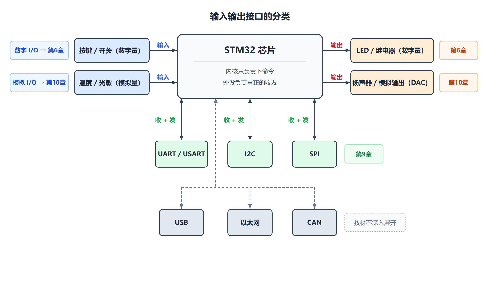

**看图方法**：中间是 STM32 芯片，左边是"输入类"外设，右边是"输出类"外设，下面一排是"双向通信类"。
- 箭头**指向芯片**的是输入（按键、传感器、ADC）；
- 箭头**离开芯片**的是输出（LED、DAC、显示屏）；
- 箭头**两头都有**的是通信（串口、SPI、I2C）—— 因为它们既能收也能发。
- 图中每一类下面标着对应章节号，方便你以后回查。

**【补充解释】"数字"和"模拟"到底差在哪？**

- **数字**：只有两种状态 —— 高电平（比如 3.3V）和低电平（0V）。非 0 即 1，清清楚楚。
- **模拟**：电压是**连续变化**的。比如温度传感器输出 1.234V，代表 23.4℃。

**类比**：
- 数字 I/O 像**电灯开关**（要么开要么关）；
- 模拟 I/O 像**调光灯旋钮**（可以停在任意亮度）。

真实的 ADC/DAC 并不是"旋钮"那么理想，它有精度限制（比如 12 位 ADC 只能分辨 4096 个档位）。

#### 【补充解释】教材这句关键的话

> "Cortex-M3 的寄存器映射到了系统空间，并且它们还控制着外设。有些外设要比 8 位机和 16 位机上的更加复杂，配置时可能会涉及更多的寄存器。"

这句话包含两个重要信息：

1. **"寄存器映射到了系统空间"** —— 外设寄存器不是 CPU 内部的寄存器，而是**被安排在 4GB 地址空间里的某些地址上**（第 3 章的表 3-1 就是这些地址的清单）。
2. **"配置时可能会涉及更多的寄存器"** —— 所以 32 位单片机比 51 单片机难：51 单片机配置一个串口可能就 2~3 个寄存器，STM32 的串口有 7 个寄存器、几十个位。

---

### 5.3.4 教材内容：外设的典型初始化过程（四步曲）

这是本节最有价值的内容，**后面每一章都会重复它**。

教材原文的四步：

> (1) 配置时钟控制回路，使能外设的时钟信号，如果有必要，那么初始化相应的引脚。
> (2) 配置 I/O，大多数微控制器的引脚都是复用的，需要对 I/O 引脚的功能进行配置，以确保外设接口正常工作。
> (3) 配置外设，大多数接口外设都有多个可编程的控制寄存器，因此，为了确保外设工作正常，就需要对寄存器进行一系列的编程操作。
> (4) 配置中断，如果外设操作需要中断处理，就需要另外配置中断控制器（例如 Cortex-M3 的 NVIC）。

把它画成流程（【辅助理解图】）：

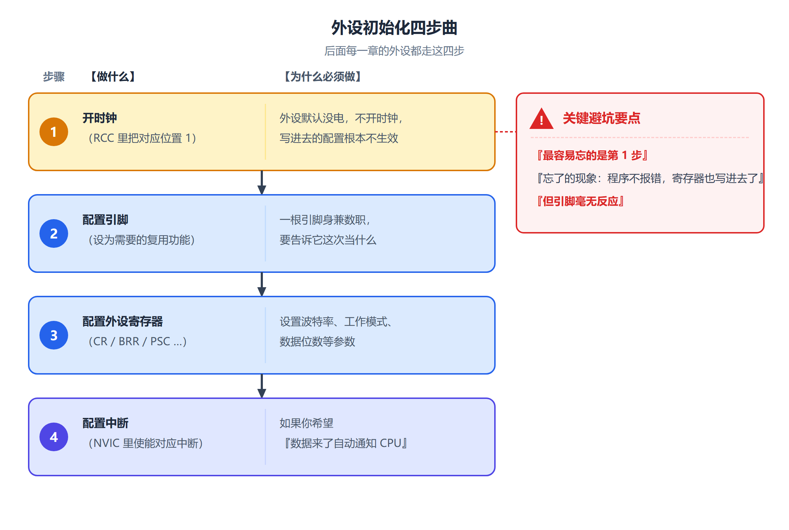

**看图方法**：从上往下四步，每一步左边写"做什么"，右边写"为什么必须做"。

| 步骤 | 做什么 | 为什么必须做 |
|---|---|---|
| ① **开时钟** | 在 RCC 寄存器里把该外设对应的位置 1 | 外设默认**没电**（时钟关着），不开时钟，你写的配置根本进不去 |
| ② **配引脚** | 把引脚设成该外设需要的复用功能 | 一个引脚可能身兼数职，要告诉它"这次你当串口的 TX" |
| ③ **配外设** | 写该外设的 CR / BRR / PSC 等寄存器 | 设置波特率、工作模式、数据位数等 |
| ④ **配中断** | 在 NVIC 里使能对应的中断 | 如果你希望"数据来了自动通知 CPU" |

**【补充解释】四步曲里出现的两个名字**

| 缩写 | 英文全称 | 中文名 | 大白话 |
|---|---|---|---|
| **RCC** | Reset and Clock Control | 复位与时钟控制器 | 芯片的"总电闸 + 配电房"。哪个外设要通电（时钟），由它决定。地址 0x40021000 |
| **NVIC** | Nested Vectored Interrupt Controller | 嵌套向量中断控制器 | 芯片的"总机接线员"。谁的中断能打进来、按什么优先级排队，由它管（第 2 章、第 7 章） |

**记住这两个名字，后面每一章都会见到它们。**
**RCC 管"供电"，NVIC 管"打断"。**

#### 【补充解释】为什么外设默认没有时钟？

教材原文：

> "在许多低功耗微控制器中，时钟信号被分为了许多路，而且为了降低功耗，它们可以单独开关。**大多数时钟信号默认都是关闭的**，配置外设前通常需要使能相应的时钟。有些情况下，用户可能还需要使能外设总线系统的时钟。"

**类比**：
时钟就像"**给这个部门送电**"。
一家公司不会所有部门 24 小时开着灯 —— 只有要用的部门才送电。
STM32 也一样：你用到 GPIOA 才给 GPIOA 送时钟，用不到的部分就断电省电。

**这就是新手最常犯的错误**：

```c
GPIO_Init(GPIOA, &GPIO_InitStructure);   /* 配了半天，灯就是不亮 */
```

**原因**：忘了先 `RCC_APB2PeriphClockCmd(RCC_APB2Periph_GPIOA, ENABLE);`。
**现象**：程序不报错，寄存器写进去了（你读回来还是你写的值），但**引脚毫无反应**。因为没时钟，外设内部电路根本没在工作。

**【补充解释】为什么引脚要"复用"？**

STM32 的引脚数量有限（比如 100 脚），但芯片内部的功能模块非常多。怎么办？
**让一根引脚在不同时候扮演不同角色** —— 这就是"**复用**"（Alternate Function，复用功能）。

举例：PA9 这根引脚
- 默认是普通 GPIO（PA9）；
- 配置成复用后，它变成 **USART1_TX**（串口1的发送线）。

**这解释了第 3 章那张超长的引脚表**（每个引脚后面跟着一串斜杠分隔的功能名，比如 `PA9` 那一行写着 `USART1_TX/TIM1_CH2`）。

#### 【补充解释】为什么需要设备驱动库？

教材原文：

> "为了方便软件开发，大多数微控制器供应商都会为外设编程提供设备驱动库。"

**原因**：外设寄存器太多太杂。如果每个项目都从零写寄存器，开发效率极低，而且换个芯片就要重写。
所以厂商把这些寄存器操作**封装成函数**，这就是"**固件库 / 设备驱动库**"。

**这正是本章 5.6 节的主题。**

---

### 5.3.5 本节真正要记住什么

1. 输入输出分四类：**数字 I/O、模拟 I/O、串行通信、系统级接口**。
2. 外设寄存器是**映射在地址空间里的**，不是 CPU 内部寄存器。
3. **外设初始化四步曲**：开时钟 → 配引脚 → 配外设 → 配中断。
4. **第一步开时钟最容易忘，忘了的现象是"程序没错但硬件没反应"。**
5. 引脚是**复用**的，要配置才知道它这次扮演什么角色。

---

## 5.4 程序映像

### 5.4.1 先别急着看教材：这一节要解决什么？

这一节回答三个非常具体的问题：

> ① 烧进 Flash 的那个文件，里面到底有些什么？
> ② 我写的变量、常量、代码，分别在 Flash 还是 SRAM 里？
> ③ 这些位置是谁决定的？—— **链接脚本（分散加载文件）**。

这一节是本章的**技术核心**。学完它，你就明白"程序从哪里开始跑""变量放在哪里"。

---

### 5.4.2 教材内容：程序映像包含什么

教材原文：

> Cortex-M3 的程序映像一般包含以下几个部分：
> - 向量表；
> - C 启动代码；
> - 程序代码（应用程序代码和数据）；
> - C 库代码（C 库函数的程序代码，链接时插入）。

用一张图（【辅助理解图】）：

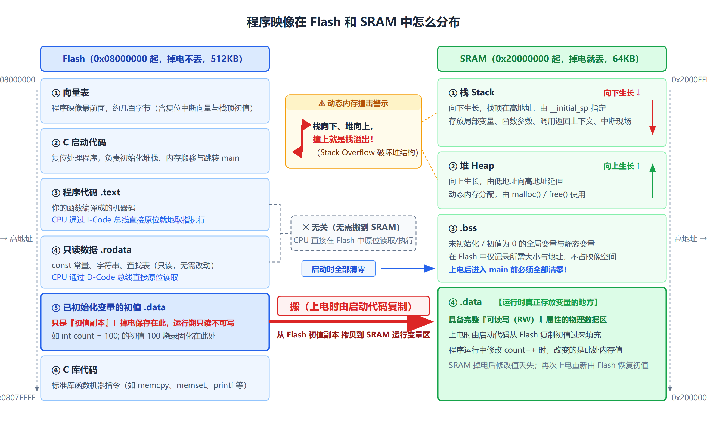

**看图方法**：这是一张"内存地图"，左边是 Flash（掉电不丢），右边是 SRAM（掉电就丢）。

```
        Flash（0x08000000 起，掉电不丢）          SRAM（0x20000000 起，掉电就丢）
   ┌──────────────────────────────┐        ┌──────────────────────────────┐
   │ ① 向量表（最前面，约 几百字节）│        │                              │
   ├──────────────────────────────┤        │  ← 栈（Stack）               │
   │ ② C 启动代码                  │        │    向下生长，栈顶在高地址     │
   ├──────────────────────────────┤        │    由 __initial_sp 指定       │
   │ ③ 程序代码 .text              │        ├──────────────────────────────┤
   │   （你的函数编译成的机器码）   │        │    堆（Heap）                │
   ├──────────────────────────────┤        │    向上生长，malloc 用        │
   │ ④ 只读数据 .rodata            │        ├──────────────────────────────┤
   │   （const 常量、字符串、查找表）│       │    .bss                      │
   ├──────────────────────────────┤        │    （未初始化 / 初始为0 的变量）│
   │ ⑤ 已初始化变量初值 .data       │───搬──→│    .data                     │
   │   （初值的"备份"放在 Flash）   │        │    （运行时真正的变量）        │
   ├──────────────────────────────┤        ├──────────────────────────────┤
   │ ⑥ C 库代码                    │        │                              │
   └──────────────────────────────┘        └──────────────────────────────┘
```

**注意中间那根标着"搬"的箭头** —— 这是理解 C 启动代码的关键，下面 5.4.5 会专门讲。

---

### 5.4.3 你需要先知道的东西

#### 【先补一个前置知识：Flash 和 SRAM 有什么不一样？】

| | **Flash** | **SRAM** |
|---|---|---|
| 中文名 | 闪存 | 静态随机存储器 |
| 类比 | **档案室**（写进去就一直留着） | **办公桌**（下班就清空） |
| 掉电后 | **数据还在** | **数据全丢** |
| 写入速度 | 慢（而且要先擦除一整页） | 快 |
| 读取速度 | 较慢 | 快 |
| 容量 | 大（STM32F103VET6 有 512KB） | 小（64KB） |
| 能不能反复随便写 | **不能**（有擦写次数限制，约 1 万次） | 可以，随便写 |
| 用来放什么 | **程序代码、常量** | **运行时变化的变量、栈、堆** |

**关键结论**：

> **代码和常量放 Flash（因为不用改、要长期保存）。**
> **变量、栈、堆放 SRAM（因为要频繁读写，而且断电后不需要保留）。**

教材第 3 章给的地址：

- Flash 主存储块：**0x08000000 起**，每页 2KB，共 256 页 → 512KB（表 3-1 附近的闪存表）；
- SRAM：**0x20000000 起**，共 64KB；
- 外设：**0x40000000 起**。

#### 【先补一个前置知识：什么叫"段"（Section）？】

**段** = 链接器给"**同一种用途的数据**"打包成的**一捆**。

**类比**：搬家时你会把东西分类装箱：
- 一箱"**书**"（重、不用常翻）→ 放仓库；
- 一箱"**日用品**"（每天用）→ 放手边；
- 一箱"**易碎品**"（要小心）→ 单独放。

链接器也这么干：把"代码"装一箱，把"常量"装一箱，把"有初值的变量"装一箱，把"没初值的变量"装一箱。

最常用的段名：

| 段名 | 装什么 | 放哪儿 |
|---|---|---|
| `.text` | 程序代码（机器指令） | Flash |
| `.rodata` | 只读数据：`const` 常量、字符串字面量、查找表 | Flash |
| `.data` | **有非零初值**的全局/静态变量 | 运行时在 SRAM（初值备份在 Flash） |
| `.bss` | **没有初值**或**初值为 0** 的全局/静态变量 | SRAM（启动时清零） |
| `STACK` | 栈 | SRAM |
| `HEAP` | 堆（`malloc` 用的） | SRAM |

**【补充解释】`.bss` 这个名字的来历**
BSS = "Block Started by Symbol"，是很久以前汇编器里的一条伪指令名，一直沿用至今。
**你只需要记住**：`.bss` = "**一堆没初值的变量**"。

**【补充解释】为什么 `.bss` 要单独一箱，不放进 `.data`？**
因为 `.data` 里的变量**有初值**，初值必须**存在 Flash 里**（否则断电就没了）。
而 `.bss` 里的变量初值都是 0 —— **如果也存进 Flash，就要白白占掉一大片 Flash 空间来存一堆 0**。

所以聪明的做法是：**Flash 里不存这些 0，只记录"这里有一片 N 字节，运行时清零"**。启动代码执行时统一 `memset(..., 0, N)` 就完事了。

**举个数**：`char buf[10000];`（全局）
- 放进 `.bss` → **Flash 里只多几个字节**（记录大小和地址）；
- 放进 `.data` → **Flash 里多 10000 字节**。

这就是为什么 C 语言规定"**未初始化的全局变量自动为 0**" —— 不是因为编译器好心，是因为这样能省 Flash。

#### 【先补一个前置知识：什么是"链接脚本 / 分散加载文件"？】

**链接脚本**（Linker Script，GNU 工具链里是 `.ld` 文件；ARM 工具链里叫**分散加载文件**，`.scat` 文件）就是**写给链接器看的一张"放东西的规则表"**。

教材图 5-1 里，链接器下面挂着的那个 `.ld` / `.scat`，就是它。

它大致长这样（GNU 风格，示意）：

```
MEMORY
{
    FLASH (rx)  : ORIGIN = 0x08000000, LENGTH = 512K
    SRAM  (rwx) : ORIGIN = 0x20000000, LENGTH = 64K
}

SECTIONS
{
    .text   : { *(.text) }   > FLASH     /* 代码放 Flash */
    .rodata : { *(.rodata) } > FLASH     /* 常量放 Flash */
    .data   : { *(.data) }   > SRAM AT> FLASH   /* 变量在 SRAM，初值备份在 Flash */
    .bss    : { *(.bss)  }   > SRAM      /* 未初始化变量在 SRAM */
}
```

**用大白话读这张表**：

| 行 | 意思 |
|---|---|
| `FLASH : ORIGIN = 0x08000000, LENGTH = 512K` | 有一块地方叫 FLASH，从 0x08000000 开始，512KB |
| `SRAM : ORIGIN = 0x20000000, LENGTH = 64K` | 有一块地方叫 SRAM，从 0x20000000 开始，64KB |
| `.text > FLASH` | 代码段放进 FLASH |
| `.data > SRAM AT> FLASH` | **数据段住在 SRAM，但它的初值副本放在 FLASH** ← 这一行最关键 |
| `.bss > SRAM` | 未初始化变量放 SRAM |

**注意 `.data > SRAM AT> FLASH` 这一行**：它说的是"**运行地址在 SRAM，加载地址在 Flash**"。
这就是为什么启动代码要把 `.data` **从 Flash 搬到 SRAM**。

#### 【补充解释】为什么需要链接脚本？不写不行吗？

**不行。** 因为：

1. 链接器**不知道**你的芯片 Flash 从哪开始、有多大；
2. 链接器**不知道**你的芯片 SRAM 从哪开始、有多大；
3. 链接器**不知道**你的板子上有没有外扩存储器。

这些信息**只有人（或 IDE 里的器件选型）知道**。所以必须有人告诉它。

**在 Keil 里你通常不直接写 `.scat`**，因为：
- 你在新建工程时选了具体芯片型号（比如 STM32F103VE）；
- Keil 的 "Target" 对话框里填了 ROM 和 RAM 的地址范围；
- Keil **自动生成**了分散加载文件。

**教材说"创建工程时要选择器件"，道理就在这里** —— 选了器件，工具才知道内存地图。

用一张图看清链接脚本在整条流水线里的位置（【辅助理解图】）：

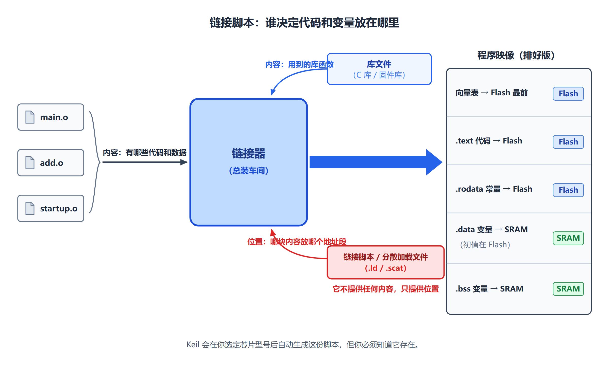

**看图方法**：中间是链接器这个"总装车间"，它有**三个输入**：

1. **左边**：一堆 `.o` 目标文件（**内容**：有哪些代码和数据）；
2. **右上**：库文件（**内容**：用到的库函数）；
3. **右下**：**链接脚本**（**位置**：哪块内容放哪个地址段）。

**右下的箭头最关键**：它不提供任何"内容"，只提供"位置"。**没有它，链接器不知道往哪儿放。**
输出则是排好版的程序映像，左侧标出各段落在 Flash 还是 SRAM。

---

### 5.4.4 教材内容逐条讲解

教材 5.4 节把程序映像分成 4 部分，我们逐条讲。

#### 1. 向量表

教材原文：

> "向量表可以用 C 语言或汇编语言实现。由于向量表的入口需要编译器和链接器生成的内容，所以向量表代码的实现细节同开发工具链相关。例如，栈指针的初始值被链接到链接器生成的栈空间地址，而复位向量则指向了 C 启动代码的地址，这些都是同编译器相关的。"

**这段话在说什么？** 它在说：**向量表里填的那些地址，不是你能手写的，是链接器算出来的**。

- `MSP 初值` = 链接器给栈分配的地址（由 `__initial_sp` 决定）；
- `复位向量` = `Reset_Handler` 的地址（由链接器决定放在 Flash 哪里）。

**所以向量表必须由"知道最终地址"的工具来生成** —— 这就是为什么它是"和开发工具链相关"的。

教材原文：

> "在上面的例子中，向量表被赋予了一个段名 RESET。为了将向量表置于系统存储器映射的开头（地址为 0x00000000），**链接文件或命令行选项需要知道段的名字，以便链接器能够正确识别向量并对其进行地址映射**。复位向量一般指向 C 启动代码的开头。"

**这句话用大白话翻译**：

> 链接脚本里必须写一句类似 `.text : { KEEP(*(RESET)) ... } > FLASH` 的话，
> 明确要求"**把名叫 RESET 的那个段，放在 Flash 的最前面**"。
> 不然链接器可能把别的代码放在最前面，向量表就不在 0 地址了，芯片一复位就找不到北。

**【补充解释】这就是为什么向量表段要单独起名。**
它需要**特殊照顾**（必须排第一），所以给它一个专门的名字，让链接脚本能单独点名。

#### 2. C 启动代码

教材原文：

> "C 启动代码用于设置像全局变量之类的数据，也会**清零加载时未被初始化的内存区域**。对于使用 malloc 等 C 函数的应用程序，C 启动代码还需要初始化堆空间的控制变量。初始化完成后，启动代码跳转到 main() 程序执行。"

**注意这两件事**，正好对应上面说的 `.data` 和 `.bss`：

| 教材原话 | 对应段 | 具体动作 |
|---|---|---|
| "设置像全局变量之类的数据" | `.data` | 把初值从 **Flash 搬到 SRAM** |
| "清零加载时未被初始化的内存区域" | `.bss` | 把这片区域**全部写 0** |
| "初始化堆空间的控制变量" | `HEAP` | 告诉 `malloc` 堆从哪里开始、到哪里结束 |

**这就是"C 启动代码"最实在的工作。** 用一张【辅助理解图】说明"变量上电后怎么变"：

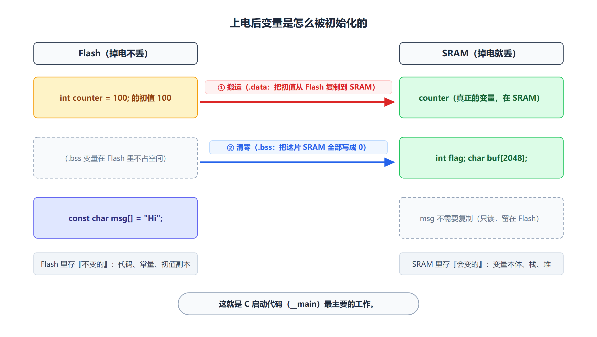

**看图方法**：左列是 Flash，右列是 SRAM，中间两个箭头。

- 上箭头（**搬运**）：`.data` 段。比如你写了 `int counter = 100;`，
  - Flash 里存着"100"这个初值；
  - 启动代码把它**复制**到 SRAM 里 `counter` 的地址上；
  - 之后程序里改 `counter`，改的是 SRAM 那份，Flash 里的 100 不动。
- 下箭头（**清零**）：`.bss` 段。比如你写了 `int flag;`，
  - Flash 里什么都不存；
  - 启动代码把 SRAM 里 `flag` 那片区域**全部写成 0**；
  - 所以第一次用 `flag` 时它是 0。

**这解释了一个经典问题**：

```c
int g1;              /* .bss  → 自动是 0 */
int g2 = 0;          /* .bss  → 自动是 0（初值是 0 也归 bss） */
int g3 = 5;          /* .data → 上电后是 5 */
int g4;              /* 局部变量（非 static）→ 在栈上，值是垃圾！ */
```

**为什么局部变量是垃圾值？**
因为它住在**栈**上，而栈是"反复使用的草稿纸"。上一个函数用完留下的数据还在那儿，没人帮你擦。所以 C 语言规定局部变量**必须自己赋初值**。

#### 3. 程序代码

教材原文：

> "用户指定的任务是由应用程序的指令完成的，除了指令以外，还有以下各类数据：
> - **变量的初始值**。函数或子程序中的局部变量需要初始化，这些初始值会在程序执行期间被赋给相应的变量。
> - **程序代码中的常量**。应用程序中的常量数据有多种用法，如数据值、外设寄存器的地址和常量字符串等，这些数据在程序映像中一般作为数据块放在一起。
> - 应用程序可能也会包括其他的常量，比如**查找表和图像数据**，它们也被合并在程序映像中。"

**逐条翻译**：

| 教材说的 | 放在哪个段 | 举例 |
|---|---|---|
| 变量的初始值 | `.data` | `int x = 7;` 里的那个 7 |
| 常量数据 | `.rodata` | `#define PERIPH_BASE ((uint32_t)0x40000000)` 里的那个 0x40000000 |
| 常量字符串 | `.rodata` | `printf("Hello")` 里的 `"Hello"` |
| 查找表 | `.rodata` | 正弦表 `const float sin_tab[256] = {...};` |
| 图像数据 | `.rodata` | 一张位图的像素数据数组 |

**关键点**：这些东西都是**只读**的，所以全放 Flash，**不占宝贵的 SRAM**。

**这也解释了一个优化技巧**：如果你的常量数组很大（比如一张 320×240 的图片），一定要加 `const`。
- 加 `const` → 放 Flash（512KB 空间，随便用）；
- 不加 `const` → 放 SRAM（只有 64KB，一下子就撑爆了）。

#### 4. C 库代码

教材原文：

> "当使用特定的 C/C++ 库函数时，它们的库代码就会由链接器嵌入到程序映像中。另外，有些数据处理任务需要浮点数或除法运算，在进行这些运算时，C 库代码也会被包含进来。"

**【补充解释】为什么"浮点数和除法"要专门提一句？**

因为 Cortex-M3 **没有浮点运算单元（FPU）**，也没有硬件除法器（部分型号有）。所以：
- 你写 `a / b;` → 编译器会插入一段**软件除法子程序**（几十条指令）；
- 你写 `a * 1.5;` → 编译器会插入**浮点运算库**（可能几百字节）。

**后果**：只要你的工程里出现了一次浮点运算，固件就会**凭空大几百字节甚至几 KB**。

**这也是嵌入式开发的一条常识**：
> 能用整数就别用浮点。要算小数，可以用"定点数"（比如把 1.5 表示成 15，最后结果除以 10）。

---

### 5.4.5 一个具体的程序映像例子（带数值演算）

光说概念太抽象，我们来算一遍。

**假设**你的工程链接脚本规定：

```
FLASH: 0x08000000 ~ 0x0807FFFF  (512KB)
SRAM : 0x20000000 ~ 0x2000FFFF  (64KB)
```

**假设**你的程序里有：

```c
const char msg[] = "Hi";      /* 常量字符串 */
int counter = 100;            /* 有初值 */
int flag;                     /* 无初值 */
char buf[2048];               /* 无初值的大数组 */
void foo(void) { ... }        /* 一个函数 */
```

**链接器排完版后，可能是这样**：

```
Flash（0x08000000 起）
┌──────────────┬─────────────────────┬──────────────────────────────┐
│ 地址          │ 内容                │ 大小                          │
├──────────────┼─────────────────────┼──────────────────────────────┤
│ 0x08000000   │ 向量表              │ 约 0x130 字节（59 个中断左右）│
│ 0x08000130   │ C 启动代码（.text）  │ 约 0x200 字节                 │
│ 0x08000330   │ 你的函数 foo()（.text）│ 约 0x40 字节                 │
│ 0x08000370   │ 常量 "Hi\0"（.rodata）│ 3 字节                        │
│ 0x08000373   │ counter 的初值 100（.data 的加载副本）│ 4 字节        │
│ 0x08000377   │ C 库代码（.text）    │ 若干                          │
└──────────────┴─────────────────────┴──────────────────────────────┘

SRAM（0x20000000 起）
┌──────────────┬────────────────────────┬──────────────────────────────┐
│ 地址          │ 内容                   │ 说明                          │
├──────────────┼────────────────────────┼──────────────────────────────┤
│ 0x20000000   │ .data: counter         │ 启动时从 Flash 0x08000373 搬来 │
│ 0x20000004   │ .bss : flag            │ 启动时清 0                    │
│ 0x20000008   │ .bss : buf[2048]       │ 启动时清 0（占 2048 字节）     │
│ 0x20000808   │ 堆（Heap）              │ 向上生长                      │
│      ...     │ （堆、栈之间的空闲区）   │                               │
│ 0x2000FC00   │ 栈区最低地址            │ 假设栈 1KB：0x2000FC00~0x2000FFFF │
│ 0x2000FFFF   │ 栈区最高字节（末地址）   │ 第一次压栈后 SP 变成 0x2000FFFC │
│ 0x20010000   │ 栈顶（__initial_sp）    │ MSP 初值 = 末地址 + 1，向下生长 │
└──────────────┴────────────────────────┴──────────────────────────────┘
```

**几点观察**：

1. **向量表排在 Flash 最前面** —— 因为链接脚本点名了；
2. **`.data` 占了两个地方**：Flash 里存"初值副本"，SRAM 里是"真正变量"；
3. **`.bss` 在 Flash 里几乎不占地方**，只在 SRAM 里占（那 2048 字节的 `buf`）；
4. **栈顶（MSP 初值）是 0x20010000** —— 也就是"SRAM 最后一个字节的地址 + 1"。
   如果栈大小是 1KB，那么**栈区是 `0x2000FC00 ~ 0x2000FFFF`**：
   `0x2000FC00` 是**栈区最低地址（栈的"底"）**，`0x20010000` 才是**栈顶**。栈的大小和位置具体由链接脚本决定；
5. **MSP 初值就是那个栈顶地址**，它被写进向量表的第 0 项。

**【补充解释】上面这些地址是"示意"，不是真实工程的精确值。**
真实的地址分配取决于：编译器版本、优化等级、库版本、链接脚本的具体写法。
**但规律是不变的**：向量表在最前，代码和常量在 Flash，变量/栈/堆在 SRAM，`.data` 要搬，`.bss` 要清。

#### 【补充解释】`__initial_sp` 的值具体是多少？

对 STM32F103VET6（64KB SRAM）来说，如果栈放在 SRAM 最顶端，那么：

```
SRAM 结束地址 = 0x20000000 + 64KB - 1 = 0x20000000 + 0x10000 - 1 = 0x2000FFFF
栈顶（MSP 初值）= 末地址 + 1 = 0x2000FFFF + 1 = 0x20010000
```

（如果栈大小是 1KB，那么栈区就是 `0x2000FC00 ~ 0x2000FFFF`。注意区分：`0x2000FC00` 是**栈区最低地址**，`0x20010000` 才是**栈顶**、才是 MSP 初值。）

**注意最后那个"+1"**：教材第 2 章强调过：

> "因为 Cortex-M3 使用的是向下生长的满栈，所以 MSP 的初始值必须是堆栈内存的末地址加 1。"

**为什么？**
因为"满栈"意味着 SP **始终指向最后一个已压入的数据**。
如果栈区是 `0x2000FC00 ~ 0x2000FFFF`，那么第一次压栈时，CPU 会先把 SP **减 4** 再存 —— SP 变成 0x2000FFFC，正好落在合法范围内。
如果 SP 初值给 0x2000FFFF（末地址），第一次压栈后 SP = 0x2000FFFB —— **不是 4 的倍数，地址错位了**。

**【补充解释】为什么必须 4 字节对齐？**
因为 Cortex-M3 是 32 位处理器，一次压栈压 4 个字节（一个字）。
如果 SP 不是 4 的倍数，压栈就会**跨越字边界**，效率低甚至出错。
所以栈指针必须**字对齐**（ARM ABI 还要求 8 字节对齐，这就是启动文件里 `PRESERVE8` 和 `ALIGN=3` 的由来）。

---

### 5.4.6 容易搞混的地方

| 误解 | 真相 |
|---|---|
| "变量都存在内存里" | **Flash 也是内存的一种**（非易失）。变量分两类：只读的常量在 Flash，可写的变量在 SRAM |
| "`const` 只是给编译器看的，不影响存储" | **影响很大**。加 `const` 的大数组放 Flash（512KB），不加就放 SRAM（64KB），差别巨大 |
| "`.data` 段的变量住在 Flash 里" | 运行时住在 **SRAM**。Flash 里那份只是**初值副本**，上电时被搬过去 |
| "栈和堆是同一块地方" | **不是**。栈从高地址往下长，堆从低地址往上长，中间隔着 `.bss/.data`。如果它们撞上了，就叫"栈溢出" |
| "`.bss` 里的变量不需要初始化，所以启动快" | 恰恰相反，启动时**必须逐字节清零**。`.bss` 越大，启动越慢 |
| "链接脚本是高级功能，初学者不用管" | Keil 自动帮你生成了，但**你必须知道它的存在**，否则遇到"程序太大放不下""变量地址不对"这类问题就无从下手 |

---

### 5.4.7 本节真正要记住什么

1. 程序映像 = **向量表 + C 启动代码 + 程序代码 + C 库代码**。
2. **Flash 放"不变的"**（代码、常量、`.data` 的初值副本）；
   **SRAM 放"会变的"**（`.data` 变量本体、`.bss`、栈、堆）。
3. **`.data` 要"搬"**（Flash → SRAM），**`.bss` 要"清"**（清零）。这两件事就是 C 启动代码的主要工作。
4. **链接脚本（分散加载文件）决定谁放在哪**。Keil 会根据你选的器件自动生成。
5. **向量表必须排在 Flash 最前面**，所以它有一个专门的段名，供链接脚本点名。
6. 栈是**向下生长**的满栈，所以 **MSP 初值 = 栈区末地址 + 1**。
7. 栈和堆从两端向中间生长，撞上就是栈溢出。

---

## 5.5 C 语言开发 ARM 应用

### 5.5.1 先别急着看教材：这一节要解决什么？

前面讲的都是"程序怎么跑起来"。这一节开始讲"**怎么写程序**"。

但嵌入式 C 和你在电脑上学的 C 有几个**致命的区别**：

| 普通 PC 上的 C | 嵌入式 C |
|---|---|
| 变量就是变量 | **变量可能代表硬件**（外设寄存器） |
| 编译器可以随便优化 | **有些变量绝对不能被优化**（要加 `volatile`） |
| 有操作系统帮你管内存 | **什么都要自己管** |
| `int` 就是 int | **`int` 到底几字节，要看编译器和处理器** |

教材 5.5 节讲了四件事：数据类型、用 C 操作外设、`volatile`、CMSIS。
其中**最重要的、也是新手最迷惑的，是"用 C 操作外设"**。

---

### 5.5.2 数据类型（表 5-1）

#### 【先补一个前置知识：为什么"数据类型"在嵌入式里这么重要？】

在 PC 上，你几乎不用关心 `int` 占几个字节 —— 反正内存多得是。
但在单片机上：
- SRAM 只有 64KB，一个字节都要省；
- 外设寄存器有**严格的位宽**：8 位寄存器你写 32 位会出错；
- 不同处理器的 `int` 长度可能不一样，代码移植会出问题。

所以嵌入式开发**必须精确知道每种类型多少位**。

#### 教材内容：表 5-1

教材表 5-1 列出 Cortex-M3 处理器支持的数据类型及长度。整理如下：

| C / C99 数据类型 | 位数 | 有符号范围 | 无符号范围 |
|---|---|---|---|
| `char` / `int8_t` / `uint8_t` | 8 | −128 ~ 127 | 0 ~ 255 |
| `short` / `int16_t` / `uint16_t` | 16 | −32 768 ~ 32 767 | 0 ~ 65 535 |
| `int` / `int32_t` / `uint32_t` | 32 | −2 147 483 648 ~ 2 147 483 647 | 0 ~ 4 294 967 295 |
| `long` | 32 | 同上 | 同上 |
| `long long` / `int64_t` / `uint64_t` | 64 | −2⁶³ ~ 2⁶³−1 | 0 ~ 2⁶⁴−1 |
| `float` | 32 | 约 ±3.4 × 10³⁸ | — |
| `double` | 64 | 约 ±1.8 × 10³⁰⁸ | — |
| `long double` | 64 | 约 ±1.8 × 10³⁰⁸ | — |
| `pointers`（指针） | 32 | 0x0 ~ 0xFFFFFFFF | — |
| `enum` | 8 / 16 / 32 | 可能的最小数据类型 | — |
| `bool`(C++) / `_Bool`(C) | 8 | 真或假 | — |
| `wchar_t` | 16 | 0 ~ 65 535 | — |

> ⚠️ **【待核验】** 原书表 5-1 的 OCR 结果里，`uint32_t` 的无符号范围印成 "0~4 294 967 265"，指针范围印成 "0x0~0xFFFFFFF"（7 个 F）。
> 按定义应为 `0 ~ 4 294 967 295`（即 2³²−1 = 0xFFFFFFFF）。详见文末"待核验"第 4 条。

**【补充解释】表里最值得注意的是 `int` = 32 位。**

在 51 单片机（8 位机）上，`int` 是 **16 位**（范围 −32768~32767）。
在 Cortex-M3 上，`int` 是 **32 位**。

**这会引发一个真实的 bug**：

```c
int i;
for (i = 0; i < 100000; i++) { ... }
```

- 在 51 上：`i` 最大只能到 32767，**循环永远结束不了**（溢出成负数）；
- 在 STM32 上：没问题。

**所以嵌入式代码里通常不用 `int`，而是用 `uint8_t`/`uint16_t`/`uint32_t`** —— 位数写死在名字里，换平台也不会变。

**【补充解释】为什么有 `int8_t` 这种带下划线的类型？**
它们来自 C99 标准头文件 `<stdint.h>`。
- `int8_t`：**int**eger, **8** bits, **t**ype → 有符号 8 位整数；
- `uint32_t`：**u**nsigned **int**eger, **32** bits → 无符号 32 位整数。

**好处**：看名字就知道几位，代码更清楚，移植更安全。

**【补充解释】`enum` 为什么是"可能的最小数据类型"？**
因为枚举值是整数，编译器可以自己决定用几个字节存：
如果枚举值最大是 5，用 8 位就够了；如果是 100000，就要用 32 位。
**所以枚举的大小不固定，不要假设它一定是 4 字节。**

---

### 5.5.3 用 C 语言操作外设（本节最重要的内容）

#### 核心思想

教材原文：

> "除了变量以外，微控制器的 C 应用程序通常需要操作外设。对于 ARM Cortex-M3 微控制器，**外设寄存器被映射到系统存储器空间，可以通过指针访问它们**。"

**这一句话就是整个 STM32 编程的钥匙。**

**用大白话讲**：

> 你平时写 C，`int a;` 这个 `a` 放在哪儿是编译器决定的，你管不着。
> 但外设寄存器**不一样** —— 它的地址是**硬件规定死的**（第 3 章表 3-1 那张清单）。
> 所以你要在 C 里访问外设，就得**强行指定地址**：告诉编译器"这块内存就是外设寄存器，你别动它"。

**怎么"强行指定地址"？答案就是指针。**

#### 【先补一个前置知识：什么叫"指针"？】

（第 1 章/第 4 章讲过，这里快速复习并加强。）

**指针** = 一个**专门用来装地址的变量**。

```c
int  a = 5;      /* a 是一个整数，值是 5 */
int *p;          /* p 是一个指针，用来装"int 型变量的地址" */
p = &a;          /* &a 表示"a 的地址"，把它装进 p */
*p = 8;          /* *p 表示"p 指向的那个变量"，也就是 a；所以 a 变成 8 */
```

**类比**：
- 普通变量 = **一个房间**；
- 指针 = **一张写着房间号（地址）的纸条**；
- `*p` = "**照着纸条上的房间号找过去，打开那个房间**"。

**关键操作：把"一个数字"变成"一个地址"**：

```c
int *p = (int *)0x20000000;
```

- `0x20000000` 本来只是一个数字；
- `(int *)` 是**强制类型转换**，意思是"**把这个数字当成 int 型的地址**"；
- 于是 `p` 就是一个指向 0x20000000 的指针；
- `*p = 100;` 就是"**往 0x20000000 这个地址写 100**"。

**这就是操作外设的全部秘密。**

#### 【先补一个前置知识：AHB、APB1、APB2 是什么？】

在接下来的代码里你会看到 `APB1PERIPH_BASE`、`APB2PERIPH_BASE` 这样的名字。先解释一下它们从哪来。

**先看一个事实**：CPU 跑得很快（72MHz），但外设（比如串口、I2C）根本不需要这么快。如果所有外设都接在同一条"高速公路"上，既浪费又互相干扰。

**所以 STM32 内部把总线分成了几条，速度不同**：

| 总线 | 英文全称 | 中文名 | 速度 | 挂了什么 |
|---|---|---|---|---|
| **AHB** | Advanced High-performance Bus | 高级高性能总线 | 最快（和内核同速） | DMA、SRAM、Flash 接口、RCC |
| **APB2** | Advanced Peripheral Bus 2 | 高级外设总线 2 | 较快（最高 72MHz） | GPIO、USART1、SPI1、ADC、TIM1 |
| **APB1** | Advanced Peripheral Bus 1 | 高级外设总线 1 | 较慢（最高 36MHz） | USART2/3、I2C、SPI2、TIM2~7 |

**类比**：整个芯片的交通系统里，AHB 是**主干道**，APB2 是**次干道**，APB1 是**慢车道**。
慢速外设挂在慢车道上，就不会拖累主干道。

**这解释了两件事**：

1. 为什么有 `APB1PERIPH_BASE` 和 `APB2PERIPH_BASE` 两个不同的基地址 —— **因为它们本来就是两段不同的地址区间**；
2. 为什么第 3 章的表 3-1 里每个外设后面都标着"所在总线" —— **因为挂在不同总线上，访问速度不一样**。

#### 教材代码逐行讲解

教材给的第一段代码：

```c
#define PERIPH_BASE       ((uint32_t)0x40000000)  //外设基地址
#define APB1PERIPH_BASE   PERIPH_BASE
#define USART1_BASE       (APB2PERIPH_BASE + 0x3800)
#define USART1            ((USART_TypeDef *) USART1_BASE)
#define USART2_BASE       (APB1PERIPH_BASE + 0x4400)
#define USART2            ((USART_TypeDef *) USART2_BASE)
```

**这段想完成什么？**
给两个串口（USART1、USART2）**算出它们的寄存器组起始地址**，并把这些地址包装成"**结构体指针**"，方便使用。

**逐行解释 + 地址演算**：

| 行 | 含义 | 数值演算 |
|---|---|---|
| `#define PERIPH_BASE ((uint32_t)0x40000000)` | 所有外设的**基地址**（起点） | 0x40000000 |
| `#define APB1PERIPH_BASE PERIPH_BASE` | APB1 总线上的外设，从这个地址开始 | 0x40000000 |
| `#define USART1_BASE (APB2PERIPH_BASE + 0x3800)` | USART1 的起始地址 | 需要先知道 APB2PERIPH_BASE |
| `#define USART1 ((USART_TypeDef *) USART1_BASE)` | 把地址变成一个"USART 结构体指针" | 见下 |
| `#define USART2_BASE (APB1PERIPH_BASE + 0x4400)` | USART2 的起始地址 | 0x40000000 + 0x4400 = **0x40004400** |
| `#define USART2 ((USART_TypeDef *) USART2_BASE)` | 同上 | 见下 |

**【补充解释】`APB2PERIPH_BASE` 在哪？**
按第 3 章表 3-1 和 5.6 节的代码：

```c
#define PERIPH_BASE      ((u32)0x40000000)
#define APB1PERIPH_BASE  PERIPH_BASE
#define APB2PERIPH_BASE  (PERIPH_BASE + 0x10000)
```

所以：

```
APB2PERIPH_BASE = 0x40000000 + 0x00010000 = 0x40010000
USART1_BASE     = 0x40010000 + 0x00003800 = 0x40013800   ← 和表 3-1 一致 ✓
USART2_BASE     = 0x40000000 + 0x00004400 = 0x40004400   ← 和表 3-1 一致 ✓
```

> ⚠️ **【待核验】** 教材 p142 这段代码里只定义了 `APB1PERIPH_BASE`，却在下一行用了 `APB2PERIPH_BASE`，**没有给出它的定义**。
> 按上下文和表 3-1，`APB2PERIPH_BASE` 应为 `PERIPH_BASE + 0x10000`。详见文末"待核验"第 3 条。

**【补充解释】这一步建立了 AGENTS 里强调的那条链**

```
地址 → 地址空间 → 外设基地址 → 寄存器偏移 → 最终寄存器地址
```

用 USART1 的 `DR` 寄存器走一遍：

```
① 地址空间起点：      0x00000000（整个 4GB 空间）
② 片上外设区起点：    0x40000000  ← PERIPH_BASE
③ APB2 外设区起点：   0x40010000  ← APB2PERIPH_BASE = PERIPH_BASE + 0x10000
④ USART1 外设起点：   0x40013800  ← + 0x3800
⑤ DR 寄存器偏移：     0x04        ← 结构体里 DR 前面有 SR（4 字节）
⑥ 最终地址：          0x40013804  ← USART1 的 DR 寄存器
```

**用图表示**（【辅助理解图】）：

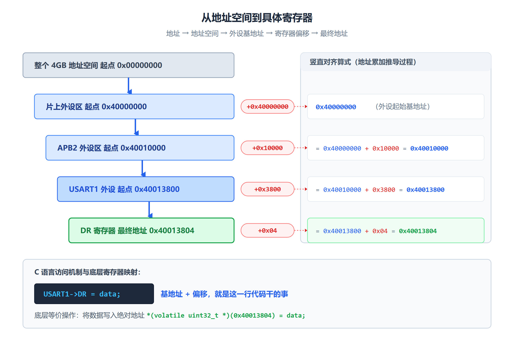

**看图方法**：从上往下一层层"加偏移"，最后落到一个具体地址上。
每往下一层，就多一个"子区域"的概念。**这就是第 3 章存储器映像和本章指针代码之间的桥梁。**

#### 结构体 `USART_TypeDef`

教材接着给了这个结构体：

```c
typedef struct
{
    __IO uint16_t SR;
    uint16_t RESERVED0;
    __IO uint16_t DR;
    uint16_t RESERVED1;
    __IO uint16_t BRR;
    uint16_t RESERVED2;
    __IO uint16_t CR1;
    uint16_t RESERVED3;
    __IO uint16_t CR2;
    uint16_t RESERVED4;
    __IO uint16_t CR3;
    uint16_t RESERVED5;
    __IO uint16_t GTPR;
    uint16_t RESERVED6;
} USART_TypeDef;
```

**这段想完成什么？**
把 USART 的一堆寄存器**按顺序**排成一个结构体，这样就能用"结构体成员的偏移"来表示"寄存器的偏移"。

**逐项解释**：

| 成员 | 大小 | 在结构体里的偏移 | 实际寄存器地址（以 USART1 为例） |
|---|---|---|---|
| `SR` | 2 字节 | 0x00 | 0x40013800 |
| `RESERVED0` | 2 字节 | 0x02 | （空） |
| `DR` | 2 字节 | 0x04 | 0x40013804 |
| `RESERVED1` | 2 字节 | 0x06 | （空） |
| `BRR` | 2 字节 | 0x08 | 0x40013808 |
| `RESERVED2` | 2 字节 | 0x0A | （空） |
| `CR1` | 2 字节 | 0x0C | 0x4001380C |
| `RESERVED3` | 2 字节 | 0x0E | （空） |
| `CR2` | 2 字节 | 0x10 | 0x40013810 |
| `RESERVED4` | 2 字节 | 0x12 | （空） |
| `CR3` | 2 字节 | 0x14 | 0x40013814 |
| `RESERVED5` | 2 字节 | 0x16 | （空） |
| `GTPR` | 2 字节 | 0x18 | 0x40013818 |
| `RESERVED6` | 2 字节 | 0x1A | （空） |

**【补充解释】为什么每个 16 位寄存器后面都要跟一个 `uint16_t RESERVED0`？**

这是一个非常经典的"**填充**"技巧，原因有两个：

1. **STM32F1 的外设寄存器在物理上就是"32 位一格子"**，但实际只用了低 16 位。所以每个寄存器占 4 字节地址空间，高 16 位是空的。
2. **C 结构体有"对齐"规则**：编译器可能会在成员之间自动插入空隙。如果不显式写 `RESERVED`，你**无法保证** `DR` 的偏移一定是 0x04。

**显式写 `RESERVED`，就把"哪里有洞、洞多大"说死了**，保证结构体成员的偏移**精确等于**硬件寄存器的偏移。

**类比**：就像填一张表格，中间那些空格你不能跳过 —— 跳过了，后面的内容就全错位了。

**【补充解释】`RESERVEDi` 这个名字是约定俗成的**
教材原文：

> "其中，RESERVEDi（i 为一个整数索引值）表示被保留区域。"

保留 = 硬件现在没用，或者留作以后扩展。**你的程序不应该去读写它。**

#### 用结构体指针访问寄存器

```c
USART1->DR = mydata;
```

**这一行到底发生了什么？** 拆开来看：

```
USART1              → 展开成 ((USART_TypeDef *) 0x40013800)
USART1->DR          → 意思是：从 0x40013800 开始，找到 DR 这个成员
                    → DR 的偏移是 0x04
                    → 所以访问的地址是 0x40013804
USART1->DR = mydata → 把 mydata 的值写到地址 0x40013804
```

**用 ASCII 图表示这个地址计算过程**：

```
   USART1 = 0x40013800（基地址）
        │
        │  结构体布局：
        │  ┌────────────┬─────────┐
        │  │ 偏移 0x00  │ SR      │
        │  ├────────────┼─────────┤
        │  │ 偏移 0x04  │ DR      │ ← 我要写这里！
        │  ├────────────┼─────────┤
        │  │ 偏移 0x08  │ BRR     │
        │  └────────────┴─────────┘
        │
        ▼
   0x40013800 + 0x04 = 0x40013804
        │
        ▼
   CPU 执行一条"存储指令"（STR），把 mydata 写到 0x40013804
        │
        ▼
   这个地址上的 USART 硬件"数据寄存器"被写入
        │
        ▼
   如果 USART 已经使能，硬件开始把这个字节一位一位地发出去
```

**这就是"软件控制硬件"的完整链条。**

**【补充解释】为什么教材说"结构体可以被多个外设实体共用"？**

教材原文：

> "从上述方法可以看出，同一个外设寄存器的结构体可以被多个外设实体共用，这样也使得程序维护变得容易。另外，由于立即数存储的减少，编译出的程序代码也会变小。"

- **共用**：USART1、USART2、USART3 的寄存器布局是一样的，所以**一个 `USART_TypeDef` 就够了**，只是基地址不同。不用写三遍。
- **代码变小**：如果每个外设都写一套独立的寄存器定义，编译器就要在代码里塞很多立即数（地址常量）。用统一的指针 + 偏移，代码更紧凑。

#### 封装成函数

教材进一步把操作封装成函数：

```c
void USART_SendData(USART_TypeDef * USARTx, uint16_t Data)
{
    /* Check the parameters */
    assert_param(IS_USART_ALL_PERIPH(USARTx));
    assert_param(IS_USART_DATA(Data));

    /* Transmit Data */
    USARTx->DR = (Data & (uint16_t)0x01FF);
}
```

**这段想完成什么？** 把"往串口数据寄存器写一个字节"这件事，包装成一个函数。

**逐行解释**：

| 行 | 做什么 | 为什么 |
|---|---|---|
| `void USART_SendData(USART_TypeDef * USARTx, uint16_t Data)` | 函数接收两个参数：**哪个串口**（指针）+ **要发什么数据** | 这样 USART1/USART2/USART3 都能用同一个函数 |
| `assert_param(IS_USART_ALL_PERIPH(USARTx));` | 检查第一个参数是不是合法的串口指针 | 防止你传错（比如传了个 GPIO 指针进去） |
| `assert_param(IS_USART_DATA(Data));` | 检查数据是否在合法范围内 | 防止传超范围的值 |
| `USARTx->DR = (Data & (uint16_t)0x01FF);` | 把数据的低 9 位写进 DR | 见下 |

**【补充解释】`assert_param` 是什么？**

它是一个**断言宏**。如果参数不合法，它会**记录错误**（开发时通常触发一个断点或错误处理）。
教材原文说：

> "固态函数库通过校验所有库函数的输入值来实现实时错误检测。该动态校验提高了软件的鲁棒性。实时检测适合于用户应用程序的开发和调试，但会增加成本，可以在最终应用程序代码中移去，以优化代码大小和执行速度。"

**用大白话说**：`assert_param` 是一道"安检门"。
- **开发阶段**：开着，帮你抓错；
- **产品出厂**：关掉（用一个宏定义），省时间省空间。

**【补充解释】`(Data & (uint16_t)0x01FF)` 里的 `0x01FF` 是什么？为什么要与运算？**

这涉及**位运算**，我们一步一步展开。

**`0x01FF` 是多少？**

十六进制每一位 = 4 个二进制位，所以：

```
0x01FF = 0000 0001 1111 1111   （16 位）
          ↑
        bit8 是最高位
```

**所以 `0x01FF` 就是"低 9 位全 1，其余全 0"**：

```
bit15 ... bit9  bit8 bit7 ... bit1 bit0
   0   ...   0     1    1   ...   1    1
  └─── 全 0 ───┘   └────── 全 1 ──────┘
```

**为什么要和它做"与"（AND）运算？**

`&` 的规则是：**两个位都是 1，结果才是 1；否则是 0**。
所以 `x & 0x01FF` 的效果是：**保留 x 的低 9 位，把高 7 位清零**。

**完整演算**（假设 `Data = 0xABCD`）：

```
运算前    Data     = 1010 1011 1100 1101
掩码     0x01FF    = 0000 0001 1111 1111
                    ───────────────────────  (AND：都为1才为1)
运算后             = 0000 0001 1100 1101  = 0x01CD
                            ↑
                    高 7 位被清掉了
```

**为什么要这样？**

因为 USART 的 DR 寄存器**只有低 9 位是数据位**（STM32 的 USART 支持 8 位或 9 位数据），高 7 位是保留位。

- 如果你传进来的 `Data` 高 7 位有垃圾值（比如 `Data = 0xABCD`）；
- 不屏蔽就写进 DR，**高 7 位也会被写进去**；
- 万一那些位有意义（在别的芯片上可能控制别的功能），就会出问题。

**所以这一句是"保险丝"**：只把合法的低 9 位放进去。

**【补充解释】`uint16_t` 强制类型转换有什么用？**
`0x01FF` 在 C 里默认是 `int`（32 位）。转成 `uint16_t` 是为了避免编译器警告"不同宽度的类型做运算"。
**实际效果一样，但代码更规范。**

**【补充解释】9 位数据是干什么用的？**
STM32 的 USART 可以配成 8 位数据 + 1 位校验位，也可以配成 9 位数据（无校验）。
所以 DR 要能装下 9 位。这就是 `0x01FF`（9 个 1）的由来。

---

### 5.5.4 `volatile`：本节最容易踩坑的地方

教材原文：

> "应该注意的是，在定义 USART_TypeDef 结构时，使用了 `_IO` 变量类型，该类型实质上是 `volatile` 的宏定义（该宏定义包含在 `core_m3.h` 文件中）。外设访问定义指针时，需要使用 `volatile` 关键字。`volatile` 用于防止相关变量被优化。"

**这段话是本节的核心。我们彻底讲清楚。**

#### 【先补一个前置知识：编译器会"优化"你的代码】

编译器不是老老实实逐行翻译的。它会想："这段代码能不能更快/更小？" 然后**改写**它。

举例：

```c
int a = 1;
a = 2;
a = 3;
```

编译器一看：前两次赋值根本没人用，直接**删掉**，只留 `a = 3;`。
这叫**优化**，是好事 —— 平时能让你程序跑得更快。

**但是，如果 `a` 不是一个普通变量，而是一个外设寄存器呢？**

先看不加 `volatile` 的写法（**错误示范**）：

```c
/* 写法 A：不加 volatile —— 错误示范 */
*(uint32_t *)0x4001080C = 0x0001;  /* 让某个引脚变高 */
*(uint32_t *)0x4001080C = 0x0002;  /* 让某个引脚变低 */
*(uint32_t *)0x4001080C = 0x0004;  /* 让另一个引脚变高 */
```

（`0x4001080C` 就是 GPIOA 的输出数据寄存器 ODR：GPIOA 基地址 `0x40010800` + ODR 偏移 `0x0C`，详见第 6 章。）

**没有 `volatile`** 时，编译器会觉得："这个地址被写了三次，但中间没人读它，那前两次白写了，删掉！" 于是只保留最后一次。

**结果**：你以为引脚会"高 → 低 → 另一个高"，实际只发生最后一次。
**程序不报错，现象就是"不对"。** 这是最折磨人的一类 bug。

正确的写法是**每一次外设访问都加上 `volatile`**：

```c
/* 写法 B：加 volatile —— 正确写法 */
*(volatile uint32_t *)0x4001080C = 0x0001;
*(volatile uint32_t *)0x4001080C = 0x0002;
*(volatile uint32_t *)0x4001080C = 0x0004;
```

加上 `volatile` 之后，编译器老老实实生成三条存储指令，硬件按顺序看到三次变化 —— 这才是我们要的效果。

**关键**：这里 `volatile` 修饰的是"**指针指向的那个对象**"（`volatile uint32_t *`），所以通过这个指针的每一次读写都不许被优化。少了它，编译器就有权按"普通变量"处理，前面那些"看起来白写"的操作就可能被删掉。

#### `volatile` 的作用

**`volatile`** 是 C 语言的一个关键字，英文意思是"**易变的、不稳定的**"。

**它的唯一作用**：告诉编译器 ——

> "**这个变量的值随时可能被'别的东西'改掉，你不要自作聪明优化它。每次用它，都必须老老实实去内存/地址里读一遍；每次赋值，都必须老老实实写进去。**"

**"别的东西"是谁？** 两种：
1. **硬件**（外设寄存器：你写进去的值硬件会拿走，硬件也会改里面的状态位）；
2. **中断服务程序**（中断可能在任意时刻改一个全局变量）。

#### 【辅助理解图】有 volatile 和没有 volatile 的区别

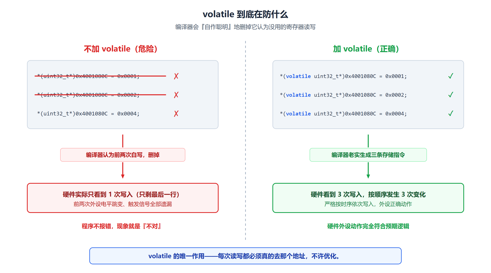

**看图方法**：左右对照。

- **左边（不加 volatile）**：编译器看到"连续三次写同一地址"，把前两次划掉，只留最后一次。硬件只看到一次变化。
- **右边（加 volatile）**：编译器老实生成三条存储指令，硬件看到三次变化。

**箭头代表"编译器对代码的改写"**，红色叉号表示"被优化掉了"。

#### 【补充解释】教材原话里的两个使用场合

教材原文：

> "对有些外部设备的寄存器来说，读写操作可能都会引发一定硬件操作，但是如果不加 volatile，编译器会把这些寄存器作为普通变量处理，例如连续多次对同一地址写入，会被优化为只有最后一次写入。"

**场合一：外设寄存器**

有些寄存器**读操作本身就有副作用**：
- 读 USART 的 `DR` → **会把"收到数据"的标志清掉**；
- 读某些状态寄存器 → **会清除状态位**。

如果编译器把"读了两次"优化成"读一次"，第二次就读不到东西了。

**场合二：中断**

教材原文：

> "另一个使用场合是中断。如果一个全局变量，在中断函数和普通函数中都用到过，那么最好对这个变量加 volatile 修饰。否则在普通函数中，可能会仅从寄存器里读取这个变量以便加快速度，而不去实际地址读取该变量。"

**具体解释**：

```c
int flag = 0;   /* 中断服务程序会把它改成 1 */

void main(void) {
    while (flag == 0) {   /* 等中断来 */
        /* 空转 */
    }
}
```

**如果不加 `volatile`**：
编译器看到 `while (flag == 0)` 这个循环里**没人修改 `flag`**，于是它把 `flag` **读进 CPU 寄存器一次**，然后每次循环都拿寄存器里的旧值比较。

**结果**：即使中断真的把内存里的 `flag` 改成了 1，CPU 也永远看不到 —— **死循环**。

**加上 `volatile` 之后**：
编译器每次循环都**重新去内存读 `flag`**，就能看到中断的修改。

用【辅助理解图】说明：

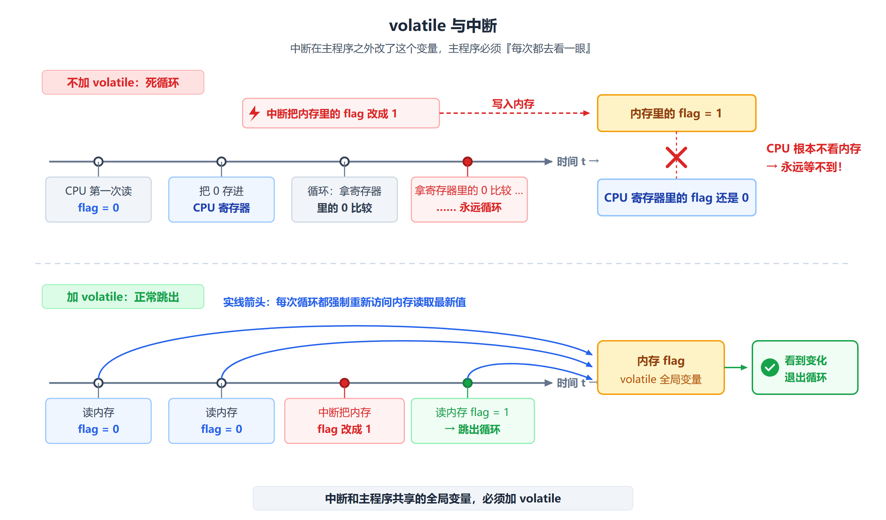

**看图方法**：上下两条时间线。

- **上面（不加 volatile）**：CPU 把 `flag` 缓存进寄存器，之后一直用缓存。中断改了内存，但 CPU 不看内存，永远等不到。
- **下面（加 volatile）**：每次循环 CPU 都去内存读一次，中断改完，下一圈就读到了。

#### 【补充解释】`_IO` 是什么？

教材说 `_IO` 是 `volatile` 的宏定义，在 `core_m3.h` 里。实际定义大致是：

```c
#define     __I     volatile const   /* 只读 */
#define     __O     volatile         /* 只写 */
#define     __IO    volatile         /* 可读可写 */
```

| 宏 | 展开成 | 含义 |
|---|---|---|
| `__I` | `volatile const` | 这个寄存器**只能读**（比如状态寄存器） |
| `__O` | `volatile` | 这个寄存器**只写**（比如某些命令寄存器） |
| `__IO` | `volatile` | 这个寄存器**可读可写**（大多数配置寄存器） |

**所以看到 `__IO uint16_t SR;`，实际就是 `volatile uint16_t SR;`。**

**【补充解释】为什么教材说 `core_m3.h`，而实际工程里常见的是 `core_cm3.h`？**
`core_cm3.h` 是 CMSIS 提供的 Cortex-M3 内核头文件（注意是下划线 `_cm3`）。
教材写的 `core_m3.h` 可能是简写或笔误。**见文末"待核验"。**

#### 【补充解释】`volatile` 不能解决什么？

**这是一个非常重要的边界，很多教材不讲。**

| `volatile` 能做的 | `volatile` 不能做的 |
|---|---|
| 防止编译器删除"看起来没用"的读写 | **不能保证原子性**（多个步骤之间不会被打断） |
| 保证每次都真的访问内存 | **不能当"互斥锁"用** |
| | **不能解决多核/多线程的数据竞争** |

**举例：`counter++` 不是原子的**

```c
volatile int counter;
counter++;   /* 实际上分三步：读 → 加 1 → 写回 */
```

如果在"读"和"写回"之间发生了中断，而中断里也改了 `counter`，结果就会丢数据。
**`volatile` 对此无能为力** —— 这需要"关中断"或者"原子操作"来解决（第 2 章讲的位带操作就是一种原子操作手段）。

**记住这句话**：

> **`volatile` 管的是"编译器别乱优化"，不管"多个人同时改会不会打架"。**

---

### 5.5.5 容易搞混的地方

| 误解 | 真相 |
|---|---|
| "指针就是地址" | 不严谨。指针是**一个装着地址的变量**，它自己也有地址 |
| "`(uint32_t)0x40000000` 是把地址转成数字" | 反过来：**是把数字当成地址**。在 32 位系统里两者都是 32 位，所以看起来一样，但语义不同 |
| "外设寄存器和内存变量没区别" | 有本质区别：**外设寄存器被读写时，硬件会真的动作**（发数据、清标志）；内存变量只是存个数 |
| "加了 `volatile` 就万事大吉" | 不能保证原子性，不能替代互斥 |
| "`RESERVED` 成员没用可以删掉" | **绝对不能删**。删了结构体偏移就全乱了，代码会去写错误的寄存器 |
| "`0x01FF` 是随便写的" | 它是"低 9 位掩码"，因为 USART 数据只有 9 位 |

---

### 5.5.6 本节真正要记住什么

1. 外设寄存器**被映射到地址空间**，用**指针**访问。
2. 访问外设的标准写法：**`(类型 *) 基地址 + 偏移`**，再用 `->成员` 访问。
3. **结构体 + `RESERVED` 填充**，保证成员偏移 = 寄存器偏移。
4. 外设指针**必须加 `volatile`**（在固件库里就是 `__IO`），否则编译器会把"连续的寄存器操作"优化掉。
5. `volatile` 也用于**中断和主程序共享的全局变量**。
6. `volatile` **不能**保证原子性。
7. 位运算（如 `& 0x01FF`）用来"只保留合法的那几位"，写外设前常要做。

---

## 5.6 固件库与 CMSIS

### 5.6.1 先别急着看教材：这一节要解决什么？

上一节你学会了"用指针直接操作寄存器"。**但这太累了**：

- 你要记住几百个寄存器的名字、地址、每一位的含义；
- 换个 STM32 型号，地址全变了，代码要重写。

所以 ST 公司提供了**固件库**：把寄存器操作**封装成函数**。
你只要调 `GPIO_ResetBits(GPIOD, GPIO_Pin_8);`，不用管 `BRR` 是什么。

而**固件库又是按 CMSIS 标准设计的**。所以这一节讲两个东西：

1. **CMSIS**：ARM 定的"通用软件接口标准"，让代码能跨厂商移植；
2. **STM32 固件库**：ST 按这个标准做的库，以及它的命名规则、变量类型、文件组成。

---

### 5.6.2 基于固件库开发和直接操作寄存器有什么区别？

#### 教材内容

教材原文：

> "固件库就是函数的集合，固件库函数的作用是：**向下负责直接操作寄存器，向上提供用户函数调用的接口（API）**。"

**这句话是本节的核心。** 用一张图（【辅助理解图】）：

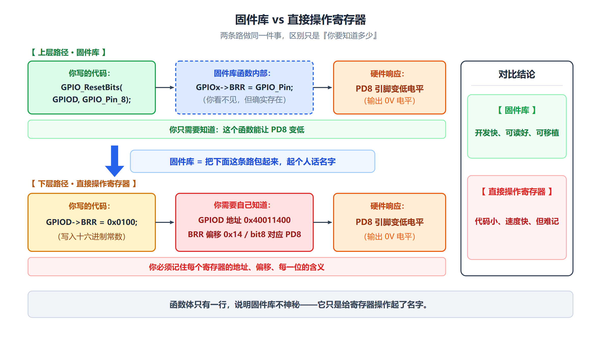

**看图方法**：上下两条路径，做的是同一件事 —— 让某个引脚变低。

| 路径 | 写法 | 你需要知道什么 |
|---|---|---|
| **上层：用固件库** | `GPIO_ResetBits(GPIOD, GPIO_Pin_8);` | 只需要知道"这个函数能让 PD8 变低" |
| **下层：直接操作寄存器** | `GPIOD->BRR = GPIO_Pin_8;` | 需要知道：GPIOD 的地址、BRR 的偏移、BRR 里每一位对应哪个引脚 |

#### 教材给的对比例子

**51 单片机（STC15）直接操作寄存器**：

```c
P2 = 0x11;
```

**STM32 直接操作寄存器**：

```c
GPIOx->BRR = 0x0011;
```

教材原文：

> "这种方法的缺点是，用户只有掌握每个寄存器的用法，才能正确使用 STM32，而 STM32 的寄存器特别多，记起来很麻烦。"

**【补充解释】`BRR` 是什么？**

`BRR` = **B**it **R**eset **R**egister = **端口位清除寄存器**。

它是一个 **16 位**寄存器（在结构体里占 32 位空间，低 16 位有效），每一位对应端口的一个引脚：

```
bit15 bit14 bit13 ... bit3 bit2 bit1 bit0
  │     │     │        │    │    │    │
  │     │     │        │    │    │    └─ 写1 → Px0 输出低电平
  │     │     │        │    │    └────── 写1 → Px1 输出低电平
  │     │     │        │    └─────────── 写1 → Px2 输出低电平
  │     │     │        └──────────────── 写1 → Px3 输出低电平
  │     │     └───────────────────────── 写1 → Px13 输出低电平
  │     └─────────────────────────────── 写1 → Px14 输出低电平
  └───────────────────────────────────── 写1 → Px15 输出低电平
```

**写 0 意味着什么**：**什么都不做**（对应引脚状态不变）。
**写 1 意味着什么**：**把对应引脚拉低**。

**所以 `GPIOx->BRR = 0x0011;` 是什么意思？**

```
0x0011 = 0000 0000 0001 0001
                     ↑    ↑
                   bit4  bit0
```

**意思是：把 bit0 和 bit4 对应的两个引脚拉低，其他引脚不动。**

```
运算前的 BRR（假设）：  xxxx xxxx xxxx xxxx   （写 BRR 不用管原来是什么）
要写的值 0x0011：       0000 0000 0001 0001
写入后的效果：          Px0 → 低电平，Px4 → 低电平，其余不变
```

**【补充解释】为什么有 `BRR` 还要有 `BSRR`？**

`BRR` 只能"清 0"（拉低）。如果要"置 1"（拉高），用 **`BSRR`**（Bit Set/Reset Register，端口位设置/清除寄存器）：
- 低 16 位写 1 → 对应引脚**拉高**；
- 高 16 位写 1 → 对应引脚**拉低**。

**为什么不用 `ODR`（输出数据寄存器）直接赋值？**
因为 `ODR` 是**整个端口一起赋值**，你写 `ODR = 0x0011` 会把其他 14 个引脚全改掉。
而 `BRR`/`BSRR` 是"**只操作我指定的那几位，其他不动**" —— 更安全。

（第 6 章会详细讲 GPIO 的这几个寄存器。）

#### 固件库的封装

教材给了固件库对应的函数：

```c
void GPIO_ResetBits(GPIO_TypeDef * GPIOx, uint16_t GPIO_Pin)
{
    GPIOx->BRR = GPIO_Pin;
}
```

**逐行解释**：

| 行 | 做什么 |
|---|---|
| `void GPIO_ResetBits(GPIO_TypeDef * GPIOx, uint16_t GPIO_Pin)` | 参数1：哪个端口（GPIOA~GPIOG）；参数2：哪几个引脚（位掩码） |
| `GPIOx->BRR = GPIO_Pin;` | 把位掩码直接写进 BRR。**函数体只有一行！** |

**注意：函数体只有一行。** 这就是固件库的本质：

> **它不是"新功能"，它只是"给寄存器操作起了个人话的名字"。**

教材原文：

> "有了上述函数，就不需要再直接去操作 BRR 寄存器了（操作 BRR 寄存器的工作在 API 函数内部完成），只需要知道 `GPIO_ResetBits()` 函数怎么使用即可。在对外设的工作原理有一定的了解之后，再去看固件库函数，基本上从函数名字就能看出这个函数的功能。"

#### 固件库的优缺点（教材内容整理）

| 优点 | 说明 |
|---|---|
| 开发效率高 | 不用记几百个寄存器 |
| 代码可读性好 | 函数名一看就懂（`GPIO_SetBits` = 置位） |
| 可移植性好 | 换型号时大部分代码不用改 |
| 符合 ANSI-C | 不受开发环境影响 |
| 有参数检查 | `assert_param` 提高鲁棒性 |

| 缺点 | 说明 |
|---|---|
| 代码变大 | 通用函数包含所有外设操作，链接进来就占空间 |
| 执行变慢 | 函数调用、参数检查都有开销 |
| 出问题时不好查 | 你看到的是函数，不知道底层寄存器怎么变的 |

教材原文：

> "由于固件库函数是通用的，并且包含了对所有外设的操作，这必定会影响程序代码的大小和执行速度，因此，对于代码大小和执行速度有严格要求的情况，可以考虑使用直接对寄存器操作来满足要求。"

**【补充解释】教材还提到一个重要的教学安排**：

> "任何处理器，归根结底都是要对处理器的寄存器进行操作。因此，第 6 章给出了汇编语言、C 语言直接操作寄存器和使用固件库函数 3 个版本的程序代码供读者参考。从第 7 章开始，只给出使用固件库函数操作外设的方法。"

**这意味着**：第 6 章你要看到同一个功能的三种写法（**这非常重要，能让你彻底理解"固件库到底帮你做了什么"**）；从第 7 章起，教材就用固件库了。

---

### 5.6.3 CMSIS 简介

> **【补充解释】关于本节的位置**
> 原教材把 CMSIS 放在 **5.5 节（C 语言开发 ARM 应用）的第 3 小节**，把固件库单独放在 **5.6 节**。
> 本讲义为了让你**一次看清"标准（CMSIS）"和"实现（固件库）"的关系**，把两者放在同一大节里讲，内容顺序不变。
> 对照原教材时：
> - 本讲义 **5.6.2** 对应原书 **5.6.1**（基于固件库开发和直接操作寄存器的区别）；
> - 本讲义 **5.6.3～5.6.6** 对应原书 **5.5.3**（CMSIS：5.6.3 简介、5.6.4 图 5-4、5.6.5 图 5-5、5.6.6 CMSIS 使用例子）；
> - 本讲义 **5.6.7 起**对应原书 **5.6.2**（STM32 固件库：命名规则、变量编码规则、外设结构体、常用文件）。
>
> （原书 5.6 节从"固件库"这个词开始，所以 5.6.6 那个点灯例子仍属于原书 5.5.3，不属于原书 5.6。）

#### 【先补一个前置知识：为什么要有一个"标准"？】

**问题**：ARM 公司只设计 CPU 内核（Cortex-M3），不生产芯片。
ST、NXP、TI、Atmel…… 每家公司都拿 Cortex-M3 去做自己的芯片。

如果没有标准，会发生什么？
- ST 的函数叫 `ST_EnableInterrupt()`；
- NXP 的函数叫 `NXP_irq_on()`；
- TI 的函数叫 `TI_INT_ENABLE()`。

**结果**：为 ST 写的代码，换到 NXP 就要**全部重写**。

**所以 ARM 联合各家厂商，搞了一个通用软件框架 —— CMSIS。**

#### 【先补一个前置知识：CMSIS 是什么？】

**CMSIS** = **C**ortex **M**icrocontroller **S**oftware **I**nterface **S**tandard
= **Cortex 微控制器软件接口标准**

**大白话**：
> 它是一份"**接口约定书**"，规定了对 Cortex-M 内核里那些标准部件（NVIC、SysTick、系统控制块）的操作函数该叫什么名字、该怎么用。

教材原文：

> "为了使软件产品具有高度的兼容性和可移植性，ARM 公司与许多微控制器供应商和软件方案供应商共同努力，开发了一个通用的软件框架 CMSIS，该框架适用于大多数的 Cortex-M 处理器以及 Cortex-M 微控制器产品。CMSIS 针对处理器特性提供了标准化的操作函数。"

**关键点**：CMSIS **管内核**（NVIC、SysTick、SCB 这些 ARM 设计的部分），**不管外设**（GPIO、USART 这些厂商自己设计的部分）。
外设部分由厂商自己按 CMSIS 的风格去做（这就有了 STM32 固件库）。

#### 教材内容：CMSIS 标准化的内容

教材列了 6 条，整理如下：

| 标准化内容 | 大白话 |
|---|---|
| **标准化的操作函数** | 访问 NVIC、系统控制块（SCB）、SysTick 的函数，名字全统一 |
| **标准化的寄存器定义** | NVIC、SCB、SysTick 的寄存器名字全统一，即使你直接操作寄存器，代码也能移植 |
| **特殊指令的标准化函数** | 有些汇编指令 C 写不出来（比如关中断、内存屏障），CMSIS 提供函数包装 |
| **系统异常处理的标准化命名** | 异常处理函数名统一，方便操作系统适配不同厂商的库 |
| **系统初始化函数的标准化命名** | 统一叫 `void SystemInit(void)` |
| **时钟频率的标准变量** | 统一叫 `SystemCoreClock`，里面放着 CPU 当前的主频 |

教材还提到 CMSIS 提供：
- **设备驱动库的通用平台**（让每个厂商的驱动库看起来都差不多，方便初学者学习、方便移植）；
- 未来可能纳入通用通信访问函数，让中间件不用移植就能复用。

**以及一个重要的边界**（教材原文）：

> "CMSIS 是为了满足基本操作的兼容性而开发的，微控制器供应商为了加强其软件解决方案可以增加函数接口，以免 CMSIS 限制嵌入式产品的功能和性能。"

**意思是**：CMSIS 只管"最低限度的统一"，厂商可以在此基础上**加自己的东西**（比如 ST 的固件库就加了一大堆外设函数）。

**【补充解释】`SystemInit` 为什么重要？**
因为启动代码里 `Reset_Handler` 会调用它（见 5.2.5 节的代码）。
它是**标准名字**，所以不管哪家的 Cortex-M 芯片，启动代码都能写 `BL SystemInit`，芯片厂商只要实现这个名字就行。

**【补充解释】`SystemCoreClock` 为什么重要？**
因为定时器、串口波特率、延时函数**全都依赖 CPU 主频**。
比如你要延时 1ms，就得知道 1 秒有多少个时钟周期。
CMSIS 规定这个变量叫 `SystemCoreClock`，库函数就能统一地算延时。

---

### 5.6.4 教材原图：图 5-4 CMSIS 的组织结构

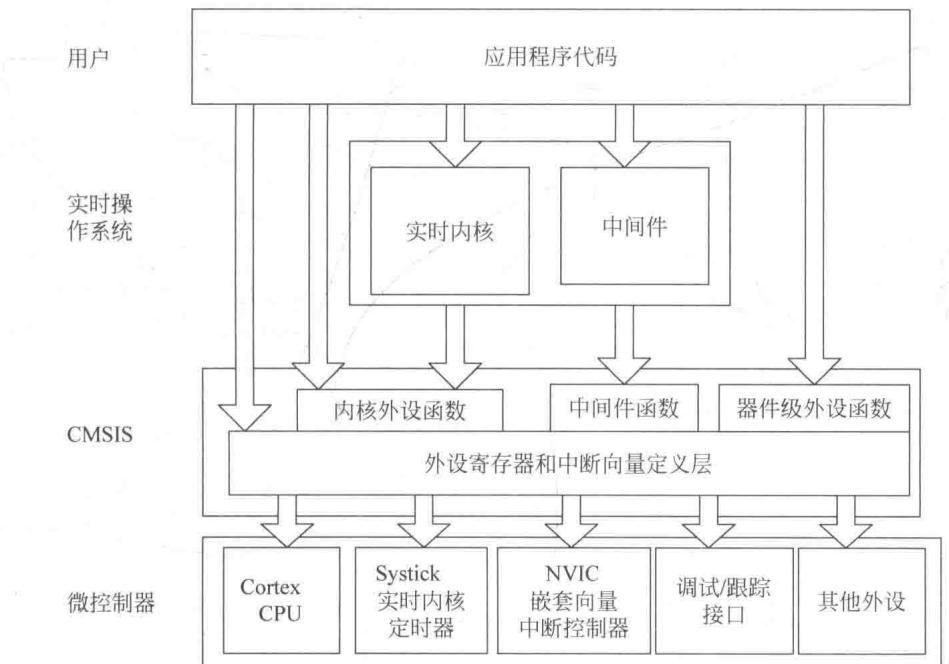

**这张图看起来层数多，我们"逐层搭积木"地看。**

**第一层（只看最上最下两个大框）**：

```
┌──────────────────────────────────────┐
│  最上面：应用程序代码（用户）          │  ← 你写的代码
└──────────────────────────────────────┘
                  ↕
┌──────────────────────────────────────┐
│  最下面：微控制器（硬件）              │  ← 真实芯片
│  Cortex CPU / SysTick / NVIC / 调试接口 / 其他外设
└──────────────────────────────────────┘
```

**第二层（看中间那一大块，标着 CMSIS）**：

中间那一大块就是 **CMSIS 层**。它把上面（软件）和下面（硬件）连起来。
里面有四块：

| 块 | 名字 | 管什么 |
|---|---|---|
| 上左 | **内核外设函数** | 操作 NVIC、SysTick、SCB 的函数 |
| 上中 | **中间件函数** | 通信接口相关的通用函数 |
| 上右 | **器件级外设函数** | 厂商自己的外设驱动函数（比如 ST 的 GPIO 函数） |
| 下面一整条 | **外设寄存器和中断向量定义层** | 所有寄存器的地址、名字、位定义 |

**第三层（看 CMSIS 左边那一竖条，标着"实时操作系统"）**：

```
┌────────────────┐  ┌────────────────┐
│  实时内核       │  │   中间件        │
└────────────────┘  └────────────────┘
```

教材说 CMSIS 可分为 4 层，对应图里的：

| 层 | 教材原文 | 说明 |
|---|---|---|
| (1) **核心外设访问层** | "命名定义、地址定义以及访问核心寄存器和 NVIC、SCB 以及 SysTick 等核心外设的辅助功能" | ARM 官方提供，管内核部件 |
| (2) **中间件访问层** | "典型嵌入式系统访问外设的通用方法；面向通信接口，包括 UART、Ethernet 和 SPI 等" | 管通信中间件 |
| (3) **设备外设访问层（MCU 相关）** | "寄存器名称定义、地址定义以及访问外设的设备驱动代码" | 厂商提供，管自家外设 |
| (4) **外设的访问函数（MCU 相关）** | "可选的外设辅助函数" | 厂商的便利函数 |

**第 4 层在图里对应哪里？**
就是最上面"应用程序代码"往下指的箭头旁边 —— 有些函数直接给应用层用。

**【补充解释】教材里还有一套"3 层"的说法，和上面的"4 层"不矛盾**

教材在 **5.6.2 节（STM32 固件库）的第 1 小节开头**，又回头看了一次图 5-4，写道：

> "从图 5-4 可以看出，CMSIS 应用程序的基本结构分为 3 个基本功能层。
> （1）核内外设访问层：ARM 公司提供的访问，定义处理器内部寄存器地址以及功能函数。
> （2）中间件访问层：定义访问中间件的通用 API，由 ARM 公司提供。
> （3）外设访问层：定义硬件寄存器的地址以及外设的访问函数。"

这段话讲义前面没出现过（原书前面 5.5.3 节讲的是"4 层"），所以第一次对照原书的读者容易以为教材前后矛盾。其实两套说法指的是**同一张图、同一种结构，只是"数法"粗细不同**：

| 5.5.3 节讲图 5-4 时的"4 层" | 5.6.2 节概括的"3 层" | 对应关系 |
|---|---|---|
| (1) **核心**外设访问层 | (1) **核内**外设访问层 | 同一个东西（"核心"/"核内"只是译法不同），ARM 提供 |
| (2) 中间件访问层 | (2) 中间件访问层 | 同一个东西，ARM 提供 |
| (3) 设备外设访问层（MCU 相关） | (3) **外设访问层** | 3 层说法把厂商的这两层合并成一层 |
| (4) 外设的访问函数（MCU 相关） | （并入上一行） | 原书自己说它是"**可选的**外设辅助函数"，本来就是第 (3) 层的补充 |

**一句话记法**：
- 按 5.5.3 节数 → **4 层**（ARM 两层 + 厂商两层）；
- 按 5.6.2 节数 → **3 个基本功能层**（ARM 两层 + 厂商一层）。

差别只在"厂商那一层算一层还是拆成两层"。以后看到"3 层"或"4 层"，先看它说的是哪一处，就不会觉得矛盾了（习题 5-2 见 5.7 节的补充说明）。

**这张图到底想让我理解什么？**

> **CMSIS 是一个"三明治中间的那层肉"。**
> 它上面是应用（你的代码）和操作系统；
> 下面是硬件（内核部件 + 厂商外设）。
> 它的作用是**把"上面"和"下面"解耦** —— 上面不用知道下面是哪家的芯片，下面只要按标准提供函数就行。

**再看图里的箭头方向**：箭头都是**从上往下指**的，说明"上层调用下层"。
**最下面那些方框**（Cortex CPU、SysTick、NVIC、调试/跟踪接口、其他外设）就是硬件真身。

教材原图信息量比较大，这里再给一张简化版（【辅助理解图】），只保留 4 层和它们之间的关系：

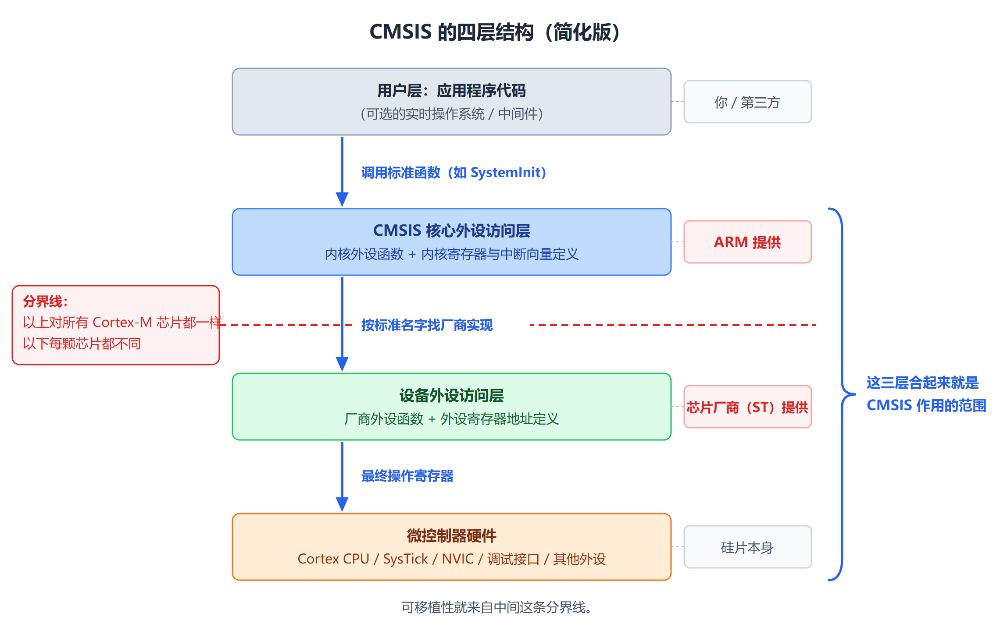

**看图方法**：从上到下 4 个横向长条，中间用向下的箭头连接。

| 层 | 内容 | 谁提供 |
|---|---|---|
| 最上：**用户层** | 应用程序代码、（可选的）实时操作系统与中间件 | 你 / 第三方 |
| 第二层：**CMSIS 核心外设访问层** | 内核外设函数 + 内核寄存器与中断向量定义 | **ARM** |
| 第三层：**设备外设访问层** | 厂商外设函数 + 外设寄存器地址定义 | **芯片厂商（ST）** |
| 最下：**微控制器硬件** | Cortex CPU、SysTick、NVIC、调试接口、其他外设 | 硅片本身 |

**这张图最想让你记住的是中间那条"分界线"**：
**分界线以上（ARM 提供的部分）对所有 Cortex-M 芯片都一样；分界线以下（厂商部分）每颗芯片都不同。**
这就是"可移植性"的来源。

#### 【补充解释】图 5-4 和图里"微控制器"那一行

最下面那一行有 5 个方框：

| 方框 | 是什么 |
|---|---|
| **Cortex CPU** | CPU 内核（第 2 章讲的） |
| **SysTick 实时内核定时器** | 内核自带的一个 24 位倒计时定时器，常用于操作系统节拍 |
| **NVIC 嵌套向量中断控制器** | 管中断（第 2 章、第 7 章） |
| **调试/跟踪接口** | 给 JTAG/SWD 用的（5.1 节讲的调试器就插在这儿） |
| **其他外设** | 厂商加的东西（GPIO、USART、定时器……） |

**注意**：前四个是 **ARM 设计的**（所有 Cortex-M 芯片都有），最后一个是**厂商设计的**（各家不同）。
**这就是 CMSIS 要分"核心外设访问层"和"设备外设访问层"的原因** —— 前者对所有 Cortex-M 通用，后者每颗芯片都不一样。

---

### 5.6.5 教材原图：图 5-5 在工程中使用 CMSIS

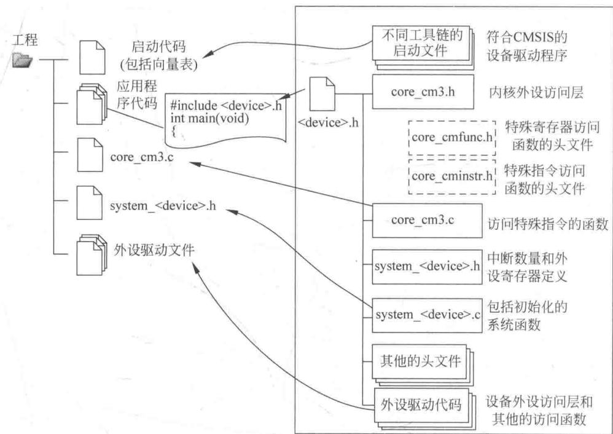

**这张图是"左边工程文件 ↔ 右边 CMSIS 分层"的对照图。**

**先看左边（工程里的文件列表）**：

| 工程里的文件/文件夹 | 是什么 |
|---|---|
| **启动代码（包括向量表）** | 启动文件 `.s`（5.2 节讲的） |
| **应用程序代码** | 你写的 `main.c` 之类 |
| **core_cm3.c** | CMSIS 内核访问函数（汇编指令包装、特殊寄存器访问） |
| **system_<device>.h** | 系统相关的头文件 |
| **外设驱动文件** | 厂商外设驱动（`stm32f10x_gpio.c` 等） |

**中间那个文件图标里写着**：

```c
#include <device>.h
int main(void)
{
}
```

**意思是**：你的程序只需要 `#include <device>.h` 这一个头文件。

**再看右边的对应关系**（图里用箭头连起来的）：

| 左边的文件 | 来自右边哪一层 | 右边标注 |
|---|---|---|
| 启动代码（包括向量表） | **符合 CMSIS 的设备驱动程序** | "不同工具链的启动文件"（CMSIS 为不同编译器准备了不同版本） |
| `<device>.h` | **内核外设访问层** | 它内部会 `#include "core_cm3.h"` |
| `core_cm3.c` | **访问特殊指令的函数** | 包装了那些 C 写不出来的汇编指令 |
| `system_<device>.h` | **中断数量和外设寄存器定义** | 里面定义了中断号、寄存器地址 |
| `system_<device>.c` | **包括初始化的系统函数** | 里面有 `SystemInit()` 的实现 |
| 外设驱动文件 | **设备外设访问层和其他的访问函数** | 厂商的外设驱动 |

**右边中间那两个虚线框**（图里用虚线画的）：

- `core_cmfunc.h` —— **特殊寄存器访问函数的头文件**（比如访问 PRIMASK、CONTROL 寄存器）；
- `core_cminstr.h` —— **特殊指令访问函数的头文件**（比如 `__NOP()`、`__WFI()`）。

**这两个是 CMSIS 后来版本拆分出来的**，教材里用虚线画，表示"可选/新版本才有"。

**教材原文补充**：

> "其中，`<device>` 的名字由实际的微控制器设备决定（例如 STM32F10x 系列微控制器对应的文件名为 `system_stm32f10x.c`）。当使用设备驱动库提供的头文件时，会自动包含其他所需的头文件（例如 STM32F10x 系列微控制器对应的文件名为 `system_stm32f10x.h`）。"

**这张图到底想让我理解什么？**

> **你只需要 `#include "stm32f10x.h"` 一行，背后会自动拉进来一大串文件。**
> 这些文件分成两类：
> - **ARM 提供的**（`core_cm3.h/.c`）：管内核；
> - **ST 提供的**（`system_stm32f10x.h/.c`、各种外设驱动）：管芯片和外设。

---

### 5.6.6 教材代码：一个使用 CMSIS 的完整例子

教材给了一个完整的点灯程序：

```c
#include "stm32f10x.h"
void delay(u32 delaytime);
int main(void)
{
    GPIO_InitTypeDef GPIO_InitStructure;

    RCC_APB2PeriphClockCmd(RCC_APB2Periph_GPIOD, ENABLE);
    GPIO_InitStructure.GPIO_Pin = GPIO_Pin_8;
    GPIO_InitStructure.GPIO_Mode = GPIO_Mode_Out_PP;
    GPIO_InitStructure.GPIO_Speed = GPIO_Speed_50MHz;
    GPIO_Init(GPIOD, &GPIO_InitStructure);
    while(1)
    {
        GPIO_SetBits(GPIOD, GPIO_Pin_8);
        delay(3000000);
        GPIO_ResetBits(GPIOD, GPIO_Pin_8);
        delay(3000000);
    }
}
void delay(u32 delaytime)
{
    while(delaytime--);
}
```

#### 这段代码想完成什么？

**让 GPIOD 的第 8 号引脚（PD8）不停地"高—低—高—低"，也就是让接在 PD8 上的 LED 灯闪烁。**

#### 逐块解释

**【第 1 块：头文件】**

```c
#include "stm32f10x.h"
```

**做什么**：把 ST 的主头文件包含进来。
**效果**：这一行会自动拉进 `core_cm3.h`、`system_stm32f10x.h`、`stm32f10x_conf.h`、各外设驱动头文件（对应图 5-5 的箭头）。
**为什么必须有**：没有它，`GPIO_InitTypeDef`、`RCC_APB2Periph_GPIOD` 这些名字编译器都不认识。

**【第 2 块：声明延时函数】**

```c
void delay(u32 delaytime);
```

**做什么**：告诉编译器"后面有个函数叫 `delay`"。
**注意**：`u32` 是 ST 定义的类型别名（`typedef unsigned long u32;`），就是 32 位无符号整数。这就是 5.6.7 节要讲的"变量编码规则"。

**【第 3 块：主函数开始 + 定义一个结构体变量】**

```c
int main(void)
{
    GPIO_InitTypeDef GPIO_InitStructure;
```

**做什么**：定义一个结构体变量，用来装"我要把引脚配成什么样"的参数。
**为什么用结构体**：因为配置一个 GPIO 需要好几个参数（哪个引脚、什么模式、什么速度）。把这些参数打包成一个结构体，传给 `GPIO_Init()` 一次就配好了。

**【第 4 块：开时钟（四步曲第 1 步）】**

```c
RCC_APB2PeriphClockCmd(RCC_APB2Periph_GPIOD, ENABLE);
```

**做什么**：打开 GPIOD 的时钟。

**代码 → CPU 做什么 → 寄存器发生什么 → 硬件发生什么**：

| 环节 | 内容 |
|---|---|
| **代码** | `RCC_APB2PeriphClockCmd(RCC_APB2Periph_GPIOD, ENABLE);` |
| **函数内部做什么** | `RCC->APB2ENR |= RCC_APB2Periph_GPIOD;`（大致等价） |
| **CPU 做什么** | ① 读出 RCC_APB2ENR 的值；② 与 `RCC_APB2Periph_GPIOD` 做"或"运算；③ 写回 RCC_APB2ENR |
| **寄存器发生什么** | RCC_APB2ENR 的 **bit5（IOPDEN）** 由 0 变成 1 |
| **硬件发生什么** | GPIOD 这个外设模块**通电**，内部电路开始工作，寄存器可以被正常读写 |

**RCC_APB2ENR 的位图**（只画低 16 位，高 16 位保留）：

```
bit15 14   13   12   11   10   9   8   7   6   5    4   3   2   1   0
+----+----+----+----+----+----+---+---+---+---+----+---+---+---+---+---+
|ADC3|USART1|TIM8|SPI1|TIM1|ADC2|ADC1|IOPG|IOPF|IOPE|IOPD|IOPC|IOPB|IOPA|保留|AFIO|
+----+----+----+----+----+----+---+---+---+---+----+---+---+---+---+---+
                                                     ↑
                                              当前关心这一位
                                          bit5 = IOPDEN（GPIOD 时钟使能）
```

**写 0 意味着什么**：GPIOD 的时钟关闭，**对 GPIOD 寄存器的所有配置都无效**（写进去读出来可能还是原值，但引脚不会动）。
**写 1 意味着什么**：GPIOD 的时钟打开，配置生效。
**程序实际怎么操作**：`RCC_APB2PeriphClockCmd(RCC_APB2Periph_GPIOD, ENABLE);`
**操作之后硬件发生什么**：GPIOD 模块上电。

**【补充解释】`RCC_APB2Periph_GPIOD` 这个宏是什么？**

它就是"**bit5 的位置**"，也就是 `0x00000020`：

```
0x00000020 = 0000 0000 0000 0000 0000 0000 0010 0000
                                              ↑
                                            bit5
```

**验证一下**：2⁵ = 32 = 0x20。✓

**【补充解释】为什么用 `|=` 而不是 `=`？**
因为 RCC_APB2ENR 里还管着**其他外设的时钟**。
如果用 `=`，你会把别的外设的时钟**全部关掉**（比如你之前打开的 USART1）。
用 `|=`（或等于）只置位你关心的那一位，**不影响其他位**。

```
运算前  APB2ENR  = 0000 0000 0000 0100  （bit2 = IOPAEN 已经开了）
要置的位         = 0000 0000 0010 0000  （bit5 = IOPDEN）
                  ─────────────────────  （OR：有一个为1就为1）
运算后           = 0000 0000 0010 0100  （bit2 和 bit5 都开了）
```

**这就是"位操作"在嵌入式里的典型用法：只改我关心的位，不动别人。**

**【第 5 块：填结构体（四步曲第 2 步）】**

```c
GPIO_InitStructure.GPIO_Pin = GPIO_Pin_8;
GPIO_InitStructure.GPIO_Mode = GPIO_Mode_Out_PP;
GPIO_InitStructure.GPIO_Speed = GPIO_Speed_50MHz;
```

**做什么**：往结构体里填三个参数。

| 成员 | 值 | 含义 |
|---|---|---|
| `GPIO_Pin` | `GPIO_Pin_8` | 我要配第 8 号引脚（值是 `0x0100`，即 bit8） |
| `GPIO_Mode` | `GPIO_Mode_Out_PP` | 模式：**推挽输出**（Output Push-Pull） |
| `GPIO_Speed` | `GPIO_Speed_50MHz` | 输出速度：50MHz（速度越高，翻转越快，但功耗和噪声也越大） |

**【补充解释】`GPIO_Pin_8` 为什么是 `0x0100`？**

因为引脚用"位掩码"表示，**bit n 对应第 n 号引脚**：

```
0x0100 = 0000 0001 0000 0000
                 ↑
               bit8  ← 第 8 号引脚
```

如果要用第 8 和第 9 号引脚，就写 `GPIO_Pin_8 | GPIO_Pin_9`：

```
GPIO_Pin_8  = 0000 0001 0000 0000
GPIO_Pin_9  = 0000 0010 0000 0000
              ───────────────────  (OR)
            = 0000 0011 0000 0000
```

**【补充解释】"推挽输出"是什么？**

- **推挽**（Push-Pull）：引脚内部有上下两个开关管，可以**主动输出高电平，也可以主动输出低电平**（有驱动能力）。
- **开漏**（Open-Drain）：只能主动拉低，高电平要靠外部上拉电阻。

**类比**：推挽像"**能主动推也能主动拉**"；开漏像"**只能往下拉，往上要靠弹簧**"。

（第 6 章会详细讲各种模式。）

**【第 6 块：调用初始化函数（四步曲第 2 步的收尾）】**

```c
GPIO_Init(GPIOD, &GPIO_InitStructure);
```

**做什么**：把结构体里的参数**真正写进 GPIOD 的配置寄存器**。

**代码 → 硬件**：

| 环节 | 内容 |
|---|---|
| 代码 | `GPIO_Init(GPIOD, &GPIO_InitStructure);` |
| 传参 | `GPIOD`（端口基地址 `0x40011400`）、`&GPIO_InitStructure`（结构体地址） |
| 函数内部做什么 | 根据 `GPIO_Pin_8` 算出该配 **CRH**（因为 8 号引脚属于高 8 位，用 CRH）；把"推挽输出 + 50MHz"翻译成 4 个 bit 的值 `0b0011`；写进 CRH 的对应 4 位 |
| 寄存器发生什么 | `GPIOD->CRH` 的 **bit3:0**（对应 PIN8）由复位值 `0x4`（浮空输入）变成 `0x3`（推挽输出 50MHz） |
| 硬件发生什么 | PD8 引脚的输出驱动器被使能，引脚进入"可以主动输出高低电平"的状态 |

**【补充解释】`GPIOD` 的基地址 `0x40011400` 是怎么来的？**

顺着第 3 章表 3-1 一层层查：

```
PERIPH_BASE        = 0x40000000     （片上外设区起点）
APB2 外设区起点     = 0x40010000     （GPIO 挂在 APB2 总线上）
GPIO 端口 D 的地址范围 = 0x4001 1400 ~ 0x4001 17FF
所以 GPIOD 的基地址（首地址）= 0x40011400
```

这正是第 6 章源码里写的"**PD: 0x4001 1400~0x4001 17FF**"。

**特别小心不要和 `0x40011C00` 混**：`0x4001 1C00~0x4001 1FFF` 是 **GPIO 端口 F** 的地址范围。每相邻两个端口相差 `0x800`（如 D 是 `0x40011400`、E 是 `0x40011800`）；GPIO D 和 GPIO F 中间还隔着 GPIO E，所以二者相差 `0x1000`。

**GPIOD->CRH 的位图**（只看 bit3:0 这一组，它管 PIN8）：

```
bit31 30 29 28 ... 7  6  5  4 | 3  2  1  0
+---+---+---+---+---+---+---+---+---+---+---+---+
| CNF15 |MODE15|  ...  |CNF8|MODE8|
+-------+------+-------+----+-----+
                              ↑
                       bit3:0 管 PIN8
                       MODE8[1:0]: 00=输入 01=输出10MHz 10=输出2MHz 11=输出50MHz
                       CNF8[1:0] : 00=推挽 01=开漏 (输出模式下)
```

**字段名里的数字 = 引脚号，不是"第几组"。** 教材第 6 章给 GPIOx_CRH 的字段命名是：

| 位段 | 字段 | 管哪个引脚 |
|---|---|---|
| bit31:30 / bit29:28 | `CNF15[1:0]` / `MODE15[1:0]` | PIN15 |
| … | … | … |
| bit3:2 / bit1:0 | `CNF8[1:0]` / `MODE8[1:0]` | **PIN8（当前例子）** |

所以 `bit3:0` 这一组叫 **CNF8/MODE8**（管 PIN8），不是"CNF0/MODE0" —— 叫 CNF0/MODE0 的是 **CRL** 里的最低那一组（管 PIN0）。这也是"CRH 里第 n 组 4 位管 PIN(n+8)"这条规律的由来。

**写 0 写 1 的含义**（MODE 字段）：

| MODE[1:0] | 含义 |
|---|---|
| 00 | 输入模式 |
| 01 | 输出模式，最大 10MHz |
| 10 | 输出模式，最大 2MHz |
| 11 | 输出模式，最大 50MHz |

**CNF 字段（输出模式时）**：

| CNF[1:0] | 含义 |
|---|---|
| 00 | 通用推挽输出 |
| 01 | 通用开漏输出 |
| 10 | 复用推挽输出 |
| 11 | 复用开漏输出 |

**所以 `GPIO_Mode_Out_PP` + `GPIO_Speed_50MHz` 翻译成 4 个 bit 就是**：

```
CNF = 00（推挽）
MODE = 11（50MHz）
       ↓
这 4 位 = 0011 = 0x3
```

**【补充解释】为什么 PD8 用 CRH 而不是 CRL？**
因为 STM32 把 16 个引脚分成两组：
- **CRL**（端口配置低寄存器）：管 **PIN0 ~ PIN7**；
- **CRH**（端口配置高寄存器）：管 **PIN8 ~ PIN15**。

PD8 属于 8~15，所以用 **CRH**，而且它占的是 **bit3:0**（8 − 8 = 0，所以从第 0 组开始）。

**记住这个规律**：`CRH` 里第 n 组 4 位，管的是 `PIN(n+8)`。

**【第 7 块：主循环（点灯）】**

```c
while(1)
{
    GPIO_SetBits(GPIOD, GPIO_Pin_8);
    delay(3000000);
    GPIO_ResetBits(GPIOD, GPIO_Pin_8);
    delay(3000000);
}
```

**做什么**：死循环，反复"点亮 → 延时 → 熄灭 → 延时"。

| 代码 | 函数内部 | 寄存器 | 硬件 |
|---|---|---|---|
| `GPIO_SetBits(GPIOD, GPIO_Pin_8);` | `GPIOD->BSRR = GPIO_Pin_8;` | 写 BSRR 低 16 位的 bit8 = 1 | PD8 引脚输出**高电平** → LED 亮 |
| `delay(3000000);` | 空转 300 万次 | 无 | 无（只是耗时间） |
| `GPIO_ResetBits(GPIOD, GPIO_Pin_8);` | `GPIOD->BRR = GPIO_Pin_8;` | 写 BRR 的 bit8 = 1 | PD8 引脚输出**低电平** → LED 灭 |
| `delay(3000000);` | 空转 300 万次 | 无 | 无 |

**【补充解释】`while(1)` 为什么必须死循环？**
因为 `main()` 如果返回了，会发生什么？—— 在嵌入式里，"返回"没有意义（没有操作系统接住你）。
更糟的是，有些启动代码在 `main` 返回后会执行复位，你的程序就会**反复重启**。
**所以嵌入式程序的 `main` 永远是死循环。**

**【第 8 块：延时函数】**

```c
void delay(u32 delaytime)
{
    while(delaytime--);
}
```

**做什么**：数数，数完 300 万次就返回。

**逐行解释**：

| 行 | 做什么 |
|---|---|
| `void delay(u32 delaytime)` | 接收一个 32 位无符号数作为计数值 |
| `while(delaytime--);` | 当 `delaytime` 非 0 时循环。每次循环先判断，再把 `delaytime` 减 1 |

**注意 `delaytime--` 是"先用后减"**：
- 先判断 `delaytime` 是否非 0；
- 然后减 1；
- 减到 0 时循环结束。

**【补充解释】这个延时函数"很不准"。**

它的延时时长取决于：
- CPU 主频（72MHz 和 8MHz 差 9 倍）；
- 编译器优化等级（`-O2` 可能把这个空循环优化掉！）；
- 指令执行效率。

**所以它只能用来"大概等一下"，不能用来做精确定时。**
要精确定时，必须用**定时器**（第 8 章）。

**【补充解释】这个循环为什么不会被优化掉？**
如果 `delaytime` 是局部变量，理论上编译器可以算出"这个循环没有副作用"从而删掉它。
实际中因为循环次数是运行时传入的，编译器一般不敢删。
**但为了保险，正规做法是把延时变量声明成 `volatile`**，或者调用一个"编译器看不透"的函数。

---

### 5.6.7 STM32 固件库的命名规则

> **【补充解释】从这里开始对照原书 5.6 节**
> 原书 **5.6.2 节第 1 小节（"STM32 固件库函数"）** 开头先回顾了图 5-4，把 CMSIS 概括为"**3 个基本功能层**"（核内外设访问层、中间件访问层、外设访问层），然后才讲命名规则。这段"3 层"与"4 层"的对照，讲义已经放在 **5.6.4 节末尾的【补充解释】** 里，忘了可以翻回去看。

#### 教材内容：外设缩写表（表 5-2）

| 缩写 | 外设名称 | 缩写 | 外设名称 |
|---|---|---|---|
| ADC | 模数转换器 | IWDG | 独立看门狗 |
| BKP | 备份寄存器 | NVIC | 嵌套中断向量列表控制器 |
| CAN | 控制器局域网模块 | PWR | 电源/功耗控制 |
| CRC | CRC 计算单元 | RCC | 复位与时钟控制器 |
| DAC | 数模转换器 | RTC | 实时时钟 |
| DMA | 直接内存存取控制器 | SDIO | SDIO 接口 |
| EXTI | 外部中断事件控制器 | SPI | 串行外设接口 |
| FLASH | 闪存存储器 | SysTick | 系统嘀嗒定时器 |
| FSMC | 灵活的静态存储器控制器 | TIM | 通用定时器 |
| GPIO | 通用输入/输出端口 | TIM1 | 高级控制定时器 |
| I2C | I2C 总线接口 | USART | 通用同步异步接收发射端 |
| I2S | I2S 总线接口 | WWDG | 窗口看门狗 |

**【补充解释】这张表怎么用？**
它是**后面所有章节的缩写词典**。
看到 `TIM_Init()` 就知道是"初始化定时器"；看到 `ADC_GetConversionValue()` 就知道是"读 ADC 转换结果"。
**建议把这张表抄在笔记本第一页。**

#### 教材内容：15 条命名规则

教材列了 15 条规则，整理成更好记的形式：

**规则 1～5：命名的"大小写和格式"规矩**

| 规则 | 内容 | 例子 |
|---|---|---|
| (1) | `PPP` 表示任一外设缩写 | `GPIO`、`ADC` |
| (2) | 系统和文件命名以 `stm32f10x_` 开头 | `stm32f10x_conf.h` |
| (3) | 常量：只用一个文件的定义在该文件里；多个文件用的定义在头文件里。**全部大写** | `RCC_APB2Periph_GPIOD` |
| (4) | 寄存器当常量处理，**名字全大写** | `CRH`、`BRR`、`APB2ENR` |
| (5) | 外设函数名 = **外设缩写 + 下划线 + 首字母大写的单词**。**函数名里只允许一个下划线** | `SPI_SendData` |

**规则 6～15：函数名的"后缀含义表"（这张表最实用）**

| 函数名格式 | 功能 | 例子 |
|---|---|---|
| `PPP_Init` | 根据 `PPP_InitTypeDef` 里的参数**初始化**外设 | `TIM_Init` |
| `PPP_DeInit` | 把外设所有寄存器**复位成默认值** | `TIM_DeInit` |
| `PPP_StructInit` | 用默认值**填充** `PPP_InitTypeDef` 结构体 | `USART_StructInit` |
| `PPP_Cmd` | **使能 / 除能**外设 | `SPI_Cmd` |
| `PPP_ITConfig` | 使能 / 除能外设的**某个中断源** | `RCC_ITConfig` |
| `PPP_DMAConfig` | 使能 / 除能外设的 **DMA 接口** | `TIM1_DMAConfig` |
| `PPP_GetFlagStatus` | **检查标志位**是否被设置 | `I2C_GetFlagStatus` |
| `PPP_ClearFlag` | **清除标志位** | `I2C_ClearFlag` |
| `PPP_GetITStatus` | 判断来自外设的**中断是否发生** | `I2C_GetITStatus` |
| `PPP_ClearITPendingBit` | 清除外设的**中断待处理标志位** | `I2C_ClearITPendingBit` |

**补充规则**：

> "用以配置外设功能的函数，总是以字符串 `Config` 结尾，例如 `GPIO_PinRemapConfig`。"

**【补充解释】怎么用这张表"猜"函数？**

看到 `USART_GetFlagStatus`：
- `USART` → 是串口外设；
- `Get` → 读；
- `FlagStatus` → 标志位状态。
→ **"读串口的标志位状态"**。

看到 `TIM_ClearITPendingBit`：
- `TIM` → 定时器；
- `Clear` → 清；
- `IT` → 中断（Interrupt）；
- `PendingBit` → 待处理标志。
→ **"清除定时器的中断待处理标志"**。

**教材原话**：

> "在对外设的工作原理有一定的了解之后，再去看固件库函数，基本上从函数名字就能看出这个函数的功能。"

**注意这个前提**："**在对外设的工作原理有一定的了解之后**"。
意思是：**先懂原理，再用库**。只背函数名不理解原理，遇到问题就束手无策。

---

### 5.6.8 变量编码规则

教材 5.6.2 节第 2 小节。这些类型定义在 `stm32f10x_type.h` 里。

#### 1）普通变量（24 个）

教材原文：

> "固态函数库定义了 24 个普通变量类型，它们的类型和大小是固定的。"

```c
typedef signed long   s32;
typedef signed short  s16;
typedef signed char   s8;
typedef signed long const   sc32;    /* Read Only */
typedef signed short const  sc16;    /* Read Only */
typedef signed char const   sc8;     /* Read Only */
typedef volatile signed long   vs32;
typedef volatile signed short  vs16;
typedef volatile signed char   vs8;
typedef volatile signed long const   vsc32;    /* Read Only */
typedef volatile signed short const  vsc16;    /* Read Only */
typedef volatile signed char const   vsc8;     /* Read Only */
typedef unsigned long   u32;
typedef unsigned short  u16;
typedef unsigned char   u8;
typedef unsigned long const   uc32;    /* Read Only */
typedef unsigned short const  uc16;    /* Read Only */
typedef unsigned char const   uc8;     /* Read Only */
typedef volatile unsigned long   vu32;
typedef volatile unsigned short  vu16;
typedef volatile unsigned char   vu8;
typedef volatile unsigned long const   vuc32;    /* Read Only */
typedef volatile unsigned short const  vuc16;    /* Read Only */
typedef volatile unsigned char const   vuc8;     /* Read Only */
```

**【补充解释】怎么读这些名字？这是一个"三位字母密码"。**

每个名字由最多 3 个字母组成，每个字母代表一个属性：

```
   第 1 位        第 2 位         第 3 位
  ┌──────┐      ┌──────┐       ┌──────┐
  │ u/s  │      │ v/空 │       │32/16/8│
  └──────┘      └──────┘       └──────┘
  u = unsigned    v = volatile    位数
  s = signed      (空) = 不加 volatile
```

如果名字是 4 个字母（如 `vsc32`），那就是在中间多了一个 `c`：

```
  v    s    c    32
  │    │    │     │
  │    │    └─────┼── c = const（只读）
  │    └──────────┼── s = signed
  └───────────────┴── v = volatile
```

**举例解读**：

| 名字 | 拆解 | 完整含义 |
|---|---|---|
| `u8` | u + 8 | unsigned char（8 位无符号） |
| `s16` | s + 16 | signed short（16 位有符号） |
| `vu32` | v + u + 32 | volatile unsigned long（32 位无符号，易变） |
| `vuc16` | v + u + c + 16 | volatile unsigned short const（16 位无符号，易变，只读） |

**所以看到 `vu16 CR1;` 就知道**：这是一个 **volatile 的无符号 16 位**寄存器成员。
**看到 `u16 RESERVED0;` 就知道**：这是一个**普通的**无符号 16 位成员（保留区不需要 volatile）。

**【补充解释】为什么保留区不用 `volatile`？**
因为**你不会去读写它**。加 `volatile` 会阻止优化，白白降低效率。

**【补充解释】为什么要定义这么多类型？直接用 `unsigned char` 不行吗？**

行，但：
1. **打字太累**：`vu16` 比 `volatile unsigned short` 短得多；
2. **防止出错**：32 位机上 `unsigned int` 和 `unsigned long` 都是 32 位，容易搞混。用 `u32` 就明确了；
3. **可移植**：换到别的编译器，只要改这一处 `typedef` 就行。

#### 2）布尔型变量

```c
typedef enum
{
    FALSE = 0,
    TRUE  = !FALSE
} bool;
```

**解释**：

| 名字 | 值 | 含义 |
|---|---|---|
| `FALSE` | 0 | 假 |
| `TRUE` | `!FALSE` = `!0` = **1** | 真 |

**【补充解释】为什么 `TRUE` 写成 `!FALSE` 而不是直接写 1？**
这是一种编程风格：**让编译器自己算，避免手写数字写错**。
`!FALSE` 就是"对 0 取反"，结果必然是 1。

**类比**：老师改卷时写"对的 = 不是错的"，而不是"对的 = 1"。虽然绕，但**逻辑上更严谨**。

#### 3）标志位状态类型（FlagStatus）

```c
typedef enum
{
    RESET = 0,
    SET = !RESET
} FlagStatus;
```

| 名字 | 值 | 含义 |
|---|---|---|
| `RESET` | 0 | **重置**（标志位没被设置） |
| `SET` | 1 | **设置**（标志位被置起来了） |

**教材原文**："定义标志位类型的两个可能值为'设置'或'重置'（SET 或 RESET）"。

**【补充解释】为什么叫 `RESET` 不叫 `CLEAR`？**
这是 ST 的习惯用法。`RESET` 在这里是"**复位状态 / 未置位**"的意思，不是"复位芯片"。
**看到 `FlagStatus` 类型，就知道这个函数的返回值只可能是 `SET` 或 `RESET` 两种。**

**注意**：`FlagStatus` 和 `FunctionalState` 值都是 0/1，但**语义完全不同**，不要混用。

#### 4）功能状态类型（FunctionalState）

```c
typedef enum
{
    DISABLE = 0,
    ENABLE  = !DISABLE
} FunctionalState;
```

| 名字 | 值 | 含义 |
|---|---|---|
| `DISABLE` | 0 | **除能 / 关闭** |
| `ENABLE` | 1 | **使能 / 打开** |

**教材原文**："功能状态类型的两个可能值为'使能'或'除能'（ENABLE 或 DISABLE）"。

**这就是 5.6.6 节例子里 `RCC_APB2PeriphClockCmd(RCC_APB2Periph_GPIOD, ENABLE);` 里的 `ENABLE`。**

#### 5）错误状态类型（ErrorStatus）

```c
typedef enum
{
    ERROR   = 0,
    SUCCESS = !ERROR
} ErrorStatus;
```

| 名字 | 值 | 含义 |
|---|---|---|
| `ERROR` | 0 | **出错** |
| `SUCCESS` | 1 | **成功** |

**教材原文**："错误状态类型的两个可能值为'成功'或'出错'（SUCCESS 或 ERROR）"。

**【补充解释】注意这几个枚举的"0 是什么"**

| 类型 | 0 代表 | 1 代表 | 直觉上是否自然 |
|---|---|---|---|
| `bool` | FALSE（假） | TRUE（真） | ✓ 自然 |
| `FlagStatus` | RESET（未置位） | SET（置位） | ✓ 自然 |
| `FunctionalState` | DISABLE（关） | ENABLE（开） | ✓ 自然 |
| `ErrorStatus` | **ERROR（出错）** | SUCCESS（成功） | ⚠️ **反直觉！** |

**⚠️ 最容易出错的地方**：`ErrorStatus` 里 **0 = 出错，1 = 成功**。

所以如果函数返回 `ErrorStatus`，你**不能**写成：

```c
if (Some_Function())   /* 错误写法！这里其实是"成功" */
```

而应该写：

```c
if (Some_Function() == SUCCESS) { ... }
```

**为什么这样设计？** 因为 0 在 C 里是"假"。如果 0 代表成功，那么 `if (func())` 就是"成功时进入分支"，很反直觉。
ST 选择了"**0 = 错误**"，这样 `if (func() == ERROR)` 判断错误更直观。**但这和很多 C 库的惯例（0 = 成功）相反**，所以要特别注意。

---

### 5.6.9 外设结构体与声明

教材 5.6.2 节第 3 小节。这部分和 5.5 节讲的内容相关，但这里讲的是**固件库里的官方定义**。

#### 1）外设控制寄存器结构

教材原文：

> "文件 `stm32f10x_map.h` 包含了所有外设控制寄存器的结构。"

**SPI 的结构体声明**：

```c
typedef struct
{
    vu16 CR1;
    u16  RESERVED0;
    vu16 CR2;
    u16  RESERVED1;
    vu16 SR;
    u16  RESERVED2;
    vu16 DR;
    u16  RESERVED3;
    vu16 CRCPR;
    u16  RESERVED4;
    vu16 RXCRCR;
    u16  RESERVED5;
    vu16 TXCRCR;
    u16  RESERVED6;
} SPI_TypeDef;
```

**逐项对照**（以 SPI1 为例，基地址 0x40013000）：

| 成员 | 类型 | 偏移 | 实际地址 | 是什么 |
|---|---|---|---|---|
| `CR1` | `vu16` | 0x00 | 0x40013000 | 控制寄存器 1（配置 SPI 模式） |
| `RESERVED0` | `u16` | 0x02 | — | 保留 |
| `CR2` | `vu16` | 0x04 | 0x40013004 | 控制寄存器 2（中断、DMA 使能） |
| `SR` | `vu16` | 0x08 | 0x40013008 | 状态寄存器（标志位） |
| `DR` | `vu16` | 0x0C | 0x4001300C | 数据寄存器（收发数据） |
| `CRCPR` | `vu16` | 0x10 | 0x40013010 | CRC 多项式寄存器 |
| `RXCRCR` | `vu16` | 0x14 | 0x40013014 | 接收 CRC 寄存器 |
| `TXCRCR` | `vu16` | 0x18 | 0x40013018 | 发送 CRC 寄存器 |

**注意这里用的是 `vu16` 而不是 5.5 节教材片段里的 `__IO uint16_t`** —— 两种写法等价：
- `vu16` = `volatile unsigned short`；
- `__IO uint16_t` = `volatile uint16_t`。

**只是版本不同**（早期固件库用 `vu16`，后期用 `__IO`）。

**【补充解释】`RESERVEDi` 的 `i` 是"整数索引值"**
教材原文："其中，RESERVEDi（i 为一个整数索引值）表示被保留区域。"
**注意**：这个 `i` **不是变量名的一部分**，而是一个**占位符**，表示"第 i 个保留区"。
实际代码里写的是 `RESERVED0`、`RESERVED1`、`RESERVED2`……（具体的数字）。

#### 2）外设声明

教材原文：

> "文件 `stm32f10x.h` 包含了所有外设的声明。"

```c
#define PERIPH_BASE        ((u32)0x40000000)
#define APB1PERIPH_BASE    PERIPH_BASE
#define APB2PERIPH_BASE    (PERIPH_BASE + 0x10000)
/*
 * SPI1 Base Address definition */
#define SPI1_BASE          (APB2PERIPH_BASE + 0x3000)
#define SPI1               ((SPI_TypeDef *) SPI1_BASE)
```

**地址演算**：

```
PERIPH_BASE       = 0x40000000
APB2PERIPH_BASE   = 0x40000000 + 0x10000 = 0x40010000
SPI1_BASE         = 0x40010000 + 0x3000  = 0x40013000
SPI1              = (SPI_TypeDef *) 0x40013000
```

**验证**：第 3 章表 3-1 里 SPI1 的地址范围是 `0x4001 3000~0x4001 33FF`。**完全一致。** ✓

**【补充解释】这两行代码的"套路"**

```c
#define SPI1_BASE  (APB2PERIPH_BASE + 0x3000)   /* 第一步：算出地址（一个数字） */
#define SPI1       ((SPI_TypeDef *) SPI1_BASE)  /* 第二步：把地址变成指针（可以 -> 访问） */
```

**这是 STM32 固件库里最常见的两行。** 每个外设都有这么一对。

**用 ASCII 图把这个"地址 → 指针"的转换画出来**：

```
   0x40013000                    SPI1
   （一个纯数字）                 （一个指针，类型是 SPI_TypeDef *）
        │                              │
        │   (SPI_TypeDef *)            │
        └──────────────────────────────┘
                       │
                       ▼
              SPI1->CR1   → 访问 0x40013000
              SPI1->CR2   → 访问 0x40013004
              SPI1->SR    → 访问 0x40013008
              SPI1->DR    → 访问 0x4001300C
```

---

### 5.6.10 常用的固件库文件（表 5-3）

| 文件名 | 描述 |
|---|---|
| `stm32f10x_conf.h` | 设置所有使用到的外设，由不同的 Define 语句组成。用户可在该文件中进行参数设置，可利用模板使能或除能外设，可以修改外部振荡器的参数 |
| `stm32f10x_it.h` | 包含了所有的中断处理程序的原型 |
| `stm32f10x_it.c` | 包含了所有的中断处理程序（如果未使用中断，则所有函数体都为空）。用户可以加入自己的中断程序代码。对于指向同一个中断向量的多个不同中断请求，可以通过判断外设的中断标志位来确定到底是哪个中断源发生了中断 |
| `stm32f10x_lib.h` | 主头文件，包含了其他头文件 |
| `stm32f10x_lib.c` | 包括所有外设指针的定义、初始化等 |
| `stm32f10x.h` | 包含了外设存储器映像、寄存器数据结构和所有寄存器物理地址的声明 |
| `stm32f10x_type.h` | 包含所有其他文件使用的通用数据类型和枚举 |
| `stm32f10x_ppp.h` | PPP 外设对应一个头文件，包含了该外设使用的函数原型、数据结构和枚举 |
| `stm32f10x_ppp.c` | PPP 外设对应的源文件，包含了该外设使用的函数体 |

> ⚠️ **【待核验】** 教材表 5-3 中 `stm32f10x.it.h` 的写法（用点号）疑为 OCR 误识，按同表其他文件的命名规律应为 `stm32f10x_it.h`（下划线）。详见文末"待核验"第 6 条。
>
> ⚠️ **【待核验】** 表 5-3 中列出的 `stm32f10x_lib.h` / `stm32f10x_lib.c` 属于较早版本（V2.x）标准外设库的文件结构；较新的 V3.x 版本中已不再使用这两个文件，改为以 `stm32f10x.h` 为主头文件。教材此处可能沿用早期版本说明。详见文末"待核验"第 7 条。

**【补充解释】这张表怎么用？**

**新手最常问的问题是**："我到底要 include 哪个头文件？"

**答案**：通常只需要一个 —— **`stm32f10x.h`**（或 `stm32f10x_lib.h`，取决于库版本）。
它会自动包含其他需要的头文件。

**具体到文件**：

| 你想干什么 | 改哪个文件 |
|---|---|
| 用某个外设 | 在 `stm32f10x_conf.h` 里把对应的 `#define` 打开（或者用 Keil 的界面勾选） |
| 写中断服务程序 | 在 `stm32f10x_it.c` 里写函数体 |
| 看某个外设有哪些函数 | 打开 `stm32f10x_ppp.h` |
| 看寄存器地址定义 | 打开 `stm32f10x.h` |

**【补充解释】`stm32f10x_it.c` 里那句关于"同一中断向量多个中断源"的话是什么意思？**

教材原文：

> "对于指向同一个中断向量的多个不同中断请求，可以通过判断外设的中断标志位来确定到底是哪个中断源发生了中断。"

**具体例子**：STM32 的外部中断线 EXTI0~EXTI4 **各有各的中断向量**，但 EXTI5~EXTI9 **共用** `EXTI9_5_IRQHandler` 一个向量。

所以在这个处理函数里，你**必须自己判断**：

```c
void EXTI9_5_IRQHandler(void)
{
    if (EXTI_GetITStatus(EXTI_Line5) != RESET) { /* 是引脚5来的 */ }
    if (EXTI_GetITStatus(EXTI_Line6) != RESET) { /* 是引脚6来的 */ }
    ...
}
```

**这就是为什么教材要专门提这一句** —— 共用向量的中断，必须靠"查标志位"来分辨来源。

---

### 5.6.11 容易搞混的地方

| 误解 | 真相 |
|---|---|
| "固件库是另一种编程语言" | 不是。固件库就是 **C 函数**，最终还是操作寄存器 |
| "用了固件库就不用懂寄存器" | **错**。出问题时你必须看寄存器。教材也强调"在对外设工作原理有一定了解之后，再去看固件库函数" |
| "CMSIS 管所有外设" | **错**。CMSIS 只管**内核部件**（NVIC、SysTick、SCB）。外设是厂商的 |
| "`ENABLE` 和 `SET` 可以互换" | 值都是 1，但**语义不同**。`FunctionalState` 用 ENABLE/DISABLE，`FlagStatus` 用 SET/RESET |
| "函数返回 0 就是失败" | 在 `ErrorStatus` 里 **0 = ERROR = 出错**，1 = SUCCESS。但很多 C 库是反过来的，**必须看类型** |
| "`vu16` 和 `uint16_t` 不一样" | 一样。`vu16` 就是 `volatile unsigned short`，只是老版本的写法 |
| "文件名里的 `ppp` 是某个具体外设" | `ppp` 是**占位符**，代表任意外设缩写（GPIO、USART……） |

---

### 5.6.12 本节真正要记住什么

1. **固件库 = 向下操作寄存器，向上提供 API 函数**。
2. `GPIO_ResetBits(GPIOx, pin)` 的内部就是 `GPIOx->BRR = pin;` —— **库函数不神秘**。
3. **CMSIS** 是 ARM 定的**内核软件接口标准**（管 NVIC、SysTick、SCB），固件库**按 CMSIS 规范设计**。
4. 固件库的**命名规则**能让你"望文生义"：`PPP_Init` 初始化、`PPP_Cmd` 使能、`PPP_GetFlagStatus` 查标志……
5. 变量类型是**三位字母密码**：`u/s` + `v/空` + `32/16/8`，加 `c` 表示 const。
6. 四个枚举类型：`bool`、`FlagStatus`（SET/RESET）、`FunctionalState`（ENABLE/DISABLE）、`ErrorStatus`（SUCCESS/**ERROR**）。
7. 外设结构体 + `RESERVED` 填充，保证偏移精确。
8. **先用固件库快速开发，需要抠性能/大小时再回到寄存器。**

---

## 5.7 习题解答

### 5-1 简述 ARM 微控制器应用系统开发的一般过程。

**答题要点**（按教材 5.1、5.2 节）：

1. **创建工程、选择器件**：在 IDE（如 Keil MDK）中新建工程，选择目标芯片型号（这决定了 Flash/SRAM 的地址范围）；
2. **添加程序代码与设备驱动库**：加入自己的 `.c/.s` 源文件，加入启动代码和固件库；
3. **编译**：C 源文件经**编译器**生成目标文件 `.o`；汇编源文件经**汇编器**生成 `.o`；
4. **链接**：**链接器**根据**链接脚本（分散加载文件）**，把所有 `.o` 和所需库代码拼装成**可执行映像**（`.elf/.axf/.out`）；
5. **下载**：通过**在线调试器**（ULINK2/J-Link/ST-Link，经 JTAG 或 SWD 连接），把映像烧写进微控制器的 **Flash**；
6. **调试**：利用 IDE 与调试器进行单步、断点、查看寄存器/变量等调试；
7. **迭代**：修改代码后重新编译、下载、调试，直到满足要求。

**也可以按教材 5.1 节图 5-2 的 6 步简答**：
创建工程 → 选择器件并设定工程选项 → 添加程序代码及设备驱动库 → 编译 → 下载到 Flash → 调试应用程序（→ 更新应用程序，循环）。

---

### 5-2 固件库函数和 CMSIS 的关系是怎样的？

**答题要点**：

1. **CMSIS** 是 ARM 公司联合各微控制器厂商制定的**通用软件接口标准**，适用于大多数 Cortex-M 处理器及微控制器产品，目的是提高软件的**兼容性和可移植性**。
2. CMSIS 主要针对**处理器内核特性**（NVIC、SCB、SysTick 的访问函数、寄存器定义、特殊指令函数、系统异常命名、`SystemInit` 命名、`SystemCoreClock` 变量等）提供标准化内容。
3. **STM32 固件库是按照 CMSIS 规范设计的**。芯片厂商编写库函数时必须遵循 CMSIS 规范，例如系统初始化函数必须命名为 `SystemInit`，外设驱动文件的文件名和函数名也被规范化。
4. 因此，**使用 STM32 固件库时，实际上就已经在使用 CMSIS 了**（教材 5.5.3 节原文："CMSIS 被集成在微控制器供应商提供的设备驱动包中，如果使用设备驱动库进行软件开发，那么就已经在使用 CMSIS 了"）。
5. 层次关系上：CMSIS 处于**中间层**，向下与内核和外设打交道，向上为应用程序（以及实时操作系统）提供统一接口。固件库中的**内核外设访问层**属于 CMSIS，**设备外设访问层**由 ST 按 CMSIS 风格提供。

**一句话总结**：**CMSIS 是"标准"，固件库是"按这个标准做的实现"，固件库包含了 CMSIS 部分。**

**【补充说明】答题时遇到"3 层"和"4 层"怎么办？**

教材对图 5-4 的 CMSIS 结构有两处说法，指的是同一张图：

- **5.5.3 节**（讲组织结构时）：分为 **4 层** —— (1) 核心外设访问层；(2) 中间件访问层；(3) 设备外设访问层（MCU 相关）；(4) 外设的访问函数（MCU 相关，可选）；
- **5.6.2 节**（讲固件库时）：概括为 **3 个基本功能层** —— (1) 核内外设访问层；(2) 中间件访问层；(3) 外设访问层。

两者只是"数法"不同：4 层把厂商负责的部分再细分成"设备外设访问层"和"外设的访问函数"两层。作答时按题目所在小节的说法写，并说明两者的拆分关系即可（详见 5.6.4 节末尾的【补充解释】）。

---

### 5-3 对照 STM32F103VET6 的存储器映射，查看 5.4 节给出的程序映像中断向量表各个中断的入口地址。

**解题思路**：

1. **先确定向量表在哪儿**：
   - Cortex-M3 的向量表默认位于 **0x00000000**；
   - STM32F103VET6 从主闪存启动时，**主闪存被映射到启动空间 0x00000000**，但仍可在原地址 **0x08000000** 访问；
   - 所以向量表既可以从 **0x00000000 + 偏移** 看，也可以从 **0x08000000 + 偏移** 看。

2. **用公式算**：向量地址 = **异常号 × 4**。

3. **逐项列出**（结合教材 5.4 节启动文件的 DCD 顺序）：

| 序号 | 向量名 | 异常号 | 向量地址（相对向量表首地址） | 从 Flash 启动时的绝对地址（若向量表在 Flash 开头） |
|---|---|---|---|---|
| — | MSP 初始值 | — | 0x00 | 0x08000000 |
| 1 | **复位向量**（Reset_Handler） | 1 | 0x04 | 0x08000004 |
| 2 | NMI_Handler | 2 | 0x08 | 0x08000008 |
| 3 | HardFault_Handler | 3 | 0x0C | 0x0800000C |
| 4 | MemManage_Handler | 4 | 0x10 | 0x08000010 |
| 5 | BusFault_Handler | 5 | 0x14 | 0x08000014 |
| 6 | UsageFault_Handler | 6 | 0x18 | 0x08000018 |
| — | 保留 | 7~10 | 0x1C~0x28 | 0x0800001C~0x08000028 |
| 11 | SVC_Handler | 11 | **0x2C** | 0x0800002C |
| 12 | DebugMon_Handler | 12 | **0x30** | 0x08000030 |
| — | 保留 | 13 | 0x34 | 0x08000034 |
| 14 | PendSV_Handler | 14 | **0x38** | 0x08000038 |
| 15 | SysTick_Handler | 15 | **0x3C** | 0x0800003C |
| 16 | **WWDG_IRQHandler**（IRQ0） | 16 | **0x40** | 0x08000040 |
| 17 | PVD_IRQHandler（IRQ1） | 17 | **0x44** | 0x08000044 |
| 18 | TAMPER_IRQHandler（IRQ2） | 18 | **0x48** | 0x08000048 |
| 19 | RTC_IRQHandler（IRQ3） | 19 | **0x4C** | 0x0800004C |
| 20 | FLASH_IRQHandler（IRQ4） | 20 | **0x50** | 0x08000050 |
| 21 | RCC_IRQHandler（IRQ5） | 21 | **0x54** | 0x08000054 |
| 22 | EXTI0_IRQHandler（IRQ6） | 22 | **0x58** | 0x08000058 |

**验算示例**（教材第 2 章的算法）：

```
SysTick 的异常号 = 15
向量地址 = 15 × 4 = 60 = 0x3C        ✓ 与上表一致
IRQ0（WWDG）的异常号 = 16
向量地址 = 16 × 4 = 64 = 0x40        ✓ 与上表一致
```

**答题时还要补充说明两点**：

1. **向量表里存的是"地址"，不是"指令"**，而且每个地址的**最低位（LSB）必须是 1**，表示异常处理使用 Thumb 指令集。
   例如：若 `Reset_Handler` 位于 0x08000100，则向量表 0x00000004（或 0x08000004）处应填 **0x08000101**。
2. **每个向量占 4 字节**，所以 `n` 号向量在向量表中的偏移是 `n × 4`。

**【补充解释】为什么教材第 2 章说"向量地址 = 异常号 × 4"？**
因为一个向量占 4 个字节（32 位地址）。第 n 项前面有 n 项，所以偏移是 n × 4。

**验证第 2 章的例子**："外部 IRQ 0 的异常类型为 16，因此 IRQ 0 的向量地址为 16 × 4 = 0x40"。✓

---

## 5.8 本章总结

### 一张图串起全章

```
你在电脑上写代码
      │
      │  ① 5.1 开发流程
      ▼
main.c ──编译器──→ main.o ──┐
add.s  ──汇编器──→ add.o  ──┼──链接器──→ app.axf ──调试器──→ 芯片 Flash
                            │  ↑
                       链接脚本(谁放哪儿)
      │
      │  ② 5.4 程序映像：Flash 里有什么
      ▼
Flash: [向量表][启动代码][.text 代码][.rodata 常量][.data 初值副本][C库]
SRAM : [.data 变量][.bss 变量][堆 →][← 栈]
      │
      │  ③ 5.2 启动过程：上电后发生什么
      ▼
复位 → 取 MSP 初值(0x00000000) → 取复位向量(0x00000004) → 跳转
     → Reset_Handler → SystemInit() → __main → 搬.data/清.bss → main()
      │
      │  ④ 5.5 C 语言操作外设
      ▼
*(volatile uint32_t *)0x40013804 = data;   ← 指针 + volatile
      │
      │  ⑤ 5.6 固件库封装
      ▼
USART_SendData(USART1, data);              ← 人话版
```

### 本章必须记住的 10 句话

1. **源文件 → 编译器/汇编器 → `.o` → 链接器（+链接脚本+库）→ 可执行映像 → 调试器 → Flash**。
2. **编译器管一个文件，链接器管整个工程，链接脚本决定"谁放在哪"。**
3. 复位后 CPU 先取 **MSP 初值**（0x00000000），再取**复位向量**（0x00000004），然后**跳过去**执行。
4. **先有栈，才能应付异常** —— 这就是 MSP 必须第一个初始化的原因。
5. 调用链：**`Reset_Handler → SystemInit() → __main → main()`**（`__main` 不是你写的 `main`）。
6. 程序映像 = **向量表 + C 启动代码 + 程序代码 + C 库代码**。
7. **Flash 放不变的（代码/常量），SRAM 放会变的（变量/栈/堆）**；`.data` 要"搬"，`.bss` 要"清"。
8. 外设寄存器**映射在地址空间里**，用 **`volatile` 指针**访问：**`(类型*)基地址`，再用 `->成员`**。
9. **`volatile` 防止编译器把寄存器读写优化掉**，也用于中断与主程序共享的变量；但**它不保证原子性**。
10. **固件库 = 向下操作寄存器，向上提供 API**；它按 **CMSIS** 标准设计，命名规则可以"望文生义"。

### 学完本章，你应该能回答的问题

- [ ] 我点一下"编译下载"，中间经过了哪些工具？
- [ ] 为什么我改了一个 `.c` 文件，整个工程要重新链接？
- [ ] 芯片一上电，PC 里是什么？它怎么找到我的程序？
- [ ] 为什么向量表里第一个东西是栈顶地址，而不是一条指令？
- [ ] 我写的 `int a = 5;` 和 `int b;`，上电后分别在哪儿、值是多少、谁负责让它们变成这样？
- [ ] 为什么 `const` 大数组要加 `const`？
- [ ] 为什么外设指针要加 `volatile`？不加会怎样？
- [ ] `GPIO_ResetBits()` 这个函数内部到底干了什么？
- [ ] `RCC_APB2PeriphClockCmd()` 忘了写会怎样？为什么？
- [ ] 为什么 `stm32f10x_it.c` 里那些空函数不用管，写了就自动生效？

如果这些都能答上来，本章就学通了。

---

## 待核验

> 以下条目是在整理本章素材时发现的**可疑之处**。按项目规则，**不做猜测性修改**，列在此处供核对原始 PDF（页码为原书页码）。
> 同时说明：本讲义正文中，凡涉及这些位置的地方，均按"教材内容 + 补充解释"的方式处理，未擅自改写教材原文结论。

| 序号 | 页码 | 疑点 | 说明 |
|---|---|---|---|
| 1 | **p138** | 教材正文说"在上面的例子中，向量表被赋予了一个段名 **RESET**"，但给出的汇编片段中**没有** `AREA RESET, DATA, READONLY` 这一行；且该片段的行序明显错乱（`;外部中断` 那一组 `DCD` 语句出现在 `AREA |.text|, CODE, READONLY` **之前**，而按启动文件结构，向量表的 DCD 应在 `.text` 段之前、但需先声明向量表所在段） | MinerU 解析时可能漏行、串行。需核对原始 PDF 中 `startup_stm32f10x_hd.s` 片段的完整顺序，确认向量表段名是否为 `RESET` |
| 2 | **p140** | 表格中出现 `EXTIO_IRQHandler`（字母 O） | 按 STM32F10x 中断向量命名规律，应为 **`EXTI0_IRQHandler`**（数字 0）。疑为 OCR 把 `0` 识别成 `O`。需核对原 PDF **【已核验 2026-10-04】回原 PDF p140 确认：教材确实印成 `EXTIO_IRQHandler`（字母 O，`EXPORT` 行与入口标号行均如此）。按 STM32F10x 命名规律应为 `EXTI0_IRQHandler`（数字 0）。本讲义按正确写法 `EXTI0_IRQHandler` 讲解并已标注教材笔误。** |
| 3 | **p142** | 代码 `#define USART1_BASE (APB2PERIPH_BASE + 0x3800)` 中使用的 `APB2PERIPH_BASE` **在该段代码中没有定义**（前一行只定义了 `APB1PERIPH_BASE`） | 按表 3-1 与 5.6 节代码，`APB2PERIPH_BASE` 应为 `PERIPH_BASE + 0x10000`（= 0x40010000），才能算出 USART1 基地址 0x40013800。需核对原 PDF 是否有被漏掉的一行 `#define` |
| 4 | **p141** | 表 5-1 中：① `uint32_t` 的无符号范围印作 **0~4 294 967 265**；② `pointers` 的范围印作 **0x0~0xFFFFFFF**（7 个 F）；③ `int`、`int32_t`、`uint32_t` 三者列在同一行 | 按定义：① 应为 0~4 294 967 295（2³²−1）；② 应为 0x0~0xFFFFFFFF（8 个 F）。③ `int32_t` 是有符号、`uint32_t` 是无符号，同一行表述容易误导。需核对原 PDF 表格 |
| 5 | **p147 等多处** | 正文多次出现"**固态**函数库""**固态**库函数" | 按上下文应为"**固件**函数库"（Firmware Library）。疑为 OCR 误识。需核对原 PDF |
| 6 | **p151** | 表 5-3 中文件名写作 `stm32f10x.it.h`（用**点号**分隔） | 按同表其他文件命名规律（`stm32f10x_it.c`、`stm32f10x_conf.h`）及 ST 标准外设库实际命名，应为 **`stm32f10x_it.h`**（下划线）。需核对原 PDF |
| 7 | **p151** | 表 5-3 列出 `stm32f10x_lib.h` 和 `stm32f10x_lib.c`，并称前者为"主头文件" | 这两个文件属于 ST 标准外设库 **V2.x** 的结构；**V3.x**（STM32F10x_StdPeriph_Lib_V3.x）已取消这两个文件，改以 `stm32f10x.h` 为主头文件，并新增 `stm32f10x_conf.h` 配置头文件。教材此处可能对应较早版本。需核对原 PDF 及教材所用库版本 |
| 8 | **p135 vs p147** | 5.4 节正文与第 3 章示例使用 **STM32F103ZET6**（图 3-3、3-4、表 3-1）；习题 5-3 却要求对照 **STM32F103VET6** 的存储器映射 | 两者 Flash/SRAM 容量相同（512KB / 64KB），地址映射一致，故不影响答案；但型号表述不统一。需核对原 PDF 确认是否为教材原文如此 |
| 9 | **p143** | 教材称 `_IO` 类型的宏定义"包含在 **core_m3.h** 文件中" | CMSIS 中该头文件的标准名称为 **`core_cm3.h`**（下划线在 `cm3` 前），且 `__IO` 等宏通常定义在 `core_cm3.h` 中。教材写法疑为简写或笔误。需核对原 PDF |
| 10 | **p135** | 图 5-1 中可执行映像的三种扩展名 `.elf` / `.out` / `.axf` 并列出现，但正文未说明区别 | `.elf` 是 GNU 工具链格式，`.axf` 是 ARM 工具链（Keil/ARMCC）格式，`.out` 是更早期的通用叫法。三者内容类似（都是带调试信息的可执行映像），只是工具链不同。需核对原 PDF 图注是否有补充说明 |

---

*本章完。下一章：第 6 章 GPIO —— 第一次真正让一根引脚动起来。*
