# 第 6 章 通用输入/输出接口（GPIO）

> **本章在整张地图上的位置**
>
> 第 1 章讲"计算机是什么"，第 2 章讲"CPU 怎么工作"，
> 第 3 章讲"STM32 这颗芯片里都有什么"，第 4 章讲"怎么用汇编指挥 CPU"，
> 第 5 章讲"代码怎么一步步变成芯片里跑起来的程序"。
>
> 前面五章，代码一直待在芯片里面，没有碰到过外面的世界。
> 到了第 6 章，我们第一次让代码伸出"手"，去碰真实的物理世界：
>
> > **让一根引脚的电平变高或变低，或者反过来，读出外面送进来的高低电平。**
>
> 这一章要回答三个问题：
>
> 1. 我写一行 `GPIOE->ODR |= 1 << 0;`，为什么接在 PE0 上的灯就亮了？
> 2. 凭什么一个数字能改变一根真实引脚上的电压？
> 3. 我到底要往哪些寄存器里写什么，才能让引脚按我的意思工作？
>
> **这一章是全书最重要的一次"软硬件打通"。**
> 这条链一旦懂了，后面定时器、串口、SPI、ADC，全都只是"换一个外设、换几个寄存器"，本质完全一样。

---

## 6.0 先别急着看教材：这一章到底要干什么？

假设你面前有一块 STM32F103VET6 最小系统板，板上 PE0 引脚接了一只发光二极管（LED）。

你想让它亮 0.5 秒、灭 0.5 秒，一直闪。

**普通人的想法**：我写一句"让 PE0 输出低电平"，灯就亮了。

**学微机原理的人必须追问**：

| 问题 | 在本章哪一节回答 |
|---|---|
| ① PE0 是什么？它和"GPIOE"是什么关系？芯片上怎么会有 80 根这种线？ | 6.1 GPIO 概述 |
| ② 一根引脚内部到底长什么样？为什么它既能输出又能输入？ | 6.2 I/O 口位的基本结构 |
| ③ "输出低电平"和"输出高电平"在硬件上是接了什么、断了什么？为什么还要分推挽、开漏、上拉、下拉？ | 6.3 GPIO 的功能与工作模式 |
| ④ 我要往哪个寄存器、哪几个 bit 写什么值，才能表达"PE0 推挽输出、50MHz"？ | 6.4 GPIO 的寄存器 |
| ⑤ 为什么我配了半天寄存器，灯就是不亮？为什么必须"先开时钟"？ | 6.5 RCC 时钟模块的寄存器 |
| ⑥ 汇编怎么写、C 语言怎么写、固件库怎么写？三者有什么区别？ | 6.6 GPIO 的使用（三种方式） |
| ⑦ 怎么写一个完整的"闪灯"和"按键控制灯"程序？ | 6.7 两个完整的小实验 |

**一句话概括本章**：

> 本章讲的是"**从一行代码到一根引脚**"的完整通路。
> 记住这条链，你以后看 STM32 的任何外设代码，都能自己还原出它背后发生了什么：

```
你的代码
   ↓
CPU 执行一条"写"指令
   ↓
访问某个地址（外设寄存器的地址）
   ↓
这个地址对应 GPIO 的某个控制寄存器
   ↓
寄存器里某几个 bit 变成 0 或 1
   ↓
GPIO 内部电路的工作方式被改变
   ↓
引脚上的电压表现改变（变高、变低、或开始"听"外面的信号）
```

---

## 6.1 GPIO 概述

### 6.1.1 先看一张图：这条链长什么样

**【辅助理解图】从一行代码到一根引脚：软硬件联动链**

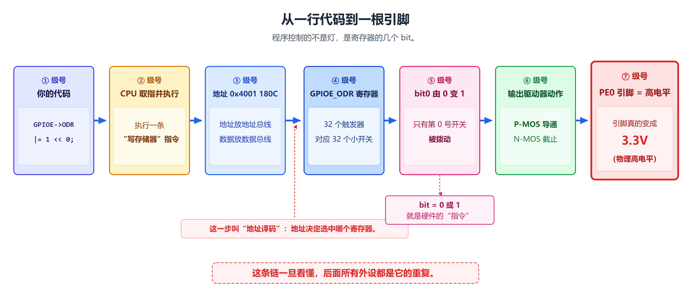

**这张图怎么看？从左往右，一共七级，我一级一级带你走。**

| 级别 | 图里画的是什么 | 对应的真实东西 |
|---|---|---|
| 第 1 级 | 一个方框里写着 `GPIOE->ODR \|= 1 << 0;` | **你写的代码**（C 语言文本） |
| 第 2 级 | 方框"CPU 执行 STR 指令" | CPU 从 Flash 取出编译好的机器码，执行一条"写存储器"指令 |
| 第 3 级 | 方框"地址 0x4001 180C" | CPU 把地址放到地址总线上，把数据放到数据总线上 |
| 第 4 级 | 方框"GPIOE_ODR 寄存器" | 这个地址对应的硬件寄存器（32 个触发器） |
| 第 5 级 | 方框"bit0 由 0 变 1" | 32 个小开关里，第 0 号开关被拨到 1 |
| 第 6 级 | 方框"输出驱动器：P-MOS 导通 / N-MOS 截止" | GPIO 内部的 MOS 管电路改变通断状态 |
| 第 7 级 | 一个引脚，旁边标"PE0 = 高电平（3.3V）" | 芯片外部那根真实的金属引脚，电压真的变了 |

**这张图要让我理解的核心只有一句**：

> **CPU 根本不"认识"GPIO。它只是往某个地址写了一个数。
> 是"地址译码电路"把这个地址翻译成了"选中的是 GPIOE 的 ODR 寄存器"。
> 硬件电路再根据这个寄存器的内容去控制引脚。**

**【类比】给小区物业写便条**

假设你想让小区大门口的路灯亮起来。你没法自己爬上去合闸，你的做法是：

1. 写一张便条："3 号楼 802 配电箱，第 3 号开关，请拨到 ON"（**代码 + 数据 + 地址**）；
2. 物业的通信员把便条送到 802（**地址总线 + 数据总线**）；
3. 802 里有一排开关面板，通信员把第 3 号开关拨上去（**寄存器 bit 改变**）；
4. 电工看到面板上第 3 号灯亮了，就把路灯的闸合上（**内部电路动作**）；
5. 大门口路灯亮（**引脚电平改变**）。

**类比边界（必须说清楚）**：

- 真实硬件里**没有"人"**去读便条。寄存器是一堆**触发器（flip-flop）**，写操作就是让某些触发器翻转；
- "便条"不是文字，而是 32 个 bit 同时到达的电压信号；
- "通信员"就是**总线**，"找 802"就是**地址译码**；
- 整个过程快得离谱，通常只要**几个到几十个时钟周期**（72MHz 下，一个周期约 14 纳秒）。

> **一句话复习（第 1、3 章讲过）**：
> **寄存器**可以先理解成"芯片内部的一排小开关"，一个 32 位寄存器就是 32 个小开关。
> 存储器的"格子"靠地址区分；**外设的寄存器也用地址区分，并且和内存住在同一个地址空间里**，
> 所以 CPU 用访问内存的普通指令就能操作硬件——这就是"存储器映射"。

### 6.1.2 你需要先知道的东西

这一节的术语密度比较高，先补齐几个最关键的概念。不懂这些，后面每一页都会卡住。

#### 【先补一个前置知识：什么叫"外设"？】

- 英文全称：**Peripheral**
- 中文：**外设 / 片上外设**
- 大白话：**芯片内部除了 CPU 内核和存储器以外，那些"专门干某一类活"的硬件模块**。
- 它是干什么的：GPIO 管引脚、定时器管计数和 PWM、USART 管串口通信、ADC 管把模拟电压变成数字……

**几个外设缩写，先认一下（后面会反复出现）：**

| 缩写 | 英文全称 | 中文 | 一句话它是干什么的 |
|---|---|---|---|
| USART | Universal Synchronous/Asynchronous Receiver/Transmitter | 通用同步/异步收发器 | 就是常说的"串口"，一根线发、一根线收 |
| SPI | Serial Peripheral Interface | 串行外设接口 | 一种"主机带从机"的高速通信方式 |
| I²C | Inter-Integrated Circuit | 集成电路间总线 | 只用两根线、可以挂很多器件的通信方式 |
| ADC | Analog-to-Digital Converter | 模数转换器 | 把模拟电压变成数字量（第 10 章） |
| DAC | Digital-to-Analog Converter | 数模转换器 | 把数字量变成模拟电压输出（第 10 章） |
| TIM | Timer | 定时器 | 按节拍计数，做延时、PWM、输入捕获（第 8 章） |
| PWM | Pulse Width Modulation | 脉冲宽度调制 | 快速开关，用"开多久、关多久"控制平均效果（第 8 章） |

**【补充解释】** 注意区别两个"外设"：

| 说法 | 指的是 | 例子 |
|---|---|---|
| 片上外设 | 集成在 STM32 芯片**内部**的功能模块 | GPIO、TIM、USART、SPI、ADC |
| 片外外设 | 接在芯片**外部**的器件 | LED、按键、显示屏、传感器、继电器 |

本章说的"GPIO 外设"，是**芯片内部**那个负责管引脚的硬件模块。

前面第 3 章画过：CPU 内核在左，一堆外设模块在右，中间靠**总线**（AHB、APB1、APB2）连接。
GPIO 就挂在那条叫 **APB2** 的总线上（这一条很重要，6.5 节开时钟要用到）。

#### 【先补一个前置知识：什么叫"引脚"？】

- 英文全称：**Pin**
- 中文：**引脚**
- 大白话：**芯片封装四周伸出来的那一根根金属小脚**。
- 它是干什么的：芯片和外部世界之间**唯一的物理通道**。芯片里的电信号要出去、外面的信号要进来，都得走引脚。

第 3 章算过：STM32F103VET6 是 LQFP100 封装，一共 **100 个引脚**。
其中大部分用来做电源、复位、晶振、调试接口，**剩下 80 根**拿来做通用输入输出——这就是本章的主角。

#### 【先补一个前置知识：什么叫"高电平"和"低电平"？】

数字电路里不用"电压是多少伏"来表达信息，而是把电压分成两个区间：

| 名称 | 大白话 | STM32 上的典型情况 |
|---|---|---|
| 高电平 | 电压比较高，代表逻辑 **1** | 接近 3.3V（比如 >2V 就算高） |
| 低电平 | 电压比较低，代表逻辑 **0** | 接近 0V（比如 <1.3V 就算低） |

**为什么不精确到"必须是 3.300V"？**
因为真实电路有噪声、有压降。所以标准规定的是**范围**：只要落在"高"的范围里就算 1，
落在"低"的范围里就算 0。两个范围中间那段（约 1.3V~2V）是"说不清"的地带，正常工作时不允许久留。

**【补充解释】为什么是 3.3V 而不是 5V？**
STM32F103 的供电电压是 **2.0V~3.6V**（典型 3.3V），所以它输出的高电平是 3.3V 左右。
但教材特别说明：这 80 根 I/O 口线**能承受 5V 电压**，意思是外面送进来 5V 的高电平它也不会坏，
可以直连 5V 的老器件。**注意："能承受 5V 输入"不等于"能输出 5V"**——它自己输出的高电平仍然是 3.3V 左右。

#### 【先补一个前置知识：CMOS 是什么？为什么 MOS 管能当开关？】

这一节必须补，否则 6.3 节讲推挽、开漏会完全听不懂。

- 英文全称：**Complementary Metal-Oxide-Semiconductor**（互补金属氧化物半导体）
- 中文：**互补金属氧化物半导体**
- 大白话：**用两种"电压控制的水龙头"搭成的电路**。
- 它是干什么的：现代数字芯片里几乎所有开关都用它做。

把一只 **MOS 管**想成**一个由电压控制的水龙头**：

```
        ┌─────────┐
        │  MOS 管  │
栅极 ──→│ (控制端) │
        │          │─── 漏极
源极 ───│          │
        └─────────┘
```

- **栅极（Gate）**：控制端。给它合适的电压，它就"开闸"；不给，就"关闸"。
- 它有三只脚：栅极（控制）、源极、漏极（电流的两端）。
- **N-MOS**：栅极给"高"就导通，相当于一个**往下接到地（GND）**的开关。
- **P-MOS**：栅极给"低"就导通，相当于一个**往上接到电源（VDD）**的开关。

> **顺手认识两个电源符号**：**VDD** 是芯片的**电源正极**（STM32 上约 3.3V），
> **VSS** 是芯片的**地**（0V）。电路图上看到"接 VDD / 接 VSS"，
> 就翻译成"接到高电平那一头 / 接到 0V 那一头"。

**【类比】** 把它想成两个不同类型的阀门：

- **N-MOS** = 装在地面上的排水阀，打开就把这根线**拉到地面（0V）**；
- **P-MOS** = 装在天花板上的注水阀，打开就把这根线**拉到天花板（3.3V）**。

**类比边界**：真实 MOS 管不是机械阀门，"开"也不是绝对短路——它导通时有个很小的电阻（几欧到几百欧），
截止时也不是绝对断开，而是有极小的漏电流。对教学理解来说，"开关"这个模型够用了。

> **后面只要看到"P-MOS 导通"，就翻译成"这根线被接到电源，输出高"；
> 看到"N-MOS 导通"，就翻译成"这根线被接到地，输出低"。**

#### 【先补一个前置知识：什么叫"使能"？】

- 英文全称：**Enable**
- 中文：**使能 / 允许工作**
- 大白话：**打开开关，让某个模块开始工作**。
- 它是干什么的：STM32 里每个外设都有一根"时钟开关"，写 1 表示"给它送时钟"（使能），写 0 表示"停它的时钟"（关闭）。

后面会反复看到 `ENABLE`、`DISABLE`、`xxxEN` 这样的词，含义都来自这里：
**EN 就是 Enable 的缩写，"打开"的意思；写 0 不是"输出低电平"，而是"关掉这个模块"。**

#### 【先补一个前置知识：寄存器、地址、偏移量（一句话复习）】

第 1、3 章已经讲过，这里只复习到本章够用的程度：

| 概念 | 一句话复习 |
|---|---|
| 寄存器 | 芯片内部一排小开关（触发器），写它就能改变硬件行为 |
| 地址 | 每个"格子"（内存单元或外设寄存器）在地址空间里的门牌号 |
| 地址空间 | CPU 能访问的全部地址范围（STM32 是 4GB，`0x0000 0000`~`0xFFFF FFFF`） |
| 外设基地址 | 某个外设（比如 GPIOA）所占一片地址区间的**第一个地址** |
| 偏移量 | 某个寄存器相对它所属外设基地址的**距离** |
| 最终地址 | **外设基地址 + 寄存器偏移量** |

### 6.1.3 【教材内容】GPIO 是什么

**术语卡片（第一次出现，按规矩给全）**：

| 项目 | 内容 |
|---|---|
| 英文全称 | **General-Purpose Input/Output** |
| 中文名称 | **通用输入/输出接口** |
| 缩写 | **GPIO** |
| 大白话 | STM32 芯片有很多引脚，GPIO 就是让程序控制这些引脚"读外面的高低电平"或者"向外输出高低电平"的基本功能。 |
| 它是干什么的 | 做开关量（只有"通/断""高/低"两种状态的量）的输入和输出：读按键、亮指示灯、驱动继电器、报警输出…… |

教材 p152 原文要点：

> - 几乎所有的嵌入式系统应用中，都涉及**开关量的输入和输出**功能，例如状态指示、报警输出、继电器闭合和断开、按钮状态读入、开关量报警信息的输入等。这些开关量的输入和控制输出都可以通过通用输入/输出接口实现。
> - 有些 GPIO 接口具有**复用功能**，本章仅介绍基本输入/输出功能。
> - STM32F103VET6 有 **80 根**多功能、双向、能承受 5V 电压的快速 I/O 口线。
> - **每 16 根口线分为一组**，分别为 **PA、PB、PC、PD、PE**。
> - 每个 GPIO 端口有：
>   - 两个 32 位配置寄存器（**GPIOx_CRL、GPIOx_CRH**）；
>   - 两个 32 位数据寄存器（**GPIOx_IDR 和 GPIOx_ODR**）；
>   - 一个 32 位置位/复位寄存器（**GPIOx_BSRR**）；
>   - 一个 16 位复位寄存器（**GPIOx_BRR**）；
>   - 一个 32 位锁定寄存器（**GPIOx_LCKR**）。
> - 每个 I/O 口可以自由编程，而 **I/O 口寄存器必须按 32 位字访问（不允许半字或字节访问）**。
> - GPIOx_BSRR 和 GPIOx_BRR 寄存器允许对任何 GPIO 寄存器的读/更改的独立访问，这样，在读和更改访问之间产生中断（IRQ）时不会发生危险。

> 引文里的 **IRQ** = Interrupt ReQuest（中断请求）：就是"某个硬件喊一声，让 CPU 先放下手头的活来处理我"。
> 第 7 章会专门讲；这里只要知道"中断会突然插进来执行一段别的代码"就够了。

这段话信息量很大。先不要试图记住所有寄存器名字，本节只要抓住三件事：

1. **有 80 根线，分成 5 组**；
2. **每组 16 根**，每根线都可以单独配置成输入或输出；
3. **配置和控制靠一组寄存器**（共 7 个，下一节和 6.4 节细讲）。

#### 逐词解释这段教材

**"80 根多功能双向能承受 5V 电压的快速 I/O 口线"——一个字一个字拆**

| 词 | 大白话意思 | 补充说明 |
|---|---|---|
| 80 根 | 一共 80 个可以当 GPIO 用的引脚 | 5 个端口 × 16 根 = 80 |
| 多功能 | 同一根引脚可以干很多种活 | 既能当 GPIO，也能"借"给串口、SPI、定时器等（这就是"复用功能"） |
| 双向 | 既能输出也能输入 | 方向由配置寄存器决定，一个时刻一般只用一个方向 |
| 能承受 5V 电压 | 外面给 5V 也不会烧坏 | 这叫"5V 容忍"，芯片自己供电仍是 3.3V |
| 快速 | 输出速度可以配得比较高 | 最高可配 50MHz 的翻转能力 |

**为什么是 80 根？算一下：**

```
端口 A：PA0  ~ PA15   → 16 根
端口 B：PB0  ~ PB15   → 16 根
端口 C：PC0  ~ PC15   → 16 根
端口 D：PD0  ~ PD15   → 16 根
端口 E：PE0  ~ PE15   → 16 根
────────────────────────────────
16 × 5 = 80 根
```

**【补充解释】** STM32 的"大号"型号（比如 144 脚的 ZET6）还有 PF、PG 两个端口，一共 7 组 112 根。
VET6 只有 100 个引脚，装不下那么多，所以只有 PA~PE 五组。
这也是第 3 章说过的："VET6 和 ZET6 的区别只是少了 PF、PG 两个 GPIO 口"。

#### 端口、位、引脚：三个最容易绕晕的词

**【辅助理解图】端口、位、引脚的关系**

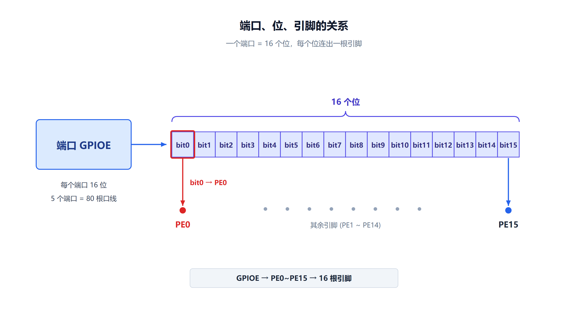

**看图方法：先看中间那一排 16 个格子，再看最右边那根线。**

- **最左边**：一个叫 **GPIOE** 的"大盒子"——这就是一个**端口**（Port）。
- **中间**：盒子里有 **16 个小格子**，编号 0~15。每个格子叫端口里的一个**位**（bit）。
- **右边**：每个位都连出去一根金属脚——这就是**引脚**（Pin）。

**三层对应关系，必须背下来：**

```
端口（Port）      GPIOE
   ↓ 里面有
位（bit）         PE0、PE1、PE2 …… PE15      共 16 位
   ↓ 每个位连到
引脚（Pin）       芯片的第 141 脚、第 142 脚 ……（具体脚号查数据手册）
```

**记法（教材和固件库都用这一套）**：

| 写法 | 读作 | 含义 |
|---|---|---|
| `GPIOE` | GPIO E | 整个端口 E（16 根线） |
| `PE0` | P-E-0 | 端口 E 的第 0 号引脚 |
| `Px` | P-x | 泛指某个端口（x = A、B、C、D、E） |
| `Pxy` | P-x-y | 端口 x 的第 y 位（y = 0~15） |
| `GPIOx_ODR` | GPIO-x-ODR | 端口 x 的输出数据寄存器 |

**【补充解释】"位 0 到 位 15"为什么不是 1 到 16？**
因为这是给计算机看的编号，计算机习惯**从 0 开始数**。第 1 根线叫 bit0，第 16 根线叫 bit15。
这一点在写代码时特别容易错：`1 << 0` 指的是 **bit0（PE0）**，不是"第 1 个引脚 = PE1"。

#### 【辅助理解图】查看教材原图：图 3-13 流水灯电路

第 6 章的例子全部围绕最小系统板上的 LED 和按键，所以我们先把教材第 3 章的电路图看清楚。

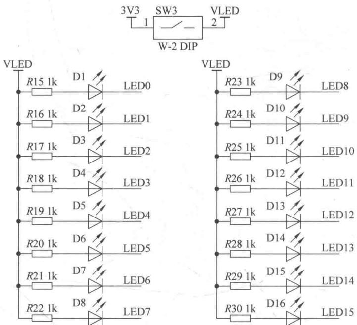

**看图方法：**

1. **先找右边那一列 `LED0` ~ `LED15`**：一共 16 只发光二极管，说明这块板子上有一排 16 个灯。
2. **再看每只 LED 左边的电阻**：这是**限流电阻**，防止电流太大烧掉 LED，也限制从引脚抽走的电流。
3. **注意 LED 的另一头接在哪儿**：图中 LED 一端经过电阻接到 **+3.3V 电源**（通过 SW3 开关提供），另一端接到 **PE0~PE15**。
4. **最后看开关 SW3**：教材例 6-1 特别说明，"要将发光二极管点亮，需要将 SW3 开关拨到 ON 给发光二极管提供电源"。

**箭头/电流方向决定了"高电平亮还是低电平亮"**：

```
   +3.3V
     │
   [限流电阻]
     │
   [ LED ]   ← 电流只能从上往下流（发光二极管是单向的）
     │
   PE0 引脚
```

- 当 PE0 输出**低电平（0V）**：电流从 +3.3V 流经电阻、LED、进入引脚、流到地 → **灯亮**；
- 当 PE0 输出**高电平（3.3V）**：两端电压差不多，没有电流 → **灯灭**。

**这张图要让我理解**：

> **代码让引脚"输出低电平"，物理上并不是"发出了什么信号"，
> 而是把这个引脚接到地，让电流有了通路。**
> 换句话说：**程序控制的不是"灯"，而是"引脚是被接到地、还是被接到电源"。**

【教材内容】教材例 6-1 就是这么分析的：

> "经过分析，当连接 LED0 的 PE0 引脚输出低电平 0 时，发光二极管亮；PE0 输出高电平 1 时，发光二极管灭。"

**注意**：不同的开发板接法可能相反（LED 一端接地，另一端接引脚，那就是高电平亮）。
**判断方法永远是看电路图，而不是背结论。**

### 6.1.4 三层解释：GPIO

按 TASK.md 第十节的要求，把这个知识点用三层讲一遍。

**第一层：先说人话**

GPIO 就是芯片的一排"电插孔"。每个孔都可以由程序选择：
"你是往外送电（输出 1）、还是往里吸电（输出 0）、还是当耳朵听外面的动静（输入）？"

**第二层：图和小例子**

```
              STM32 芯片
   ┌──────────────────────────────┐
   │   GPIOE 端口（16 个位）        │
   │                              │
   │  bit0 ──[输出电路]───────────●─ PE0 ──→ 灯
   │  bit1 ──[输出电路]───────────●─ PE1 ──→ 灯
   │   …                          │
   │  bit15 ─[输出电路]───────────●─ PE15 ─→ 灯
   │                              │
   │  程序写 ODR 寄存器 ← 控制这些 │
   └──────────────────────────────┘
```

**第三层：正式知识（考试式表述）**

> GPIO（General-Purpose Input/Output，通用输入/输出接口）是 STM32 微控制器用于
> 数字量（开关量）输入和输出的片上外设。STM32F103VET6 共有 80 根多功能、双向、
> 5V 容忍的快速 I/O 口线，每 16 根构成一个端口，分别记为 PA、PB、PC、PD、PE。
> 每个端口拥有 7 个寄存器：端口配置低寄存器 GPIOx_CRL、端口配置高寄存器 GPIOx_CRH、
> 端口输入数据寄存器 GPIOx_IDR、端口输出数据寄存器 GPIOx_ODR、
> 端口位设置/清除寄存器 GPIOx_BSRR、端口位清除寄存器 GPIOx_BRR、
> 端口配置锁定寄存器 GPIOx_LCKR。这些寄存器必须按 32 位字访问。
> 每个 I/O 位可独立配置为输入浮空、输入上拉、输入下拉、模拟输入、
> 通用推挽输出、通用开漏输出、复用推挽输出、复用开漏输出 8 种模式之一。

### 6.1.5 容易搞混的地方（一）：80 根线不等于 80 个"随便用的引脚"

【补充解释】虽然叫"80 根口线"，但实际上：

- 其中 **5 根**（PA13、PA14、PA15、PB3、PB4）复位后默认被 **JTAG 调试接口**占用；
- **术语卡片**：**JTAG** = Joint Test Action Group（联合测试行动小组）。它原本是一套芯片测试标准，
  后来成了 ARM 芯片最常用的**调试接口**——程序靠它下载进芯片、单步运行、查看寄存器。
  **SWD** = Serial Wire Debug（串行线调试），是 JTAG 的"两线精简版"，只用 SWCLK、SWDIO 两根线。
  同一组引脚通常可以在"JTAG 模式"和"SWD 模式"里二选一；
- **教材 p154 只列出了其中 4 根的复位状态**（PA13、PA14、PA15、PB4 谁上拉谁下拉）——
  因为第 5 根 PB3 是 JTAG 的**输出脚**（JTDO），复位后它只管往外送信号，
  不存在"输入上拉/下拉"这回事，所以教材的表里没有它。
  （下文 6.3.1 功能 1 的表格解释的就是这 4 根，和教材保持一致。）
- 想把这 5 根当普通 GPIO 用，需要**关闭 JTAG、改用 SWD 调试**（涉及 AFIO 复用重映射寄存器，第 7 章会讲）；
- PC13、PC14、PC15 与 **RTC**、外部 32.768kHz 晶振共用，能做 GPIO 但驱动能力有限
  （这是参考手册的补充知识，教材未展开，见文末"待核验"）。
  **RTC** = Real-Time Clock（实时时钟）：芯片里那个"接上纽扣电池也能继续走时"的日历时钟。

**一句话**：教材说 80 根，是指"硬件上存在 80 个 GPIO 位"；
真正拿到手里能随便用的，要**扣掉**被调试口、晶振口占用的一部分。

---

## 6.2 把一根引脚切开看：I/O 口位的基本结构

### 6.2.1 先别急着看教材：这一节要搞懂什么？

这一节要回答：

> **"配置成输入"和"配置成输出"，硬件上到底改变了什么？**

答案不是"软件里换了个变量"，而是**GPIO 内部的电路真的被切换了**：
某个缓冲器被打开、某个电阻被接上、某个 MOS 管被允许工作……

这一节把一根 I/O 位（就是端口里的一位，比如 PE0）的内部电路拆开看。

### 6.2.2 看教材原图：图 6-1 一个 I/O 口位的基本结构

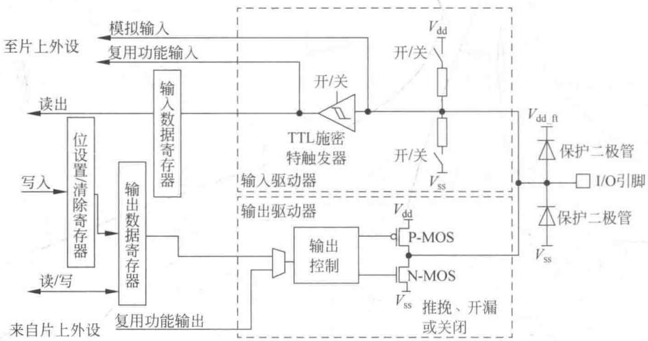

**这张图元素很多，第一遍只找三个东西：**

1. **最右边那根竖线**——它是**引脚**，通向芯片外面；
2. **上半部分**——数据的**输入通道**（从引脚往里走）；
3. **下半部分**——数据的**输出通道**（从里往引脚走）。

**第二遍，沿着信号走两条路。**

#### 路线一：输入通道（信号从引脚进芯片）

以引脚为起点，往左看：

```
引脚 ●──┬──[保护二极管：上管接 VDD、下管接 VSS]──┬──[输入驱动器]──→ 输入数据寄存器 IDR
        │                                        │
        │                                  ┌─────┴─────┐
        │                                  │ 上拉电阻 ─ 开关 ─ VDD
        │                                  │ 下拉电阻 ─ 开关 ─ VSS
        │                                  │ TTL 施密特触发器
        │                                  └───────────┘
```

**逐块说明：**

**① 保护二极管（钳位保护）**

教材 p153 说明：在接近 I/O 引脚处连接了两只保护二极管，假设导通压降为 $V_d$，
则输入到输入驱动器的信号电压范围被钳位在：

$$V_{\mathrm{ss}} - V_{d} < V_{\mathrm{in}} < V_{\mathrm{dd}} + V_{d} \tag{6-1}$$

**【补充解释】把公式翻译成人话：**

- 上面的二极管接在引脚和 VDD 之间：引脚电压一旦超过 VDD 约 0.7V，它就导通，
  把引脚上多余的能量"泄"到电源上去，**让电压再也升不上去**——被顶在 VDD + 0.7V
  这个"天花板"下面（也就是"钳位"在 VDD + 0.7V 以内）；
- 下面的二极管接在引脚和 VSS（地）之间：引脚电压一旦低于 −0.7V，它就导通，
  把引脚"抬"回安全区——−0.7V 是它的"地板"；
- 于是：**电源 3.3V 时，引脚上无论被灌多高的电压，送到内部电路的信号最多约 4V；
  被拉到多低，最多约 −0.7V。**

教材随后说明："由于 $V_d$ 的导通压降不会超过 0.7V，若电源电压 $V_{dd}$ 为 3.3V，
则输入到输入驱动器的信号最低不会低于 −0.7V，最高不会高于 4V，起到了保护作用。
在实际工程设计中，一般都将输入信号尽可能调理到 0～3.3V，也就是说，
一般情况下，两只保护二极管都不会导通。"

**这段话的含义是**：保护二极管是**保险丝式**的最后防线，正常工作时它不该导通。
不能因为"有保护"就往引脚上随便灌 5V、12V——保护电路只能扛住一定能量。

**② 上拉电阻和下拉电阻（带开关，受软件控制）**

教材 p153 原文：

> "输入驱动器中包括了两只电阻，分别通过开关接电源 $V_{dd}$（该电阻称为上拉电阻）
> 和地 $V_{ss}$（该电阻称为下拉电阻）。开关受软件的控制，用来设置当 I/O 口位用作输入时，
> 选择使用上拉电阻或者下拉电阻。"

**【类比】** 上拉/下拉电阻像**一根很松的橡皮筋**：

- **上拉**：橡皮筋把你往"高"的方向轻轻拉；
- **下拉**：橡皮筋把你往"低"的方向轻轻拉；
- 它们的拉力很弱（几十千欧的电阻），外面接进来的信号（比如按键、传感器）**一使劲就能把它拽过去**。

**类比边界**：真实电阻不是"力"，而是**限制了电流**。
"弱上拉/弱下拉"的"弱"就是靠大阻值实现的（电流小，所以弱）。
**关键点**：这两个电阻是"定基调"用的——当外面**什么都不接**（悬空）时，
引脚有一个确定的默认状态，而不是飘忽不定。

**③ TTL 施密特触发器（波形整形）**

**【先补一个前置知识：TTL 是什么？】**

- 英文全称：**Transistor-Transistor Logic**（晶体管-晶体管逻辑）
- 中文：**TTL 电路 / TTL 电平**
- 大白话：一种历史很悠久的数字电路家族；后来大家把"低于某个电压算 0、高于某个电压算 1"
  这类数字电平规则统称为"TTL 电平"。
- 在这里：教材说"TTL 施密特触发器"，意思就是这个触发器按数字电平的规矩来判断 0 和 1
  （而不是去关心电压到底是多少伏）。

#### 【先补一个前置知识：施密特触发器是什么？】

- 英文全称：**Schmitt Trigger**
- 中文：**施密特触发器**
- 大白话：**一个专门把"邋遢的波形"修成"方方正正的 0/1"的电路**。
- 它是干什么的：外面的信号因为有干扰、有电容、上升很慢，可能一会儿 1.4V、一会儿 1.8V，
  在门槛附近抖来抖去。直接送给数字电路会导致"一会儿 0 一会儿 1"地乱跳。
  施密特触发器**有两个不同的门槛**（一个稍高的上门槛、一个稍低的门门槛）：
  电压必须**超过上门槛**才认成 1，必须**低于下门槛**才认成 0。
  这样中间那点抖动就不会引起反复翻转。

```
       高 ┤        ┌───────────────┐  干净输出
          │        │
       低 ┤────────┘
          └────────────────────────→ 时间

   抖动输入：  ┌─┐  ┌─┐ ┌──────
          ─────┘ └──┘ └─┘
   整形输出：  ─────┘ └────────────   （只认第一次，中间抖不乱）
```

**【补充解释】** 教材说"当 I/O 口位用于开关量输入或者复用功能输入时，
TTL 施密特触发器用于对输入波形进行整形"——这就是它的全部职责。
按键、光耦、长线送来的信号，都靠它变得"干净"。

#### 路线二：输出通道（信号从芯片里走到引脚）

教材 p153 原文：

> "输出通道中包括**位设置/清除寄存器、输出数据寄存器、输出驱动器**。
> 要输出的开关量数据首先写入到位设置/清除寄存器，通过读写命令进入输出数据寄存器，
> 然后进入输出驱动的输出控制模块。输出控制模块可以接收开关量的输出和复用功能输出。
> 输出的信号通过由 **P-MOS 和 N-MOS 场效应管电路**输出到引脚。
> 通过软件设置，由 P-MOS 和 N-MOS 场效应管电路可以构成**推挽方式、开漏方式或者关闭**。"

**把这段话按顺序翻译：**

```
         (1) 你先写 BSRR/BRR           (2) 值落到 ODR          (3) 输出驱动器
    ┌──────────────────────┐     ┌──────────────────┐     ┌──────────────────────┐
    │ 位设置/清除寄存器 BSRR │ ──→ │ 输出数据寄存器 ODR │ ──→ │ 输出控制模块          │
    │ （你写 1 的那一位才动） │     │ （32 位，低 16 位有效）│     │  ↓                   │
    └──────────────────────┘     └──────────────────┘     │ P-MOS 上管 ─ 接 VDD   │
                                                            │ N-MOS 下管 ─ 接 VSS   │
                                                            └───────────┬──────────┘
                                                                        ↓
                                                                      引脚
```

**注意三个关键点：**

1. **写入顺序**：平时大家直接写 ODR 也行（教材这段话描述的是"经过 BSRR/BRR 再进 ODR"的路径）；
   BSRR/BRR 的好处见 **6.3.1 节"功能 2"** 和 **6.4.7、6.4.8 节**。
2. **两个 MOS 管的不同组合 = 不同输出方式**：
   - 上管 P-MOS、下管 N-MOS **都参与** → **推挽**输出；
   - **只有下管 N-MOS 参与**，上管彻底关掉 → **开漏**输出；
   - 两个都关掉 → 输出被"关闭"（输出高阻/不驱动）。
3. **输出控制模块有一个"二选一开关"**：输出的是"你写的 ODR 的值"还是"外设发来的信号"，
   由工作模式决定——这就是**通用输出**和**复用功能输出**的区别（见 6.3.7 节）。

### 6.2.3 用一句话总结这一节

> **一根 I/O 位 = 一条输入通道 + 一条输出通道 + 两个受软件控制的电阻 + 两个保护二极管。**
> 配置寄存器（CRL/CRH）做的事情，就是**把这几块电路按需要接通或断开**。

---

## 6.3 GPIO 的功能与 8 种工作模式

### 6.3.1 【教材内容】GPIO 的功能清单

教材 6.2 节列了 10 个小标题，本质上是 GPIO 的 10 项能力。先列清单，再重点展开。

| 编号 | 功能 | 一句话说明 | 本章是否展开 |
|---|---|---|---|
| 1 | 普通 I/O 功能 | 输出写 ODR；输入读 IDR；复位后默认浮空输入 | ★ 重点 |
| 2 | 单独的位设置或位清除 | 用 BSRR/BRR 只改指定位，其他位不动，不用关中断 | ★ 重点 |
| 3 | 外部中断/唤醒线 | 端口配成输入后，可作为外部中断源（第 7 章） | 第 7 章 |
| 4 | 复用功能（AF） | 引脚"借"给片上外设使用 | ★ 重点 |
| 5 | 软件重新映射 I/O 复用功能 | 通过 AFIO 寄存器把复用功能换到别的引脚 | 第 7 章细讲 |
| 6 | GPIO 锁定机制 | 锁死配置，防止程序跑飞乱改关键引脚 | ★ 重点 |
| 7 | 输入配置 | 输入时内部发生哪 5 件事 | ★ 重点 |
| 8 | 输出配置 | 输出时内部发生哪 6 件事 | ★ 重点 |
| 9 | 复用功能配置 | 复用功能时内部发生哪 7 件事 | ★ 重点 |
| 10 | 模拟输入配置 | 模拟输入时内部发生哪 4 件事 | ★ 重点 |

**【补充解释】教材说"有些 GPIO 接口具有复用功能，本章仅介绍基本输入/输出功能"**，
意思是本章以"通用 I/O"为主。但"复用"这个概念绕不开——因为 8 种模式里有 4 种名字就带"复用"。
所以本节把复用模式**讲到"够用"**为止：知道它是什么、怎么配、什么场景用；
至于具体某个外设复用到哪根引脚、怎么重映射，后面第 7~10 章各有专章。

#### 功能 1：普通 I/O 功能（教材 p154）

教材原文要点：

> - **复位期间和刚复位后，复用功能未开启，I/O 口被配置成浮空输入模式。**
> - 复位后，JTAG 引脚被置于输入上拉或下拉模式：
>   - PA13（JTMS）置于**上拉**模式；
>   - PA14（JTCK）置于**下拉**模式；
>   - PA15（JTDI）置于**上拉**模式；
>   - PB4（JNTRST）置于**上拉**模式。
> - 当作为输出配置时，写到输出数据寄存器（GPIOx_ODR）上的值输出到相应的 I/O 引脚。
>   可以以推挽模式或开漏模式（当输出 0 时，只有 N-MOS 被打开）使用输出驱动器。
> - 输入数据寄存器（GPIOx_IDR）在**每个 APB2 时钟周期**捕捉 I/O 引脚上的数据。
> - 所有 GPIO 引脚有一个**内部弱上拉和弱下拉**，当配置为输入时，它们可以被激活也可以被断开。

**这里有三个考试常考的"默认状态"结论：**

| 问题 | 答案 | 为什么 |
|---|---|---|
| 芯片刚复位后，引脚是什么模式？ | **浮空输入** | 配置寄存器 CRL/CRH 的复位值是 `0x4444 4444`，每个引脚 4 位是 `0100`，正好是浮空输入（6.4 节会演算） |
| 那 PA13/PA14/PA15/PB4 呢？ | 上拉/下拉输入（见上表） | 因为复位后 JTAG 调试接口要能用，不能让它悬空乱跳 |
| 复位后引脚输出什么电平？ | **不输出** | 因为默认是输入模式，输出驱动器根本没开 |

**【辅助理解图】IDR 是怎么"采样"引脚的：一条时间轴**

既然 IDR 是"每个 APB2 时钟周期捕捉一次引脚上的数据"，那它就不是"实时的镜子"，
而是**每个时钟边沿拍一张快照**。

```
APB2 时钟   ┌─┐  ┌─┐  ┌─┐  ┌─┐  ┌─┐  ┌─┐  ┌─┐  ┌─┐
            ┘ └──┘ └──┘ └──┘ └──┘ └──┘ └──┘ └──┘ └──
             ↑     ↑     ↑     ↑     ↑     ↑
引脚电平 ────┐     ┌───────────┐           ┌────────
            └─────┘           └───────────┘
            ①     ②     ③     ④     ⑤     ⑥
IDR 里的值  1     1     1     0     0     1      ← 只在这几个"拍快照"的时刻更新
```

**先发生什么 → 再发生什么 → 为什么：**

1. **先**：引脚上的电压稳定成某个电平；
2. **再**：APB2 时钟的边沿到来，GPIO 硬件把这一瞬间的电平"拍"进 IDR；
3. **为什么**：数字电路是同步电路，所有动作跟着时钟节拍走，才不会乱。
   这也解释了为什么**读 IDR 可能读到"上一拍"的值**——它最多有一个 APB2 周期的延迟。

**APB2 周期有多长？** APB2 时钟（PCLK2）最高 72MHz，所以一拍约 13.9ns。
对人工按键（毫秒级）来说快得可以忽略；但对高速信号（几 MHz），这个延迟就要算进去。

#### 功能 2：单独的位设置或位清除（教材 p154）

教材原文：

> "当对 GPIOx_ODR 的个别位编程时，软件不需要禁止中断：在单次 APB2 写操作中，
> 可以只更改一个或多个位。这是通过对'置位/复位寄存器'（GPIOx_BSRR，复位是 GPIOx_BRR）
> 中想要更改的位写 1 来实现的。没被选择的位将不被更改。"

**为什么这条很值钱？** 先看没有它会发生什么。

假设 PE0 和 PE1 各接一只灯，现在只想点亮 PE0（让它变低），用"读—改—写"的做法：

```c
GPIOE->ODR = GPIOE->ODR & ~(1 << 0);   /* 读出 ODR，改 bit0，再写回 */
```

**先算清楚这条语句要写回什么。** 假设读到的 ODR 是 `0x0000 0002`（PE1 目前是 1、PE0 是 0）：

```
读到的 ODR：        0x0000 0002 = 0000 0000 0000 0000 0000 0000 0000 0010
1 << 0：            0x0000 0001 = 0000 0000 0000 0000 0000 0000 0000 0001
~(1 << 0)：         0xFFFF FFFE = 1111 1111 1111 1111 1111 1111 1111 1110
AND 后（要写回的值）：0x0000 0002 = 0000 0000 0000 0000 0000 0000 0000 0010
                                    ↑                             ↑
                                bit1 还是 1                  bit0 被清成 0
```

**注意**：这次 AND 只清掉 bit0，**bit1 是原封不动地被算进"要写回的值"里的**。
（不是算成 `0x0000 0000`——AND 掩码里 bit1 的位置是 1，所以 bit1 保住了。）
然后才发生：

```
时刻 ①  CPU 读 ODR        → 得到 0x0000 0002（PE1 目前是 1）
时刻 ②  CPU 算出要写回的值 → 0x0000 0002（只把 bit0 清 0，bit1 保持原样）
时刻 ③  ★ 这时候发生了中断！★
        中断服务程序把 PE1 改成 0（写 ODR，bit1 = 0）→ 此刻 ODR 变成 0x0000 0000
时刻 ④  CPU 把刚才算好的 0x0000 0002 写回 ODR
         → bit0 确实清成了 0（这一步是对的 ✓）
         → 但 bit1 也被写成 1：**中断里"把 PE1 清 0"的修改被覆盖、丢了！**
```

**问题出在哪？** CPU 在时刻 ④ 写回的是一个**基于"旧值"算出来的结果**。
它并不知道在它"读"和"写"之间，别人（中断服务程序）已经改过这块寄存器了。
这种"谁先谁后不确定、结果也就不确定"的情况，叫**竞态（race）**。

这就是教材说的"在读和更改访问之间产生中断（IRQ）时会发生危险"（IRQ = 中断请求，见 6.1.3 的说明）。

**【辅助理解图】读—改—写为什么危险：一次中断就把修改弄丢了**

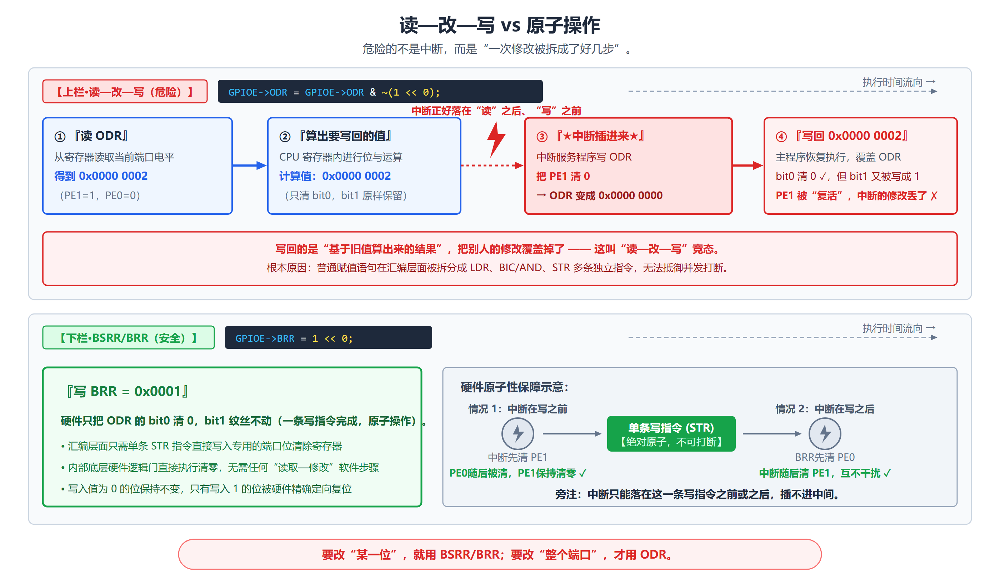

**看图方法**：

1. **上图是"读—改—写"**：时间轴从左到右经过"读 ODR → 算 → 中断插进来 → 写 ODR"；
2. **红色闪电表示中断**：它落在"读"之后、"写"之前——这是最要命的位置；
3. **看最后写回的 `0x0000 0002`**：bit0 清对了，但 bit1 被"复活"成 1，中断的修改丢了；
4. **下图是 BSRR/BRR 的原子操作**：整个过程只有"写"这一步，中断只能落在它之前或之后，插不进中间。

**这张图要让我理解**：

> **危险的不是"中断"，而是"一次修改被拆成了好几步"。**
> 只要中间有可能被打断，就应该换成"一条指令完成"的写法。

**用 BSRR/BRR 就没有这个问题**：我只写一个值，硬件只动我指定的那一位，不碰其他位：

```c
GPIOE->BRR = 1 << 0;   /* 写 0x0001：只把 bit0 清零，bit1 想怎样就怎样 */
```

**【补充解释】** 这种"一条指令完成、中间不可能被打断"的操作，叫**原子操作**。
（一句话复习：第 2 章讲过的**位带** = **bit-banding**，中文也叫"位段"，
它的思路是把"某一位"膨胀成"一个 32 位的字"——写这个字，就等于原子地改那一位。
BSRR/BRR 提供的是另一种"原子改一位"的手段，而且不用算别名地址，所以实际更常用。）

#### 功能 3：外部中断/唤醒线（教材 p154）

> "所有端口都有外部中断能力。为了使用外部中断线，端口必须配置成输入模式。
> 更多的关于外部中断的信息，请参考第 7 章的内容。"

**一句话记住**：想让引脚"一旦电平变化就叫醒 CPU"，先把引脚配成输入，再去第 7 章看 EXTI 和 NVIC。
本章只做输入读取（轮询），不做中断。

#### 功能 4：复用功能（AF）（教材 p154）

**术语卡片：**

| 项目 | 内容 |
|---|---|
| 英文全称 | **Alternate Function** |
| 中文名称 | **复用功能 / 第二功能** |
| 缩写 | **AF** |
| 大白话 | 一根引脚除了当普通 GPIO，还能"借调"给芯片内部的专业模块（串口、SPI、定时器等）使用。 |
| 它是干什么的 | 让有限的引脚承担更多功能。比如 PA9/PA10 平时是 GPIO，被串口 1 "借"走后就是 TX/RX。 |

教材原文要点：

> - 使用默认复用功能前必须对端口位配置寄存器编程。
> - 对于**复用输入**功能，端口必须配置成**输入模式**（浮空、上拉或下拉），且输入引脚必须由外部驱动。
> - 对于**复用输出**功能，端口必须配置成**复用功能输出模式**（推挽或开漏）。
> - 对于**双向复用**功能，端口位必须配置**复用功能输出模式**（推挽或开漏），
>   此时输入驱动器被配置成浮空输入模式。
> - 如果把端口配置成复用输出功能，则**引脚和输出寄存器断开**，并和片上外设的输出信号连接。
> - 如果软件把一个 GPIO 脚配置成复用输出功能，但是外设没有被激活，那么它的输出将不确定。

**【类比】工位借调**

GPIO 的 16 个工位（引脚）平时归"老板"（你的代码）直接指挥——老板写 ODR，工位就动。
现在"串口部门"缺人手，把 PA9 借走了：

- 借调手续（把 PA9 配成"复用推挽输出"）办完之后，
  **老板的指令（ODR）就传不到这个工位了**，工位只听串口部门的（外设信号）；
- 如果串口部门根本没人上班（外设没使能），这个工位就"没人管"——输出不确定。

**类比边界**：真实硬件里没有"借调手续"这个动作，**配置寄存器里 4 个 bit 的取值**就是手续；
"断开"是一个叫**输出控制模块里的多路选择器**真的换了输入来源。

**这句话是考试常考的**："配置成复用输出后，引脚的输出由**片上外设**驱动，而不再由 GPIOx_ODR 驱动。"

#### 功能 5：软件重新映射 I/O 复用功能（教材 p154）

> "为了使不同封装器件的外设 I/O 功能的数量达到最优，可以把一些复用功能重新映射到其他一些引脚上。
> 这可以通过软件配置 **AFIO** 寄存器来完成，这时，复用功能就不再映射到它们的原始引脚上了。"

**术语卡片：**

| 项目 | 内容 |
|---|---|
| 英文全称 | **Alternate Function I/O** |
| 中文名称 | **复用功能 I/O（辅助功能 I/O）** |
| 缩写 | **AFIO** |
| 大白话 | 一个"换线员"：默认的复用功能接在哪些引脚上是定好的，AFIO 能把这些功能改接到别的引脚。 |
| 它是干什么的 | 比如某些封装引脚不够用时，把 USART 的 TX/RX 从 PA9/PA10 改到 PB6/PB7。 |

本章只需要知道它存在（因为 AFIO 的时钟也要在 RCC_APB2ENR 里打开，见 6.5 节）；
具体重映射表在第 7 章（中断）和第 9 章（串口）用到时再学。

#### 功能 6：GPIO 锁定机制（教材 p155）

> "锁定机制允许冻结 IO 配置。当在一个端口位上执行了锁定（LOCK）程序，
> 在下一次复位之前，将不能再更改端口位的配置。
> 这个功能主要用于一些关键引脚的配置，防止程序跑飞引起灾难性后果。"

**【类比】** 把关键引脚的配置"锁进保险柜，钥匙扔掉"。

**类比边界**：不是物理锁，也**不是永久的**——只要芯片复位，锁自动解开；
锁住的也**只是配置**（CRL/CRH 里的 4 个 bit），不锁 ODR 的输出值（你依然可以点灯/灭灯）。

教材 p160 给出具体操作：LCKR 寄存器 + 一个"写 1→写 0→写 1→读 0→读 1"的序列（**6.4.9 节**细讲）。

#### 功能 7：输入配置（教材 p155）

**当 I/O 口配置为输入时，内部发生 5 件事：**

| 序号 | 教材原文 | 大白话 |
|---|---|---|
| (1) | 输出缓冲器被禁止 | 输出通道**关了**，引脚不受 ODR 影响 |
| (2) | 施密特触发输入被激活 | 输入通道**开了**，波形被整形 |
| (3) | 根据输入配置（上拉、下拉或浮动）的不同，弱上拉和下拉电阻被连接 | 那两个"橡皮筋"按你选的方式接上（浮空时两个都不接） |
| (4) | 出现在 I/O 引脚上的数据在每个 APB2 时钟被采样到输入数据寄存器 | 每个 APB2 节拍给引脚"拍快照"存进 IDR |
| (5) | 对输入数据寄存器的读访问可得到 I/O 状态 | 程序读 IDR 就能知道引脚现在是什么电平 |

**见图 6-2（下一小节一起看）。**

#### 功能 8：输出配置（教材 p155）

**当 I/O 口被配置为输出时，内部发生 6 件事：**

| 序号 | 教材原文 | 大白话 |
|---|---|---|
| (1) | 输出缓冲器被激活 | 输出通道**开了** |
| (1a) | 开漏模式：输出寄存器上的 0 激活 N-MOS，而输出寄存器上的 1 将端口置于高阻状态（P-MOS 从不被激活） | 开漏：写 0 拉低；写 1"撒手不管"，需要外面上拉电阻 |
| (1b) | 推挽模式：输出寄存器上的 0 激活 N-MOS，而输出寄存器上的 1 将激活 P-MOS | 推挽：写 0 主动拉低，写 1 主动拉高 |
| (2) | 施密特触发输入被激活 | 输入通道**也还开着**（输出模式下仍能读回引脚状态） |
| (3) | 弱上拉和下拉电阻被禁止 | 那两根"橡皮筋"**断开**（输出模式下不需要它们定基调） |
| (4) | 出现在 I/O 引脚上的数据在每个 APB2 时钟被采样到输入数据寄存器 | IDR 依然在拍快照 |
| (5) | 开漏模式时，对输入数据寄存器的读访问可得到 I/O 状态 | 开漏输出：想知道引脚真实电平（可能被外面拉高），**读 IDR** |
| (6) | 推挽式模式时，对输出数据寄存器的读访问得到最后一次写的值 | 推挽输出：读 ODR 只能知道你**上次写了什么**，不代表引脚现在的真实电平 |

**【补充解释】第 (5)、(6) 条是最容易考、也最容易写错程序的地方，展开说：**

- **推挽输出**：引脚电平基本等于你写的值，所以读 ODR 就够了（读的是"你的意图"）；
- **开漏输出**：你写 1 时引脚是高阻，实际电平由**外部上拉电阻**决定。
  如果外面没接上拉，写 1 后引脚可能"飘"在中间电平，甚至读回来是 0。
  所以开漏时**必须读 IDR**，才能知道引脚真实状态。

#### 功能 9：复用功能配置（教材 p155~156）

**当 I/O 口被配置为复用功能时，内部发生 7 件事：**

| 序号 | 教材原文 | 大白话 |
|---|---|---|
| (1) | 在开漏或推挽式配置中，输出缓冲器被打开 | 输出通道开了，但输入来自外设 |
| (2) | 内置外设的信号驱动输出缓冲器（复用功能输出） | **控制权交给外设**，ODR 靠边站 |
| (3) | 施密特触发输入被激活 | 输入通道也开着 |
| (4) | 弱上拉和下拉电阻被禁止 | "橡皮筋"断开 |
| (5) | 在每个 APB2 时钟周期，出现在 I/O 引脚上的数据被采样到输入数据寄存器 | IDR 依然在拍快照 |
| (6) | 开漏模式时，读输入数据寄存器时可得到 I/O 口状态 | 同输出模式的规则 |
| (7) | 在推挽模式时，读输出数据寄存器时可得到最后一次写的值 | 同输出模式的规则 |

**见图 6-4。**

#### 功能 10：模拟输入配置（教材 p157）

**当 I/O 口被配置为模拟输入时，内部发生 4 件事：**

| 序号 | 教材原文 | 大白话 |
|---|---|---|
| (1) | 输出缓冲器被禁止 | 输出通道关掉 |
| (2) | 禁止施密特触发输入，实现了每个模拟 I/O 引脚上的零消耗。施密特触发输出值被强置为 0 | 数字输入通道也**关掉**，不消耗、不干扰模拟信号 |
| (3) | 弱上拉和下拉电阻被禁止 | "橡皮筋"断开，不会把模拟电压"拉偏" |
| (4) | 读取输入数据寄存器时数值为 0 | 读 IDR 永远读到 0，**别想用它读模拟量** |

**为什么模拟输入要把数字部分全部关掉？**

因为模拟信号最怕"负载"和"干扰"。假设你接了一个光敏电阻分压电路，
输出 1.65V 这么个"中间电压"，准备送给 ADC 转换：

- 如果施密特触发器还开着，它会把这个 1.65V 一会儿判成 0、一会儿判成 1，纯粹是噪声源；
- 如果弱上拉/下拉电阻还接着，它会像一只手轻轻地把电压往 3.3V 或 0V 拽，测出来就不是真值了。

所以：**当引脚要送给 ADC 用时，必须配成模拟输入（GPIO_Mode_AIN）**——
这也是教材第 10 章 ADC 的例子里反复出现这句话的原因。

**见图 6-5。**

### 6.3.2 先看教材原图：三种输入配置（图 6-2）

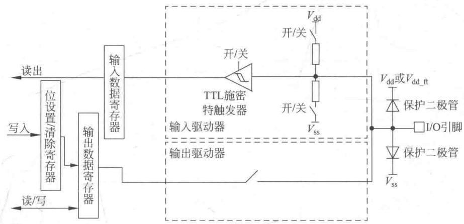

**看图方法（三步）：**

1. **先找引脚（最右边）**，然后沿着线往左看；
2. **看那两个开关**：一个通向上拉电阻（接 VDD），一个通向下拉电阻（接 VSS）。
   图中会画出三种情况的开关状态；
3. **看输出缓冲器那一块**：它是"打叉/断开"的状态——因为现在配的是输入模式。

**三种情况对照：**

| 模式 | 上拉开关 | 下拉开关 | 引脚悬空时会读到什么 |
|---|---|---|---|
| 浮空输入（Floating） | 断开 | 断开 | **不确定**（易受干扰） |
| 上拉输入（Pull-Up，IPU） | 闭合 | 断开 | 稳定读到 **1**（高） |
| 下拉输入（Pull-Down，IPD） | 断开 | 闭合 | 稳定读到 **0**（低） |

**【教材内容】教材对这三种的原始定义（p152）：**

> - **输入浮空**：浮空（floating）就是逻辑器件的输入引脚既不接高电平，也不接低电平。
>   由于逻辑器件的内部结构，当它输入引脚悬空时，相当于该引脚接了高电平。
>   一般实际运用时，引脚不建议悬空，易受干扰。
> - **输入上拉**：上拉就是把电压拉高，比如拉到 Vcc。上拉就是将不确定的信号通过一个电阻嵌位在高电平。
>   电阻同时起限流作用。弱强只是上拉电阻的阻值不同，没有什么严格区分。
> - **输入下拉**：就是把电压拉低，拉到 GND。与上拉原理相似。

**【补充解释】教材说"悬空时相当于接了高电平"——这句要小心理解：**

- 它描述的是**旧式 TTL 逻辑器件**的典型现象（输入端悬空会被内部电路拉高）；
- 但 **CMOS 输入是高阻的**，悬空的引脚电压**没有保证**，可能被周围的电场、你的手指、
  甚至空气湿度影响，在 0 和 1 之间乱跳；
- 所以教材紧接着说"一般实际运用时，引脚不建议悬空，易受干扰"——**这句才是重点**。

**结论（实际工程用法）**：

> **输入引脚不允许长期悬空。** 要么由外部电路给出确定电平，
> 要么打开内部上拉/下拉电阻。悬空 = 薛定谔的电平。

### 6.3.3 先看教材原图：输出配置与复用功能配置（图 6-3、图 6-4）

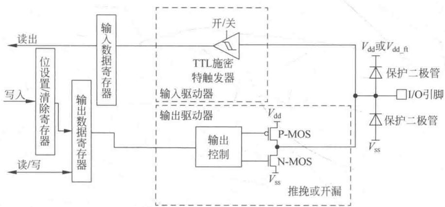

**看图方法：**

1. **先看最下面那两个 MOS 管**：上面写着 P-MOS（接 VDD），下面写着 N-MOS（接 VSS）。
   它们是真正把引脚"接到高"或"接到低"的开关；
2. **看 MOS 管往上连到哪里**：连到"输出控制"模块；
3. **看输出控制模块的输入来自哪里**：一个是"输出数据寄存器 ODR"，另一个是"复用功能输出"。
   谁被选中，由配置位决定；
4. **看最左边**：你会看到 BSRR、ODR 这些寄存器方块，这就是"程序能碰到的地方"；
5. **找那个"P-MOS 驱动器的使能"信号**：开漏模式下它是关闭的——这是推挽与开漏在图上唯一的区别。

**推挽和开漏的硬件差异（对照图看）：**

```
【推挽 Push-Pull】                    【开漏 Open-Drain】
        VDD                                   VDD（芯片内部：不接！）
         │                                     ╳
      [P-MOS] ← 会导通                     （P-MOS 从不导通）
         │                                     │
  引脚 ──┼────                         引脚 ──┼────
         │                                     │
      [N-MOS] ← 会导通                     [N-MOS] ← 会导通
         │                                     │
        VSS                                   VSS

写 1：P-MOS 开 → 引脚被拉到 3.3V     写 1：两个都关 → 引脚高阻（等于"悬空撒手"）
写 0：N-MOS 开 → 引脚被拉到 0V       写 0：N-MOS 开 → 引脚被拉到 0V
```

**【类比】推挽 = 有两只手，开漏 = 只有一只手**

- **推挽**（也叫推拉）：一只手能往上推（P-MOS 拉高），一只手能往下拽（N-MOS 拉低），
  所以**高、低都能主动输出**；
- **开漏**：只有往下拽的那只手（N-MOS）。想输出高，只能靠**外面**接一个上拉电阻把线拉上去。

**类比边界**：上面的"两只手"不会同时用力。教材 p152 说得很准确：
"推挽结构一般是指两个三极管分别受两个互补信号的控制，总是在一个三极管导通的时候另一个截止。"
所以实际电路里**永远是上管、下管二选一导通**，绝不会出现"上管接电源、下管接地"的短路状态。

**【补充解释】"开漏"的"漏"是什么？**
"漏"指 MOS 管的**漏极**（Drain）。"开漏"就是"只把漏极露出来接引脚"，
源极接地、P-MOS 完全不参与。教材 p152 说"输出端相当于三极管的集电极。
要得到高电平状态需要上拉电阻才行"——老教材常拿三极管的"集电极开路（OC）"来类比，
意思是一样的：**只能拉低，不能主动拉高**。

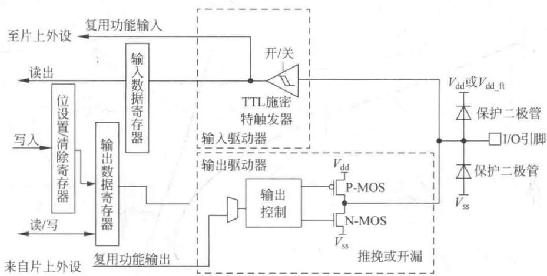

**看图方法（对比图 6-3）：**

1. 两张图结构几乎一样，**唯一的区别在"谁在驱动输出控制模块"**；
2. 图 6-3 的输入是 GPIOx_ODR（你自己的数据）；
3. 图 6-4 的输入是**片上外设（Alternate Function）**发来的信号；
4. 再看输入侧：图 6-4 里引脚上的信号除了进 IDR，还会被送去**外设**（比如串口的 RX 引脚）；
5. 注意图上的"复用功能输入/输出"两条路是**分开的**：
   输出方向从外设来，输入方向往外设去——一根引脚可以同时"收"和"发"（比如 USART）。

**这张图要让我理解**：

> **复用功能 = 在引脚和片上外设之间，接了一条"专用直连线"，把 GPIO 的 ODR 旁路掉了。**

### 6.3.4 【辅助理解图】8 种工作模式一页速查

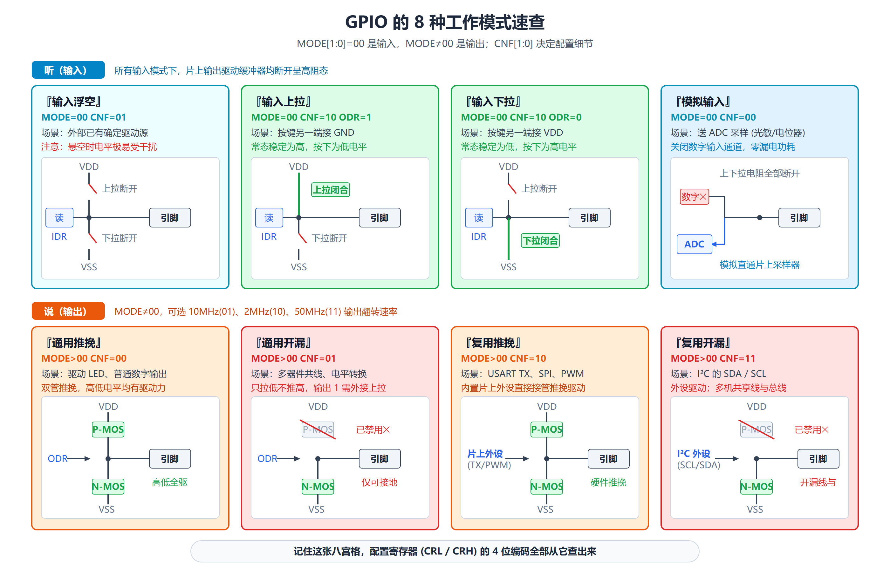

**看图方法**：

1. **先看颜色分两大类**：上面 4 个是**输入**（蓝绿色系），下面 4 个是**输出**（橙红色系）；
2. **每个方框都写三行**：模式中文名、4 位编码（CNF MODE）、典型用途；
3. **再看每个方框右侧的"小电路"**：直观显示这个模式内部谁通谁断；
4. **最后一列是"什么时候用它"**——这一列比编码更重要。

**【补充解释】8 种模式的名字，其实是一层一层问下来的结果：**

```
问题 1：这根引脚是"听"（输入）还是"说"（输出）？
       —— 由 MODE[1:0] 决定：MODE = 00 → 输入（4 种）；MODE ≠ 00 → 输出（4 种）

【如果是输入，接着往下问】
问题 2（输入分支）：数字输入通道开不开？
       关掉数字通道（施密特触发器禁止） → 模拟输入（只给 ADC 用）
       开着数字通道                    → 剩下 3 种输入模式，再问问题 3

问题 3（输入分支·数字通道开着时）：悬空（外面什么都不接）时靠谁定电平？
       谁也不靠，等外部电路来驱动   → 浮空输入
       内部弱上拉电阻拽向高         → 上拉输入
       内部弱下拉电阻拽向低         → 下拉输入

【如果是输出，改问这一条】
问题 2（输出分支）：谁来发号施令，用几只手？
       听我（ODR）的 + 两只手  → 通用推挽
       听我（ODR）的 + 一只手  → 通用开漏
       听外设的     + 两只手  → 复用推挽
       听外设的     + 一只手  → 复用开漏
```

**最容易搞混的一对：模拟输入 vs 浮空输入。**
它们都是"内部既不接上拉、也不接下拉"，看起来很像。但**区别不在"扶不扶"，
而在"数字输入通道开不开"**：

| 对比项 | 浮空输入（CNF=01） | 模拟输入（CNF=00） |
|---|---|---|
| 施密特触发器（数字输入通道） | **开**：引脚电平会被判成 0/1 送进 IDR | **关**：数字通道被整个切断 |
| 读 IDR | 能读到引脚电平（0 或 1） | 恒为 0，读不到有用信息 |
| 上拉/下拉电阻 | 都不接（这就是"浮空"） | 都不接 |
| 干什么用的 | 接收外部已经有确定驱动源的**数字信号** | 把引脚的**模拟电压**送给 ADC |

**记住这张"八宫格"，后面所有配置寄存器的位怎么填，都是从这张表查出来的。**

### 6.3.5 【教材内容】端口位配置表（表 6-1）

教材用表 6-1 把这 8 种模式的编码集中列出。这张表是本章的"字典"，必须会查。

**表 6-1 端口位工作模式配置表（按教材整理）**

> **读表提醒 1**：4 位编码的读法是 **CNF[1:0] 在前（高 2 位）、MODE[1:0] 在后（低 2 位）**。
> **读表提醒 2**：教材原表里，四个"输出"行的 MODE 列是**合并单元格**——三档速度
> （01=10MHz、10=2MHz、11=50MHz）对**四个输出行全都适用**。
> 所以下表把三档速度在每一行里都写全，避免"复用输出不用配速度"的误读。

| 大类 | 配置模式 | CNF[1:0] | MODE[1:0] | 对应 ODR 位的作用 |
|---|---|---|---|---|
| **通用输出** | 推挽（Push-Pull） | `00` | `01`=10MHz、`10`=2MHz、`11`=50MHz（三档任选，不能是 00） | ODR 决定输出值（0 或 1） |
| **通用输出** | 开漏（Open-Drain） | `01` | `01`=10MHz、`10`=2MHz、`11`=50MHz（三档任选，不能是 00） | ODR 决定输出值（0 或 1） |
| **复用功能输出** | 推挽（Push-Pull） | `10` | `01`=10MHz、`10`=2MHz、`11`=50MHz（三档任选，不能是 00） | 不使用（外设驱动） |
| **复用功能输出** | 开漏（Open-Drain） | `11` | `01`=10MHz、`10`=2MHz、`11`=50MHz（三档任选，不能是 00） | 不使用（外设驱动） |
| **输入** | 模拟输入 | `00` | `00` | 不使用 |
| **输入** | 浮空输入 | `01` | `00` | 不使用 |
| **输入** | 下拉输入 | `10` | `00` | 写 0（选下拉） |
| **输入** | 上拉输入 | `10` | `00` | 写 1（选上拉） |

**结论（针对易错点）**：**只要 MODE≠00（也就是"输出"），不管是通用还是复用、推挽还是开漏，
都必须同时选一档速度**——"复用输出"只是把"谁来驱动"换成了外设，速度配置一样少不了。
（下文 6.3.7 的第（7）（8）两种模式和 6.3.8 的总表都是这个结论。）

**【补充解释】表 6-1 的三条"读表规则"：**

1. **先看 MODE[1:0] 是不是 00**：
   - `MODE = 00` → **输入**，此时 CNF 表示"哪种输入"；
   - `MODE ≠ 00` → **输出**，此时 CNF 表示"推挽/开漏、通用/复用"，MODE 的数值表示**输出速度**。
2. **输入模式下的 CNF 编码**（教材 p157 原文）：
   - `00`：模拟输入模式；
   - `01`：浮空输入模式（**复位后的状态**）；
   - `10`：上拉/下拉输入模式（**注意：到底是上拉还是下拉，不由 CNF 决定，而由 ODR 的对应位决定**）；  - `11`：保留。
3. **输出模式下的 CNF 编码**（教材 p157 原文，其中前两行请见下表说明）：
   - `00`：通用推挽输出模式；
   - `01`：通用开漏输出模式；
   - `10`：复用功能推挽输出模式；
   - `11`：复用功能开漏输出模式。

**【待核验】提醒**：MinerU 对教材 p157 这段的解析**丢了中间两行**（"输出模式（MODE[1:0]>00）：00 通用推挽、01 通用开漏"），
只剩一个公式占位。本讲义按**表 6-1 的完整内容 + ST 参考手册**补全，并把这一处列入文末"待核验"。

**【补充解释】"上拉输入"和"下拉输入"的编码是同一个 `CNF=10`，那怎么区分？**

这就是表 6-1 最后一列存在的意义：

```
配置：CNF0=0, CNF1=1, MODE1=0, MODE0=0   →  引脚进入"上拉/下拉"这一类
然后看 ODR 对应的位：
        ODR 该位 = 1  →  接通上拉电阻   →  上拉输入
        ODR 该位 = 0  →  接通下拉电阻   →  下拉输入
```

**记住这个"隐藏开关"**：输入模式下 ODR 不是用来输出的，它变成了**上拉/下拉选择开关**。
这也是初学者最容易困惑的地方之一。

### 6.3.6 【教材内容】输出速度：10MHz / 2MHz / 50MHz 是什么？

教材 p157 原文：

> MODEy[1:0]：端口 x 的模式位（y=0~7）。
> `00`：输入模式（复位后的状态）；`01`：输出模式，最大速度 10MHz；
> `10`：输出模式，最大速度 2MHz；`11`：输出模式，最大速度 50MHz。

**注意这个顺序：`01` 是 10MHz、`10` 才是 2MHz、`11` 是 50MHz。**
这不像"1、2、3 越来越大"，是容易记反的地方。

**【补充解释】"最大输出速度"指的是什么？**

指的是**引脚允许的翻转频率上限**。数字越大，GPIO 内部输出驱动电路的驱动能力越强（管子更大、更快），
信号上升/下降沿更陡。

| 速度档 | 适用场景 | 为什么不干脆永远用 50MHz？ |
|---|---|---|
| 2MHz | LED、继电器、按键指示等慢速信号 | 边沿越陡，高频成分越多，**电磁干扰（EMI）越大**、功耗越高 |
| 10MHz | 一般的中速信号 | 折中 |
| 50MHz | SPI 时钟、高速总线等 | 快，但"最脏" |

**工程原则**：够用就好。点个灯配 50MHz，属于"大炮打蚊子"，还会让整块板更"吵"（干扰）。

**固件库对应关系**（表 6-3，教材 p180）：

| 库里的名字 | 实际含义 |
|---|---|
| `GPIO_Speed_10MHz` | 最大输出速度 10MHz |
| `GPIO_Speed_2MHz` | 最大输出速度 2MHz |
| `GPIO_Speed_50MHz` | 最大输出速度 50MHz |

### 6.3.7 八种模式逐个说清楚（含各自适用场景）

下面按"输入 4 种 + 输出 4 种"逐个过。每个模式都按同一个模板讲：
**大白话 → 内部发生什么 → 编码 → 适用场景 → 注意点**。

**【先补一个前置知识：下面表格里会出现的几根"通信线名"】**

- **SCK** = Serial Clock（串行时钟线）：SPI 通信里由主机发出的"节拍线"；
- **MOSI** = Master Out Slave In（主机输出、从机输入）：SPI 里主机往从机送数据的线；
- **SDA** = Serial Data（串行数据线）、**SCL** = Serial Clock（串行时钟线）：
  I²C 总线用的两根线。

（SPI、I²C 本身是什么，见 6.1.2 的外设缩写表；第 9 章会专门讲这两种通信。）

#### （1）输入浮空（Input Floating）

| 项目 | 内容 |
|---|---|
| 编码 | `MODE=00`、`CNF=01` |
| 大白话 | 引脚"光着耳朵听"，内部不接任何电阻，外面给什么就听什么 |
| 内部 | 输出缓冲器禁止；施密特触发器开；上拉/下拉开关全断 |
| 场景 | 外部电路已经提供了确定的驱动源（比如另一个芯片的输出、有上下拉的传感器输出） |
| 注意 | **悬空时电平不确定、极易受干扰**。复位后所有引脚默认就是这个状态 |

**【类比】** 像一个没装天线的收音机：外面有强电台它就收到，外面没信号它就只剩噪声。

**类比的边界**：真实的浮空引脚不是"收到空气"，而是**输入阻抗极高**，
周围任何一点电荷变化（你的手指、邻近走线）都能改变它的电压。

**【教材内容】教材 p152 的提醒**（已引用过，这里再强调一遍）：
> "一般实际运用时，引脚不建议悬空，易受干扰。"

#### （2）输入上拉（Input Pull-Up，常缩写 IPU）

| 项目 | 内容 |
|---|---|
| 编码 | `MODE=00`、`CNF=10`、**ODR 对应位 = 1** |
| 大白话 | 引脚内部接了一根"弱橡皮筋"，把你往高电平拽 |
| 内部 | 上拉开关闭合（通过几十 kΩ 电阻接 VDD），下拉开关断开 |
| 场景 | **按键输入端**：按键另一端接地，不按 = 高，按下 = 低（最常见接法） |
| 注意 | 上拉是"弱"的（电流小），只能定基调，不能当驱动源；外面强拉低时它拉不回来 |

#### （3）输入下拉（Input Pull-Down，常缩写 IPD）

| 项目 | 内容 |
|---|---|
| 编码 | `MODE=00`、`CNF=10`、**ODR 对应位 = 0** |
| 大白话 | 引脚内部接了一根"弱橡皮筋"，把你往低电平拽 |
| 内部 | 下拉开关闭合（接 VSS），上拉开关断开 |
| 场景 | 按键另一端接 VDD 时；或需要"默认低、来了高电平才算有效"的输入 |
| 注意 | 同上，弱下拉定基调 |

**【辅助理解图】三种输入的对比（按键场景）**

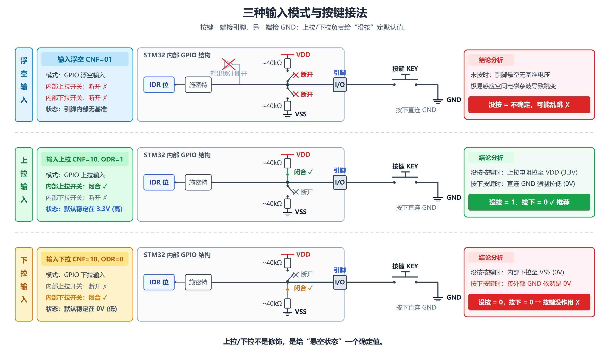

**看图方法**：

1. **图中画了三行，每行都只有一个小改动**：引脚内部那两个开关的通断不同；
2. **每一行最右边是一个按键**：一端接引脚，另一端接地（按下就把引脚拉到 0V）；
3. **重点看"没按的时候"和"按下的时候"分别读到什么**：

| 模式 | 未按下（按键断开） | 按下（按键闭合，引脚被拉到 GND） | 是否可用 |
|---|---|---|---|
| 浮空 | **不确定，可能乱跳** | 稳定读到 0 | ✗ 不可靠（悬空） |
| 上拉 | 稳定读到 1 | 稳定读到 0 | ✓ 推荐 |
| 下拉 | 稳定读到 0 | 稳定读到 0（拉低方向上没变化） | ✗ 按键没作用出来 |

**这张图要让我理解**：

> **上拉/下拉不是"修饰"，而是"给悬空状态定一个默认值"。**
> 按键接法必须和内部上拉/下拉配合：**按键另一头接 GND，就用内部上拉**——
> 这样"没按 = 1、按下 = 0"，按下这个动作才会被程序检测到。

#### （4）模拟输入（Analog Input，常缩写 AIN）

| 项目 | 内容 |
|---|---|
| 编码 | `MODE=00`、`CNF=00` |
| 大白话 | 引脚"闭嘴"，把数字部分的电路全部关掉，只让模拟信号安静地通过 |
| 内部 | 输出缓冲器禁止；施密特触发器禁止且输出强置 0；上下拉断开；读 IDR 恒为 0 |
| 场景 | **ADC 采集**：光敏电阻、热敏电阻、电位器、外部传感器电压 |
| 注意 | 配成模拟输入后，**程序读 IDR 读不到任何有用信息**；要用 ADC 外设去转换 |

**【辅助理解图】模拟输入为什么必须"关掉数字部分"**

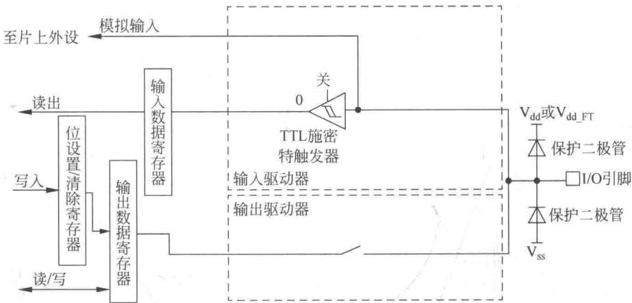

**先看教材原图（图 6-5）：**

1. **先找引脚（最右边）**，然后沿路往左看；
2. **看输出缓冲器**：打叉/断开——输出通道关闭（对应"输出缓冲器被禁止"）；
3. **看施密特触发器**：打叉/被旁路——数字输入通道关闭（对应"禁止施密特触发输入"）；
4. **看上下拉电阻那两个开关**：都断开（对应"弱上拉和下拉电阻被禁止"）；
5. **看从引脚通向左边的那条模拟通路**：它是**唯一还连着**的通路，
   图上标注为"高阻抗"——直接送往 ADC（教材第 10 章）。

**再看辅助理解图（把两张图对照着看）：**

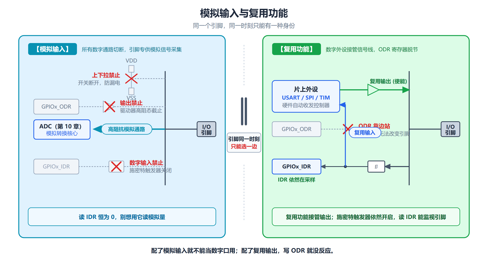

**看图方法**：

1. **看左边那张图（模拟输入）**：三个大叉分别画在输出缓冲器、施密特触发器、上下拉电阻上；
2. **看中间那根竖直的模拟信号线**：从引脚直接通向 ADC（芯片内部的模数转换器）；
3. **看右边的对比图（复用功能）**：那是"引脚借给外设"的另一种情况，数字通路是打通的；
4. **看最下方的小字**："引脚只能选一种身份"——模拟输入和数字功能**不能同时用**。

**这张图要让我理解**：

> **模拟输入不是"什么都不做"，而是"主动把数字电路赶走"，防止它们干扰和消耗模拟信号。**

#### （5）通用推挽输出（GP Output Push-Pull）

| 项目 | 内容 |
|---|---|
| 编码 | `MODE≠00`（决定速度）、`CNF=00` |
| 大白话 | 引脚听 ODR 指挥，写 1 主动拉高，写 0 主动拉低 |
| 内部 | P-MOS 和 N-MOS **都参与**，二选一导通 |
| 场景 | **驱动 LED、驱动数字器件输入、普通开关量输出**（最常用的输出模式） |
| 注意 | **两个推挽输出不能接在一起**（一个想拉高、一个想拉低时，会形成大电流通路，可能烧管子） |

**【辅助理解图】推挽输出的写 0 / 写 1**

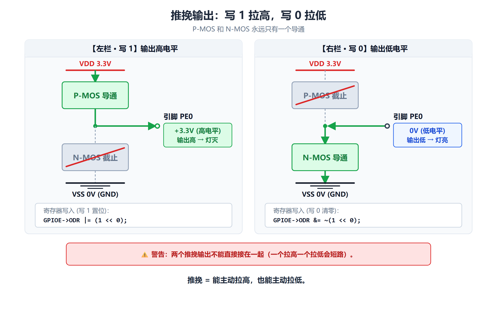

**看图方法**：

1. **图中上方是一条通往 VDD（3.3V）的路**，中间画一个 P-MOS 开关；
2. **下方是一条通往 VSS（0V）的路**，中间画一个 N-MOS 开关；
3. **它们中间那个交点就是引脚**；
4. **左边按"你写的 ODR 值"分成两张小图**：
   - 写 `1`：**上管闭合、下管断开** → 引脚接到 3.3V；
   - 写 `0`：**上管断开、下管闭合** → 引脚接到 0V。
5. **注意图上永远只有一个管是"闭合"的**——这是推挽的硬性规则。

**这张图要让我理解**：

> **推挽输出写 1 是"真的把引脚接到电源"，写 0 是"真的把引脚接到地"。**
> 所以它**输出能力强**（能灌能拉），但**不能两个推挽输出并联**。

**【补充解释】为什么两个推挽输出接在一起很危险？**

```
   芯片甲输出高 ──┐
                 ├── 同一根线
   芯片乙输出低 ──┘

   甲：闭合上管（接 3.3V）     乙：闭合下管（接 0V）
   → 从 3.3V 到 0V 形成一条几乎没有电阻的通路 → 大电流 → 发热甚至烧毁
```

**口诀**：推挽只能"单打独斗"，要"线与"必须用开漏。

#### （6）通用开漏输出（GP Output Open-Drain，常缩写 OD）

| 项目 | 内容 |
|---|---|
| 编码 | `MODE≠00`（决定速度）、`CNF=01` |
| 大白话 | 引脚只有一只"往下拽"的手：写 0 能拉低，写 1 就"撒手"（高阻），要靠外面上拉电阻才能变高 |
| 内部 | 只有 N-MOS 参与，P-MOS **从不导通** |
| 场景 | **多器件共享一根线**（I²C 总线）、驱动比 3.3V 高的负载（靠外部上拉）、需要"线与"逻辑 |
| 注意 | **没有外部上拉电阻时，输出 1 永远得不到高电平**——这是初学者最常见的"灯不亮/波形不对"原因 |

**【辅助理解图】开漏输出为什么必须配上拉电阻**

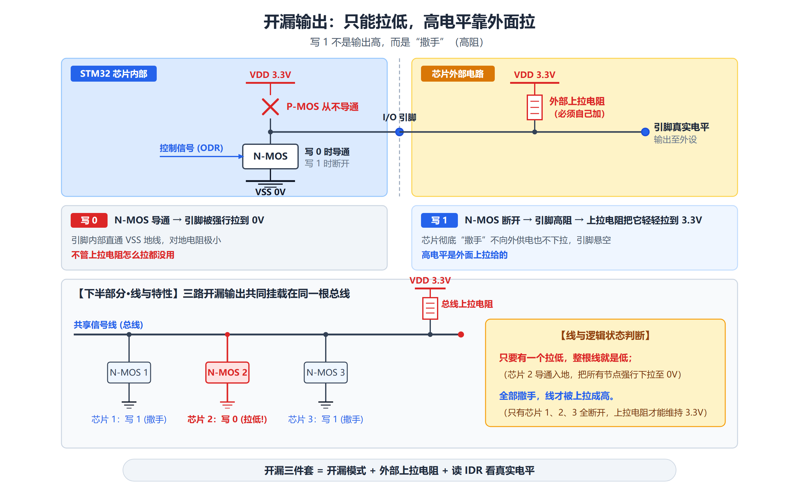

**看图方法**：

1. **先看芯片内部**：只有 N-MOS 一个开关，通往 VDD 的路是断的（画一个大叉）；
2. **再看芯片外部**：一根**上拉电阻**从引脚连到 3.3V（**这个电阻是你在板子上必须自己加的**）；
3. **然后看两种写法**：
   - 写 `0` → N-MOS 闭合 → 引脚被强行拉到 0V（不管上拉电阻怎么拉，都拉不过这个开关）；
   - 写 `1` → N-MOS 断开 → 引脚"撒手" → 上拉电阻把它轻轻拉到 3.3V。
4. **最后看右下角那个"两个开漏接在一起"的小图**：任何一个拉低，线就是低；
   全都不拉，线才被上拉成高——这就是"线与"。

**这张图要让我理解**：

> **开漏的"高"不是芯片给的，是外面的上拉电阻给的。**
> 所以开漏输出可以方便地和其他电平（比如 5V）配合——上拉电阻接到几伏，高电平就是几伏。

**教材 p152 对开漏的评价**：
> "适合做电流型的驱动，其吸收电流的能力相对强（一般 20mA 以内）。"

**【补充解释】** "吸收电流"就是"把线拉低时能灌入多少电流"。开漏只有下管工作，
所以它能灌（sink）比较大的电流，这一点适合直接驱动 LED、继电器（当然要注意总电流限制，
单个引脚和整个芯片的电流都有上限，见数据手册的电气特性表）。

#### （7）复用推挽输出（AF Push-Pull）

| 项目 | 内容 |
|---|---|
| 编码 | `MODE≠00`（决定速度）、`CNF=10` |
| 大白话 | 引脚"借给外设"，外设说高就高、说低就低，而且是"主动拉高/拉低"（两只手） |
| 内部 | 输出控制模块的输入从 ODR 切换为外设信号；P-MOS/N-MOS 都参与 |
| 场景 | **USART 的 TX、SPI 的 SCK/MOSI、定时器 PWM 输出**等 |
| 注意 | 配成复用后，"写 ODR"不再影响引脚输出；外设没使能时输出不确定 |

#### （8）复用开漏输出（AF Open-Drain）

| 项目 | 内容 |
|---|---|
| 编码 | `MODE≠00`（决定速度）、`CNF=11` |
| 大白话 | 引脚"借给外设"，但只有往下拽的一只手，高电平靠外面上拉 |
| 内部 | 输出控制模块输入来自外设；只有 N-MOS 参与 |
| 场景 | **I²C 的 SDA/SCL**（I²C 总线协议本身就要求开漏 + 外部上拉）、部分复用总线 |
| 注意 | 同样必须外接上拉电阻 |

**复用输出（7）（8）共同的要点**：

```
配置成复用输出之后：
   你的代码写 GPIOx_ODR  →  对引脚没有任何影响（引脚已和 ODR 断开）
   引脚由外设（USART/SPI/TIM…）的信号驱动
```

### 6.3.8 8 种模式总复习表（考试版）

| 模式 | CNF[1:0] | MODE[1:0] | ODR 的角色 | 一句话场景 |
|---|---|---|---|---|
| 输入浮空 | 01 | 00 | 不用 | 外部已有确定驱动源 |
| 输入上拉 | 10 | 00 | **1 = 上拉** | 按键接 GND |
| 输入下拉 | 10 | 00 | **0 = 下拉** | 按键接 VDD |
| 模拟输入 | 00 | 00 | 不用 | 送 ADC |
| 通用推挽输出 | 00 | 01/10/11 | 输出值 | 驱动 LED、数字信号 |
| 通用开漏输出 | 01 | 01/10/11 | 输出值 | 多器件共线、电平转换 |
| 复用推挽输出 | 10 | 01/10/11 | 不用 | USART TX、SPI、PWM |
| 复用开漏输出 | 11 | 01/10/11 | 不用 | I²C SDA/SCL |

**最后再给一条"看图选模式"的口诀：**

```
输入还是输出？     → 看 MODE 是不是 00
输出高靠谁？       → 靠芯片（推挽 CNF0=0）还是靠外面上拉（开漏 CNF0=1）
谁说了算？         → 你的代码（CNF1=0）还是外设（CNF1=1）
输入怎么定基调？   → 不是上拉/下拉就选 CNF=01 浮空、CNF=00 模拟；是的话 CNF=10，拿 ODR 选上/下拉
```

---

## 6.4 GPIO 的寄存器

### 6.4.1 先别急着看教材：这一节要搞懂什么？

上一节知道了"有 8 种模式"，这一节回答：

> **这 8 种模式，到底写进哪里？写成什么数？**

答案：写进 **7 个寄存器**。这 7 个寄存器住在**同一个"小区"**里——
GPIO 端口 x 的地址区间。它们的门牌号（偏移量）是固定不变的。

### 6.4.2 先看地图：GPIO 寄存器住在哪里（地址链）

**【补充解释】地址不是乱给的，是一层一层分下来的。**
先把第 3 章讲过的"地址链"复习一遍，再落到 GPIO 上。

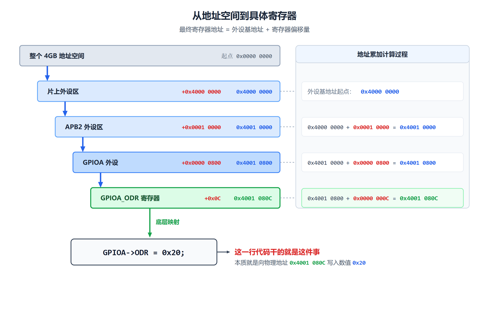

**这张第 3 章的图，看的就是这条链：**

```
整个 4GB 地址空间（0x0000 0000 起）
        ↓ +0x4000 0000
片上外设区（0x4000 0000 起）
        ↓ +0x0001 0000
APB2 外设区（0x4001 0000 起）
        ↓ +0x0000 0800
GPIOA 外设（0x4001 0800 起）
        ↓ +0x0C
GPIOA_ODR 寄存器（0x4001 080C）
```

**【教材内容】教材 p157 给出 5 个端口各自占据的地址范围：**

| 端口 | 地址范围 | 首地址（基地址） | 长度 |
|---|---|---|---|
| PA | `0x4001 0800` ~ `0x4001 0BFF` | `0x4001 0800` | 1KB |
| PB | `0x4001 0C00` ~ `0x4001 0FFF` | `0x4001 0C00` | 1KB |
| PC | `0x4001 1000` ~ `0x4001 13FF` | `0x4001 1000` | 1KB |
| PD | `0x4001 1400` ~ `0x4001 17FF` | `0x4001 1400` | 1KB |
| PE | `0x4001 1800` ~ `0x4001 1BFF` | `0x4001 1800` | 1KB |

教材原文：

> "各个端口的第一个地址称为该端口的**首地址**，如 PA 的首地址为 0x4001 0800。
> 后续介绍寄存器时，各个寄存器的地址都是以**偏移量**的方式给出，
> 寄存器的物理地址就是**基地址加上偏移量**。"

**【补充解释】为什么每个端口要占 1KB（0x400 字节），可寄存器只有 7 个？**

因为以后可能扩展，而且"占用一片连续区间"让地址译码更简单。
7 个寄存器实际只用掉前 `0x1C` 个字节，剩下的空间是空的（读它没有意义）。

**【辅助理解图】GPIO 寄存器地图**

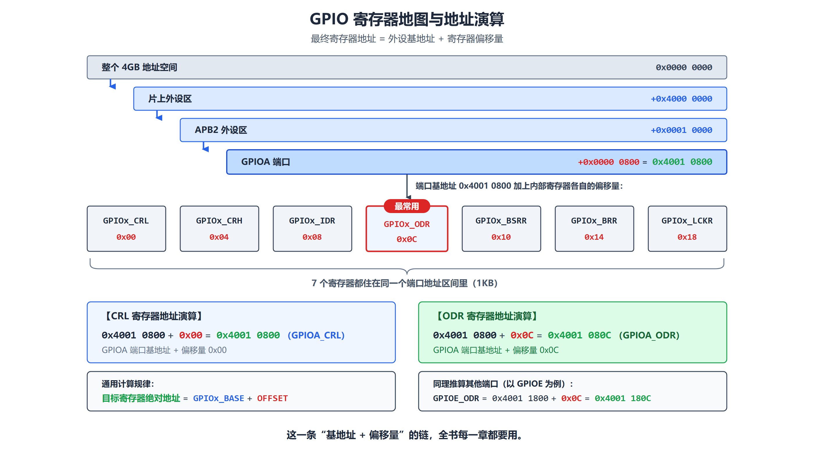

**看图方法**：

1. **先看最上面一行**：那是一个端口（比如 GPIOA）的 1KB 地址区间；
2. **再看下面一排小格子**：7 个寄存器依次排开，每个格子写三样东西：
   **名字**（GPIOx_CRL）、**偏移量**（0x00）、**作用一句话**；
3. **看最右边那条红色算式**：基地址 + 偏移量 = 绝对地址；
4. **最后看右下角两个例题**：分别算 GPIOA_CRL 和 GPIOA_ODR。

**7 个寄存器的偏移量表（必须背下来）**

| 偏移量 | 寄存器 | 中文名 | 功能 | 复位值 |
|---|---|---|---|---|
| `0x00` | **GPIOx_CRL** | 端口配置低寄存器 | 配置 bit0~bit7 这 8 根引脚 | `0x4444 4444` |
| `0x04` | **GPIOx_CRH** | 端口配置高寄存器 | 配置 bit8~bit15 这 8 根引脚 | `0x4444 4444` |
| `0x08` | **GPIOx_IDR** | 端口输入数据寄存器 | 读出 16 根引脚的输入电平 | `0x0000 XXXX` |
| `0x0C` | **GPIOx_ODR** | 端口输出数据寄存器 | 决定 16 根引脚输出什么 | `0x0000 0000` |
| `0x10` | **GPIOx_BSRR** | 端口位设置/清除寄存器 | 原子地置位/清位 | `0x0000 0000` |
| `0x14` | **GPIOx_BRR** | 端口位清除寄存器 | 原子地清位 | `0x0000 0000` |
| `0x18` | **GPIOx_LCKR** | 端口配置锁定寄存器 | 冻结引脚配置 | `0x0000 0000` |

**一步一步演算（教材例子里最常用的几个地址）：**

**例 1：GPIOA_CRL 的绝对地址**

```
  0x4001 0800      （GPIOA 基地址，教材 p157）
+ 0x0000 0000      （CRL 偏移量）
──────────────
  0x4001 0800      （GPIOA_CRL 的绝对地址）
```

**例 2：GPIOA_ODR 的绝对地址**

```
  0x4001 0800      （GPIOA 基地址）
+ 0x0000 000C      （ODR 偏移量）
──────────────
  0x4001 080C      （GPIOA_ODR 的绝对地址）
```

**例 3：GPIOE_ODR 的绝对地址（例 6-2、例 6-3 里灯接在 PE0）**

```
  0x4001 1800      （GPIOE 基地址：0x4001 0000 + 0x1800）
+ 0x0000 000C      （ODR 偏移量）
──────────────
  0x4001 180C      （GPIOE_ODR 的绝对地址）
```

**例 4：GPIOE_CRL 的绝对地址（配置 PE0 模式用）**

```
  0x4001 1800
+ 0x0000 0000
──────────────
  0x4001 1800
```

**所以你在例 6-2 代码里看到的：**

```c
GPIOE->CRL |= 0x00000003;   /* 本质是访问地址 0x4001 1800 */
GPIOE->ODR |= 1 << 0;       /* 本质是访问地址 0x4001 180C */
```

**这两行代码的"物理含义"分别是：**
"往地址 0x40011800 这个格子里写数"和"往地址 0x4001180C 这个格子里写数"。

### 6.4.3 GPIOx_CRL：端口配置低寄存器

**【教材内容】教材 p157 原文：**
> "偏移地址：0x00，复位值：0x4444 4444。"

#### ① 它属于谁、控制什么、为什么需要

| 问题 | 回答 |
|---|---|
| 属于谁 | 属于**某一个 GPIO 端口**（x = A/B/C/D/E），例如 GPIOE_CRL 只管端口 E |
| 控制什么 | **端口 bit0~bit7 这 8 根引脚**的工作模式（输入/输出、推挽/开漏、速度、上拉/下拉） |
| 为什么需要 | 因为一根引脚有 8 种可能的身份，必须有个地方"登记"它到底当什么用；这个登记处就是 CRL |
| 什么时候写 | **初始化时写一次**（引脚模式一般不需要频繁改）；写完之后它就一直生效 |

#### ② ASCII 位图：CRL 的 32 个 bit 怎么分

```
        GPIOx_CRL（偏移 0x00，复位值 0x4444 4444）
 31  30  29  28  27  26  25  24  23  22  21  20  19  18  17  16
+---+---+---+---+---+---+---+---+---+---+---+---+---+---+---+---+
| CNF7  | MODE7 | CNF6  | MODE6 | CNF5  | MODE5 | CNF4  | MODE4 |
| [1:0] | [1:0] | [1:0] | [1:0] | [1:0] | [1:0] | [1:0] | [1:0] |
+---+---+---+---+---+---+---+---+---+---+---+---+---+---+---+---+
 15  14  13  12  11  10   9   8   7   6   5   4   3   2   1   0
+---+---+---+---+---+---+---+---+---+---+---+---+---+---+---+---+
| CNF3  | MODE3 | CNF2  | MODE2 | CNF1  | MODE1 | CNF0  | MODE0 |
| [1:0] | [1:0] | [1:0] | [1:0] | [1:0] | [1:0] | [1:0] | [1:0] |
+---+---+---+---+---+---+---+---+---+---+---+---+---+---+---+---+
                                                          ↑   ↑
                                                     CNF0   MODE0
                                                    （bit3:2）（bit1:0）
                                              ── 当前只关心 PE0 的这 4 位 ──
```

**怎么记这个排布？**

> **每 4 个 bit 管一根引脚**，从高位到低位依次是 **P7、P6、P5、P4、P3、P2、P1、P0**。
> 每一组 4 bit 里：**高 2 位是 CNF（功能），低 2 位是 MODE（方向+速度）**。

**【补充解释】为什么 8 根引脚要占 32 位？**
8 × 4 = 32。所以 8 根引脚刚好塞满一个 32 位寄存器。
那剩下 8 根（bit8~bit15）呢？塞不下了，所以又开了一个 CRH——这就是 6.4.4 节的内容。

#### ③ 字段含义表（CNF 和 MODE）

| 字段 | 全称/含义 | 什么时候起作用 |
|---|---|---|
| `MODEy[1:0]` | 模式位：`00`=输入；`01`=输出（最大 10MHz）；`10`=输出（最大 2MHz）；`11`=输出（最大 50MHz） | **它决定方向**（输入/输出），也决定输出速度 |
| `CNFy[1:0]` | 配置位：在**输入**时表示哪种输入；在**输出**时表示推挽/开漏、通用/复用 | **它决定细节** |

**写 0 写 1 分别意味着什么？**（以 PE0 为例，CRL 的 bit3:0）

> **先记住读法**：这 4 位写成二进制串时，**左边 2 位是 CNF0（占 bit3:2），右边 2 位是 MODE0（占 bit1:0）**，
> 和上面的位图完全一致。下表按"二进制串从左到右"的顺序拆列，**不要按列头顺序去猜**。

| 你写进 bit3:0 的二进制串（bit3 bit2 bit1 bit0） | CNF0（高 2 位，bit3:2） | MODE0（低 2 位，bit1:0） | 结果（PE0 变成什么） |
|---|---|---|---|
| `0 0 0 0`（0x0） | 00 | 00 | 模拟输入（模拟量输入，送 ADC） |
| `0 1 0 0`（0x4） | 01 | 00 | 浮空输入（**复位后的默认值**） |
| `1 0 0 0`（0x8） | 10 | 00 | 上拉/下拉输入（到底哪个由 ODR 的 bit0 决定） |
| `1 1 0 0`（0xC） | 11 | 00 | 保留（别用） |
| `0 0 0 1`（0x1） | 00 | 01 | 通用推挽输出，最大 10MHz |
| `0 1 0 1`（0x5） | 01 | 01 | 通用开漏输出，最大 10MHz |
| `1 0 0 1`（0x9） | 10 | 01 | 复用推挽输出，最大 10MHz |
| `1 1 0 1`（0xD） | 11 | 01 | 复用开漏输出，最大 10MHz |
| `0 0 1 0`（0x2） | 00 | 10 | 通用推挽输出，最大 2MHz |
| `0 0 1 1`（0x3） | 00 | 11 | 通用推挽输出，最大 50MHz ← **例 6-2 用的就是这个** |

**自己验一遍最容易错的一行**：`0x8` = `1000b`，左边 `10` 是 CNF0=10（上拉/下拉这一类），
右边 `00` 是 MODE0=00（输入）——所以它是**输入**，不是"推挽 2MHz"。
（"推挽、2MHz" 的编码是 `0010` = `0x2`，MODE0=10。两者正好是"位序读反了"的典型错误。）

（把上表里的 MODE 换成 10/11 就是速度和编码的对应变化；CNF 的意义不变。）

**【补充解释】为什么例 6-2 写 `0x00000003` 就表示"推挽输出 50MHz"？**
`0x3` = `0011b`，拆出来：高 2 位 `00` = CNF0 = 通用推挽；低 2 位 `11` = MODE0 = 输出、50MHz。✓

#### ④ 复位值 0x4444 4444 的解读（很重要）

复位值不是 0，这说明芯片"上电时每根引脚都有一个默认身份"。把它拆开：

```
   0x 4    4    4    4    4    4    4    4
      ↓    ↓    ↓    ↓    ↓    ↓    ↓    ↓
   0100 0100 0100 0100 0100 0100 0100 0100
    ↑    ↑
  P7组  P6组 …… 每一组都是 0100

   0100 拆开： CNF = 01 → 浮空输入
              MODE = 00 → 输入模式
```

**结论**：**复位后，GPIOA~GPIOE 的所有普通引脚都是浮空输入模式**，与教材 p154
"复位期间和刚复位后，复用功能未开启，I/O 口被配置成浮空输入模式"完全一致。✓
（PA13/PA14/PA15/PB4 是例外，由硬件置为上拉/下拉，见 6.3.1 节。）

#### ⑤ 程序怎么操作 CRL

**场景**：把 PE0 配成"通用推挽输出、50MHz"（例 6-2 的做法）。

```c
GPIOE->CRL &= 0xFFFFFFF0;   /* 第 1 步：把 PE0 那 4 位（bit3:0）清零 */
GPIOE->CRL |= 0x00000003;   /* 第 2 步：填入 0011（CNF=00，MODE=11） */
```

**位运算一步一步展开（按 AGENTS.md 第 10 节，不跳步）：**

第 1 步 `&= 0xFFFFFFF0`：

```
运算前（复位值）： 0x4444 4444
               = 0100 0100 0100 0100 0100 0100 0100 0100
掩码：            0xFFFFFFF0
               = 1111 1111 1111 1111 1111 1111 1111 0000
AND 后：          0x4444 4440
               = 0100 0100 0100 0100 0100 0100 0100 0000
                                                  ↑↑↑↑
                                     PE0 的 4 位被清零（暂时是"模拟输入"）
```

第 2 步 `|= 0x00000003`：

```
运算前：          0x4444 4440
               = 0100 0100 0100 0100 0100 0100 0100 0000
掩码：            0x0000 0003
               = 0000 0000 0000 0000 0000 0000 0000 0011
OR 后：           0x4444 4443
               = 0100 0100 0100 0100 0100 0100 0100 0011
                                                   ↑↑↑↑
                                      0011 = CNF0=00 推挽，MODE0=11 50MHz
```

**为什么要"先清后置"（先 `&=` 再 `|=`），不能直接 `=`？**

- 直接 `GPIOE->CRL = 0x00000003;` 会把**其他 7 根引脚（PE1~PE7）的配置全部改成 0**
  （模拟输入），如果它们原本有别的用途，就被你毁了；
- `&=` + `|=` 只动你关心的 4 位，**其他位保持原样**——这叫"读—改—写"模式。

**【补充解释】"读—改—写"在初始化阶段是安全的**，因为这时一般没有中断来抢着改同一个寄存器。
但如果是运行中频繁改输出值，就要用 BSRR/BRR 的原子写法（**6.4.7、6.4.8 节**）。

#### ⑥ 写完 CRL 之后，硬件发生了什么？

以 PE0 写 `0x3` 为例，按顺序发生：

1. **CPU** 执行 `STR`（存储）指令，把地址 `0x40011800` 和数据送上总线。
   注意这里其实发生了**两次写**（对应代码里的 `&=` 和 `|=`）：
   第一次写 `0x44444440`（先把 PE0 的 4 位清零），第二次写 `0x44444443`（再填入 0011）；
2. **总线矩阵 → AHB2APB 桥 → APB2**，最终到达 GPIOE 外设；
3. GPIOE 内部把这 32 位写进 **CRL 的 32 个触发器**；
4. CRL 的 `bit3:0 = 0011` 这 4 个触发器的输出，连到 **PE0 引脚的控制逻辑**；
5. 控制逻辑根据 `CNF=00, MODE=11`：
   - 打开**输出缓冲器**；
   - 关闭弱上拉/下拉；
   - 允许 **P-MOS 和 N-MOS** 都参与驱动；
   - 把输出速度设为最高档（50MHz）；
6. 此时 PE0 的"身份"正式变成**通用推挽输出**——接下来写 ODR，引脚就会动。

### 6.4.4 GPIOx_CRH：端口配置高寄存器

**【教材内容】教材 p158 原文：**
> "偏移地址：0x04，复位值：0x4444 4444。"
> "MODEy[1:0]：端口 x 的模式位（y=8~15）。"
> "除了 y 的取值不同，端口配置高寄存器的各位定义和端口配置低寄存器类似，请读者自行参考学习。"

**一句话理解**：**CRL 管 bit0~bit7，CRH 管 bit8~bit15，两者结构一模一样。**

**ASCII 位图：**

```
        GPIOx_CRH（偏移 0x04，复位值 0x4444 4444）
 31  30  29  28  27  26  25  24  23  22  21  20  19  18  17  16
+---+---+---+---+---+---+---+---+---+---+---+---+---+---+---+---+
|CNF15  |MODE15 |CNF14  |MODE14 |CNF13  |MODE13 |CNF12  |MODE12 |
| [1:0] | [1:0] | [1:0] | [1:0] | [1:0] | [1:0] | [1:0] | [1:0] |
+---+---+---+---+---+---+---+---+---+---+---+---+---+---+---+---+
 15  14  13  12  11  10   9   8   7   6   5   4   3   2   1   0
+---+---+---+---+---+---+---+---+---+---+---+---+---+---+---+---+
| CNF11 |MODE11 | CNF10 |MODE10 | CNF9  | MODE9 | CNF8  | MODE8 |
| [1:0] | [1:0] | [1:0] | [1:0] | [1:0] | [1:0] | [1:0] | [1:0] |
+---+---+---+---+---+---+---+---+---+---+---+---+---+---+---+---+
                                                          ↑   ↑
                                                    CNF8    MODE8
                                    ── bit15:0 里的最低 4 位，管 PE8 ──
```

**【辅助理解图】CRL / CRH 与引脚编号的对应**

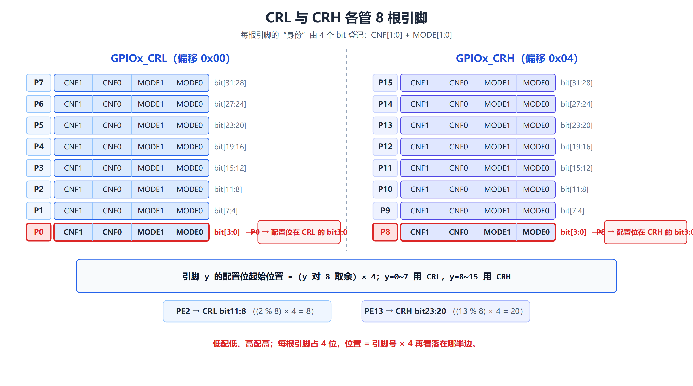

**看图方法**：

1. **中间竖着一个"4 位小方块"**：写着一个引脚名字（P0 或 P8）、CNF 两位、MODE 两位；
2. **左边一列是 CRL**，由 8 个这样的小方块拼成，分别对应 P0~P7；
3. **右边一列是 CRH**，同样 8 个方块，对应 P8~P15；
4. **红色箭头**指着某个方块，旁边写"想改哪个引脚，就把它的 4 位片段替换掉"。

**这张图要让我理解**：

> **改 PE8，就去 CRH；改 PE0~PE7，就去 CRL。**
> 每根引脚在它所属寄存器里的**位置 = 引脚号 × 4**。

**【补充解释】位置公式：**

```
引脚 y（0 ≤ y ≤ 15）的配置位在哪个寄存器？
    y = 0~7   →  CRL，起始位号 = y × 4
    y = 8~15  →  CRH，起始位号 = (y − 8) × 4

例：PE8  → CRH，起始位号 = (8−8)×4 = 0  → 占 CRH 的 bit3:0 ✓
例：PE13 → CRH，起始位号 = (13−8)×4 = 20 → 占 CRH 的 bit23:20
例：PE2  → CRL，起始位号 = 2×4 = 8  → 占 CRL 的 bit11:8
```

**写 CRH 的代码套路和 CRL 一样**（以 PE8 配成推挽、50MHz 为例）：

```c
GPIOE->CRH &= 0xFFFFFFF0;   /* 清掉 CRH 的 bit3:0（PE8 的配置） */
GPIOE->CRH |= 0x00000003;   /* 填 0011：通用推挽、50MHz */
```

**位运算展开：**

```
运算前：0x4444 4444
       0100 0100 0100 0100 0100 0100 0100 0100
掩码：  0xFFFFFFF0
AND 后：0x4444 4440
       0100 0100 0100 0100 0100 0100 0100 0000
                                        ↑↑↑↑ PE8 的 4 位清零
掩码：  0x0000 0003
OR 后： 0x4444 4443
       0100 0100 0100 0100 0100 0100 0100 0011
                                        ↑↑↑↑ 换成推挽、50MHz
```

### 6.4.5 GPIOx_IDR：端口输入数据寄存器

**【教材内容】教材 p159 原文：**
> "地址偏移：0x08，复位值：0x0000 XXXX。"
> "位 31:16：保留，始终读为 0。"
> "位 15:0：IDRy[15:0]，端口输入数据（y=0~15）。这些位**只读**，只能以字的形式读出。读出的值为对应 I/O 口的状态。"

#### ① 它属于谁、控制什么、为什么需要

| 问题 | 回答 |
|---|---|
| 属于谁 | 端口 x（GPIOA_IDR 等） |
| 控制什么 | **它不控制任何东西**——它是一块"看板"，反映 16 根引脚**当前的输入电平** |
| 为什么需要 | 程序要知道按键有没有按下、外面的器件送来的是 0 还是 1，就得有个地方"看" |
| 只读还是可写 | **只读**（r）。它是硬件采样写进去的，程序只能读 |

#### ② ASCII 位图

```
        GPIOx_IDR（偏移 0x08，复位值 0x0000 XXXX）
 31                                                              16
+-----------------------------------------------------------------+
|                          保留（始终读为 0）                        |
+-----------------------------------------------------------------+
 15  14  13  12  11  10   9   8   7   6   5   4   3   2   1   0
+---+---+---+---+---+---+---+---+---+---+---+---+---+---+---+---+
|IDR15|IDR14|IDR13|IDR12|IDR11|IDR10|IDR9 |IDR8 |IDR7 |…… |IDR1 |IDR0|
+---+---+---+---+---+---+---+---+---+---+---+---+---+---+---+---+
  ↑                                                           ↑
  PE15 的电平                                          PE0 的电平
  （0 = 低电平，1 = 高电平）
```

**“写 0 写 1 分别怎样”？**
**这一条对 IDR 不适用**——你不能写它，只能读它。写 0 写 1 的规则属于 ODR/BSRR/BRR/CRL/CRH。

**【补充解释】复位值里的 `XXXX` 是什么意思？**
`X` 表示"不确定"。上电瞬间，外面接的是什么电平还没稳定，所以硬件不保证 IDR 的初值。
**这提醒我们**：程序不应该一上电就假设某个输入引脚是什么值，
必要时要先配置好上下拉，或等外部电路稳定后再读。

#### ③ 硬件什么时候更新 IDR？

按教材 p154："输入数据寄存器（GPIOx_IDR）在**每个 APB2 时钟周期**捕捉 I/O 引脚上的数据。"

时间轴（和 6.3.1 节那张一样，这里再看一次应用版）：

```
        ①       ②       ③       ④
      按下按键  采样     采样     采样     ← APB2 时钟边沿
引脚:  ────┐                   ┌────────
           └───────────────────┘
           ↑ 按键在这一刻按下
IDR:   ────────┐
               └──────────────────────
               ↑ 最近的一个 APB2 边沿之后，IDR 才变成 0
程序读 IDR：如果正好在 ③ 之前读，可能还读到旧值 1
```

**先发生什么 → 再发生什么 → 为什么**：

1. **先**：引脚电平变化（按键按下）；
2. **再**：等到下一个 APB2 时钟边沿，GPIO 硬件把新电平采样进 IDR；
3. **最后**：CPU 读 IDR 才能看到新值；
4. **为什么**：GPIO 是同步采样，不是"实时导线"。

#### ④ 程序怎么操作 IDR

**场景 1：只关心某一根引脚（推荐）**

```c
if (GPIOA->IDR & (1 << 0))     /* 把 IDR 和 0x00000001 做 AND */
{
    /* 结果非 0，说明 PA0 现在是高电平 */
}
else
{
    /* 结果等于 0，说明 PA0 现在是低电平 */
}
```

**位运算展开（假设 PA0 现在是高）：**

```
运算前（IDR）：  0x0000 0001
               = 0000 0000 0000 0000 0000 0000 0000 0001
掩码：           0x0000 0001
               = 0000 0000 0000 0000 0000 0000 0000 0001
AND 后：         0x0000 0001   → 非 0 → 判为高电平 ✓
```

（如果 PA0 是低，AND 后是 `0x0000 0000` → 判为低电平。）

**场景 2：一次读出整个端口**

```c
uint16_t all = (uint16_t)GPIOA->IDR;   /* all 的低 16 位就是 PA0~PA15 的电平 */
```

**【补充解释】教材 p159 说"只能以字的形式读出"**，意思是：**必须一次读 32 位**，
不能只读半个字（16 位）或一个字节（8 位）。C 语言里写 `GPIOA->IDR` 就是读 32 位，
所以正常写代码不会违反这条规则；但如果尝试 `*(uint8_t*)&GPIOA->IDR` 去读 8 位，就是错误操作。

### 6.4.6 GPIOx_ODR：端口输出数据寄存器

**【教材内容】教材 p159 原文：**
> "地址偏移：0Ch，复位值：0x0000 0000。"
> "位 31:16：保留，始终读为 0。"
> "位 15:0：ODRy[15:0]，端口输出数据（y=0~15）。这些位可读可写，只能以字的形式操作。"

#### ① 它属于谁、控制什么、为什么需要

| 问题 | 回答 |
|---|---|
| 属于谁 | 端口 x |
| 控制什么 | **在"通用输出"模式下**，决定 16 根引脚各自输出高还是低 |
| 为什么需要 | 程序"想输出什么"，总得有个地方存着；ODR 就是"输出意愿登记表" |
| 读它读到什么 | 推挽模式下 = 你最后一次写的值；开漏模式下未必等于引脚真实电平（见 6.3.1 功能 8） |

#### ② ASCII 位图

```
        GPIOx_ODR（偏移 0x0C，复位值 0x0000 0000）
 31                                                              16
+-----------------------------------------------------------------+
|                          保留（始终读为 0）                        |
+-----------------------------------------------------------------+
 15  14  13  12  11  10   9   8   7   6   5   4   3   2   1   0
+---+---+---+---+---+---+---+---+---+---+---+---+---+---+---+---+
|ODR15|ODR14|ODR13|ODR12|ODR11|ODR10|ODR9 |ODR8 |ODR7 |…… |ODR1 |ODR0|
+---+---+---+---+---+---+---+---+---+---+---+---+---+---+---+---+
  ↑                                                           ↑
 PE15 输出什么                                          PE0 输出什么
 （0 = 低电平，1 = 高电平）
```

**写 0 写 1 分别怎样？**

| ODRy 的值 | 引脚（配置为通用输出时） | 什么时候不适用 |
|---|---|---|
| 写 `0` | 输出**低电平**（推挽：N-MOS 导通；开漏：N-MOS 导通） | 若引脚是"输入模式"或"复用模式"，写 ODR 不影响引脚输出 |
| 写 `1` | 推挽：输出**高电平**；开漏：引脚**高阻**（要靠外面上拉才有高） | 同上 |

**【补充解释】输入模式下 ODR 的另一个身份**：它变成**上拉/下拉选择开关**（6.3.5 节讲过）。
所以你会看到"配置输入上拉"的代码里也要写 ODR：

```c
GPIOA->CRL &= 0xFFFFFFF0;
GPIOA->CRL |= 0x00000008;   /* PA0：输入，CNF=10（上拉/下拉这一类） */
GPIOA->ODR |= (1 << 0);     /* ODR 的 bit0 写 1 → 选上拉 */
```

#### ③ 程序怎么操作 ODR

**场景：让 PE0 输出高，再让它输出低（例 6-2 的循环）。**

```c
GPIOE->ODR |= 1 << 0;        /* PE0 输出高 */
...
GPIOE->ODR &= ~(1 << 0);     /* PE0 输出低 */
```

**位运算展开（第 1 行，假设 ODR 当前是 0）：**

```
运算前：  0x0000 0000
         0000 0000 0000 0000 0000 0000 0000 0000
掩码：    1 << 0 = 0x0000 0001
         0000 0000 0000 0000 0000 0000 0000 0001
OR 后：   0x0000 0001     → bit0 = 1 → PE0 输出高 ✓
```

**位运算展开（第 2 行）：**

```
运算前：  0x0000 0001
         0000 0000 0000 0000 0000 0000 0000 0001
1 << 0：  0x0000 0001
~(1 << 0)：0xFFFF FFFE
         1111 1111 1111 1111 1111 1111 1111 1110
AND 后：  0x0000 0000     → bit0 = 0 → PE0 输出低 ✓
```

**【补充解释】这里为什么用 `|=` 和 `&=~`，而不是直接 `=`？**

因为 ODR 管着**16 根引脚**。如果直接 `GPIOE->ODR = 0x0001;`，
等于把 PE1~PE15 全部设成 0——如果那 15 根引脚也在控制别的灯或器件，就全被你关了。
`|=` 只置位、`&=~` 只清位，**不影响其他引脚**。

**但是**：`|=` 和 `&=~` 都是"读—改—写"，中间可能被中断打断（6.3.1 功能 2 讲过）。
所以更专业的写法是用 BSRR/BRR。

### 6.4.7 GPIOx_BSRR：端口位设置/清除寄存器

**【教材内容】教材 p159 原文：**
> "地址偏移：0x10，复位值：0x0000 0000。"
> "位 31:16：BRy，清除端口 x 的位 y（y=0~15）。这些位只能以字的形式写入。
> `0`：对对应端口的 ODRy 位不产生影响。`1`：清除对应端口的 ODRy 位为 0。"
> "注：如果同时设置了 BSy 和 BRy 的对应位，**BSy 位起作用**。"
> "位 15:0：BSy，设置端口 x 的位 y（y=0~15）。这些位只能以字的形式写入。
> `0`：对对应端口的 ODRy 位不产生影响。`1`：设置对应端口的 ODRy 位为 1。"

#### ① 它属于谁、控制什么、为什么需要

| 问题 | 回答 |
|---|---|
| 属于谁 | 端口 x |
| 控制什么 | **间接控制 ODR**：写 1 的位会让 ODR 对应位变 1（BS 部分）或变 0（BR 部分） |
| 为什么需要 | 提供"**只动我指定位**"的原子操作，避免读—改—写被打断的风险 |
| 特点 | **只写**（w）。读它没有意义（读不到有用信息）；写 0 的位"不产生任何影响" |

#### ② ASCII 位图

```
        GPIOx_BSRR（偏移 0x10，复位值 0x0000 0000）
 31  30  29  28  27  26  25  24  23  22  21  20  19  18  17  16
+---+---+---+---+---+---+---+---+---+---+---+---+---+---+---+---+
| BR15| BR14| BR13| BR12| BR11| BR10| BR9 | BR8 | BR7 | …… |BR1 |BR0 |
+---+---+---+---+---+---+---+---+---+---+---+---+---+---+---+---+
  ↑                                                          ↑
 写 1 → 把 PE15 清 0                               写 1 → 把 PE0 清 0
 写 0 → 不动它                                      写 0 → 不动它

 15  14  13  12  11  10   9   8   7   6   5   4   3   2   1   0
+---+---+---+---+---+---+---+---+---+---+---+---+---+---+---+---+
| BS15| BS14| BS13| BS12| BS11| BS10| BS9 | BS8 | BS7 | …… |BS1 |BS0 |
+---+---+---+---+---+---+---+---+---+---+---+---+---+---+---+---+
  ↑                                                          ↑
 写 1 → 把 PE15 置 1                               写 1 → 把 PE0 置 1
 写 0 → 不动它                                      写 0 → 不动它
```

**【补充解释】为什么"写 0 不影响"是优点？**

因为这样你就可以**一条指令同时操作多个引脚**而互不干扰。例如：

```c
GPIOE->BSRR = 0x00000001;          /* 只把 PE0 置 1，其他 15 根引脚纹丝不动 */
GPIOE->BSRR = 0x00010000;          /* 只把 PE0 清 0（注意 1 在 bit16！） */
GPIOE->BSRR = 0x00000011;          /* 同时把 PE0 和 PE4 置 1 */
GPIOE->BSRR = 0x00110000;          /* 同时把 PE0 和 PE4 清 0 */
GPIOE->BSRR = 0x00010001;          /* BS0 和 BR0 同时为 1 → 按教材注释，BS 优先 → PE0 = 1 */
```

#### ③ 程序怎么操作 BSRR

```c
GPIOE->BSRR = GPIO_Pin_0;                  /* 置位 PE0（写 0x00000001） */
GPIOE->BSRR = (uint32_t)GPIO_Pin_0 << 16;  /* 复位 PE0（写 0x00010000） */
GPIOE->BSRR = GPIO_Pin_0 | GPIO_Pin_1;     /* 同时置位 PE0、PE1 */
```

**位运算展开（清 PE0）：**

```
运算前 ODR： 0x0000 0001（PE0 = 1）
写入 BSRR：  0x0001 0000
             0000 0000 0000 0001 0000 0000 0000 0000
                          ↑
                    bit16 = BR0 = 1 → 清 ODR 的 bit0
写入后 ODR： 0x0000 0000  → PE0 输出低
```

#### ④ 写完之后硬件发生什么

1. 写 BSRR 的操作**不改变 BSRR 本身**（它是"扳机"，不是"存储"）；
2. 硬件根据写入值，直接修改 **ODR** 的对应位；
3. ODR 变化后，输出驱动器立刻按新值动作（推挽就换 MOS 管，开漏就通/断 N-MOS）；
4. 全程**一条写指令**完成，中间不可被打断 → 原子。

**【补充解释】这也解释了教材 p154 那句话**：
> "当对 GPIOx_ODR 的个别位编程时，软件不需要禁止中断：在单次 APB2 写操作中，
> 可以只更改一个或多个位。"

### 6.4.8 GPIOx_BRR：端口位清除寄存器

**【教材内容】教材 p160 原文：**
> "地址偏移：0x14，复位值：0x0000 0000。"
> "`0`：对对应的 ODRy 位不产生影响。`1`：清除对应的 ODRy 位为 0。"

#### ① 它属于谁、控制什么、为什么需要

| 问题 | 回答 |
|---|---|
| 属于谁 | 端口 x |
| 控制什么 | 通过写 1 把 ODR 对应位清 0（只清，不能置位） |
| 为什么需要 | 它相当于 BSRR 的"高 16 位"单独拿出来做了一个寄存器。因为"清位"是最常用的操作，单独给个入口写起来更顺手 |
| 特点 | 16 位寄存器（实际按 32 位字访问，高 16 位保留）；只写 |

#### ② ASCII 位图

```
        GPIOx_BRR（偏移 0x14，复位值 0x0000 0000）
 31                                                              16
+-----------------------------------------------------------------+
|                          保留（始终读为 0）                        |
+-----------------------------------------------------------------+
 15  14  13  12  11  10   9   8   7   6   5   4   3   2   1   0
+---+---+---+---+---+---+---+---+---+---+---+---+---+---+---+---+
| BR15| BR14| BR13| BR12| BR11| BR10| BR9 | BR8 | BR7 | …… |BR1 |BR0 |
+---+---+---+---+---+---+---+---+---+---+---+---+---+---+---+---+
  ↑                                                          ↑
 写 1 → 清 PE15                                       写 1 → 清 PE0
 写 0 → 不动                                          写 0 → 不动
```

**和 BSRR 的关系（对照记）：**

```
BSRR  = [ BR15…BR0 | BS15…BS0 ]    高 16 位清位，低 16 位置位
BRR   = [  保留     | BR15…BR0 ]    只有低 16 位清位
```

**所以**：

```c
GPIOE->BRR = GPIO_Pin_0;      /* 等价于 GPIOE->BSRR = 0x00010000; */
```

#### ③ 为什么有人说"清位用 BRR 更方便"

| 目的 | 用 BSRR 写 | 用 BRR 写 |
|---|---|---|
| 置位 PE0 | `0x00000001`（写低 16 位） | 做不到 |
| 清位 PE0 | `0x00010000`（要**左移 16 位**，容易忘） | `0x00000001`（直接写，不易错） |

**结论**：置位用 BSRR 的低 16 位；清位用 BRR（或者 BSRR 的高 16 位）——
**这是实际写代码时最常用的两种写法**。

**【教材例题印证】** 第 5 章曾出现 `GPIOE->BRR = GPIO_Pin_8;` 和固件库
`GPIO_ResetBits(GPIOE, GPIO_Pin_0)`（函数体就是 `GPIOx->BRR = GPIO_Pin;`）——
现在你应该完全明白它为什么这么写了。

### 6.4.9 GPIOx_LCKR：端口配置锁定寄存器

**【教材内容】教材 p160 原文要点：**
> - 当正确的写序列设置了位 16（LCKK）时，该寄存器用来锁定端口位的配置。位[15:0] 用于锁定 GPIO 端口的配置。
> - 在规定的写入操作期间，不能改变 LCKR[15:0]。
> - 对相应的端口位执行了 LOCK 序列后，在**下次系统复位之前**将不能再更改端口位的值。
> - **每个锁定位锁定控制寄存器（CRL、CRH）中相应的 4 位。**
> - 地址偏移：0x18，复位值：0x0000 0000。
> - 位 16：LCKK，锁键（Lock Key）。该位可随时读出，它只可通过锁键写入序列修改。
>   - `0`：端口配置锁键未激活；
>   - `1`：端口配置锁键被激活，下次系统复位前 GPIOx_LCKR 寄存器被锁住。
> - 锁键的写入序列：**写 1 → 写 0 → 写 1 → 读 0 → 读 1**。最后一个读可省略，但可以用来确认锁键已被激活。
> - 位 15:0：LCKy，端口 x 的锁位 y。这些位可读可写，但只能在 LCKK 位为 0 时写入。
>   - `0`：不锁定端口的配置；
>   - `1`：锁定端口的配置。

#### ① 它属于谁、控制什么、为什么需要

| 问题 | 回答 |
|---|---|
| 属于谁 | 端口 x |
| 控制什么 | 把**某一根引脚的配置**（CRL/CRH 里那 4 位）**冻结**起来 |
| 为什么需要 | 防止程序跑飞（比如指针越界、堆栈溢出）后乱改关键引脚的配置，造成事故 |
| 生效范围 | **只锁配置**，不锁 ODR。锁定后你还是可以点灯灭灯，只是不能改"这根引脚是输入还是输出、推挽还是开漏" |
| 解锁条件 | **只有系统复位**（重新上电、按复位键、看门狗复位等） |

#### ② ASCII 位图

```
        GPIOx_LCKR（偏移 0x18，复位值 0x0000 0000）
 31                                                      17  16
+-------------------------------------------------------+---+---+
|                    保留（始终读为 0）                     |LCKK|
+-------------------------------------------------------+---+---+
 15  14  13  12  11  10   9   8   7   6   5   4   3   2   1   0
+---+---+---+---+---+---+---+---+---+---+---+---+---+---+---+---+
|LCK15|LCK14|LCK13|LCK12|LCK11|LCK10|LCK9|LCK8|LCK7 |…… |LCK1|LCK0|
+---+---+---+---+---+---+---+---+---+---+---+---+---+---+---+---+
  ↑                                                        ↑
 写 1 → 锁定 PE15 的配置                            写 1 → 锁定 PE0 的配置
```

**写 0 写 1 分别怎样？**

| 位 | 写 0 | 写 1 |
|---|---|---|
| `LCKy`（bit15:0） | 不锁定第 y 根引脚的配置 | 锁定第 y 根引脚的配置（生效需 LCKK 激活） |
| `LCKK`（bit16） | 锁键未激活（仍可改 LCK[15:0]） | 锁键激活（LCKR 被锁住，配置也按 LCKy 冻结） |

#### ③ 锁键写入序列：一条"对暗号"的时间轴

为什么要"写 1→写 0→写 1"这么麻烦？因为**单次写太容易被误触发**。
设计成一串特定节奏，可以保证只有"知道暗号"的程序才能锁，避免跑飞的程序乱锁一气。

**下面以"锁定 PE0 的配置"为例**。要锁哪几根引脚，就把对应的 LCKy 位写成 1；
这里只锁 bit0，所以 **LCK[15:0] = 0x0001**（这个"数据部分"从头到尾不许变）：

```
时间 →
   ① 写 LCKR = 0x0001 0001   （LCKK=1；LCK[15:0]=0x0001，表示要锁 PE0）
   ② 写 LCKR = 0x0000 0001   （LCKK=0；★ LCK[15:0] 必须保持 0x0001 不变！）
   ③ 写 LCKR = 0x0001 0001   （LCKK=1；★ LCK[15:0] 仍然是 0x0001）
   ④ 读 LCKR                  → LCKK 读到 0（此时还没锁存；这一步用来确认"暗号"写对了）
   ⑤ 读 LCKR                  → LCKK 读到 1（锁存成功，锁定生效）

   之后：CRL/CRH 里被 LCKy 选中的那几组配置位 → 写不进去了
   直到：系统复位
```

**【补充解释】第 ② 步为什么不能图省事写成 `0x0000 0000`？**

教材原文特别强调：**"在操作锁键的写入序列时，不能改变 LCK[15:0] 的值。"**
如果你在第 ② 步写 `0x0000 0000`，就等于把第 ① 步刚设好的 LCK0 又清回 0——
三次写的"数据部分"前后不一致，序列作废，**锁键根本不会激活**（关掉 LCKK 不等于"内容也清空"）。

> 一句话记：**LCKK 的 1→0→1 是"暗号"，LCK[15:0] 是你的"内容"；
> 暗号要变，内容一个字都不能改。**

**先发生什么 → 再发生什么 → 为什么：**

1. **先**：三次特定顺序的写操作，把"暗号"对上；
2. **再**：第 4、5 次读回确认锁键是否真的被激活（教材说"最后一个读可省略，但可以用来确认"）；
3. **为什么**：一旦激活，LCKK 就锁存为 1，同时 CRL/CRH 中对应的 4 位配置被硬件"封住"；
4. **注意**：教材明确提醒——"在操作锁键的写入序列时，**不能改变 LCK[15:0] 的值**。
   操作锁键写入序列中的任何错误将不能激活锁键。"

**【辅助理解图】一次锁定操作的时间轴**

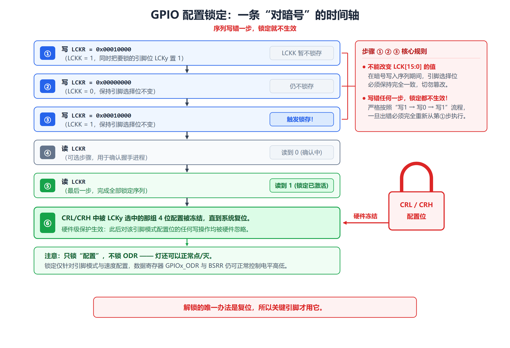

**看图方法**：

1. **横轴是时间**，从上往下是操作步骤；
2. **左边一列写操作**：① 写 `0x0001 0001` → ② 写 `0x0000 0001` → ③ 写 `0x0001 0001` → 读 → 读。
   **注意三次写里 LCK[15:0] 都是 `0x0001`，变的只有 LCKK**；右边标出每次操作后 LCKK 的值；
3. **最后一段用红色标出"锁定生效"**：CRL/CRH 对应的 4 位变成"只读"，直到复位；
4. **图中还有一个小人推不开的锁形图标**——表示"程序再怎么改也没用"。

#### ④ 固件库里的用法

```c
GPIO_PinLockConfig(GPIOA, GPIO_Pin_0);   /* 锁定 PA0 的配置 */
```

教材 p181 给出的就是这一句。要不要用？**关键引脚（比如控制电机、继电器、电源的引脚）值得用**；
普通实验一般不用，否则调程序时要反复复位才能改配置。

### 6.4.10 七个寄存器一页速查

| 寄存器 | 偏移 | 读写 | 一句话 | 最关键的位 |
|---|---|---|---|---|
| `GPIOx_CRL` | 0x00 | rw | 配置 P0~P7 的模式 | 每组 4 位：CNF[1:0]、MODE[1:0] |
| `GPIOx_CRH` | 0x04 | rw | 配置 P8~P15 的模式 | 同上 |
| `GPIOx_IDR` | 0x08 | **r** | 读引脚输入电平 | bit15:0 = IDR15~IDR0 |
| `GPIOx_ODR` | 0x0C | rw | 写输出电平 | bit15:0 = ODR15~ODR0 |
| `GPIOx_BSRR` | 0x10 | **w** | 原子置位（低 16 位）/清位（高 16 位） | BSy / BRy，同时写时 BS 优先 |
| `GPIOx_BRR` | 0x14 | **w** | 原子清位 | bit15:0 = BR15~BR0 |
| `GPIOx_LCKR` | 0x18 | rw | 冻结引脚配置 | LCKK = bit16，LCKy = bit15:0 |

**【补充解释】第 2 章学过的"位带"也能用在 GPIO 上**
（一句话复习：位带 = 把"某一位"膨胀成"一个字"，用普通写内存指令原子地改一个 bit）。
GPIO 寄存器在 `0x4000 0000~0x400F FFFF` 这个位带区内，所以可以用**别名区**地址操作某一位：

> **什么叫"别名区"**（alias region）？位带区里每一个 bit，在另一个地址区间里都有一个
> **属于它自己的 32 位字**；这个字所在的区域就叫别名区。读改写这个字，等于读改写那一个 bit。
> 可以理解成：**位带区是"真身"，别名区是每个 bit 的"专用遥控器"**。

```
别名地址 = 0x4200 0000 + (寄存器绝对地址 − 0x4000 0000) × 32 + 位号 × 4

例：GPIOA_ODR 的 bit0
  0x4001 080C − 0x4000 0000 = 0x0001 080C
  0x0001 080C × 32 = 0x0021 0180
  0x4200 0000 + 0x0021 0180 + 0 × 4 = 0x4221 0180

于是：*(volatile uint32_t *)0x42210180 = 1;   → 把 PA0 置 1
```

**这段是【补充解释】**（教材第 6 章没有讲位带操作 GPIO），
实际工程中更常用 BSRR/BRR，因为它们更直观、地址也不容易算错。

---

## 6.5 RCC 时钟模块的寄存器：为什么必须先开时钟

### 6.5.1 先别急着看教材：灯不亮的头号原因

【教材内容】教材 p161 开门见山：

> "嵌入式系统在工作前，都要进行初始化工作。时钟配置是初始化的一项重要工作。
> 由 STM32F103VET6 的时钟结构可以看出，**要使用某个外设，必须使能该外设的时钟**。
> 时钟配置需要先考虑系统时钟的来源（内部时钟、外部时钟、外部振荡器），以及是否需要锁相环（PLL）。
> 然后再考虑内部总线和外部总线，最后考虑外设的时钟信号。
> 应遵从**先倍频作为处理器的时钟，然后再由内向外分频**的原则。
> 时钟配置流程图如图 6-6 所示。"
> "时钟配置主要就是对 RCC 时钟模块的寄存器进行设置。RCC 时钟模块寄存器的首地址是 **0x4002 1000**。"

**【补充解释】教材专门用一整节（6.4）讲 RCC，但标题是"RCC 时钟模块的寄存器"，
而章节开头却先说'要使用某个外设，必须使能该外设的时钟'。这句话是本章最容易吃亏的地方：**

> **忘了开 GPIO 的时钟，你配的所有寄存器都写不进去，引脚一点反应都没有。**
> 这不是"程序错了"，而是**这个外设根本没有通电（没有时钟）**。

### 6.5.2 什么叫"给外设开时钟"？

**【辅助理解图】时钟门控：为什么外设需要时钟**

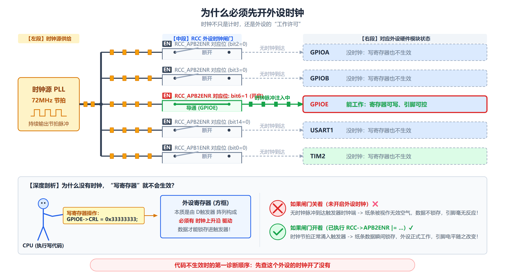

**看图方法**：

1. **左边**是时钟源（PLL 输出的 72MHz），画成一条"节拍流水线"；
2. **中间是一排闸门**，每个闸门上写着一个外设的名字（GPIOA、GPIOB、USART1……）；
3. **闸门旁边有一个开关**，开关由 RCC 的"使能寄存器"里对应的那一位控制；
4. **右边是各个外设模块**，只有闸门打开的外设才收到"节拍"（时钟）；
5. **最下面有一行红字**：闸门关着时，往外设寄存器里写数据——**写了也白写**。

**这张图要让我理解**：

> **时钟对外设来说，不只是"计时"，还是"工作许可"。**
> 没有时钟，外设内部的触发器不翻转、状态机不运行，你写进去的值存不住，配置自然不生效。

**【类比】** 外设像一间办公室，时钟像"整栋楼的总电闸分给这一间的电"。

- 总电闸（系统时钟）一直开着；
- 每个房间有一个**分闸**（使能位）；
- 房间没合闸时，你在黑屋子里写笔记（写寄存器），写完也没人记得住（**值存不住**）；
- 只有合上分闸（写 1 使能），房间才开始工作。

**类比边界**：真实硬件里没有"房间"，也没有"分闸"这个人。所谓"关时钟"，是 RCC 里的
**时钟门控电路**停止向这个外设送时钟脉冲。后果是：

- 外设内部的触发器**不再更新**——你写进去的值**存不住**；
- 外设的状态机、计数器**不再推进**——即使某个寄存器侥幸残留着一个旧值，它也不会引发出任何动作；
- 所以结论只有一个：**关着时钟时对寄存器的任何操作都是"不可依赖"的**。
  千万不要有"先把寄存器配好，再开时钟"这种想法——**正确顺序永远是"先开时钟 → 再写寄存器"**
  （6.5.7 节会再强调一次）。

而且**不用的外设关掉时钟可以省电**，这正是 STM32 低功耗设计的基本手段。

> **一句话复习（第 3 章时钟树讲过）**：
> STM32 的时钟是"树状"分发的：振荡器 → PLL → SYSCLK → AHB（HCLK）→
> APB2（PCLK2，最高 72MHz）/ APB1（PCLK1，最高 36MHz）→ 各个外设。
> **GPIO 挂在 APB2 上**，所以要开的是 **APB2 上的 GPIO 时钟**。

### 6.5.3 RCC 的寄存器全景（先看地图，别背）

RCC 也是"一个外设"，它的寄存器也有偏移量。基地址：**`0x4002 1000`**。

| 偏移量 | 寄存器 | 中文名 | 和 GPIO 的关系 |
|---|---|---|---|
| `0x00` | **RCC_CR** | 时钟控制寄存器 | 开关 HSI/HSE/PLL 等时钟源 |
| `0x04` | **RCC_CFGR** | 时钟配置寄存器 | 选系统时钟源、各种分频、PLL 倍频 |
| `0x08` | **RCC_CIR** | 时钟中断寄存器 | 时钟就绪/失效的中断 |
| `0x0C` | **RCC_APB2RSTR** | APB2 外设复位寄存器 | 复位 GPIOA~E 等（不常用） |
| `0x10` | **RCC_APB1RSTR** | APB1 外设复位寄存器 | 复位 APB1 上的外设 |
| `0x14` | **RCC_AHBENR** | AHB 外设时钟使能寄存器 | 开 DMA、SRAM、FSMC 等时钟 |
| **`0x18`** | **RCC_APB2ENR** | **APB2 外设时钟使能寄存器** | **★ 开 GPIOA~E 时钟就靠它** |
| `0x1C` | **RCC_APB1ENR** | APB1 外设时钟使能寄存器 | 开 TIM2~7、USART2~5 等时钟 |
| `0x20` | **RCC_BDCR** | 备份域控制寄存器 | RTC、LSE |
| `0x24` | **RCC_CSR** | 控制/状态寄存器 | 复位标志、LSI |

**地址演算（开 GPIO 时钟要用到的那个寄存器）：**

```
  0x4002 1000      （RCC 基地址，教材 p161）
+ 0x0000 0018      （APB2ENR 偏移量）
──────────────
  0x4002 1018      （RCC_APB2ENR 的绝对地址）
```

**你在例 6-2 里写的那一行：**

```c
RCC->APB2ENR |= RCC_APB2Periph_GPIOE;
```

**它的物理含义就是**：往地址 `0x40021018` 写一个数，把 bit6（IOPEEN）置 1。

### 6.5.4 RCC_CR：时钟控制寄存器

**【教材内容】教材 p161 原文：**
> "偏移地址：0x00，复位值：0x0000 XX83，X 代表未定义。访问：无等待状态。"

#### ① 它是谁的、控制什么

| 问题 | 回答 |
|---|---|
| 属于谁 | RCC 时钟模块 |
| 控制什么 | **时钟源的开关和状态**：内部 8MHz RC（HSI）、外部 4~16MHz 晶振（HSE）、PLL；以及时钟安全系统 |
| 为什么需要 | 系统刚上电时只有内部 8MHz RC 在跑；要用外部晶振和 PLL 凑 72MHz，就得在这里一项一项打开并等待"就绪" |
| 怎么用 | **先写 ON 位打开，再轮询 RDY 位等就绪**，就绪后才允许切换/使用 |

#### ② ASCII 位图（只画到能用的程度）

```
        RCC_CR（偏移 0x00，复位值 0x0000 XX83）
 25    24          19    18      17      16
+------+------+----+------+-------+-------+-------+
|PLLRDY|PLLON |保留 |CSSON |HSEBYP |HSERDY |HSEON  |
|  r   |  rw  |    |  rw  |  rw   |   r   |  rw   |
+------+------+----+------+-------+-------+-------+
   ↑      ↑
 只读   写1开PLL

  7  6  5  4  3    2      1       0
+---+---+---+---+----+------+-------+-------+
| HSITRIM[4:0]   |保留 |HSIRDY| HSION  |
|     rw         |      |  r   |  rw    |
+---+---+---+---+----+------+-------+-------+
                          ↑        ↑
                    内部8MHz就绪  写1开内部8MHz
```

**关键字段逐个说：**

| 位 | 名称 | 读写 | 写 0 / 写 1 会发生什么 |
|---|---|---|---|
| 0 | **HSION** | rw | 0：关闭内部 8MHz RC 振荡器；1：开启内部 8MHz RC 振荡器。**复位后为 1**（系统默认靠它起步） |
| 1 | **HSIRDY** | r | **只读**。0：内部 8MHz 未就绪；1：已稳定。**只能等，不能写** |
| 7:3 | **HSITRIM[4:0]** | rw | 微调 HSI 频率，默认 16（复位值里的 `0x80` 就是这几位），用来补偿电压/温度漂移 |
| 16 | **HSEON** | rw | 0：关闭外部晶振；1：开启外部晶振（教材例 6-1 写的就是 `0x00010000`） |
| 17 | **HSERDY** | r | **只读**。0：外部晶振未就绪；1：已稳定 |
| 18 | **HSEBYP** | rw | 0：不旁路；1：旁路外部晶振（调试时从外部直接灌时钟用） |
| 19 | **CSSON** | rw | 0：时钟监测器关闭；1：若外部晶振就绪，则开启时钟安全系统（HSE 挂了自动切 HSI） |
| 24 | **PLLON** | rw | 0：关闭 PLL；1：使能 PLL（教材例 6-1 写的是 `0x01000000`） |
| 25 | **PLLRDY** | r | **只读**。0：PLL 未锁定；1：PLL 已锁定（教材例 6-1 等的是 `0x02000000`） |
| 31:26 | 保留 | — | 始终读为 0 |

**【补充解释】"就绪标志（RDY）"为什么要等？**

晶振不是"一通电就立刻稳定出 8MHz"的。石英晶体起振需要时间（典型几百微秒到几毫秒），
PLL 锁频也需要时间。所以标准流程是：

```
写 xxxON = 1   →   硬件开始启动这个时钟源
     ↓
轮询 xxxRDY    →   一直是 0 就继续等
     ↓
读到 1         →   时钟稳定，可以用了
```

**这就是教材例 6-1 里那三段 `WAIT_xxx_RDY` 循环的意义**——**先打开，再等就绪，最后才用**。

### 6.5.5 RCC_CFGR：时钟配置寄存器

**【教材内容】教材 p162 原文：**
> "偏移地址：0x04，复位值：0x0000 0000。访问：0~2 个等待周期，
> 只有当访问发生在时钟切换时，才会插入 1 或 2 个等待周期。"

#### ① 它是谁的、控制什么

| 问题 | 回答 |
|---|---|
| 属于谁 | RCC |
| 控制什么 | **系统时钟选谁（SW/SWS）、AHB/APB1/APB2 怎么分频（HPRE/PPRE1/PPRE2）、PLL 怎么倍频（PLLMUL/PLLSRC）、ADC 和 USB 的分频、时钟输出（MCO）** |
| 为什么需要 | "先倍频、再由内向外分频"这一整套动作，都写在这一个寄存器里 |
| 怎么用 | 配置各项分频和倍频 → 打开 PLL 并等就绪 → 最后写 SW 切换系统时钟 → 查 SWS 确认切换成功 |

#### ② ASCII 位图

```
        RCC_CFGR（偏移 0x04，复位值 0x0000 0000）
 26  25  24   23  22  21  20  19  18  17   16
+---+---+---+----+---+---+---+---+---+----+----+
|  MCO[2:0] |保留 |USBPRE| PLLMUL[3:0]|PLLXTPRE|PLLSRC|
+---+---+---+----+---+---+---+---+---+----+----+
                    ↑                ↑        ↑
                  USB分频         PLL倍频    PLL输入选择

 15  14  13  12  11  10   9   8   7   6   5   4   3   2   1   0
+---+---+---+---+---+---+---+---+---+---+---+---+---+---+---+---+
|ADCPRE[1:0]| PPRE2[2:0] | PPRE1[2:0] |  HPRE[3:0]  | SWS[1:0]| SW[1:0]|
+---+---+---+---+---+---+---+---+---+---+---+---+---+---+---+---+
   ↑ ADC分频   ↑ APB2分频    ↑ APB1分频     ↑ AHB分频     ↑只读  ↑切换系统时钟
```

**关键字段逐个说：**

| 位 | 名称 | 作用 | 写 0 / 写 1 的讲究 |
|---|---|---|---|
| 1:0 | **SW[1:0]** | 选择系统时钟源 | `00`=HSI；`01`=HSE；`10`=PLL 输出；`11`=不可用。**切换后不会立刻生效**，要等 SWS 跟上 |
| 3:2 | **SWS[1:0]** | **只读**，报告当前实际用的是哪个时钟源 | 编码同 SW。**软件要确认切换成功，就读它** |
| 7:4 | **HPRE[3:0]** | AHB 预分频 | `0xxx`=不分频（HCLK = SYSCLK）；其余编码对应 ÷2、÷4…… ÷512 |
| 10:8 | **PPRE1[2:0]** | APB1 预分频 | `0xx`=HCLK 不分频；`1xx`=分频。**APB1 最高 36MHz** |
| 13:11 | **PPRE2[2:0]** | APB2 预分频 | `0xx`=HCLK 不分频；`1xx`=分频。**GPIO 就挂在这条上，最高 72MHz** |
| 15:14 | **ADCPRE[1:0]** | ADC 时钟分频 | 决定 ADCCLK（最大 14MHz） |
| 16 | **PLLSRC** | PLL 输入时钟源选择 | `0`=HSI/2；`1`=HSE。**教材例 6-1 置 1（用 HSE）** |
| 17 | **PLLXTPRE** | HSE 进入 PLL 前是否二分频 | 0=不分频；1=二分频 |
| 21:18 | **PLLMUL[3:0]** | PLL 倍频系数 | 例如 `0111` = ×9（8MHz×9 = 72MHz）；`0000`=×2 …… |
| 22 | **USBPRE** | USB 预分频 | 0=÷1.5；1=÷1 |
| 26:24 | **MCO[2:0]** | 时钟输出（把内部时钟从引脚输出来测量） | `0xx`=不输出；`100`=SYSCLK；`101`=HSI；`110`=HSE；`111`=PLL/2 |

**【待核验】提醒**：MinerU 在 RCC_CFGR 这一段把"HPRE 不分频"的描述错位到了 SW 附近
（原文里出现孤立的 `0xxx: SYSCLK 不分频；`，随后紧接 SW 的编码），
本讲义按位图位置归位。详见文末"待核验"。

#### ③ 例 6-1 里的 `0x001D 0400` 是怎么来的（位运算不跳步）

教材例 6-1 的注释说："PLL 倍频系数，PCLK2，PCLK1 分频设置，HSE 9 倍频，PCLK2 = HCLK，
PCLK1 = HCLK/2；HCLK = 72MHz 0x001D0400"。我们把它拆开验证：

```
写入值： 0x001D0400
二进制： 0000 0000 0001 1101 0000 0100 0000 0000
                   │   ││││ ││││
                   │   ││││ │││└─ bit10 = 1  → PPRE1 = 100 → APB1 = HCLK/2 ✓
                   │   └┴┴┴─ bit21:18 = 0111 → PLLMUL = ×9 ✓
                   └──────── bit16 = 1 → PLLSRC = 1，选 HSE ✓

结果：
  HSE 8MHz × 9 = 72MHz（PLL 输出）
  HPRE = 0xxx → HCLK = SYSCLK = 72MHz
  PPRE2 = 0xx → PCLK2 = HCLK = 72MHz   （GPIO 跑在 72MHz 的 APB2 上）
  PPRE1 = 100 → PCLK1 = HCLK/2 = 36MHz
```

**【补充解释】为什么 PCLK1 要分频到 36MHz，而 PCLK2 不分？**

因为 **APB1 的额定最高频率就是 36MHz**，而 APB2 可以跑到 72MHz。
HCLK 已经是 72MHz，所以 APB1 必须 ÷2 才安全；APB2 不分频正好 72MHz。
**这是"外设挂在哪条总线上，决定了它能跑多快"的直接体现**（第 3 章表 3-1 讲过）。

### 6.5.6 RCC_CIR / APB2RSTR / APB1RSTR / AHBENR：先认识，不深究

#### RCC_CIR 时钟中断寄存器（偏移 0x08）

它的作用是：**当时钟源出现"就绪"或"HSE 失效"这类事件时，产生中断或标志**。

| 字段 | 含义 | 怎么用 |
|---|---|---|
| 位 23 CSSC | 清除时钟安全系统中断 | 写 1 清除 CSSF |
| 位 20~16 PLLRDYC / HSERDYC / HSIRDYC / LSERDYC / LSIRDYC | 各种"就绪中断"的**清除位** | 写 1 清对应标志 |
| 位 12~8 PLLRDYIE / HSERDYIE / HSIRDYIE / LSERDYIE / LSIRDYIE | 各种"就绪中断"的**使能位** | 写 1 允许产生中断 |
| 位 7 CSSF | 时钟安全系统中断标志 | **只读**，HSE 失效时硬件置 1 |
| 位 4~0 PLLRDYF / HSERDYF / HSIRDYF / LSERDYF / LSIRDYF | 各种"就绪中断"标志 | **只读**，由硬件置 1，要软件写 C 位清除 |

**【补充解释】"C 位"和"F 位"的分工**（这是 STM32 中断寄存器的通用套路，第 7 章还会遇到）：

```
F 位（Flag）    ：硬件说"事情发生了"，置 1 给你看      —— 只读
IE 位（Interrupt Enable）：软件说"这事我要不要被打扰"  —— 读写
C 位（Clear）   ：软件说"我处理完了，把它擦掉"          —— 只写
```

**记住这个"F / IE / C"三件套，以后看任何外设的中断寄存器都不慌。**

**【待核验】** 教材 p164 位 3 的说明里出现"在**外部低速时钟**就绪且 HSERDYIE 位被置 1 时"
——与位名 HSERDYF（HSE = 外部**高速**时钟）矛盾，疑为教材笔误或 OCR 错误，已列入文末。

#### RCC_APB2RSTR APB2 外设复位寄存器（偏移 0x0C）

**它是"复位按钮"，不是"时钟开关"。**

| 位 | 名称 | 写 1 的效果 |
|---|---|---|
| 0 | AFIORST | 复位辅助功能 IO（AFIO） |
| 2 | IOPARST | 复位 IO 端口 A |
| 3 | IOPBRST | 复位 IO 端口 B |
| 4 | IOPCRST | 复位 IO 端口 C |
| 5 | IOPDRST | 复位 IO 端口 D |
| 6 | IOPERST | 复位 IO 端口 E |
| 7/8 | IOPFRST / IOPGRST | 复位端口 F / G（VET6 上没有） |
| 9~15 | ADC1/ADC2/TIM1/SPI1/TIM8/USART1/ADC3 | 对应外设复位 |

**写 0：无作用；写 1：复位对应外设**（把它恢复成复位默认状态，然后硬件自动回到 0）。

**【补充解释】复位和关时钟不是一回事：**

| 操作 | 效果 | 类比 |
|---|---|---|
| 关时钟（ENR 写 0） | 模块不工作，但寄存器内容可能还留着 | 关灯 |
| 复位（RSTR 写 1） | 模块状态被清回默认值 | 把它"打回出厂设置" |

#### RCC_APB1RSTR APB1 外设复位寄存器（偏移 0x10）

结构同 APB2RSTR，只是名单不同（APB1 上的外设）：

| 位 | 位名 | 位 | 位名 |
|---|---|---|---|
| 0~5 | TIM2RST ~ TIM7RST | 11 | WWDGRST |
| 14/15 | SPI2RST / SPI3RST | 17~20 | USART2RST / USART3RST / UART4RST / UART5RST |
| 21/22 | I2C1RST / I2C2RST | 23 | USBRST |
| 25 | CANRST | 27 | BKPRST |
| 28 | PWRRST | 29 | DACRST |

> 表中的 **DAC** = Digital-to-Analog Converter（数模转换器），作用是"把数字量变成模拟电压输出"，
> 第 10 章会专门学；**PWR** = power（电源接口）、**BKP** = backup（备份接口）。
> 其余缩写见 6.1.2 的外设缩写表。

#### RCC_AHBENR AHB 外设时钟使能寄存器（偏移 0x14）

**【教材内容】教材 p167 原文：**
> "偏移地址：0x14。复位值：0x0000 0014。访问：无等待周期。所有可设置的位都由软件置 1 或清零。"

| 位 | 名称 | 写 1 的效果（括号里是该位的复位值） |
|---|---|---|
| 0 | DMA1EN | DMA1 时钟开启（**复位值为 0，默认关着**；要用 DMA 时自己开，第 11 章） |
| 1 | DMA2EN | DMA2 时钟开启（**复位值为 0**，VET6 上没有 DMA2） |
| 2 | SRAMEN | 睡眠模式时 SRAM 时钟开启（**复位值为 1**） |
| 4 | FLITFEN | 睡眠模式时闪存接口电路时钟开启（**复位值为 1**） |
| 6 | CRCEN | CRC 时钟开启（复位值为 0） |
| 8 | FSMCEN | FSMC 时钟开启（复位值为 0，第 12 章） |
| 10 | SDIOEN | SDIO 时钟开启（复位值为 0） |

**复位值 `0x0000 0014` 拆开看：**

```
0x14 = 0001 0100b
        ↑   ↑
      bit4  bit2
   FLITFEN  SRAMEN   → 只有这两位复位后默认是 1

其余所有位（包括 bit0 的 DMA1EN、bit1 的 DMA2EN）复位后都是 0 —— 默认关着。
```

**【补充解释】为什么它俩默认开着？**
因为 CPU 取指令要用 Flash 接口、读写变量要用 SRAM——**没有它们，程序根本跑不起来**。
而 DMA、SDIO 这些"按需使用"的外设，默认关着，用的时候再开，省电。

### 6.5.7 RCC_APB2ENR：开 GPIO 时钟的寄存器（本章重点）

**【教材内容】教材 p168 原文：**
> "偏移地址：0x18，复位值：0x0000 0000。访问：通常无访问等待周期，
> 但 APB2 总线上的外设被访问时，将插入等待状态直到 APB2 的外设访问结束。
> 所有可设置的位都由软件置 1 或清零。"

#### ① 它属于谁、控制什么、为什么需要

| 问题 | 回答 |
|---|---|
| 属于谁 | RCC |
| 控制什么 | **APB2 总线上每个外设的时钟开关**（GPIOA~E、AFIO、ADC1~3、TIM1、TIM8、SPI1、USART1） |
| 为什么需要 | 默认全关（复位值 0）。要用哪个外设，就必须把它对应的 EN 位写 1 |
| 怎么用 | `RCC->APB2ENR |= (1 << 6);` 这种"置位"写法，或固件库 `RCC_APB2PeriphClockCmd(RCC_APB2Periph_GPIOE, ENABLE);` |

#### ② ASCII 位图

```
        RCC_APB2ENR（偏移 0x18，复位值 0x0000 0000）
 15    14      13    12    11    10    9     8     7     6     5     4     3     2      1    0
+------+------+-----+-----+-----+-----+-----+-----+-----+-----+-----+-----+-----+-----+-----+-----+
|ADC3EN|USART1|TIM8 |SPI1 |TIM1 |ADC2 |ADC1 |IOPG |IOPF |IOPE |IOPD |IOPC |IOPB |IOPA |保留 |AFIO |
|      |EN    |EN   |EN   |EN   |EN   |EN   |EN   |EN   |EN   |EN   |EN   |EN   |EN   |     |EN   |
+------+------+-----+-----+-----+-----+-----+-----+-----+-----+-----+-----+-----+-----+-----+-----+
                                                              ↑
                                                    ★ bit6 = IOPEEN
                                        （要开 GPIOE 的时钟，就写这一位）
  31:16 保留，始终读为 0
```

**逐个位的含义（教材 p168 原文）：**

| 位 | 名称 | 写 0 | 写 1 |
|---|---|---|---|
| 0 | AFIOEN | 辅助功能 IO 时钟关闭 | 辅助功能 IO 时钟开启 |
| 2 | IOPAEN | IO 端口 A 时钟关闭 | **IO 端口 A 时钟开启** |
| 3 | IOPBEN | IO 端口 B 时钟关闭 | **IO 端口 B 时钟开启** |
| 4 | IOPCEN | IO 端口 C 时钟关闭 | **IO 端口 C 时钟开启** |
| 5 | IOPDEN | IO 端口 D 时钟关闭 | **IO 端口 D 时钟开启** |
| 6 | IOPEEN | IO 端口 E 时钟关闭 | **IO 端口 E 时钟开启** |
| 7 | IOPFEN | IO 端口 F 时钟关闭 | IO 端口 F 时钟开启（VET6 无此端口） |
| 8 | IOPGEN | IO 端口 G 时钟关闭 | IO 端口 G 时钟开启（VET6 无此端口） |
| 9 | ADC1EN | ADC1 接口时钟关闭 | ADC1 接口时钟开启 |
| 10 | ADC2EN | ADC2 接口时钟关闭 | ADC2 接口时钟开启 |
| 11 | TIM1EN | TIM1 定时器时钟关闭 | TIM1 定时器时钟开启 |
| 12 | SPI1EN | SPI1 时钟关闭 | SPI1 时钟开启 |
| 13 | TIM8EN | TIM8 定时器时钟关闭 | TIM8 定时器时钟开启 |
| 14 | USART1EN | USART1 时钟关闭 | USART1 时钟开启 |
| 15 | ADC3EN | ADC3 接口时钟关闭 | ADC3 接口时钟开启 |
| 1、31:16 | 保留 | — | 始终读为 0 |

**【补充解释】注意位 1 是保留的**——从 IOPAEN（bit2）到 IOPEEN（bit6）是连续 5 位，
对应 5 个 GPIO 端口，非常好记：

```
bit2 → A      bit3 → B      bit4 → C      bit5 → D      bit6 → E
```

#### ③ 程序怎么操作：三种等价写法

**写法 1：用固件库的宏（最直观）**

```c
RCC_APB2PeriphClockCmd(RCC_APB2Periph_GPIOE, ENABLE);
```

**写法 2：直接操作寄存器（例 6-2 用的）**

```c
RCC->APB2ENR |= RCC_APB2Periph_GPIOE;   /* 宏的值 = 0x00000040 = bit6 */
```

**位运算展开：**

```
运算前（复位值）： 0x0000 0000
                0000 0000 0000 0000 0000 0000 0000 0000
掩码：             0x0000 0040
                0000 0000 0000 0000 0000 0000 0100 0000
                                              ↑ bit6
OR 后：            0x0000 0040   → IOPEEN = 1 → GPIOE 时钟开启 ✓
```

**写法 3：自己数位（最能暴露"你到底懂不懂"）**

```c
RCC->APB2ENR |= (1 << 6);    /* 等价于 |= 0x40 */
```

**如果同时要用多个端口**，可以把掩码或起来：

```c
RCC->APB2ENR |= (1 << 2) | (1 << 6);   /* 同时开 GPIOA 和 GPIOE */
/* 展开： (1<<2) = 0x04, (1<<6) = 0x40, 或起来 = 0x44 -> 写入 APB2ENR */
```

#### ④ 写完这一位，硬件发生什么？

1. CPU 把 `0x00000040` 写到地址 `0x40021018`；
2. RCC 模块里，`IOPEEN` 触发器变成 1；
3. **时钟门控电路打开**：APB2 的 72MHz 时钟开始送进 GPIOE 模块；
4. 从这一刻起，**再往 GPIOE 的 CRL/CRH/ODR 写值才会真正存住并生效**。

**顺序不能反**：教材 6.5 节明确说使用 GPIO 的三步是
"（1）配置系统时钟并打开 GPIO 口的时钟；（2）设置 GPIO 口位的工作模式；（3）使用 GPIO 口位进行输入或输出"。
**第 1 步必须最先做。**

### 6.5.8 RCC_APB1ENR：APB1 外设的时钟使能（偏移 0x1C）

结构和 APB2ENR 完全同理，只是名单是 APB1 上的外设。以后各章会用到，先把"将来要用的几位"记下来：

| 位 | 名称 | 将来哪一章用 |
|---|---|---|
| 0~5 | TIM2EN ~ TIM7EN | 第 8 章 定时器 |
| 11 | WWDGEN | 窗口看门狗 |
| 14/15 | SPI2EN / SPI3EN | 第 9 章 SPI |
| 17/18 | USART2EN / USART3EN | 第 9 章 串口 |
| 19/20 | UART4EN / UART5EN | 第 9 章 串口 |
| 21/22 | I2C1EN / I2C2EN | I²C 总线 |
| 23 | USBEN | USB |
| 25 | CANEN | CAN 总线 |
| 27 | BKPEN | 备份接口 |
| 28 | PWREN | 电源接口（低功耗模式要用） |
| 29 | DACEN | 第 10 章 DAC |

**【补充解释】APB1ENR 与 APB2ENR 的"分家原则"：**
高速外设（GPIO、ADC、USART1、SPI1、TIM1/8）挂在 **APB2**；
其余"低速/常规"外设（TIM2~7、USART2~5、SPI2/3、I2C、CAN、USB、DAC……）挂在 **APB1**。
**所以写代码前先问自己："我这个外设挂在哪条总线上？"**——挂错了寄存器，时钟永远开不起来。

### 6.5.9 RCC_BDCR 与 RCC_CSR：知道有这么回事就行

#### RCC_BDCR 备份域控制寄存器（偏移 0x20）

> "复位值：0x0000 0000，**只能由备份域复位有效复位**。访问：需要 0~3 个等待周期。"

| 位 | 名称 | 含义 |
|---|---|---|
| 16 | BDRST | 写 1 复位整个备份域 |
| 15 | RTCEN | RTC 时钟使能 |
| 9:8 | RTCSEL[1:0] | RTC 时钟源选择：`00`=无时钟；`01`=LSE；`10`=LSI；`11`=HSE/128 |
| 2 | LSEBYP | 外部低速晶振旁路 |
| 1 | LSERDY | LSE 就绪（只读） |
| 0 | LSEON | 外部 32kHz 低速晶振开关 |

**【补充解释】"备份域"是什么？**
就是那块**由纽扣电池/后备电源供电**的小区域（RTC + 少量备份寄存器）。
主电源断了，它还在走，所以 RTC 能继续计时。它的复位来源和其他部分不一样，
所以教材特意标注"只能由备份域复位有效复位"。

#### RCC_CSR 控制/状态寄存器（偏移 0x24）

> "复位值：0x0C00 0000，除复位标志外由系统复位清除，复位标志只能由电源复位清除。"

它最有用的是**复位标志位**——帮你查出"这次到底是谁把芯片复位了"：

| 位 | 名称 | 含义 |
|---|---|---|
| 31 | LPWRRSTF | 低功耗管理复位 |
| 30 | WWDGRSTF | 窗口看门狗复位 |
| 29 | IWDGRSTF | 独立看门狗复位 |
| 28 | SFTRSTF | 软件复位 |
| 27 | PORRSTF | 上电/掉电复位 |
| 26 | PINRSTF | NRST 引脚复位 |
| 24 | RMVF | 写 1 清除上述所有复位标志 |
| 1/0 | LSIRDY / LSION | 内部 40kHz 低速时钟就绪 / 使能 |

**复位值 `0x0C00 0000` 拆开：**

```
0x0C000000 = 0000 1100 0000 0000 0000 0000 0000 0000
                 ↑  ↑
              bit27 bit26
           PORRSTF  PINRSTF
```

**【补充解释】为什么上电后默认这两位是 1？**
因为芯片刚经历了一次"上电复位"，这个事实被记录下来了。软件可以读它来判断"上次为什么重启"，
排查完再写 RMVF 清掉。
（注意：这两个标志**只能由电源复位清除**，普通系统复位清不掉——这正是它的价值所在。）

### 6.5.10 看教材原图：图 6-6 时钟配置流程图

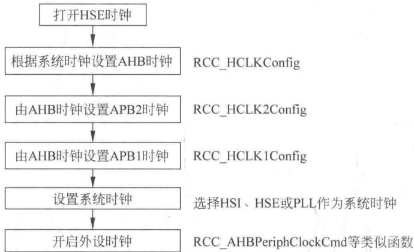

**看图方法：**

1. **先看图的走向是从上到下还是从内到外**——教材标题是"时钟配置流程图"，
   而正文说要遵从"**先倍频作为处理器的时钟，然后再由内向外分频**"的原则；
2. **第一段：选时钟源**——在"内部时钟（HSI）、外部时钟（HSE）、外部振荡器"之间做决定；
3. **第二段：决定要不要 PLL**——要倍频到 72MHz，就得配 PLL 的输入源、倍频系数，并等待锁定；
4. **第三段：内部总线**——AHB 分频（HPRE），决定 HCLK；
5. **第四段：外部总线**——APB2 分频（PPRE2）和 APB1 分频（PPRE1）；
6. **最后一段：外设时钟**——到每个外设的使能位（APB2ENR / APB1ENR / AHBENR）。

**【补充解释】这张图的阅读顺序，正好对应四个寄存器的配置顺序：**

```
① 选时钟源         →  RCC_CR（HSION/HSEON/PLLON + 等 RDY）
② PLL 倍频         →  RCC_CFGR 的 PLLMUL / PLLSRC
③ 总线分频         →  RCC_CFGR 的 HPRE / PPRE1 / PPRE2
④ 外设时钟使能      →  RCC_APB2ENR / RCC_APB1ENR / RCC_AHBENR
```

**先发生什么 → 再发生什么 → 为什么（完整时序）：**

```
上电
 ↓
HSI（内部 8MHz RC）自动开启并稳定    ← 芯片的"保命时钟"，不需要外部器件
 ↓
（如果要 72MHz）开 HSE（外部 8MHz 晶振），等 HSERDY=1
 ↓
配 PLL：PLLSRC 选 HSE，PLLMUL = ×9，开 PLLON，等 PLLRDY=1
 ↓
配分频：HPRE=÷1，PPRE2=÷1，PPRE1=÷2
 ↓
写 SW = 10，把系统时钟切到 PLL
 ↓
读 SWS，确认它已经变成 10（切换成功）
 ↓
（最后，也是本章关心的）在各 ENR 里打开你要用的外设时钟
 ↓
外设（比如 GPIOE）开始工作
```

**为什么顺序不能乱？**
因为每一步的"上游"都是下一步的"原料"——

- 没有稳定的时钟源，PLL 没法锁定；
- 没有锁定好的 PLL，高频系统时钟切不过去（切过去系统会崩）；
- 没有系统时钟，外设时钟就是"0 的分频"，开了也没用。

**【补充解释】C 语言程序里"没配时钟"为什么也能跑？**

教材 p177 对例 6-2 有一段说明：

> "读者可能发现，在用户程序中没有进行系统时钟的配置。其实，系统时钟配置工作已经在
> SystemInit 函数中实现了，并且默认的系统时钟被配置为 72MHz。
> 而通过查看启动文件 startup_stm32f10x_hd.s 可以发现，SystemInit 函数是在 main 函数之前调用的。
> 因此，在 main 函数中，不再需要进行系统时钟配置工作。"

**结论**：

| 编程方式 | 系统时钟谁来配 | 外设时钟谁来开 |
|---|---|---|
| 汇编（例 6-1） | **你自己**配（RCC_CR/CFGR 一条条写） | **你自己**开（APB2ENR） |
| C 直接操作寄存器（例 6-2） | **SystemInit 已经配好 72MHz** | **你自己**开（`RCC->APB2ENR |= ...`） |
| 固件库（例 6-3） | **SystemInit 已经配好 72MHz** | **你自己**开（`RCC_APB2PeriphClockCmd(...)`） |

**注意**：**"系统时钟配好了"不等于"外设时钟也开了"。**
外设时钟必须在 main 里自己开——这就是为什么例 6-2、例 6-3 都有那一行开 GPIO 时钟的代码。

### 6.5.11 【辅助理解图】RCC_APB2ENR 的位运算全过程

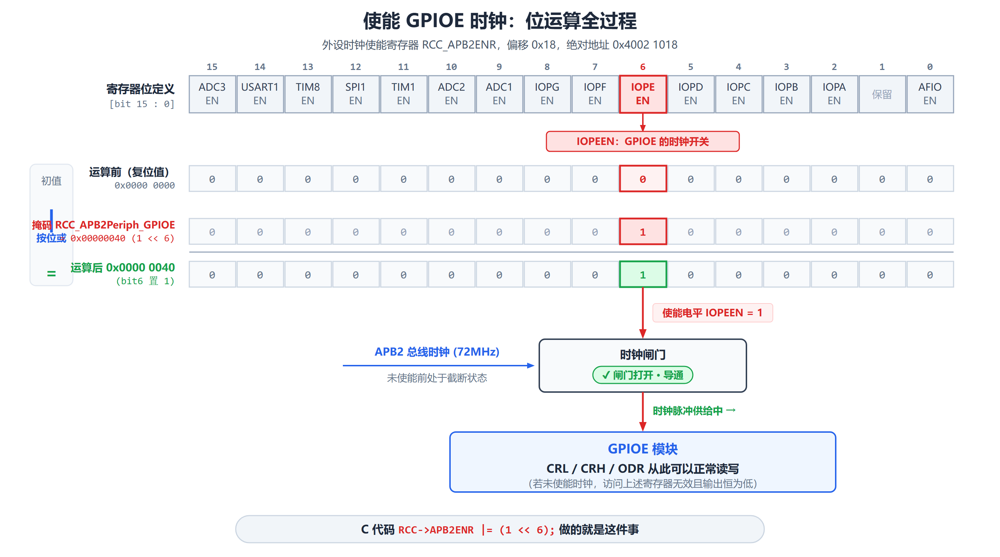

**看图方法**：

1. **最上面一行**是 RCC_APB2ENR 的 32 个格子，其中 bit6（IOPEEN）被红框圈出；
2. **第二行是"运算前"**：复位值 `0x0000 0000`，所有位都是 0；
3. **第三行是"掩码"**：`0x0000 0040`，只有 bit6 是 1；
4. **第四行是"运算后"**：`0x0000 0040`，bit6 变成 1；
5. **最下面的箭头**从 bit6 指向一个"时钟闸门"图标，最后连到 GPIOE 模块。

**这张图要让我理解**：

> **"开时钟"这件事，物理上就是让一个 bit 从 0 变成 1。
> 它没有任何神秘之处——但少了它，后面所有配置都无效。**

### 6.5.12 RCC 部分真正要记住什么

1. **外设用之前必须开时钟**；GPIO 在 APB2 上，所以开的是 `RCC_APB2ENR`。
2. `RCC_APB2ENR` 偏移 `0x18`，绝对地址 `0x4002 1018`；`IOPAEN`~`IOPEEN` = bit2~bit6。
3. 时钟配置的顺序：**时钟源 → PLL 倍频 → 总线分频 → 外设使能**；
   每一个"开关"都要"先打开、再等就绪（RDY）"。
4. 例 6-1 的 `0x001D0400` 不是魔法数：它是 **PLL ×9 + PLLSRC=HSE + APB1 ÷2** 三项设置的合成。
5. 系统时钟由 SystemInit 配好（默认 72MHz），但**外设时钟要自己在 main 里开**。

---

## 6.6 GPIO 的使用：三种方式

### 6.6.1 先别急着看教材：使用 GPIO 的三个标准步骤

【教材内容】教材 6.5 节开门见山：

> "使用 GPIO 时，按下面步骤进行：
> （1）**配置系统时钟并打开 GPIO 口的时钟**；
> （2）**设置 GPIO 口位的工作模式**；
> （3）**使用 GPIO 口位进行输入或输出**。"

**这三步翻译成"人话"：**

| 步骤 | 大白话 | 对应寄存器 | 不做会怎样 |
|---|---|---|---|
| ① 开时钟 | 给这个端口"通电" | RCC_APB2ENR | 后面写什么都没用 |
| ② 配模式 | 告诉引脚"你是输入还是输出、推挽还是开漏、什么速度" | GPIOx_CRL / CRH | 引脚还是"浮空输入"，输出不了 |
| ③ 输入/输出 | 读 IDR 或写 ODR/BSRR/BRR | IDR / ODR / BSRR / BRR | 没这一步就没有实际动作 |

**教材接着用三个例子分别演示三种"写法"：**

| 例子 | 方式 | 特点 |
|---|---|---|
| 例 6-1 | 汇编语言直接访问寄存器 | 最底层，能看到 CPU 的每一条动作，但最啰嗦 |
| 例 6-2 | C 语言直接操作寄存器 | 用指针和位运算访问地址，代码简短，要自己查手册 |
| 例 6-3 | 固件库函数 | 用函数名表达意图，最好读，但要依赖库 |

### 6.6.2 【教材内容】例 6-1：利用汇编语言访问 GPIO

#### ① 这段代码想完成什么

> 控制最小系统板上连接 **PE0** 的发光二极管**亮 0.5 秒、灭 0.5 秒**，一直循环。

**硬件前提**（回顾图 3-13）：
- SW3 拨到 ON，给 LED 供电；
- PE0 输出**低电平 0** → 灯亮；输出**高电平 1** → 灯灭。

#### ② 先补一个前置知识：汇编里怎么"访问一个寄存器"

第 4 章学过指令，这里快速复习三条最关键的：

| 汇编写法 | 意思 | 类比 |
|---|---|---|
| `LDR R1, =0x40021000` | 把**地址**常数 `0x40021000` 装进 R1 | 把门牌号记在纸上 |
| `LDR R0, [R1]` | 去 R1 指的地址**读**一个数，装进 R0 | 按门牌号去取东西 |
| `STR R0, [R1]` | 把 R0 的数**写**到 R1 指的地址 | 按门牌号把东西放进去 |
| `ORR R0, R2` | 按位"或"：`R0 = R0 OR R2` | 把某些位置 1，其他位不动 |
| `ANDS R0, R2` | 按位"与"，并影响标志位 | 检查某些位是不是 1 |

**【补充解释】为什么汇编访问外设寄存器这么"绕"？**

因为**外设寄存器和内存共用地址空间（存储器映射）**，汇编里没有"GPIO 寄存器"这种语法，
只有"地址"。所以套路永远是：

```
LDR R1, =地址      ← 先拿到门牌号
LDR/STR R0, [R1]   ← 再按门牌号读/写
```

**C 语言里的 `GPIOE->ODR` 看着高级，编译之后也就是这么两条指令。**

#### ③ 代码逐块解释

**【待核验】提醒**：MinerU 解析出的例 6-1 代码**从中间开始**（第一条是 `BL.W DELAY_NMS`），
前面的主程序开头、GPIO 时钟使能、GPIO 模式配置、`LOOP` 标号与 `LED0` 常量定义都缺失。
下面把教材**现有的部分**逐块讲清楚，并在"待核验"中标注需要回原 PDF 补齐。

**第 1 块：主循环（教材 p173 最上面三行）**

```asm
BL.W DELAY_NMS          ; 调用延时子程序，延时时间由 R0 决定
EOR R2, # LED0          ; 把 R2 中 LED0 对应的位取反（翻转）
B LOOP                  ; 无条件跳回 LOOP，继续下一轮
```

**逐行"代码 → CPU → 寄存器 → 硬件"：**

| 代码 | CPU 做什么 | 寄存器发生什么 | 硬件发生什么 |
|---|---|---|---|
| `BL.W DELAY_NMS` | 把下一条指令地址存入 LR，跳到延时子程序 | R0 决定延时长度；LR 保存返回地址 | 无（纯粹的"空转"） |
| `EOR R2, #LED0` | 把 R2 与 LED0 掩码做**异或** | 只有掩码里为 1 的那一位被翻转 | 无（还在寄存器里） |
| `B LOOP` | 跳回循环开头 | PC 改成 LOOP 的地址 | 无 |

**【补充解释】`EOR`（异或）为什么能"翻转"？**

异或规则：`0 XOR 1 = 1`，`1 XOR 1 = 0`，`x XOR 0 = x`。

```
运算前 R2：  0000 0000 0000 0000 0000 0000 0000 0000
掩码 LED0：  0000 0000 0000 0000 0000 0000 0000 0001   （LED0 = 1<<0）
EOR 后：     0000 0000 0000 0000 0000 0000 0000 0001   ← 位被"翻"成 1
再来一次：
运算前 R2：  0000 0000 0000 0000 0000 0000 0000 0001
掩码 LED0：  0000 0000 0000 0000 0000 0000 0000 0001
EOR 后：     0000 0000 0000 0000 0000 0000 0000 0000   ← 又被"翻"回 0
```

**掩码里为 1 的位 = "要翻转的位"；为 0 的位 = "保持不变"。**
但注意：这段代码只是改了 **R2 这个 CPU 寄存器**，还没有写回 GPIO！
（教材的原始清单中应当还有把 R2 写进 GPIOE->ODR 的语句，被 MinerU 漏掉了。）

**第 2 块：RCC 时钟配置（教材 p173）**

```asm
;RCC 时钟配置 HCLK = 72MHz = HSE * 9, PCLK2 = HCLK PCLK1 = HCLK/2
RCC_CONFIG_72MHZ
    LDR R1, = 0X40021000      ; R1 = RCC 基地址（RCC_CR 就在这里）
    LDR R0, [R1]              ; 读出 RCC_CR 当前值
    LDR R2, = 0X00010000      ; 掩码：HSEON（bit16）
    ORR R0, R2                ; R0 = R0 | 掩码 → 把 bit16 置 1
    STR R0, [R1]              ; 写回 RCC_CR → 打开外部晶振
```

**位运算展开（`ORR` 那一步）：**

```
运算前 R0（RCC_CR 复位值）： 0x0000 XX83 = .... .... 0000 0000 1000 0011
掩码 R2：                    0x0001 0000 = .... .... 0000 0001 0000 0000
ORR 后 R0：                  0x0001 XX83 = .... .... 0000 0001 1000 0011
                                                          ↑
                                                   bit16 = HSEON = 1
```

**硬件发生什么**：外部 8MHz 晶振开始起振。
**注意**：这时代码**没有立刻往下冲**，而是进入等待——因为晶振还没稳。

```asm
WAIT_HSE_RDY
    LDR R2, = 0X00020000      ; 掩码：HSERDY（bit17）
    LDR R0, [R1]              ; 读 RCC_CR
    ANDS R0, R2               ; R0 = R0 AND 掩码
    CMP R0, #0                ; 结果是 0 吗？
    BEQ WAIT_HSE_RDY          ; 是 0 → 就绪位还没置 1 → 回去继续等
```

**这是一个"轮询等待"循环。** 时间轴：

```
写 HSEON=1 ──→ 晶振开始起振 ──→ （几百 μs） ──→ HSERDY 被硬件置 1
                    │
                    └── 程序在 WAIT_HSE_RDY 里反复读、反复比较，直到等到 1
```

**为什么要等？** 因为"打开开关"和"时钟稳定"是两件事。
不等就往下配 PLL，PLL 可能锁不上。

```asm
    LDR R1, = 0X40022000      ; FLASH_ACR（闪存访问控制寄存器，注意：不是 RCC！）
    MOV R0, #0X12             ; 0x12 = 0001 0010b
    STR R0, [R1]              ; 设置 Flash 等待周期和预取
```

**【补充解释】这里为什么突然去动 Flash？**

因为**CPU 跑得越快，Flash 越"跟不上"**。72MHz 时读 Flash 需要插入等待周期，
否则取指会出错。`0x12` 的含义（第 5 章提过）：

```
0x12 = 0001 0010
       │      └── bits[2:0] = 010 → 2 个等待周期（72MHz 下的推荐值）
       └───────── bit4 = 1 → 预取缓冲区使能
```

**这类"提速前先把存储器配好"的动作，是系统初始化的标准环节。**

```asm
    LDR R1, = 0X40021004      ; RCC_CFGR（时钟配置寄存器）
    LDR R0, [R1]              ; 先读出来（读—改—写）
    LDR R2, = 0x001D0400      ; PLL×9 + PLLSRC=HSE + APB1÷2（6.5.5 节已拆解）
    ORR R0, R2
    STR R0, [R1]              ; 写回 → 配好分频和倍频参数
```

**【补充解释】这里用 `ORR` 而不是 `STR` 直接写，是"读—改—写"模式**：
先把原来的值读出来，只把要设置的位"或"成 1，其他位保持不变。

```asm
    LDR R1, = 0X40021000      ; 回到 RCC_CR
    LDR R0, [R1]
    LDR R2, = 0X01000000      ; PLLON（bit24）
    ORR R0, R2
    STR R0, [R1]              ; 打开 PLL

WAIT_PLL_RDY
    LDR R2, = 0X02000000      ; PLLRDY（bit25）
    LDR R0, [R1]
    ANDS R0, R2
    CMP R0, #0
    BEQ WAIT_PLL_RDY          ; 等 PLL 锁定
```

**`PLLON` = bit24，`PLLRDY` = bit25**——一个在 25 位、一个在 24 位，只差一位，
**这是背 RCC_CR 时的经典易错点**。

```asm
    LDR R1, = 0X40021004      ; RCC_CFGR
    LDR R0, [R1]
    MOV R2, #0X02             ; SW[1:0] = 10 → 选 PLL 作系统时钟
    ORR R0, R2
    STR R0, [R1]              ; 请求切换系统时钟

WAIT_HCLK_USEPLL
    LDR R0, [R1]              ; 读 RCC_CFGR
    ANDS R0, #0X08            ; SWS[1:0] 在 bit3:2，0x08 = bit3 = 1
    CMP R0, #0X08             ; SWS 变成 10 了吗？
    BNE WAIT_HCLK_USEPLL      ; 没变就继续等
    BX LR                     ; 返回主程序
```

**为什么要读 SWS 而不是相信自己刚写的 SW？**
因为**切换时钟源需要时间**，硬件切换完成后会把 SWS 更新成"实际在用的源"。
**读 SWS 才是"确认"，写 SW 只是"请求"。**

**第 3 块：延时子程序（教材 p174）**

```asm
;延时 R0(ms),误差((R0-1)*4+12)/8 us. 延时较长时,误差小于 0.1%
DELAY_NMS
    PUSH {R1}                 ; 保存 R1
DELAY_NMSLOOP
    SUB R0, #1                ; 毫秒计数减 1
    MOV R1, #1000             ; 内层循环 1000 次（教材按"一次约 1μs"设计）
DELAY_ONEUS
    SUB R1, #1                ; 内层计数减 1
    NOP
    NOP
    NOP                       ; 三条空操作
    CMP R1, #0
    BNE DELAY_ONEUS
    CMP R0, #0
    BNE DELAY_NMSLOOP
    POP {R1}                  ; 恢复 R1
    BX LR                     ; 返回
    NOP                       ; 程序代码对齐，不加这一句会出现一个警告
END
```

**【补充解释】这段延时到底有多长？——按 72MHz 数一遍指令**

教材的子程序名（`DELAY_ONEUS`）和注释，是按"内层一次 ≈ 1μs、1000 次 ≈ 1ms"来设计的。
但我们把内层循环的指令数一遍：

```
SUB R1,#1    NOP    NOP    NOP    CMP R1,#0    BNE DELAY_ONEUS
 1 周期      1      1      1        1         1~3 周期
```

Cortex-M3 里这些指令大多是 1 个周期，跳转略多，**一次内层循环合计约 6~8 个周期**。
在 72MHz 下：

```
内层一次 ≈ 6~8 周期 ÷ 72 000 000 ≈ 0.08~0.11 μs      ← 注释想要的"1μs"，实际只有约 1/10
1000 次   ≈ 80~110 μs ≈ 0.08~0.11 ms                 ← 注释想要的"1ms"，实际只有约 1/10
整个子程序（R0 = 1）≈ 0.1ms 量级，而不是 1ms
```

也就是说：**实际延时大约是注释标称值的 1/10 左右**（"亮 0.5 秒、灭 0.5 秒"实际会变成几十毫秒闪一次）。

这不是电路或代码坏了，而是**软件延时的老毛病：换主频就必须重新标定**。
这套"1μs / 1ms"的数字，看起来是按 8MHz 级别的主频凑的
（8MHz 时 6 个周期 ≈ 0.75μs，1000 次 ≈ 0.75ms，正好接近标称值），
搬到 72MHz 下自然就快了约 9~12 倍。

> **【待核验】** 教材此处的注释时长与 72MHz 主频对不上，已列入文末"待核验"，
> 需回原 PDF 核对注释原文，并上板实测确认实际延时。
> 本节的结论只在"按 72MHz、每条指令 1~3 周期"的估算下成立，**不要求背具体数值**——
> 要记住的是"**内层次数 × 一次循环的周期数 ÷ 主频 = 延时**"这个算法。

**结论：软件延时"能用但不准"，而且改主频就失效。**

**软件延时的三个特点：**

| 特点 | 说明 |
|---|---|
| 简单 | 不需要任何外设，会写循环就行 |
| **占用 CPU** | CPU 在延时期间什么都不干，纯空转 |
| 不精确 | 受编译器优化、流水线、中断影响 |

**以后第 8 章会学"用定时器精确延时/定时"**——那才是正路。本章先用软件延时凑合。

**【教材内容】例 6-1 还提到仿真调试设置**（教材 p174）：

> "软件仿真或者硬件在线仿真调试 STM32 外设时，需要对'Options for Target Target 1'对话框的 Debug 标签页进行设置。
> 在 Use Simulator（软件仿真）一栏最底部的 Dialog DLL 编辑框中输入 `DARMSTM.DLL`，
> 在 Parameter 编辑框中输入 `-pSTM32F103VE`，并将上一行 Parameter 编辑框中的 `-REMAP` 删除。
> 同样，在硬件在线仿真调试一栏最底部的 Dialog DLL 编辑框中输入 `TARMSTM.DLL`，
> 在 Parameter 编辑框中输入 `-pSTM32F103VE`。"

**【补充解释】这一步的作用**：告诉 Keil 的仿真器"我仿真的是 STM32F103VE 这颗芯片"，
这样仿真器才能正确显示外设寄存器窗口。**不做这一步，你可能在调试器里找不到 GPIOE 的视图。**

**【教材内容】教材还介绍了在调试中"看寄存器"的方法**（p175）：

> "本例中用到了系统时钟配置和 PE 口，在调试之前可以单击菜单 Peripherals→System Viewer→RCC，
> 弹出 RCC 的观察视图，如图 6-8 所示。单击菜单 Peripherals→System Viewer→GPIO→GPIOE，
> 弹出 GPIOE 的观察视图，如图 6-9 所示。"

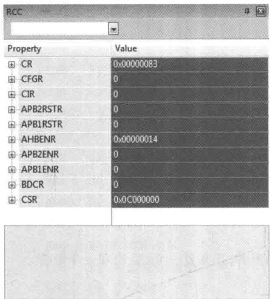

**看图方法（图 6-8：RCC 的观察视图）**：

1. **先看窗口左边那一列寄存器名**：RCC_CR、RCC_CFGR、RCC_CIR、RCC_APB2ENR……就是 6.5 节讲的那一排；
2. **看 RCC_CFGR 的 SW/SWS**：系统时钟切到 72MHz（PLL）后，它们应该是 `10`——
   这就是例 6-1 里 `WAIT_HCLK_USEPLL` 那段循环在等的目标；
3. **看 RCC_CR 的 HSERDY、PLLRDY**：它们应该是 1，表示外部晶振和 PLL 都已就绪；
4. **看 RCC_APB2ENR**：这里就是 6.5.7 节那个寄存器，各 GPIO 端口的时钟开关位
   （IOPAEN~IOPEEN = bit2~bit6）都在这一个窗口里，对照位图就能看出"哪个端口的时钟开了"。

**这张图要让我理解**：

> **仿真器里看到的不是"程序的变量"，而是芯片里真实的寄存器；
> 代码有没有把配置写进去，看这个窗口最直接。**

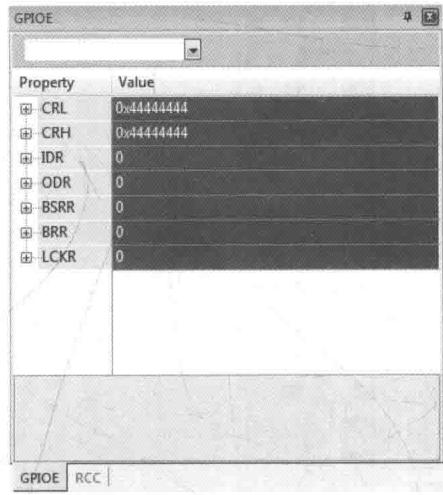

**看图方法（图 6-9：GPIOE 的观察视图）**：

1. **看窗口左边那一列寄存器名**：CRL、CRH、IDR、ODR、BSRR、BRR、LCKR——正是 6.4 节那 7 个寄存器；
2. **看每个寄存器的值**：它们以 `0x` 十六进制显示，和你在讲义里学到的复位值对照；
3. **看 CRL 的值**：如果 CRL 的低 4 位是 `3`，说明 PE0 已经配成推挽输出；如果是 `4`，说明还是浮空输入；
4. **看 ODR 的 bit0**：程序运行时它会周期性地 0/1 变化——这就是"灯在闪"在寄存器层面的样子。

**这张图要让我理解**：

> **软件仿真时"寄存器窗口"就是硬件的"透视镜"。**
> 你写下的每一个数，都能在这里看到它落在了哪个 bit 上；
> 你说的"软件控制硬件"，就是这些 bit 在变。

#### ④ 汇编方式的优缺点

| 优点 | 缺点 |
|---|---|
| 最贴近硬件，每条指令干了什么都看得见 | 代码量大、写起来繁琐 |
| 能精确控制时序和指令数 | 容易出错（地址、位号写错就是灾难） |
| 适合启动代码、中断入口、极短的关键时序 | 可读性差，移植困难 |

### 6.6.3 【教材内容】例 6-2：利用 C 语言直接操作寄存器

#### ① 这段代码想完成什么

> 和例 6-1 一样：控制 PE0 上的 LED 亮 0.5 秒、灭 0.5 秒，一直循环。
> **不同点**：用 C 语言 + 直接操作寄存器地址来实现。

教材说明（p176）：

> "使用 C 语言直接操作 STM32 微控制器寄存器进行开发时，为了避免进行一些重复的系统初始化操作
> （如设置堆栈、中断向量表等内容），可以借助 ST 公司提供的**启动文件**，
> 在创建工程出现 Manage Run-Time Environment 对话框时，选中 Device→Startup。"
> "在对话框的下方出现提示'require CMSIS: CORE'，说明需要选中 CMSIS 中的 CORE 部件。"

**【补充解释】这两步在干什么？**

| 选项 | 作用 | 不选的后果 |
|---|---|---|
| Device→Startup | 加入启动文件 `startup_stm32f10x_hd.s`（里面有栈顶值、向量表、调用 SystemInit、跳 main） | 芯片上电后不知道从哪开始，程序跑不起来 |
| CMSIS→CORE | 加入 `core_cm3.h` 等内核支持文件 | 编译报错，找不到内核相关的定义 |

**一句话复习（第 5 章讲过）**：启动文件负责"上电后把环境铺好，再跳到 main"。

#### ② 代码逐行解释

```c
#include "stm32f10x.h"                     // 包含 STM32F1 系列微控制器的头文件
void delay_ms(unsigned short int Number);  // 延时子函数声明
#define LED0 (1 << 0)                      // LED 端口定义
#define RCC_APB2Periph_GPIOE ((uint32_t)0x00000040)
```

**【待核验】提醒**：MinerU 解析出的原文是 `include "stm32f10x.h"`（少了一个 `#`），
应为 `#include`；另外 `#define LED0 (1 << 0)` 的注释在素材里写的是"led0 连接 PE8"，
**与 `1 << 0`（PE0）矛盾**（正文和例 6-3 都说是 PE0）。两处均已列入"待核验"。

**第 1 行：`#include "stm32f10x.h"`**

教材 p177 说明：

> "由于在 stm32f10x.h 文件中定义了 STM32F10 系列微控制器所有的外设寄存器，
> 因此，在 C 语言程序中，只要包含了这个头文件，则可以省略外设寄存器的定义，
> 直接在用户程序代码中使用即可。"

**这个头文件给了你什么？** 主要是三样：

| 内容 | 举例 | 作用 |
|---|---|---|
| 外设结构体指针 | `GPIOE`、`RCC` | 让 `GPIOE->ODR` 这种写法合法 |
| 位掩码宏 | `RCC_APB2Periph_GPIOE`（=0x40） | 不用自己记 bit6 |
| 数据类型 | `uint32_t`、`u16`、`vu32` | 跨平台长度确定 |

**第 2 行：`void delay_ms(unsigned short int Number);`**

函数声明。**为什么先声明？** 因为 `main` 里要用它，而它的定义写在后面；
C 语言要求"用之前先见到"，所以先声明一下。

**第 3、4 行：两个宏**

```c
#define LED0 (1 << 0)                                 /* = 0x00000001 */
#define RCC_APB2Periph_GPIOE ((uint32_t)0x00000040)   /* = bit6 = IOPEEN */
```

**【补充解释】宏就是"文本替换"**：编译器在编译前会把代码里所有 `LED0` 换成 `(1 << 0)`，
把 `RCC_APB2Periph_GPIOE` 换成 `((uint32_t)0x00000040)`。
用宏的好处是"意图清楚"：看到 `LED0` 就知道是那个 LED 对应的位。

**【补充解释】为什么写成 `(1 << 0)` 而不是直接写 `1`？**
为了**统一格式**：以后加第二个灯，就写 `#define LED1 (1 << 1)`，
一眼就能看出"第几位"。这是嵌入式代码的常见习惯。

**第 5 块：main 的开头**

```c
int main(void)
{
    RCC->APB2ENR |= RCC_APB2Periph_GPIOE;    // 使能 GPIOE 时钟
    GPIOE->CRL &= 0XFFFFFFF0;
    GPIOE->CRL |= 0X00000003;                // PE.0 推挽输出
    GPIOE->ODR |= 1 << 0;                    // PE.0 输出高
```

**逐行"代码 → CPU → 寄存器 → 硬件"：**

| 代码 | 这一段想干什么 | CPU 做什么 | 寄存器发生什么 | 硬件发生什么 |
|---|---|---|---|---|
| `RCC->APB2ENR \|= RCC_APB2Periph_GPIOE;` | 给 GPIOE 开时钟 | 读地址 `0x40021018` → 与 `0x40` 或 → 写回 | APB2ENR 的 bit6 由 0 变 1 | GPIOE 模块开始收到 APB2 时钟 |
| `GPIOE->CRL &= 0XFFFFFFF0;` | 清掉 PE0 的 4 位配置 | 读地址 `0x40011800` → 与掩码 → 写回 | CRL 的 bit3:0 变 0000 | PE0 暂时变成"模拟输入"（中间状态） |
| `GPIOE->CRL \|= 0X00000003;` | 把 PE0 配成推挽、50MHz | 读 CRL → 或 `0x3` → 写回 | CRL 的 bit3:0 变 0011 | PE0 输出驱动器打开，P/N-MOS 都允许工作 |
| `GPIOE->ODR \|= 1 << 0;` | PE0 输出高（灯灭） | 读 ODR → 或 `1` → 写回 | ODR 的 bit0 变 1 | P-MOS 导通，PE0 输出 3.3V |

**位运算展开（前两行，前面 6.4.3 节算过，这里再对照一次）：**

```
GPIOE->CRL 复位值：  0x4444 4444
掩码 &：             0xFFFFFFF0
结果：               0x4444 4440     ← PE0 的 4 位清零
掩码 |：             0x0000 0003
结果：               0x4444 4443     ← PE0 = 0011（推挽、50MHz）✓

GPIOE->ODR 复位值：  0x0000 0000
掩码 |：             0x0000 0001
结果：               0x0000 0001     ← PE0 输出高 ✓
```

**主循环：**

```c
    while(1)
    {
        GPIOE->ODR |= 1 << 0;      // PE.0 输出高 → 灯灭
        delay_ms(500);             // 延时 500ms
        GPIOE->ODR &= ~(1 << 0);   // PE.0 输出低 → 灯亮
        delay_ms(500);             // 延时 500ms
    }
}
```

**【辅助理解图】0.5 秒亮、0.5 秒灭：代码与电平的时间轴**

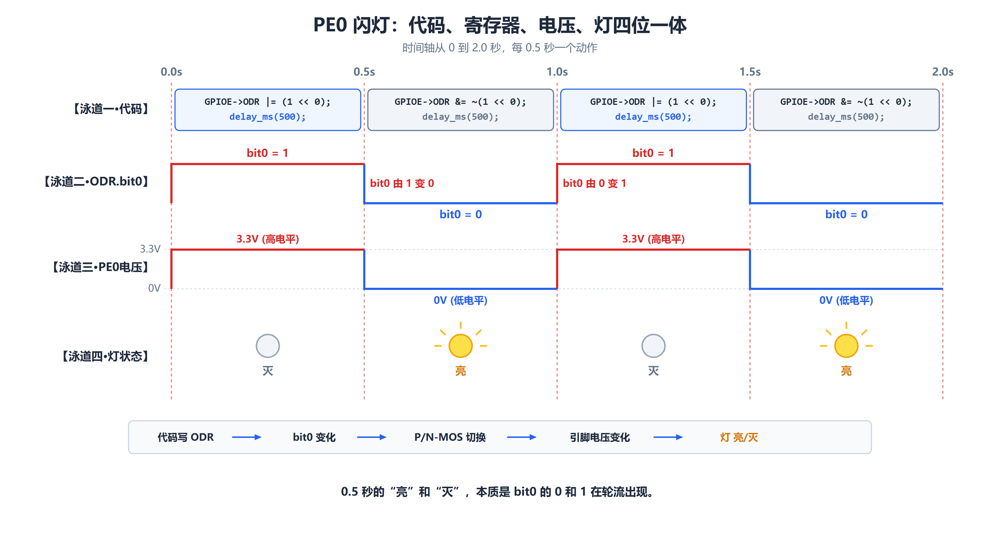

**看图方法**：

1. **最上面一行是时间轴**，单位是秒（0、0.5、1.0、1.5、2.0……）；
2. **第二行是代码动作**：`ODR |= 1<<0`（写高）、`delay_ms(500)`、`ODR &= ~(1<<0)`（写低）、`delay_ms(500)` 循环出现；
3. **第三行是 PE0 的电压波形**：高 0.5 秒 → 低 0.5 秒 → 高 0.5 秒 → ……
4. **第四行是灯的状态**：灭 0.5 秒 → 亮 0.5 秒 → ……

**先发生什么 → 再发生什么 → 为什么：**

```
① 执行 ODR |= (1<<0)     → 寄存器 bit0 变 1 → P-MOS 导通 → 引脚 3.3V  → 灯灭
② CPU 执行延时循环        → 什么都不改变，纯粹耗掉 0.5 秒
③ 执行 ODR &= ~(1<<0)    → 寄存器 bit0 变 0 → N-MOS 导通 → 引脚 0V   → 灯亮
④ CPU 再执行延时循环      → 再耗掉 0.5 秒
⑤ 回到 ① → 无限循环
```

**这张图要让我理解**：

> **"灯闪烁"这个现象，本质是"寄存器里一个 bit 在 0 和 1 之间来回变化"。**
> 代码、寄存器、波形、灯，四位一体，说的是同一件事。

**延时函数：**

```c
void delay_ms(unsigned short int Number)
{
    unsigned int i;
    while(Number--){
        i = 12000;
        while(i--);
    }
}
```

**和例 6-1 的汇编延时是同一个思路**：外层循环 `Number` 次（毫秒），
内层空转 12000 次（想凑出大约 1 毫秒）。
**【补充解释】具体 12000 这个数怎么来的？** 跟主频、编译器优化、每条 C 语句对应的指令数都有关系，
是**试出来/估算**的，不保证精确。

**【补充解释】注意：这里内层是 12000 次，例 6-1 汇编里是 1000 次，为什么都说"1 毫秒"？**

因为两种写法"内层转一圈"的耗时不同——**次数本身说明不了时间**：

| 版本 | 内层转一圈做什么 | 一圈大约几个周期 | 1ms 需要多少圈 |
|---|---|---|---|
| 例 6-1（汇编） | 6 条指令（含 3 个 NOP） | 约 6~8 个 | 教材写 1000 次（**按 72MHz 估算只有约 0.1ms，比 1ms 小一个数量级**） |
| 例 6-2/6-3（C） | `while(i--)` 编译后约 2~3 条指令 | 约 2~3 个 | 12000 次（**量级上接近 1ms**） |

**记住这个算法：延时 ≈ 循环次数 × 一次循环的周期数 ÷ 主频。**
所以"1000 次"和"12000 次"谁都不天然等于 1ms，必须配合主频和指令数一起算。
（例 6-1 那 1000 次与 72MHz 对不上的问题，已在 6.6.2 节分析并列入文末"待核验"。）
要精确延时，还是得靠第 8 章的定时器。

**【待核验】提醒**：MinerU 解析的代码里 `delay_ms` 函数的定义被并入了 `main` 的代码块
（大括号层级看起来是错的），实际工程中它应当是一个**独立的函数**。已列入"待核验"。

**教材对例 6-2 的总结**（p177）：

> "C 语言编程比汇编语言编程相对简单一些，但是，还是需要开发者查阅相关的寄存器定义进行设置。
> 如果使用固件库函数开发，则更加直观。"

### 6.6.4 【教材内容】例 6-3：利用固件库函数访问 GPIO

#### ① 先补一个前置知识：什么是"固件库"？

- 英文全称：**Standard Peripheral Library**（标准外设库，ST 公司为 STM32F1 提供的）
- 中文：**固件库 / 标准外设库**
- 大白话：**ST 公司把"往寄存器里写什么数"这件事提前写好，包装成一堆函数**，
  你只要调用函数名（比如 `GPIO_SetBits`）就行。
- 它是干什么的：让开发者不必背寄存器，把精力放在功能上。

**【类比】三种方式的区别，像"做饭的三种姿势"：**

| 方式 | 类比 | 你要懂什么 |
|---|---|---|
| 汇编 | 自己种菜、生火、掌勺 | 每一步的物理过程 |
| C 直接操作寄存器 | 照着菜谱，自己备料下锅 | 菜谱上的每个数值（寄存器每一位） |
| 固件库 | 买半成品，按按钮 | 按钮上写的字（函数名和参数） |

**类比边界**：用固件库**不是"不懂硬件也能写"**——出了问题时，
你依然要回到寄存器层面去查（比如"为什么灯不亮"最终还是要看时钟、看 CRL）。
所以本章先讲透寄存器，再讲库函数，顺序不能反。

#### ② GPIO 的寄存器结构体：库函数的地基

教材 p178 给出（在 `stm32f10x.h` 中定义）：

```c
typedef struct
{
    vu32 CRL;   // 端口配置低寄存器
    vu32 CRH;   // 端口配置高寄存器
    vu32 IDR;   // 端口输入数据寄存器
    vu32 ODR;   // 端口输出数据寄存器
    vu32 BSRR;  // 端口位设置/复位寄存器
    vu32 BRR;   // 端口位复位寄存器
    vu32 LCKR;  // 端口配置锁定寄存器
} GPIO_TypeDef;
```

**【补充解释】这段代码是本章最需要"看懂"的 C 语言技巧，展开讲。**

**问题**：C 语言里 `GPIOE->ODR` 为什么能访问到 `0x4001180C`？

**答案**：靠两件事——**结构体成员按顺序排列** + **基地址指针**。

```
C 结构体里的成员顺序：         对应的偏移量：
    CRL      ← 第 1 个成员   →   0x00
    CRH      ← 第 2 个成员   →   0x04
    IDR      ← 第 3 个成员   →   0x08
    ODR      ← 第 4 个成员   →   0x0C
    BSRR     ← 第 5 个成员   →   0x10
    BRR      ← 第 6 个成员   →   0x14
    LCKR     ← 第 7 个成员   →   0x18
```

**关键**：每个成员都是 `vu32`（volatile unsigned 32 位，4 字节），
所以相邻成员的地址差正好是 4——**和硬件的偏移量表一模一样**。

**【补充解释】`vu32` 是什么？**

`v` = volatile（防止编译器优化），`u` = unsigned（无符号），`32` = 32 位。
合起来就是"一个不能被优化掉的 32 位无符号整数"。
第 5 章重点讲过 `volatile`：**外设寄存器的值会被硬件悄悄改变，编译器不许自作聪明。**

**【补充解释】为什么一定要"按 32 位字访问"？**
教材 p152 明确："I/O 口寄存器必须按 32 位字访问（不允许半字或字节访问）"。
结构体成员都是 32 位，正好满足这个要求；
如果你硬要用 8 位指针去访问，就是违反硬件要求的行为。

**基地址是怎么定义的**（教材 p178~179）：

```c
#define PERIPH_BASE       ((u32)0x40000000)
#define APB1PERIPH_BASE   PERIPH_BASE
#define APB2PERIPH_BASE   (PERIPH_BASE + 0x10000)
#define AHBPERIPH_BASE    (PERIPH_BASE + 0x20000)
#define AFIO_BASE         (APB2PERIPH_BASE + 0x0000)
#define GPIOA_BASE        (APB2PERIPH_BASE + 0x0800)
#define GPIOB_BASE        (APB2PERIPH_BASE + 0x0C00)
#define GPIOC_BASE        (APB2PERIPH_BASE + 0x1000)
#define GPIOD_BASE        (APB2PERIPH_BASE + 0x1400)
#define GPIOE_BASE        (APB2PERIPH_BASE + 0x1800)
```

**算一遍 GPIOE_BASE：**

```
0x4000 0000（PERIPH_BASE）
+ 0x0001 0000（得到 APB2PERIPH_BASE）
= 0x4001 0000
+ 0x0000 1800（GPIOE 相对 APB2 的偏移）
= 0x4001 1800 ✓（与教材 p157 的 PE 首地址一致）
```

**再看 `GPIOE->ODR` 怎么落到绝对地址：**

```
GPIOE 这个指针的值     = 0x4001 1800
->ODR 的偏移           = 0x0C
──────────────────────────────
实际访问的地址          = 0x4001 180C
```

**【教材内容】教材还给出 AFIO 的结构体**（p178）：

```c
typedef struct
{
    vu32 EVCR;       // 事件控制寄存器
    vu32 MAPR;       // 复用重映射和调试 I/O 配置寄存器
    vu32 EXTICR[4];  // 外部中断线路 0~15 配置寄存器
} AFIO_TypeDef;
```

> "其中，AFIO 与 GPIO 的中断和事件有关，详细内容请参考第 7 章。"

#### ③ GPIO 库函数清单（教材 p179）

| 函数 | 作用 | 一句话记法 |
|---|---|---|
| `GPIO_DeInit` | 把 GPIOx 寄存器恢复默认值 | "恢复出厂" |
| `GPIO_AFIODeInit` | 复位复用功能相关设置 | "复位换线员" |
| **`GPIO_Init`** | **按结构体参数初始化引脚** | ★ 最常用 |
| `GPIO_StructInit` | 把初始化结构体填成默认值 | 先给个模板 |
| `GPIO_ReadInputDataBit` | 读**某一根**引脚的输入 | 读 IDR 的一位 |
| `GPIO_ReadInputData` | 读**整个端口**的输入 | 读整个 IDR |
| `GPIO_ReadOutputDataBit` | 读某一根引脚的输出 | 读 ODR 的一位 |
| `GPIO_ReadOutputData` | 读整个端口的输出 | 读整个 ODR |
| **`GPIO_SetBits`** | 置位（输出高） | 写 BSRR 低 16 位 |
| **`GPIO_ResetBits`** | 复位（输出低） | 写 BRR |
| `GPIO_WriteBit` | 按参数置位或复位 | 二合一 |
| `GPIO_Write` | 写整个端口 | 写 ODR |
| `GPIO_PinLockConfig` | 锁定引脚配置 | 动 LCKR |
| `GPIO_EventConfig` | 引脚用作事件输出 | 第 7 章 |
| `GPIO_EventOutputCmd` | 使能/除能事件输出 | 第 7 章 |
| `GPIO_PinRemapConfig` | 复用功能重映射 | 第 7 章 |
| `GPIO_EXTILINEConfig` | 选 GPIO 作外部中断线 | 第 7 章 |

**核心只有 5 个**：`GPIO_Init`、`GPIO_SetBits`、`GPIO_ResetBits`、`GPIO_ReadInputDataBit`、`GPIO_Write`。

#### ④ 关键函数逐个说明

**函数 1：`GPIO_Init`**

```c
void GPIO_Init(GPIO_TypeDef * GPIOx, GPIO_InitTypeDef * GPIO_InitStruct);
```

- **它做什么**：根据结构体里填好的参数，去写 GPIOx 的 CRL/CRH（必要时也写 ODR）。
- **参数 1**：`GPIOx`，x 可以是 A、B、C、D 或 E，选哪个端口。
- **参数 2**：`GPIO_InitStruct`，一个结构体指针，装着三个信息：

```c
typedef struct
{
    u16 GPIO_Pin;                  // 哪一根（或哪几根）引脚
    GPIOSpeed_TypeDef GPIO_Speed;  // 速度
    GPIOMode_TypeDef GPIO_Mode;    // 模式
} GPIO_InitTypeDef;
```

**三个成员能取什么值（教材表 6-2、6-3、6-4）：**

*(1) GPIO_Pin：选引脚*

| 取值 | 含义 | 取值 | 含义 |
|---|---|---|---|
| `GPIO_Pin_None` | 无引脚被选中 | `GPIO_Pin_8` | 选中引脚 8 |
| `GPIO_Pin_0` | 选中引脚 0 | `GPIO_Pin_9` | 选中引脚 9 |
| `GPIO_Pin_1` | 选中引脚 1 | `GPIO_Pin_10` | 选中引脚 10 |
| `GPIO_Pin_2` | 选中引脚 2 | `GPIO_Pin_11` | 选中引脚 11 |
| `GPIO_Pin_3` | 选中引脚 3 | `GPIO_Pin_12` | 选中引脚 12 |
| `GPIO_Pin_4` | 选中引脚 4 | `GPIO_Pin_13` | 选中引脚 13 |
| `GPIO_Pin_5` | 选中引脚 5 | `GPIO_Pin_14` | 选中引脚 14 |
| `GPIO_Pin_6` | 选中引脚 6 | `GPIO_Pin_15` | 选中引脚 15 |
| `GPIO_Pin_7` | 选中引脚 7 | `GPIO_Pin_All` | 选中全部引脚 |

**用 `|` 可以一次选多个**（教材 p180）：

```c
GPIO_InitStructure.GPIO_Pin = GPIO_Pin_0 | GPIO_Pin_1;   /* 同时选 PE0、PE1 */
```

**【补充解释】为什么可以"或"？**

因为这些宏都是**位掩码**：

```
GPIO_Pin_0 = 0x0001 = 0000 0000 0000 0001
GPIO_Pin_1 = 0x0002 = 0000 0000 0000 0010
   OR 后   = 0x0003 = 0000 0000 0000 0011   ← bit0、bit1 同时为 1 = 选中两个引脚
```

*(2) GPIO_Speed：选速度（教材表 6-3）*

| 取值 | 含义 |
|---|---|
| `GPIO_Speed_10MHz` | 最高输出速率 10MHz |
| `GPIO_Speed_2MHz` | 最高输出速率 2MHz |
| `GPIO_Speed_50MHz` | 最高输出速率 50MHz |

*(3) GPIO_Mode：选 8 种模式之一（教材表 6-4）*

| 取值 | 模式 | 取值 | 模式 |
|---|---|---|---|
| `GPIO_Mode_AIN` | 模拟输入 | `GPIO_Mode_Out_OD` | 开漏输出 |
| `GPIO_Mode_IN_FLOATING` | 浮空输入 | `GPIO_Mode_Out_PP` | 推挽输出 |
| `GPIO_Mode_IPD` | 下拉输入 | `GPIO_Mode_AF_OD` | 复用开漏输出 |
| `GPIO_Mode_IPU` | 上拉输入 | `GPIO_Mode_AF_PP` | 复用推挽输出 |

**【补充解释】这几个名字非常好记**：

```
IPU = Input Pull-Up     上拉输入
IPD = Input Pull-Down   下拉输入
IN_FLOATING = 浮空输入
AIN = Analog In         模拟输入
Out_PP = Output Push-Pull   推挽输出
Out_OD = Output Open-Drain  开漏输出
AF_PP  = Alternate Function Push-Pull   复用推挽
AF_OD  = Alternate Function Open-Drain  复用开漏
```

**教材示例**（p180，把 PE0 配成推挽输出、50MHz）：

```c
GPIO_InitTypeDef GPIO_InitStructure;
GPIO_InitStructure.GPIO_Pin = GPIO_Pin_0;
GPIO_InitStructure.GPIO_Speed = GPIO_Speed_50MHz;
GPIO_InitStructure.GPIO_Mode = GPIO_Mode_Out_PP;
GPIO_Init(GPIOE, &GPIO_InitStructure);
```

**【补充解释】`GPIO_Init` 内部其实就是在写 CRL/CRH**：
把你的 `GPIO_Pin`、`GPIO_Speed`、`GPIO_Mode` 翻译成 4 位编码，
再"先清后置"地填进对应的 CRL/CRH 片段。
**你现在回头看这一段，应该能想象出它的内部动作**——这正是"先懂寄存器、再看库函数"的价值。

**函数 2：`GPIO_SetBits`——置位**

```c
void GPIO_SetBits(GPIO_TypeDef * GPIOx, u16 GPIO_Pin);
```

**它做什么**：把指定引脚输出高电平。
**内部动作**：`GPIOx->BSRR = GPIO_Pin;`

教材例子（p181）：

```c
GPIO_SetBits(GPIOE, GPIO_Pin_0 | GPIO_Pin_1);   /* PE0、PE1 同时输出高 */
```

**函数 3：`GPIO_ResetBits`——复位**

```c
void GPIO_ResetBits(GPIO_TypeDef * GPIOx, u16 GPIO_Pin);
```

**它做什么**：把指定引脚输出低电平。
**内部动作**：`GPIOx->BRR = GPIO_Pin;`（第 5 章讲过这一点）

教材例子：

```c
GPIO_ResetBits(GPIOE, GPIO_Pin_0);   /* PE0 输出低 */
```

**函数 4：`GPIO_WriteBit`——一个函数干两件事**

```c
void GPIO_WriteBit(GPIO_TypeDef * GPIOx, u16 GPIO_Pin, BitAction BitVal);
```

| 参数 3 取值 | 效果 |
|---|---|
| `Bit_RESET` | 把引脚置为低电平 |
| `Bit_SET` | 把引脚置为高电平 |

教材例子：

```c
GPIO_WriteBit(GPIOE, GPIO_Pin_8, Bit_SET);   /* 把 PE8 置高 */
```

**函数 5：`GPIO_Write`——写整个端口**

```c
void GPIO_Write(GPIO_TypeDef * GPIOx, u16 PortVal);
```

**它做什么**：一次写 16 位，等于直接写 ODR。
教材例子：

```c
GPIO_Write(GPIOE, 0x1101);   /* 一次设定 PE0~PE15 的输出 */
```

**位运算展开（0x1101 表示哪几根引脚输出高）：**

```
0x1101 = 0001 0001 0000 0001
         │    │        │
       bit12 bit8     bit0
     → PE12、PE8、PE0 输出高，其余输出低
```

**【补充解释】这个函数危险在哪？** 它会**覆盖整个端口**，
如果你只想改一根引脚，却用了 `GPIO_Write`，其他 15 根就被顺手改掉了。
所以**"改一根"要用 `GPIO_SetBits`/`GPIO_ResetBits`/`GPIO_WriteBit`**。

**函数 6~9：四个"读"函数**

| 函数 | 读什么 | 对应寄存器 | 返回值 |
|---|---|---|---|
| `GPIO_ReadInputDataBit(GPIOx, Pin)` | 某一根引脚的**输入** | IDR | 0 或 1 |
| `GPIO_ReadInputData(GPIOx)` | 整个端口的**输入** | IDR | 16 位 |
| `GPIO_ReadOutputDataBit(GPIOx, Pin)` | 某一根引脚的**输出** | ODR | 0 或 1 |
| `GPIO_ReadOutputData(GPIOx)` | 整个端口的**输出** | ODR | 16 位 |

教材例子：

```c
u8 ReadValue;
ReadValue = GPIO_ReadInputDataBit(GPIOA, GPIO_Pin_0);   /* 读 PA0 */
u16 ReadValue2;
ReadValue2 = GPIO_ReadInputData(GPIOA);                 /* 读整个 PA 口 */
```

**【补充解释】"读输入"和"读输出"到底有什么区别？**

- **读输入**（IDR）：读的是**引脚上真实的电平**（外面给的）；
- **读输出**（ODR）：读的是**你上次写进去的值**（你想让它输出的）。
  推挽模式下两者基本一致，但**开漏模式下可能差很多**（6.3.1 功能 8 讲过）。

**函数 10：`GPIO_PinLockConfig`——锁定配置**

```c
void GPIO_PinLockConfig(GPIO_TypeDef * GPIOx, u16 GPIO_Pin);
```

教材例子：

```c
GPIO_PinLockConfig(GPIOA, GPIO_Pin_0);   /* 锁定 PA0 的配置 */
```

#### ⑤ 例 6-3 完整程序与逐行解释

教材 p184 的代码：

```c
#include "stm32f10x.h"    // 包含 STM32F1 系列微控制器的头文件
void delay_ms(unsigned short int Number);    // 延时子函数

int main(void)
{
    GPIO_InitTypeDef GPIO_InitStructure;    // 声明用于 GPIO 初始化的结构体
    RCC_APB2PeriphClockCmd(RCC_APB2Periph_GPIOE, ENABLE);    // 使能 PE 口时钟

    GPIO_InitStructure.GPIO_Pin = GPIO_Pin_0;             // 对 PE0 引脚进行设置
    GPIO_InitStructure.GPIO_Mode = GPIO_Mode_Out_PP;      // 选择推挽输出模式
    GPIO_InitStructure.GPIO_Speed = GPIO_Speed_50MHz;     // 频率最高为 50MHz
    GPIO_Init(GPIOE, &GPIO_InitStructure);                // 对引脚进行配置

    while(1)
    {
        GPIO_SetBits(GPIOE, GPIO_Pin_0);      // 输出高电平
        delay_ms(500);
        GPIO_ResetBits(GPIOE, GPIO_Pin_0);    // 输出低电平
        delay_ms(500);
    }
}

void delay_ms(unsigned short int Number)
{
    unsigned int i;
    while(Number--){
        i = 12000;
        while(i--);
    }
}
```

**逐块拆解：**

| 代码块 | 想完成什么 | 背后发生了什么 |
|---|---|---|
| `GPIO_InitTypeDef GPIO_InitStructure;` | 准备一个"配置单" | 在 SRAM 里开出一块空间（3 个成员） |
| `RCC_APB2PeriphClockCmd(RCC_APB2Periph_GPIOE, ENABLE);` | 开 GPIOE 时钟 | 函数内部把 `0x40` 或进 `RCC->APB2ENR`（bit6） |
| 三行 `GPIO_InitStructure.xxx = ...` | 在配置单上填三格 | 只是给结构体成员赋值，**还没碰硬件** |
| `GPIO_Init(GPIOE, &GPIO_InitStructure);` | **真正写寄存器** | 把"PE0、推挽、50MHz"翻译成 `0x3`，先清后置写进 `GPIOE->CRL` |
| `GPIO_SetBits(GPIOE, GPIO_Pin_0);` | PE0 输出高 | `GPIOE->BSRR = 0x0001` |
| `GPIO_ResetBits(GPIOE, GPIO_Pin_0);` | PE0 输出低 | `GPIOE->BRR = 0x0001` |
| `delay_ms(500);` | 延时 500ms | 软件空转 |

**【补充解释】`&GPIO_InitStructure` 里的 `&` 是什么？**

`&` 是"取地址"。`GPIO_Init` 的第二个参数是**指针**，
所以要传结构体的地址进去，让函数能读到（甚至改写）里面的内容。
第 5 章讲指针时强调过：**指针 = 门牌号**。这里就是"把配置单的门牌号交给函数"。

**教材对固件库方式的总结**（p184）：

> "由上述代码可以看出，使用固件库函数进行外设的应用程序开发，可以让开发者不必记忆和查阅大量的寄存器，
> 主要关注程序的功能设计，编写代码更加符合自然语言习惯，也就更加流畅，可以大大提高开发效率。"

### 6.6.5 三种方式对比

**【辅助理解图】三种编程方式：从"自己接线"到"插模块"**

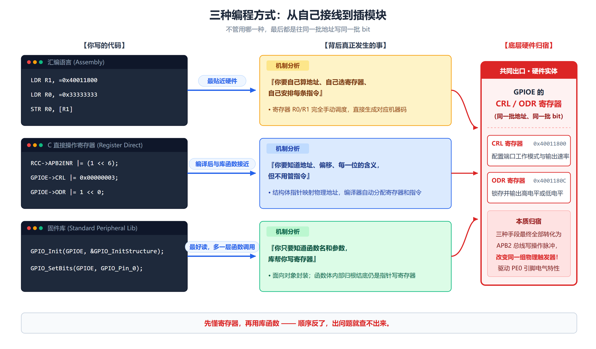

**看图方法**：

1. **图分三层**，从上到下依次是：汇编、C 直接操作寄存器、固件库；
2. **左边一列是"你写的代码"**，右边一列是"它背后真正做的事"；
3. **中间用箭头连起来**，箭头上写"翻译的层数"；
4. **注意三层的箭头最终都指向同一个东西**：GPIOE 的 CRL 和 ODR 寄存器；
5. **最下面一行小字**："不管用哪种方式，最后都是往同一批地址写同一批 bit"。

**三种方式对比表（考试常考）**

| 对比项 | 汇编 | C 直接操作寄存器 | 固件库函数 |
|---|---|---|---|
| 抽象层次 | 最低 | 中 | 最高 |
| 代码量（闪灯） | 最多 | 中 | 最少 |
| 可读性 | 差 | 一般 | 好（函数名即意图） |
| 需要掌握的知识 | 指令 + 地址 + 位 | 地址 + 寄存器位 + C 指针 | 函数名 + 参数 |
| 执行效率 | 最高（可控） | 高（编译后与库相近） | 稍低（多一层函数调用） |
| 出错概率 | 高 | 中 | 低 |
| 移植性 | 差 | 差（换芯片就要重查地址） | 较好（同系列改动小） |
| 适合场景 | 启动代码、中断入口、极精确时序 | 想彻底掌控硬件、库里没有的功能 | 日常开发、快速实现功能 |

**【补充解释】库函数"效率稍低"影响大吗？**

对一个点灯程序来说，完全无所谓。库函数多做的那点判断和运算，
在 72MHz 的 CPU 上也就是几十纳秒。
**只有在极端讲究时序（比如软件模拟高速协议）时，才需要回到寄存器甚至汇编。**
教材的顺序（先汇编 → 再寄存器 → 再库）正是让你"先懂底层，再用高层"——
**所以本章的重点始终是寄存器，库函数只是"帮你写寄存器的助手"。**

**【补充解释】三种方式可以混用吗？**
可以，而且很常见。比如：

```c
GPIO_SetBits(GPIOE, GPIO_Pin_0);      /* 库函数置位 */
GPIOE->BRR = (1 << 1);                /* 直接操作寄存器清 PE1 */
*(volatile uint32_t *)0x4001180C = 0x0004;  /* 直接写绝对地址 */
```

三句话操作的是同一批寄存器，只要逻辑不冲突，混用完全合法。

---

## 6.7 两个完整的小实验

### 6.7.1 输出实验：16 只 LED 流水灯（教材习题 6-3）

**【教材内容】习题 6-3：**
> "分别使用汇编语言、C 语言直接操作寄存器和固件库函数 3 种方法编程，
> 实现最小系统板上连接 PE 口 16 只发光二极管的流水灯控制（轮流点亮）。"

#### ① 硬件前提：图 3-13 的 16 只灯


**再看这张图一次，这次数一数**：`LED0`~`LED15` 一共 16 只，
分别接在 PE0~PE15 上，另一端经限流电阻接 +3.3V。

**所以"流水"的目标是**：**让 PE0~PE15 依次轮流输出低电平**，
同一时刻只有一根是低（只有一只灯亮），看起来就像一滴水在 16 只灯之间流过去。

#### ② 流水灯的关键：一个"会走路的 1"

用固件库的写法，核心思想是：**准备一个 16 位的数 `led`，它只有一个 bit 是 1；
每次左移一位，这个 1 就"走"到下一根引脚。**

```c
#include "stm32f10x.h"
void delay_ms(unsigned short int Number);

int main(void)
{
    unsigned short int led = 0x0001;      /* 当前"选中"的引脚：先选 PE0 */
    GPIO_InitTypeDef GPIO_InitStructure;

    RCC_APB2PeriphClockCmd(RCC_APB2Periph_GPIOE, ENABLE);   /* ① 开时钟 */

    GPIO_InitStructure.GPIO_Pin = GPIO_Pin_All;             /* ② 配模式：全部 16 根 */
    GPIO_InitStructure.GPIO_Mode = GPIO_Mode_Out_PP;        /*    推挽输出 */
    GPIO_InitStructure.GPIO_Speed = GPIO_Speed_50MHz;
    GPIO_Init(GPIOE, &GPIO_InitStructure);

    while(1)                                                /* ③ 循环流水 */
    {
        GPIO_Write(GPIOE, ~led);      /* 选中位写 0（点亮），其余写 1（熄灭） */
        delay_ms(200);
        led <<= 1;                    /* 左移一位：轮到下一根引脚 */
        if (led == 0)
        {
            led = 0x0001;             /* 移出第 16 位以后，回到 PE0 */
        }
    }
}
```

**逐块解释：**

| 代码 | 想完成什么 | 硬件发生什么 |
|---|---|---|
| `led = 0x0001` | "选中 PE0" | 无（还只是变量） |
| `RCC_APB2PeriphClockCmd(...)` | 开 GPIOE 时钟 | APB2ENR 的 bit6 = 1 |
| `GPIO_Init(..., GPIO_Pin_All, ...)` | 把 PE0~PE15 全配成推挽输出 | CRL 和 CRH 各 8 组都变成 `0011` |
| `GPIO_Write(GPIOE, ~led)` | 把"反码"写进 ODR | 只有 `led` 里那一位是 0，对应引脚输出低 → **该灯亮** |
| `led <<= 1` | 让 1 往高位走 | 无（变量运算） |
| `if (led == 0) led = 0x0001;` | 走完 16 位后回到起点 | 无 |

**【补充解释】`~led` 是什么？为什么要取反？**

因为 LED 是**低电平点亮**（图 3-13 的接法决定的）。

```
假设 led = 0x0001（选中 PE0）：
   led  = 0000 0000 0000 0001
  ~led  = 1111 1111 1111 1110
          ↑                  ↑
         PE1~PE15 写 1        PE0 写 0
       → 15 只灯灭            → PE0 的灯亮
```

**如果换成高电平点亮的板子，就不取反，直接写 `led`。**
**结论：灯到底写 0 还是写 1，永远看电路图，不要背。**

**【辅助理解图】流水灯的"1 在走路"**

```
第 1 步   0000 0000 0000 0001   → 只有 PE0 亮
第 2 步   0000 0000 0000 0010   → 只有 PE1 亮
第 3 步   0000 0000 0000 0100   → 只有 PE2 亮
   …
第 16 步  1000 0000 0000 0000   → 只有 PE15 亮
第 17 步  0000 0000 0000 0000   → 1 被移出去了 → 复位回 0x0001，重新开始
```

**位运算展开（第 1 步 → 第 2 步的移位）：**

```
运算前 led： 0x0001 = 0000 0000 0000 0001
左移 1 位：   0x0002 = 0000 0000 0000 0010   ← 最低位后面补 0，最高位移出丢弃
```

**【补充解释】用"移位"实现的流水灯，还有别的写法吗？**
有。可以用查表法（把 16 个值放在数组里轮流取）、可以正反来回流（加一个方向变量）、
也可以两两亮、渐亮渐灭（用 PWM，第 8 章）……但**核心动作都一样：改 ODR 里哪一位是 0。**

**用寄存器直接写版本，关键三行是：**

```c
RCC->APB2ENR |= (1 << 6);        /* 开 GPIOE 时钟 */

GPIOE->CRL = 0x33333333;         /* PE0~PE7：每组 4 位 = 0011（推挽、50MHz） */
GPIOE->CRH = 0x33333333;         /* PE8~PE15：同上 */

GPIOE->ODR = ~led;               /* 直接写整个端口 */
```

**验证 `0x33333333` 的每一组：**

```
0x3 = 0011 → CNF=00（通用推挽）、MODE=11（输出、50MHz）✓
0x33333333 拆成 8 组 0011 → PE0~PE7 全部推挽 50MHz ✓
```

**【补充解释】为什么这里可以直接 `GPIOE->CRL = 0x33333333;` 而不用"先清后置"？**
因为**我们本来就要把 8 根引脚全部设成同一个模式**，不存在"要保护其他位"的问题。
**"什么时候用 `=`，什么时候用 `&=`+`|=`，取决于你要不要保留其他位的原值。**

**用汇编怎么写？** 思路完全一样，只是把每条 C 语句换成几条指令：

```asm
    LDR R1, = 0x40011800      ; GPIOE_CRL 的地址
    LDR R0, = 0x33333333      ; 8 组"推挽 50MHz"
    STR R0, [R1]              ; 写 CRL

    LDR R1, = 0x40011804      ; GPIOE_CRH
    STR R0, [R1]              ; 写 CRH（CRL/CRH 结构相同，可以复用同一个值）

    LDR R1, = 0x4001180C      ; GPIOE_ODR
    MVN R0, R2                ; R0 = ~R2（把 1 取反成掩码）
    STR R0, [R1]              ; 写 ODR
    ; 再配合移位（LSL）和延时循环，就是完整的流水灯
```

### 6.7.2 输入实验：按键控制 LED（教材习题 6-4）

**【教材内容】习题 6-4：**
> "编程实现连接 PA0 口位上的独立按键的状态读入，并使用连接 PE0 的发光二极管显示按键的状态。"

#### ① 硬件前提：图 3-11 独立按键电路

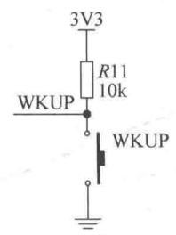

**看图方法（这张图很小，但每一笔都是信息）：**

1. **先看最上面**：`3V3` 是电源，往下串了一只电阻 **R11（10k）**——这是一只**外部上拉电阻**；
2. **看中间那根横线的网络名**：它标的是 **`WKUP`**，**不是"PA0"**。
   `WKUP` 是 STM32 的"唤醒"功能名，在最小系统板上它对应的引脚就是 **PA0**
   ——教材习题 6-4 说的"连接 PA0 的独立按键"就是它。
   **【补充解释】** 读原理图要养成一个习惯：**先认网络名，再回引脚表确认它接到哪根引脚**。
   图上写 `WKUP` 不等于"图上没有 PA0"，只是画图的人用了另一个名字；
3. **看下面那个按键**：一端接 `WKUP` 网络，另一端直接接**地（GND）**。
   所以：**按下 → 引脚被按键拉到 0V；松开 → 被 R11 拉回 3.3V**；
4. **看有没有电容**：这张图里**没有**电容——所以消抖只能靠软件做（就是本节程序里的 `delay_ms(20)`）；
5. **结论：这块板子上该配哪种输入模式？**
   - 板上**已经有 10k 外部上拉**，松开时电平被它拉高、按下时被按键强拉低，外部电路本身是完整的；
   - 本节仍按教材/固件库的习惯配成**上拉输入（`GPIO_Mode_IPU`）**：内部弱上拉和外部 10k 上拉
     **都往高电平拉，互不冲突**（相当于两只电阻并联），而且换一块没有外部上拉的板子也照样能用；
   - **绝对不能配成下拉输入**：那等于"内部往下拽、外部往上拽"，两边打架，
     松手时引脚会停在一个不上不下的电压上，读数就不可靠了。

> **一句话**：先看图上有没有上拉电阻、按键另一端接地还是接电源，再决定用哪种输入模式。
> 这块板子：**按键接地 + 已有 10k 外部上拉 → 用上拉输入（或浮空输入）都行，用下拉就错了**。

**【补充解释】按键为什么要"消抖"？**

机械按键的触点在闭合和断开的瞬间，**不是干净的一步到位**，而是会"弹跳"几下：

```
理想情况：  高 ────────┐
                       └──────── 低（一次干净的下跳）

真实情况：  高 ────┐ ┌─┐ ┌───────
                  └─┘ └─┘
                  ↑ 抖动持续约 5~20ms（宏观上人按一下）
```

如果程序不加处理，一次按下可能被读成"按了又松、按了又松"好几次。
解决办法有两种：

| 方法 | 做法 | 特点 |
|---|---|---|
| **软件消抖** | 检测到变化后，延时 10~20ms 再读一次；两次都是低才算真的按下 | 简单，本章用这种 |
| 硬件消抖 | 引脚并一个电容 + 施密特触发器 | 占用电路板空间和成本 |

#### ② 完整程序（固件库版本）

```c
#include "stm32f10x.h"
void delay_ms(unsigned short int Number);

int main(void)
{
    GPIO_InitTypeDef GPIO_InitStructure;

    /* ① 开时钟：PA 和 PE 两个端口都要用 */
    RCC_APB2PeriphClockCmd(RCC_APB2Periph_GPIOA | RCC_APB2Periph_GPIOE, ENABLE);

    /* ② 配模式：PE0 推挽输出，驱动 LED */
    GPIO_InitStructure.GPIO_Pin = GPIO_Pin_0;
    GPIO_InitStructure.GPIO_Mode = GPIO_Mode_Out_PP;
    GPIO_InitStructure.GPIO_Speed = GPIO_Speed_50MHz;
    GPIO_Init(GPIOE, &GPIO_InitStructure);

    /* ② 配模式：PA0 上拉输入，接按键 */
    GPIO_InitStructure.GPIO_Pin = GPIO_Pin_0;
    GPIO_InitStructure.GPIO_Mode = GPIO_Mode_IPU;   /* 上拉输入 */
    GPIO_Init(GPIOA, &GPIO_InitStructure);

    /* ③ 循环读按键、控制灯 */
    while(1)
    {
        if (GPIO_ReadInputDataBit(GPIOA, GPIO_Pin_0) == Bit_RESET)  /* 0 = 按下 */
        {
            delay_ms(20);                                          /* 消抖 */
            if (GPIO_ReadInputDataBit(GPIOA, GPIO_Pin_0) == Bit_RESET)
            {
                GPIO_ResetBits(GPIOE, GPIO_Pin_0);   /* PE0 输出低 → 灯亮 */
            }
        }
        else
        {
            GPIO_SetBits(GPIOE, GPIO_Pin_0);         /* PE0 输出高 → 灯灭 */
        }
    }
}
```

**【补充解释】"开时钟"那一行用了 `|`：**

```c
RCC_APB2PeriphClockCmd(RCC_APB2Periph_GPIOA | RCC_APB2Periph_GPIOE, ENABLE);
```

**展开：**

```
RCC_APB2Periph_GPIOA = 0x00000004 = 0000 0000 0000 0000 0000 0000 0000 0100
RCC_APB2Periph_GPIOE = 0x00000040 = 0000 0000 0000 0000 0000 0000 0100 0000
           按位或 = 0x00000044 = 0000 0000 0000 0000 0000 0000 0100 0100
                                  ↑
                           bit2 和 bit6 同时置 1
                    → GPIOA 和 GPIOE 的时钟一起打开
```

#### ③ 程序流程图（含消抖）

**【辅助理解图】按键控制 LED 的流程**

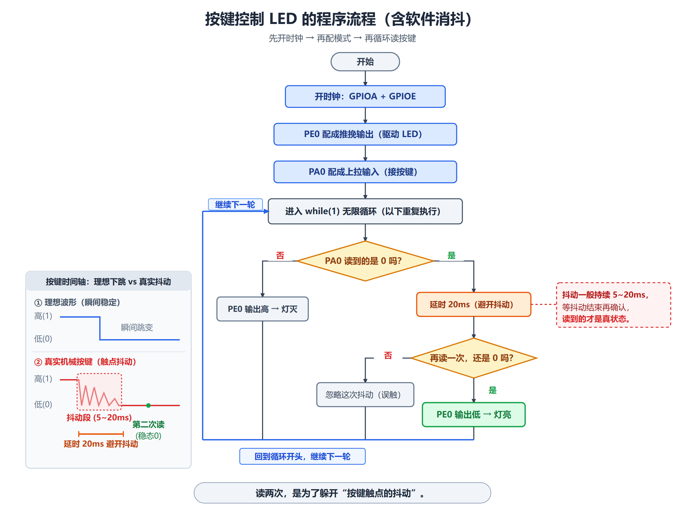

**看图方法：**

1. **从最上面的"开始"往下走**：初始化（开时钟 → 配 PE0 输出 → 配 PA0 上拉输入）；
2. **进入循环后遇到判断框**："PA0 读到的是 0 吗？"
   - 是（按键可能按下）→ 右侧分支：**延时 20ms 再读一次**；
     - 还是 0 → 确认按下 → 点亮 LED；
     - 变成 1 → 是抖动，忽略；
   - 否（按键没按）→ 左侧分支：熄灭 LED；
3. **两条路最后都回到循环开头**，不断重复；
4. **图右下角特别标出"为什么读两次"**：第一次可能是抖动，第二次才是真状态。

**先发生什么 → 再发生什么 → 为什么（一次完整按键的时间轴）：**

```
① 手指按下
② 触点抖动（5~20ms）：PA0 电平在 0/1 之间乱跳
   └─ 程序第一次读到 0（可能只是抖动）
③ delay_ms(20)：避开抖动期  ← 先做这一步
④ 再读一次：
      还是 0 → 真的按下了  → 点灯
      变回 1 → 刚才是抖动  → 忽略
⑤ 手指松开：PA0 被内部弱上拉（配合板上 10k 外部上拉）拉回 1 → 灯灭
```

**为什么非要延时 20ms 不可？**
因为**抖动期最长约 20ms**，等抖动结束再确认，才能保证读到的是稳定状态。
20ms 是经验值（教材实验里常用 10~20ms）。

#### ④ 用"直接操作寄存器"的等价写法（对照理解）

```c
/* 开时钟 */
RCC->APB2ENR |= (1 << 2) | (1 << 6);        /* GPIOA、GPIOE */

/* PE0：推挽输出、50MHz */
GPIOE->CRL &= 0xFFFFFFF0;
GPIOE->CRL |= 0x00000003;

/* PA0：上拉输入（CNF=10, MODE=00 → 0x8），并且 ODR 的 bit0 写 1 选上拉 */
GPIOA->CRL &= 0xFFFFFFF0;
GPIOA->CRL |= 0x00000008;
GPIOA->ODR |= (1 << 0);                     /* ★ 这一位决定"上拉"还是"下拉" */

/* 读按键 */
if ((GPIOA->IDR & (1 << 0)) == 0)           /* PA0 是低电平 */
{
    /* 按下 */
}
```

**【补充解释】注意上面那行 `GPIOA->ODR |= (1 << 0);`——**
**输入模式下 ODR 不是输出值，而是"上拉/下拉选择开关"**（6.3.5 节强调过）。
忘了这一行，PA0 就成了**下拉输入**：内部往下拽，和板上的 10k 外部上拉"打架"，
松手时引脚被两个电阻分压在一个不上不下的电压上，读数就不可靠了
（这是很多"按键没反应 / 灯乱闪"案例的根源）。
所以配输入时，一定要把"上拉还是下拉"这一位写清楚，**别让它停在默认的 0（= 下拉）**。

---

## 6.8 容易搞混的地方（集中排查）

前面各节已经零散提醒过一些，这里集中列一遍。**这些几乎都是初学者实际会踩的坑。**

### 混淆 1：GPIOA 的基地址是 0x40010800 还是 0x40010000？

- `0x4001 0000` 是 **APB2 外设区**的起点（AFIO 在 `0x4001 0000`）；
- **GPIOA 自己的基地址是 `0x4001 0800`**；GPIOB 是 `0x4001 0C00`——
  每个端口占 1KB（`0x400`），依次向上排。

**记忆法**：AFIO、EXTI 各占 1KB 后，才轮到 GPIOA："先 A（AFIO）后 GPIO"。

### 混淆 2：端口 x 和引脚 y 的记号顺序

```
GPIOE_CRL  →  E 是端口，CRL 是寄存器
PE0        →  P 是引脚，E 是端口，0 是位号
GPIO_Pin_0 →  固件库里表示"第 0 位"的宏
```

**【补充解释】教材里还可能出现 `PxODR` 的写法**（表 6-1 就有），
其中 x 是端口名，整个词读作"端口 x 的 ODR 寄存器"。
看到 `Px` 不要以为是"某个引脚"，要看上下文。

### 混淆 3：CRL 管谁、CRH 管谁

```
CRL（Low，低） → 管 bit0~bit7（低 8 位）
CRH（High，高）→ 管 bit8~bit15（高 8 位）

口诀：低配低，高配高。
```

**最容易犯的错**：想配 PE13，却去改了 CRL；或者想配 PE8，却按"8×4=32"去改 CRH 的最高 4 位。
正确算法见 6.4.4 节的位置公式。

### 混淆 4：为什么我的灯"高电平亮"，教材说"低电平亮"？

因为**灯是怎么接的，决定了它什么时候亮**：

```
接法 A（灌电流）：电源 → 电阻 → LED → 引脚     引脚输出 0 才亮
接法 B（拉电流）：引脚 → 电阻 → LED → 地       引脚输出 1 才亮
```

**永远先看电路图**（或者自己用万用表/仿真试一次），不要背结论。

### 混淆 5：我配了开漏输出、写了 1，为什么量不到高电平？

**因为开漏写 1 只是"撒手"（高阻），高电平必须由外部上拉电阻提供。**
如果电路上没接上拉电阻，引脚就"飘"着——万用表可能测到零点几伏到一两伏的乱值。
**开漏三件套：开漏模式 + 外部上拉电阻 + 记住读 IDR 而不是读 ODR。**

### 混淆 6：输入模式和输出模式下，ODR 的含义一样吗？

**不一样！**

| 模式 | ODR 的作用 |
|---|---|
| 通用输出 | **输出值**：写 1 输出高、写 0 输出低 |
| 输入 | **上拉/下拉选择**：写 1 选上拉、写 0 选下拉（仅当 CNF=10 时） |
| 复用输出 | **不使用**（引脚由外设驱动） |

### 混淆 7：复位后引脚是什么状态？

**浮空输入**（`0x4444 4444` 每一位都是 `0100`）。
不是低电平、不是高电平、不是输出。
除 PA13/PA14/PA15/PB4（JTAG 相关，复位后带上拉/下拉）外，其余都是浮空。

### 混淆 8：为什么必须先开时钟？

**因为不开时钟，外设的"节拍"就没有，寄存器的值存不住、状态机不转。**
GPIO 的时钟在 `RCC_APB2ENR` 的 bit2~bit6（IOPAEN~IOPEEN）。
**调试口诀**：代码不生效 → 先查时钟 → 再查模式 → 再查输出值。

### 混淆 9：USE 固件库时，`GPIO_Write` 和 `GPIO_SetBits` 能不能混着用？

能，但要注意语义不同：

```
GPIO_Write(GPIOE, 0x0001)   → 整个 ODR = 0x0001（其余位全变 0）
GPIO_SetBits(GPIOE, GPIO_Pin_0) → 只有 bit0 变 1，其余位保持
```

**只想改一根引脚，永远别用 `GPIO_Write`。**

### 混淆 10：位运算里的 `1 << 0`、`~` 和数据类型陷阱

**陷阱一：`1 << 0` 不是"第 1 个引脚"**

```
1 << 0 = bit0（PE0）       ← 计算机从 0 开始数
1 << 1 = bit1（PE1）
1 << 15 = bit15（PE15）
```

**陷阱二：`~(1 << 0)` 在 32 位机上是 `0xFFFFFFFE`，不是 `0xFE`**

```
1        = 0x0000 0001
~(1)     = 0xFFFF FFFE     ← int 是 32 位，取反是 32 位
(uint16_t)~(1) = 0xFFFE    ← 如果你真的要 16 位，要显式转换
```

**陷阱三：该用 `|=` 的地方用了 `=`**

```
GPIOE->ODR |= (1 << 0);    ✓ 只改 bit0
GPIOE->ODR  = (1 << 0);    ✗ 把其他 15 根引脚全部清 0
```

### 混淆 11：BSRR 同时写了 BS 和 BR 会怎样？

**按教材 p159 的注释：BSy 位起作用（置位优先）。**

```
GPIOE->BSRR = 0x00010001;   /* BR0=1 且 BS0=1 */
→ 结果是 PE0 = 1（置位赢）
```

**实际编程不要故意这么写**，这种"同时置位和清除"属于未定义意图，容易埋坑。

### 混淆 12：配了复用输出，为什么我的代码写 ODR 没反应？

因为**复用输出模式下，引脚已经和 ODR 断开，改由片上外设驱动**（教材 p154）。
要验证，先确认外设本身已经使能——教材专门提醒：
"如果软件把一个 GPIO 脚配置成复用输出功能，但是外设没有被激活，那么它的输出将不确定。"

### 混淆 13：锁定（LCKR）之后还能改 ODR 点灯吗？

**能。** 锁定锁的是 **CRL/CRH 里的配置**，不是 ODR 的输出值。
灯该怎么闪还怎么闪，只是"这根引脚是推挽还是开漏"改不了了。

### 混淆 14：为什么我的延时函数不是精确的 0.5 秒？

因为软件延时受主频、编译器优化、流水线、中断影响。
教材例 6-1 的注释都写了"误差……"，例 6-2/6-3 的 `i = 12000` 也是一个**估算值**。
**要精确计时，用第 8 章的定时器。**

---

## 6.9 本章真正要记住什么

### 6.9.1 一张"必须背下来"的清单

**① 一句话理解 GPIO**

> 程序往 GPIO 的寄存器里写 0/1，硬件电路据此改变引脚的工作方式，
> 引脚的电平就变了——这就是"软件控制硬件"。

**② 五个端口、每个 16 位、共 80 根线**

```
PA0~PA15  PB0~PB15  PC0~PC15  PD0~PD15  PE0~PE15
```

**③ 7 个寄存器和它们的偏移**

| 偏移 | 0x00 | 0x04 | 0x08 | 0x0C | 0x10 | 0x14 | 0x18 |
|---|---|---|---|---|---|---|---|
| 寄存器 | CRL | CRH | IDR | ODR | BSRR | BRR | LCKR |
| 用途 | 配 P0~P7 | 配 P8~P15 | 读输入 | 写输出 | 置位/清位 | 清位 | 锁配置 |

**④ 地址链（以 GPIOE 为例）**

```
0x4000 0000（外设区）
 +0x10000 → 0x4001 0000（APB2）
 +0x1800  → 0x4001 1800（GPIOE 基地址）
 +0x0C    → 0x4001 180C（GPIOE_ODR）
```

**⑤ 8 种模式的编码（见 6.3.8 节总表）**

**⑥ 使用三步**

```
① 开时钟（RCC_APB2ENR）
② 配模式（CRL/CRH）
③ 输入/输出（IDR / ODR / BSRR / BRR）
```

**⑦ 软硬件联动链（本章的灵魂，再重复一遍）**

```
代码 → CPU 执行写操作 → 访问某个地址 → 该地址对应 GPIO 控制寄存器
→ 寄存器某几个 bit 变化 → GPIO 硬件电路工作方式改变 → 引脚表现改变
```

### 6.9.2 教材习题的答题思路

**习题 6-1：STM32F103VET6 的 GPIO 有什么功能和特点？**

答题要点（按教材 6.2 节罗列，再补一句"特点"）：

1. 80 根多功能、双向、5V 容忍的快速 I/O 线，每 16 根一组分 PA~PE；
2. 支持普通 I/O 输入输出，每位可独立配置；
3. 支持 8 种工作模式：输入浮空/上拉/下拉/模拟，输出通用推挽/通用开漏/复用推挽/复用开漏；
4. 支持单独的位设置/位清除（BSRR/BRR），可原子操作；
5. 所有端口都有外部中断能力（配成输入后可用）；
6. 支持复用功能（AF）与软件重映射（AFIO）；
7. 支持 GPIO 锁定机制，可冻结关键引脚配置；
8. 复位后默认浮空输入（JTAG 引脚例外）；
9. 寄存器必须按 32 位字访问。

**习题 6-2：如何确定外设某个寄存器的物理地址？**

答题要点：

```
物理地址 = 该外设的基地址（首地址） + 该寄存器的偏移量

例：GPIOA_ODR
  查表：GPIOA 基地址 = 0x4001 0800
  查表：ODR 偏移量 = 0x0C
  相加：0x4001 0800 + 0x0C = 0x4001 080C
```

**习题 6-3（流水灯）**：见 6.7.1 节，三种写法的骨架都已给出。

**习题 6-4（按键控制灯）**：见 6.7.2 节，注意四点：
① 开 PA 和 PE 两个时钟；② PE0 推挽输出；③ PA0 上拉输入（记得 ODR 选上拉）；
④ 读 IDR 判断，加软件消抖。

### 6.9.3 与前后章节的联系

| 本章知识 | 后面哪里还会用 |
|---|---|
| 时钟使能（RCC_APB2ENR） | 每一章用外设前都要做（第 7~12 章） |
| CRL/CRH 配置 4 位一组 | 所有 GPIO 相关外设都要先配引脚 |
| 复用功能概念 | 第 7 章 EXTI、第 9 章 USART/SPI、第 10 章 ADC |
| IDR 采样 + 外部中断 | 第 7 章"端口必须配成输入才能用中断" |
| 推挽/开漏 | 第 9 章 I²C（必须开漏 + 上拉） |
| 模拟输入 = 关掉数字电路 | 第 10 章 ADC 采集必须配 `GPIO_Mode_AIN` |
| BSRR/BRR 原子操作 | 第 8 章 PWM 之外的一般开关量输出 |

---

## 待核验

以下是本讲义编写过程中发现的**可疑处、OCR 缺失或与教材表述不一致的地方**，
按 AGENTS.md 要求列出，供回原始 PDF 核验。**正文中凡涉及这些点的地方，均已按"教材表 6-1 + ST 参考手册"给出合理解释，但正式定稿前应核对原书。**

| 序号 | 位置 | 问题描述 | 本讲义的处理 |
|---|---|---|---|
| 1 | 教材 p157（6.3 节 1） | MinerU 解析 GPIOx_CRL 的 CNF 说明时**丢失了输出模式的两行**（"输出模式（MODE[1:0]>00）：00 通用推挽、01 通用开漏"），原文只剩一个公式占位 `( MODE[1:0] > 00 )` | 按表 6-1（解析完整）和 ST 参考手册补全为 00 通用推挽 / 01 通用开漏 / 10 复用推挽 / 11 复用开漏；已在 6.3.5 节标注 |
| 2 | 教材 p158 表 6-1 | "复用功能输出"两行的 MODE 列在解析结果中与"通用输出"共用同一个合并单元格（写"01:10MHz / 10:2MHz / 11:50MHz"），无法从表格判断复用输出是否也需要 MODE≠00 | 按 ST 参考手册：复用输出同样需要 MODE≠00 来选择速度；表 6-1 该单元格是跨行合并。为避免主表本身被误读，讲义 6.3.5 节的复刻表把三档速度在**四个输出行里逐一写出**，并在表下加了"复用输出同样必须配速度"的结论 |
| 3 | 教材 p160 | 标题"6. 端口位清除寄存器(GPIOxBRR)"中寄存器名缺下划线，应为 **GPIOx_BRR**（同页正文与表内均写 BRR） | 讲义统一写作 `GPIOx_BRR`，并注明 |
| 4 | 教材 p162 RCC_CFGR | 解析结果中出现孤立的 `0xxx: SYSCLK 不分频；`，位置在 MCO 与 SW 的说明之间；按 ST 参考手册，`0xxx` 属于 **HPRE[3:0]（AHB 不分频）**，与 SW 无关 | 讲义按位图把 `0xxx` 归入 HPRE；已在 6.5.5 节标注 |
| 5 | 教材 p164 RCC_CIR 位 3 | 位名为 **HSERDYF**（HSE = 外部**高速**时钟），但说明文字写作"在**外部低速时钟**就绪且 HSERDYIE 位被置 1 时"；位 1 的 LSERDYF 才是"外部低速" | 按位名理解应为"外部高速（4~16MHz）振荡器"；需核 PDF 确认是教材笔误还是 OCR 错 |
| 6 | 教材 p164 RCC_CIR 表 | 位 18 在表格中印作 "HIS RDYC"（字母顺序颠倒），正文写 **HSIRDYC** | 讲义统一写作 `HSIRDYC` |
| 7 | 教材 p161 图 6-6 | MinerU 只提取了图片，**图内文字未做结构化解析**，流程图的具体框、判断分支无法从素材确认 | 讲义按教材正文"先倍频、再由内向外分频 + 时钟源/总线/外设三层"的原则解图；图片文字需人工核 |
| 8 | 教材 p159 | "GPIOx_BSRR 和 GPIOx_BRR 寄存器允许对**任何 GPIO 寄存器**的读/更改的独立访问"——"任何 GPIO 寄存器"表述可疑，从上下文看应是"对**任何 GPIO 端口位**" | 讲义在 6.3.1 功能 2 中按"对指定位的独立置位/复位"理解，需核 PDF 原文 |
| 9 | 教材 p173 例 6-1 | MinerU 解析的汇编清单**从中间开始**（首行 `BL.W DELAY_NMS`），主程序开头、GPIOE 时钟使能（RCC_APB2ENR）、GPIOE 模式配置、`LOOP` 标号与 `LED0` 常量定义等**均缺失** | 讲义只讲解现有片段并明确指出缺失；完整清单需回 PDF 补齐（否则无法确证例 6-1 是否真的配置了 GPIOE_CRL 与时钟） |
| 10 | 教材 p176 例 6-2 | 代码首行 `include "stm32f10x.h"` 缺 `#`，应为 `#include "stm32f10x.h"` | 讲义按 `#include` 引用并标注 |
| 11 | 教材 p176 例 6-2 | `#define LED0 (1 << 0) //LED 端口定义, led0 连接 PE8`：注释写"PE8"，但 `1 << 0` 是 PE0，且正文与例 6-3 均按 PE0 讲解 | 讲义按 **PE0** 理解，并在 6.6.3 节标注；需核 PDF 确认注释原文 |
| 12 | 教材 p176~177 例 6-2 | 解析结果中 `delay_ms` 函数定义被并入 `main` 函数（大括号层级混乱），且 `while(1)` 循环体的闭合位置异常 | 讲义按"`delay_ms` 是独立函数"整理代码；需核 PDF 的排版 |
| 13 | 教材 p176 例 6-2 | 程序里自定义了 `#define RCC_APB2Periph_GPIOE ((uint32_t)0x00000040)`——该名字与固件库中的同名宏重复，且此例未包含固件库文件（只选了 Startup + CMSIS CORE） | 讲义保留教材原样（值 0x40 = bit6 = IOPEEN，正确），并在 6.6.3 节说明其含义；"是否与固件库宏冲突"需结合所用库版本核验 |
| 14 | 教材 p152 与 p157 | p152 说"每 16 根口线分为一组，分别为 PA、PB、PC、PD、PE"（5 组 = 80 根）；p157 给出的 5 个端口地址范围连续排列，但 APB2ENR 中还有 IOPFEN/IOPGEN 两位（对应其他封装型号） | 讲义说明 VET6 只有 PA~PE、其余型号可能有 PF/PG；需核 PDF 表述是否一致 |
| 15 | 教材 p154 | 教材未说明 PA13/PA14/PA15/PB3/PB4 之外的引脚限制（如 PC13~PC15 与 RTC/晶振共用、输出能力受限） | 讲义在 6.1.5 节作为【补充解释】简要提及，并注明"来自参考手册、教材未展开"，需核参考手册 |
| 16 | 教材 p171 RCC_CSR | 复位值 `0x0C00 0000` 对应 bits[27:26]（PORRSTF、PINRSTF）为 1；正文未解释这两个默认标志的来源 | 讲义按"上电即发生上电复位/NRST 引脚复位"解释；需确认教材是否有此说明 |
| 17 | 教材 p180 | 表 6-2 中 `GPIO_Pin_None` 与 `GPIO_Pin_All` 的取值在解析结果中未给出十六进制值 | 讲义按位掩码规律说明"`None` = 0x0000、`All` = 0xFFFF"，未作为教材原文引用；如需精确值请查固件库头文件 |
| 18 | 教材 p174 例 6-1 | `DELAY_NMS` 的注释按"内层 1000 次 ≈ 1ms（即内层一次 ≈ 1μs）"标定，但按 72MHz 主频数指令（内层一次 6 条指令 ≈ 6~8 周期 ≈ 0.08~0.11μs），实际延时约为标称值的 1/10；与例 6-2/6-3 的 C 版内层 12000 次也相差 12 倍，"内层次数"与"1ms"对不上 | 讲义保留教材代码与注释，同时在 6.6.2、6.6.3 两节按"周期数 ÷ 主频"算清楚"72MHz 下会快约 10 倍"，并提示需核 PDF 原文、上板实测 |
| 19 | 教材 p154 图 3-11 | 图内按键的网络名标的是 **WKUP**（图上没有出现 PA0 字样），教材正文/习题只说"连接 PA0 的独立按键"，未说明二者的对应关系 | 讲义 6.7.2 节按"STM32 的 WKUP 功能引脚就是 PA0"解读，并按图实际信息（R11 10k 外部上拉、按键另一端接地、图中无电容）重写了看图方法；需核原理图确认该按键确实接 PA0 |

---

*本章完。下一章：第 7 章 中断和事件 —— 让引脚"主动来敲门"，而不是让 CPU 一直盯着看。*

