# 第 7 章 中断和事件

> 本章对应原教材第 7 章（《基于ARM的微机原理与接口技术——STM32嵌入式系统架构、编程与应用》陈桂友，原书 p185~p199 及分卷 2 的 p0~p5）。
>
> **这一章要解决一个问题：**
>
> 前面第 6 章 GPIO 讲的是"程序主动去读引脚"——CPU 每隔一会儿去问一句"按键按了没有？"。
> 本章要讲的是反过来的一件事：**让引脚主动来打断 CPU**。外面有事，CPU 立刻放下手头的活去处理，处理完再回来接着干。
>
> 这件事就叫**中断（Interrupt）**。

---

## 本章在整张地图里的位置

还记得全书知识地图里的第四层吗？

```
第四层  CPU 怎么跟外界交互
        → 第 6 章 GPIO（读引脚 / 控引脚）
        → 第 7 章 中断和事件（"有人敲门"就立刻响应）   ← 你在这里
        → 第 8 章 定时器
        → 第 9 章 串行通信
```

本章依赖：

| 依赖 | 来自哪里 | 本章会用到的部分 |
|---|---|---|
| 寄存器、位、0x | 第 1、2 章 | 读寄存器位图、算地址 |
| 栈、MSP / PSP、PC、LR、xPSR | 第 2 章 | 中断响应时硬件自动压栈、返回 |
| NVIC、优先级、向量表 | 第 2 章 | 本章把它落到 STM32F103VET6 这颗具体芯片上 |
| 时钟、总线、存储器映像 | 第 3 章 | NVIC 和 EXTI 各住在哪个地址 |
| GPIO、AFIO、时钟使能 | 第 6 章 | 按键引脚怎么变成中断源 |

**本章路线图**（建议按顺序读）：

```
7.1  STM32 的中断源        —— 谁能让 CPU 停下来？中断表长什么样？
7.2  STM32 的中断管理      —— NVIC 里有哪些寄存器？优先级怎么设？中断响应那几纳秒里硬件干了什么？
7.3  外部中断/事件控制器 EXTI —— 引脚上的电平变化，是怎么变成一个中断请求的？
7.4  EXTI 相关寄存器        —— 六个寄存器，一个一个拆开看
7.5  外部中断的使用         —— 固件库函数 + 一个完整例程，逐行讲
```

---

## 7.0 先热个身：为什么需要"中断"？

### 先别急着看教材：这一节到底要干什么？

我们先不看任何寄存器、任何地址。

先回答一个最朴素的问题：

> **CPU 只有一颗，它怎么同时"盯着"按键、"盯着"串口、"盯着"定时器？**

答案有两个：

1. **轮询（Polling，也叫查询方式）**：CPU 挨个去问——"按键按了吗？""串口来数据了吗？""时间到了吗？"问完一圈再问一圈。
2. **中断（Interrupt）**：CPU 该干嘛干嘛，谁有事谁自己举手。CPU 听到举手，暂停手头的活去处理，处理完回来继续。

本章讲的就是第 2 种。

### 【类比】你正在写作业

**场景一：没有中断（轮询）**

你在写作业，但是门口可能有人来。你只能：

```
写两行字  →  抬头看看门  →  写两行字  →  抬头看看门  →  ...
```

问题是：**大部分时候门是没人来的**，你抬头看的这些时间全浪费了。
这就是轮询的缺点——**CPU 的时间大量浪费在"问"上**，而且如果问得不勤，就可能"人来了很久你才发现"（响应不及时）。

**场景二：有中断**

你专心写作业。门上有门铃：

```
写作业① → 写作业② →（叮咚！）→ 把笔放下、记住写到哪一行 → 去开门 → 回来从那一行接着写 → 写作业③
```

- "叮咚" = 中断请求（Interrupt Request，IRQ）。
- "记住写到哪一行" = **保存现场**（把 CPU 现在干到哪儿、手头的数据记下来）。
- "去开门" = 执行**中断服务程序**（ISR）。
- "回来接着写" = **恢复现场**，继续原来的程序。

**类比的边界**：真实硬件里"记住写到哪一行"不是 CPU 自己"回忆"，而是**硬件自动把 8 个寄存器的值压进内存的栈里**，速度极快（几十纳秒），而且完全不用程序写一条指令。这个后面 7.2.8 节会详细拆开。

### 【先补一个前置知识：什么叫"中断"？】

**中断（Interrupt）**：

- 英文全称：Interrupt
- 中文：中断
- 大白话：CPU 正在执行程序，突然有个"更紧急的事情"需要它处理，于是 CPU 暂停当前程序，跳去执行一段专门处理这件事的程序，处理完再回到原来停下的地方继续。
- 它是干什么的：让 CPU 不必傻等，能在事件发生的瞬间立刻响应。

和它紧密相关的一组词，第一次出现都要说清楚：

| 术语 | 英文全称 | 中文 | 大白话 |
|---|---|---|---|
| 中断源 | Interrupt Source | 中断源 | "谁"能发出中断请求。比如按键、定时器、串口 |
| 中断请求 | Interrupt Request（IRQ） | 中断请求 | 外设举手说"我有事" |
| 中断服务程序 | Interrupt Service Routine（ISR） | 中断服务程序 | 专门处理这个中断的那段代码，也叫"中断处理程序""中断函数" |
| 中断向量 | Interrupt Vector | 中断向量 | 中断服务程序的**入口地址**（不是程序本身，是"程序在哪儿"） |
| 向量表 | Vector Table | 向量表 | 一张"中断编号 → 入口地址"的对照表，放在内存最前面 |
| 中断嵌套 | Interrupt Nesting | 中断嵌套 | 正在处理一个中断时，被更紧急的中断再次打断 |
| 中断优先级 | Interrupt Priority | 中断优先级 | 同时有多个请求时，谁先被响应 |
| 挂起 | Pending | 挂起 | 中断来了但暂时不能响应，先"记在小本本上"等着 |
| 现场 | Context | 现场 | 中断发生时 CPU 里那些正在用的寄存器值 |

### 【先补一个前置知识：异常和中断是一回事吗？】

**异常（Exception）**是更大的一个概念：**一切"让 CPU 偏离正常顺序去执行别的代码"的事件**，都叫异常。

Cortex-M3 里，异常包括：

- **系统异常（内核异常）**：复位、NMI、硬件错误（HardFault）、SVCall、PendSV、SysTick…… 这些是 CPU 内核自己产生的，编号固定，优先级固定或可设置。
- **外部中断（IRQ）**：由芯片上的外设（GPIO、定时器、串口、ADC……）产生。

所以严格说：**中断是异常的一种**。

但教材和日常口语里经常混着用。本章凡是需要区分的地方，都会明确写清楚。

【教材内容】教材原话是：

> "中断事件的异常处理通常被称作中断服务程序（ISR），中断一般由片上外设或者 I/O 口的外部输入产生。"

### 【先补一个前置知识：什么叫"寄存器"？（复习第 1、2 章）】

一句话复习：

> **寄存器 = 芯片内部一排"小开关"，一个 32 位寄存器就是 32 个小开关。**

写一个数进去，等于把这 32 个开关按某个图案拨一遍；硬件看这些开关的状态决定怎么工作。

本章会出现很多寄存器名，比如 `EXTI_IMR`、`NVIC_ISER`。它们全都是这种"一排小开关"。

### 【先补一个前置知识：0x 是什么意思？一个十六进制位等于几个 bit？】

- `0x` 表示"后面这个数是十六进制（Hexadecimal）写的"。
- 一个十六进制位 = **4 个 bit**（因为 2⁴ = 16）。
- 所以 8 位十六进制数 = 32 个 bit = 1 个"字"（32 位）。

举例：

```
0x00000004
```

展开成二进制（每位十六进制拆成 4 个二进制位）：

```
0    0    0    0    0    0    0    4
0000 0000 0000 0000 0000 0000 0000 0100
                                    ↑
                                  bit2
```

所以 **0x00000004 代表 bit2 是 1，其它位都是 0**。

再比如本章会用到的：

```
1 << 6  =  0x00000040  =  0000 0000 0000 0000 0000 0000 0100 0000
                                                              ↑
                                                            bit6
```

`1 << 6` 读作"1 左移 6 位"，意思就是"只有 bit6 是 1"。

### 【先补一个前置知识：什么叫"时钟周期"？】

芯片里所有动作都要跟着一个"心跳"走，这个心跳叫**时钟（Clock）**。

- 一个心跳的时间 = 一个**时钟周期**。
- STM32F103 的主频可以到 72MHz，也就是每秒 7200 万个时钟周期，一个周期约 13.9 纳秒。
- "中断响应要几个时钟周期"就是在问"要等几个心跳"。

【教材内容】教材提到 Cortex-M3 的 **Tail-Chaining（咬尾）**技术"最多可减少 12 个时钟周期数"。这句话的意思后面 7.2.9 节会解释。

### 【先补一个前置知识：什么叫"上升沿""下降沿"？】

数字电路里只有两种电平：**高电平（1）** 和 **低电平（0）**。

- **上升沿（Rising Edge）**：电平从 0 变成 1 的那一瞬间。
- **下降沿（Falling Edge）**：电平从 1 变成 0 的那一瞬间。
- **边沿（Edge）**：上升沿和下降沿的统称。

```
电平
 1 |        +--------+        +--------+
   |        |        |        |        |
 0 |--------+        +--------+        +------
            ↑        ↑        ↑        ↑
         上升沿    下降沿    上升沿    下降沿
```

**为什么"边沿"比"电平"重要？**

因为**电平是"状态"，边沿是"事件"**。按键按住不动，电平一直是低，这只是个状态；而"按下"这个动作，对应的是"从高变低的那一瞬间"，是一个事件。

中断关心的是**事件**，所以中断触发要选边沿。

### 中断响应过程：先看一张最简时间轴

**【辅助理解图】中断的直觉：正在做作业，突然有人敲门**

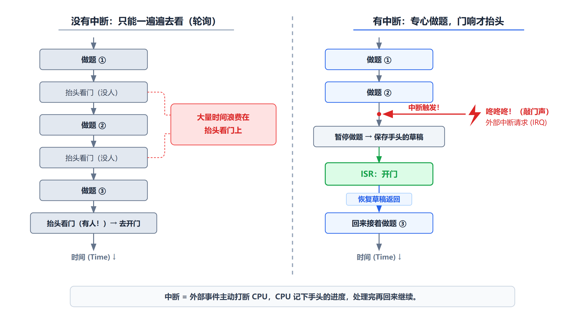

**看图方法**：
- 左边一栏是"没有中断"的世界：CPU 必须一遍遍主动去问，中间那些"抬头看门（没人）"的方块就是被浪费掉的时间。
- 右边一栏是"有中断"的世界：CPU 一直专心干活，只有红色闪电（敲门）出现时，才去执行绿色方块（ISR），执行完回到原来的进度。

**这张图想让你记住一件事**：中断不是"多了一个 CPU"，而是"CPU 被打断一下，然后回到原处"。**关键在"回到原处"这四个字**——这也是后面要花大力气讲"保存现场 / 恢复现场"的原因。

【教材内容】教材 p185 用一句话概括了这个过程：

> "当异常发生时，Cortex-M3 通过硬件自动将程序计数器（PC）、程序状态寄存器（xPSR）、链接寄存器（LR）和 R0~R3、R12 等寄存器压进堆栈。在 Dbus（数据总线）保存处理器状态的同时，处理器通过 Ibus（指令总线）从一个可以重新定位的向量表中识别出异常向量，并获取 ISR 函数的地址，也就是保护现场与取异常向量是并行处理的。一旦压栈和取指令完成，中断服务程序或故障处理程序就开始执行。执行完 ISR，硬件进行出栈操作，中断前的程序恢复正常执行。"

这段话信息量很大，先不用全懂。记住两个关键词：**压栈（保存现场）** 和 **取向量（找到 ISR 地址）**，而且它们是**并行**做的。

### 本节真正要记住什么

1. 中断 = 外面有事，CPU 暂停当前程序去处理，处理完回来接着执行。
2. 中断比轮询省时间、响应快。
3. 中断响应有三个关键动作：**保存现场 → 执行 ISR → 恢复现场**。
4. 异常是更大的概念，中断是异常的一种。
5. 边沿 = 电平跳变的那一瞬间，中断一般由边沿触发。

---

## 7.1 STM32 的中断源

### 先别急着看教材：这一节到底要干什么？

要回答两个问题：

1. **这颗芯片上一共有多少个中断？它们分别叫什么名字、编号是多少？**
2. **这些中断的名字和编号，是怎么组织成一张"表"的？**

这张表就是**向量表**。搞懂向量表，后面所有"中断服务函数为什么必须叫 `EXTI0_IRQHandler` 这个名字"之类的疑问都会自动消失。

### 7.1.1 STM32F103VET6 的中断源

> 教材 7.1 节下面分两个子项："1. STM32F103VET6 的中断源"和"2. STM32 的中断优先级"。本讲义对应写成 7.1.1 与 7.1.2，内容和顺序与教材保持一致。

#### 【教材内容】Cortex-M3 的中断体系

教材 p185 原文要点：

- Cortex-M3 处理器支持 **256 个中断**：**16 个内核中断 + 240 个外部中断**。
- 支持**可编程的 256 级中断优先级**设置。
- 相关的中断控制和中断优先级控制寄存器（**NVIC、SysTick** 等）都属于 **Cortex-M3 内核**的一部分。
- 为了满足工控领域"更快的中断速度"要求，Cortex-M3 采用了 **Tail-Chaining（咬尾）**中断技术，完全基于硬件进行中断处理，最多可减少 12 个时钟周期。
- STM32F103VET6 采用了 Cortex-M3 内核，但**没有使用内核全部功能**（例如内存保护单元 MPU），因此它的 NVIC 是 Cortex-M3 内核 NVIC 的**子集**。

##### 【先补一个前置知识：NVIC 是什么？】

- 英文全称：**Nested Vectored Interrupt Controller**
- 中文：**嵌套向量中断控制器**
- 缩写：**NVIC**
- 大白话：它是 CPU 内核里专门管中断的一个"调度室"。所有外设的中断请求都送到这里，由它来决定"这个请求现在能不能响应""要不要先记下来等着""和别的请求比谁先"。
- 它是干什么的：让 CPU 不用自己判断中断，硬件直接帮你算好，速度极快。

拆开看 NVIC 这个名字，每个词都有含义：

| 词 | 含义 |
|---|---|
| Nested（嵌套） | 高优先级中断可以打断正在执行的低优先级中断 |
| Vectored（向量） | 每个中断都有固定的编号，通过向量表一步跳到对应函数，不用软件逐个判断 |
| Interrupt（中断） | 它管的就是中断 |
| Controller（控制器） | 它是一个硬件模块 |

#### 【教材内容】STM32F103VET6 的中断资源

| 项目 | 数值 | 说明 |
|---|---|---|
| 支持的中断总数 | **70 个** | = 10 个内核异常 + 60 个外部中断 |
| 可编程中断优先级 | **16 级** | 只使用优先级设置 8 位中的**高 4 位** |
| NVIC | 内核的 NVIC 子集 | 与处理器核接口紧密相连，低延迟、支持晚到的中断 |
| 中断来源 | 片上外设 + I/O 口外部输入 | 每个 I/O 口都可以作为中断输入 |

**【补充解释】"70 个"是怎么算出来的？**

教材表 7-1 里，"位置"这一列从 0 排到 59，一共 **60 个**外部中断；
另外前面还有 **10 个**内核异常（优先级 -3 到 6：Reset、NMI、HardFault、MemManage、BusFault、UsageFault、SVCall、DebugMonitor、PendSV、SysTick）。

60 + 10 = 70。✓

**注意**：这 70 个不是"平级"的，前面 10 个是内核自带的，后面 60 个才是"外设中断"。教材特别说明：

> "其中，位置号 0 之前的中断源是 Cortex-M3 内核的。"

#### 先看一张图：中断向量表长什么样

**【辅助理解图】向量表：一排写着函数地址的格子**

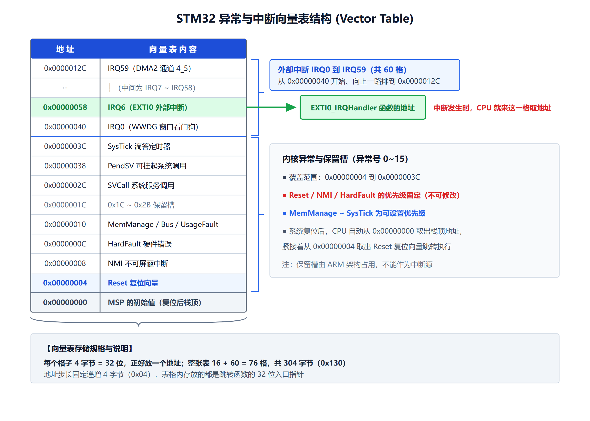

**看图方法**：
1. **先看最下面两行**：`0x00000000` 和 `0x00000004`。这是整个表最特殊的两格。
2. **再看中间**：每一行都是"地址 + 内容"，内容就是**一个函数的入口地址**。
3. **最后看右边那个绿色方块**：它是"某一格内容指向的函数"。中断发生时，CPU 就是顺着"编号 → 这一格 → 这个函数"这条链跳过去的。
4. **底部小字**：每格 4 字节 = 32 位，正好装一个地址。

这张图要你理解的核心是：**向量表就是一张"门牌号 → 去哪儿办事"的对照表**。

#### 【教材内容】STM32F103VET6 的向量表（表 7-1）

原表很长，完整抄录如下。"位置"列是外部中断的编号（IRQ 编号），"优先级"列的含义见表格后面的解释。

| 位置 | 优先级 | 优先级类型 | 名称 | 向量地址 | 描述 |
|---|---|---|---|---|---|
| — | — | — | — | 0x0000_0000 | 保留 |
| — | -3 | 固定 | Reset | 0x0000_0004 | 上电复位或系统复位 |
| — | -2 | 固定 | NMI | 0x0000_0008 | 不可屏蔽中断 |
| — | -1 | 固定 | HardFault | 0x0000_000C | 用于所有类型的错误处理 |
| — | 0 | 可设置 | MemManage | 0x0000_0010 | 存储器管理 |
| — | 1 | 可设置 | BusFault | 0x0000_0014 | 总线错误，预取指失败，存储器访问失败 |
| — | 2 | 可设置 | UsageFault | 0x0000_0018 | 错误应用，未定义的指令或非法状态 |
| — | — | — | — | 0x0000_001C~0x0000_002B | 保留 |
| — | 3 | 可设置 | SVCall | 0x0000_002C | 通过 SWI 指令的系统服务调用 |
| — | 4 | 可设置 | DebugMonitor | 0x0000_0030 | 调试监控器 |
| — | — | — | — | 0x0000_0034 | 保留 |
| — | 5 | 可设置 | PendSV | 0x0000_0038 | 可挂起的系统服务 |
| — | 6 | 可设置 | SysTick | 0x0000_003C | 系统嘀嗒定时器 |
| 0 | 7 | 可设置 | WWDG | 0x0000_0040 | 窗口看门狗中断 |
| 1 | 8 | 可设置 | PVD | 0x0000_0044 | 连到 EXTI 的电源电压检测（PVD）中断 |
| 2 | 9 | 可设置 | TAMPER | 0x0000_0048 | 侵入检测中断 |
| 3 | 10 | 可设置 | RTC | 0x0000_004C | 实时时钟（RTC）全局中断 |
| 4 | 11 | 可设置 | FLASH | 0x0000_0050 | 闪存全局中断 |
| 5 | 12 | 可设置 | RCC | 0x0000_0054 | 复位和时钟控制（RCC）中断 |
| 6 | 13 | 可设置 | **EXTI0** | 0x0000_0058 | EXTI 线 0 中断 |
| 7 | 14 | 可设置 | **EXTI1** | 0x0000_005C | EXTI 线 1 中断 |
| 8 | 15 | 可设置 | **EXTI2** | 0x0000_0060 | EXTI 线 2 中断 |
| 9 | 16 | 可设置 | **EXTI3** | 0x0000_0064 | EXTI 线 3 中断 |
| 10 | 17 | 可设置 | **EXTI4** | 0x0000_0068 | EXTI 线 4 中断 |
| 11 | 18 | 可设置 | DMA1 通道 1 | 0x0000_006C | DMA1 通道 1 全局中断 |
| 12 | 19 | 可设置 | DMA1 通道 2 | 0x0000_0070 | DMA1 通道 2 全局中断 |
| 13 | 20 | 可设置 | DMA1 通道 3 | 0x0000_0074 | DMA1 通道 3 全局中断 |
| 14 | 21 | 可设置 | DMA1 通道 4 | 0x0000_0078 | DMA1 通道 4 全局中断 |
| 15 | 22 | 可设置 | DMA1 通道 5 | 0x0000_007C | DMA1 通道 5 全局中断 |
| 16 | 23 | 可设置 | DMA1 通道 6 | 0x0000_0080 | DMA1 通道 6 全局中断 |
| 17 | 24 | 可设置 | DMA1 通道 7 | 0x0000_0084 | DMA1 通道 7 全局中断 |
| 18 | 25 | 可设置 | ADC1_2 | 0x0000_0088 | ADC1 和 ADC2 的全局中断 |
| 19 | 26 | 可设置 | USB_HP_CAN_TX | 0x0000_008C | USB 高优先级或 CAN 发送中断 |
| 20 | 27 | 可设置 | USB_LP_CAN_RX0 | 0x0000_0090 | USB 低优先级或 CAN 接收 0 中断 |
| 21 | 28 | 可设置 | CAN_RX1 | 0x0000_0094 | CAN 接收 1 中断 |
| 22 | 29 | 可设置 | CAN_SCE | 0x0000_0098 | CAN SCE 中断 |
| 23 | 30 | 可设置 | **EXTI9_5** | 0x0000_009C | EXTI 线 [9:5] 中断 |
| 24 | 31 | 可设置 | TIM1_BRK | 0x0000_00A0 | TIM1 刹车中断 |
| 25 | 32 | 可设置 | TIM1_UP | 0x0000_00A4 | TIM1 更新中断 |
| 26 | 33 | 可设置 | TIM1_TRG_COM | 0x0000_00A8 | TIM1 触发和通信中断 |
| 27 | 34 | 可设置 | TIM1_CC | 0x0000_00AC | TIM1 捕获比较中断 |
| 28 | 35 | 可设置 | TIM2 | 0x0000_00B0 | TIM2 全局中断 |
| 29 | 36 | 可设置 | TIM3 | 0x0000_00B4 | TIM3 全局中断 |
| 30 | 37 | 可设置 | TIM4 | 0x0000_00B8 | TIM4 全局中断 |
| 31 | 38 | 可设置 | I2C1_EV | 0x0000_00BC | I2C1 事件中断 |
| 32 | 39 | 可设置 | I2C1_ER | 0x0000_00C0 | I2C1 错误中断 |
| 33 | 40 | 可设置 | I2C2_EV | 0x0000_00C4 | I2C2 事件中断 |
| 34 | 41 | 可设置 | I2C2_ER | 0x0000_00C8 | I2C2 错误中断 |
| 35 | 42 | 可设置 | SPI1 | 0x0000_00CC | SPI1 全局中断 |
| 36 | 43 | 可设置 | SPI2 | 0x0000_00D0 | SPI2 全局中断 |
| 37 | 44 | 可设置 | USART1 | 0x0000_00D4 | USART1 全局中断 |
| 38 | 45 | 可设置 | USART2 | 0x0000_00D8 | USART2 全局中断 |
| 39 | 46 | 可设置 | USART3 | 0x0000_00DC | USART3 全局中断 |
| 40 | 47 | 可设置 | **EXTI15_10** | 0x0000_00E0 | EXTI 线 [15:10] 中断 |
| 41 | 48 | 可设置 | RTCAlarm | 0x0000_00E4 | 连到 EXTI 的 RTC 闹钟中断 |
| 42 | 49 | 可设置 | USB 唤醒 | 0x0000_00E8 | 连到 EXTI 的从 USB 待机唤醒中断 |
| 43 | 50 | 可设置 | TIM8_BRK | 0x0000_00EC | TIM8 刹车中断 |
| 44 | 51 | 可设置 | TIM8_UP | 0x0000_00F0 | TIM8 更新中断 |
| 45 | 52 | 可设置 | TIM8_TRG_COM | 0x0000_00F4 | TIM8 触发和通信中断 |
| 46 | 53 | 可设置 | TIM8_CC | 0x0000_00F8 | TIM8 捕获比较中断 |
| 47 | 54 | 可设置 | ADC3 | 0x0000_00FC | ADC3 全局中断 |
| 48 | 55 | 可设置 | FSMC | 0x0000_0100 | FSMC 全局中断 |
| 49 | 56 | 可设置 | SDIO | 0x0000_0104 | SDIO 全局中断 |
| 50 | 57 | 可设置 | TIM5 | 0x0000_0108 | TIM5 全局中断 |
| 51 | 58 | 可设置 | SPI3 | 0x0000_010C | SPI3 全局中断 |
| 52 | 59 | 可设置 | UART4 | 0x0000_0110 | UART4 全局中断 |
| 53 | 60 | 可设置 | UART5 | 0x0000_0114 | UART5 全局中断 |
| 54 | 61 | 可设置 | TIM6 | 0x0000_0118 | TIM6 全局中断 |
| 55 | 62 | 可设置 | TIM7 | 0x0000_011C | TIM7 全局中断 |
| 56 | 63 | 可设置 | DMA2 通道 1 | 0x0000_0120 | DMA2 通道 1 全局中断 |
| 57 | 64 | 可设置 | DMA2 通道 2 | 0x0000_0124 | DMA2 通道 2 全局中断 |
| 58 | 65 | 可设置 | DMA2 通道 3 | 0x0000_0128 | DMA2 通道 3 全局中断 |
| 59 | 66 | 可设置 | DMA2 通道 4_5 | 0x0000_012C | DMA2 通道 4 和 DMA2 通道 5 全局中断 |

**表 7-1 的图注（教材原图）**：

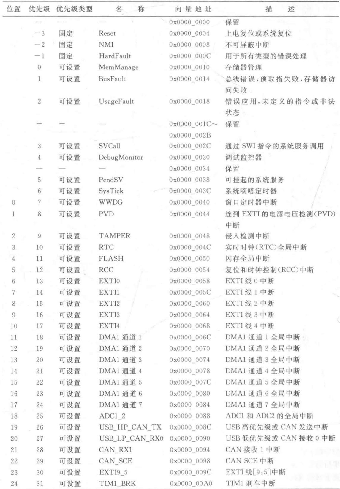

**这张原图怎么看**：
- 先只看**第 5 列"向量地址"**：它是一串连续递增的地址，每次加 4。
- 再看**最后几行**：`EXTI0`（位置 6）、`EXTI1`（位置 7）、`EXTI9_5`（位置 23）、`EXTI15_10`（位置 40）。这四行是本章的主角。
- 表里加粗的那些行，就是"外部中断"，也是本章会真正用到、并在 7.5 节例程里出现的。

> 【OCR 提示】教材表 7-1 中位置 41 的名字印成了 `RTCAIarm`，其中第 5 个字符其实是**小写字母 l**（= RTC + Alarm），不是大写字母 I。固件库与启动文件里的正确拼写是 **`RTCAlarm`**（中断枚举名 `RTCAlarm_IRQn`，中断服务函数名 `RTCAlarm_IRQHandler`）。本讲义的表格已按正确拼写转写，详见文末"OCR 问题清单"。

#### 向量地址是怎么算出来的？

这是本章第一个需要动手算的地方，务必跟着算一遍。

**规律：**

```
向量地址 = 4 × (16 + 位置号)
```

**为什么是 16？**

因为 Cortex-M3 规定：**前 16 个异常号（0~15）留给了内核异常**（严格地说，是从异常号 16 开始才是外部中断）。

【补充解释】更准确的说法是：ARM 规定外部中断 IRQn 的异常号 = 16 + n。向量表里每一格 4 字节，所以地址 = 4 × 异常号。

**验算 1：EXTI0（位置 6）**

```
4 × (16 + 6) = 4 × 22 = 88 = 0x58
```

查表：EXTI0 的向量地址是 `0x0000_0058`。✓ 对上了。

**验算 2：EXTI15_10（位置 40）**

```
4 × (16 + 40) = 4 × 56 = 224 = 0xE0
```

查表：`0x0000_00E0`。✓ 对上了。

**验算 3：位置 0（WWDG）**

```
4 × (16 + 0) = 64 = 0x40
```

查表：`0x0000_0040`。✓

**所以，只要知道一个中断的"位置号"（也就是 IRQ 编号），就能算出它在向量表里的门牌号。**

##### 【容易搞混】"位置"列和"优先级"列不是一回事

表 7-1 里有一列叫"优先级"，值从 -3 一直到 66。

**它不是你要写进优先级寄存器的那个值！**

- 它是教材给的一个**排序编号**：数字越小优先级越高。Reset 最高（-3），NMI 次之（-2），HardFault 再次（-1），然后按顺序排下去。
- 你能明显看出规律：**优先级列 = 位置号 + 7**（例如 EXTI0：位置 6 → 优先级 13）。
- 而真正要写进寄存器的优先级数值，是一个 **0~255 之间的数**（STM32 只用高 4 位，也就是 0~15 的 16 个级别），写在 NVIC 的 `PRI_n` 寄存器里，**和这一列没有直接换算关系**。

> 【待核验】教材未明确说明表 7-1"优先级"列的含义与生成规则，上面"位置号 + 7"的规律是本讲义根据表中数据归纳的，建议核对原 PDF p186 表格上下文。

#### 向量表放在哪？——向量表偏移量寄存器 VTOR

【补充解释】向量表默认放在地址 `0x00000000` 开始的地方（实际上 STM32 会把 Flash 起始区域映射到 0 地址）。

但有时候我们想把向量表搬到别的地方（比如做 Bootloader、或者程序运行在 RAM 里），这时就要用一个寄存器告诉 CPU："表被我搬走了，新地址在这儿。"

这个寄存器叫 **VTOR（Vector Table Offset Register，向量表偏移量寄存器）**：

| 项目 | 值 |
|---|---|
| 名称 | VTOR（也叫"向量表偏移量寄存器"） |
| 地址 | `0xE000ED08` |
| 作用 | 告诉内核：向量表从哪个地址开始 |
| 复位值 | 0（表示表在 0x00000000） |

**地址计算链**（这是全书反复出现的套路）：

```
0xE000E000  ← 系统控制空间（SCS）的基地址
    + 0xED00  ← SCB（系统控制块）的偏移
    = 0xE000ED00  ← SCB 基地址
    + 0x08         ← VTOR 在 SCB 里的偏移
    = 0xE000ED08  ← VTOR 的门牌号
```

教材 7.2.2 节的示例汇编里就用了这个地址：

```asm
LDR R0, = 0xE000ED08    ; 向量表偏移量寄存器的地址
LDR R1, = NEW_VECT_TABLE
STR R1, [R0]            ; 把向量表重定位到 NEW_VECT_TABLE
```

**【补充解释】向量表对齐要求**：VTOR 的低 7 位在硬件上被忽略，所以向量表起始地址**至少要 128 字节对齐**。实际使用中，为了整张表不被覆盖，通常会按 512 字节甚至 1KB 对齐。

**这张表到底有多大？** 这里藏着本章一个容易记错的数字，务必分清楚：

| 说法 | 数值 | 说明 |
|---|---|---|
| "70 个中断" | 70 | 这是**中断的个数**（10 个内核异常 + 60 个外部中断），**不是向量表的项数** |
| 向量表有多少格 | **76 格** | 前 **16** 格留给内核异常（异常号 0~15，第 0 格放 MSP 初值），后面 **60** 格给外部中断：16 + 60 = 76 |
| 向量表有多少字节 | **304 字节**（= 0x130） | 76 × 4 = 304 |

**验算**：表 7-1 最后一格（位置 59，DMA2 通道 4_5）的向量地址是 `0x0000_012C`，再加 4 个字节正好是 `0x0000_0130` = 304。✓

**为什么内核异常只用到 10 个，却占 16 格？** 因为 Cortex-M3 规定**异常号 0~15 这 16 个编号整段留给内核**（里面有几个是保留槽），外部中断从异常号 16 开始。所以数表要按 **16 + 60** 数，而不是按 10 + 60 数——**"70 个中断"和"76 格向量表"是两个不同的量**。

#### 再看一眼第 2 章那张向量表图

教材第 2 章有一张图，专门讲"程序映像里的向量表"：

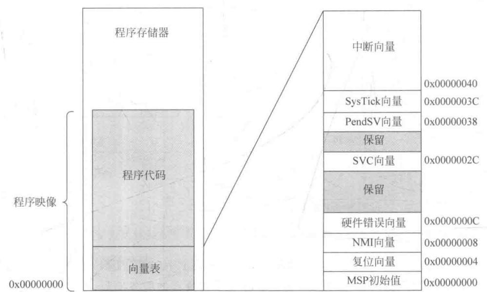

**这张图怎么看**：
- **左半边**是"程序映像"：Flash 里从 `0x00000000` 开始，依次放着**向量表**、**程序代码**。
- **右半边**是向量表被放大的细节。从下往上看：
  - `0x00000000`：**MSP 初始值**
  - `0x00000004`：**复位向量**
  - `0x00000008`：NMI 向量
  - `0x0000000C`：硬件错误向量（HardFault）
  - `0x0000002C`：SVC 向量
  - `0x00000038`：PendSV 向量
  - `0x0000003C`：SysTick 向量
  - `0x00000040` 往上：中断向量（外部中断从这里开始）
- **这张图要你理解**：向量表不是"某个寄存器"，它是**一段实实在在存在 Flash 里的数据**，和你的代码放在一起，只是位置最靠前。

> 【待核验】教材表 7-1 把 `0x0000_0000` 这一项标为"保留"，但第 2 章图 2-39 明确标注该位置是"**MSP 初始值**"（Cortex-M3 规定向量表第 0 项存放复位后主堆栈指针的初值，第 1 项才是复位向量）。两者不一致，建议核对原 PDF p186 与 p69。

### 7.1.2 STM32 的中断优先级

#### 用大白话理解：两个优先级，一个管"插队"，一个管"排队"

**场景**：你在医院急诊科。同时有好几件事：

1. 一个病人正在被医生处理（**正在执行的中断**）。
2. 门口又推进来一个病人（**新来的中断请求**）。

医生该怎么办？要看两个东西：

- **谁的病更危急？** —— 这是**抢占式优先级（Pre-emption Priority）**。如果新来的病人比手上这个更危急，医生可以**立刻放下手上这个**去救新的。这叫**中断嵌套**。
- **如果两个人病情危急程度一样呢？** —— 那就得排队。这时候看**副优先级（Subpriority）**，副优先级高的先看。但注意：**副优先级再高，也不能打断正在处理的病人**，只能等他处理完。

**类比的边界**：真实硬件里"病情"就是一个 0~15 的数字（数字越小越优先），比较是纯数字比较，没有医生判断这一步。

#### 【教材内容】正式定义

教材 p188 原文：

**1）抢占式优先级（pre-emption priority）**

> 具有高抢占式优先级的中断可以在具有低抢占式优先级的中断处理过程中被响应，即可以实现抢断式优先响应，俗称中断嵌套。或者说，高抢占式优先级的中断可以嵌套低抢占优先级的中断。

**2）副优先级（subpriority）**（也叫"亚优先级""响应优先级"）

> 在抢占式优先级相同的情况下，高副优先级的中断优先被响应；
> 在抢占式优先级相同的情况下，如果有低副优先级中断正在执行，高副优先级的中断要等待已被响应的低副优先级中断执行结束后才能得到响应，即所谓的非抢断式响应（不能嵌套）。

**3）优先级冲突的处理**

> 当两个中断源的抢占式优先级相同时，这两个中断将没有嵌套关系，当一个中断到来后，如果正在处理另一个中断，这个后到来的中断就要等到前一个中断处理完之后才能被处理。如果这两个中断同时到达，则中断控制器根据它们的副优先级高低来决定先处理哪一个中断；如果它们的抢占式优先级和副优先级都相同，则根据它们在中断表中的排位顺序决定先处理哪一个。

**4）判断依据**

> 因此，判断中断是否会被响应的依据是，首先是看抢占式优先级，其次是副优先级。抢占式优先级决定是否会有中断嵌套。

**【辅助理解图】两个中断同时来了，先处理谁？**

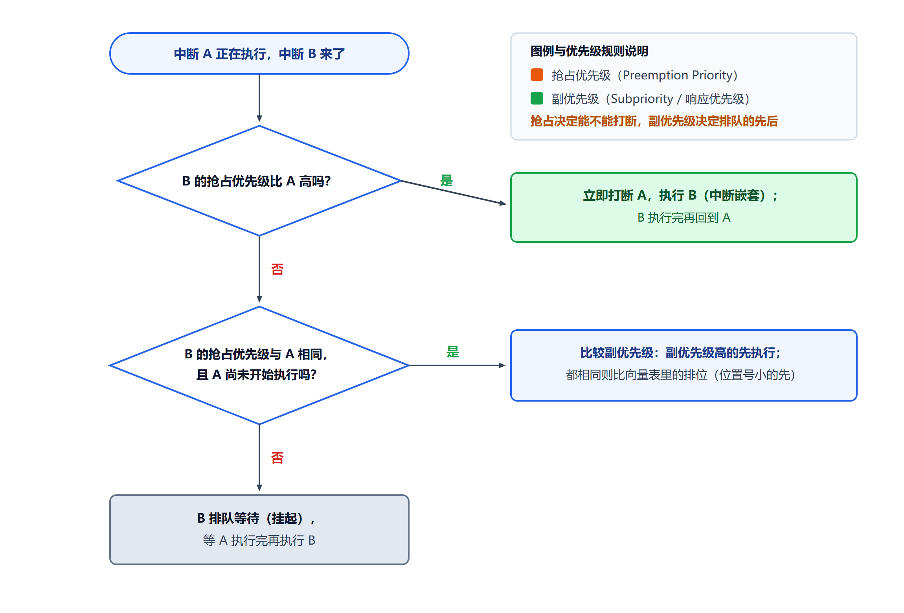

**看图方法**：顺着菱形判断框往下走一遍，就得到完整的判定逻辑。重点记住最后一行的图例：**橙色（抢占）决定"能不能打断"，绿色（副）决定"排队的先后"**。

#### 【教材内容】STM32 对中断优先级的定义（4 位分组）

> STM32 中指定中断优先级的寄存器位有 4 位，这 4 个寄存器位的分组方式如下：
> - 第 0 组，所有 4 位用于指定响应优先级。
> - 第 1 组，最高 1 位用于指定抢占式优先级，最低 3 位用于指定响应优先级。
> - 第 2 组，最高 2 位用于指定抢占式优先级，最低 2 位用于指定响应优先级。
> - 第 3 组，最高 3 位用于指定抢占式优先级，最低 1 位用于指定响应优先级。
> - 第 4 组，所有 4 位用于指定抢占式优先级。

**【辅助理解图】优先级 4 个 bit 怎么切：5 种分组方式**

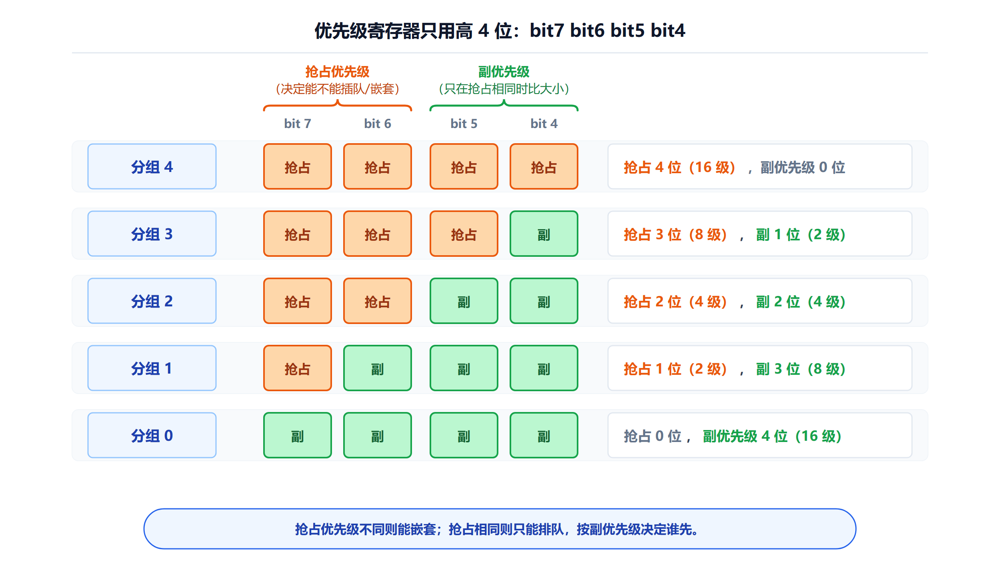

**看图方法**：
1. 每行 4 个小方格，代表优先级寄存器的 **bit7 bit6 bit5 bit4** 这 4 位（从右到左是 bit4 → bit7）。
2. 橙色格子 = 抢占优先级用的位；绿色格子 = 副优先级用的位。
3. 从上往下看：**分组 4 最"独裁"**（抢占权全给它），**分组 0 最"和平"**（没有抢占，全靠排队）。
4. 注意"16 级"是怎么来的：4 个 bit 能表示 2⁴ = 16 个值，所以是 16 级。

#### 看教材原图：分组组合方式

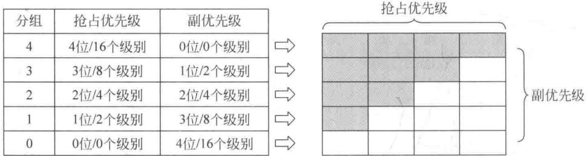

**这张图怎么看**：
1. **先看左边表格**：5 行，分别是分组 4、3、2、1、0。每行给出"抢占优先级用几位 / 多少个级别""副优先级用几位 / 多少个级别"。
   - 分组 4：抢占 4 位 / 16 个级别，副 0 位 / 0 个级别
   - 分组 3：抢占 3 位 / 8 个级别，副 1 位 / 2 个级别
   - 分组 2：抢占 2 位 / 4 个级别，副 2 位 / 4 个级别
   - 分组 1：抢占 1 位 / 2 个级别，副 3 位 / 8 个级别
   - 分组 0：抢占 0 位 / 0 个级别，副 4 位 / 16 个级别
2. **再看右边的方块图**：4 个竖格代表优先级寄存器的 4 位；箭头把"分组"映射到"哪几格属于抢占、哪几格属于副"。
   - 分组 4 时 4 格全是抢占；
   - 分组 0 时 4 格全是副优先级。
3. **这张图要你理解**：分组方式本质上就是**一条分界线**，把 4 个 bit 分成"左边归抢占、右边归副"两段。分界线越往右，抢占的位越多。

#### 【容易搞混】"第几组"和 PRIGROUP 的数值不是一回事

这是本章最容易踩的坑之一。

- 教材 7.1 节说的"**第 0 组 / 第 1 组 / … / 第 4 组**"，是**固件库里的分组编号**（`NVIC_PriorityGroup_0` ~ `NVIC_PriorityGroup_4`）。
- 而真正写进芯片寄存器的是 **AIRCR 寄存器的 PRIGROUP 位段**，它是一个 3 位的二进制数。

两者的对应关系（来自教材表 7-5）：

**教材原表**：

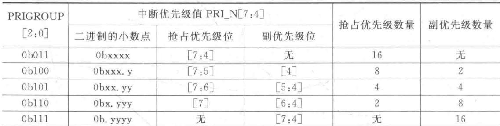

**这张表怎么看**：
1. **第一列** `PRIGROUP[2:0]` 是真正写进 AIRCR 的值（3 位二进制）。
2. **第二列**"二进制的小数点"是理解的关键——那个点就是"抢占和副优先级的分界线"。`0bxxx.y` 表示小数点在第 4 位和第 5 位之间。
3. **第三、四列**分别标出抢占位段和副位段覆盖哪几个 bit。
4. **最后两列**给出"各有多少个级别"：位数 n 对应 2ⁿ 个级别。
5. 表里只列了 `0b011` ~ `0b111` 五行，因为 STM32F103 只实现高 4 位，只有这 5 种有意义的切法。

| PRIGROUP[2:0] | 抢占优先级位 | 副优先级位 | 抢占级别数 | 副级别数 | 固件库里的名字 |
|---|---|---|---|---|---|
| 0b011 | [7:4]（4 位） | 无 | 16 | 无 | NVIC_PriorityGroup_4 |
| 0b100 | [7:5]（3 位） | [4] | 8 | 2 | NVIC_PriorityGroup_3 |
| 0b101 | [7:6]（2 位） | [5:4] | 4 | 4 | NVIC_PriorityGroup_2 |
| 0b110 | [7]（1 位） | [6:4] | 2 | 8 | NVIC_PriorityGroup_1 |
| 0b111 | 无 | [7:4] | 无 | 16 | NVIC_PriorityGroup_0 |

**看出来了吗**：**分组编号越大，PRIGROUP 的数值反而越小**。这是个很容易记反的地方。

【补充解释】为什么会这样？因为 PRIGROUP 在 ARM 的原始定义里是"**二进制小数点在从右往左数第几位**"：
- `0b111` 表示小数点在最左边 → 全给副优先级；
- `0b011` 表示小数点在 bit4 左边 → 全给抢占优先级。
教材表 7-5 里那列"二进制的小数点"（`0bxxxx`、`0bxxx.y`、`0bxx.yy`、`0bx.yyy`、`0b.yyyy`）画的就是这个分界点。

> 【待核验】教材 7.2.2 节第 (1) 步写"默认情况下使用组 0（7 位抢占优先级，1 位副优先级）"。这句话是 Cortex-M3 的**通用**描述（PRIGROUP 复位值为 0，8 位优先级里分成 7 位抢占 + 1 位副）。但 STM32F103VET6 只实现了 8 位中的高 4 位，且固件库里的"组 0"指的是"抢占 0 位 / 副 4 位"，两者含义完全不同。建议核对原 PDF p193，教材此处未加区分。

#### 【教材内容】哪些外设能产生中断？

从表 7-1 可以数出来，STM32F103VET6 的中断源大致分为这几类：

| 类别 | 例子 | 本章是否展开 |
|---|---|---|
| 看门狗 | WWDG | 否 |
| 电源/安全 | PVD、TAMPER | 否 |
| 时钟/存储 | RTC、FLASH、RCC | 否 |
| **外部中断** | **EXTI0、EXTI1、EXTI2、EXTI3、EXTI4、EXTI9_5、EXTI15_10** | **是（本章主角）** |
| DMA | DMA1 通道 1~7、DMA2 通道 1~5 | 第 11 章 |
| 模拟 | ADC1_2、ADC3 | 第 10 章 |
| 通信 | USB、CAN、I2C、SPI、USART、UART、SDIO | 第 9 章 |
| 定时器 | TIM1~TIM8 | 第 8 章 |
| 外部存储 | FSMC | 第 12 章 |

教材特别说明：

> "本章仅介绍外部中断和事件，与定时器有关的中断请参考第 8 章，与串行通信相关的中断请参考第 9 章，与 ADC 相关的中断请参考第 10 章。其他中断资源，请读者自行查阅产品的参考手册。"

还有一句很重要：

> "STM32F103VET6 的每个 I/O 口都可以作为中断输入，在使用之前需要对 NVIC 进行设置。"

**注意"每个 I/O 口"这句话要理解准确**：不是说"80 个引脚能同时当 80 个中断源"，而是**任何一个引脚都可以被配置成中断输入**，但同一时刻同一编号的引脚只能选一个（见 7.3.5 节的 AFIO_EXTICR）。

### 本节真正要记住什么

1. STM32F103VET6：**70 个中断 = 10 个内核异常 + 60 个外部中断**，**16 级可编程优先级**。
2. **向量表**是一段放在 Flash 最前面的数据，每一项 4 字节，存放中断服务函数的入口地址。
3. **向量地址 = 4 × (16 + 位置号)**。
4. 优先级有两层：**抢占式优先级**（决定能否嵌套）+ **副优先级**（决定排队先后）。
5. STM32 只用优先级寄存器的**高 4 位**，按分组切成"抢占段 + 副段"，共 5 种分组方式。
6. **分组编号越大，抢占位越少**（分组 4 = 全抢占，分组 0 = 全副优先级）。

---

## 7.2 STM32 的中断管理

### 先别急着看教材：这一节到底要干什么？

上一节回答了"有哪些中断"。这一节回答"**这些中断是怎么被管的**"：

1. NVIC 里到底有哪些寄存器？它们在哪个地址？
2. 怎么"打开"一个中断？怎么"关掉"？
3. 什么是"挂起"？怎么清除？
4. 优先级具体怎么写进去？
5. **中断响应那一瞬间，硬件到底干了什么？**（本节最重要的部分）

### 7.2.1 NVIC 是什么、住在哪、怎么访问

【教材内容】教材 p188 原文要点：

> 向量中断控制器简称 NVIC，是 Cortex-M3 不可分离的一部分。NVIC 与 Cortex-M3 内核相辅相成，共同完成对中断的响应。NVIC 的寄存器以**存储器映射**的方式访问……NVIC 的**访问基地址是 0xE000 E000**。所有 NVIC 的中断控制/状态寄存器都只能在**特权级**下访问。不过有一个例外——**软件触发中断寄存器可以在用户级下访问**以产生软件中断。所有的中断控制/状态寄存器均可按**字 / 半字 / 字节**的方式访问。

#### 【先补一个前置知识：什么叫"存储器映射"？】

一句话复习（第 1、3 章）：

> **CPU 眼里没有"内存"和"外设"的区别，只有地址。**
> 每一个硬件模块（包括 NVIC）都被分配了一段地址，程序往那个地址读写，就等于在操作那个模块。

所以"NVIC 的访问基地址是 0xE000E000"的意思是：**NVIC 这一整块硬件，在 CPU 的地址空间里占了从 0xE000E000 开始的一段**。

#### 【先补一个前置知识：什么叫"特权级"？】

Cortex-M3 有两种"身份"：

- **特权级（Privileged）**：可以访问所有资源，想改什么改什么。
- **用户级（Unprivileged）**：受限，很多寄存器和指令不能用。

复位后 CPU 默认是特权级。所以本章的代码都能正常操作 NVIC。只有跑操作系统时，用户任务才会被降级。

#### 【辅助理解图】NVIC 住在 Cortex-M3 内核里

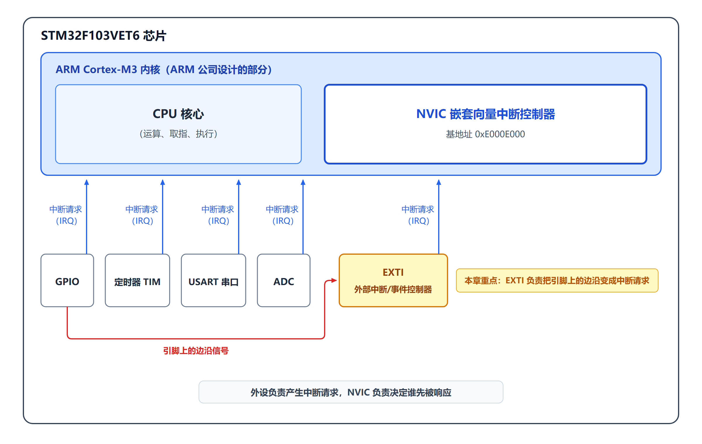

**看图方法**：
1. **先看大框**：整个芯片叫 STM32F103VET6。
2. **再看大框里上半部分那个浅蓝矩形**：那是"ARM 公司设计的 Cortex-M3 内核"，**NVIC 就在里面**（右边那个加粗小方块）。
3. **看下面一排外设**：GPIO、TIM、USART、ADC、EXTI。每个外设都有一条向上的箭头指向内核，箭头旁写着"中断请求（IRQ）"。
4. **重点**：EXTI 用黄色标出，因为它就是本章的主角——它负责把"引脚上的边沿"翻译成"中断请求"。
5. **这张图要你理解**：**外设负责产生请求，NVIC 负责调度，CPU 负责执行**。三者分工明确。

#### 【教材内容】每个外部中断和 NVIC 中这些寄存器有关

教材 p188 列出了清单：

- **使能与除能寄存器**（除能也就是平常所说的屏蔽）。
- **挂起与解挂寄存器**。
- **优先级寄存器**。
- **活动状态寄存器**。

另外还有几个对中断处理有重大影响的：

- **异常屏蔽寄存器**（PRIMASK、FAULTMASK 及 BASEPRI）。
- **向量表偏移量寄存器**（就是 7.1 节讲过的 VTOR）。
- **软件触发中断寄存器**。
- **优先级分组位段**。

#### 【辅助理解图】NVIC 寄存器族：一排有门牌号的格子

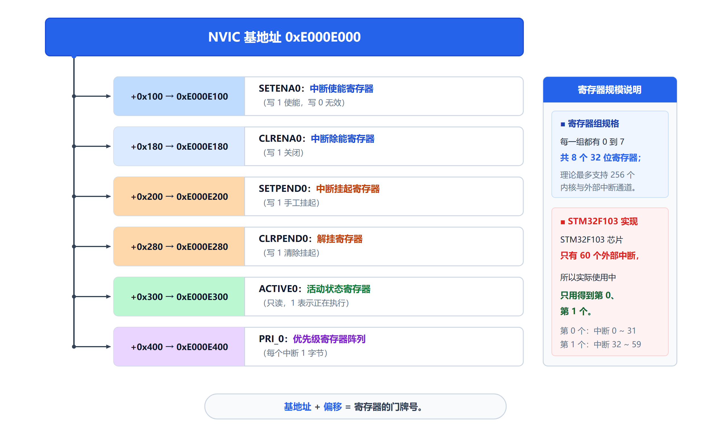

**看图方法**：
1. 最上面是"**基地址 0xE000E000**"，所有分支都从它出发。
2. 每个分支左边是**偏移量**（+0x100 这种），右边是**最终地址 + 寄存器名**。
3. 颜色分组：蓝 = 使能/除能，橙 = 挂起/解挂，绿 = 活动状态，紫 = 优先级。
4. **这张图要你理解**："基地址 + 偏移 = 门牌号"这条链在 NVIC 里也一样成立。

### 7.2.2 中断的使能与除能

#### 用大白话理解

每个中断都有一个"开关"：

- **使能（Enable）** = 把开关打开，这个中断可以打断 CPU。
- **除能（Disable）** = 把开关关掉（也就是**屏蔽**），这个中断就算来了也没用。

【教材内容】教材 p189 有一段非常关键的设计思想说明：

> 传统的中断使能与除能是通过设置中断控制寄存器中的一个相应位为 1 或者 0 实现的，而 Cortex-M3 的中断使能与除能分别使用**各自的寄存器**控制。Cortex-M3 中有 240 对使能位/除能位（SETENA 位/CLRENA 位），每个中断拥有一对，它们分布在 **8 对 32 位寄存器**中（最后一对没有用完）。欲使能一个中断，需要**写 1 到对应 SETENA 的位**中；欲除能一个中断，需要**写 1 到对应的 CLRENA 位**中。**如果往它们中写 0，则不会有任何效果。**
>
> 写 0 无效是个很关键的设计理念，通过这种方式，使能/除能中断时只需把需要设置的位写成 1，其他的位可以全部为零。再也不用像以前那样，害怕有些位被写入 0 而破坏其对应的中断设置……从而实现每个中断都可以单独地设置，而互不影响——**只需单一的写指令，不再需要"读-改-写"三部曲**。

#### 【补充解释】"读-改-写"是什么？为什么写 0 无效是好事？

**传统做法（有风险）**：假设一个寄存器里 32 个位分别是 32 个中断的开关。

- 你想打开第 5 号中断。
- 你并不知道其他 31 个位现在是什么状态。
- 所以你只能：**先读出来 → 把 bit5 改成 1 → 再把整个 32 位写回去**。
- 风险在于：如果在你"读"和"写"之间，中断被触发了，某个位变了，你一写回去就把它覆盖掉了。

**Cortex-M3 做法（安全）**：

- 想使能中断 5：往 `SETENA0` 写 `0x00000020`（只有 bit5 = 1）。**写 1 的位生效，写 0 的位不动。**
- 想除能中断 5：往 `CLRENA0` 写 `0x00000020`。同样只影响 bit5。

这样一来，**一次写操作就能精确操作一个中断，不需要读，也不怕影响别人**。

#### 【教材内容】表 7-2 SETENA/CLRENA 寄存器族

| 名称 | 类型 | 地址 | 复位值 | 描述 |
|---|---|---|---|---|
| SETENA0 | R/W | 0xE000_E100 | 0 | 中断 0~31 的使能寄存器，共 32 位。位[n]：中断 #n 使能位（异常号 16+n） |
| SETENA1 | R/W | 0xE000_E104 | 0 | 中断 32~63 的使能寄存器，共 32 个使能位 |
| … | … | … | … | |
| SETENA7 | R/W | 0xE000_E11C | 0 | 中断 224~239 的使能寄存器，共 16 个使能位 |
| CLRENA0 | R/W | 0xE000_E180 | 0 | 中断 0~31 的除能寄存器，共 32 位。位[n]：中断 #n 除能位（异常号 16+n） |
| CLRENA1 | R/W | 0xE000_E184 | 0 | 中断 32~63 的除能寄存器，共 32 个除能位 |
| … | … | … | … | … |
| CLRENA7 | R/W | 0xE000_E19C | 0 | 中断 224~239 的除能寄存器，共 16 个除能位 |

**教材原表**：

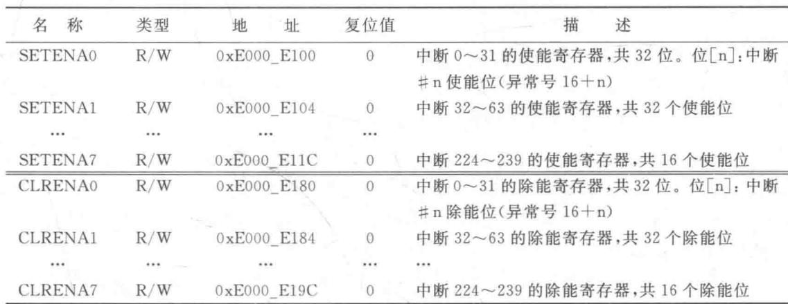

**这张表怎么看**：
- 看**地址列**：SETENA0 在 `0xE000_E100`，CLRENA0 在 `0xE000_E180`。两者相差 0x80。
- 看**描述列**：位[n] 对应"中断 #n"，而它的**异常号是 16+n**。
- 看**"8 对"**：因为 Cortex-M3 最多 240 个外部中断，240 ÷ 32 = 7.5，所以要 8 个 32 位寄存器。

#### 地址链可视化

```
0xE000E000  ← NVIC 基地址
    + 0x100
    = 0xE000E100  ← SETENA0（使能中断 0~31）
    + 0x080
    = 0xE000E180  ← CLRENA0（除能中断 0~31）
```

#### ASCII 位图：SETENA0

```
 31                              8   7   6   5   4   3   2   1   0
+--------------------------------+---+---+---+---+---+---+---+---+
|       中断 #31 ~ #8            |#7 |#6 |#5 |#4 |#3 |#2 |#1 |#0 |
+--------------------------------+---+---+---+---+---+---+---+---+
                                      ↑
                              当前关心的位：写 1 就使能中断 #7
```

**每一位的含义**：

| 位 | 写 0 | 写 1 | 操作后硬件发生什么 |
|---|---|---|---|
| bit n | **没有任何效果**（保持原状态） | 使能中断 #n | 该中断的请求以后可以送达 CPU |

**程序里怎么写？**

```c
/* 使能中断 #7：只把 bit7 写 1，其他位写 0 也不会误伤别人 */
NVIC->ISER[0] = (1 << 7);      /* 1<<7 = 0x00000080 */
```

【补充解释】教材和固件库里管 SETENA0 叫 `NVIC_ISER0`（Interrupt Set-Enable Register），CLRENA0 叫 `NVIC_ICER0`。名字不同，说的是同一个寄存器。

**写 1 到 CLRENA0 的 bit7 会怎样？** 中断 #7 被关闭。以后它的请求会被"挡在门外"。

#### 【容易搞混】

- **写 0 到 SETENA0 不会关闭中断！** 很多人以为"写 0 就是关"，错。关中断必须写 **CLRENA**。
- **SETENA0 是可以读的**，教材表 7-2 把它标为 **R/W** 是正确的。前面刚说过：`SETENA0` 就是 `NVIC_ISER0`（Interrupt **S**et-**E**nable **R**egister，中断使能置位寄存器），两者是同一个寄存器的两个名字。
  - **写**：写 1 使能对应中断；写 0 没有任何效果（不影响该位原来的值）。
  - **读**：读出来的就是每一位**当前的使能状态**——bit n 读出 1 表示"中断 #n 现在是使能的"，读出 0 表示"中断 #n 现在是除能的"。
- 所以想查"某个中断目前开着还是关着"，**直接读 `SETENA0`（`NVIC_ISER0`）就行**，不要绕到别的寄存器去。真正"只能读、不能写"的是**活动状态寄存器**（`ACTIVE0` / `NVIC_IABR`，见 7.2.5）。

> 【补充解释】"置位寄存器"这个叫法描述的是**写**的行为（写 1 把它置位），并不等于"只写不能读"。在 Cortex-M3 里，使能状态是**一份数据、两个写入窗口**：ISER 负责"置位 / 查看"，ICER 负责"清零"。要改状态得写对应的地址，要查看状态读 ISER 即可。

### 7.2.3 中断的挂起与解挂

#### 用大白话理解

**挂起（Pending）** = "这件事我记下来了，但现在还轮不到处理，先排队。"

什么时候会挂起？【教材内容】教材 p189：

> 如果中断发生时，正在处理同级或高优先级异常，或者被屏蔽，则中断不能立即得到响应。**此时中断被挂起。** 中断的挂起状态可以通过设置中断挂起寄存器（SETPEND）和中断挂起清除寄存器（CLRPEND）来读取。还可以对它们写入值实现**手工挂起中断**或**清除挂起**，清除挂起简称为**解挂**。

**为什么需要挂起机制？**

因为中断可能"一闪而过"。如果 CPU 正忙着处理一个更紧急的中断，等它忙完，原来的信号可能已经消失了。所以硬件必须**先把这个请求记住**（置挂起位），等 CPU 有空了再处理。

#### 【教材内容】表 7-3 SETPEND/CLRPEND 寄存器族

| 名称 | 类型 | 地址 | 复位值 | 描述 |
|---|---|---|---|---|
| SETPEND0 | R/W | 0xE000_E200 | 0 | 中断 0~31 的挂起寄存器，共 32 位。位[n]：中断 #n 挂起位（异常号 16+n） |
| SETPEND1 | R/W | 0xE000_E204 | 0 | 中断 32~63 的挂起寄存器，共 32 个挂起位 |
| … | … | … | … | |
| SETPEND7 | R/W | 0xE000_E21C | 0 | 中断 224~239 的挂起寄存器，共 16 个挂起位 |
| CLRPEND0 | R/W | 0xE000_E280 | 0 | 中断 0~31 的解挂寄存器，共 32 位。位[n]：中断 #n 解挂位（异常号 16+n） |
| CLRPEND1 | R/W | 0xE000_E284 | 0 | 中断 32~63 的解挂寄存器，共 32 个解挂位 |
| … | … | … | … | … |
| CLRPEND7 | R/W | 0xE000_E29C | 0 | 中断 224~239 的解挂寄存器，共 16 个解挂位 |

**教材原表**：

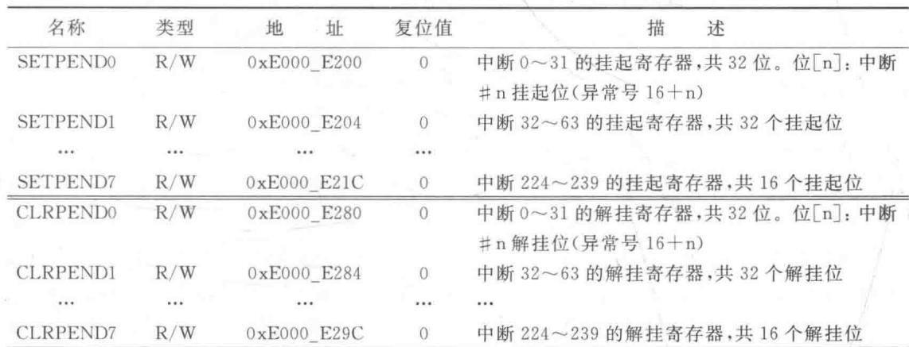

**这张表怎么看**：
- 结构和表 7-2 **完全一样**，只是地址段从 `0xE000_E200` 开始。
- 对比一下：SETENA0 = `0xE000_E100`，SETPEND0 = `0xE000_E200`，相差 0x100。
- 用法也完全一样：**写 1 有效，写 0 无效**。

#### ASCII 位图：SETPEND0

```
 31                              8   7   6   5   4   3   2   1   0
+--------------------------------+---+---+---+---+---+---+---+---+
|       中断 #31 ~ #8            |#7 |#6 |#5 |#4 |#3 |#2 |#1 |#0 |
+--------------------------------+---+---+---+---+---+---+---+---+
                                      ↑
                              读这里 = 1，说明中断 #7 正在排队等待
```

| 位 | 读出来是 0 | 读出来是 1 | 写入 1 的效果 |
|---|---|---|---|
| bit n | 中断 #n 没有待处理的请求 | 中断 #n 已挂起（在排队） | 手工把这个中断"挂起"（等于软件模拟了一次中断请求） |

**解挂怎么写？**

```c
NVIC->ICPR[0] = (1 << 7);   /* 往 CLRPEND0 的 bit7 写 1 = 清除中断 #7 的挂起 */
```

#### 地址链

```
0xE000E000 + 0x200 = 0xE000E200   ← SETPEND0（挂起）
0xE000E000 + 0x280 = 0xE000E280   ← CLRPEND0（解挂）
```

### 7.2.4 优先级寄存器

#### 【教材内容】

> 每个外部中断都有一个对应的优先级寄存器，每个寄存器占用 **8 位**，Cortex-M3 最多使用 8 位，最少使用 3 位。**4 个相邻的优先级寄存器拼成一个 32 位寄存器。** 根据优先级组的设置，优先级可以被分为高低两个位段，分别是抢占优先级和副优先级。优先级寄存器都可以按字节访问，当然也可以按半字/字来访问。优先级寄存器数目由芯片厂商实现的中断数目决定。

#### 【教材内容】表 7-4 中断优先级寄存器阵列

| 名称 | 类型 | 地址 | 复位值 | 描述 |
|---|---|---|---|---|
| PRI_0 | R/W | 0xE000_E400 | 0（8 位） | 外中断 #0 的优先级 |
| PRI_1 | R/W | 0xE000_E401 | 0（8 位） | 外中断 #1 的优先级 |
| … | … | … | … | … |
| PRI_239 | R/W | 0xE000_E4EF | 0（8 位） | 外中断 #239 的优先级 |
| PRI_4E | | 0xE000_ED18 | | 存储器管理 Fault 的优先级 |
| PRI_5E | | 0xE000_ED19 | | 总线 Fault 的优先级 |
| PRI_6E | | 0xE000_ED1A | | 用法 Fault 的优先级 |
| PRI_11E | | 0xE000_ED1F | | SVC 优先级 |
| PRI_12E | | 0xE000_ED20 | | 调试监视器的优先级 |
| PRI_14E | | 0xE000_ED22 | | PendSV 的优先级 |
| PRI_15E | | 0xE000_ED23 | | SysTick 的优先级 |

**教材原表**：

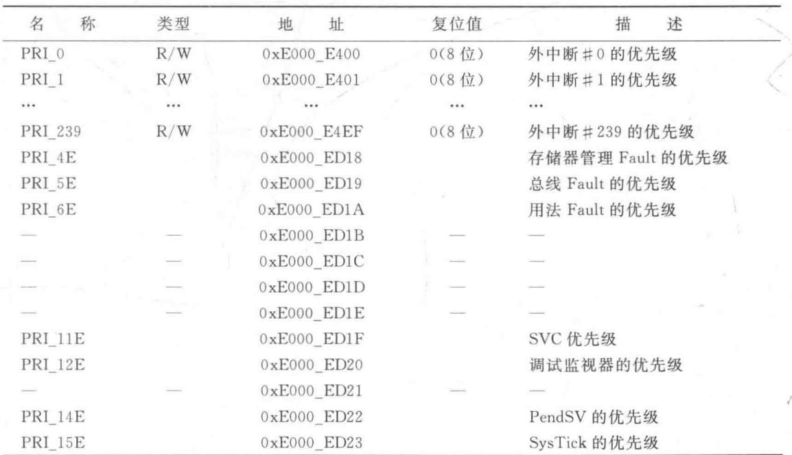

**这张表怎么看**：
- 注意地址：PRI_0 在 `0xE000_E400`，PRI_1 在 `0xE000_E401`——**每个中断只占 1 个字节（8 位）**，所以地址每次只加 1。
- 4 个相邻的字节拼成一个 32 位寄存器，例如 PRI_0~PRI_3 拼成 `0xE000_E400` 这个 32 位寄存器。
- 下面那一批 `PRI_4E`、`PRI_5E`…… 是**内核异常**的优先级，它们在另一段地址 `0xE000_ED18` 附近。名字里的数字是异常号，E 表示 Exception。

【教材内容】教材接着强调：

> 每个中断优先级寄存器占用 8 位，保存优先级的数值（0~255），**数值越小，相应中断的优先级越高**。STM32 **只使用了 8 位中的高 4 位（bits[7:4]），低 4 位读出时为 0，写入时被忽略。** 高 4 位又被划分两段，即有多少位用于抢占式优先级，有多少位用于副优先级。

#### 【先补一个前置知识：为什么"数值越小优先级越高"？】

这是 ARM 的规定，和人的直觉相反。记住一句话就行：

> **在 Cortex-M3 里，优先级数字越小 = 越优先。**

0 是最高优先级，15 是最低（在 4 位的情况下）。

#### ASCII 位图：一个优先级寄存器（PRI_n）

```
 7    6    5    4  | 3    2    1    0
+----+----+----+----+----+----+----+----+
|  抢占优先级  |  副优先级  | 未实现（读出为 0，写入被忽略） |
+----+----+----+----+----+----+----+----+
 ← 高 4 位：STM32 真正使用的部分 →
```

以"分组 2"（2 位抢占 + 2 位副）为例：

```
 7    6  |  5    4  | 3    2    1    0
+----+----+----+----+----+----+----+----+
| 抢占(2位) | 副(2位)  |  0  |  0  |  0  |  0  |
+----+----+----+----+----+----+----+----+
   ↑         ↑
 决定能否   决定排队
 嵌套       先后
```

**写 0 会怎样？** 这一位的优先级值变成 0。因为"数字越小越优先"，所以**写 0 = 最高优先级**。

**写入一个具体值的演算**（这是教材示例汇编里用到的）：

```
要写 0xC0
0xC0 = 1100 0000
       ^^^^
       bit7 bit6 bit5 bit4

按"分组 2"（2 位抢占 + 2 位副）切分：
  抢占优先级 = 高 2 位 = 11b = 3
  副优先级   = 低 2 位 = 00b = 0

按"分组 5"（ARM 通用 8 位说法：2 位抢占 + 6 位副）切分：
  抢占优先级 = 高 2 位 = 11b = 3
  副优先级   = 剩下的 6 位 = 000000b = 0
```

**结论**：写 0xC0 表示"抢占优先级 3，副优先级 0"。

#### 地址链

```
0xE000E000 + 0x400 = 0xE000E400   ← PRI_0（中断 #0 的优先级）
0xE000E400 + n     = PRI_n        ← 中断 #n 的优先级
0xE000E400 + 6     = 0xE000E406   ← EXTI0（位置号 6）的优先级寄存器
```

### 7.2.5 活动状态寄存器

#### 【教材内容】

> 每个外部中断都有一个活动状态位。在处理器执行了中断服务程序（ISR）的**第一条指令后**，该中断的活动位就被置 1，并且直到 **ISR 返回时才硬件清零**。由于支持嵌套，允许高优先级异常抢占某个 ISR。然而，哪怕中断被抢占，其活动状态也**依然为 1**（因为直到 ISR 返回时才清零）。活动状态寄存器的定义，与前面的使能/除能寄存器相同，只是不再成对出现。活动状态寄存器是**只读的**。

#### 【教材内容】表 7-6 活动状态寄存器族

| 名称 | 地址 | 复位值 | 描述 |
|---|---|---|---|
| ACTIVE0 | 0xE000_E300 | 0 | 中断 0~31 的活动状态寄存器，共 32 位。位[n]：中断 #n 活动状态（异常号 16+n） |
| ACTIVE1 | 0xE000_E304 | 0 | 中断 32~63 的活动状态寄存器，共 32 个状态位 |
| … | … | … | … |
| ACTIVE7 | 0xE000_E31C | 0 | 中断 224~239 的活动状态寄存器，共 16 个状态位 |

**教材原表**：

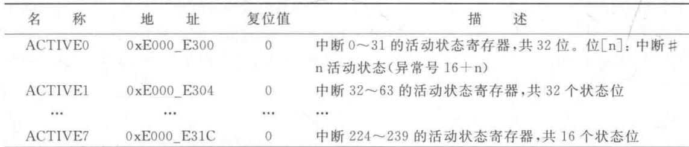

**这张表怎么看**：

1. **先看地址列**：ACTIVE0 在 `0xE000_E300`。把它和表 7-2 的 SETENA0（`0xE000_E100`）一比，正好相差 0x200；和表 7-3 的 SETPEND0（`0xE000_E200`）相差 0x100。这几组寄存器的地址是"排队排下来"的，记住一个就能推出其余。
2. **再看"少了什么"**：表 7-2、表 7-3 都有"类型"列（标 R/W），这张表**没有这一列**。原因就在教材正文那句话里——"**活动状态寄存器是只读的**"：这些位由硬件自动置 1、自动清零，程序只能看，不能写，所以也就无所谓"R/W 类型"了。
3. **看描述列**：和前面两张表一样，"位[n]"对应"中断 #n"，异常号是 16+n。例如 bit6 对应中断 #6，也就是本章主角 EXTI0。
4. **看最后一句话"只是不再成对出现"**：使能、挂起这两类都是"一个置位寄存器 + 一个清除寄存器"成对出现（SETENA/CLRENA、SETPEND/CLRPEND）；活动状态只有**一个**寄存器，读一次就知道"现在有哪些 ISR 正在执行"，不需要"解活动"这种东西。

**这三个寄存器族放在一起对比**（这是理解它们关系最快的方法）：

| 寄存器族 | 回答的问题 | 谁能改 | 复位值 |
|---|---|---|---|
| SETENA（0xE000_E100） | "这个中断**允许**吗？" | 程序写 1 使能（写 0 无效） | 0 |
| SETPEND（0xE000_E200） | "有没有请求在**排队**？" | 硬件置 1，程序写 1 清除 | 0 |
| ACTIVE（0xE000_E300） | "它的 ISR **正在跑**吗？" | **只有硬件能改，程序只读** | 0 |

#### ASCII 位图：ACTIVE0

```
 31                              8   7   6   5   4   3   2   1   0
+--------------------------------+---+---+---+---+---+---+---+---+
|       中断 #31 ~ #8            |#7 |#6 |#5 |#4 |#3 |#2 |#1 |#0 |
+--------------------------------+---+---+---+---+---+---+---+----+
                                      ↑
                              读这里 = 1，说明中断 #7 的 ISR 正在执行
```

| 位 | 0 的含义 | 1 的含义 |
|---|---|---|
| bit n | 中断 #n 的 ISR 没在执行 | 中断 #n 的 ISR 正在执行（或被执行过、尚未返回） |

**注意三个区别**：

| 寄存器 | 回答的问题 | 谁写 |
|---|---|---|
| SETENA（使能） | "这个中断允许吗？" | 程序写 |
| SETPEND（挂起） | "有没有请求在排队？" | 硬件自动置 1，程序清除 |
| ACTIVE（活动） | "它的 ISR 正在跑吗？" | 硬件自动置 1 / 清 0，程序不能写 |

### 7.2.6 特殊功能寄存器：PRIMASK、FAULTMASK、BASEPRI

前面讲的都是"管某一个中断"的寄存器。这一小节讲的是"**管一大片**"的寄存器，统称**异常屏蔽寄存器**。

#### 【先补一个前置知识：这三个名字分别是什么意思？】

三个名字都是英文缩写拼起来的，先把它们拆开：

| 缩写 | 英文全称 | 中文 | 大白话 |
|---|---|---|---|
| PRIMASK | **PRI**ority **MASK** register | 优先级屏蔽寄存器 | "把普通中断**全部挡住**"的总开关 |
| FAULTMASK | **FAULT** **MASK** register | 故障屏蔽寄存器 | "**连 HardFault 也一起挡住**"的总开关 |
| BASEPRI | **BASE** **PRI**ority **MASK** register | 基准优先级屏蔽寄存器 | "划一条**门槛线**，只挡数字上比它低的中断" |

**它们和前面那些寄存器有一个重要区别**：

- NVIC 的寄存器（`SETENA`、`PRI_n` 等）是**存储器映射**的——有地址，程序用指针就能读写；
- 而 PRIMASK、FAULTMASK、BASEPRI 是 **CPU 内核内部的特殊寄存器（special register）**，**没有内存地址**，只能用 **MRS**（读）/ **MSR**（写）这两条汇编指令访问，或者用 `CPS` 指令快速开关。

**它们存的都是"优先级阈值/开关"，不是"中断编号"**——所以下面的例子里写进去的是 `0x60`、`0x40` 这样的**优先级数值**，而不是"第几个中断"。

**【先补一个前置知识：MRS / MSR / CPS 是什么？】**

| 指令 | 全称 | 干什么 |
|---|---|---|
| MRS | **M**ove from special register to **R**egister | 把特殊寄存器的值**读**到通用寄存器，例如 `MRS R0, PRIMASK` |
| MSR | **M**ove to **S**pecial register from **R**egister | 把通用寄存器的值**写**进特殊寄存器，例如 `MSR PRIMASK, R0` |
| CPS | **C**hange **P**rocessor **S**tate | 一条指令直接改处理器状态：`CPSID I` = 关中断，`CPSIE I` = 开中断，比"MOV + MSR"两条更省事 |

#### 【教材内容】PRIMASK 与 FAULTMASK

> PRIMASK 用于除能 NMI 和硬 Fault 之外的所有异常，它有效地把当前优先级改为 0（可编程优先级中的最高优先级）。

**大白话**：`PRIMASK = 1` 就是"**关掉所有普通中断**"，只剩 NMI 和 HardFault 还能进来。

教材给出的汇编写法：

```asm
; 1）关中断
MOV R0, #1
MSR PRIMASK, R0        ; PRIMASK = 1

; 2）开中断
MOV R0, #0
MSR PRIMASK, R0        ; PRIMASK = 0
```

也可以用一条更简单的 `CPS` 指令：

```asm
CPSID I    ; 关中断，PRIMASK = 1   （I 表示 Interrupt）
CPSIE I    ; 开中断，PRIMASK = 0
CPSID F    ; 关中断，FAULTMASK = 1 （F 表示 Fault）
CPSIE F    ; 开中断，FAULTMASK = 0
```

**PRIMASK 和 FAULTMASK 的区别**：

| 寄存器 | 能屏蔽什么 | 有什么特殊行为 |
|---|---|---|
| PRIMASK | 除 NMI 和 HardFault 外的所有异常 | 需要程序自己清 0 |
| FAULTMASK | 除 NMI 外的**所有**异常（连 HardFault 也能挡） | **异常退出时会自动清零** |

> 【教材内容】注意：屏蔽寄存器**不能屏蔽 NMI 中断**。

**【类比】** PRIMASK 就像把办公室门锁上："普通访客都别进来，但消防员（NMI）和急救员（HardFault）有钥匙。"

**类比的边界**：真实硬件里这是 CPU 内部一个 bit，比较的也是优先级数值，不是"人"。

**什么时候用？** 当程序在操作一段"绝对不能被打断"的数据（比如修改一个被中断和主程序同时访问的变量）时，会临时关中断，改完再打开。

#### 【教材内容】BASEPRI 寄存器

> 如果只屏蔽优先级低于某一阈值的中断（即它们的优先级在数字上大于或等于某个数），则可以使用 BASEPRI 存储这个数字。如果往 BASEPRI 中写 0，BASEPRI 将停止屏蔽任何中断。

**大白话**：PRIMASK 是"全关"，BASEPRI 是"**只挡优先级不够高的小兵，放行优先级够高的大将**"。

教材例子：

```asm
; 屏蔽所有优先级不高于 0x60 的中断
MOV R0, #0x60
MSR BASEPRI, R0

; 取消屏蔽
MOV R0, #0
MSR BASEPRI, R0
```

**注意这里的"不高于"要理解准确**：优先级数值**大于或等于** 0x60 的（也就是"级别更低"的）中断会被屏蔽；优先级数值**小于** 0x60 的（级别更高的）还能进来。

#### BASEPRI 和 BASEPRI_MAX 的区别

教材有一段很有意思的说明：

> BASEPRI_MAX 和 BASEPRI 其实是**同一个寄存器**。但是当使用 BASEPRI_MAX 这个名字时，会使用一个**条件写操作**……使用 BASEPRI 时，可以任意设置新的优先级阈值；但是使用 BASEPRI_MAX 时则"**许进不许出**"——只允许新的优先级阈值比原来的那个在数值上更小，也就是说，只能一次次地**扩大屏蔽范围**，反之则不行。

教材例子：

```asm
MOV R0, #0x60
MSR BASEPRI_MAX, R0    ; 屏蔽优先级不高于 0x60 的中断
MOV R0, #0xF0
MSR BASEPRI_MAX, R0    ; 本次设置被忽略，因为 0xF0 比 0x60 的优先级低
MOV R0, #0x40
MSR BASEPRI_MAX, R0    ; 扩大屏蔽范围到优先级不高于 0x40 的中断
```

**为什么要有这种"只能扩大"的设计？**

因为 BASEPRI 常用于"临界区嵌套"：函数 A 屏蔽了一部分中断，调用了函数 B，B 又屏蔽了一部分。B 结束时如果允许它"放松"屏蔽，就会把 A 的保护也破坏掉。BASEPRI_MAX 保证**内层只能更严格，不能更宽松**，从而不会意外放行。

> 【教材内容】为了把屏蔽阈值降低或者解除屏蔽，需要使用 BASEPRI 这个名字。在用户级下不能更改 BASEPRI 寄存器。

> 【教材内容】与其他和优先级有关的寄存器一样，系统中表达优先级的位数，也同样影响 BASEPRI 中有意义的位数。如果系统中只使用 3 个位来表达优先级，则 BASEPRI 有意义的值仅为 0x00、0x20、0x40、0x60、0x80、0xA0、0xC0 以及 0xE0。

**为什么是这些值？** 因为 3 位只能表示 8 个级别，这 8 个值正好是"把 3 位放在 8 位寄存器的高 3 位"的结果：

```
0x20 = 0010 0000
0x40 = 0100 0000
0x60 = 0110 0000
0x80 = 1000 0000
0xA0 = 1010 0000
0xC0 = 1100 0000
0xE0 = 1110 0000
```

每两个相邻值之间差 0x20，正好是"高 3 位变 1"的效果。

### 7.2.7 中断系统设置过程

#### 【教材内容】教材给出的 6 步

> 设置一个外部中断的过程如下：
>
> （1）系统启动后，先设置**优先级分组寄存器**。默认情况下使用组 0（7 位抢占优先级，1 位副优先级）。
> （2）如果需要**重定位向量表**，先把硬 Fault 和 NMI 服务例程的入口地址写到新表项所在的地址中。
> （3）配置**向量表偏移量寄存器**，使之指向新的向量表（如果有重定位的话）。
> （4）为该中断**建立中断向量**。因为向量表可能已经重定位了，保险起见需要先读取向量表偏移量寄存器的值，再根据该中断在表中的位置，计算出对应的表项，再把服务例程的入口地址填写进去。如果一直使用 ROM 中的向量表，则无需此步骤。
> （5）为该中断**设置优先级**。
> （6）**使能**该中断。

**【补充解释】这 6 步在"用固件库开发"时的实际情况**

第 (2)(3)(4) 步都是"**只有当你把向量表搬到别的地方时才需要**"。在 Keil 里用固件库开发、程序存在 Flash 里时，向量表就在 Flash 开头，**这 3 步全部省略**。

所以教材紧接着说：

> 如果应用程序存储在 ROM 中，并且不需要改变异常服务程序，则可以把整个向量表编码到 ROM 的起始区域（从 0 地址开始的那段）。在这种情况下，向量表的偏移量将一直为 0，并且中断向量一直在 ROM 中，因此上例可以大大简化，只需 3 步：
> （1）建立优先级组；
> （2）为该中断指定优先级；
> （3）使能该中断。

**这 3 步就是 7.5 节固件库例程真正做的事情。**

#### 【教材内容】教材给出的汇编示例（逐行拆解）

这段汇编是本章唯一一段完整汇编，虽然实际开发中很少手写，但它把"寄存器到底怎么操作"讲得最清楚，所以一定要看懂。

```asm
LDR R0, = 0xE000ED0C      ; 应用程序中断及复位控制寄存器（AIRCR）
LDR R1, = 0x05FA0500      ; 使用优先级组 5（2/6）
STR R1, [R0]              ; 设置优先级组
```

**逐行解释**：

| 代码 | CPU 做什么 | 寄存器发生什么 | 硬件发生什么 |
|---|---|---|---|
| `LDR R0, = 0xE000ED0C` | 把常数 `0xE000ED0C` 装进 R0 | R0 = 0xE000ED0C（这是 AIRCR 的地址） | 没有硬件动作，只是准备地址 |
| `LDR R1, = 0x05FA0500` | 把常数 `0x05FA0500` 装进 R1 | R1 = 0x05FA0500 | 同上 |
| `STR R1, [R0]` | 把 R1 的值写到 R0 指向的地址 | 内存地址 0xE000ED0C 处被写入 0x05FA0500 | **AIRCR 的 PRIGROUP 位段被设置**，优先级分组方式改变 |

**`0x05FA0500` 这个数怎么读？**

```
0x05FA0500
拆成 32 位：
0000 0101 1111 1010 0000 0101 0000 0000
[   VECTKEY   ] [ 保留 ] [PRIGROUP] [ 保留/其他 ]
```

- 高 16 位 `0x05FA`：是**写操作的"钥匙"**。教材说："要对这个寄存器写操作，必须在 VECTKEY 位段中写入 0x5FA，否则写操作无效。" 这是一种防误写保护。
- 低 16 位 `0x0500`：

```
0x0500 = 0000 0101 0000 0000
                  ↑     ↑
                bit10  bit8
```

bit[10:8] = `101`（二进制）= 5 → **PRIGROUP = 5**。

【补充解释】PRIGROUP = 5 在 ARM 的通用 8 位说法里表示"**2 位抢占 + 6 位副**"（这就是注释里"2/6"的意思）。在 STM32F103VET6 上，因为只实现高 4 位，所以实际是"**2 位抢占 + 2 位副**"，也就是固件库里的 `NVIC_PriorityGroup_2`。

#### AIRCR 寄存器位图

```
 31                          16 15 14    11 10   8  7    3  2  1  0
+-----------------------------+--+--------+------+------+--+--+--+--+
|  VECTKEY（写 0x5FA）        |E |  保留  |PRIGRP| 保留 |SR|VC|VR|
+-----------------------------+--+--------+------+------+--+--+--+--+
  读出来是 0xFA05               r            rw           w  w  w
```

| 位段 | 名称 | 含义 |
|---|---|---|
| [31:16] | VECTKEY / VECTKEYSTAT | 写：必须写 0x5FA 才生效；读：读出 0xFA05 |
| [15] | ENDIANESS | 数据端模式，读出为 0（小端模式） |
| [14:11] | 保留 | 必须保持 0 |
| **[10:8]** | **PRIGROUP** | **中断优先级分组位段（本段重点）** |
| [7:3] | 保留 | 保持 0 |
| [2] | SYSRESETREQ | 系统复位请求 |
| [1] | VECTCLRACTIVE | 调试用，写时必须写 0 |
| [0] | VECTRESET | 调试用，写时必须写 0 |

**AIRCR 的地址链**：

```
0xE000E000  ← 系统控制空间基地址
    + 0xED00
    = 0xE000ED00  ← SCB 基地址
    + 0x0C
    = 0xE000ED0C  ← AIRCR 的门牌号
```

#### 继续看汇编：向量表重定位

```asm
MOV R4, #8                        ; ROM 中的向量表
LDR R5, = (NEW_VECT_TABLE + 8)
LDMIA R4!, {R0-R1}                ; 读取 NMI 和硬 fault 的向量
STMIA R5!, {R0-R1}                ; 拷贝它们的向量到新表中
```

| 代码 | 做什么 | 为什么 |
|---|---|---|
| `MOV R4, #8` | R4 = 8 | 向量表里 NMI 在偏移 8（地址 0x8），HardFault 在偏移 12（地址 0xC） |
| `LDR R5, = (NEW_VECT_TABLE + 8)` | R5 = 新向量表地址 + 8 | 让 R5 也指向"新表里 NMI 的位置" |
| `LDMIA R4!, {R0-R1}` | 从 R4 指向的地址连续读 2 个字到 R0、R1，然后 R4 自动加 8 | R0 = 旧表的 NMI 入口地址，R1 = 旧表的 HardFault 入口地址 |
| `STMIA R5!, {R0-R1}` | 把 R0、R1 连续写到 R5 指向的地址 | 新表的 NMI、HardFault 项被填好 |

**【补充解释】为什么要先拷 NMI 和 HardFault？**

因为这两个异常优先级最高、最紧急。如果向量表刚搬走还没填好，此时恰好发生硬件错误，CPU 就会跑到新表里一个"空位"上，程序立刻跑飞。**先填这两项，是为了保证搬迁过程中系统仍然安全**——这是很典型的工程思维。

```asm
LDR R0, = 0xE000ED08              ; 向量表偏移量寄存器的地址（VTOR）
LDR R1, = NEW_VECT_TABLE
STR R1, [R0]                      ; 把向量表重定位
```

这一步把 VTOR 写成新表地址，从此 CPU 找中断入口就去新表找。

```asm
LDR R0, = IRQ7_Handler            ; 取得 IRQ #7 服务例程的入口地址
LDR R1, = 0xE000ED08              ; 向量表偏移量寄存器的地址
LDR R1, [R1]                      ; 读出 VTOR 的值（新表基地址）
ADD R1, R1, #(4 * (7 + 16))       ; 计算 IRQ #7 服务例程的入口地址
STR R0, [R1]                      ; 在向量表中写入 IRQ #7 服务例程的入口地址
```

**这里就是 7.1 节那个公式的实际使用**：

```
4 × (7 + 16) = 4 × 23 = 92 = 0x5C
```

查表 7-1：位置 7 是 EXTI1，向量地址 `0x0000_005C`。✓ 完全对上。

| 代码 | 做什么 |
|---|---|
| `LDR R0, = IRQ7_Handler` | R0 里放进函数 `IRQ7_Handler` 的入口地址 |
| `LDR R1, [R1]` | 把 VTOR 的值读出来，得到向量表基地址 |
| `ADD R1, R1, #(4*(7+16))` | 基地址 + 偏移 0x5C = IRQ#7 那一格的门牌号 |
| `STR R0, [R1]` | 把函数地址写进那一格 |

```asm
LDR R0, = 0xE000E400              ; 外部中断优先级寄存器阵列的基地址
MOV R1, #0xC0
STRB R1, [R0, #7]                 ; 把 IRQ #7 的优先级设置为 0xC0
```

**注意 `STRB`**：末尾的 B 表示"按**字节**（Byte）写"，只写 1 个字节。

```
0xE000E400 + 7 = 0xE000E407
```

所以这一句的意思是：**把 0xE000E407 这个字节写成 0xC0**，也就是把中断 #7 的优先级设为 0xC0（抢占优先级 3，副优先级 0）。

```asm
LDR R0, = 0xE000E100              ; SETEN 寄存器的地址
MOV R1, #(1 << 7)                 ; 置位 IRQ #7 的使能位
STR R1, [R0]                      ; 使能 IRQ #7
```

```
1 << 7 = 0x00000080 = 0000 0000 0000 0000 0000 0000 1000 0000
                                                          ↑
                                                        bit7
```

**这一句就是"打开中断 #7 的开关"。**

至此，6 步全部完成。

### 7.2.8 中断响应过程：硬件到底做了什么？

这是本章最核心、也最容易含糊过去的部分。我们分成 5 步慢慢来。

#### 第一步：先看最简单的时间轴

【教材内容】教材第 2 章把中断过程画成了一张很简单的图：

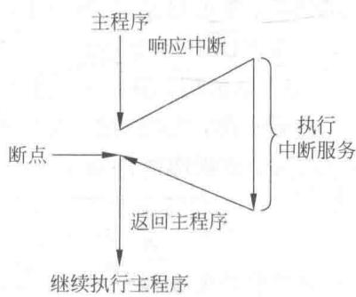

**这张图怎么看**：
- 中间那条竖线是"**主程序在往下执行**"。
- 左边那条斜线：**响应中断**，程序离开主程序。
- 中间那段：**执行中断服务**。
- 右边那条斜线：**返回主程序**。
- 最下面：**继续执行主程序**。
- "**断点**"两个字标在主程序线上，意思是"主程序被打断的那个位置"。

**这张图要你理解**：中断是一个"**V 字形**"的岔路——出去，办完事，原路回来。

#### 第二步：加入具体指令，画完整时间轴

现在我们把"主程序"具体化成 5 条指令 A、B、C、D、E。

**正常情况**：

```
A → B → C → D → E → （继续）
```

**C 执行完、D 还没执行时，来了中断**：

```
A → B → C ──┐
            │ ① 保存现场（硬件自动压栈 8 个字）
            │ ② 取向量（从向量表取出 ISR 地址，装进 PC）
            ↓
        【执行 ISR】
            │ ③ 恢复现场（硬件自动出栈）
            ↓
            └──→ D → E → （继续）
```

**【辅助理解图】中断响应全过程时间轴（从 A 到 E）**

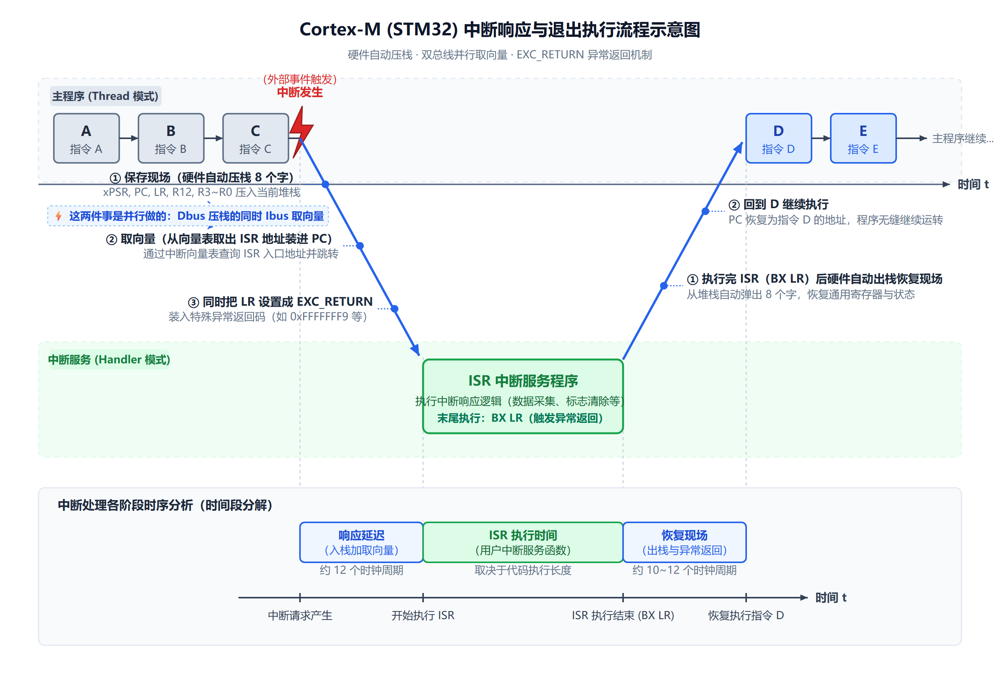

**看图方法**：
1. 横轴是时间，从左到右。
2. 上面一排方块是主程序：A、B、C 是灰的（已经执行完），D、E 是蓝的（中断返回后才执行）。
3. C 和 D 之间那个红色闪电就是"中断请求到达"。
4. 下面绿色大方块是 ISR。
5. **重点看两条斜线上的编号**：下去的斜线是"保存现场 → 取向量"，上来的斜线是"恢复现场 → 回到 D"。
6. 图里那条虚线箭头说明：**保存现场和取向量是并行做的**。

**为什么是"从 D 继续"而不是"从 C 重新执行"？**

因为 C 已经执行完了。CPU 压栈时保存的 PC 值，是"**下一条本该执行的指令的地址**"，也就是 D 的地址。所以出栈后 PC 恢复成 D，程序自然从 D 继续。这就是"不重不漏"的关键。

#### 第三步：保存现场——到底保存了哪些东西？

【教材内容】教材 p185：

> 当异常发生时，Cortex-M3 通过硬件自动将程序计数器（PC）、程序状态寄存器（xPSR）、链接寄存器（LR）和 R0~R3、R12 等寄存器压进堆栈。

一共 **8 个寄存器**：

| 寄存器 | 是什么 | 为什么要保存它 |
|---|---|---|
| R0 | 通用寄存器 | 主程序可能正在用它算数 |
| R1 | 通用寄存器 | 同上 |
| R2 | 通用寄存器 | 同上 |
| R3 | 通用寄存器 | 同上 |
| R12 | 通用寄存器 | 同上 |
| LR | 链接寄存器（Link Register） | 保存函数的返回地址，ISR 会用到 LR |
| PC | 程序计数器（Program Counter） | 保存"下一条要执行的指令地址"，回来时靠它 |
| xPSR | 程序状态寄存器（Program Status Register） | 保存标志位（进位、零、负、溢出等）和当前执行状态 |

**为什么只保存这 8 个？**

因为 ARM 的**调用规范**规定：函数调用时，R0~R3 和 R12 是"调用者不管、被调用者随便用"的临时寄存器（调用者保存），而 R4~R11 是"被调用者必须自己保护"的（被调用者保存）。ISR 也是一个"函数"，所以它**只需要硬件帮忙保存 R0~R3、R12 这 5 个临时寄存器**，其余由编译器在 ISR 里自己处理。

**【辅助理解图】中断入栈：硬件自动往栈里放 8 个字**

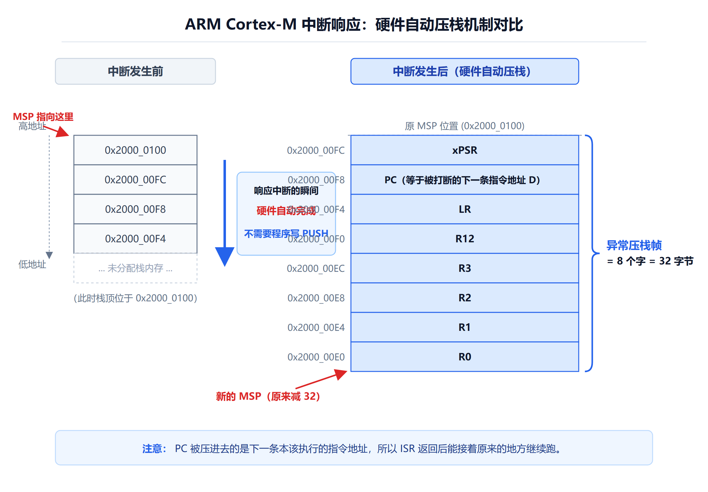

**看图方法**：
1. 左列是"中断前"：MSP 指向栈顶（栈是从高地址往低地址长的，所以"栈顶"在低地址）。
2. 右列是"中断后"：MSP 往下移了 32 字节，这 32 字节里多了 8 个格子。
3. 从高地址到低地址依次是：**xPSR、PC、LR、R12、R3、R2、R1、R0**。
4. 也就是说，**新的 MSP 正好指向 R0**。
5. **这张图要你理解**：压栈是"硬件自动"的，程序里**一条 PUSH 指令都不用写**，而且只花了几个时钟周期。

**栈里 8 个字的具体排布**（以新的 MSP 为基准）：

```
地址（相对新 MSP）        内容
+0x20                  ← 压栈前的 MSP 指着这里（= 新 MSP + 0x20，在 xPSR 上面一格）
+0x1C  ┌──────────────┐
       │    xPSR      │
+0x18  ├──────────────┤
       │    PC        │  ← 被打断的下一条指令地址（D 的地址）
+0x14  ├──────────────┤
       │    LR        │
+0x10  ├──────────────┤
       │    R12       │
+0x0C  ├──────────────┤
       │    R3        │
+0x08  ├──────────────┤
       │    R2        │
+0x04  ├──────────────┤
       │    R1        │
+0x00  ├──────────────┤   ← 压栈后的 MSP（新的栈顶）
       │    R0        │
       └──────────────┘
```

**看清楚这个 0x20**：压栈前 MSP 指向"旧栈顶"，压栈 8 个字（共 0x20 字节）后，新 MSP = 旧 MSP − 0x20。反过来写就是：

```
压栈前的 MSP = 压栈后的 MSP + 0x20
```

所以"压栈前的 MSP"落在 **+0x20** 这一行，而不是 xPSR 所在的 +0x1C 那一行——它就贴在 xPSR 上面一格。这是刚开始算栈地址时最容易错 4 个字节的地方。

**教材原图：内部入栈序列**

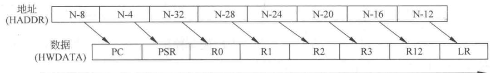

**这张图怎么看**：
1. 上面一行是**地址（HADDR）**，下面一行是**数据（HWDATA）**。
2. 箭头表示"这个数据被写到这个地址"。
3. **注意顺序**：图上从左到右的写入顺序是 **PC、PSR(xPSR)、R0、R1、R2、R3、R12、LR**——这是**总线上数据写的先后顺序**。
4. 而地址那一行的顺序是打乱的（N-8、N-4、N-32、N-28……），说明**写栈的顺序不等于栈里最终排列的顺序**。
5. **最终排列顺序**是固定的：R0 在最低地址（新的 MSP 处），xPSR 在最高地址。

**这张图要你理解**：硬件在总线上是"一个一个写"的，但最终栈帧的布局是固定的 8 个字。

#### 第四步：取向量——CPU 怎么知道该跳去哪？

【教材内容】教材 p185：

> 在 Dbus（数据总线）保存处理器状态的同时，处理器通过 Ibus（指令总线）从一个可以重新定位的向量表中识别出异常向量，并获取 ISR 函数的地址，也就是**保护现场与取异常向量是并行处理的**。

**【先补一个前置知识：Dbus 和 Ibus 是什么？】**

Cortex-M3 采用**哈佛结构**（第 1、2 章讲过）：指令和数据走不同的总线。

| 总线 | 全称 | 干什么 |
|---|---|---|
| **Ibus** | Instruction bus，指令总线 | 取指令、取中断向量 |
| **Dbus** | Data bus，数据总线 | 读写数据（包括压栈） |

**为什么"并行"很重要？**

因为压栈（写数据）走 Dbus，取向量（读地址）走 Ibus，**两条总线互不干扰，可以同时进行**。这就省下了大量时间——如果串行做，中断响应延迟会翻倍。

**取向量的具体过程**：

```
① 硬件知道刚刚响应的是"异常号 N"
        ↓
② 算出向量表里那一格的位置：地址 = 向量表基地址 + 4 × N
        ↓
③ 从那一格读出一个 32 位数 —— 这就是 ISR 的入口地址
        ↓
④ 把这个地址装进 PC
        ↓
⑤ 同时把 LR 设置成 EXC_RETURN（见下一步）
```

**注意第 ⑤ 步和 PC 的关系**：ISR 的入口地址是装进 **PC** 的，而 **LR 被写成了一个特殊值**，不是返回地址。这一点非常反直觉，下面专门讲。

#### 第五步：LR 与 EXC_RETURN——"返回说明书"

**【补充解释】这是本节最难、也最容易被忽略的一点。**

普通函数调用时，LR 里放的是"返回地址"（调用指令的下一条指令的地址）。
但**中断响应时，LR 里放的不是返回地址，而是一个特殊值，叫 EXC_RETURN**。

为什么？因为中断返回要做的事情比普通函数返回复杂：

- 要把压进去的 8 个寄存器弹回来；
- 要知道回哪个模式（线程模式还是处理模式）；
- 要知道用哪个栈（MSP 还是 PSP）。

**光一个返回地址说不清这些，所以硬件干脆把 LR 写成一个"编码了这些信息的特殊值"。**

【教材内容】教材第 2 章的图 2-37、图 2-38 给了三种情况：

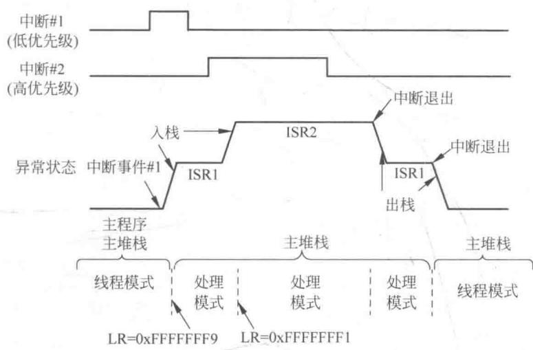

**这张图怎么看**（图 2-37）：
1. 最上面两条是**中断请求信号**：中断 #1（低优先级）先来，中断 #2（高优先级）后来。
2. 中间那条折线是**异常状态**：
   - 主程序（平）→ 入栈 → ISR1（上升）→ **中断 #2 来了，又入栈** → ISR2（更高）→ **中断退出、出栈** → 回到 ISR1 → **中断退出、出栈** → 回到主程序。
3. 最下面一行标出了**当前处在什么模式**：线程模式 → 处理模式 → 处理模式 → 处理模式 → 线程模式。
4. 底部标注了两个关键值：
   - 第一次入栈（从主程序进 ISR1）时：**LR = 0xFFFFFFF9**
   - 第二次入栈（从 ISR1 进 ISR2）时：**LR = 0xFFFFFFF1**
5. 图里还标了"主堆栈"，说明全程用的都是 **MSP**。

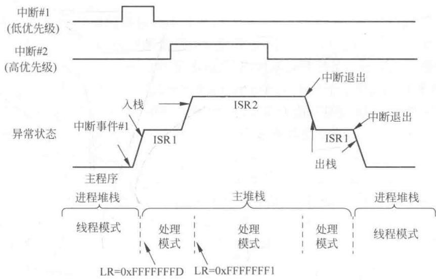

**图 2-38 与图 2-37 的区别**：只有一处——中断前线程模式用的是**进程堆栈 PSP**，所以第一次入栈时 **LR = 0xFFFFFFFD**（而不是 0xFFFFFFF9）。第二次（嵌套）仍然是 0xFFFFFFF1。

**【辅助理解图】LR 里的 EXC_RETURN**

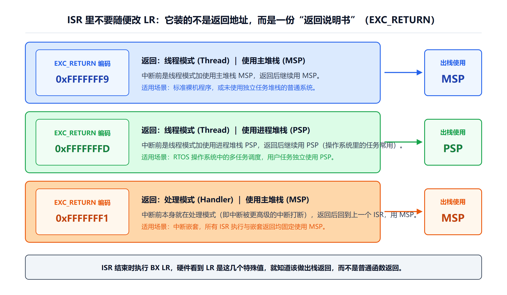

**看图方法**：
1. 三张卡片对应三种情况，左边是 LR 的值，右边是含义。
2. 卡片 1（蓝色）：`0xFFFFFFF9` —— 回**线程模式**，用 **MSP**。这是最常见的情况（裸机程序）。
3. 卡片 2（绿色）：`0xFFFFFFFD` —— 回**线程模式**，用 **PSP**。跑操作系统时，任务都跑在 PSP 上。
4. 卡片 3（橙色）：`0xFFFFFFF1` —— 回**处理模式**，用 **MSP**。说明是被更高级的中断打断了，返回时回到上一个 ISR。
5. **这张图要你理解**：LR 在这里不是"地址"，而是一份"**返回说明书**"。

**EXC_RETURN 的值怎么记？**

```
0xFFFFFFF1  →  返回 Handler 模式（处理模式），用 MSP   ← 1 = 回处理模式
0xFFFFFFF9  →  返回 Thread 模式（线程模式），用 MSP   ← 9 = 回线程模式 + MSP
0xFFFFFFFD  →  返回 Thread 模式（线程模式），用 PSP   ← D = 回线程模式 + PSP
```

> 【复习第 2 章】MSP = Main Stack Pointer（主堆栈指针），PSP = Process Stack Pointer（进程堆栈指针）。复位后默认用 MSP。线程模式（Thread mode）是跑普通程序时的模式；处理模式（Handler mode）是跑 ISR 时的模式。
>
> 【待核验】上述三个 EXC_RETURN 数值属于第 2 章内容，本讲义依据教材图 2-37、图 2-38 的标注整理，如与第 2 章正文表述不一致，请以第 2 章为准。

#### 【重要】ISR 结束时怎么返回？

ISR 的 C 代码最后一条隐含操作，编译后是一条：

```asm
BX LR      ; 跳转到 LR 指向的"地址"
```

**关键在于**：因为 LR 里是 `0xFFFFFFF9` 这样的特殊值（不是普通地址），**硬件识别出这个特殊值后，不会真的跳到那个地址，而是执行"异常返回"动作**：

```
① 从栈里把 8 个寄存器弹回来（R0~R3、R12、LR、PC、xPSR）
② PC 被恢复成 D 的地址 → 程序从 D 继续
③ 模式从"处理模式"切回"线程模式"
④ 活动状态位自动清零
```

**注意**：这一步**也是硬件自动完成的**，程序同样不用写"POP 8 个寄存器"。

#### 完整的软硬件对照表

| 阶段 | 程序做什么 | 硬件自动做什么 |
|---|---|---|
| 中断请求到达 | 什么都不用做 | 外设置挂起位，通知 NVIC |
| NVIC 判断 | 什么都不用做 | 比较优先级，决定响应还是排队 |
| 保存现场 | 什么都不用做 | 压栈 8 个字（R0~R3、R12、LR、PC、xPSR），MSP 减 32 |
| 取向量 | 什么都不用做 | 用 Ibus 从向量表读出 ISR 地址，装进 PC；同时把 LR 写成 EXC_RETURN |
| 执行 ISR | 执行你写的 `EXTI0_IRQHandler()` | 活动位置 1 |
| ISR 返回 | `BX LR`（C 语言里就是函数结束） | 出栈 8 个字，PC 恢复，模式切回，活动位清零 |
| 继续主程序 | 从 D 继续执行 | —— |

**一句话总结**：**中断的"进"和"出"，绝大部分是硬件自动做的，程序只负责"在中间干正事"。** 这也是 Cortex-M3 中断速度快、延迟低的根本原因。

### 7.2.9 【补充解释】咬尾与晚到：两个让中断更快的技巧

【教材内容】教材 7.1 节提到：

> Cortex-M3 采用了 **Tail-Chaining** 中断技术，完全基于硬件进行中断处理，最多可减少 12 个时钟周期数。

#### 咬尾（Tail-Chaining）

**场景**：ISR1 刚执行完，紧接着 ISR2 的请求已经在等着了。

**没有咬尾**：先出栈恢复现场 → 然后发现又有中断 → 再压栈保存现场。中间这一出一进纯属浪费。

**有咬尾**：**跳过"出栈再压栈"这一步，直接接着执行 ISR2**。省下的时间就是"出栈 + 压栈"的时间，最多 12 个时钟周期。

**教材原图**：

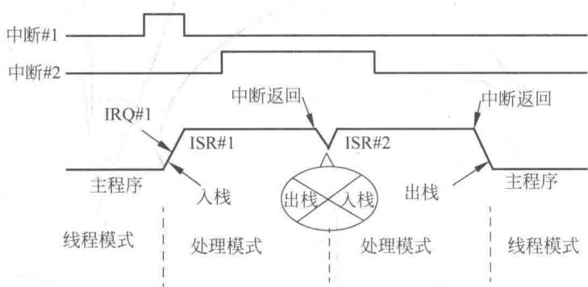

**这张图怎么看**：重点看两个 ISR 之间**没有**出现"出栈 → 再压栈"的往复，而是直接连过去。这就是"咬尾"——两个中断像咬住尾巴一样首尾相接。

#### 晚到（Late-Arriving）

**场景**：CPU 正在做"保存现场"（压栈），这时候来了一个**更高优先级**的中断。

**没有晚到处理**：先响应低优先级的，压完栈再被高优先级打断，白忙一场。

**有晚到处理**：**立刻改主意**，直接去取高优先级中断的向量，先执行高优先级的 ISR。等它执行完，再回来处理低优先级的。

**教材原图**：

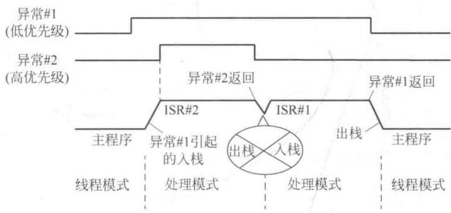

**这张图怎么看**：注意"压栈"这个动作**只做了一次**，但最后执行的却是后来居上的高优先级异常。说明硬件在压栈过程中"改主意"了。

【教材内容】教材在 7.1 节还提到 NVIC"可以实现低延迟的中断处理和有效地处理**晚到的中断**"，说的就是这件事。

### 本节真正要记住什么

1. NVIC 基地址 **0xE000E000**，寄存器以**存储器映射**方式访问。
2. **使能 / 除能**用 **SETENA / CLRENA**（地址 0xE000E100 / 0xE000E180），**写 1 有效，写 0 无效**；其中 SETENA0 = NVIC_ISER0 **可读**（读出即当前的使能状态），真正"只读"的是 ACTIVE0。
3. **挂起 / 解挂**用 **SETPEND / CLRPEND**（0xE000E200 / 0xE000E280），同样是写 1 有效。
4. **优先级**寄存器 PRI_n 在 0xE000E400 + n，**每个 1 字节**，STM32 只用高 4 位，**数值越小越优先**。
5. **活动状态** ACTIVE0（0xE000E300）只读，ISR 执行期间为 1。
6. **PRIMASK** 关所有普通中断；**BASEPRI** 只屏蔽"优先级不够高"的中断，且 `BASEPRI_MAX` 只能扩大屏蔽范围。
7. 中断响应 = **保存现场（硬件压栈 8 个字）+ 取向量（并行）→ 执行 ISR → 恢复现场（硬件出栈）**。
8. LR 在 ISR 里是 **EXC_RETURN**：`0xFFFFFFF9`（回线程模式用 MSP）、`0xFFFFFFFD`（回线程模式用 PSP）、`0xFFFFFFF1`（回处理模式）。

---

## 7.3 外部中断/事件控制器 EXTI

### 先别急着看教材：这一节到底要干什么？

前面讲的都是"中断来了之后怎么办"。但有一个问题一直没回答：

> **引脚上那个电平变化，是怎么变成"中断请求"的？**

干这件事的硬件叫 **EXTI**。本节要回答：

1. EXTI 内部长什么样？（结构框图）
2. 它怎么"认出"一个边沿？（边沿检测原理）
3. 80 个引脚怎么接到 16 条 EXTI 线上？（AFIO_EXTICR）
4. **中断和事件到底有什么区别？**（本章标题的另一半）

### 【教材内容】EXTI 是什么

> 外部中断/事件控制器（EXTI）由 **19 个**产生事件/中断请求的**边沿检测器**组成。每个输入线可以独立地配置输入类型（脉冲或挂起）和对应的触发事件（上升沿或下降沿或者双边沿都触发）。每个输入线都可以独立地被屏蔽。挂起寄存器保存了状态线的中断请求。

**【术语】** EXTI = External Interrupt/Event Controller = 外部中断/事件控制器。

大白话：它是**"引脚"和"NVIC"之间的翻译官**。引脚上只有高低电平，NVIC 只认"中断请求"，EXTI 负责把前者翻译成后者。

【教材内容】EXTI 的主要特性：

- 每个中断/事件都有独立的**触发**和**屏蔽**；
- 每个中断线都有**专用的状态位**；
- 支持多达 **19 个软件**的中断/事件请求；
- 检测**脉冲宽度低于 APB2 时钟宽度**的外部信号。

**最后一条值得解释一下**："脉冲宽度低于 APB2 时钟宽度"意思是——**即使引脚上的脉冲非常短（短到只有一个 APB2 时钟周期那么宽），EXTI 也能检测到**。这个特性很实用，比如某些传感器输出的脉冲很窄。

### 7.3.1 EXTI 的结构

#### 看教材原图：外部中断/事件控制器框图

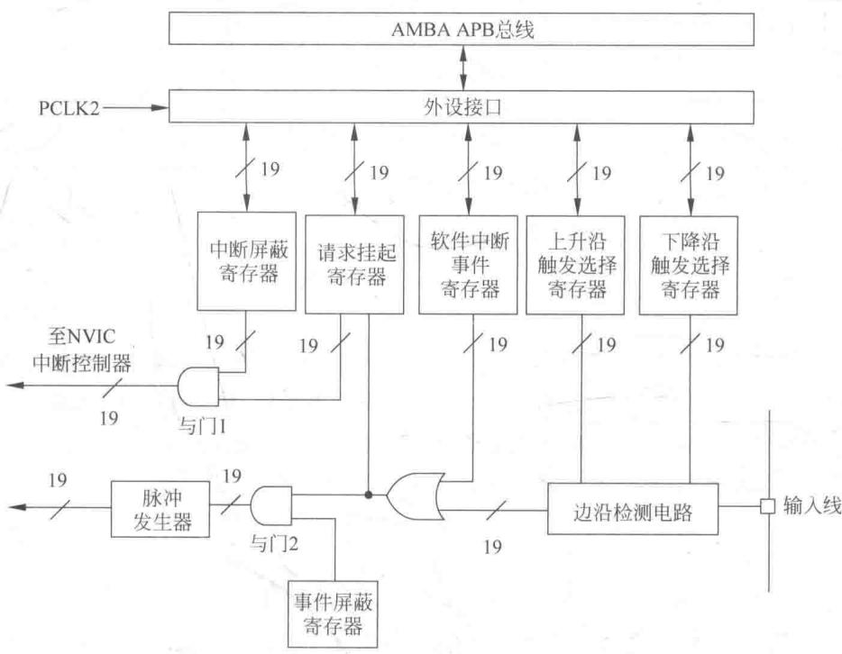

**这张图信息量很大，不要一次全看。按下面的顺序，一层一层看。**

##### 第一层：只看"信号从哪进、从哪出"

1. **最右边**：`输入线`（一个引脚信号从这里进来）。
2. **最左边上方**：`至 NVIC 中断控制器`（中断请求从这里出去）。
3. **最左边下方**：`脉冲发生器` 后面那条输出线（事件脉冲从这里出去，送给别的外设）。

**第一层结论**：EXTI 就是一根"从引脚到 NVIC / 到其他外设"的管道。

##### 第二层：看信号经过的那串方块

**看图前先记住一句最要紧的话**：图 7-2 是**右进左出**的——`输入线` 在最右边，`至 NVIC` 和 `脉冲发生器` 在最左边。所以图面上要**从右往左**看，才是信号经过的先后顺序。如果习惯性地从左往右找，会先撞上最下游的"脉冲发生器"和"与门 2"，顺序就全乱了。

下面按"信号**先经过谁、后经过谁**"列出这一串方块（不是按它们在图面上从左到右的位置）：

| 方块（按信号经过的先后） | 作用 |
|---|---|
| 边沿检测电路 | 判断信号有没有发生"跳变" |
| （或门） | 把"外部边沿"和"软件触发"合起来 |
| 请求挂起寄存器 | 记住"有请求来了"（**只有"中断"这一条支路经过它**，见下面的第三层） |
| 中断屏蔽寄存器 | 决定这个请求能不能送到 NVIC |
| 事件屏蔽寄存器 | 决定这个请求能不能产生事件脉冲 |
| 软件中断事件寄存器 | 让软件可以"假装"引脚上来了一个边沿 |
| 上升沿触发选择寄存器 | 决定"上升沿算不算触发" |
| 下降沿触发选择寄存器 | 决定"下降沿算不算触发" |
| 脉冲发生器 | 把一个"跳变"整形成"一个干净的脉冲" |

##### 第三层：看那两个"门"（与门）

图里有 **与门 1** 和 **与门 2**，这是理解"中断 vs 事件"的关键。

**【先补一个前置知识：与门和或门是什么？】**

- **与门（AND gate）**：两个输入**都为 1**，输出才是 1；否则输出 0。可以理解成"**两个开关串联**，必须都合上才通电"。
- **或门（OR gate）**：两个输入**只要有一个是 1**，输出就是 1。可以理解成"**两个开关并联**，合上任意一个就通电"。

**与门 1**：

```
请求挂起寄存器的输出 ──┐
                      ├──与门1──→ 至 NVIC
中断屏蔽寄存器的输出 ──┘
```

**含义**：只有当"**有请求**"**并且**"**中断没有被屏蔽**"时，才向 NVIC 发中断请求。这解释了为什么**中断可以被屏蔽**。

**与门 2**：

```
（或门输出）──────┐
                 ├──与门2──→ 脉冲发生器 ──→ 事件脉冲输出
事件屏蔽寄存器的输出 ┘
```

**含义**：只有当"**有请求**"**并且**"**事件没有被屏蔽**"时，才产生事件脉冲。

##### 第四层：看那根"斜线 + 19"

图里很多信号线上画了一条**斜线**，旁边标着 **19**。这是工程图纸的惯例：

> **斜线 + 数字 = 这是一束线，一共有这么多根。**

所以"19"的意思是：**这样的线路一共有 19 套**（线 0 ~ 线 18，一共 19 条）。图里画的是其中一套，实际芯片里是 19 套并排。

**这里要特别小心别多数出一条**：19 条线的编号是 **0、1、2、…、18**，到线 18 为止，**没有"线 19"**。后面 7.4 节寄存器位图里会看到一个"bit19"，那是给**互联型产品**（如 STM32F105/107）留的，本芯片（STM32F103VET6）上它是保留位，详见 7.4 节开头。

##### 第五层：看最上面那条总线

图最上方有一条 `AMBA APB 总线`，下面通过 `外设接口` 连到各个寄存器方块，旁边还有个 `PCLK2` 时钟输入。

**含义**：EXTI 的所有寄存器都是通过 **APB2 总线**被 CPU 读写的。PCLK2 是 APB2 的时钟。**这也解释了为什么操作 EXTI 之前必须先开 AFIO 的时钟**（EXTI 和 AFIO 都挂在 APB2 上）。

#### 【教材内容】教材对信号通路的描述（原文拆解）

> 外部信号从芯片引脚进入，经过**边沿检测电路**，通过**或门**进入中断"**请求挂起寄存器**"，最后经过**与门 1** 输出到 NVIC 中断控制器。

> 在这个通道上有 4 个控制选项。外部的信号首先经过边沿检测电路，这个边沿检测电路受**上升沿或下降沿选择寄存器**控制，用户可以使用这两个寄存器控制需要哪一个边沿产生中断。因为选择上升沿或下降沿是分别受两个**平行的**寄存器控制，所以用户可以**同时选择上升沿或下降沿**；如果只有一个寄存器控制，那么只能选择一个边沿了。

**【补充解释】最后这句话很关键**：如果只有一个"触发方式寄存器"，那么你就只能选一种（要么上升沿、要么下降沿）。而 EXTI 有**两个独立寄存器**，所以你可以：

| RTSR bit | FTSR bit | 效果 |
|---|---|---|
| 0 | 0 | 不触发 |
| 1 | 0 | 只有上升沿触发 |
| 0 | 1 | 只有下降沿触发 |
| 1 | 1 | **上升沿和下降沿都触发** |

> 信号经过边沿检测电路后进入到或门，这个或门的另一个输入是"**软件中断/事件寄存器**"，从这里可以看出，**软件可以优先于外部信号请求一个中断或事件**，即当"软件中断/事件寄存器"的对应位为 1 时，不管外部信号如何，或门都会输出有效信号。

> 一个中断或事件请求信号经过或门后，进入请求挂起寄存器，到此之前，**中断和事件的信号传输通路都是一致的**，也就是说，挂起请求寄存器中记录了外部信号的电平变化。

**这句话是理解"中断与事件"的关键**：在"请求挂起寄存器"这个位置**之前**，中断和事件走的是同一条路。

**分叉点究竟在哪里？** 教材紧接着讲事件时写的是：

> "外部请求信号经过**或门后**，进入**与门 2**……"

也就是说，**分叉就发生在"或门的输出"这一个点上**：

```
                         ┌──→ 请求挂起寄存器 PR ──→ 与门1（受 IMR 控制）──→ NVIC   ← 中断通路
或门的输出 ──────────────┤
                         └──→ 与门2（受 EMR 控制）──→ 脉冲发生器 ──→ 事件脉冲  ← 事件通路
```

- **中断通路**：或门输出 → 请求挂起寄存器 PR → 与门 1（受 IMR 控制）→ NVIC；
- **事件通路**：或门输出 → **直接**进与门 2（受 EMR 控制）→ 脉冲发生器 → 事件输出。

**关键点：事件通路根本不经过"请求挂起寄存器"。** 这正是"事件不置挂起位"的原因——不是"置了又清掉"，而是压根没走那条线。

**为什么要把这一点说这么细？** 因为很容易顺口讲成"先经过挂起寄存器，然后再分叉"。如果真是那样，事件也会把挂起位置 1，就和教材原话"（事件）对应的挂起位不被置 1"直接矛盾了。**看教材图 7-2 时请留意：信号右进左出，在或门输出那条线上就能看到这个分叉，请求挂起寄存器与与门 2 是并列的两条支路。**

> 外部请求信号最后经过与门 1，向 NVIC 中断控制器发出一个中断请求，如果中断屏蔽寄存器的对应位为 0，则该请求信号不能传输到与门 1 的另一端，实现了**中断的屏蔽**。

> 产生事件的过程如下：外部请求信号经过或门后，进入与门 2，与门 2 的作用与与门 1 类似，用于引入**事件屏蔽寄存器**的控制；最后**脉冲发生器**把一个跳变的信号转变为**一个单脉冲**，输出到芯片中的其他功能模块。

> 从外部激励信号来看，**中断和事件是没有分别的**，只是在芯片内部分开，一路信号会向 CPU 产生中断请求，另一路信号会向其他功能模块发送脉冲触发信号，其他功能模块如何响应这个触发信号，则由对应的模块自己决定。

#### 【辅助理解图】EXTI 内部框图（简化教学版）

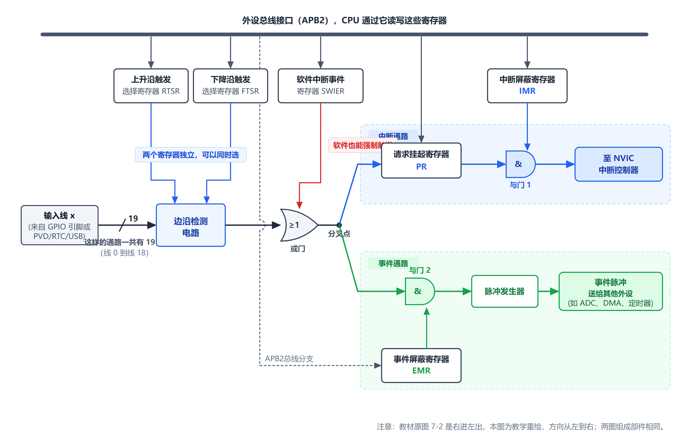

**看图方法**：
1. **从左往右**跟着信号走一遍：输入线 → 边沿检测 → 或门 → 分叉。
   （说明：这张简化图是**教学重绘**，画成"左进右出"，方向与教材原图 7-2 **相反**——原图是右进左出。这样画是为了顺着平时从左往右看图的习惯；两张图的组成部件完全一样。）
2. **上面的蓝色支路**是中断：或门输出 → 请求挂起 → 与门1（受 IMR 控制）→ NVIC。
3. **下面的绿色支路**是事件：或门输出 → 与门2（受 EMR 控制）→ 脉冲发生器 → 其他外设。
4. **顶部的横线**是 APB2 总线，所有寄存器都挂在它上面，CPU 通过它读写。
5. **对比图 7-2**：这张简化图把教材原图里所有"19 套"的标记去掉了，只画一套；并且用颜色明确标出了"中断/事件分叉点"。**特别注意：分叉点在"或门输出"处，在请求挂起寄存器之前**——绿色支路不经过挂起寄存器，所以事件不置挂起位。等你把这张图看懂了，再回头看教材原图 7-2，就能一眼找到每一部分。

### 7.3.2 边沿检测原理

#### 用大白话理解

**问题**：怎么用电路判断"信号刚刚从 0 变成了 1"？

**答案**：**把信号和"它自己延迟一拍的版本"比一比**。

**【类比】** 就像判断"一个人是不是刚进门"：

- 你手里有一张**刚才的照片**（延迟一拍的信号）和**现在的实况**（当前信号）。
- 照片里人不在、现在人在 → **刚刚进来的**（上升沿）。
- 照片里人在、现在人不在 → **刚刚出去的**（下降沿）。
- 两张一样 → 什么都没发生。

**类比的边界**：真实电路里"延迟一拍"是用一个 **D 触发器**（D Flip-Flop）实现的，由时钟驱动，延迟时间是**一个时钟周期**。

##### 【先补一个前置知识：D 触发器是什么？】

- 英文全称：**D Flip-Flop**（D 型触发器）
- 中文：**D 触发器**，也常被叫做"**延迟触发器**""**一位寄存器**"
- 大白话：它是一个**只能装 1 个 bit 的小盒子**，有三个关键引脚——数据输入 **D**、时钟输入 **CLK**、输出 **Q**。它的工作规则只有一条：

> **只在时钟边沿（比如上升沿）到来的那一瞬间，把 D 上此刻的电平"抄"到 Q 上；其余时间，不管 D 怎么变，Q 都一动不动。**

- 它在本节里干什么：把"输入信号"接到 D，用一个周期性时钟去驱动 CLK，那么 Q 上出现的永远是"**上一个时钟周期的输入信号**"——这就是"延迟一拍"。把"当前信号"和"延迟一拍信号"一比较，就能发现"刚才是不是跳变了"。
- 它和"寄存器"是什么关系：本章前面说"寄存器就是芯片内部的一排小开关"。**一个 D 触发器就是 1 个 bit 的寄存器**；32 个 D 触发器并排，就是本章到处出现的 32 位寄存器。
- 它为什么能"记住"：因为它内部是一个双稳态电路，只要不断电，输出就一直保持，直到下一个时钟边沿把它改写。

> 【补充解释】D 触发器内部的晶体管级电路属于"数字电路"课程的内容，本课程只需记住上面那条"时钟边沿抄一次，其余时间保持不变"的规则就够用了。

#### 时序图

**【辅助理解图】边沿检测原理：把电平跳变变成一个脉冲**

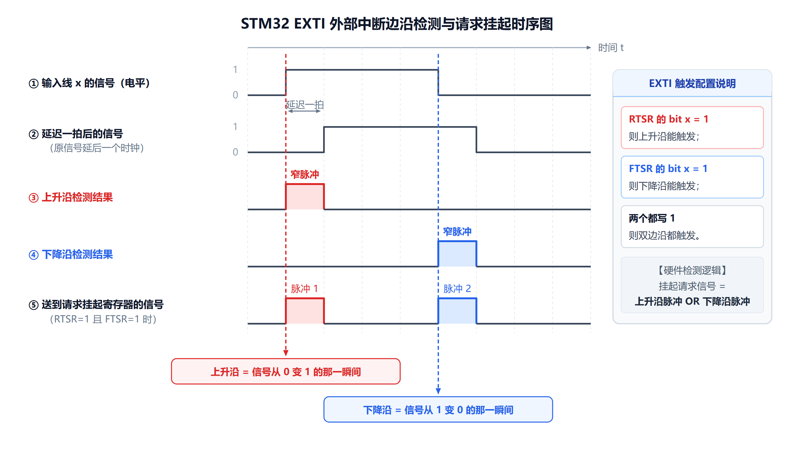

**看图方法**：
1. **第 ① 条波形**是输入信号本身：低 → 高 → 低。
2. **第 ② 条波形**是它延迟一拍的样子：形状一样，但整体右移一格。
3. **第 ③ 条**是"上升沿检测结果"：只有在 ① 由低变高那一格才有一个窄脉冲。
4. **第 ④ 条**是"下降沿检测结果"：只有在 ① 由高变低那一格才有一个窄脉冲。
5. **第 ⑤ 条**是两者相或的结果（前提是 RTSR 和 FTSR 的对应位都写了 1）。
6. **这张图要你理解**：边沿检测的输出**不是电平，而是一个"瞬间的脉冲"**。这个脉冲就是"事件发生了"的信号。

#### 为什么"边沿"要变成"脉冲"？

因为后面要送去触发别的东西：

- 送去 NVIC：需要一个明确的"请求信号"；
- 送去脉冲发生器：需要一个干净的、宽度固定的脉冲（所以才有"脉冲发生器"这个模块）。

如果直接把一个宽宽的电平送过去，接收方就分不清"这是发生了一次还是持续发生"。

#### 软件怎么控制它？

由 **EXTI_RTSR** 和 **EXTI_FTSR** 两个寄存器控制：

| 寄存器 | 控制的边沿 |
|---|---|
| EXTI_RTSR（Rising Trigger Selection Register） | 上升沿 |
| EXTI_FTSR（Falling Trigger Selection Register） | 下降沿 |

**这就是 7.4 节要详细拆的两个寄存器。**

### 7.3.3 事件和中断的区别

#### 【教材内容】教材原文

> 事件和中断的关系如下：
>
> **事件**——表示检测到有触发事件发生了。
>
> **中断**——有某个事件发生并产生中断，并跳转到对应的中断处理程序中。
>
> 事件可以触发中断，也可以不触发。中断有可能被更优先的中断屏蔽，**事件不会**。事件本质上就是一个**触发信号**，是用来触发特定的外设模块或核心本身（例如唤醒操作）。

#### 【辅助理解图】中断和事件：同一个信号，两条不同的去向

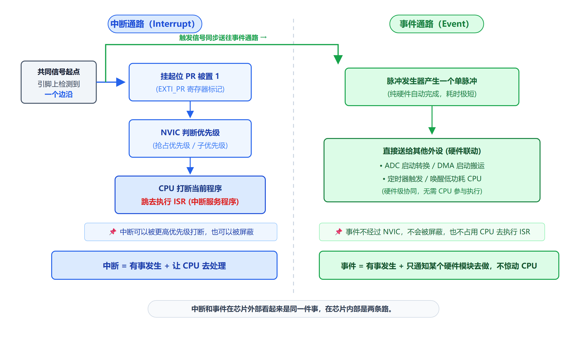

**看图方法**：
1. 最左边是共同起点："引脚上检测到一个边沿"。
2. **蓝色支路（中断）**：挂起位被置 1 → NVIC 判断优先级 → CPU 跳去执行 ISR。
3. **绿色支路（事件）**：脉冲发生器产生一个单脉冲 → 直接送给其他外设，**不经过 NVIC，也不占用 CPU**。
4. 底部两句话是核心区别。

#### 对比表

| 对比项 | 中断 | 事件 |
|---|---|---|
| 本质 | 让 CPU 跳去执行一段程序 | 给别的硬件模块发一个触发脉冲 |
| 经过 NVIC 吗 | 经过 | 不经过 |
| 能被屏蔽吗 | 能（被更高优先级中断屏蔽，或被 IMR 屏蔽） | **不会被中断屏蔽**，只受 EMR 控制 |
| 会置挂起位吗 | **会**（EXTI_PR 的对应位被置 1） | **不会**（教材原话："对应的挂起位不被置 1"） |
| 占用 CPU 吗 | 占用（要执行 ISR） | 不占用 |
| 典型用途 | 按键响应、串口收数据 | 启动 ADC 转换、启动 DMA 搬运、唤醒 CPU |

#### 【类比】

- **中断**：你正在写作业，有人敲门，**你亲自去开门**。
- **事件**：门口装了感应器，有人经过就**自动开灯**——不需要你动。

**类比的边界**：真实硬件里"自动开灯"的那盏灯，是 ADC、DMA、定时器这类"能被触发的模块"，它们收到脉冲后自己开始干活。

#### 【容易搞混】

- **"事件不置挂起位"** 不代表"事件不记录"。EXTI_PR 记录的是**中断请求**；事件走的是另一条路，用脉冲直接通知。
- **同一个引脚可以同时产生中断和事件**：只要 IMR 和 EMR 的对应位都写了 1，且触发边沿设置合适。它们互不干扰。

### 7.3.4 中断和事件的管理（三种配置方式）

【教材内容】教材 p197 给出了三种配置流程。

#### 1）硬件中断选择（把 19 条线配置成中断源）

> （1）配置 19 个中断线的**屏蔽位**（EXTI_IMR）；
> （2）配置所选中断线的**触发选择位**（EXTI_RTSR 和 EXTI_FTSR）；
> （3）配置对应到外部中断控制器（EXTI）的 **NVIC 中断通道**的使能和屏蔽位，使得 19 个中断线中的请求可以被正确地响应。

**注意第 (3) 步**：光配置 EXTI 还不够，**还要去 NVIC 里把这个中断"打开"**。这是初学者最容易漏的一步——EXTI 配好了，中断就是不来，十有八九是忘了 NVIC 使能。

#### 2）硬件事件选择（把 19 条线配置成事件源）

> （1）配置 19 个事件线的**屏蔽位**（EXTI_EMR）；
> （2）配置事件线的**触发选择位**（EXTI_RTSR 和 EXTI_FTSR）。

**注意**：事件不需要配置 NVIC，因为它不经过 NVIC。

#### 3）软件中断/事件的选择

> 19 个线路可以被配置成软件中断/事件线。下面是产生软件中断的过程：
> （1）配置 19 个中断/事件线屏蔽位（EXTI_IMR, EXTI_EMR）；
> （2）设置软件中断寄存器的请求位（EXTI_SWIER）。

**大白话**：不想靠引脚，直接让程序"假装"来了一个中断。写 SWIER 的某一位为 1，就相当于在对应线上"手动按了一下按钮"。

**什么时候用？** 调试时验证中断服务程序写得对不对，非常方便。

#### 【教材内容】唤醒事件（WFE）的配置

> STM32 可以处理外部或内部事件来唤醒内核（WFE）。唤醒事件可以通过下述配置产生：
>
> - 在外设的控制寄存器使能一个中断，但**不在 NVIC 中使能**，同时在 Cortex-M3 的系统控制寄存器中使能 **SEVONPEND** 位。当 CPU 从 WFE 恢复后，需要清除相应外设的中断挂起位和外设 NVIC 中断通道挂起位。
> - 配置一个外部或内部 EXTI 线为**事件模式**，当 CPU 从 WFE 恢复后，因为对应事件线的挂起位没有被置位，**不必清除**相应外设的中断挂起位或 NVIC 中断通道挂起位。

**【补充解释】WFE 是什么？**

- **WFI** = Wait For Interrupt，等中断：CPU 睡下，**只有中断**能叫醒它。
- **WFE** = Wait For Event，等事件：CPU 睡下，**中断或事件**都能叫醒它。

这两种指令用来省电。第一种配置思路是"用中断来唤醒，但故意不在 NVIC 里放行"，第二种是"直接用事件唤醒"。第二种更省事，因为**事件不置挂起位，醒来后不用清理**。

**【补充解释】SEVONPEND 是什么？**

教材第一条配置里要求"使能 **SEVONPEND** 位"，这个位是第一次出现，必须讲清楚：

| 项目 | 内容 |
|---|---|
| 英文全称 | **S**end **E**vent **ON** **PEND**ing（挂起即发送事件） |
| 中文 | "挂起即发事件"位（也有人译作"挂起时发送事件"） |
| 住在哪 | Cortex-M3 内核的 **SCR**（System Control Register，系统控制寄存器，地址 `0xE000ED10`）的 **bit4** |
| 大白话 | **只要有一个中断刚刚变成"挂起"状态，就顺手发一次"事件"**——哪怕这个中断被屏蔽、NVIC 里没使能、优先级不够，根本没资格真正进入 ISR |
| 写 0 | 只有"能真正通过 NVIC 的中断"以及别的事件能唤醒 WFE |
| 写 1 | **任何**新挂起的中断都能唤醒 WFE |

**它正好解释了教材第一条配置为什么能工作**：那条配置是"在外设里使能中断，但**不在 NVIC 里使能**"。这样中断请求会停在 NVIC 的挂起位上（中断被挂起），但因为 NVIC 没放行，CPU 不会跳去执行 ISR；与此同时，SEVONPEND = 1 让这个"新挂起"产生一次事件，把执行 `WFE` 睡下的 CPU 叫醒。所以醒来后程序要自己清掉外设的中断挂起位和 NVIC 的挂起位——这正是教材那句"需要清除相应外设的中断挂起位和外设 NVIC 中断通道挂起位"的意思。

> 【补充解释·需核对参考手册】SCR 的地址（`0xE000ED10`）与 SEVONPEND 的位号（bit4）来自 Cortex-M3 技术参考手册，教材正文没有给出。使用时可对照《Cortex-M3 权威指南》或 STM32F103 参考手册。

### 7.3.5 外部中断/事件线路映像（EXTI 与 GPIO 的映射）

#### 【教材内容】

> 80 个通用 I/O 口以图 7-3 的方式连接到 16 个外部中断/事件线上。
>
> 另外 3 个 EXTI 线的连接方式如下：
> （1）EXTI 线 16 连接到 PVD 输出；
> （2）EXTI 线 17 连接到 RTC 闹钟事件；
> （3）EXTI 线 18 连接到 USB 唤醒事件。
>
> PAx、PBx、PCx、PDx 和 PEx 端口对应的是同一个外部中断/事件源 EXTIx（x: 0~15）。
>
> **注意：通过 AFIO_EXTICRx 配置 GPIO 线上的外部中断/事件，必须先使能 AFIO 时钟。**

#### 先看教材原图

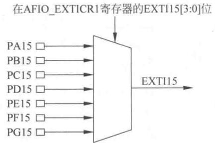

**这张图怎么看**：
1. **左边一列**：`PA15`、`PB15`、`PC15`、`PD15`、`PE15`、`PF15`、`PG15` —— 这是 7 个端口的第 15 号引脚。
2. **中间那个梯形**：是一个**多路选择器（MUX）**。你可以把它想成一个"**多选一的开关**"。
3. **梯形上方那个向下箭头**：写着"在 AFIO_EXTICR1 寄存器的 EXTI15[3:0] 位"。这就是"**谁来控制这个开关**"——由 AFIO_EXTICR 里的 4 个 bit 决定。
4. **右边输出**：只有一条线，叫 `EXTI15`。
5. **这张图要你理解**：**7 个端口各有第 15 号引脚，但它们共用同一条 EXTI15 线，同一时刻只能选一个接上去。**

**教材 p197 另外两张无题图**（EXTI0 和 EXTI1 的映射，原理与上图完全相同）：

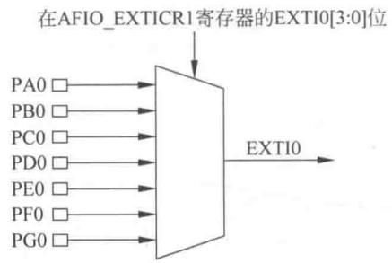

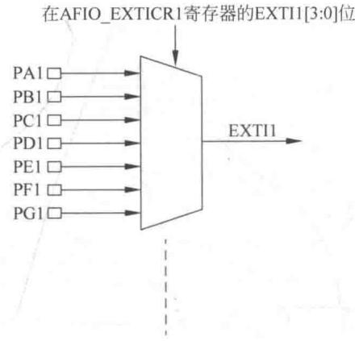

**这两张图怎么看**：
- 第一张：`PA0`~`PG0` 七条线进 MUX，输出 `EXTI0`，由 AFIO_EXTICR1 的 EXTI0[3:0] 位选择。
- 第二张：`PA1`~`PG1` 七条线进 MUX，输出 `EXTI1`，由 AFIO_EXTICR1 的 EXTI1[3:0] 位选择。
- **规律**：**引脚编号 = EXTI 线编号**。PA3 只能接 EXTI3，不能接 EXTI7。

> 【待核验】图 7-3 的图内文字写的是"在 AFIO_EXTICR1 寄存器的 EXTI15[3:0] 位"。但按 STM32F103 参考手册，EXTI 线 12~15 由 **AFIO_EXTICR4** 选择，EXTICR1 只负责线 0~3。教材图 7-3 的标注可能为印刷或解析错误，建议核对原 PDF p197。

#### 【辅助理解图】80 个 GPIO 引脚怎么接到 16 条 EXTI 线上

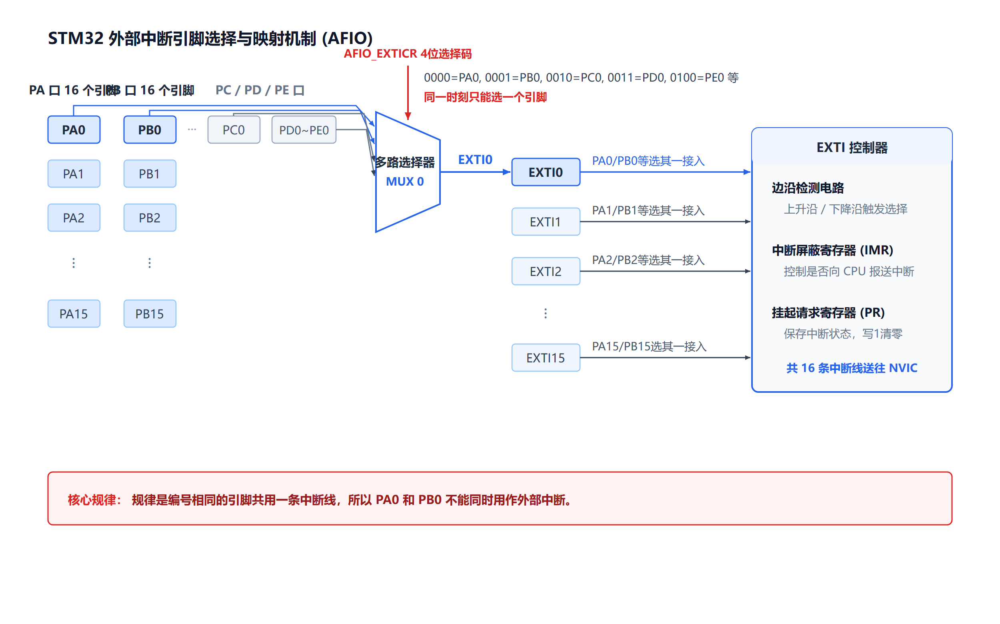

**看图方法**：
1. 左边是各个端口的引脚（PA0~PA15、PB0~PB15、PC0~PC15……），一个端口 16 个。
2. 中间那个大梯形就是**多路选择器**：左边很多输入，右边只有一个输出。
3. 梯形上方写着"AFIO_EXTICR 里的 4 位选择码"——这就是"选谁"的控制信号。
4. 右边是 16 条 EXTI 线，每条线再进 EXTI 控制器。
5. **这张图要你理解两件事**：
   - **同一编号的引脚共线**：PA0、PB0、PC0…… 抢同一条 EXTI0；
   - **所以不能同时用**：一个工程里如果 PA0 已经接了按键中断，就不能再用 PB0 做中断了。

#### 【补充解释】AFIO_EXTICR 是什么？

- **AFIO** = Alternate Function I/O = **复用功能 I/O**。它是 STM32 里一个专门管"引脚功能切换"的模块（第 6 章 GPIO 讲过复用功能）。
- **AFIO_EXTICR1 ~ AFIO_EXTICR4** = AFIO 里负责"**外部中断线选哪个端口**"的 4 个寄存器。

**结构**：每个 AFIO_EXTICR 寄存器 32 位，分成 **4 个 4 位字段**，每个字段管一条 EXTI 线。

| 寄存器 | 管哪几条线 | 字段划分 |
|---|---|---|
| AFIO_EXTICR1 | EXTI0 ~ EXTI3 | [3:0]=EXTI0，[7:4]=EXTI1，[11:8]=EXTI2，[15:12]=EXTI3 |
| AFIO_EXTICR2 | EXTI4 ~ EXTI7 | 同上规律 |
| AFIO_EXTICR3 | EXTI8 ~ EXTI11 | 同上规律 |
| AFIO_EXTICR4 | EXTI12 ~ EXTI15 | 同上规律 |

**每个 4 位字段的编码**（以 STM32F103 的 PA~PG 为例）：

| 4 位值 | 选中的端口 |
|---|---|
| 0000 | PA |
| 0001 | PB |
| 0010 | PC |
| 0011 | PD |
| 0100 | PE |
| 0101 | PF |
| 0110 | PG |
| 0111 ~ 1111 | 保留 |

> 【补充解释·需核对参考手册】AFIO_EXTICR 的基地址与各寄存器偏移、以及上面这张端口编码表，**教材正文并未给出**（教材只写了"通过 AFIO_EXTICRx 配置"和两张映射示意图）。本讲义按 STM32F103 参考手册补充，使用时请以《STM32F103x8/B 参考手册》为准。AFIO 的基地址为 `0x40010000`，EXTICR1~4 的偏移为 `0x08`、`0x0C`、`0x10`、`0x14`。

**地址演算示例**（把 PA0 接到 EXTI0）：

```
AFIO 基地址          = 0x40010000
AFIO_EXTICR1 偏移    = +0x08
AFIO_EXTICR1 地址    = 0x40010008

要写的内容：EXTI0 字段 = 0000（选 PA）
           其余字段保持 0（本示例中）
           → 写入 0x00000000
```

**为什么必须先开 AFIO 时钟？**

因为 AFIO_EXTICR 这个寄存器属于 AFIO 模块。**时钟不开，模块就是"断电"状态，写进去也不生效**。这是第 6 章讲过的"外设四步曲"第一步——**开时钟**。

**对应到代码就是这一句**：

```c
RCC_APB2PeriphClockCmd(RCC_APB2Periph_GPIOA | RCC_APB2Periph_AFIO, ENABLE);
```

**注意这里同时开了两个时钟**：GPIOA 和 AFIO。教材特意强调："GPIO 配置，务必注意打开 GPIO 时钟时，一并打开 AFIO 时钟。"

### 本节真正要记住什么

1. EXTI = 外部中断/事件控制器，**19 个边沿检测器**，是"引脚电平"到"中断请求/事件脉冲"的翻译官。
2. 信号通路：**输入线 → 边沿检测 → 或门 → 挂起寄存器 → 与门1（受 IMR 控制）→ NVIC**；
   另一条：**→ 与门2（受 EMR 控制）→ 脉冲发生器 → 事件输出**。
3. **中断和事件在"或门的输出"处就分叉**：或门输出 → 请求挂起寄存器 PR → 与门 1（受 IMR 控制）→ NVIC，这是中断通路；或门输出 → 与门 2（受 EMR 控制）→ 脉冲发生器 → 事件输出，这是事件通路。**事件通路不经过挂起寄存器，所以事件不置挂起位。**
4. **中断会被屏蔽、会置挂起位、占用 CPU；事件不会。**
5. **EXTI 一共只有 19 条线（编号 0~18）**：线 0~15 接 GPIO，线 16 接 PVD，线 17 接 RTC 闹钟，线 18 接 USB 唤醒。寄存器位图里画出的 bit19 是给互联型产品留的，本芯片上是保留位。
6. **引脚编号 = EXTI 线编号**，同一编号的不同端口**只能选一个**，由 **AFIO_EXTICR** 决定。
7. **用 AFIO 之前必须先开 AFIO 时钟。**

---

## 7.4 EXTI 相关寄存器

### 先别急着看教材：这一节到底要干什么？

上一节看了框图，这一节把框图上那 6 个方块，**一个一个拆成寄存器**来看。

【教材内容】教材 p197 的说明：

> 要使用外部中断，需要了解 EXTI 寄存器的定义。**所有的 EXTI 寄存器必须以字（32 位）的方式操作。EXTI 寄存器的首地址是 0x4001_0400。** 各个寄存器中的**位 19 只适用于互联型产品**，对于其他产品为保留位。

**这句话有三个要点**：

1. **必须以 32 位（字）方式操作**——不能像优先级寄存器那样按字节写。
2. **首地址（基地址）= 0x40010400**。
3. **位 19 是"别人的"**——它只对**互联型产品**（如 STM32F105/107）有意义，本芯片（STM32F103VET6）上是**保留位，必须写 0**。本芯片真正有效的只有 **bit[18:0]**，正好对应**线 0 ~ 线 18 这 19 条线**。（后面各小节的位图沿用教材/参考手册的通用画法，把 bit19 也画了出来，看到它请直接当保留位处理。）

**【辅助理解图】EXTI 寄存器地址是怎么算出来的**

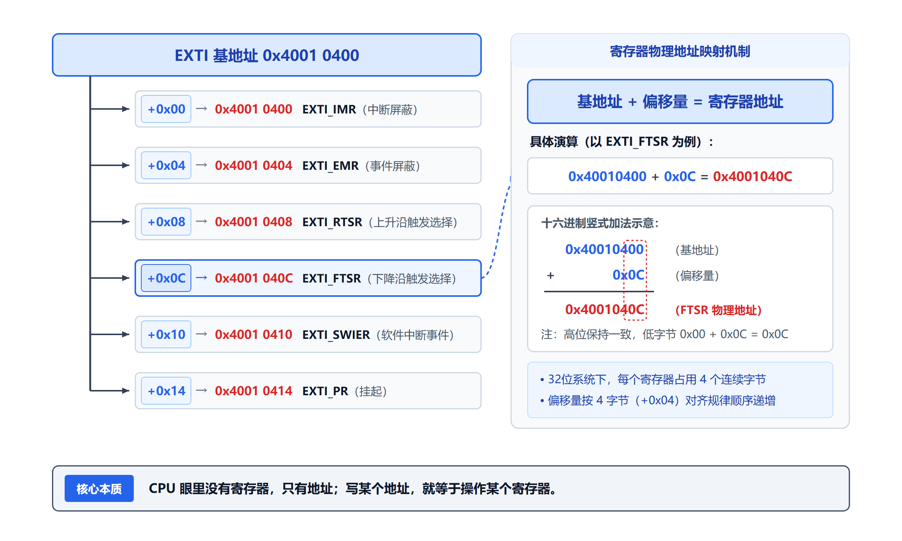

**看图方法**：
1. 最上面是基地址 `0x40010400`。
2. 下面 6 个分支，每个是"偏移量 → 最终地址 + 寄存器名"。
3. 右侧的公式是核心：**基地址 + 偏移量 = 寄存器地址**。
4. **这张图要你理解**：6 个寄存器不是 6 个孤立的门牌号，而是**同一个基地址加上不同偏移**算出来的。

**地址总表**：

| 寄存器 | 偏移 | 最终地址 | 名称 |
|---|---|---|---|
| EXTI_IMR | +0x00 | 0x40010400 | 中断屏蔽寄存器 |
| EXTI_EMR | +0x04 | 0x40010404 | 事件屏蔽寄存器 |
| EXTI_RTSR | +0x08 | 0x40010408 | 上升沿触发选择寄存器 |
| EXTI_FTSR | +0x0C | 0x4001040C | 下降沿触发选择寄存器 |
| EXTI_SWIER | +0x10 | 0x40010410 | 软件中断事件寄存器 |
| EXTI_PR | +0x14 | 0x40010414 | 挂起寄存器 |

**演算示例**（以 FTSR 为例）：

```
0x40010400        （基地址）
+      0x0C       （偏移）
─────────────
0x4001040C        （EXTI_FTSR 的门牌号）
```

**所有的 6 个寄存器位图结构都一样**：

- bit[31:20]：保留，必须始终保持为 0。
- bit[19:0]：每条线一位。**bit0 对应线 0，bit1 对应线 1，……，bit18 对应线 18。**
- **bit19 请单独看待**：按教材原话"各个寄存器中的位 19 只适用于互联型产品，对于其他产品为保留位"。本讲义用的 STM32F103VET6 **不是**互联型产品，所以**本芯片上 bit19 是保留位（必须始终写 0），真正有效的只有 bit[18:0]**——19 条线，编号 0~18。参考手册的表格画到 bit19，是因为那张表对所有型号通用；互联型产品把线 19 用作额外的唤醒源（具体连接以对应型号的参考手册为准）。

**一张通用的位图**（下面 6 个小节会逐个替换位名）：

```
 31                    20 19   18   17   16
+------------------------+----+----+----+----+
|         保留           | x19| x18| x17| x16|
+------------------------+----+----+----+----+
 15   14   13   12   11   10    9    8    7    6    5    4    3    2    1    0
+----+----+----+----+----+----+----+----+----+----+----+----+----+----+----+----+
| x15| x14| x13| x12| x11| x10| x9 | x8 | x7 | x6 | x5 | x4 | x3 | x2 | x1 | x0 |
+----+----+----+----+----+----+----+----+----+----+----+----+----+----+----+----+
  ↑                                                                         ↑
 线15                                                                      线0
```

### 7.4.1 中断屏蔽寄存器（EXTI_IMR）

| 项目 | 内容 |
|---|---|
| **属于谁** | 属于 EXTI（外部中断/事件控制器），挂在 APB2 总线上 |
| **地址** | 偏移 0x00，地址 0x40010400 |
| **复位值** | 0x0000 0000（上电后所有位都是 0） |
| **读写** | rw |
| **它控制什么** | 决定每一条 EXTI 线上的"**中断请求**"能不能送到 NVIC |
| **为什么需要它** | 因为同一条线既可能用于中断也可能用于事件，还可能需要临时关闭；必须有一个"中断开关" |

#### 位图

```
 31                    20 19   18   17   16
+------------------------+----+----+----+----+
|         保留           |MR19|MR18|MR17|MR16|
+------------------------+----+----+----+----+
 15   14   13   12   11   10    9    8    7    6    5    4    3    2    1    0
+----+----+----+----+----+----+----+----+----+----+----+----+----+----+----+----+
|MR15|MR14|MR13|MR12|MR11|MR10|MR9 |MR8 |MR7 |MR6 |MR5 |MR4 |MR3 |MR2 |MR1 |MR0 |
+----+----+----+----+----+----+----+----+----+----+----+----+----+----+----+----+
  ↑                                                                         ↑
 线15                                                                      线0
                                                              ↑
                                                    当前关心的位（例：线0）
```

#### 每个关键位的含义

| 位 | 名称 | 写 0 | 写 1 |
|---|---|---|---|
| bit x | MRx | **屏蔽**来自线 x 的中断请求（请求到不了 NVIC） | **开放**来自线 x 的中断请求 |

【教材内容】教材原文：

> 位[31:20]：保留，必须始终保持为复位状态（0）。
> 位[19:0]：MRx，线 x 上的中断屏蔽位。
> 0：屏蔽来自线 x 上的中断请求；1：开放来自线 x 上的中断请求。

**教材原表**：

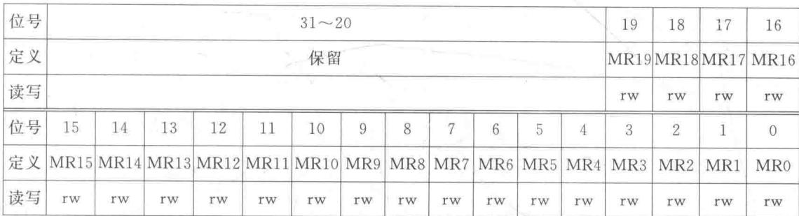

**这张表怎么看**：第一行是 bit19~16 和保留位，第二行是 bit15~bit0。**每一位对应一条 EXTI 线**，名字是 MR + 线号。

#### 程序怎么操作？

**只打开线 0 的中断**：

```c
/* 方法一：直接写寄存器 */
EXTI->IMR = 0x00000001;      /* 只有 bit0 = 1，即只开放线 0 */

/* 方法二：读-改-写，只改 bit0，不影响其他位 */
EXTI->IMR |= 0x00000001;     /* |= 是"或等"，只把 bit0 置 1 */

/* 方法三：用固件库（推荐，见 7.5 节） */
EXTI_InitStructure.EXTI_Line = EXTI_Line0;
EXTI_InitStructure.EXTI_Mode = EXTI_Mode_Interrupt;
EXTI_Init(&EXTI_InitStructure);
```

**位运算演算**（方法二）：

```
假设原来 IMR = 0x00000030（线4、线5 已经打开）

运算前：  0000 0000 0000 0000 0000 0000 0011 0000
掩码：    0000 0000 0000 0000 0000 0000 0000 0001   (1<<0)
──────────────────────────────────────────────────────  OR
运算后：  0000 0000 0000 0000 0000 0000 0011 0001

结果：线 0 被打开，线 4、线 5 保持不变。✓
```

#### 操作之后硬件发生什么？

写 1 到 bit0 之后：

```
EXTI 线 0 上如果出现符合触发条件的边沿
    → 请求挂起寄存器 PR 的 bit0 置 1
    → 与门1 两个输入都是 1
    → 向 NVIC 发出中断请求
    → NVIC 判断优先级后，CPU 跳进 EXTI0_IRQHandler
```

**如果 bit0 写 0 呢？** 边沿照样会让 PR 的 bit0 置 1（挂起寄存器仍然记录），但**与门1 被挡住，NVIC 收不到请求**，中断永远不会发生。

### 7.4.2 事件屏蔽寄存器（EXTI_EMR）

| 项目 | 内容 |
|---|---|
| **属于谁** | EXTI |
| **地址** | 偏移 0x04，地址 0x40010404 |
| **复位值** | 0x0000 0000 |
| **读写** | rw |
| **它控制什么** | 决定每一条 EXTI 线上的"**事件请求**"能不能产生事件脉冲 |
| **为什么需要它** | 因为事件通路是独立的一条路，必须有独立的开关 |

#### 位图

```
 31                    20 19   18   17   16
+------------------------+----+----+----+----+
|         保留           |MR19|MR18|MR17|MR16|
+------------------------+----+----+----+----+
 15   14   13   12   11   10    9    8    7    6    5    4    3    2    1    0
+----+----+----+----+----+----+----+----+----+----+----+----+----+----+----+----+
|MR15|MR14|MR13|MR12|MR11|MR10|MR9 |MR8 |MR7 |MR6 |MR5 |MR4 |MR3 |MR2 |MR1 |MR0 |
+----+----+----+----+----+----+----+----+----+----+----+----+----+----+----+----+
                                                                           ↑
                                                              当前关心的位（线0）
```

#### 每个关键位的含义

| 位 | 名称 | 写 0 | 写 1 |
|---|---|---|---|
| bit x | MRx | **屏蔽**来自线 x 的事件请求 | **开放**来自线 x 的事件请求 |

【教材内容】教材原文：

> 位[31:20]：保留，必须始终保持为复位状态（0）。
> 位[19:0]：MRx，线 x 上的事件屏蔽位。
> 0：屏蔽来自线 x 上的事件请求；1：开放来自线 x 上的事件请求。

**教材原表**：

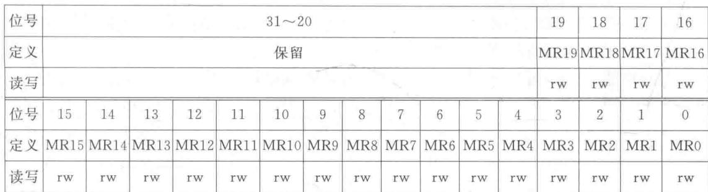

> 【待核验】教材表 7 中 EMR 的位名与 IMR 一样写作 `MRx`（而 IMR 的位名也是 `MRx`）。按 STM32F103 参考手册，事件屏蔽寄存器的位名应为 **`EMx`**，以便与中断屏蔽位 `MRx` 区分。教材此处可能是沿用同一张表格模板。建议核对原 PDF p198。

#### 程序怎么操作？

```c
/* 开放线 0 的事件请求 */
EXTI->EMR |= 0x00000001;

/* 关闭线 0 的事件请求 */
EXTI->EMR &= ~0x00000001;    /* &= ~ 是"与非等"，只把 bit0 清 0 */
```

**位运算演算**（`&= ~`）：

```
假设原来 EMR = 0x0000000F

~0x00000001 = 1111 1111 1111 1111 1111 1111 1111 1110

运算前：  0000 0000 0000 0000 0000 0000 0000 1111
掩码：    1111 1111 1111 1111 1111 1111 1111 1110
──────────────────────────────────────────────────────  AND
运算后：  0000 0000 0000 0000 0000 0000 0000 1110

结果：线 0 被关闭，线 1、2、3 保持不变。✓
```

#### 操作之后硬件发生什么？

写 1 到 bit0 之后：

```
EXTI 线 0 上出现符合触发条件的边沿
    → 与门2 两个输入都是 1
    → 脉冲发生器输出一个单脉冲
    → 这个脉冲送到芯片内部其他模块（ADC、DMA、定时器等）
```

**注意**：整个过程**不会置挂起位，也不会惊动 CPU**。

### 7.4.3 上升沿触发选择寄存器（EXTI_RTSR）

| 项目 | 内容 |
|---|---|
| **属于谁** | EXTI |
| **地址** | 偏移 0x08，地址 0x40010408 |
| **复位值** | 0x0000 0000 |
| **读写** | rw |
| **它控制什么** | 决定每条线上的"**上升沿**"算不算触发 |
| **为什么需要它** | 因为不同外设需要的触发边沿不同（按键按下是下降沿，某些传感器是上升沿） |

#### 位图

```
 31                    20 19   18   17   16
+------------------------+----+----+----+----+
|         保留           |TR19|TR18|TR17|TR16|
+------------------------+----+----+----+----+
 15   14   13   12   11   10    9    8    7    6    5    4    3    2    1    0
+----+----+----+----+----+----+----+----+----+----+----+----+----+----+----+----+
|TR15|TR14|TR13|TR12|TR11|TR10|TR9 |TR8 |TR7 |TR6 |TR5 |TR4 |TR3 |TR2 |TR1 |TR0 |
+----+----+----+----+----+----+----+----+----+----+----+----+----+----+----+----+
  ↑                                                                         ↑
 线15                                                                      线0
```

#### 每个关键位的含义

| 位 | 名称 | 写 0 | 写 1 |
|---|---|---|---|
| bit x | TRx | **禁止**输入线 x 上的上升沿触发（中断和事件都禁） | **允许**输入线 x 上的上升沿触发 |

【教材内容】教材原文：

> 位[31:20]：保留，必须始终保持为复位状态（0）。
> 位[19:0]：TRx，线 x 上的上升沿触发事件配置位。
> 0：禁止输入线 x 上的上升沿触发（中断和事件）。
> 1：允许输入线 x 上的上升沿触发（中断和事件）。
> 注：**在同一中断线上，可以同时设置上升沿和下降沿触发。即任一边沿都可触发中断。**

**教材原表**：

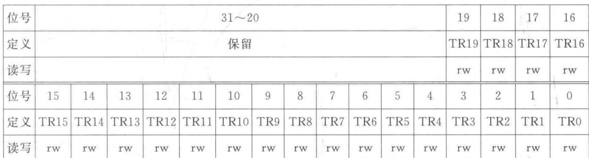

#### 【容易搞混】

**RTSR 和 FTSR 控制的不是"中断还是事件"，而是"哪个边沿"。**

- 中断还是事件，由 **IMR / EMR** 决定；
- 哪个边沿触发，由 **RTSR / FTSR** 决定；
- **RTSR / FTSR 对中断和事件都生效**（教材括号里特意写了"中断和事件"）。

#### 程序怎么操作？

```c
/* 允许线 0 的上升沿触发 */
EXTI->RTSR |= 0x00000001;

/* 禁止线 0 的上升沿触发 */
EXTI->RTSR &= ~0x00000001;
```

### 7.4.4 下降沿触发选择寄存器（EXTI_FTSR）

| 项目 | 内容 |
|---|---|
| **属于谁** | EXTI |
| **地址** | 偏移 0x0C，地址 0x4001040C |
| **复位值** | 0x0000 0000 |
| **读写** | rw |
| **它控制什么** | 决定每条线上的"**下降沿**"算不算触发 |
| **为什么需要它** | 按键按下一般产生下降沿，所以最常用的就是这个寄存器 |

#### 位图

```
 31                    20 19   18   17   16
+------------------------+----+----+----+----+
|         保留           |TR19|TR18|TR17|TR16|
+------------------------+----+----+----+----+
 15   14   13   12   11   10    9    8    7    6    5    4    3    2    1    0
+----+----+----+----+----+----+----+----+----+----+----+----+----+----+----+----+
|TR15|TR14|TR13|TR12|TR11|TR10|TR9 |TR8 |TR7 |TR6 |TR5 |TR4 |TR3 |TR2 |TR1 |TR0 |
+----+----+----+----+----+----+----+----+----+----+----+----+----+----+----+----+
                                                                           ↑
                                                          当前关心的位（例：线0）
```

#### 每个关键位的含义

| 位 | 名称 | 写 0 | 写 1 |
|---|---|---|---|
| bit x | TRx | **禁止**输入线 x 上的下降沿触发（中断和事件都禁） | **允许**输入线 x 上的下降沿触发 |

【教材内容】教材原文：

> 位[19:0]：TRx，线 x 上的下降沿触发事件配置位。
> 0：禁止输入线 x 上的下降沿触发（中断和事件）。
> 1：允许输入线 x 上的下降沿触发（中断和事件）。
> 注：在同一中断线上，可以同时设置上升沿和下降沿触发。即任一边沿都可触发中断。

**教材原表**：

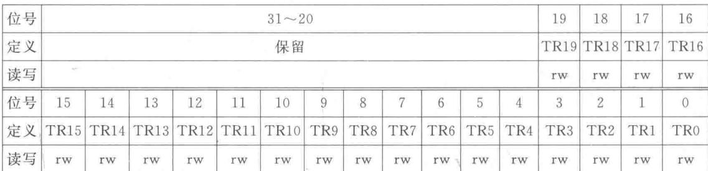

#### 程序怎么操作？

```c
/* 允许线 0 的下降沿触发（按键最常用） */
EXTI->FTSR |= 0x00000001;

/* 允许线 0 双边沿触发 */
EXTI->RTSR |= 0x00000001;
EXTI->FTSR |= 0x00000001;
```

**位运算演算**（双边沿）：

```
RTSR: 运算前 0000...0000  |  掩码 0000...0001  →  运算后 0000...0001
FTSR: 运算前 0000...0000  |  掩码 0000...0001  →  运算后 0000...0001

结果：线 0 上"上升沿或下降沿"都会触发。
```

#### 操作之后硬件发生什么？

```
边沿检测电路的两个输出（上升沿脉冲、下降沿脉冲）
    → 相或
    → 送到请求挂起寄存器 / 事件通路
```

### 7.4.5 软件中断事件寄存器（EXTI_SWIER）

| 项目 | 内容 |
|---|---|
| **属于谁** | EXTI |
| **地址** | 偏移 0x10，地址 0x40010410 |
| **复位值** | 0x0000 0000 |
| **读写** | rw |
| **它控制什么** | 让**软件**可以主动"制造"一次中断/事件请求，不需要引脚上真的有信号 |
| **为什么需要它** | 调试时验证中断服务程序；某些场合需要软件主动触发 |

#### 位图

```
 31                    20 19    18    17    16
+------------------------+-----+-----+-----+-----+
|         保留           |SWIER|SWIER|SWIER|SWIER|
|                        |  19 |  18 |  17 |  16 |
+------------------------+-----+-----+-----+-----+
 15    14    13    12    11    10     9     8     7     6     5     4     3     2     1     0
+-----+-----+-----+-----+-----+-----+-----+-----+-----+-----+-----+-----+-----+-----+-----+-----+
|SWIER|SWIER|SWIER|SWIER|SWIER|SWIER|SWIER|SWIER|SWIER|SWIER|SWIER|SWIER|SWIER|SWIER|SWIER|SWIER|
|  15 |  14 |  13 |  12 |  11 |  10 |   9 |   8 |   7 |   6 |   5 |   4 |   3 |   2 |   1 |   0 |
+-----+-----+-----+-----+-----+-----+-----+-----+-----+-----+-----+-----+-----+-----+-----+-----+
                                                                                          ↑
                                                                              当前关心的位（线0）
```

**教材原表**：

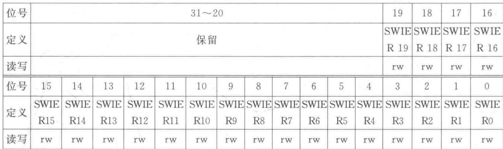

**这张表怎么看**：位图结构与前面几个寄存器完全一样，只是每一位的名字换成了 `SWIERx`。**注意这一列位名直接叫 `SWIERx`，而不是简写成 `SWx`**——教材在这一点上保持了完整拼写。

#### 每个关键位的含义

【教材内容】教材原文：

> 位[19:0]：SWIERx，线 x 上的软件中断。**当该位为 0 时，写 1 将设置 EXTI_PR 中相应的挂起位。如果在 EXTI_IMR 和 EXTI_EMR 中允许产生该中断，则此时将产生一个中断。**
> 通过清除 EXTI_PR 的对应位（写入 1），可以清除该位为 0。

**这段话要拆开理解，它说了三件事**：

1. **"当该位为 0 时，写 1"** —— 只有从 0 变 1 的那一下才有效，一直写 1 不会反复触发。
2. **写 1 之后，PR 的对应位被置 1** —— 这跟"真的来了一个边沿"效果一样。
3. **"通过清除 EXTI_PR 的对应位，可以清除该位为 0"** —— 注意！**SWIER 位不能直接写 0 清除，必须通过清 PR 来间接清除**。

#### 程序怎么操作？

```c
/* 软件触发线 0 的中断请求 */
EXTI->SWIER |= 0x00000001;

/* 清除（必须先清 PR） */
EXTI->PR = 0x00000001;
```

#### 操作之后硬件发生什么？

```
写 SWIER 的 bit0 = 1
    → 或门输出有效
    → 请求挂起寄存器 PR 的 bit0 被置 1
    → 如果 IMR 的 bit0 = 1，则与门1 输出有效
    → NVIC 收到中断请求
    → CPU 跳进 EXTI0_IRQHandler
```

**注意**：**即使引脚上什么信号都没有，中断照样会发生。** 这就是"软件中断"的意思。

### 7.4.6 挂起寄存器（EXTI_PR）

| 项目 | 内容 |
|---|---|
| **属于谁** | EXTI |
| **地址** | 偏移 0x14，地址 0x40010414 |
| **复位值** | 0xXXXX XXXX（**注意：不是 0！** 上电后这些位的值不确定） |
| **读写** | rw |
| **它控制什么** | 记录"哪条线上发生了触发请求" |
| **为什么需要它** | 中断请求可能来得很短，需要一个地方把它"记下来"，等 CPU 有空再处理 |

#### 位图

```
 31                    20 19   18   17   16
+------------------------+----+----+----+----+
|         保留           |PR19|PR18|PR17|PR16|
+------------------------+----+----+----+----+
 15   14   13   12   11   10    9    8    7    6    5    4    3    2    1    0
+----+----+----+----+----+----+----+----+----+----+----+----+----+----+----+----+
|PR15|PR14|PR13|PR12|PR11|PR10|PR9 |PR8 |PR7 |PR6 |PR5 |PR4 |PR3 |PR2 |PR1 |PR0 |
+----+----+----+----+----+----+----+----+----+----+----+----+----+----+----+----+
  ↑                                                                         ↑
 线15                                                                      线0
                                                              ↑
                                                    当前关心的位（例：线0）
```

#### 每个关键位的含义

【教材内容】教材原文：

> 位[31:20]：保留，必须始终保持为复位状态（0）。
> 位[19:0]：PRx，挂起位。
> 0：没有发生触发请求。
> 1：发生了选择的触发请求。
> 当在外部中断线上发生了选择的边沿事件，该位被置 1。**在该位中写入 1 可以清除它**，也可以通过改变边沿检测的极性清除。

**教材原表**：

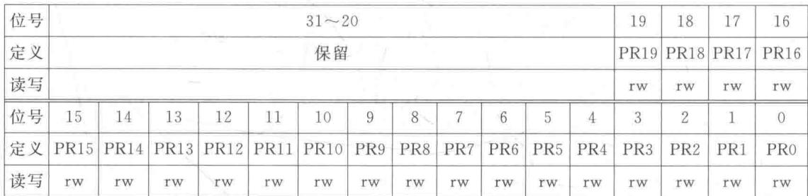

#### 【容易搞混】PR 的"写 1 清除"和 IMR 的"写 1 置位"

两个都是"写 1"，但效果**完全相反**：

| 寄存器 | 写 1 的效果 |
|---|---|
| EXTI_IMR | **置位**：打开中断 |
| EXTI_PR | **清除**：把挂起位清 0 |
| NVIC 的 SETENA | 置位：使能中断 |
| NVIC 的 CLRPEND | 清除：解挂 |

**记忆方法**：**"设置类"寄存器写 1 是让它变成 1；"清除类"寄存器写 1 也是让目标位变成 0。**

#### 为什么必须清除 PR？

这是初学者最常犯的错误，务必理解：

```
中断发生
   → PR 的 bit0 被硬件置 1
   → CPU 进入 ISR
   → ISR 里做了正事（比如翻转 LED）
   → ISR 返回
   → 【如果 PR 的 bit0 还是 1】
   → NVIC 发现挂起位还是 1，认为"这个中断还没处理完"
   → 立刻又进入 ISR
   → 又翻转 LED
   → 又返回
   → 又进入 ISR……
   → 程序卡在中断里出不来（"反复进中断"）
```

**所以 ISR 里必须清 PR**，对应代码就是：

```c
EXTI_ClearITPendingBit(EXTI_Line0);    /* 清除 EXTI_PR 的 bit0 */
```

#### 程序怎么操作？

```c
/* 读取：查看线 0 有没有挂起 */
if (EXTI->PR & 0x00000001) { ... }

/* 清除：写 1 到对应位 */
EXTI->PR = 0x00000001;

/* 或者用固件库 */
EXTI_ClearITPendingBit(EXTI_Line0);
```

**位运算演算**（判断）：

```
假设 PR = 0x00000005（线0 和线2 都挂起了）

PR      = 0000 0000 0000 0000 0000 0000 0000 0101
掩码    = 0000 0000 0000 0000 0000 0000 0000 0001   (EXTI_Line0)
──────────────────────────────────────────────────────  AND
结果    = 0000 0000 0000 0000 0000 0000 0000 0001

结果非 0 → 说明线 0 确实有挂起请求。✓
```

#### 6 个寄存器一页总结

| 寄存器 | 偏移 | 地址 | 作用 | 写 1 的效果 | 谁写 |
|---|---|---|---|---|---|
| EXTI_IMR | 0x00 | 0x40010400 | 中断屏蔽 | 开放该线的中断 | 程序 |
| EXTI_EMR | 0x04 | 0x40010404 | 事件屏蔽 | 开放该线的事件 | 程序 |
| EXTI_RTSR | 0x08 | 0x40010408 | 上升沿触发选择 | 允许上升沿触发 | 程序 |
| EXTI_FTSR | 0x0C | 0x4001040C | 下降沿触发选择 | 允许下降沿触发 | 程序 |
| EXTI_SWIER | 0x10 | 0x40010410 | 软件中断事件 | 软件制造一次请求 | 程序 |
| EXTI_PR | 0x14 | 0x40010414 | 挂起 | **清除**该线的挂起位 | 硬件置位 / 程序清除 |

### 本节真正要记住什么

1. EXTI 6 个寄存器基地址 **0x40010400**，偏移分别是 **0x00 / 0x04 / 0x08 / 0x0C / 0x10 / 0x14**，**必须按 32 位访问**。
2. 位图结构统一：**bit[31:20] 保留，bit[19:0] 一线一位**；但本芯片只有 **bit[18:0]** 对应真实存在的 19 条线，**bit19 是保留位**。
3. **IMR** 管中断开关，**EMR** 管事件开关。
4. **RTSR / FTSR** 管触发边沿，两者独立，可以同时置 1 实现双边沿触发。
5. **SWIER** 让软件制造请求，写 1 置 PR 的对应位；要清它得去清 PR。
6. **PR** 是挂起位，**ISR 里必须写 1 清除它**，否则会反复进中断。

---

## 7.5 外部中断的使用

### 先别急着看教材：这一节到底要干什么？

前面把硬件原理讲完了，这一节动手写程序。

要完成的任务是教材的【例 7-1】：

> 利用连接最小系统板上 PA0 的按钮，每按一次按钮，连接 PE0 的发光二极管亮灭状态翻转一次。采用外部中断的方法实现。

### 7.5.1 编程步骤

【教材内容】教材 p0（分卷 2）给出的步骤：

> （1）系统初始化，如系统时钟初始化。如前所述，在 STM32 的启动文件中已经调用 SystemInit() 函数，对系统时钟进行了设置，并且默认系统时钟频率就是 72MHz，因此，这一步可以省略。
> （2）GPIO 配置，**务必注意打开 GPIO 时钟时，一并打开 AFIO 时钟**。
> （3）EXTI 配置，配置需要选择哪个引脚作为中断引脚。
> （4）嵌套向量中断控制器 NVIC 配置，必须把 NVIC 中对应的通道使能，并且设置优先级别。
> （5）进入循环等待中断发生，并在中断程序中写入中断发生时应如何处理。

**这五步和 7.2.7 节的"简化三步"是一致的**：

- 第 (2) 步 = 配置引脚 + 打开时钟（外设四步曲的前两步）；
- 第 (3) 步 = 配置 EXTI 的 IMR / FTSR / RTSR；
- 第 (4) 步 = 优先级分组 + 优先级 + 使能（简化三步的完整版）；
- 第 (5) 步 = 写 ISR。

#### 【辅助理解图】例 7-1 按键中断程序：代码 → 寄存器 → 硬件

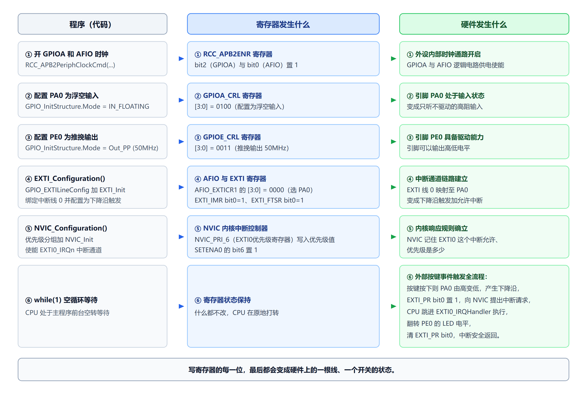

**看图方法**：
1. **左列**是你要写的代码，从上往下读。
2. **中列**是每一句代码实际改动了哪个寄存器的哪一位。
3. **右列**是硬件随之发生的变化。
4. **重点看第 ⑥ 行**：`while(1)` 看起来"什么都没干"，但实际上一旦按键按下，硬件会自动完成后面一整串动作，最后跳进 ISR。
5. **这张图要你理解**：**代码 → 寄存器 → 硬件 → 引脚**，这条链在中断程序里同样成立。

#### 【先补一个前置知识：按键电路长什么样？】

教材说"电路图请参见第 3 章"，我们看教材图 3-11：

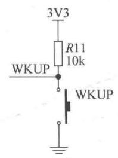

**这张图怎么看**：
1. **最上面**是 `3V3`（3.3V 电源）。
2. **中间**是一个 `R11 10k` 的电阻，它把 `WKUP` 这个网络**上拉**到 3.3V。
3. `WKUP` 就是接到 STM32 的 **PA0（PA0-WKUP）** 引脚的线。
4. **下面**是按键，按键另一端接**地（GND）**。

**所以电路的行为是**：

| 按键状态 | PA0 引脚电平 | 说明 |
|---|---|---|
| 没按 | **高电平（1）** | 通过 R11 上拉到 3.3V |
| 按下 | **低电平（0）** | 被按键直接拉到地 |

**因此**：按下的瞬间，PA0 上产生一个**下降沿**。这就是为什么例程里要选 `EXTI_Trigger_Falling`（下降沿触发）。

**另外**：因为引脚上已经有外部上拉电阻 R11，所以 GPIO 配置成"**浮空输入**"就够了，不需要再开芯片内部的上拉。

### 7.5.2 外部中断相关的固件库函数

【教材内容】教材介绍了 NVIC 相关的 2 个函数、EXTI 相关的 3 个函数、GPIO 相关的 1 个函数。

#### 1. NVIC 相关函数

##### 函数 NVIC_PriorityGroupConfig

```c
void NVIC_PriorityGroupConfig(u32 NVIC_PriorityGroup);
```

| 项目 | 内容 |
|---|---|
| 功能 | 设置优先级分组（抢占优先级和副优先级各占几位） |
| 输入 | `NVIC_PriorityGroup`，取值见表 7-7 |
| 返回值 | 无 |
| **重要限制** | **优先级分组只能设置一次**（教材原话） |

【教材内容】表 7-7 NVIC_PriorityGroup 的可取值：

| NVIC_PriorityGroup 的值 | 描述 |
|---|---|
| NVIC_PriorityGroup_0 | 抢占优先级 0 位，副优先级 4 位 |
| NVIC_PriorityGroup_1 | 抢占优先级 1 位，副优先级 3 位 |
| NVIC_PriorityGroup_2 | 抢占优先级 2 位，副优先级 2 位 |
| NVIC_PriorityGroup_3 | 抢占优先级 3 位，副优先级 1 位 |
| NVIC_PriorityGroup_4 | 抢占优先级 4 位，副优先级 0 位 |

**教材原表**：

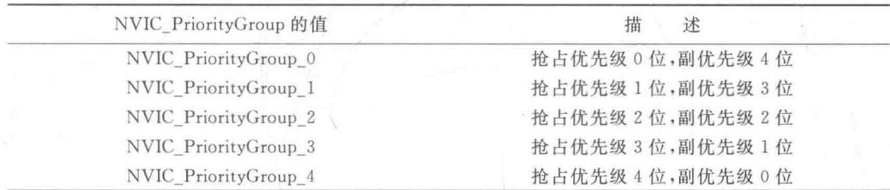

**用法示例**：

```c
NVIC_PriorityGroupConfig(NVIC_PriorityGroup_1);   /* 1 位抢占，3 位副 */
```

**这一句背后发生了什么？** 它去写 **AIRCR 寄存器的 PRIGROUP 位段**（0xE000ED0C）。

按 7.1 节的对照表：`NVIC_PriorityGroup_1` → PRIGROUP = `0b110`。

```
要写进 AIRCR 的值 = 0x05FA0000 | (0b110 << 8)
                  = 0x05FA0000 | 0x00000600
                  = 0x05FA0600
```

**为什么要"只能设置一次"？** 因为整个系统共用一套分组方式，如果不同外设各设各的，优先级就乱了。所以一般在程序开头设一次，之后不再改。

##### 函数 NVIC_Init

```c
void NVIC_Init(NVIC_InitTypeDef * NVIC_InitStruct);
```

| 项目 | 内容 |
|---|---|
| 功能 | 根据 `NVIC_InitStruct` 中指定的参数初始化 NVIC 寄存器 |
| 输入 | 指向结构 `NVIC_InitTypeDef` 的指针 |

结构体定义（在 `stm32f10x_nvic.h` 中）：

```c
typedef struct
{
    u8 NVIC_IRQChannel;                        /* 中断通道（选哪个中断） */
    u8 NVIC_IRQChannelPreemptionPriority;      /* 抢占优先级 */
    u8 NVIC_IRQChannelSubPriority;             /* 副优先级 */
    FunctionalState NVIC_IRQChannelCmd;        /* 使能还是除能 */
} NVIC_InitTypeDef;
```

**四个成员的含义**：

| 成员 | 含义 | 取值 |
|---|---|---|
| NVIC_IRQChannel | 选哪个中断通道 | 见表 7-8（例如 `EXTI0_IRQn`） |
| NVIC_IRQChannelPreemptionPriority | 抢占优先级 | 见表 7-9 |
| NVIC_IRQChannelSubPriority | 副优先级 | 见表 7-9 |
| NVIC_IRQChannelCmd | 使能 / 除能 | `ENABLE` 或 `DISABLE` |

【教材内容】表 7-8 NVIC_IRQChannel 可取的值（节选与本章相关部分）：

| NVIC_IRQChannel 值 | 描述 | NVIC_IRQChannel 值 | 描述 |
|---|---|---|---|
| WWDG_IRQn | 窗口看门狗中断 | TIM4_IRQn | TIM4 全局中断 |
| PVD_IRQn | PVD 通过 EXTI 探测中断 | I2C1_EV_IRQn | I2C1 事件中断 |
| TAMPER_IRQn | 篡改中断 | I2C1_ER_IRQn | I2C1 错误中断 |
| RTC_IRQn | RTC 全局中断 | I2C2_EV_IRQn | I2C2 事件中断 |
| FLASH_IRQn | FLASH 全局中断 | I2C2_ER_IRQn | I2C2 错误中断 |
| RCC_IRQn | RCC 全局中断 | SPI1_IRQn | SPI1 全局中断 |
| **EXTI0_IRQn** | **外部中断线 0 中断** | SPI2_IRQn | SPI2 全局中断 |
| **EXTI1_IRQn** | **外部中断线 1 中断** | USART1_IRQn | USART1 全局中断 |
| **EXTI2_IRQn** | **外部中断线 2 中断** | USART2_IRQn | USART2 全局中断 |
| **EXTI3_IRQn** | **外部中断线 3 中断** | USART3_IRQn | USART3 全局中断 |
| **EXTI4_IRQn** | **外部中断线 4 中断** | **EXTI15_10_IRQn** | **外部中断线 15-10 中断** |
| DMA1_Channel1_IRQn | DMA1 通道 1 中断 | RTCAlarm_IRQn | RTC 闹钟通过 EXTI 线中断 |
| DMA1_Channel2_IRQn | DMA1 通道 2 中断 | USBWakeUp_IRQn | USB 由 EXTI 线从挂起唤醒中断 |
| DMA1_Channel3_IRQn | DMA1 通道 3 中断 | TIM8_BRK_IRQn | TIM8 暂停中断 |
| DMA1_Channel4_IRQn | DMA1 通道 4 中断 | TIM8_UP_IRQn | TIM8 更新中断 |
| DMA1_Channel5_IRQn | DMA1 通道 5 中断 | TIM8_TRG_COM_IRQn | TIM8 触发和通信中断 |
| DMA1_Channel6_IRQn | DMA1 通道 6 中断 | TIM8_CC_IRQn | TIM8 捕获比较中断 |
| DMA1_Channel7_IRQn | DMA1 通道 7 中断 | ADC3_IRQn | ADC3 全局中断 |
| ADC1_2_IRQn | ADC1_2 全局中断 | FSMC_IRQn | FSMC 全局中断 |
| USB_HP_CAN1_TX_IRQn | USB 高优先级或 CAN 发送中断 | SDIO_IRQn | SDIO 全局中断 |
| USB_LP_CAN1_RX0_IRQn | USB 低优先级或 CAN 接收 0 中断 | TIM5_IRQn | TIM5 全局中断 |
| CAN1_RX1_IRQn | CAN 接收 1 中断 | SPI3_IRQn | SPI3 全局中断 |
| CAN1_SCE_IRQn | CAN SCE 中断 | UART4_IRQn | UART4 全局中断 |
| **EXTI9_5_IRQn** | **外部中断线 9-5 中断** | UART5_IRQn | UART5 全局中断 |
| TIM1_BRK_IRQn | TIM1 暂停中断 | TIM6_IRQn | TIM6 全局中断 |
| TIM1_UP_IRQn | TIM1 更新中断 | TIM7_IRQn | TIM7 全局中断 |
| TIM1_TRG_COM_IRQn | TIM1 触发和通信中断 | DMA2_Channel1_IRQn | DMA2 通道 1 中断 |
| TIM1_CC_IRQn | TIM1 捕获比较中断 | DMA2_Channel2_IRQn | DMA2 通道 2 中断 |
| TIM2_IRQn | TIM2 全局中断 | DMA2_Channel3_IRQn | DMA2 通道 3 中断 |
| TIM3_IRQn | TIM3 全局中断 | DMA2_Channel4_5_IRQn | DMA2 通道 4_5 中断 |

**教材原表**：

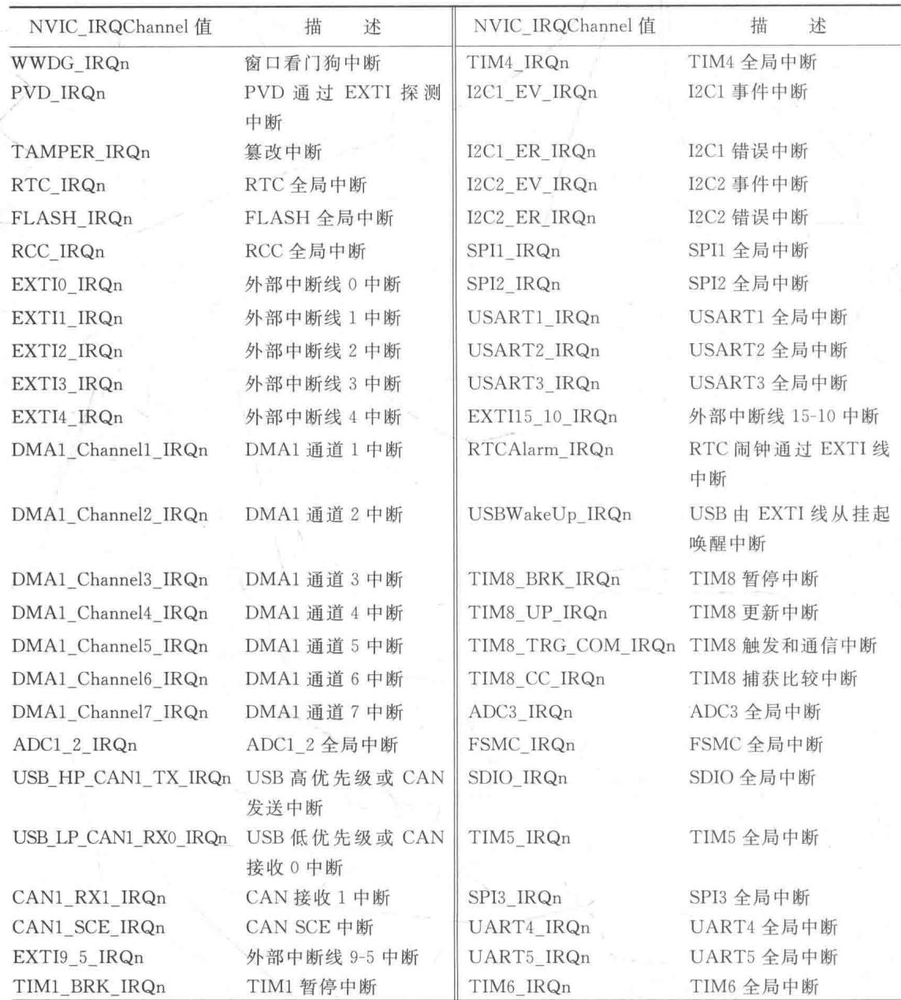

> 【OCR 提示】教材表 7-8 里的 `RTCAIarm_IRQn` 同样是 `RTCAlarm_IRQn` 的排印错误（小写 l 被印成了大写 I），本讲义已按固件库的正确拼写转写。

**【重要】把这张表和表 7-1 对照着看**：

| NVIC_IRQChannel | 表 7-1 里的"位置" | 向量地址 |
|---|---|---|
| EXTI0_IRQn | 6 | 0x0000_0058 |
| EXTI1_IRQn | 7 | 0x0000_005C |
| EXTI2_IRQn | 8 | 0x0000_0060 |
| EXTI3_IRQn | 9 | 0x0000_0064 |
| EXTI4_IRQn | 10 | 0x0000_0068 |
| EXTI9_5_IRQn | 23 | 0x0000_009C |
| EXTI15_10_IRQn | 40 | 0x0000_00E0 |

**"位置号"和固件库里的名字是对应的**：`EXTI0_IRQn` 的 0 就是位置号 0？**不是！**

**注意这里有个陷阱**：`EXTI0_IRQn` 里的 "0" 是 **EXTI 线号**，而它在向量表里的**位置号是 6**。两者不是一回事：

```
EXTI 线号 0  →  中断通道 EXTI0_IRQn  →  向量表位置号 6  →  向量地址 0x58
```

**这个 6 非常重要**，因为它决定了：

- 优先级寄存器是 `PRI_6`（地址 0xE000E406）；
- 使能位是 `SETENA0` 的 bit6（掩码 0x00000040）；
- 向量表那一格在偏移 0x58。

【教材内容】表 7-9 抢占优先级和副优先级可取的值：

| NVIC_PriorityGroup | 抢占优先级可取值 | 副优先级可取值 | 描述 |
|---|---|---|---|
| NVIC_PriorityGroup_0 | 0 | 0~15 | 抢占 0 位，副 4 位 |
| NVIC_PriorityGroup_1 | 0~1 | 0~7 | 抢占 1 位，副 3 位 |
| NVIC_PriorityGroup_2 | 0~3 | 0~3 | 抢占 2 位，副 2 位 |
| NVIC_PriorityGroup_3 | 0~7 | 0~1 | 抢占 3 位，副 1 位 |
| NVIC_PriorityGroup_4 | 0~15 | 0 | 抢占 4 位，副 0 位 |

**教材原表**：

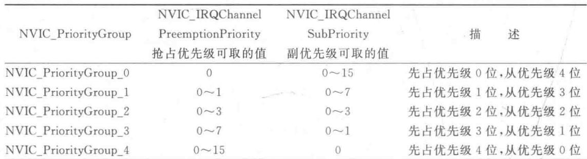

> 注：（1）若选中 NVIC_PriorityGroup_0，则参数 NVIC_IRQChannelPreemptionPriority 对中断通道的设置不产生影响。
> （2）若选中 NVIC_PriorityGroup_4，则参数 NVIC_IRQChannelSubPriority 对中断通道的设置不产生影响。

**这两条注怎么理解？** 看分组 0：抢占位数是 0，也就是说"抢占优先级"这个概念根本不存在，所以你怎么填都无所谓。分组 4 同理，副优先级位数是 0，填什么都无所谓。

#### 2. EXTI 相关函数

##### 函数 EXTI_Init

```c
void EXTI_Init(EXTI_InitTypeDef * EXTI_InitStruct);
```

| 项目 | 内容 |
|---|---|
| 功能 | 根据 `EXTI_InitStruct` 中指定的参数初始化 EXTI 寄存器 |
| 输入 | 指向结构 `EXTI_InitTypeDef` 的指针 |

结构体定义（在 `stm32f10x_exti.h` 中）：

```c
typedef struct
{
    u32 EXTI_Line;                    /* 选哪条 EXTI 线 */
    EXTIMode_TypeDef EXTI_Mode;       /* 中断模式还是事件模式 */
    EXTITrigger_TypeDef EXTI_Trigger; /* 触发边沿 */
    FunctionalState EXTI_LineCmd;     /* 使能还是除能 */
} EXTI_InitTypeDef;
```

| 成员 | 含义 | 取值 |
|---|---|---|
| EXTI_Line | 选哪条线 | 见表 7-10（`EXTI_Line0` ~ `EXTI_Line19`） |
| EXTI_Mode | 中断还是事件 | `EXTI_Mode_Interrupt` / `EXTI_Mode_Event` |
| EXTI_Trigger | 触发边沿 | `EXTI_Trigger_Falling` / `EXTI_Trigger_Rising` / `EXTI_Trigger_Rising_Falling` |
| EXTI_LineCmd | 使能 / 除能 | `ENABLE` / `DISABLE` |

【教材内容】表 7-10 EXTI_Line 可取的值：

| EXTI_Line | 描述 | EXTI_Line | 描述 |
|---|---|---|---|
| EXTI_Line0 | 外部中断线 0 | EXTI_Line10 | 外部中断线 10 |
| EXTI_Line1 | 外部中断线 1 | EXTI_Line11 | 外部中断线 11 |
| EXTI_Line2 | 外部中断线 2 | EXTI_Line12 | 外部中断线 12 |
| EXTI_Line3 | 外部中断线 3 | EXTI_Line13 | 外部中断线 13 |
| EXTI_Line4 | 外部中断线 4 | EXTI_Line14 | 外部中断线 14 |
| EXTI_Line5 | 外部中断线 5 | EXTI_Line15 | 外部中断线 15 |
| EXTI_Line6 | 外部中断线 6 | EXTI_Line16 | 外部中断线 16 |
| EXTI_Line7 | 外部中断线 7 | EXTI_Line17 | 外部中断线 17 |
| EXTI_Line8 | 外部中断线 8 | EXTI_Line18 | 外部中断线 18 |
| EXTI_Line9 | 外部中断线 9 | EXTI_Line19 | 外部中断线 19 |

**教材原表**：

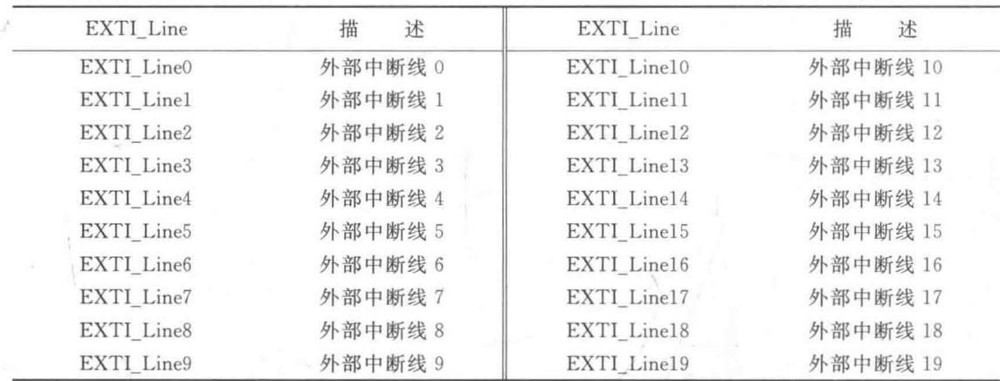

> 【容易搞混】固件库头文件里确实定义了 `EXTI_Line19`，但本芯片（STM32F103VET6）**没有线 19**——它只对互联型产品有意义。在本芯片的程序里写 `EXTI_Line19` 不会报错，但也不会产生任何效果。真正可用的编号是 `EXTI_Line0` ~ `EXTI_Line18`，其中线 16~18 不是 GPIO（分别是 PVD、RTC 闹钟、USB 唤醒）；纯用 GPIO 做外部中断时，实际只会用到 `EXTI_Line0` ~ `EXTI_Line15`。

**用法示例**（教材给出）：

```c
EXTI_InitTypeDef EXTI_InitStructure;
EXTI_InitStructure.EXTI_Line = EXTI_Line0;                  /* 选线 0 */
EXTI_InitStructure.EXTI_Mode = EXTI_Mode_Interrupt;         /* 中断模式 */
EXTI_InitStructure.EXTI_Trigger = EXTI_Trigger_Falling;     /* 下降沿 */
EXTI_InitStructure.EXTI_LineCmd = ENABLE;                   /* 使能 */
EXTI_Init(&EXTI_InitStructure);
```

**`EXTI_Init` 内部干了什么？** 它会把结构体翻译成寄存器操作：

| 结构体成员 | 实际写的寄存器 |
|---|---|
| EXTI_Line + EXTI_Mode = Interrupt + ENABLE | `EXTI_IMR` 的对应位置 1 |
| EXTI_Line + EXTI_Mode = Event + ENABLE | `EXTI_EMR` 的对应位置 1 |
| EXTI_Trigger = Falling | `EXTI_FTSR` 的对应位置 1 |
| EXTI_Trigger = Rising | `EXTI_RTSR` 的对应位置 1 |
| EXTI_LineCmd = DISABLE | 对应屏蔽位清 0 |

##### 函数 EXTI_GetITStatus

```c
ITStatus EXTI_GetITStatus(u32 EXTI_Line);
```

| 项目 | 内容 |
|---|---|
| 功能 | 检查指定的 EXTI 线路触发请求发生与否 |
| 输入 | `EXTI_Line`：待检查的 EXTI 线路 |
| 返回值 | `SET`（发生了）或 `RESET`（没发生） |

**用法示例**：

```c
ITStatus EXTIStatus;
EXTIStatus = EXTI_GetITStatus(EXTI_Line0);
```

**它内部读的是哪个寄存器？** 主要是 **EXTI_PR**（挂起寄存器），同时也会检查 IMR。

##### 函数 EXTI_ClearITPendingBit

```c
void EXTI_ClearITPendingBit(u32 EXTI_Line);
```

| 项目 | 内容 |
|---|---|
| 功能 | 清除 EXTI 线路中断挂起位 |
| 输入 | `EXTI_Line`：待清除挂起位的 EXTI 线路 |

**用法示例**：

```c
EXTI_ClearITPendingBit(EXTI_Line0);
```

**它内部做的就是**：往 `EXTI_PR` 的对应位**写 1**。

> 【待核验】教材 p4 的示例代码写作 `EXTI_ClearITpendingBit(EXTI_Line0);`（pending 的首字母小写）。固件库中的正确函数名是 **`EXTI_ClearITPendingBit`**（大写 P）。属 OCR 或排版问题，建议核对原 PDF 分卷 2 第 4 页。

#### 3. GPIO 相关函数 GPIO_EXTILineConfig

```c
void GPIO_EXTILineConfig(u8 GPIO_PortSource, u8 GPIO_PinSource);
```

| 项目 | 内容 |
|---|---|
| 功能 | 选择 GPIO 引脚用作外部中断线路 |
| 输入 1 | `GPIO_PortSource`：端口，取 `GPIO_PortSource_GPIOy`（y 可以是 A~E） |
| 输入 2 | `GPIO_PinSource`：引脚号，取 `GPIO_PinSourcex`（x 可以是 0~15） |

**它内部做的就是写 AFIO_EXTICR**：

```c
GPIO_EXTILineConfig(GPIO_PortSourceGPIOA, GPIO_PinSource0);
```

翻译成寄存器操作：

```
AFIO_EXTICR1（地址 0x40010008）的 bit[3:0] 写成 0000
→ 表示 EXTI0 这条线选择 PA 端口
```

**注意**：这个函数就是 7.3.5 节那个"多路选择器"的软件接口。

### 7.5.3 【例 7-1】完整代码与逐行讲解

#### 这段代码要完成什么？

用 PA0 上的按键，通过**外部中断**的方式，控制 PE0 上的 LED 亮灭翻转。

#### 完整代码

> 【补充解释】下面代码按教材 p4~p5 抄录，并修正了几处明显的 OCR 错误（`EXTIO` → `EXTI0`、`PAO` → `PA0`、`EXTI_ClearITpendingBit` → `EXTI_ClearITPendingBit`、括号配对等）。修正处已在表格中注明。

```c
#include "stm32f10x.h"    /* 包含 STM32F1 系列微控制器的头文件 */

void NVIC_Configuration(void);    /* 嵌套向量中断控制器配置 */
void EXTI_Configuration(void);    /* 外部中断设置 */

int main(void)
{
    GPIO_InitTypeDef GPIO_InitStructure;    /* 声明用于 GPIO 初始化的结构体 */

    /* 使能 PA 口和 AFIO 时钟 */
    RCC_APB2PeriphClockCmd(RCC_APB2Periph_GPIOA | RCC_APB2Periph_AFIO, ENABLE);
    /* 使能 PE 口时钟 */
    RCC_APB2PeriphClockCmd(RCC_APB2Periph_GPIOE, ENABLE);

    /* 配置输入脚 PA0 控制按键 */
    GPIO_InitStructure.GPIO_Pin = GPIO_Pin_0;
    GPIO_InitStructure.GPIO_Mode = GPIO_Mode_IN_FLOATING;
    GPIO_Init(GPIOA, &GPIO_InitStructure);

    /* 配置输出脚 PE0 控制 LED 灯 */
    GPIO_InitStructure.GPIO_Pin = GPIO_Pin_0;
    GPIO_InitStructure.GPIO_Speed = GPIO_Speed_50MHz;
    GPIO_InitStructure.GPIO_Mode = GPIO_Mode_Out_PP;
    GPIO_Init(GPIOE, &GPIO_InitStructure);

    EXTI_Configuration();
    NVIC_Configuration();

    while(1);    /* 循环等待中断产生 */
}

/* 嵌套向量中断控制器配置 */
void NVIC_Configuration(void)
{
    NVIC_InitTypeDef NVIC_InitStructure;

    NVIC_PriorityGroupConfig(NVIC_PriorityGroup_1);    /* 选择优先级组别 */

    /* 选择中断通道：EXTI 线 0 中断，因为按键连接的是 PA0 脚 */
    NVIC_InitStructure.NVIC_IRQChannel = EXTI0_IRQn;
    NVIC_InitStructure.NVIC_IRQChannelPreemptionPriority = 0;    /* 0 级抢占式优先级 */
    NVIC_InitStructure.NVIC_IRQChannelSubPriority = 0;           /* 0 级副优先级 */
    NVIC_InitStructure.NVIC_IRQChannelCmd = ENABLE;              /* 使能引脚作为中断源 */
    NVIC_Init(&NVIC_InitStructure);    /* 调用 NVIC_Init 固件库函数进行设置 */
}

void EXTI_Configuration(void)
{
    EXTI_InitTypeDef EXTI_InitStructure;

    /* 调用固件库中的 GPIO_EXTILineConfig 函数，
       其中两个参数分别是中断口和中断口对应的引脚号 */
    GPIO_EXTILineConfig(GPIO_PortSourceGPIOA, GPIO_PinSource0);

    EXTI_InitStructure.EXTI_Line = EXTI_Line0;                  /* 将中断映射到中断源 Line0 */
    EXTI_InitStructure.EXTI_Mode = EXTI_Mode_Interrupt;         /* 中断模式 */
    EXTI_InitStructure.EXTI_Trigger = EXTI_Trigger_Falling;     /* 下降沿中断 */
    EXTI_InitStructure.EXTI_LineCmd = ENABLE;                   /* 中断使能，即开中断 */
    EXTI_Init(&EXTI_InitStructure);
    /* 调用 EXTI_Init 固件库函数，将结构体写入 EXTI 相关寄存器中 */
}

void EXTI0_IRQHandler(void)
{
    if(EXTI_GetITStatus(EXTI_Line0) != RESET)
    {
        /* EXTI_GetITStatus() 函数的返回值如果不是 RESET，说明此时确实有中断发生了，
           注意把中断标志位清除，以防它不断地进入中断 */
        /* 将 LED0 的状态反转 */
        GPIO_WriteBit(GPIOE, GPIO_Pin_0,
                      (BitAction)(1 - GPIO_ReadOutputDataBit(GPIOE, GPIO_Pin_0)));
        EXTI_ClearITPendingBit(EXTI_Line0);    /* 清中断 */
    }
}
```

#### 逐块讲解

##### 第 1 块：头文件和函数声明

```c
#include "stm32f10x.h"
void NVIC_Configuration(void);
void EXTI_Configuration(void);
```

| 代码 | CPU 做什么 | 寄存器/硬件发生什么 |
|---|---|---|
| `#include "stm32f10x.h"` | 编译阶段的事，不产生机器码 | 让编译器知道 `GPIOA`、`EXTI`、`RCC` 这些符号代表什么地址 |
| 两个函数声明 | 告诉编译器"这两个函数在别处定义了" | 无 |

**【补充解释】`GPIOA`、`EXTI` 这些名字到底是什么？**

它们是**指向寄存器的指针**（结构体指针）。比如：

- `GPIOA` 展开后就是 `((GPIO_TypeDef *) 0x40010800)`，指向 GPIOA 的基地址；
- `EXTI` 展开后就是 `((EXTI_TypeDef *) 0x40010400)`，指向 EXTI 的基地址。

所以 `EXTI->IMR = 0x00000001;` 这句话，**本质就是"往地址 0x40010400 写 1"**。这就是"代码 → 地址 → 寄存器"的对应关系。

##### 第 2 块：打开时钟

```c
RCC_APB2PeriphClockCmd(RCC_APB2Periph_GPIOA | RCC_APB2Periph_AFIO, ENABLE);
RCC_APB2PeriphClockCmd(RCC_APB2Periph_GPIOE, ENABLE);
```

| 代码 | 寄存器发生什么 | 硬件发生什么 |
|---|---|---|
| 第 1 句 | 写 `RCC_APB2ENR`，把 bit2（GPIOA）和 bit0（AFIO）置 1 | GPIOA 和 AFIO 两个模块通电，可以工作了 |
| 第 2 句 | 写 `RCC_APB2ENR`，把 bit6（GPIOE）置 1 | GPIOE 模块通电 |

**为什么要 `|`（或）？**

```
RCC_APB2Periph_GPIOA = 0x00000004  (bit2)
RCC_APB2Periph_AFIO  = 0x00000001  (bit0)

运算前：  0000 0000 0000 0000 0000 0000 0000 0000
掩码：    0000 0000 0000 0000 0000 0000 0000 0101   (两个值相或)
──────────────────────────────────────────────────────  OR
运算后：  0000 0000 0000 0000 0000 0000 0000 0101

结果：bit0 和 bit2 同时被置 1，一次调用开了两个时钟。✓
```

**注意教材特意强调的**：`RCC_APB2Periph_AFIO` **必须开**，因为后面 `GPIO_EXTILineConfig` 要写 AFIO_EXTICR1 寄存器。不开时钟，写进去也不生效。

##### 第 3 块：配置 PA0 为输入

```c
GPIO_InitStructure.GPIO_Pin = GPIO_Pin_0;
GPIO_InitStructure.GPIO_Mode = GPIO_Mode_IN_FLOATING;
GPIO_Init(GPIOA, &GPIO_InitStructure);
```

| 代码 | 寄存器发生什么 | 硬件发生什么 |
|---|---|---|
| `GPIO_Pin = GPIO_Pin_0` | 只是填结构体，还没写硬件 | 无 |
| `GPIO_Mode = GPIO_Mode_IN_FLOATING` | 同上 | 无 |
| `GPIO_Init(GPIOA, ...)` | 写 **GPIOA_CRL** 的 bit[3:0] = `0100` | PA0 引脚变成"浮空输入" |

**`0100` 是什么意思？** 第 6 章讲过：GPIO 的配置寄存器每 4 位管一个引脚，这 4 位又分成两段：

```
bit3 bit2 | bit1 bit0
   CNF    |   MODE
```

- **MODE[1:0]**（低 2 位）：决定是输入还是输出、输出速度多少。`00` = 输入模式。
- **CNF[1:0]**（高 2 位）：在输入模式下决定是浮空 / 上拉 / 下拉 / 模拟；在输出模式下决定是推挽还是开漏。

所以 `0100` 要这样读：

```
 0    1  |  0    0
bit3 bit2| bit1 bit0
+----+---+----+----+
| CNF = 01 | MODE = 00 |
+----+---+----+----+
   ↑            ↑
 浮空输入      输入模式
```

**结论**：`0100` = **输入模式 + 浮空输入**。✓

**为什么用"浮空输入"就够了？** 因为外部电路里已经有 R11 这个 10k 上拉电阻（图 3-11），引脚平时被拉到高电平，不需要芯片内部再上拉。

##### 第 4 块：配置 PE0 为输出

```c
GPIO_InitStructure.GPIO_Pin = GPIO_Pin_0;
GPIO_InitStructure.GPIO_Speed = GPIO_Speed_50MHz;
GPIO_InitStructure.GPIO_Mode = GPIO_Mode_Out_PP;
GPIO_Init(GPIOE, &GPIO_InitStructure);
```

| 代码 | 寄存器发生什么 | 硬件发生什么 |
|---|---|---|
| `GPIO_Speed = GPIO_Speed_50MHz` | 只填结构体；`GPIO_Init` 会据此把 CRL 的 **MODE 位写成 `11`**（50MHz） | 无（还没写进硬件） |
| `GPIO_Mode = GPIO_Mode_Out_PP` | 只填结构体；`GPIO_Init` 会据此把 CRL 的 **CNF 位写成 `00`**（通用推挽输出） | 无（还没写进硬件） |
| `GPIO_Init(GPIOE, ...)` | 写 **GPIOE_CRL** 的 bit[3:0] = `0011` | PE0 引脚变成"推挽输出，最高 50MHz" |

**`0011` 怎么读**：

```
 0    0  |  1    1
bit3 bit2| bit1 bit0
+----+---+----+----+
| CNF = 00 | MODE = 11 |
+----+---+----+----+
   ↑            ↑
 通用推挽输出   输出模式，50MHz
```

**结论**：`0011` = **推挽输出 + 50MHz**。✓

**注意结构体复用的小技巧**：这里没有重新声明结构体，而是**直接改成员**。第一次用 `GPIO_Pin_0` 配 PA0，第二次还用 `GPIO_Pin_0` 配 PE0——因为两个都是 0 号引脚，只是端口不同（一个传 `GPIOA`，一个传 `GPIOE`）。

##### 第 5 块：调用两个配置函数

```c
EXTI_Configuration();
NVIC_Configuration();
```

先配 EXTI（把线 0 设置成下降沿中断），再配 NVIC（把这个中断打开并设优先级）。

**顺序其实无所谓**，但**两个都必须配**。

##### 第 6 块：while(1) 等中断

```c
while(1);
```

| 代码 | CPU 做什么 | 硬件发生什么 |
|---|---|---|
| `while(1);` | CPU 反复执行"空转"指令（其实是一条跳转指令来回跑） | **什么都没有发生**，直到中断到来 |

**【重要】为什么这里"什么都不干"也能工作？**

因为**中断是硬件自动触发的**，不需要程序去"等"或"查"。CPU 在这里空转，一旦按键按下：

```
PA0 引脚电平由高变低
    → EXTI 边沿检测电路发现下降沿
    → EXTI_PR 的 bit0 被置 1
    → 与门1（IMR bit0 = 1）输出有效
    → NVIC 收到请求，比较优先级
    → CPU 暂停 while(1)，自动压栈 8 个字
    → 从向量表 0x58 处取出 EXTI0_IRQHandler 的地址，装进 PC
    → 开始执行 ISR
```

**这就是中断和轮询最直观的区别**：`while(1)` 里一行代码都没有，但系统照样能响应按键。

##### 第 7 块：NVIC_Configuration 逐行

```c
NVIC_PriorityGroupConfig(NVIC_PriorityGroup_1);
```

| 代码 | 寄存器发生什么 | 硬件发生什么 |
|---|---|---|
| 这一句 | 写 AIRCR（0xE000ED0C），PRIGROUP = `0b110` | 全局优先级分组变成"1 位抢占 + 3 位副" |

```c
NVIC_InitStructure.NVIC_IRQChannel = EXTI0_IRQn;
```

| 代码 | 含义 |
|---|---|
| `EXTI0_IRQn` | 这是一个**编号常量**，值是 **6**（EXTI 线 0 在向量表里的位置号） |

**再强调一次这个 6**：它是后面所有计算的基础。

```c
NVIC_InitStructure.NVIC_IRQChannelPreemptionPriority = 0;
NVIC_InitStructure.NVIC_IRQChannelSubPriority = 0;
```

抢占优先级 0、副优先级 0 —— 这是**最高优先级**（数值越小越优先）。

**优先级寄存器的值算出来是多少？**

分组 1 是"1 位抢占 + 3 位副"：

```
 7  | 6    5    4 | 3  2  1  0
+---+-----------+------------+
|抢占|   副优先级  |  未实现     |
+---+-----------+------------+
  0      0 0 0      0 0 0 0

整个字节 = 0000 0000 = 0x00
```

所以 **PRI_6（地址 0xE000E406）会被写成 0x00**。

```c
NVIC_InitStructure.NVIC_IRQChannelCmd = ENABLE;
NVIC_Init(&NVIC_InitStructure);
```

`NVIC_Init` 内部会做两件关键的事：

| 动作 | 寄存器 | 值 | 地址 |
|---|---|---|---|
| 写优先级 | PRI_6 | 0x00 | 0xE000E406 |
| 使能中断 | SETENA0 的 bit6 | 0x00000040 | 0xE000E100 |

**位运算演算**（使能位）：

```
1 << 6 = 0x00000040
        = 0000 0000 0000 0000 0000 0000 0100 0000
                                              ↑
                                            bit6

写 SETENA0（0xE000E100）= 0x00000040
→ 中断 #6（也就是 EXTI0）被使能。
```

**到这里，"简化三步"（设分组、设优先级、使能）全部完成。**

##### 第 8 块：EXTI_Configuration 逐行

```c
GPIO_EXTILineConfig(GPIO_PortSourceGPIOA, GPIO_PinSource0);
```

| 代码 | 寄存器发生什么 | 硬件发生什么 |
|---|---|---|
| 这一句 | 写 AFIO_EXTICR1（0x40010008）的 bit[3:0] = `0000` | EXTI 线 0 的输入源被切换到 **PA0** |

**位图**：

```
AFIO_EXTICR1（0x40010008）
 15   14   13   12   11   10    9    8   7    6    5    4   3    2    1    0
+----+----+----+----+----+----+----+----+----+----+----+----+----+----+----+----+
|   EXTI3 字段    |   EXTI2 字段    |   EXTI1 字段    |   EXTI0 字段    |
+----+----+----+----+----+----+----+----+----+----+----+----+----+----+----+----+
                                                                ↑
                                                    当前关心这里：写 0000 = 选 PA0
```

```c
EXTI_InitStructure.EXTI_Line = EXTI_Line0;
EXTI_InitStructure.EXTI_Mode = EXTI_Mode_Interrupt;
EXTI_InitStructure.EXTI_Trigger = EXTI_Trigger_Falling;
EXTI_InitStructure.EXTI_LineCmd = ENABLE;
EXTI_Init(&EXTI_InitStructure);
```

`EXTI_Init` 内部写的寄存器：

| 结构体成员 | 写的寄存器 | 写的位 | 值 | 地址 |
|---|---|---|---|---|
| EXTI_Line0 + Interrupt + ENABLE | EXTI_IMR | bit0 | 1 | 0x40010400 |
| EXTI_Line0 + Falling | EXTI_FTSR | bit0 | 1 | 0x4001040C |

**位运算演算**：

```
EXTI_IMR（0x40010400）：
运算前：  0000 0000 0000 0000 0000 0000 0000 0000
掩码：    0000 0000 0000 0000 0000 0000 0000 0001   (EXTI_Line0)
──────────────────────────────────────────────────────  OR
运算后：  0000 0000 0000 0000 0000 0000 0000 0001

EXTI_FTSR（0x4001040C）：
运算前：  0000 0000 0000 0000 0000 0000 0000 0000
掩码：    0000 0000 0000 0000 0000 0000 0000 0001   (EXTI_Line0)
──────────────────────────────────────────────────────  OR
运算后：  0000 0000 0000 0000 0000 0000 0000 0001
```

**注意 `EXTI_RTSR` 保持 0**：因为我们只要下降沿，不要上升沿。

##### 第 9 块：中断服务程序 EXTI0_IRQHandler

```c
void EXTI0_IRQHandler(void)
{
    if(EXTI_GetITStatus(EXTI_Line0) != RESET)
    {
        ...
        EXTI_ClearITPendingBit(EXTI_Line0);
    }
}
```

**【重要】函数名为什么必须叫 `EXTI0_IRQHandler`？**

因为**这个名字就是向量表里那一格指向的地址的名字**。启动文件（`startup_stm32f10x_hd.s`）里已经把向量表里**偏移 0x58 的那一格**指向了这个名字。

**注意不要把这一格说成"第 6 项"**：

```
0x58 ÷ 4 = 22   →  这是"异常号 22"
按表内的位置从头数（第 1 格算第 1 项），它是第 23 项
```

而 **6 是 EXTI0 在"外部中断"里的编号**（`EXTI0_IRQn` = 6），两者差了一个 16（内核异常占掉的异常号 0~15）：**异常号 = 16 + 外部中断编号 = 16 + 6 = 22**。本章反复强调"编号 6 ≠ 表内位置"，这里用的就是同一个道理——只不过这次要用的"表内位置"是 23，而不是 6。

如果你把函数名写成 `MyButtonHandler`，向量表里那一格还是指向 `EXTI0_IRQHandler`，而那个函数不存在（或者是个空函数），你的代码永远不会被执行。

**函数名 → 向量表位置**：

```
EXTI0_IRQHandler  →  EXTI0_IRQn（外部中断编号 6）
                  →  异常号 = 16 + 6 = 22
                  →  向量表偏移 0x58（表内第 23 项）
                  →  表 7-1 中 EXTI0 那一行
```

**逐行**：

```c
if(EXTI_GetITStatus(EXTI_Line0) != RESET)
```

| 代码 | 做什么 | 为什么需要 |
|---|---|---|
| `EXTI_GetITStatus(EXTI_Line0)` | 读 `EXTI_PR` 的 bit0，看是不是 1 | **同一个 ISR 可能对应多个中断源**。比如 `EXTI9_5_IRQHandler` 一个函数要管线 5、6、7、8、9 五条线，必须判断是哪一条触发的 |
| `!= RESET` | 如果挂起位是 1，说明确实是线 0 触发的 | 确认后再干活 |

**对本例来说**，`EXTI0_IRQHandler` 只对应线 0 一个源，这个 `if` 看起来"多余"，但这是**良好的编程习惯**，教材特意保留并加注释说明。

```c
GPIO_WriteBit(GPIOE, GPIO_Pin_0,
              (BitAction)(1 - GPIO_ReadOutputDataBit(GPIOE, GPIO_Pin_0)));
```

这一句要拆成三步看：

| 步骤 | 代码 | 寄存器 | 说明 |
|---|---|---|---|
| ① 读 | `GPIO_ReadOutputDataBit(GPIOE, GPIO_Pin_0)` | 读 **GPIOE_ODR** 的 bit0 | 得到当前 LED 的状态（0 或 1） |
| ② 取反 | `1 - x` | 无 | 0 变 1，1 变 0 |
| ③ 写 | `GPIO_WriteBit(GPIOE, GPIO_Pin_0, ...)` | 写 **GPIOE_ODR** 的 bit0（或 BSRR/BRR） | LED 状态翻转 |

**为什么用 `1 - x` 而不是 `!x`？** 因为 `!` 是逻辑非，结果只有 0 和 1，其实也可以。教材用 `1 - x` 是更直观的"翻转"写法：0→1，1→0。

**硬件最终发生什么**：

```
PE0 的 ODR 位翻转
    → GPIO 输出驱动器改变输出电平
    → PE0 引脚电平翻转
    → 接在 PE0 上的 LED 由亮变灭（或由灭变亮）
```

**注意 `GPIO_ReadOutputDataBit` 读的是 ODR（输出数据寄存器）而不是 IDR（输入数据寄存器）**——因为它关心的是"我们让引脚输出什么"，而不是"引脚上实际是什么电平"。对推挽输出而言两者通常一致。

```c
EXTI_ClearITPendingBit(EXTI_Line0);
```

| 代码 | 寄存器发生什么 | 为什么必须写 |
|---|---|---|
| 这一句 | 往 `EXTI_PR`（0x40010414）的 bit0 **写 1** | 清除挂起位 |

**不清会怎样？** 前面 7.4.6 节讲过：**会反复进入中断**，程序卡死在 ISR 里出不来。

**完整的清中断演算**：

```
清除前：EXTI_PR = 0000 0000 0000 0000 0000 0000 0000 0001
写 1：          0000 0000 0000 0000 0000 0000 0000 0001
──────────────────────────────────────────────────────────  （写 1 清除）
清除后：EXTI_PR = 0000 0000 0000 0000 0000 0000 0000 0000
```

#### 整个程序的完整数据流

```
【配置阶段】
main()
  ├─ 开 GPIOA / AFIO / GPIOE 时钟        → RCC_APB2ENR
  ├─ PA0 配成浮空输入                    → GPIOA_CRL[3:0] = 0100
  ├─ PE0 配成推挽输出                    → GPIOE_CRL[3:0] = 0011
  ├─ EXTI_Configuration()
  │    ├─ GPIO_EXTILineConfig(GPIOA, 0)  → AFIO_EXTICR1[3:0] = 0000
  │    └─ EXTI_Init(Line0, Interrupt, Falling, ENABLE)
  │         ├─ EXTI_IMR bit0  = 1
  │         └─ EXTI_FTSR bit0 = 1
  └─ NVIC_Configuration()
       ├─ NVIC_PriorityGroupConfig(Group_1) → AIRCR PRIGROUP = 110
       ├─ NVIC_Init(...) → PRI_6 (0xE000E406) = 0x00
       └─ NVIC_Init(...) → SETENA0 (0xE000E100) bit6 = 1

【运行阶段】
while(1) 空转
   ↓
按键按下 → PA0: 高 → 低（下降沿）
   ↓
EXTI 边沿检测 → EXTI_PR bit0 = 1
   ↓
与门1（IMR bit0 = 1）→ 向 NVIC 发请求
   ↓
NVIC（SETENA0 bit6 = 1）→ 响应，比较优先级
   ↓
硬件自动：压栈 8 个字（R0~R3, R12, LR, PC, xPSR），LR = 0xFFFFFFF9
   ↓
硬件自动：从向量表 0x58 取 EXTI0_IRQHandler 地址 → 装进 PC
   ↓
执行 EXTI0_IRQHandler
   ├─ 读 EXTI_PR bit0 → 是 1，进入 if
   ├─ 翻转 PE0 → LED 状态改变
   └─ 清 EXTI_PR bit0
   ↓
BX LR → 硬件出栈恢复现场 → PC 恢复 → 回到 while(1)
```

#### 教材原代码的 OCR 问题清单

| 教材原文 | 应该是 | 位置 |
|---|---|---|
| `EXTIO_IRQn` | `EXTI0_IRQn` | p5 |
| `void EXTIO_IRQHandler(void)` | `void EXTI0_IRQHandler(void)` | p5 |
| `PAO` / `PEO` / `LEDO` | `PA0` / `PE0` / `LED0` | p4、p5 |
| `EXTI_ClearITpendingBit` | `EXTI_ClearITPendingBit` | p4 |
| `EXTIrigger_TypeDef` | `EXTITrigger_TypeDef` | p2 |
| `RTCAIarm` | `RTCAlarm` | p186（表 7-1 位置 41） |
| `RTCAIarm_IRQn` | `RTCAlarm_IRQn` | p1（表 7-8） |
| 第 834 行括号不配对 | `(BitAction)(1 - GPIO_ReadOutputDataBit(...))` | p5 |

### 7.5.4 关于 stm32f10x_it.c

【教材内容】教材最后提到：

> 其实，ST 公司提供了一个将所有中断函数框架写好的文件 `stm32f10x_it.c`，读者可以在这个文件中找到中断函数增加功能或进行修改。

**【补充解释】`stm32f10x_it.c` 是什么？**

它是固件库自带的一个"**中断函数模板文件**"，里面把所有中断服务函数的**空壳**都写好了：

```c
void EXTI0_IRQHandler(void)
{
    /* 这里等着你填代码 */
}

void EXTI1_IRQHandler(void)
{
    /* 这里等着你填代码 */
}
/* …… 还有几十个 */
```

**两种做法都可以**：

| 做法 | 优点 | 缺点 |
|---|---|---|
| 把 ISR 写在 `stm32f10x_it.c` 里 | 所有中断集中管理，不容易重名 | 文件会很长 |
| 写在 `main.c` 里（教材例程的做法） | 看得见、离主程序近 | 要自己保证函数名拼写正确 |

**注意**：**不要两处都写**，否则链接时会报"重复定义"错误。

### 本节真正要记住什么

1. 外部中断编程五步：**开时钟（含 AFIO）→ 配 GPIO → 配 EXTI → 配 NVIC → 写 ISR**。
2. 固件库关键函数：`NVIC_PriorityGroupConfig`、`NVIC_Init`、`EXTI_Init`、`EXTI_GetITStatus`、`EXTI_ClearITPendingBit`、`GPIO_EXTILineConfig`。
3. **`EXTI0_IRQn` 的编号是 6**，不是 0；它决定优先级寄存器是 `PRI_6`、使能位是 `SETENA0` 的 bit6、向量地址是 0x58。
4. **ISR 函数名必须和向量表里的名字一致**（`EXTI0_IRQHandler`）。
5. **ISR 里必须清挂起位**，否则会反复进入中断。
6. `while(1);` 空循环就能等中断——因为中断是硬件自动触发的。

---

## 7.6 本章小结

### 一张图串起全章

```
                     【中断源】
         外设（GPIO/TIM/USART/ADC…）
                    │
                    │  引脚电平变化
                    ↓
        ┌───────────────────────────┐
        │   EXTI 外部中断/事件控制器   │  基地址 0x40010400
        │                           │
        │  边沿检测 → 或门 ─┬→ 挂起PR → IMR → NVIC │  ← 中断通路
        │                  └→ EMR → 脉冲发生器     │  ← 事件通路
        └───────────────────────────┘
                    │ 中断请求
                    ↓
        ┌───────────────────────────┐
        │   NVIC 嵌套向量中断控制器    │  基地址 0xE000E000
        │  SETENA/CLRENA（使能）      │  0xE000E100 / 0xE000E180
        │  SETPEND/CLRPEND（挂起）    │  0xE000E200 / 0xE000E280
        │  ACTIVE（活动）            │  0xE000E300
        │  PRI_n（优先级）           │  0xE000E400+n
        │  AIRCR PRIGROUP（分组）     │  0xE000ED0C
        └───────────────────────────┘
                    │ 决定响应谁
                    ↓
        ┌───────────────────────────┐
        │          CPU 内核          │
        │  ① 硬件自动压栈 8 个字       │
        │  ② 并行取向量（Ibus）        │
        │  ③ LR = EXC_RETURN         │
        │  ④ 执行 ISR                │
        │  ⑤ 出栈恢复现场             │
        └───────────────────────────┘
```

### 常见错误清单

| 错误 | 现象 | 原因 |
|---|---|---|
| 忘了开 AFIO 时钟 | 中断怎么都不来 | AFIO_EXTICR 写不进去 |
| 忘了 NVIC 使能 | EXTI 配好了但中断不来 | 请求被挡在 NVIC 门口 |
| 忘了清挂起位 | 反复进中断，程序卡死 | PR 一直是 1 |
| ISR 函数名写错 | 中断进了默认的死循环或什么都不做 | 向量表里的名字对不上 |
| 把 EXTI0_IRQn 当成 0 号中断 | 优先级、使能位算错 | 它的位置号是 6 |
| 同一编号的引脚用了两次 | 只有一个能工作 | PA0 和 PB0 抢同一条 EXTI0 |
| 中断模式配成了事件模式 | 没有 ISR 执行 | `EXTI_Mode_Event` 不经过 NVIC |
| 忘了清挂起位里的"写 1 清除" | 清不掉 | PR 是"写 1 清除"，不是"写 0 清除" |

### 习题提示

【教材内容】教材 p5 的三道习题：

**7-1 中断和事件的区别有哪些？**

答题要点（对应 7.3.3 节）：
1. 中断会置挂起位、经过 NVIC、占用 CPU 执行 ISR；事件不置挂起位、不经过 NVIC、不占用 CPU。
2. 中断可能被更优先的中断屏蔽，**事件不会**。
3. 事件本质是一个触发信号，用于触发其他外设模块或唤醒 CPU。
4. 二者的信号通路在"或门的输出"处就分叉：一条进请求挂起寄存器（中断），一条直接进与门 2（事件）；**事件通路不经过挂起寄存器，所以事件不置挂起位**。

**7-2 中断优先级如何设定？**

答题要点（对应 7.1.2、7.2.4、7.2.7 节）：
1. 先设置**优先级分组**（写 AIRCR 的 PRIGROUP 位段，或调用 `NVIC_PriorityGroupConfig`），把 4 个优先级位分成"抢占段 + 副段"。
2. 再为每个中断写**优先级寄存器 PRI_n**（0xE000E400 + n），只使用高 4 位。
3. 数值越小优先级越高；抢占优先级决定能否嵌套，副优先级决定同抢占级下的排队顺序。
4. 最后**使能**该中断（SETENA 或 `NVIC_Init` 的 `NVIC_IRQChannelCmd = ENABLE`）。

**7-3 利用连接最小系统板上 PA0 的按钮，每按一次按钮，连接 PE 口的 16 个发光二极管循环点亮。**

提示：在例 7-1 的基础上，把 ISR 里的"翻转 PE0"改成"移位点亮 PE0~PE15"。需要注意：
- PE 口 16 个引脚都要配成推挽输出；
- 用一个变量记录当前亮到第几个（0~15），每次中断加 1 并回绕；
- 用 `GPIO_Write(GPIOE, 1 << index)` 一次写整个端口，比逐个引脚写更方便；
- **别忘了清挂起位**。

---

## 待核验

以下条目是本讲义在重构过程中发现的、**原教材或 MinerU 解析可能存在问题的点**，需要回到原始 PDF 核对。逐条给出页码与疑点。

| # | 页码 | 疑点 | 本讲义的处理 |
|---|---|---|---|
| 1 | p186（表 7-1） | 表 7-1 把 `0x0000_0000` 标为"保留"，但第 2 章图 2-39（p69）明确标注该位置是"**MSP 初始值**"。按 Cortex-M3 规范，向量表第 0 项存复位后 MSP 初值，第 1 项才是复位向量 | 正文已并列指出两种说法，并注明以第 2 章图 2-39 为准 |
| 2 | p186（表 7-1） | 表中"优先级"列的含义与生成规则教材未说明。本讲义归纳出"优先级 = 位置号 + 7"，并指出它是排序编号而非写入寄存器的优先级数值 | 已加【待核验】提示，需核对表下正文 |
| 3 | p185 | "在实际应用中可减少 70% 中断"——句子不完整，疑为 OCR 漏字（可能是"减少 70% 的中断处理时间"或"70% 的中断处理可通过咬尾完成"） | 未引用该具体数字 |
| 4 | p193（7.2.2 第 1 步） | "默认情况下使用组 0（7 位抢占优先级，1 位副优先级）"——这是 Cortex-M3 通用 8 位优先级的描述；而固件库的"组 0"是"抢占 0 位 / 副 4 位"，两者含义冲突 | 已在 7.1.2【容易搞混】中说明两套编号的差别，并加【待核验】 |
| 5 | p191（表 7-5） | 表 7-5 只列出 PRIGROUP = 0b011~0b111 五行，未列 0b000~0b010；教材也未说明这些值的含义 | 已按"8 位通用定义 + 只实现高 4 位"解释 |
| 6 | p194（示例汇编） | 注释"使用优先级组 5（2/6）"中的"组 5"与 7.1 节"第 0~4 组"是两套编号体系 | 已解释：此处指 PRIGROUP=5，ARM 通用说法为 2 位抢占 + 6 位副，在 STM32 上实际是 2 位抢占 + 2 位副 |
| 7 | p198（EXTI_EMR 表） | 教材表中 EXTI_EMR 的位名与 IMR 相同，都写作 `MRx`；按 STM32F103 参考手册，事件屏蔽位应为 `EMx` | 已加【待核验】说明，正文按教材写 MRx 并注明参考手册的 EMx |
| 8 | p197（图 7-3） | 图 7-3 图内文字写"在 AFIO_EXTICR1 寄存器的 EXTI15[3:0] 位"，但 EXTI 线 12~15 应由 AFIO_EXTICR4 选择，EXTICR1 只管线 0~3 | 已在 7.3.5 加【待核验】，并说明正确划分 |
| 9 | p197 | AFIO_EXTICR 的基地址、各寄存器偏移、端口编码表（PA=0000 等）教材正文未给出 | 本讲义按 STM32F103 参考手册补充，已明确标注为【补充解释·需核对参考手册】 |
| 10 | p197 | "每个输入线可以独立地配置输入类型（**脉冲或挂起**）"——"脉冲或挂起"这一表述含义不明，疑为 OCR 或翻译问题（参考手册原文通常表述为边沿触发方式） | 未展开解释该表述 |
| 11 | p199（EXTI_PR） | 复位值标为 `0xXXXX XXXX`（不确定值），与其它 EXTI 寄存器均为 0 不同；需确认是教材原样还是解析问题 | 正文按教材写"上电后这些位的值不确定" |
| 12 | 分卷 2 p4~p5（例 7-1 代码） | 多处 OCR 错误：`EXTIO_IRQn`、`EXTIO_IRQHandler`、`PAO`/`PEO`/`LEDO`、`EXTI_ClearITpendingBit`、括号不配对 | 已列出"OCR 问题清单"并在代码中修正 |
| 13 | 分卷 2 p2 | 结构体成员类型写作 `EXTIrigger_TypeDef`（少一个 T） | 已修正为 `EXTITrigger_TypeDef` |
| 14 | 分卷 2 p0 | 例 7-1 说明"在 Manage Run-Time Environment 对话框中，除了选中例 6-3 中所有的部件外，还要选中 EXTI 部件"——此处依赖第 6 章例 6-3 的上下文，本章无法独立验证 | 未展开 |
| 15 | p185 | "STM32F103VET6 支持的中断共有 70 个"与表 7-1 中列出的 60 个外部中断：本讲义按"60 外部 + 10 内核异常 = 70"理解，但教材未明确给出这个加法 | 已在 7.1 节给出推导，供核对 |
| 16 | p185 | "中断事件的异常处理通常被称作中断服务程序（ISR）"——句子结构不通顺，疑为 OCR 断句错误 | 按语义理解为"异常的处理程序通常被称作 ISR" |
| 17 | p195（图 7-2） | 图 7-2 是"右进左出"布局（输入线在最右、至 NVIC 与脉冲发生器在最左），图上"或门输出分叉"需要仔细辨认：一路接请求挂起寄存器，另一路直接接与门 2 | 已把该页渲染成图后交给 gemini 视觉核验：输入线在右、NVIC 与脉冲发生器在左，信号右进左出；与门 2 的输入取自**或门输出**，请求挂起寄存器与与门 2 是并列的两条支路。正文已改为按"信号经过的先后顺序"讲解并注明"从右往左看"，简化图另标"方向与原图相反" |
| 18 | 全章 | 本讲义引用的第 2 章 EXC_RETURN 数值（0xFFFFFFF9 / 0xFFFFFFFD / 0xFFFFFFF1）来自教材图 2-37、图 2-38 的图内标注，未与第 2 章正文核对 | 已加【待核验】提示，以第 2 章为准 |
| 19 | p186（表 7-1 位置 41）、p1（表 7-8） | `RTCAIarm` / `RTCAIarm_IRQn` 中把小写字母 l 印成了大写 I；固件库与启动文件中的正确拼写是 `RTCAlarm` / `RTCAlarm_IRQn` | 正文表格已按正确拼写转写，并列入"OCR 问题清单" |
| 20 | p195（图 7-2） | 教材正文"一个中断或事件请求信号经过或门后，**进入请求挂起寄存器**，到此之前……都是一致的"容易被读成"中断和事件都先进挂起寄存器"；而同一页讲事件时写的是"外部请求信号**经过或门后**，进入与门 2"，并明确"（事件）对应的挂起位不被置 1" | 本讲义按图 7-2 的实际连接解释：信号在**或门输出**处分叉，只有中断支路经过挂起寄存器；已把该处行文列入待核验 |
