# 第 8 章　定时器

> 对应教材《基于ARM的微机原理与接口技术——STM32嵌入式系统架构、编程与应用》第 8 章（原书页码约 202~249）。
>
> 本章对应素材：`tools/index/ch08_source.md`（MinerU 解析，原书 微机原理2 第 6~54 页）。
>
> 阅读约定：正文中用【教材内容】【补充解释】【先补一个前置知识】【类比】【辅助理解图】标注每一段的来源，帮助你分清"教材本来就这么讲"和"为了让你看懂而额外加的"。

---

## 8.0　先别急着看教材：这一章到底在干什么？

### 一句话目标

前面几章我们已经让 CPU 能"看"世界（GPIO 读引脚）、能"被通知"（中断）。
可是 CPU 还缺一个能力：

> **知道自己过了多长时间。**

这一章就是给 STM32 装上"钟表"和"秒表"。

#### 【类比】厨房里的三样东西

厨房里通常有三样跟时间有关的东西：

| 厨房里的东西 | 它是干什么的 | 对应到 STM32 里的什么 |
|---|---|---|
| 定时器（烤面包机上的旋钮） | 拧到 3 分钟，时间到了"叮"一声 | **定时功能**：数够一定的时间，产生一次中断 |
| 秒表 / 计数器 | 按一下开始，数外面发生了几次事件 | **计数功能**：数引脚上来了几个脉冲 |
| 调光台灯的旋钮 | 灯不是全亮也不是全灭，而是"半亮" | **PWM 功能**：快速开关，用"开多久/关多久"控制平均效果 |

STM32 里那个叫**定时器（Timer）**的东西，同时具备这三种能力。

【类比】的边界：真实硬件里定时器并不是一个"旋钮"，而是一组寄存器和一整套数字逻辑电路，靠"数时钟脉冲"来计时间。上面这个类比只是让你先建立"它大概能干什么"的印象，具体怎么数数，下面马上讲。

### 本章的四个核心问题

1. STM32 有几个定时器？它们有什么区别？（**8.2 节**）
2. 定时器内部是怎么"数时间"的？（**8.3~8.5 节**）
3. 怎么用它测量外面的信号？怎么用它输出波形？（**8.6~8.10 节**）
4. 程序到底要写哪些寄存器、调哪些库函数？（**8.11~8.13 节**）

### 本章在全书地图中的位置

```text
第1章  计算机基础（数制、CPU、内存、总线）
第2章  Cortex-M3 内核（寄存器、栈、中断）
第3章  STM32 整体结构（时钟、存储器映像、外设）
第6章  GPIO  —— 让引脚能读能写
第7章  中断和事件 —— 让外设能"叫醒"CPU
第8章  定时器 ★本章 —— 让 CPU 知道"过了多久"、让引脚输出波形   ← 你在这里
第9章  串行通信（USART / SPI）—— 通信时也要用定时器算波特率
第10章 ADC / DAC —— 基本定时器 TIM6/TIM7 专门给 DAC 提供触发
第11章 DMA —— 定时器的更新事件可以触发 DMA 搬运
```

> 【补充解释】上面地图里出现了几个后面章节才会详讲的缩写。按项目规则，重要术语第一次出现必须交代清楚，所以先在这里补上：
>
> | 缩写 | 英文全称 | 中文名 | 大白话：它是干什么的 |
> |---|---|---|---|
> | **ADC** | Analog-to-Digital Converter | 模数转换器（A/D 转换器） | 把外面的模拟电压变成 CPU 能读懂的数字量（第 10 章详讲） |
> | **DAC** | Digital-to-Analog Converter | 数模转换器（D/A 转换器） | 反过来，把数字量变成模拟电压（第 10 章详讲） |
> | **DMA** | Direct Memory Access | 直接存储器访问 | 让外设和内存之间自己搬数据，不用 CPU 一箱箱搬（第 11 章详讲） |

所以这一章是后面好几章的基础。学扎实了，后面会轻松很多。

---

## 8.1　你需要先知道的东西（前置知识补齐）

这一章会反复出现"时钟""分频""寄存器""位""地址"这些词。如果你对其中任何一个没有把握，先花几分钟看完本节。已经会的同学可以跳到 8.2。

#### 【先补一个前置知识：什么叫"时钟"和"时钟周期"？】

数字电路里，芯片内部有一个不停"嗒、嗒、嗒"跳动的信号，叫**时钟（Clock）**。

你可以把它想成**节拍器**。乐队里所有人都跟着节拍器走，计算机里所有部件都跟着时钟走。

- 时钟每跳一次，叫一个**时钟周期（clock cycle）**。
- 一秒钟跳多少次，叫**时钟频率（clock frequency）**，单位是**赫兹（Hz）**。

STM32F103 常见的时钟频率是 **72 MHz**。

**"72 MHz"是什么意思？**

```text
MHz = 兆赫兹 = 每秒 100 万次
72 MHz = 每秒 72 × 1 000 000 次 = 每秒 72 000 000 次
```

也就是：

```text
72 MHz  →  一个时钟周期 = 1 / 72 000 000 秒 ≈ 0.0000000139 秒 ≈ 13.9 纳秒
```

**反过来算**（这个算法本章要用很多次）：

```text
频率 f 和周期 T 的关系：      T = 1 / f
72 MHz → T = 1 / 72 000 000 s ≈ 13.9 ns
1 MHz  → T = 1 / 1 000 000 s  = 1 µs   ← 这个数很好用，记住
1 kHz  → T = 1 / 1 000 s      = 1 ms
1 Hz   → T = 1 / 1 s          = 1 s
```

常用单位换算：

```text
1 秒(s) = 1 000 毫秒(ms)
1 毫秒(ms) = 1 000 微秒(µs)
1 微秒(µs) = 1 000 纳秒(ns)
1 MHz = 1 000 kHz = 1 000 000 Hz
```

> 一句话复习：**时钟就是芯片的节拍器，频率越高，一拍越短。定时器干的事情，本质上就是"数了多少拍"。**

#### 【先补一个前置知识：什么叫"分频"？】

如果节拍器跳得太快，你数不过来，怎么办？

**每跳 N 次，我才记 1 次。** 这就是**分频（frequency division）**。

```text
输入 72 MHz（每秒跳 72 000 000 次）
       ↓ 每 72 次只记 1 次（分频系数 = 72）
输出 1 MHz（每秒跳 1 000 000 次）
```

分频系数也叫**预分频系数**（prescaler）。**预分频器（Prescaler）**就是干这件事的电路。

【类比】分频就像把"每秒 72 滴水"接成"每 72 滴合成 1 滴"，于是变成每秒 1 滴。真实硬件里分频器是一个"数到 N 就输出一个脉冲"的小计数器，并不是真的把水接起来。

**本章的定时器公式里会出现 `PSC + 1`，注意那个 "+1"：**

```text
实际分频系数 = PSC 寄存器的值 + 1
```

为什么是 +1？因为当 PSC 寄存器写 0 时，我们希望"不分频"（也就是分频系数 = 1），所以 0 + 1 = 1。**写 0 表示除以 1，写 71 表示除以 72。** 这个"+1"是初学者最容易漏掉的地方。

#### 【先补一个前置知识：什么叫寄存器？】

**寄存器（Register）**可以先非常粗糙地理解成：

> **芯片内部的一排小开关。**

一排开关有 32 个或者 16 个位置，每个位置要么是 0（关/低电平），要么是 1（开/高电平）。

程序写一句：

```c
TIM2->CR1 = 0x0001;
```

意思就是"把 TIM2 的 CR1 这一排 16 个开关，按照 `0x0001` 这个图案拨一遍"。

寄存器和我们平时说的"内存"最大的区别是：

- 内存（RAM）：用来**存数据**，存进去以后就静静躺着。
- 寄存器：通常是**控制硬件**的。你往里面写一个数，硬件电路的行为立刻就变了。

【补充解释】严格地说，STM32 的"外设寄存器"其实是映射到内存地址上的一段特殊存储空间（第 3 章讲过"存储器映像"）。CPU 用普通的"写内存"指令去写它，但背后的硬件不是普通内存，而是控制电路。所以才有"写一个数就能控制硬件"这种效果。

#### 【先补一个前置知识：什么叫"位（bit）"和"位图"？】

一个二进制位（bit）只有两种状态：0 或 1。

STM32 里大多数寄存器是 **32 位**的，但定时器寄存器大多只用低 16 位。16 位寄存器里，从右往左编号：

```text
 bit15 bit14 bit13 ... bit3 bit2 bit1 bit0
```

**bit0 是最右边那一位**（最低位），**bit15 是最左边那一位**（最高位）。这个编号顺序是固定的，一定要记牢，因为后面所有位图都按这个来。

位图长这样（本章会反复出现）：

```text
 15 14 13 12 11 10  9  8  7  6  5  4  3  2  1  0
+-----------------------------------------------+
|              各个字段占据不同的位              |
+-----------------------------------------------+
```

#### 【先补一个前置知识：0x 是什么意思？】

`0x` 开头表示**十六进制（hexadecimal）**。

为什么用十六进制？因为 **1 个十六进制位 = 正好 4 个二进制位**，看起来短，又容易换算：

```text
十六进制   0 1 2 3 4 5 6 7 8 9 A  B  C  D  E  F
十进制     0 1 2 3 4 5 6 7 8 9 10 11 12 13 14 15
二进制     0000 0001 0010 0011 0100 0101 0110 0111
           1000 1001 1010 1011 1100 1101 1110 1111
```

**一个 16 位寄存器，用 4 个十六进制位就能写完**（4 × 4 = 16）：

```text
0x0001
 │││└── 第 0 个十六进制位 = 1  → 二进制 0001 → 对应 bit3 bit2 bit1 bit0
 ││└─── 第 1 个十六进制位 = 0  → 二进制 0000 → 对应 bit7 bit6 bit5 bit4
 │└──── 第 2 个十六进制位 = 0  → 二进制 0000 → 对应 bit11 bit10 bit9 bit8
 └───── 第 3 个十六进制位 = 0  → 二进制 0000 → 对应 bit15 bit14 bit13 bit12
```

所以：

```text
0x0001 = 二进制 0000 0000 0000 0001 → 只有 bit0 = 1
0x0002 = 二进制 0000 0000 0000 0010 → 只有 bit1 = 1
0x0004 = 二进制 0000 0000 0000 0100 → 只有 bit2 = 1
0x0010 = 二进制 0000 0000 0001 0000 → 只有 bit4 = 1
0x0020 = 二进制 0000 0000 0010 0000 → 只有 bit5 = 1
0x0080 = 二进制 0000 0000 1000 0000 → 只有 bit7 = 1
0x8000 = 二进制 1000 0000 0000 0000 → 只有 bit15 = 1
```

**规律：第 n 位为 1，值就是 2ⁿ。** 这个规律在本章讲 CR1 的各个控制位时会用到。

#### 【先补一个前置知识：位运算（与、或、取反、移位）】

配置定时器寄存器时，程序很少直接写 `TIM2->CR1 = 0x0001;`（那会把其他位**全部清掉**）。更常见的写法是：

```c
TIM2->CR1 |= 0x0001;      // 只把 bit0 置 1，其他位不动
TIM2->CR1 &= ~0x0001;     // 只把 bit0 清 0，其他位不动
```

这两种写法用到两个运算符：`|`（按位或）和 `&`（按位与），`~` 是取反。它们都是**一位一位地对齐运算**。

**（1）按位或 `|`：用来"置 1"（把某位拨到 ON）**

规则：**只要有一个是 1，结果就是 1。**

```text
运算前（原寄存器值）  0000 0000 0000 0100     ← 例如 bit2 已经是 1
掩码（想置 1 的位）   0000 0000 0000 0001     ← 想让 bit0 也变 1
───────────────────────────────────────── 按位或
运算后                0000 0000 0000 0101     ← bit0 和 bit2 都是 1
```

**（2）按位与 `&`：用来"读某一位"或"清 0"**

规则：**两个都是 1，结果才是 1。**

```text
运算前（原寄存器值）  0000 0000 0000 0101
掩码                  0000 0000 0000 0001     ← 只想看 bit0
───────────────────────────────────────── 按位与
运算后                0000 0000 0000 0001     ← 结果非 0，说明 bit0 = 1
```

**（3）取反 `~` 配合与：用来"清 0"（把某位拨到 OFF）**

```text
想清 0 的位           0000 0000 0000 0001     （想清 bit0）
取反 ~                1111 1111 1111 1110     ← 变成"除 bit0 外全是 1"的掩码

运算前（原寄存器值）  0000 0000 0000 0101
掩码 ~                1111 1111 1111 1110
───────────────────────────────────────── 按位与
运算后                0000 0000 0000 0100     ← bit0 被清 0，bit2 保留
```

**（4）移位 `<<`：用来"从第 n 位开始"**

```text
1 << 0  = 0x0001 = 0000 0000 0000 0001   （bit0）
1 << 4  = 0x0010 = 0000 0000 0001 0000   （bit4）
1 << 7  = 0x0080 = 0000 0000 1000 0000   （bit7）
```

**一句话总结：**

```text
置 1 用 |（或），清 0 用 & ~（与上取反），读位用 &（与），定位用 <<（移位）。
```

> 【补充解释】库函数把这些位运算都包好了（比如 `TIM_Cmd()`、`TIM_ITConfig()`），所以你写库函数版程序时不用自己算掩码。但**看别人的寄存器版代码、看参考手册的位定义、考试时写位操作**，都必须懂这几条。

#### 【先补一个前置知识：什么叫"地址"？】

CPU 眼里，内存和外设都是一排排编了号的"格子"，每个格子有一个编号，这个编号就是**地址（address）**。

【类比】地址就像**门牌号**。你要找某个人（某个寄存器），先得知道他的门牌号。

本章讲定时器寄存器时会用到这条逻辑链，请一定记牢：

```text
地址  →  地址空间  →  外设基地址  →  寄存器偏移  →  最终寄存器地址
```

具体怎么算，8.11 节会一步一步演算。

#### 【先补一个前置知识：什么叫"中断"？】

**中断（Interrupt）**：CPU 正在做 A 事情，突然硬件发出请求，CPU 暂停 A，先去做 B，做完 B 再回来继续 A。

【类比】你正在写作业，突然有人敲门。你放下笔去开门，处理完回来接着写。敲门的人就是"中断源"，你去开门的过程就是"执行中断服务函数"。

本章会用到两个概念：

- **中断标志位（flag）**：硬件把某个位置 1，表示"有事情发生了"。比如定时器的 UIF 位。
- **中断服务函数（ISR, Interrupt Service Routine）**：中断发生时 CPU 跳过去执行的那段程序。

> 一句话复习：**标志位是"门口的便条"，中断是"敲门声"，中断服务函数是"你去开门做的事"。**

#### 【先补一个前置知识：什么叫"计数器"和"溢出"？】

**计数器（Counter）**就是一个只会加 1 的小本子。

- 每来一个脉冲，本子上的数加 1。
- 本子只有 16 位，最大能记到 `0xFFFF` = 65535。
- 数到顶了再加 1，就"翻回去"变成 0，这叫**溢出（overflow）**。

```text
16 位计数器能表示的范围：
0000 0000 0000 0000  = 0
...
1111 1111 1111 1111  = 0xFFFF = 65535
再加 1 → 0000 0000 0000 0000 = 0   ← 溢出，回 0
```

溢出这一瞬间，硬件会做两件事：

1. 产生一个**更新事件（Update Event，缩写 UEV）**。
2. 把**更新中断标志（UIF）**置 1，告诉 CPU"一轮数完了"。

**定时器的"定时"就是靠"数够了多少个脉冲再溢出"实现的。**

---

## 8.2　STM32 的定时器家族

#### 【教材内容】一共有 11 个定时器

> STM32 一共有 11 个定时器，包括 2 个高级控制定时器、4 个普通定时器和 2 个基本定时器、2 个看门狗定时器和 1 个系统嘀嗒定时器（SysTick）。本章介绍 STM32 微控制器普通定时器的结构、工作原理及使用方法。
>
> ——教材 8 章开篇（原书 p6）

#### 【补充解释】先把这一串名字的"全名"对上

教材直接用了缩写，这里先把每个名字的全称和大白话补齐（第一次出现的重要术语必须交代清楚）：

| 缩写 | 英文全称 | 中文名 | 大白话：它是干什么的 |
|---|---|---|---|
| **TIM1/TIM8** | Advanced-control timer | 高级控制定时器 | 功能最全的定时器，能输出带死区的互补 PWM，专门驱动三相电机 |
| **TIM2~TIM5** | General-purpose timer | 通用（普通）定时器 | 本章的主角。能定时、能计数、能测信号、能输出 PWM |
| **TIM6/TIM7** | Basic timer | 基本定时器 | "简化版"定时器，只能定时，不能输出也不能测量 |
| **IWDG** | Independent Watchdog | 独立看门狗 | 一个"你不按时喂它，它就把芯片复位"的定时器，用于程序跑飞时自动恢复 |
| **WWDG** | Window Watchdog | 窗口看门狗 | 类似的看门狗，但要求你在一个"时间窗口"内喂它，太早太晚都会复位 |
| **SysTick** | System Tick Timer | 系统嘀嗒定时器 | 在 Cortex-M3 **内核**里（不在外设里），给操作系统提供固定节拍，也常用来做延时 |

**看门狗为什么能"救"程序？**

【类比】看门狗就像一条狗守着你干活。你每隔一段时间就要"喂"它一次（程序里定期写一个寄存器）。如果你卡死了、忘了喂，狗饿了就会"咬你一口"——把芯片复位，让程序重新开始。

【类比】的边界：真实硬件里，看门狗是一个独立的递减计数器，减到 0 就输出复位信号。它不需要 CPU 参与就能工作，所以即使程序跑飞了，它照样能复位。

**"通用定时器"这个说法在教材里有点混用**，请注意区分：

- 教材 8.1 节标题叫"STM32 通用定时器概述"，然后说"通用定时器包括 2 个高级控制定时器(TIM1 和 TIM8)、4 个普通定时器(TIM2-TIM5)和 2 个基本定时器(TIM6 和 TIM7)"。这里"通用定时器"是**泛指**。
- 但表格里和 8.2 节之后，"普通定时器"特指 **TIM2~TIM5**，本章重点讲的就是它们。

#### 【教材内容】表 8-1　STM32 的通用定时器

| 定时器 | 计数器分辨率 | 计数器类型 | 预分频系数 | DMA 请求 | 捕获/比较通道 | 互补输出 |
|---|---|---|---|---|---|---|
| TIM1、TIM8 | 16 位 | 向上、向下、向上/向下 | 1~65 536 的任意数 | 可以 | 4 | 有 |
| TIM2、TIM3、TIM4、TIM5 | 16 位 | 向上、向下、向上/向下 | 1~65 536 的任意数 | 可以 | 4 | 没有 |
| TIM6、TIM7 | 16 位 | 向上 | 1~65 536 的任意数 | 可以 | 0 | 没有 |

**这张表怎么读？**

- **16 位**：计数器和 ARR 都是 16 位，最多数到 65 535。
- **向上、向下、向上/向下**：三种计数方式（8.4 节详细讲）。
- **预分频系数 1~65 536**：因为 PSC 是 16 位，能写 0~65 535，加上那个"+1"，实际分频系数就是 1~65 536。
  > 【补充解释】教材 8.1.1 节特性第(2)条写"分频系数为 1~65 535"，表 8-1 写"1~65 536"，两处不一致。按 PSC 寄存器是 16 位、实际分频 = PSC+1 来算，**正确范围是 1~65 536**，即 PSC 写 0~65 535。
- **DMA 请求**：定时器事件可以直接触发 DMA 搬运数据。这里的 **DMA** = Direct Memory Access = 直接存储器访问，大白话就是"专门替 CPU 搬数据的搬运工"——定时器数满一轮，可以顺手让 DMA 去搬一批数据，不用 CPU 插手（第 11 章讲）。
- **捕获/比较通道**：这是本章最核心的概念之一。TIM2~TIM5 和 TIM1/TIM8 各有 4 个通道，TIM6/TIM7 一个都没有。
- **互补输出**：高级定时器特有，能同时输出"一正一反"两路 PWM，用于驱动三相电机。

#### 【辅助理解图】定时器家族对比

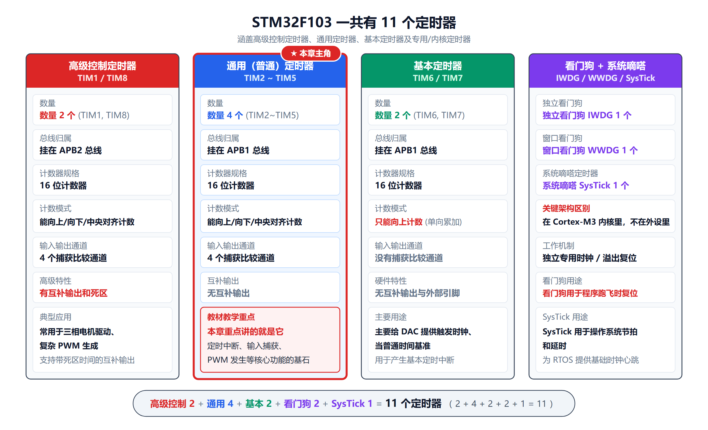

**这张图怎么看：**

1. **先看最上面那行标题**："一共有 11 个定时器"。这是你考试时最容易被问到的第一个数字。
2. **看第二张卡片（蓝色，标了红星）**：这就是本章的主角——**普通（通用）定时器 TIM2~TIM5**。它挂在一根叫 **APB1** 的总线上，16 位计数器，能向上/向下/中央对齐计数，有 4 个捕获比较通道，**没有**互补输出。
3. **看第一张卡片（红色）**：高级控制定时器 TIM1/TIM8。它比普通定时器多了"互补输出、死区、刹车输入"这些东西，专门给电机控制用，挂在 **APB2** 上。
4. **看第三张卡片（绿色）**：基本定时器 TIM6/TIM7。它"退化"得比较厉害——**只能向上计数**，而且**一个捕获/比较通道都没有**，所以它不能输出 PWM，也不能测量信号。它的主要用途是当"普通时间基准"和"给 DAC 提供触发时钟"（**DAC** = Digital-to-Analog Converter = 数模转换器，负责把数字量变成模拟电压，见第 10 章）。
5. **看第四张卡片（紫色）**：看门狗和 SysTick。看门狗不是用来定时的，是用来"程序跑飞了就复位"的；SysTick 在 Cortex-M3 内核里，不在外设里。

#### 【教材内容】三类定时器各自的特点

**高级控制定时器（TIM1、TIM8）**的主要特性（教材 8.1.1 节）：

1. 16 位向上、向下、向上/下自动装载计数器。
2. 16 位可编程（可以实时修改）预分频器。
3. 多达 4 个独立通道：输入捕获、输出比较、PWM 生成和单脉冲模式输出。
4. **死区时间可编程的互补输出**。
5. 使用外部信号控制定时器和定时器互联的同步电路。
6. 允许在指定数目的计数器周期之后更新定时器寄存器的**重复计数器**。
7. **刹车输入信号**可以将定时器输出信号置于复位状态或者一个已知状态。
8. 支持针对定位的增量（正交）编码器和霍尔传感器电路。
9. 触发输入作为外部时钟或者按周期的电流管理。
10. TIM1 和 TIM8 能够产生 **3 对 PWM 互补输出**，常用于三相电机的驱动，时钟由 APB2 的输出产生。

【补充解释】上面第 4、6、7 条是"高级"两个字的真正含义：

- **互补输出**：CH1 输出高电平时，CH1N 输出低电平，两者永不"同时导通"。驱动电机的上下两个开关管时，这样才不会短路。
- **死区时间**：现实中的开关管不是瞬间关断的，会有一小段"半开半关"的时间。所以要在"一个关完"和"另一个打开"之间插入一段谁都不开的空档，这就是死区。死区时间可编程，就是这段空档可以设置多长。
- **刹车输入**：紧急情况下（比如电机过流），外部给一个信号，立刻把所有输出置为安全状态。

**普通定时器（TIM2~TIM5）**的主要特性（教材 8.1.2 节）：

1. 16 位向上、向下、向上/向下自动装载计数器。
2. 16 位可编程（可以实时修改）预分频器。
3. **4 个独立通道**：输入捕获、输出比较、PWM 生成（边缘或中间对齐模式）和单脉冲模式输出。
4. 使用外部信号控制定时器和定时器互连的同步电路。
5. 如下事件发生时产生中断/DMA：更新（计数器向上溢出/向下溢出、计数器初始化）、触发事件、输入捕获、输出比较。
6. 支持针对定位的增量（正交）编码器和霍尔传感器电路。
7. 触发输入作为外部时钟或者按周期的电流管理。

**基本定时器（TIM6、TIM7）**的主要特性（教材 8.1.3 节）：

1. 16 位自动重装载累加计数器（**只能向上**）。
2. 16 位可编程（可实时修改）预分频器。
3. 触发 DAC 的同步电路。
4. 在更新事件（计数器溢出）时产生中断/DMA 请求。

### 8.2.1　定时器的时钟从哪来

#### 【教材内容】图 8-1 定时器的时钟

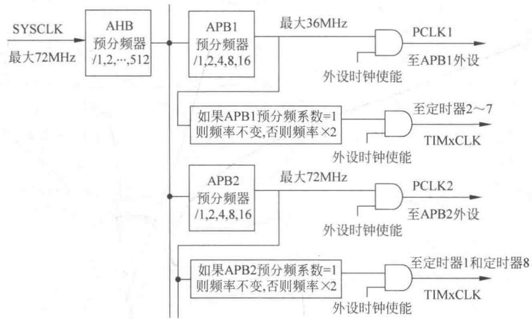

**这张图逐点讲解：**

1. **先看图的左边**：时钟的源头是系统时钟（AHB）。这是整个 STM32 的"总节拍"。
2. **再看向右分出的两条路**：一条经过 **APB1 预分频器**，一条经过 **APB2 预分频器**。APB1 和 APB2 是芯片内部的两根外设总线（可以理解成两条"支路"，第 3 章讲过）。
3. **看图中间那个"倍频器"**：注意，定时器的时钟**不是**直接从 APB1/APB2 接出来的，中间插了一个"倍频器"。这是这张图最关键的地方。
4. **看右边的输出**：倍频器后面才是 TIM1~TIM7 的时钟。

**教材给的具体规则（原文）：**

> 当 APB1 的预分频系数为 1 时，这个倍频器不起作用，定时器的时钟频率等于 APB1 的频率；当 APB1 的预分频系数为其他数值（即预分频系数为 2、4、8 或 16）时，这个倍频器起作用，定时器的时钟频率等于 APB1 的频率两倍。

**教材给的例子（原文）：**

> 假定 AHB = 72 MHz，因为 APB1 允许的最大频率为 36 MHz，所以 APB1 的预分频系数 = 2，此时 APB1 = 36 MHz，在倍频器的作用下，TIM2~7 的时钟频率 = 72 MHz。

**为什么要这么设计？教材也解释了（原文）：**

> 之所以如此，是因为 APB1 不但要为 TIM2~7 提供时钟，而且还要为其他外设提供时钟；设置这个倍频器可以在保证其他外设使用较低时钟频率时，TIM2~7 仍能得到较高的时钟频率。

#### 【辅助理解图】定时器时钟的来源

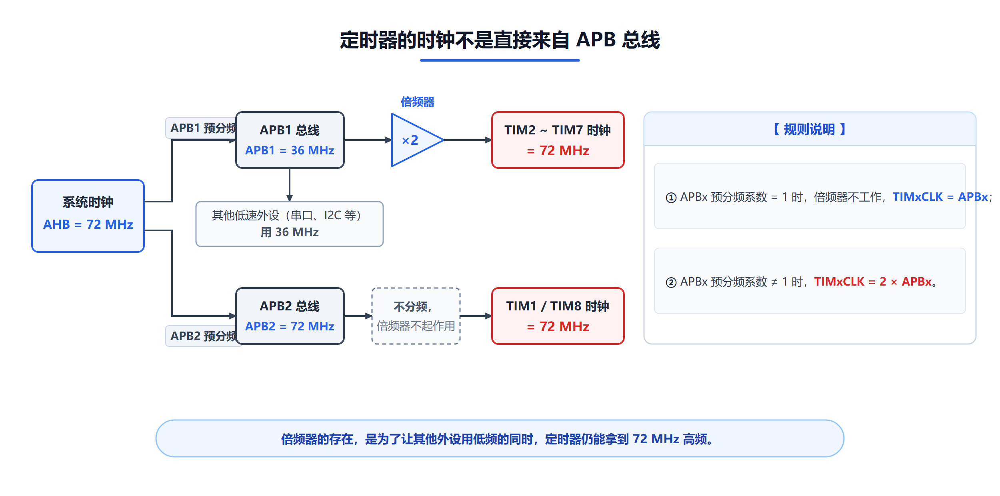

**这张图想让你记住一句话：**

> **APB1 分频了，定时器反而能拿到双倍频率。**

**一步一步推：**

```text
AHB = 72 MHz
   │
   ├── APB1 预分频系数 = 2  →  APB1 = 72 / 2 = 36 MHz
   │        │
   │        ├──→ 其他外设（串口、I2C 等）用 36 MHz（它们受不了 72 MHz）
   │        │
   │        └──→ 倍频器 ×2  →  TIM2~TIM7 时钟 = 36 × 2 = 72 MHz
   │
   └── APB2 预分频系数 = 1  →  APB2 = 72 MHz
            │
            └──→ 倍频器不起作用  →  TIM1、TIM8 时钟 = 72 MHz
```

**考试式表述（记住这句）：**

> 定时器时钟由 APB 总线时钟经倍频器得到：当 APB 预分频系数为 1 时，TIMxCLK = APBx；否则 TIMxCLK = 2 × APBx。

**这条规则的实际后果（很重要）：**

写程序开定时器时钟时，**要选对总线**：

```c
RCC_APB1PeriphClockCmd(RCC_APB1Periph_TIM2, ENABLE);   // TIM2~TIM7 走 APB1
RCC_APB2PeriphClockCmd(RCC_APB2Periph_TIM1, ENABLE);   // TIM1、TIM8 走 APB2
```

选错了，定时器根本不会动，而且编译器不会报错，你会调试很久。**这是初学者最常踩的坑之一。**

> 一句话复习：**TIM1/TIM8 在 APB2，TIM2~TIM7 在 APB1。开时钟用不同的库函数。**

---

## 8.3　通用定时器的内部结构：时基单元

### 8.3.1　先看整体结构

#### 【教材内容】图 8-2 普通定时器的结构框图

> 普通定时器的结构框图如图 8-2 所示。
>
> ——教材 8.2 节（原书 p9）

> ⚠️ **说明（已解决）**：MinerU 解析结果中**没有提取到图 8-2 的图片文件**（`tools/index/figures.md` 里也没有这一条），正文只留下了"普通定时器的结构框图如图 8-2 所示"这句话。
>
> 按 AGENTS.md 的要求，缺图应当回到**原始 PDF** 核验，而不是直接放弃。核验结果：**图 8-2 确实存在**，它印在**原书第 205 页（MinerU 页码索引 p10）**——正文那句"如图 8-2 所示"在上一页（p204 / 索引 p9）的末尾，图本身排在了下一页，所以按正文所在页去找是找不到的。
>
> 下面这张就是**从原始 PDF 重新截取的教材原图**（只做了整页裁剪和旋转，没有修改图内任何内容）。

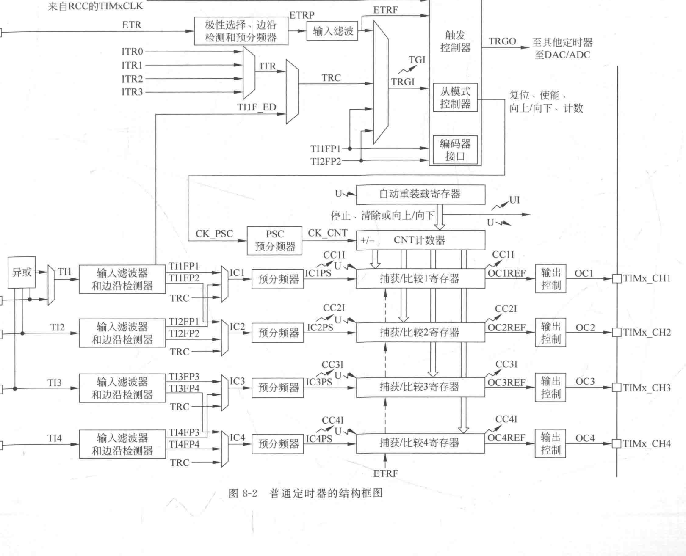

**这张图是本章最复杂的图之一，第一遍不要想一次看懂。** 按"三层"来看：

1. **第一层：先找中间那一竖列方框** —— `CNT 计数器`、下面的"自动重装载寄存器"（ARR），以及横排的"捕获/比较 1~4 寄存器"（也就是 CCR1~CCR4，图上用的是"捕获/比较1寄存器"这种旧叫法）。**这一列就是 8.3 节的时基单元和 8.6 节的四个通道，先只记住它们。**
2. **第二层：看这一列左右两边的箭头方向** —— 左边进来的是 `TI1~TI4`：每路信号先经过"输入滤波器"和"边沿检测器"，再经一个预分频器送进捕获/比较寄存器（这是**输入捕获**通路）；右边出去的是"捕获/比较寄存器 → 输出控制 → `OC1~OC4` → `TIMx_CH1~CH4` 引脚"（这是**输出比较 / PWM** 通路）。**一句话：每个通道左边是"进"，右边是"出"，中间的 CCR 两边共用。**
3. **第三层：最后看左上角和最上面那些"辅助模块"** —— 最上面的 `ETR` 引脚及其"极性选择、边沿检测和预分频器"（外部时钟模式 2 用的），`ITR0~ITR3` 与 `TRC`（来自其他定时器的内部触发），以及"触发控制器 / 从模式控制器 / 编码器接口"（8.10 节讲的各种工作模式都靠它们）。**第一遍全部跳过，学完 8.5~8.10 再回头看这张图，会有豁然开朗的感觉。**

**为什么值得先看一眼这张图？** 因为它把本章后面的路线全画出来了：8.3 节讲中间的时基单元，8.5 节讲时钟从哪来（左上角那堆模块），8.6~8.9 节讲左右两条通路，8.10 节讲触发、门控、编码器这些工作模式。

#### 【辅助理解图】时基单元结构框图

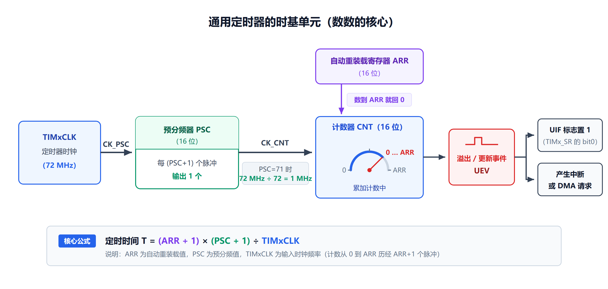

**这张图是本节的骨架，请务必看懂。** 从左到右依次是：

1. **TIMxCLK（定时器时钟）**：72 MHz 的节拍，从 APB 总线经倍频器送来。
2. **预分频器 PSC**：把 72 MHz 变慢。慢多少由 PSC 寄存器的值决定。
3. **计数器 CNT**：真正在"数数"的小本子。每来一个脉冲加 1。
4. **自动重装载寄存器 ARR**：给 CNT 设一个"上限门槛"。CNT 数到 ARR 就回 0，并产生一次更新事件。
5. **更新事件 UEV** → **UIF 标志** → **中断/DMA 请求**。

### 8.3.2　三个核心寄存器：PSC、CNT、ARR

#### 【教材内容】

> 可编程通用定时器的主要部分是一个 16 位计数器和与其相关的自动装载寄存器。这个计数器可以向上计数、向下计数或者向上向下双向计数。此计数器时钟由预分频器分频得到。计数器、自动装载寄存器和预分频器寄存器可以由软件读写，在计数器运行时仍可以读写。时基单元包含：计数器寄存器（TIMx_CNT）、预分频器寄存器（TIMx_PSC）和自动装载寄存器（TIMx_ARR）。
>
> ——教材 8.2.1 节（原书 p9）

**用大白话翻译一下这三个寄存器：**

| 寄存器 | 大白话 | 类比 |
|---|---|---|
| **TIMx_PSC**（Prescaler，预分频器） | 决定"多少个时钟脉冲算 1 个数" | 秒表的"档位" |
| **TIMx_CNT**（Counter，计数器） | 当前数到几了 | 秒表上显示的数字 |
| **TIMx_ARR**（Auto-Reload Register，自动重装载寄存器） | 数到几就归零重来 | 你给闹钟设的"响铃时间" |

#### 【类比】用秒表理解定时器

假设你要泡一杯茶，需要 3 分钟。

- 你把**闹钟**拧到 3 分钟 → 这就是设 **ARR**。
- 闹钟内部的秒针一格一格走 → 这就是 **CNT** 在加 1。
- 秒针走一格代表 1 秒，但如果你想要"每 5 秒才跳一格"，就要调档位 → 这就是 **PSC**。
- 走到 3 分钟时"叮"一声 → 这就是**更新事件 UEV**，同时**UIF 置 1**。

【类比】的边界：真实硬件里，PSC 不是"档位旋钮"，而是一个"数到 N 输出一个脉冲"的计数器；ARR 也不是机械凸轮，而是一个 16 位寄存器。但"设上限、数数、到点报警"这个逻辑是一致的。

### 8.3.3　定时时间怎么算（本节最重要）

#### 【教材内容】定时时间公式

> 定时时间 T 计算公式如下：
>
> T = (TIM_Period + 1) × (TIM_Prescaler + 1) / TIMxCLK
>
> 其中，TIM_Period 是自动重装载寄存器周期的值；TIM_Prescaler 是时钟预分频数；TIMxCLK 是 TIMx 的时钟频率，一般为 72 MHz。
>
> ——教材 8.5.2 节（原书 p52）

用寄存器的名字写出来，就是：

```text
                     (ARR + 1) × (PSC + 1)
        T  =  ────────────────────────────────
                        TIMxCLK
```

**每一步的物理意义：**

```text
第 1 步：TIMxCLK 被 PSC 分频
         CK_CNT = TIMxCLK / (PSC + 1)
         CK_CNT 的周期 t = (PSC + 1) / TIMxCLK

第 2 步：CNT 要数 ARR + 1 个 CK_CNT 脉冲才算一轮
         （从 0 数到 ARR，一共 ARR + 1 个数）

第 3 步：一轮的时间 T = (ARR + 1) × t = (ARR + 1) × (PSC + 1) / TIMxCLK
```

**为什么是 `ARR + 1` 而不是 `ARR`？**

```text
CNT:  0 → 1 → 2 → 3 → 4 → 0 → 1 → ...
                 ↑
            这里 ARR = 4

从 0 到 4 一共经过几个数？0、1、2、3、4 —— 共 5 个 = ARR + 1
```

**这是初学者最容易错的地方：数"个数"要 +1。**

#### 【辅助理解图】预分频器在干什么

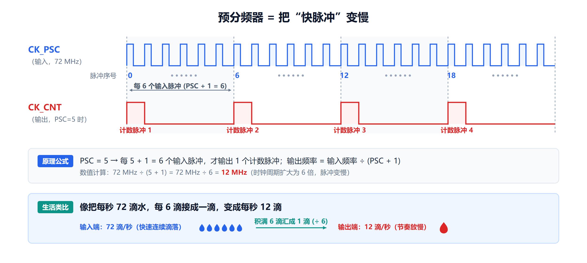

**看图要点：**

- 上面那行密密的窄脉冲是 **CK_PSC**（分频器的输入，72 MHz）。
- 下面那行稀疏的宽脉冲是 **CK_CNT**（分频器的输出）。图中 PSC = 5，所以**每 6 个输入脉冲才出 1 个输出脉冲**。
- 竖直虚线把"第 0、6、12、18 个输入脉冲"和"输出脉冲"一一对齐，这就是"分频"的直观含义。

#### 【教材内容 + 补充解释】数值演算

**例 1（教材原例，1 秒定时）：**

> T = ((1 + TIM_Prescaler) / 72M) × (1 + TIM_Period) = ((1 + 7199) / 72M) × (1 + 9999) = 1 秒
>
> ——教材（原书 p52）

**一步一步算给你看：**

```text
已知：TIMxCLK = 72 MHz = 72 000 000 Hz
      PSC = 7199      →  分频系数 = 7199 + 1 = 7200
      ARR = 9999      →  一轮数 9999 + 1 = 10000 个脉冲

第 1 步：算 CK_CNT
        72 000 000 ÷ 7200 = 10 000 Hz = 10 kHz
        → CK_CNT 一个脉冲的周期 = 1 / 10 000 s = 0.0001 s = 100 µs

第 2 步：数 10000 个脉冲要多久
        100 µs × 10 000 = 1 000 000 µs = 1 s

第 3 步：用公式验证
        T = (9999+1) × (7199+1) ÷ 72 000 000
          = 10 000 × 7200 ÷ 72 000 000
          = 72 000 000 ÷ 72 000 000
          = 1 s   ✓
```

**例 2（教材给出的另一种解法，也是 1 秒）：**

> TIM_TimeBaseStructure.TIM_Prescaler = 35999;  // 分频 35999，72M/(35999+1)/(1999+1) = 1 Hz
> TIM_TimeBaseStructure.TIM_Period = 1999;      // 计数值 2000
>
> ——教材（原书 p52）

**验证：**

```text
T = (1999 + 1) × (35999 + 1) ÷ 72 000 000
  = 2000 × 36000 ÷ 72 000 000
  = 72 000 000 ÷ 72 000 000
  = 1 s   ✓
```

**例 3（本章必须会的例子：72 MHz → 1 ms）：**

题目：系统时钟 72 MHz，要求每 **1 ms** 产生一次更新事件。

**思路：先决定 PSC，再算 ARR。**

```text
方案 A：让 CK_CNT = 1 MHz（即每 1 µs 加 1 个数）

第 1 步：求 PSC
        CK_CNT = 72 MHz ÷ (PSC + 1) = 1 MHz
        → PSC + 1 = 72 MHz ÷ 1 MHz = 72
        → PSC = 72 - 1 = 71

第 2 步：求 ARR
        要数 1 ms = 1000 µs，而每 1 µs 加 1
        → 要数 1000 个数
        → ARR + 1 = 1000
        → ARR = 1000 - 1 = 999

第 3 步：验证
        T = (999 + 1) × (71 + 1) ÷ 72 000 000
          = 1000 × 72 ÷ 72 000 000
          = 72 000 ÷ 72 000 000
          = 0.001 s
          = 1 ms   ✓
```

```text
方案 B：让 CK_CNT = 10 kHz（即每 100 µs 加 1 个数）

PSC + 1 = 72 000 000 ÷ 10 000 = 7200  → PSC = 7199
ARR + 1 = 1000 µs ÷ 100 µs = 10      → ARR = 9

验证：T = 10 × 7200 ÷ 72 000 000 = 72 000 ÷ 72 000 000 = 0.001 s = 1 ms  ✓
```

**两个方案都能得到 1 ms，区别在哪？**

- 方案 A 的 ARR 更大（999），**定时精度更细**（1 µs 一步）。
- 方案 B 的 ARR 很小（9），如果中途想微调时间，可调的档位就少。

**结论：一般先让 CK_CNT 变成"好看"的频率（1 MHz、10 kHz 之类），再算 ARR。**

**例 4（定时器能定多长？定时范围）：**

```text
最短：PSC = 0，ARR = 0
      T = 1 × 1 ÷ 72 000 000 = 13.9 ns

最长：PSC = 65535，ARR = 65535
      T = 65536 × 65536 ÷ 72 000 000
        = 4 294 967 296 ÷ 72 000 000
        ≈ 59.65 s
```

所以一个普通定时器**一次最多大约只能定 59.65 秒**。

【补充解释】如果要定 1 分钟以上怎么办？两个办法：

1. **软件计数**：让定时器每 0.5 秒中断一次，在中断服务函数里数 120 次，就是 1 分钟。例 8-1 的思路就是这个的简化版。
2. **级联**：用一个定时器的溢出信号去驱动另一个定时器（8.10 节的"主从同步"）。

### 8.3.4　影子寄存器与预装载：为什么改了参数不当场生效？

#### 【教材内容】

> 自动装载寄存器是预先装载的，写或读自动重装载寄存器将访问预装载寄存器。根据在 TIMx_CR1 寄存器中的自动装载预装载使能位（ARPE）的设置，预装载寄存器的内容被立即或在每次的更新事件 UEV 时传送到影子寄存器。
>
> 预分频器可以将计数器的时钟频率按 1~65536 的任意值分频。它是基于一个（在 TIMx_PSC 寄存器中的）16 位寄存器控制的 16 位计数器。这个控制寄存器带有缓冲器，能够在工作时被改变。新的预分频器参数在下一次更新事件到来时被采用。
>
> ——教材 8.2.1 节（原书 p9）

#### 【先补一个前置知识：什么叫"影子寄存器"？】

STM32 的定时器里，很多寄存器实际上是"**成对**"的：

```text
   你写进去的             真正在工作的
   ┌──────────┐          ┌──────────┐
   │ 预装载寄存器 │ ──更新事件──→ │ 影子寄存器 │
   │ (preload)  │   时才搬运    │ (shadow)   │
   └──────────┘          └──────────┘
      ↑                        ↑
   程序读写这里            硬件电路用这里
```

**为什么要这么麻烦？**

【类比】你在高速公路上开车，发动机在转。这时候你直接去拆发动机换零件，车肯定出问题。所以设计成"你先把新零件放到后备箱（预装载寄存器），等到下一个服务区（更新事件）再换上"。

**具体到定时器：**

- 假设当前 ARR = 9999，定时 1 秒。
- 现在你想改成 ARR = 4999（0.5 秒）。
- 如果**当场生效**：CNT 可能已经数到 8000 了，它一看"上限变成 4999 了"，就直接回 0，于是这一轮的时间变成了一个奇怪的中间值。
- 如果**等到更新事件再生效**：当前这一轮照旧数到 9999 结束，下一轮才用 4999。每一轮的时间都是"干净"的。

**ARPE 位控制这个行为：**

- **ARPE = 0**：ARR 没有缓冲，**你写进去立刻生效**。
- **ARPE = 1**：ARR 有缓冲（预装载），**你写进去先放在预装载寄存器里，等到下一次更新事件才搬到影子寄存器**。

**PSC 也一样**：新写的预分频值不会立刻生效，要等下一次更新事件。教材专门用图 8-3、图 8-4 说明这件事。

#### 【教材内容】图 8-3 / 图 8-4：运行中改预分频参数

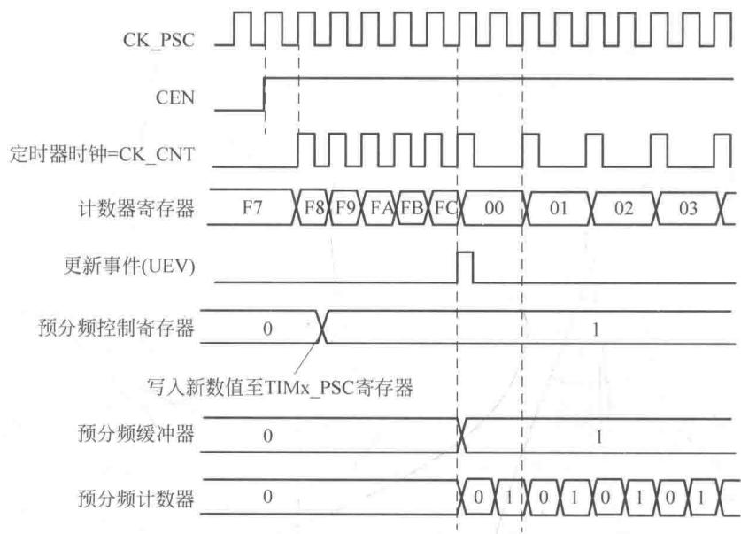

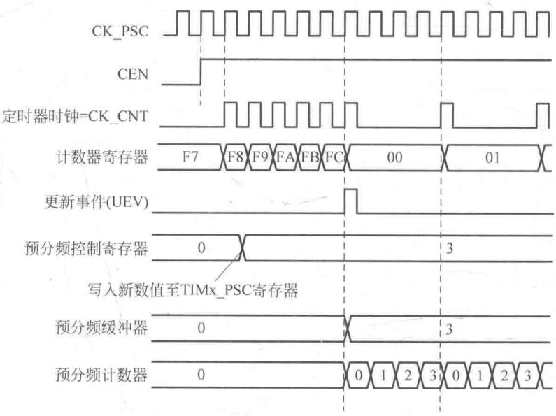

**这两张图怎么看：**

1. **先找"分频参数"变化的那个位置**：图里会有一条竖直虚线标出"你写入新 PSC 值的时刻"。
2. **看竖线左边的 CK_CNT**：脉冲比较密（分频系数小）。
3. **看竖线右边的 CK_CNT**：脉冲变疏了（分频系数变大了）。
4. **关键点：注意变化发生的位置**——不是在你写寄存器的瞬间，而是**推迟到了下一次更新事件**。图 8-3 里 PSC 从 1 变到 2，图 8-4 里从 1 变到 4，两张图对比着看，能明显看出"变疏的程度不一样"。
5. **这张图要你理解什么**：**预分频器的修改有"缓冲"，新参数在下一个更新事件才生效。** 这就是"影子寄存器"的实物证据。

### 本节真正要记住什么

1. 时基单元 = **PSC + CNT + ARR** 三件套。
2. `T = (ARR + 1) × (PSC + 1) ÷ TIMxCLK`。**两个 +1 都不能漏。**
3. 72 MHz 下，`PSC=71, ARR=999` 得到 1 ms。
4. 一个定时器一次最长约 59.65 秒。
5. 改 PSC/ARR 有"影子寄存器"缓冲，新值在下一个更新事件才生效。

---

## 8.4　计数模式：向上、向下、中央对齐

#### 【教材内容】

> TIM2-TIM5 可以向上计数、向下计数、向上向下双向计数。
>
> ——教材 8.2.2 节（原书 p9）

### 8.4.1　向上计数模式

#### 【教材内容】

> 在向上计数模式中，计数器从 0 计数到自动加载值（TIMx_ARR 寄存器的内容），然后重新从 0 开始计数并且产生一个计数器溢出事件。
>
> 每次计数器溢出时可以产生更新事件，在 TIMx_EGR 寄存器中（通过软件方式或者使用从模式控制器）设置 UG 位也同样可以产生一个更新事件。
>
> ——教材 8.2.2 节 1（原书 p11）

**大白话：** CNT 从 0 开始，0、1、2、……、ARR，然后"啪"一下回 0，继续。

**每次溢出的同时，硬件做这些事：**

1. 产生更新事件 UEV。
2. 把 UIF 标志（TIMx_SR 的 bit0）置 1。
3. 如果开了更新中断（UIE = 1），就向 NVIC 发中断请求。
4. 把预分频器的缓冲器装入 PSC 预装载寄存器的值。
5. 把自动装载影子寄存器装入 ARR 预装载寄存器的值。

> 一句话复习：**NVIC** = Nested Vectored Interrupt Controller = 嵌套向量中断控制器。它是 Cortex-M3 **内核**里"管中断的总机"：各个外设把中断请求交给它，它按优先级排队，再决定让 CPU 先处理谁（第 2 章、第 7 章已经讲过；忘了的话，把它理解成"医院分诊台"就行）。定时器只是众多"按铃"的外设之一。

#### 【辅助理解图】向上计数时序图

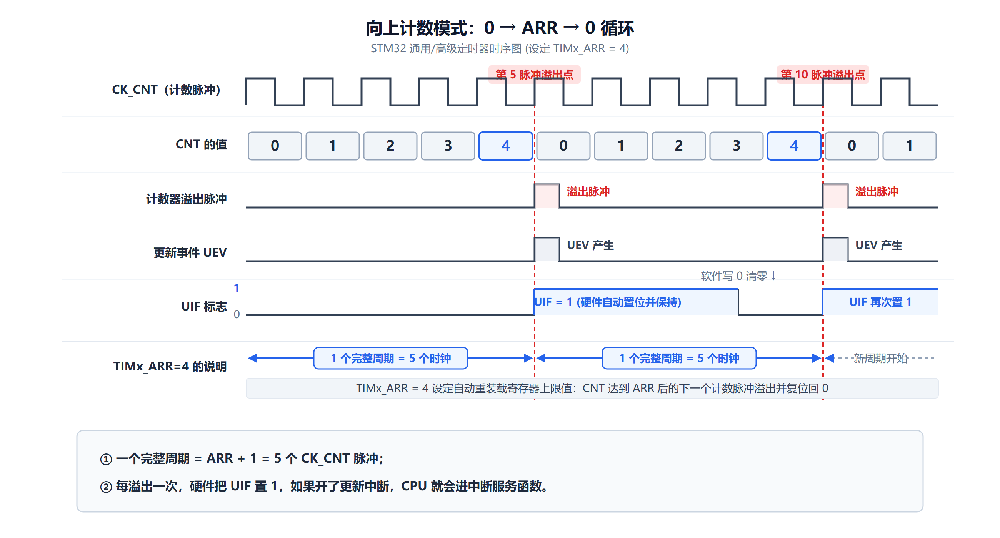

**看图顺序：**

1. **先看最上面那行 CK_CNT**：这是计数脉冲，每来一个，CNT 就加 1。
2. **再看第二行 CNT 的值**：0 → 1 → 2 → 3 → 4 → **0** → 1 → 2 → 3 → 4 → **0** → ……
3. **找红色竖虚线**：那就是"数到 ARR=4 之后回 0"的时刻，也就是**溢出时刻**。
4. **看下面三行**：溢出脉冲、UEV、UIF 都在同一时刻出现。**先有溢出 → 再有 UEV → 再有 UIF = 1。** 这个先后顺序要记住。
5. **一个周期多长**：从一次回 0 到下一次回 0，中间有 5 个 CK_CNT 脉冲 = ARR + 1。

#### 【教材内容】图 8-5：教材上的向上计数时序图

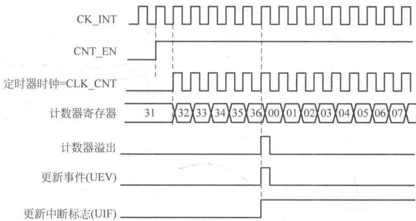

**教材原图逐行讲解：**

1. **最上面一行 CK_INT**：这是定时器的输入时钟（内部时钟）。脉冲很密，说明分频因子 = 1，也就是"每个 CK_INT 脉冲 CNT 就加 1"。
2. **第二行 CNT_EN**：这是"计数器使能"信号。它从低变高的那一刻，定时器才开始工作。**在它变高之前，CNT 是不动的。** 这一点很重要——对应到寄存器就是 CR1 的 CEN 位从 0 变 1。
3. **第三行"定时器时钟 = CLK_CNT"**：这是预分频器的输出。分频因子 = 1 时，它和 CK_INT 一模一样。
4. **第四行"计数器寄存器"**：里面写着一串数字 `31 32 33 34 35 36 00 01 02 03 04 05 06 07`。**看那个从 36 跳到 00 的地方**——这就是溢出。因为 ARR = 0x36 = 54（十进制），数到 54 之后回 0。
5. **第五行"计数器溢出"**：在 36 → 00 的位置出现一个窄脉冲。
6. **第六行"更新事件 UEV"**：同一个位置，也是一个窄脉冲。
7. **第七行"更新中断标志 UIF"**：同一个位置，电平从低跳到高，并且**一直保持为高**，直到软件把它清 0。

**这张图要你理解什么：**

> 计数器数到 ARR 就回 0，这一瞬间会产生溢出脉冲、更新事件，并把 UIF 置 1。整个过程是**硬件自动完成**的，不需要程序参与。

### 8.4.2　向下计数模式

#### 【教材内容】

> 在向下模式中，计数器从自动装入的值（TIMx_ARR 寄存器的值）开始向下计数到 0，然后从自动装入的值重新开始，并产生一个计数器向下溢出事件。
>
> ——教材 8.2.2 节 2（原书 p12）

**大白话：** CNT 从 ARR 开始，ARR、ARR-1、……、1、0，然后"啪"一下跳回 ARR，继续。

**"向下溢出"（underflow）**就是数到 0 之后跳回 ARR 的那一瞬间。

**先把它的波形记在心里（以 ARR = 4 为例）：**

```text
CNT     4 → 3 → 2 → 1 → 0 → 4 → 3 → 2 → 1 → 0 → …
                        ↑                       ↑
                   下溢（underflow）        下溢（underflow）
                   同时产生 UEV、UIF         同时产生 UEV、UIF
```

#### 【教材内容】图 8-11 ~ 图 8-14：向下计数的时序图

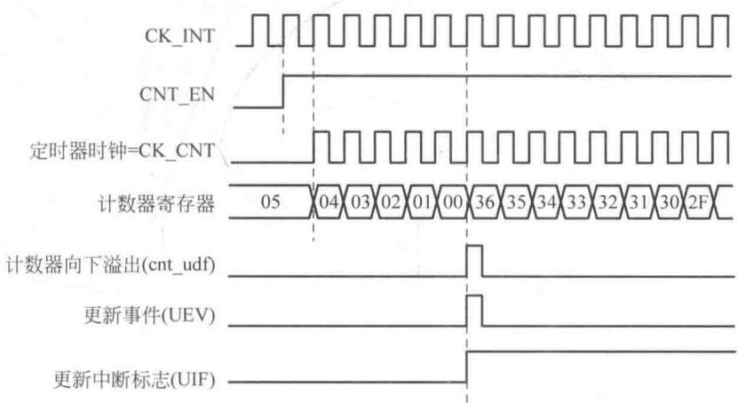

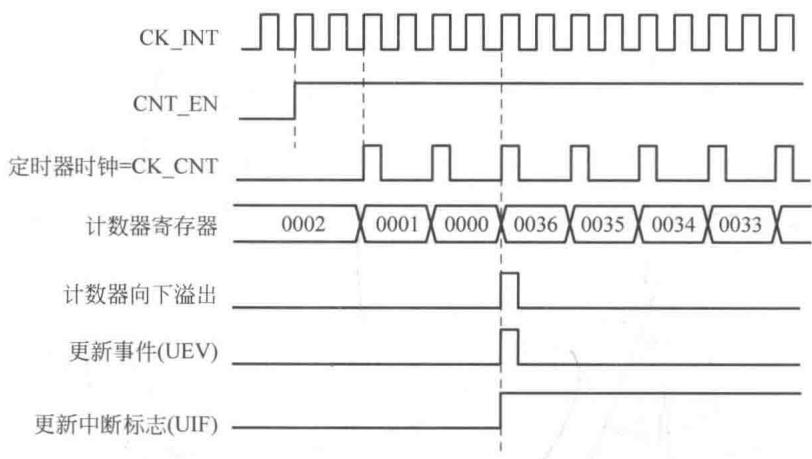

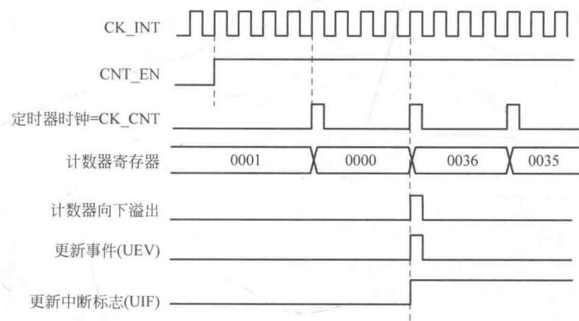

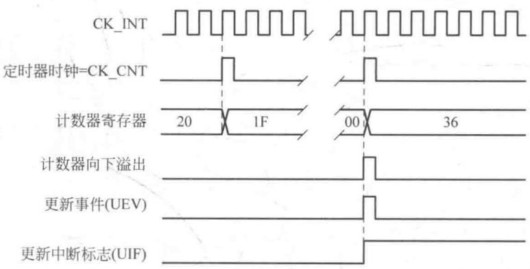

**这四张图是同一件事的四个版本（分频因子分别为 1、2、4、N），先盯着图 8-11 看就行：**

1. **最上面是 CK_INT**：定时器的输入时钟。
2. **第二行 CNT_EN**：计数器使能信号，它变高之后 CNT 才开始动（对应 CR1 的 CEN 位）。
3. **第三行"定时器时钟 = CK_CNT"**：预分频器的输出。图 8-11 的分频因子是 1，所以它和 CK_INT 一样密；图 8-12、8-13、8-14 依次变疏——这正是"分频"两字的直观样子。
4. **第四行"计数器寄存器"**：数字**从大往小**走。图上第一段是 `05 04 03 02 01 00`，走到 00 之后**跳回 36**（0x36 = 54 = ARR），再继续 `35 34 33 32 31 30 2F…`。**看到数字越来越小，就说明进入了向下计数模式**——这是它和向上计数（图 8-5）最直观的区别。
5. **第五行"计数器向下溢出（cnt_udf）"**：在 CNT 从 00 跳回 36 的位置出现一个窄脉冲，这就是**下溢**。
6. **第六行"更新事件 UEV"、第七行"更新中断标志 UIF"**：都在同一个位置出现。**顺序仍然是：先下溢 → 再 UEV → 再 UIF 置 1。**

**这四张图要你理解什么：**

> 向下计数和向上计数是"镜像"关系：向上是"数到 ARR 回 0，溢出一声"，向下是"数到 0 回 ARR，下溢一声"。**一轮的计数个数都是 ARR + 1**，UIF 也都是在那一瞬间置 1。

### 8.4.3　中央对齐模式（向上/向下计数）

#### 【教材内容】

> 在中央对齐模式中，计数器从 0 开始计数到自动加载的值（TIMx_ARR 寄存器）-1，产生一个计数器溢出事件，然后向下计数到 1 并且产生一个计数器下溢事件；然后再从 0 开始重新计数。
>
> 在这个模式中，不能写入 TIMx_CR1 中的 DIR 方向位。它由硬件更新并指示当前的计数方向。
>
> ——教材 8.2.2 节 3（原书 p15）

> ⚠️ **教材正文与教材插图不一致（重要）**：
>
> 上面这段文字说"从 0 计数到 ARR − 1"。
>
> 但教材**图 8-16**（中央对齐、ARR = 0x6）画出来的计数器序列是：
>
> `04 03 02 01 00 01 02 03 04 05 06 05 04 03`
>
> 也就是**上界是 6 = ARR**，不是 ARR − 1。
>
> 教材**图 8-33**（中央对齐 PWM、ARR = 8）画的计数器序列是：
>
> `0 1 2 3 4 5 6 7 8 7 6 5 4 3 2 1 0 1 …`
>
> 同样是**上界 = ARR = 8**。
>
> 本讲义以**插图为准**（0 → ARR → 1 → 0），因为这既与两张插图一致，也与 STM32F10x 参考手册的图形一致。此处差异已记入文末"待核验"。

**中央对齐模式的要点：**

- CNT 先向上数到 ARR（产生**向上溢出**），再向下数到 0（产生**向下溢出**），然后再向上，如此反复。
- **DIR 位不用你写**，硬件会自动更新它来指示当前方向。
- 一个完整周期 = **2 × ARR** 个 CK_CNT 脉冲（上坡 ARR 个 + 下坡 ARR 个）。
- **上溢和下溢都会产生更新事件**：中央对齐模式下，每发生一次上溢、一次下溢，都会各产生一次 UEV（所以下面图 8-16 里 CNT = 00 和 CNT = 06 两处都有 UEV 脉冲）。教材正文的原话是"可以在每次计数上溢和每次计数下溢时产生更新事件"。
- **CMS[1:0] 选择的不是更新事件，而是"输出比较中断标志 CCxIF 什么时候置 1"**：CMS = 01 只在向下计数时置 CCxIF，CMS = 10 只在向上计数时置，CMS = 11 两个方向都置（见 8.9.4 节和 8.11.3 节里 CR1 的位定义）。
- **注意别把两个"标志"搞混**：更新事件对应的是 **UIF**（含义是"一轮数完了"），比较事件对应的是 **CCxIF**（含义是"CNT 撞上 CCR 了"）。同一轮里可能既有 UEV 又有比较匹配，它们各自有各自的标志。**CMS 只管后者，不管前者。**

#### 【辅助理解图】向上 vs 向下：两种方向放在一起看

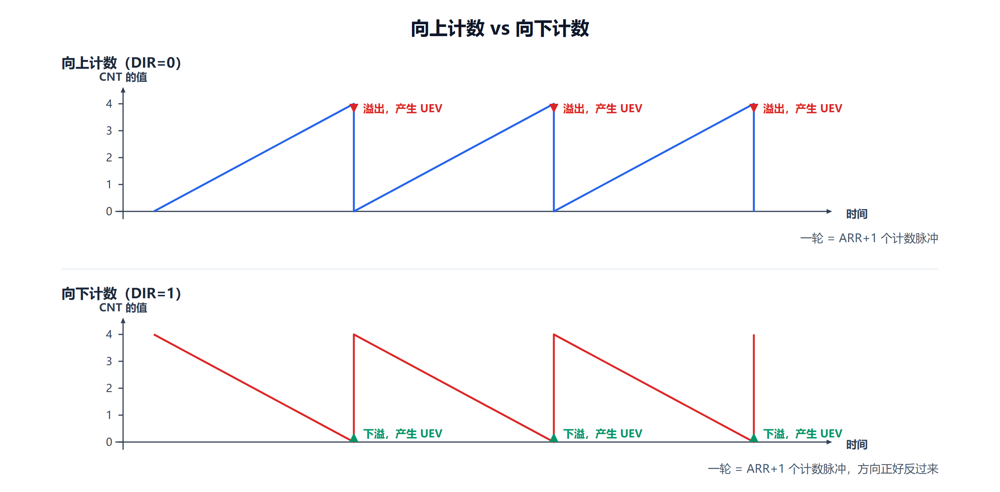

> ⚠️ **此图目前尚未生成成功**：绘图作业已写在 `notes/images/jobs/ch08.json` 里，但绘图服务（gemini-3.8-flash-tiered）持续返回 503 不可用，多次重试仍未成功，暂时看不到图片。**本节的知识不受影响**：向上计数看教材图 8-5，向下计数看上面刚讲的图 8-11~图 8-14，本节末尾的对比表也把三种模式总结全了。

**看图要点：**

1. **上栏（向上计数）**：蓝色锯齿波。每次从 0 爬到顶（ARR），就垂直掉回 0。**只在顶部产生一次溢出。**
2. **下栏（向下计数）**：红色倒锯齿波。每次从顶掉到 0，就垂直跳回顶。**只在底部产生一次下溢。**
3. **两张图的形状互为"镜像"**：把上面那张上下翻过来，就是下面那张。一轮的计数个数都是 **ARR + 1**，区别只在"从哪头开始数"。

#### 【辅助理解图】中央对齐计数：CNT 在 0 和 ARR 之间来回跑

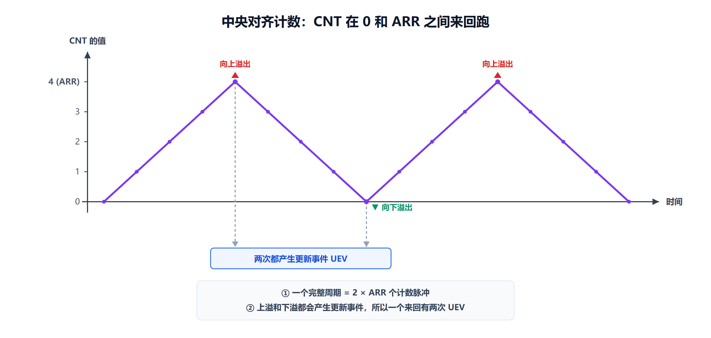

> ⚠️ **此图与图 8-F1 一样，目前尚未生成成功**（绘图服务返回 503，多次重试未成功）。**中央对齐的计数过程可以直接看下面的教材图 8-16**：CNT 在 00 和 06（= ARR）之间来回跑，两个位置各有一个 UEV 脉冲。

**看图要点：**

1. **紫色三角波**：从 0 爬到顶（图中 ARR = 4），再从顶滑回 0，如此反复。
2. **顶部（CNT = ARR）**：产生**向上溢出**，同时也产生 UEV。
3. **底部（CNT = 0）**：产生**向下溢出**，同时也产生 UEV。**所以一个来回有两次 UEV——这正是前面说的"上溢和下溢都会产生更新事件"。**
4. **对比周期长度**：假设 ARR 相同，中央对齐的一个周期（上坡 + 下坡）是向上计数的**两倍**长。

#### 【教材内容】图 8-16：中央对齐的计数时序

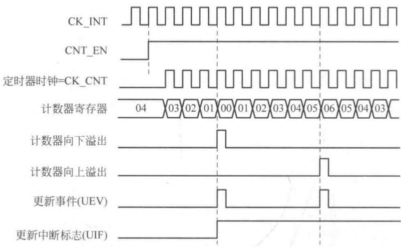

**逐行讲解：**

1. **CK_INT**：输入时钟。
2. **CNT_EN**：使能信号，变高后计数器才动。
3. **定时器时钟 = CK_CNT**：分频因子为 1，和 CK_INT 一样。
4. **计数器寄存器**：`04 03 02 01 00 | 01 02 03 04 05 06 | 05 04 03`。
   - 先看到它在**往下数**（04→03→02→01→00），说明进入中央对齐模式时，方向取决于当时 DIR 的值。
   - 到 00 之后**向上数**（01→02→…→06）。
   - 到 06 之后又**向下数**（05→04→03）。
5. **"计数器向下溢出"**：在 00 的位置有一个脉冲。
6. **"计数器向上溢出"**：在 06 的位置有一个脉冲。
7. **更新事件 UEV**：在 00 和 06 **两个位置都有**脉冲。
8. **更新中断标志 UIF**：第一个 UEV 之后变高，保持。

**这张图要你理解什么：**

> 中央对齐模式下，CNT 在 0 和 ARR 之间来回跑，一个来回产生**两个**事件（上溢 + 下溢）。这就是它和向上/向下计数最本质的区别。

#### 【教材内容】使用中央对齐模式的三个注意事项

> （1）进入中央对齐模式时，使用当前的向上/向下计数配置；这就意味着计数器向上还是向下计数取决于 TIMx_CR1 寄存器中 DIR 位的当前值。此外，软件不能同时修改 DIR 和 CMS 位。
>
> （2）不推荐当运行在中央对齐模式时改写计数器，因为这会产生不可预知的结果。特别地，如果写入计数器的值大于自动重加载的值（TIMx_CNT > TIMx_ARR），则方向不会被更新。例如，如果计数器正在向上计数，它就会继续向上计数。如果将 0 或者 TIMx_ARR 的值写入计数器，方向被更新，但不产生更新事件 UEV。
>
> （3）使用中央对齐模式最保险的方法，就是在启动计数器之前产生一个软件更新（设置 TIMx_EGR 位中的 UG 位），不要在计数进行过程中修改计数器的值。
>
> ——教材 8.2.2 节 3（原书 p27）

**大白话翻译：**

1. 刚进中央对齐模式时，它先朝哪个方向走，看 DIR 位当时的值。
2. **别在运行中手动改 CNT 的值**，容易乱。
3. 要改，就在**启动之前**用 UG 位先做一次软件更新（相当于"重新开局"）。

### 本节真正要记住什么

| 模式 | 计数方向 | 一个周期的脉冲数 | 什么时候产生事件 |
|---|---|---|---|
| 向上 | 0 → ARR | ARR + 1 | 顶部（溢出） |
| 向下 | ARR → 0 | ARR + 1 | 底部（下溢） |
| 中央对齐 | 0 → ARR → 0 | 2 × ARR | 顶部 + 底部 |

---

## 8.5　计数脉冲从哪来（时钟选择）

#### 【教材内容】

> 定时器的计数脉冲可由下列时钟源提供：
> （1）内部时钟（CK_INT）。
> （2）外部时钟模式 1：外部输入脚（TIx）（相当于计数器功能）。
> （3）外部时钟模式 2：外部触发输入（ETR）（相当于计数器功能）。
> （4）内部触发输入（ITRx）：使用一个定时器作为另一个定时器的预分频器。
>
> ——教材 8.2.3 节（原书 p16）

#### 【辅助理解图】四种时钟来源

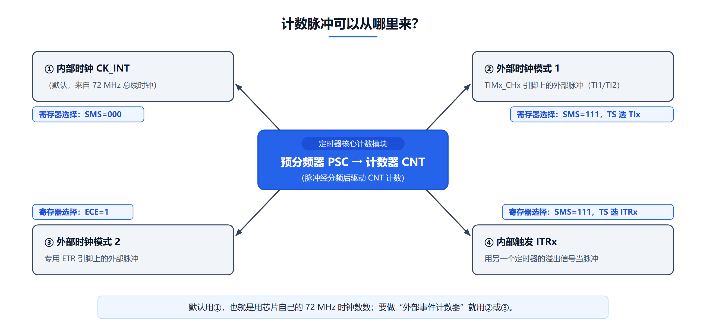

**看图要点：**

1. **中央的方框**（PSC → CNT）是"数数的地方"，它需要一个"脉冲源"。
2. **四个来源方框**就是四个可以给它送脉冲的地方。
3. **最常用的是左上角那个（① 内部时钟 CK_INT）**：芯片自己的 72 MHz 时钟。本章 99% 的例子里都用它。
4. **另外三个都跟"外部信号"有关**：② 和 ③ 是"把引脚上来的外部脉冲当计数脉冲"，④ 是"用另一个定时器的输出当计数脉冲"。

#### 【先补一个前置知识：什么叫"上升沿"和"下降沿"？】

下面马上要用"上升沿/下降沿"这个词，而它是本章后半段（外部时钟、输入捕获、触发模式、编码器）反复出现的前提，先花一分钟说清楚。

数字信号只有"低电平"和"高电平"两种状态。所谓**边沿（edge）**，就是电平发生跳变的那一瞬间：

- **上升沿（rising edge）**：电平从低变高的那一刻。
- **下降沿（falling edge）**：电平从高变低的那一刻。

```text
            上升沿                  下降沿
              ↓                       ↓
        ┌───────────┐           ┌───────────┐
────────┘           └───────────┘           └──────
     低      高           低          高
```

**为什么电路总是强调"沿"而不是"电平"？** 因为"一个电平持续多久"很难约定一个统一的事件点，而"跳变的那一瞬间"是明确、唯一的，用它来触发计数、捕获或中断最可靠。（第 7 章讲外部中断时专门讲过这一节，这里只是复习。）

本章后面凡是看到"上升沿有效""下降沿有效"，意思都是"只把这一种跳变当作有效事件，另一种忽略"。到底是哪一种有效，由**极性位 CCxP** 决定（CCxP = 0 选上升沿，CCxP = 1 选下降沿）。

### 8.5.1　内部时钟源（CK_INT）

#### 【教材内容】

> 如果禁止了从模式控制器（TIMx_SMCR 寄存器的 SMS=000），则 CEN、DIR（TIMx_CR1 寄存器）和 UG 位（TIMx_EGR 寄存器）是事实上的控制位，并且只能被软件修改（UG 位仍被自动清除）。只要 CEN 位被写成 1，预分频器的时钟就由内部时钟 CK_INT 提供。
>
> ——教材 8.2.3 节 1（原书 p18）

**大白话：** 默认情况（SMS = 000），定时器就用芯片自己的时钟数数。**你在例 8-1 里没写 SMS，就是用的这个。**

### 8.5.2　外部时钟模式 1（用 TIx 引脚上的脉冲计数）

#### 【教材内容】

> 当 TIMx_SMCR 寄存器的 SMS=111 时，此模式被选中。计数器可以在选定输入端的每个上升沿或下降沿计数。
>
> 例如，要配置向上计数器在 TI2 输入端的上升沿计数，使用下列步骤：
> （1）配置 TIMx_CCMR1 寄存器 CC2S='01'，配置通道 2 检测 TI2 输入的上升沿。
> （2）配置 TIMx_CCMR1 寄存器的 IC2F[3:0]，选择输入滤波器带宽（如果不需要滤波器，保持 IC2F = 0000）。
> （3）配置 TIMx_CCER 寄存器的 CC2P='0'，选定上升沿极性。
> （4）配置 TIMx_SMCR 寄存器的 SMS='111'，选择定时器外部时钟模式 1。
> （5）配置 TIMx_SMCR 寄存器中的 TS='110'，选定 TI2 作为触发输入源。
> （6）设置 TIMx_CR1 寄存器的 CEN='1'，启动计数器。
>
> 当上升沿出现在 TI2，计数器计数一次，且 TIF 标志被设置。
>
> ——教材 8.2.3 节 2（原书 p18~p19）

**大白话：** 把定时器当成"计数器"用。外面每来一个上升沿，CNT 就加 1。

**用途举例：**

- 数生产线上经过的产品个数（光电传感器输出脉冲）。
- 数车轮转了多少圈（霍尔传感器输出脉冲）。

#### 【教材内容】图 8-24：外部时钟模式 1 的时序

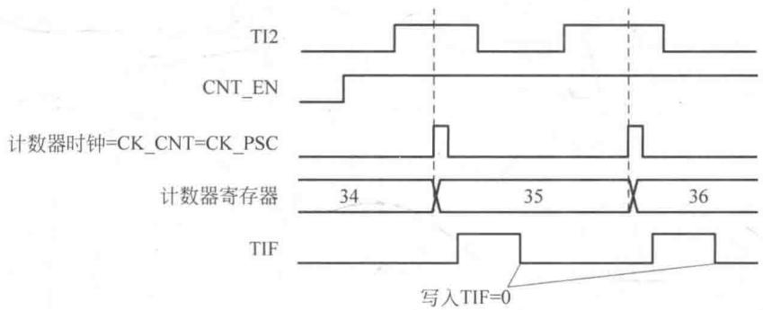

**看图要点：**

1. **上面是 TI2 引脚上的外部信号**，画了几个上升沿和下降沿。
2. **下面是 CNT 的值**：注意它只在**上升沿**处变化（因为你配的是上升沿有效），下降沿它不动。
3. **CNT 每次加 1 的时刻，比 TI2 的上升沿稍微晚一点**。教材原文解释了原因：
   > 在 TI2 的上升沿和计数器实际时钟之间的延时，取决于在 TI2 输入端的重新同步电路。
4. **为什么要"重新同步"？** 因为外部信号和芯片内部时钟是"两个世界"的，它们的节奏不同步。信号进来后要先"对齐"到内部时钟上，才能被可靠地使用。这个对齐过程需要几个时钟周期。

### 8.5.3　外部时钟模式 2（用 ETR 引脚上的脉冲计数）

#### 【教材内容】

> 选定此模式的方法为：令 TIMx_SMCR 寄存器中的 ECE = 1。在此模式下，计数器能够在外部触发 ETR 的每一个上升沿或下降沿计数。
>
> 例如，要配置在 ETR 下每 2 个上升沿计数一次的向上计数器，使用下列步骤：
> （1）本例中不需要滤波器，置 TIMx_SMCR 寄存器中的 ETF[3:0] = 0000。
> （2）设置预分频器，置 TIMx_SMCR 寄存器中的 ETPS[1:0]=01。
> （3）设置在 ETR 的上升沿检测，置 TIMx_SMCR 寄存器中的 ETP=0。
> （4）开启外部时钟模式 2，置 TIMx_SMCR 寄存器中的 ECE=1。
> （5）启动计数器，置 TIMx_CR1 寄存器中的 CEN=1。计数器在每 2 个 ETR 上升沿计数一次。
>
> ——教材 8.2.3 节 3（原书 p20）

**模式 1 和模式 2 的区别：**

| | 外部时钟模式 1 | 外部时钟模式 2 |
|---|---|---|
| 用哪个引脚 | TIMx_CHx（TI1/TI2/TI3/TI4，和捕获通道共用） | 专用的 ETR 引脚 |
| 由哪个位选择 | SMS = 111，再用 TS 选 TIx | ECE = 1 |
| 有没有自己的滤波/预分频 | 借用通道的 ICxF、ICxPSC | 有专门的 ETF、ETPS |
| 能不能和从模式一起用 | —— | 可以和复位/门控/触发模式同时用 |

#### 【教材内容】图 8-25 / 图 8-26：ETR 通路与时序

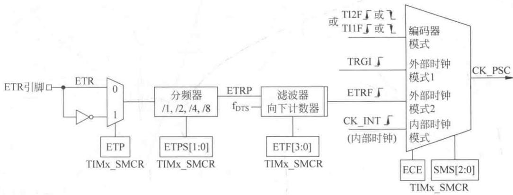

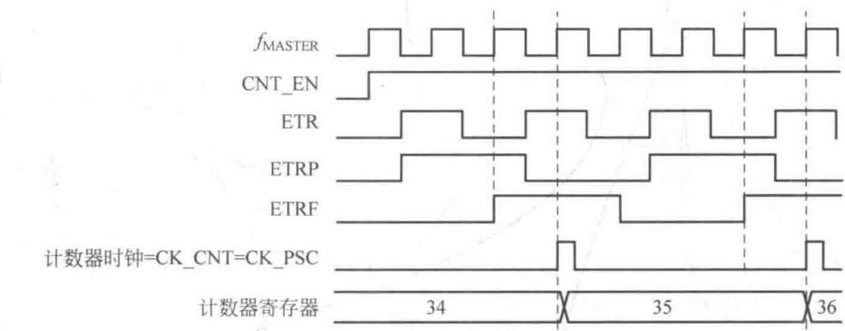

**图 8-25 看图要点：** 从 ETR 引脚进来，先经过**极性选择**（ETP，决定用上升沿还是下降沿）、再经过**预分频**（ETPS，决定每几个边沿算一个）、再经过**滤波器**（ETF，抗抖动），最后才送给计数器。

**图 8-26 看图要点：** 因为 ETPS 设成了"除以 2"，所以 ETR 上出现**两个**上升沿，CNT 才加 1 次。图中可以看到 CNT 的变化频率正好是 ETR 的一半。

### 8.5.4　内部触发输入（ITRx）

用**另一个定时器的输出**当本定时器的计数脉冲。这就是 8.10 节"定时器同步"的内容，这里先知道有这回事即可。

#### 【教材内容】表 8-3　TIMx 的内部触发连接

| 从定时器 | ITR0（TS=000） | ITR1（TS=001） | ITR2（TS=010） | ITR3（TS=011） |
|---|---|---|---|---|
| TIM2 | TIM1 | TIM8 | TIM3 | TIM4 |
| TIM3 | TIM1 | TIM2 | TIM5 | TIM4 |
| TIM4 | TIM1 | TIM2 | TIM3 | TIM8 |
| TIM5 | TIM2 | TIM3 | TIM4 | TIM8 |

**怎么用这张表？** 假设你要"用 TIM3 的溢出信号驱动 TIM2"，查 TIM2 那一行，找到 TIM3 在 ITR2 列，所以 TS 应该写 010。

---

## 8.6　捕获/比较通道：本章最核心的概念

### 先说一句最重要的话

> **定时器的一个"通道"，可以当"输入"用，也可以当"输出"用。**

- 当**输入**用 → 叫**输入捕获（Input Capture）**：测量外面来的信号。
- 当**输出**用 → 叫**输出比较（Output Compare）**：向外产生波形。PWM 是输出比较的一个特例。

一个普通定时器有 **4 个通道**，所以你可以同时做 4 件不同的事（比如：2 路 PWM 输出 + 2 路输入捕获）。

#### 【教材内容】

> 每一个捕获/比较通道都围绕着一个捕获/比较寄存器（包含影子寄存器），包括捕获的输入部分（数字滤波、多路复用和预分频器），和输出部分（比较器和输出控制）。
>
> 捕获/比较模块由一个预装载寄存器和一个影子寄存器组成。读写过程仅操作预装载寄存器。在捕获模式下，捕获发生在影子寄存器上，然后再复制到预装载寄存器中。在比较模式下，预装载寄存器的内容被复制到影子寄存器中，然后影子寄存器的内容和计数器进行比较。
>
> ——教材 8.2.4 节（原书 p21~p22）

#### 【辅助理解图】捕获/比较通道的内部结构

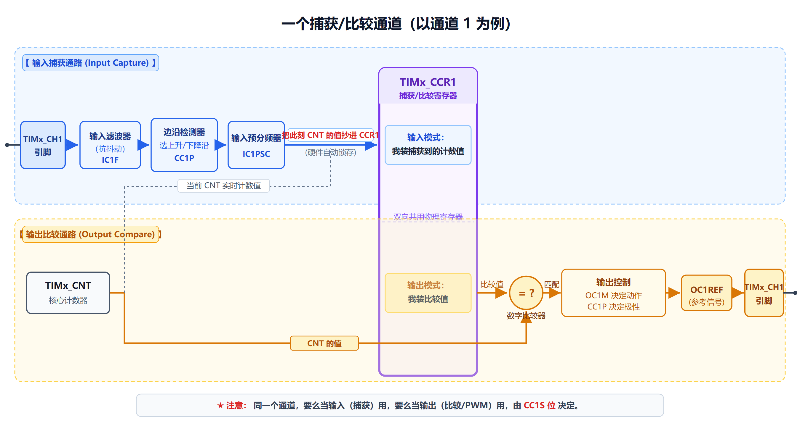

**这张图要分成"上半条"和"下半条"来看：**

**上半条（蓝色，输入捕获通路）——从引脚到 CCR：**

```text
TIMx_CH1 引脚 → 输入滤波器 → 边沿检测器 → 输入预分频器 → TIMx_CCR1
                (抗抖动)      (选上升/下降沿)   (每几个边沿算一次)
```

- **输入滤波器**：如果信号有毛刺，滤波器能把毛刺滤掉。带宽由 IC1F 位设置。
- **边沿检测器**：决定"上升沿有效"还是"下降沿有效"，由 CC1P 位设置。
- **输入预分频器**：决定"每 1 个 / 每 2 个 / 每 4 个 / 每 8 个边沿才捕获一次"，由 IC1PSC 位设置。
- 最后，**边沿到来的一瞬间，CNT 当前的值被"抄"进 CCR1**。

**下半条（橙色，输出比较通路）——从 CCR 到引脚：**

```text
TIMx_CCR1 ─┐
           ├→ 比较器 → 输出控制 → OC1REF → 极性控制 → TIMx_CH1 引脚
CNT ───────┘
```

- **比较器**：不断比较 CNT 和 CCR1 是否相等。
- **输出控制**：相等时做什么？由 OC1M 位决定（什么都不做 / 变高 / 变低 / 翻转 / PWM）。
- **OC1REF**：这是"参考波形"，高电平有效。
- **极性控制**：最终引脚上的信号是 OC1REF 本身还是它的反相，由 CC1P 决定。

**中间那个紫色方框（TIMx_CCR1）是两种模式的交汇点：**

- **当输出用时**：CCR1 里装的是**你设定的比较门槛值**。
- **当输入用时**：CCR1 里装的是**硬件捕获到的计数值**。

#### 【教材内容】图 8-27 / 图 8-28 / 图 8-29

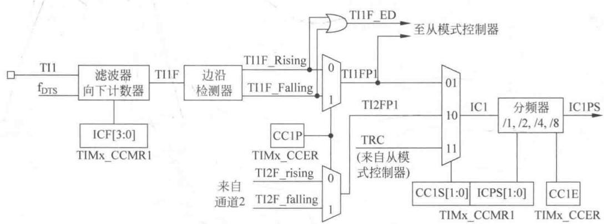

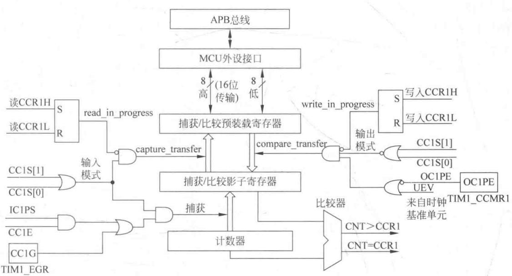

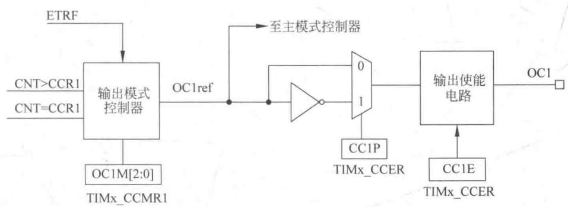

**这三张教材原图太复杂，用"逐层搭积木"的方式看：**

**第一层：只看图 8-27 里的一条通路。**
从左边引脚进来，经过几个小方框（滤波、边沿检测），最后进到一个"捕获/比较寄存器"。你只需要知道：**输入信号要经过几道"加工"才被用。**

**第二层：看图 8-28 的"主电路"。**
这是通道 1 的完整电路，中间那个大方框就是 `TIMx_CCR1`。它**上面连着输入通路，下面连着输出通路**。旁边还有一个"OC1REF"信号。这张图的作用是告诉你：**一个通道的输入和输出其实是共用同一个 CCR 的。**

**第三层：看图 8-29 的"输出部分"。**
从 OC1REF 出发，经过"输出控制"（由 OC1M 控制），再经过"极性"（由 CC1P 控制），最后到引脚。**OCxREF 是高电平有效**——这句话教材原文写了：

> 输出部分产生一个中间波形 OCxREF（高有效）作为基准，链的末端决定最终输出信号的极性。

**这三张图要你理解什么：**

> 一个通道 = 一条输入通路 + 一个 CCR + 一条输出通路。输入和输出共用 CCR，所以**同一个通道不能同时又当输入又当输出**，得用 CCxS 位选择。

---

## 8.7　输入捕获模式：测量外面的信号

### 8.7.1　输入捕获的原理

#### 【教材内容】

> 在输入捕获模式下，当检测到 ICx 信号上相应的边沿后，计数器的当前值被锁存到捕获/比较寄存器（TIMx_CCRx）中。当捕获事件发生时，相应的 CCxIF 标志（TIMx_SR 寄存器）被置 1，如果使能了中断或者 DMA 操作，则将产生中断或者 DMA 操作。如果捕获事件发生时 CCxIF 标志已经为高，那么重复捕获标志 CCxOF（TIMx_SR 寄存器）被置 1。写 CCxIF=0 可清除 CCxIF，或读取存储在 TIMx_CCRx 寄存器中的捕获数据也可清除 CCxIF。写 CCxOF=0 可清除 CCxOF。
>
> ——教材 8.3 节 1（原书 p22）

**用大白话说一遍：**

想象一个跑步比赛：

- **CNT 是一个不停在跑的秒表**，从 0 开始一直加。
- **CCR1 是一张照片**。
- **外面来的信号边沿 = 拍照的按钮**。
- 按钮一按，**秒表当时的读数就被"咔嚓"拍下来，存进 CCR1**。

这样，如果你按两次按钮，就得到两个读数。两个读数一减，就是**两次事件之间过了多少个计数**。

#### 【教材内容】配置步骤（教材给的例子：TI1 上升沿捕获到 CCR1）

> （1）选择有效输入端。TIMx_CCR1 必须连接到 TI1 输入，所以写入 TIMx_CCMR1 寄存器中的 CC1S=01，只要 CC1S 不为 00，通道被配置为输入，并且 TIMx_CCR1 寄存器变为只读。
>
> （2）根据输入信号的特点，配置输入滤波器为所需的带宽。假设输入信号在最多 5 个内部时钟周期的时间内抖动，那么必须配置滤波器的带宽长于 5 个时钟周期。因此，可以（以 f_DTS 频率）连续采样 8 次，以确认在 TI1 上一次真实的边沿变换，即在 TIMx_CCMR1 寄存器中写入 IC1F=0011。
>
> （3）选择 TI1 通道的有效转换边沿，在 TIMx_CCER 寄存器中写入 CC1P=0（上升沿）。
>
> （4）配置输入预分频器。在本例中，希望捕获发生在每一个有效的电平转换时刻，因此预分频器被禁止（写 TIMx_CCMR1 寄存器的 IC1PS=00）。
>
> （5）设置 TIMx_CCER 寄存器的 CC1E=1，允许捕获计数器的值到捕获寄存器中。
>
> （6）如果需要，通过设置 TIMx_DIER 寄存器中的 CC1IE 位允许相关中断请求，通过设置 TIMx_DIER 寄存器中的 CC1DE 位允许 DMA 请求。
>
> ——教材 8.3 节 1（原书 p22）

**注意第（2）步那个"连续采样 8 次"是什么意思：**

```text
假设输入信号上有一个 5 个时钟周期宽的毛刺：

真实信号   ______┌──────────────────────
毛刺        ↑↑↑↑↑
采样        ×  ×  ×  ×  ×  ×  ×  ×
            └── 8 次采样里只有 5 次是"高" ──┘
            → 达不到"8 次全是高"的门槛 → 判定为毛刺，忽略
```

**这就是数字滤波的原理：要连续 N 次采到同一个电平，才认为是真的。** 教材的 IC1F=0011 表示"以 f_CK_INT 采样，连续 8 次"（见 8.11 节 CCMR1 的 IC1F 表）。

### 8.7.2　输入捕获发生时硬件做了什么

#### 【教材内容】

> 当发生输入捕获时：
> （1）产生有效的电平转换时，计数器的值被传送到 TIMx_CCR1 寄存器。
> （2）CC1IF 标志被设置（中断标志）。当发生至少 2 个连续的捕获时，且 CC1IF 未曾被清除，CC1OF 也被置 1。
> （3）如设置了 CC1IE 位，则会产生一个中断。
> （4）如设置了 CC1DE 位，则还会产生一个 DMA 请求。
>
> 为了处理捕获溢出，建议在读出捕获溢出标志之前读取数据，这是为了避免丢失在读出捕获溢出标志之后和读取数据之前可能产生的捕获溢出信息。
>
> ——教材 8.3 节 1（原书 p23）

**"重复捕获标志 CC1OF"是干什么的？**

【类比】你在拍照，但胶卷只有一个格子（CCR1）。第一张照片存进去了，你还没取走，第二张又来了——第二张就把第一张**覆盖**了，第一张丢了。

CC1OF 就是"**照片被覆盖了**"的警告灯：

- CC1IF = 1 表示"有新照片了，快来取"。
- 如果你还没取（没清 CC1IF），又来一张，硬件就把 CC1OF 置 1，意思是"你丢数据了"。

**教材那句"建议在读出捕获溢出标志之前读取数据"，翻译成大白话就是：先读 CCR1 的数据，再清标志，免得漏掉一次捕获。**

### 8.7.3　【辅助理解图】输入捕获时序图

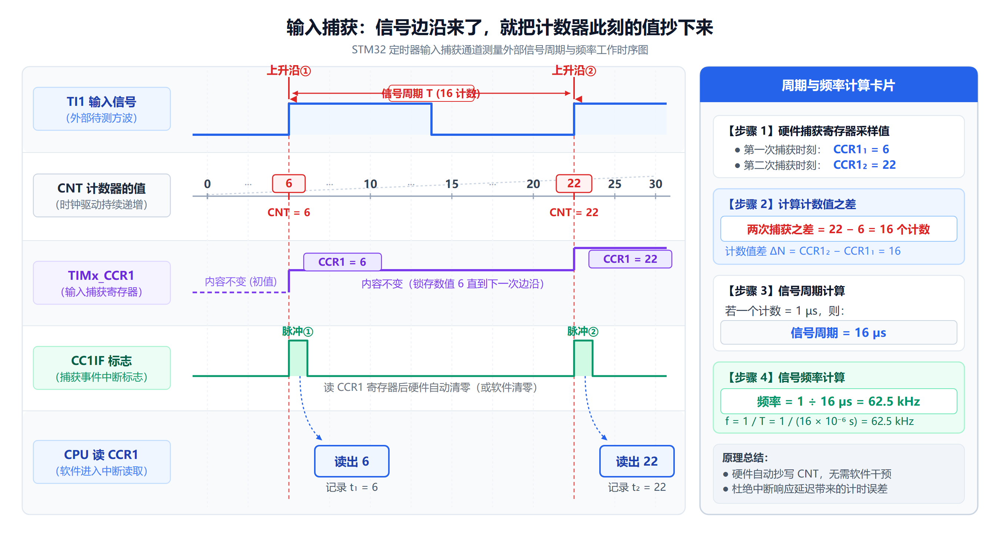

**这张图要按时间顺序看：**

1. **第一行 TI1**：外部信号。第 2 格有一个**上升沿①**，第 9 格有一个**上升沿②**。
2. **第二行 CNT**：一直在数，0、1、2、3……不停。
3. **第三行 TIMx_CCR1**：
   - 上升沿①到来的那一瞬间，CNT 正好是 6 → **CCR1 被写成 6**。
   - 上升沿②到来的那一瞬间，CNT 正好是 22 → **CCR1 被写成 22**。
   - **注意：CCR1 只在这两个瞬间变，平时不动。**
4. **第四行 CC1IF**：两次捕获各产生一个脉冲，告诉 CPU"有新数据了"。
5. **第五行**：CPU 读走数据。

**怎么算周期和频率：**

```text
两次捕获的差值 = 22 − 6 = 16
这 16 是"16 个计数"

如果每个计数 = 1 µs（即 CK_CNT = 1 MHz）：
    信号周期 = 16 × 1 µs = 16 µs
    信号频率 = 1 ÷ 16 µs = 62 500 Hz = 62.5 kHz
```

### 8.7.4　用输入捕获测频率

**思路：** 测"两个相邻上升沿之间 CNT 走了多少"。

**硬件配置思路：**

```text
① 让定时器用内部时钟 CK_INT 计数（SMS=000），比如 CK_CNT = 1 MHz
   （这样每个计数正好是 1 µs，算起来方便）
② 通道 1 配成输入捕获（CC1S = 01），选上升沿（CC1P = 0）
③ 使能捕获中断（CC1IE = 1）
④ 在中断服务函数里，把这一次的 CCR1 值和上一次的 CCR1 值相减
```

**在中断里要处理的一个坑：CNT 会溢出。**

```text
假设 ARR = 0xFFFF（最大），CK_CNT = 1 MHz
那么 CNT 每 65536 µs ≈ 65.5 ms 就回 0 一次。

如果两次捕获之间 CNT 刚好跨过了"回 0"：
    这次读到 100，上次读到 65000
    直接相减：100 − 65000 = −64900   ← 错了！
    正确算法：100 + 65536 − 65000 = 636  ← 要加上一个"满周期"
```

所以**测频率时一般把 ARR 设成 0xFFFF（最大）**，这样两次捕获之间几乎不会跨越溢出；万一跨越了，就在中断里加一个"溢出次数"计数来补偿。

**频率计算：**

```text
                    1
        信号频率 = ──────────────────────────
                   (本次CCR − 上次CCR) × t_计数

其中 t_计数 = (PSC + 1) / TIMxCLK
```

### 8.7.5　用输入捕获测脉宽（高电平持续多久）

**思路：** 在**同一个通道**上，先捕获**上升沿**，再捕获**下降沿**。

**做法：**

```text
① 第一次捕获到上升沿 → 记下 T1 = CCR1
② 在中断里把极性改成"下降沿有效"（CC1P 从 0 改成 1）
③ 第二次捕获到下降沿 → 记下 T2 = CCR1
④ 脉宽 = T2 − T1
⑤ 再把极性改回"上升沿有效"，准备测下一个脉冲
```

**另一种做法（用两个通道）：**

```text
通道 1 配成"上升沿捕获" → 得到 T1
通道 2 配成"下降沿捕获" → 得到 T2
脉宽 = T2 − T1
```

**测脉宽的时序（ASCII 图）：**

```text
TI1      ┌────────────────┐          ┌──────────
         │                │          │
    ─────┘                └──────────┘
         ↑                ↑
      上升沿T1         下降沿T2

CNT      ...  30  31  32  33 ... 58  59  60 ...
CCR1        ← 30（第一次捕获）
CCR2                        ← 58（第二次捕获）

脉宽 = 58 − 30 = 28 个计数
如果 1 个计数 = 1 µs，脉宽 = 28 µs
```

### 8.7.6　PWM 输入模式（一次同时测出周期和占空比）

#### 【教材内容】

> 该模式是输入捕获模式的一个特例，除下列区别外，操作与输入捕获模式相同：
> （1）两个 ICx 信号被映射至同一个 TIx 输入。
> （2）这两个 ICx 信号为边沿有效，但是极性相反。
> （3）其中一个 TIxFP 信号被作为触发输入信号，而从模式控制器被配置成复位模式。
>
> 由于只有 TI1FP1 和 TI2FP2 连到了从模式控制器，所以 PWM 输入模式只能使用 TIMx_CH1/TIMx_CH2 信号。
>
> ——教材 8.3 节 2（原书 p23~p24）

**大白话：** 有一个 PWM 信号进来，你**只用一根引脚**，就能同时知道它的**周期**和**占空比**。

> 【先补一句】**占空比（duty cycle）** 是本章后面的高频词，这里第一次用到，先给个临时定义：**一个周期里"高电平"所占的比例**。比如"高 1 ms、低 3 ms"，周期是 4 ms，占空比就是 1 ÷ 4 = 25%。8.9.1 节会给它正式的定义、公式和示意图，现在有个印象就够了。

**怎么做到的？**

```text
        ┌────────┐          ┌────────┐
TI1  ───┘        └──────────┘        └─────
        ↑                    ↑
     上升沿                 上升沿

配置：
  通道 1：接 TI1，上升沿捕获 → 记到 CCR1，同时"把 CNT 清零"（复位模式）
  通道 2：也接 TI1（同一个引脚！），下降沿捕获 → 记到 CCR2

结果：
  CCR1 = 从 0 数到下一个上升沿 = 一个完整周期
  CCR2 = 从 0 数到中间的下降沿 = 高电平持续时间
  占空比 = CCR2 / CCR1
```

**教材给的配置步骤（原文）：**

> （1）选择 TIMx_CCR1 的有效输入：置 TIMx_CCMR1 寄存器的 CC1S=01（选择 TI1）。
> （2）选择 TI1FP1 的有效极性：置 CC1P=0（上升沿有效）。
> （3）选择 TIMx_CCR2 的有效输入：置 TIMx_CCMR1 寄存器的 CC2S=10（选择 TI1）。
> （4）选择 TI1FP2 的有效极性（捕获数据到 TIMx_CCR2）：置 CC2P=1（下降沿有效）。
> （5）选择有效的触发输入信号：置 TIMx_SMCR 寄存器中的 TS=101（选择 TI1FP1）。
> （6）配置从模式控制器为复位模式：置 TIMx_SMCR 中的 SMS=100。
> （7）使能捕获：置 TIMx_CCER 寄存器中 CC1E=1 且 CC2E=1。

**关键在第（6）步**：把从模式配成**复位模式**。这样每次上升沿到来，CNT 都被清零。于是：

```text
周期   = CCR1（因为每次都从 0 开始数到下一个上升沿）
高电平 = CCR2（从 0 开始数到下降沿）
占空比 = CCR2 ÷ CCR1 × 100%
频率   = CK_CNT ÷ CCR1
```

#### 【教材内容】图 8-30：PWM 输入模式时序

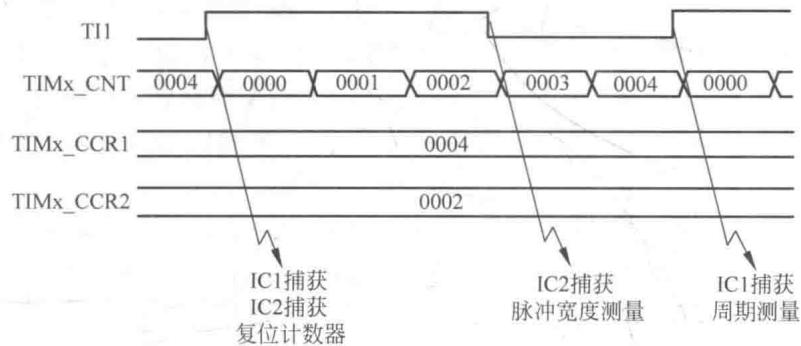

**看图要点：**

1. **先找 TI1 那个波形**：一串高低变化的方波。
2. **看 CNT**：每次 TI1 出现上升沿时，CNT 被**清零**（图上会看到 CNT 突然跳回 0）。
3. **看 CCR1**：在每个上升沿处被捕获，值是"上一个完整周期的长度"。
4. **看 CCR2**：在每个下降沿处被捕获，值是"从周期开始到下降沿的长度"，也就是高电平时间。
5. **这张图要你理解什么**：**同一根引脚上的两种边沿，分别触发两个通道的捕获，再配合 CNT 复位，就能一次拿到周期和占空比。**

### 本节真正要记住什么

| 要测什么 | 怎么做 |
|---|---|
| 信号频率 | 两个上升沿之间 CNT 走了多少 → 取倒数 |
| 高电平脉宽 | 上升沿捕获 T1，下降沿捕获 T2 → T2 − T1 |
| 周期 + 占空比一起 | PWM 输入模式（两个通道映射到同一引脚 + 复位模式） |

---

## 8.8　输出比较模式：产生特定的波形

#### 【教材内容】

> 此项功能是用来控制一个输出波形，或者指示给定的时间已经到。当计数器与捕获/比较寄存器的内容相同时，输出比较功能做如下操作：
> （1）将输出比较模式（TIMx_CCMRx 寄存器中的 OCxM 位）和输出极性（TIMx_CCER 寄存器中的 CCxP 位）定义的值输出到对应的引脚上。在比较匹配时，输出引脚可以保持它的电平（OCxM=000）、被设置成有效电平（OCxM=001）、被设置成无效电平（OCxM=010）或进行翻转（OCxM=011）。
> （2）设置中断状态寄存器中的标志位（TIMx_SR 寄存器中的 CCxIF 位）。
> （3）若设置了相应的中断屏蔽（TIMx_DIER 寄存器中的 CCxIE 位），则产生一个中断。
> （4）若设置了相应的使能位（TIMx_DIER 寄存器中的 CCxDE 位，TIMx_CR2 寄存器中的 CCDS 位选择 DMA 请求功能），则产生一个 DMA 请求。
>
> 在输出比较模式下，更新事件 UEV 对 OCxREF 和 OCx 输出没有影响。同步的精度可以达到计数器的一个计数周期。
>
> ——教材 8.3 节 4（原书 p24）

#### 【辅助理解图】输出比较原理

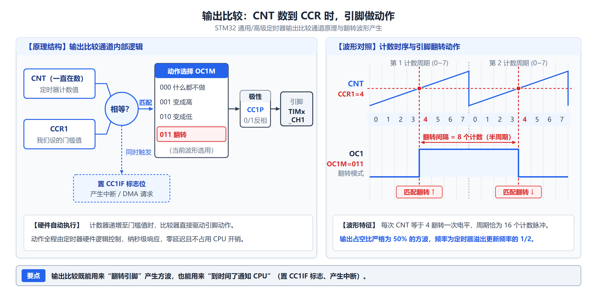

**看图要点：**

1. **左边是"比较"这件事**：CNT 一直在数，CCR1 是你设的门槛值，比较器不停问"它们相等吗？"
2. **相等的那一刻，引脚做动作**。做什么由 **OC1M** 决定：
   - `000` 冻结：什么都不做。
   - `001` 匹配时置为**有效电平**（OC1REF 变高）。
   - `010` 匹配时置为**无效电平**（OC1REF 变低）。
   - `011` **翻转**：原来高就变低，原来低就变高。
3. **右边是翻转模式的波形**：CNT 每次数到 CCR1=4，引脚就翻转一次。于是引脚上出现一个周期 = 8 个计数的方波。
4. **同时，CC1IF 标志会被置 1**，可以触发中断。

**这张图要你理解什么：**

> 输出比较 = "CNT 数到 CCR 时，让引脚做个动作"。**它既能用来产生波形，也能用来"到点了通知 CPU"。**

#### 【教材内容】输出比较的配置步骤

> （1）选择计数器时钟（内部、外部、预分频器）。
> （2）将相应的数据写入 TIMx_ARR 和 TIMx_CCRx 寄存器中。
> （3）如果要产生中断请求和/或 DMA 请求，设置 CCxIE 位和/或 CCxDE 位。
> （4）选择输出模式，例如当计数器 CNT 与 CCRx 匹配时翻转 OCx 的输出引脚，CCRx 预装载未用，开启 OCx 输出且高电平有效，则必须设置 OCxM='011'、OCxPE='0'、CCxP='0' 和 CCxE='1'。
> （5）设置 TIMx_CR1 寄存器的 CEN 位启动计数器。
>
> ——教材 8.3 节 4（原书 p24）

**注意第（4）步里那四个位**，这就是"配一个输出通道"的标准四件套：

| 位 | 在哪 | 作用 |
|---|---|---|
| **OCxM[2:0]** | TIMx_CCMRx | 匹配时做什么动作 |
| **OCxPE** | TIMx_CCMRx | CCRx 要不要预装载（要不要"下次更新才生效"） |
| **CCxP** | TIMx_CCER | 极性（高有效还是低有效） |
| **CCxE** | TIMx_CCER | **输出使能**——不开这个，引脚上什么都不会有 |

**特别强调 CCxE：** 很多人配好了 OCxM、CCxP，结果引脚没反应，就是忘了 `CCxE = 1`。

#### 【教材内容】图 8-31：翻转 OC1 的例子

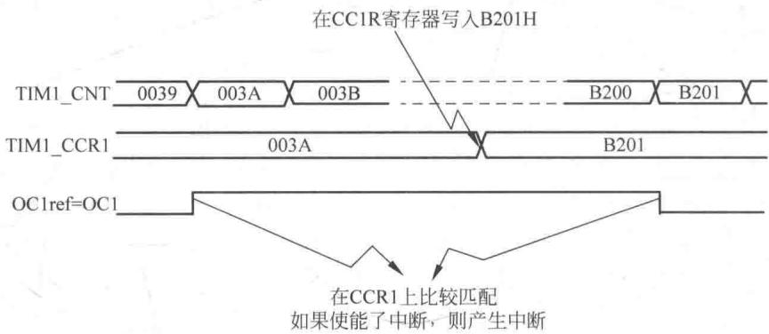

**看图要点：**

1. **上面是 CNT 的值**，在 0 和 ARR 之间循环。
2. **下面是 OC1 引脚的电平**。
3. **找 OC1 翻转的时刻**：每次 CNT 数到 CCR1 时翻转一次。
4. **注意波形周期**：CNT 走完**两轮**，OC1 才走完**一轮**（因为一轮里只翻转一次，需要两次翻转才构成一个完整周期）。

---

## 8.9　PWM 模式：定时器最有用的功能

### 8.9.1　PWM 是什么

**PWM = Pulse Width Modulation = 脉冲宽度调制。**

【类比】你家里有一个只能"全开"或"全关"的开关。你想让灯"半亮"，怎么办？

> **快速不停地开、关。** 开一半时间、关一半时间，灯看起来就是半亮。

这就是 PWM。**它用"开关的时间比例"来模拟"中间值"。**

**两个关键参数：**

- **频率**：一秒钟开关多少次。由 **ARR** 决定。
- **占空比（duty cycle）**：一个周期里"开"占的比例。由 **CCRx** 决定。

```text
    ┌───────────┐           ┌───────────┐
    │           │           │           │
────┘           └───────────┘           └──────
    <--- 高 ---><--- 低 --->
    <------- 一个周期 ------->

占空比 = 高电平时间 / 一个周期的时间 × 100%
```

**PWM 的实际用途：**

- 调 LED 亮度（占空比大 → 亮）
- 调电机转速（占空比大 → 快）
- 调舵机角度（靠脉宽，不是占空比）
- 模拟输出一个电压（配合滤波电路，PWM 的平均值就是电压）

### 8.9.2　PWM 的原理

#### 【教材内容】

> 脉冲宽度调制模式可以产生一个由 TIMx_ARR 寄存器确定频率、由 TIMx_CCRx 寄存器确定占空比的信号。在 TIMx_CCMRx 寄存器中的 OCxM 位写入 110（PWM 模式 1）或 111（PWM 模式 2），能够独立地设置每个 OCx 输出通道产生一路 PWM。必须设置 TIMx_CCMRx 寄存器 OCxPE 位以使能相应的预装载寄存器，最后还要设置 TIMx_CR1 寄存器的 ARPE 位，（在向上计数或中心对称模式中）使能自动重装载的预装载寄存器。
>
> 在 PWM 模式（模式 1 或模式 2）下，TIMx_CNT 和 TIMx_CCRx 始终在进行比较，以确定是否符合 TIMx_CCRx ≤ TIMx_CNT 或者 TIMx_CNT ≤ TIMx_CCRx。
>
> ——教材 8.3 节 5（原书 p25）

**PWM 模式 1 和模式 2 的区别（以向上计数为例）：**

| 模式 | OCxM 的值 | CNT < CCRx 时 | CNT ≥ CCRx 时 |
|---|---|---|---|
| **PWM 模式 1** | `110` | **有效电平（高）** | 无效电平（低） |
| **PWM 模式 2** | `111` | 无效电平（低） | **有效电平（高）** |

**大白话：** 模式 1 是"先高后低"，模式 2 是"先低后高"。**平时用模式 1 就行。**

#### 【教材内容】PWM 模式配置的关键三条（教材原文）

> 仅当发生一个更新事件的时候，预装载寄存器才能被传送到影子寄存器，因此在计数器开始计数之前，必须通过设置 TIMx_EGR 寄存器中的 UG 位来初始化所有的寄存器。OCx 的极性可以通过软件在 TIMx_CCER 寄存器中的 CCxP 位设置，它可以设置为高电平有效或低电平有效。TIMx_CCER 寄存器中的 CCxE 位控制 OCx 输出使能。
>
> ——教材 8.3 节 5（原书 p25）

**翻译成"写程序时必须做的事"：**

1. **设完参数后，先给 UG 位写 1**（产生一次软件更新），把 ARR、CCRx 的值真正装进影子寄存器。**不做这一步，第一轮 PWM 的占空比是错的。**
2. **CCxP** 决定极性。
3. **CCxE = 1** 才会真正输出到引脚。

### 8.9.3　PWM 边沿对齐模式

#### 【教材内容】向上计数配置

> 当 TIMx_CR1 寄存器中的 DIR 位为低的时候执行向上计数。例如，对于 PWM 模式 1，当 TIMx_CNT < TIMx_CCRx 时 PWM 信号参考 OCxREF 为高，否则为低。如果 TIMx_CCRx 中的比较值大于自动重装载值（TIMx_ARR），则 OCxREF 保持为 1。如果比较值为 0，则 OCxREF 保持为 0。TIMx_ARR=8 时边沿对齐的 PWM 波形实例如图 8-32 所示。
>
> ——教材 8.3 节 5（原书 p26）

**四个特殊情况的处理（这段教材讲得很清楚，值得记住）：**

```text
CCRx > ARR  →  OCxREF 一直为高  →  占空比 100%
CCRx = 0    →  OCxREF 一直为低  →  占空比 0%
CCRx = ARR  →  只有 CNT = ARR 那一个瞬间是低，其余全高
CCRx 在中间 →  正常的占空比
```

#### 【辅助理解图】边沿对齐 PWM 波形

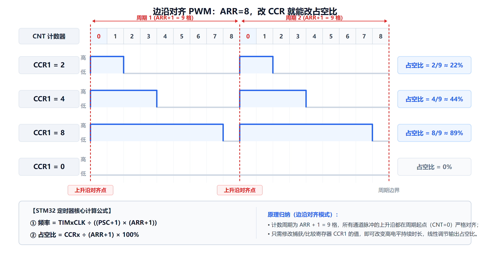

**看图要点：**

1. **最上面那行 CNT**：0、1、2、…、8，然后回到 0。**一共 9 个数**（ARR + 1）。
2. **CCR1 = 2 那行**：CNT 在 0、1 的时候是高（因为 CNT < 2），从 2 开始变低。高占 2 格，低占 7 格。
3. **CCR1 = 4 那行**：高占 4 格，低占 5 格。
4. **CCR1 = 8 那行**：高占 8 格，低占 1 格。
5. **CCR1 = 0 那行**：全程低。
6. **注意所有波形的上升沿都对齐在周期的起点**——这就是"**边沿对齐**"这个名字的来源。

**计算公式（边沿对齐、向上计数、PWM 模式 1）：**

```text
                          TIMxCLK
         PWM 频率 = ────────────────────────
                     (PSC + 1) × (ARR + 1)

                       CCRx
         占空比 = ────────────── × 100%
                    ARR + 1
```

**验算（ARR = 8，CCR = 4）：**

```text
占空比 = 4 ÷ (8 + 1) = 4 ÷ 9 = 0.4444 = 44.4%   ✓ 与图一致
```

#### 【教材内容】向下计数配置

> 当 TIMx_CR1 寄存器的 DIR 位为高时执行向下计数。例如，在 PWM 模式 1 下，当 TIMx_CNT > TIMx_CCRx 时参考信号 OCxREF 为低，否则为高。如果 TIMx_CCRx 中的比较值大于 TIMx_ARR 中的自动重装载值，则 OCxREF 保持为 1。该模式下能产生 0% 的 PWM 波形。
>
> ——教材 8.3 节 5（原书 p26）

**大白话：** 向下计数时，判断条件反过来了：**CNT > CCRx 时才是低**。

#### 【教材内容】图 8-32：教材上的边沿对齐 PWM 波形

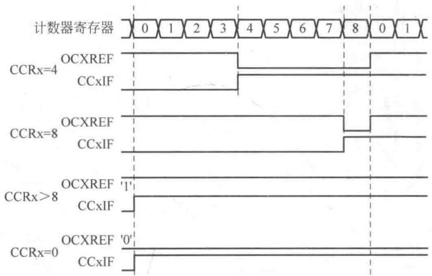

**逐行讲解：**

1. **最上面一行"计数器寄存器"**：写着 `0 1 2 3 4 5 6 7 8 0 1 …`，两个周期连在一起。**看清 8 后面直接回 0。**
2. **`CCRx=4` 那组**：
   - `OCxREF` 波形：从周期起点开始高，到 CNT = 4 时变低，一直到周期结束。
   - `CCxIF` 波形：在 CNT 与 CCRx 匹配（CNT = 4）时有一个窄脉冲，这就是"比较匹配标志"。
3. **`CCRx=8` 那组**：高电平一直持续到 CNT = 8 才变低，所以高电平占了 8/9。
4. **`CCRx>8` 那组**：OCxREF 标着 "1"，**全程高电平**。
5. **`CCRx=0` 那组**：OCxREF 标着 "0"，**全程低电平**。
6. **`CCxIF` 为什么重要？** 因为它可以在每次"CNT = CCRx"时触发中断或 DMA。比如你想在 PWM 的高电平结束那一刻做点什么，就可以用它。

**这张图要你理解什么：**

> **ARR 决定周期（频率），CCRx 决定高电平占多长（占空比）。** 改 ARR 就改频率，改 CCRx 就改占空比，两者互不干扰。

### 8.9.4　PWM 中央对齐模式

#### 【教材内容】

> 当 TIMx_CR1 寄存器中的 CMS 位不为 00 时，为中央对齐模式（所有其他的配置对 OCxREF/OCx 信号都有相同的作用）。根据不同的 CMS 位设置，比较标志可以在计数器向上计数时被置 1、在计数器向下计数时被置 1 或在计数器向上和向下计数时被置 1。TIMx_CR1 寄存器中的计数方向位（DIR）由硬件更新，不要用软件修改它。
>
> ——教材 8.3 节 5（原书 p26）

**中央对齐 PWM 和边沿对齐 PWM 的区别：**

| | 边沿对齐 | 中央对齐 |
|---|---|---|
| 计数器怎么走 | 0 → ARR → 0（锯齿） | 0 → ARR → 0（三角） |
| 一个周期几个计数 | ARR + 1 | 2 × ARR |
| 脉冲位置 | 靠左（从周期起点开始） | **居中** |
| 波形特点 | 谐波多 | 谐波少，对电机友好 |
| 配置位 | CMS = 00 | CMS = 01 / 10 / 11 |

**计算公式（中央对齐）：**

```text
                          TIMxCLK
         PWM 频率 = ────────────────────────
                     (PSC + 1) × 2 × ARR

                       CCRx
         占空比 = ────────────── × 100%
                       ARR
```

**注意分母的变化：** 边沿对齐是 `ARR + 1`，中央对齐是 `2 × ARR`（频率）和 `ARR`（占空比）。**这是最容易记混的地方。**

#### 【辅助理解图】中央对齐 PWM 波形

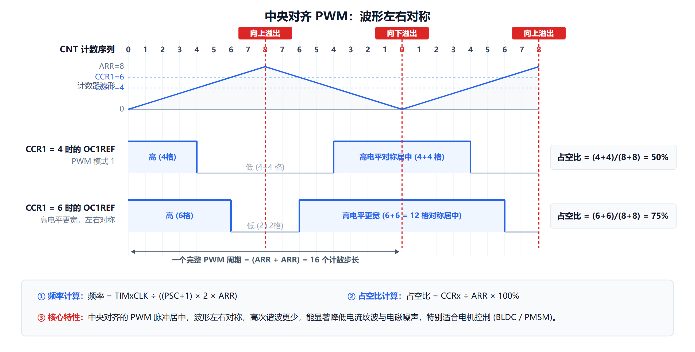

**看图要点：**

1. **最上面那行 CNT**：0、1、2、…、8、7、6、…、1、0、1、2、…，是一个**三角波**。
2. **CNT = 8 的位置**：标着"向上溢出"。
3. **CNT = 0 的位置**：标着"向下溢出"。
4. **CCR1 = 4 那行**：CNT < 4 时为高。上坡时是 0、1、2、3（4 格），下坡时也是 3、2、1、0（4 格），总共 8 格高，一个周期 16 格。
5. **占空比** = 8 ÷ 16 = 50% = CCR1 ÷ ARR = 4 ÷ 8。**注意这里分母是 ARR 不是 ARR+1。**
6. **波形左右对称**，脉冲位于周期正中间。

#### 【教材内容】图 8-33：教材上的中央对齐 PWM 波形

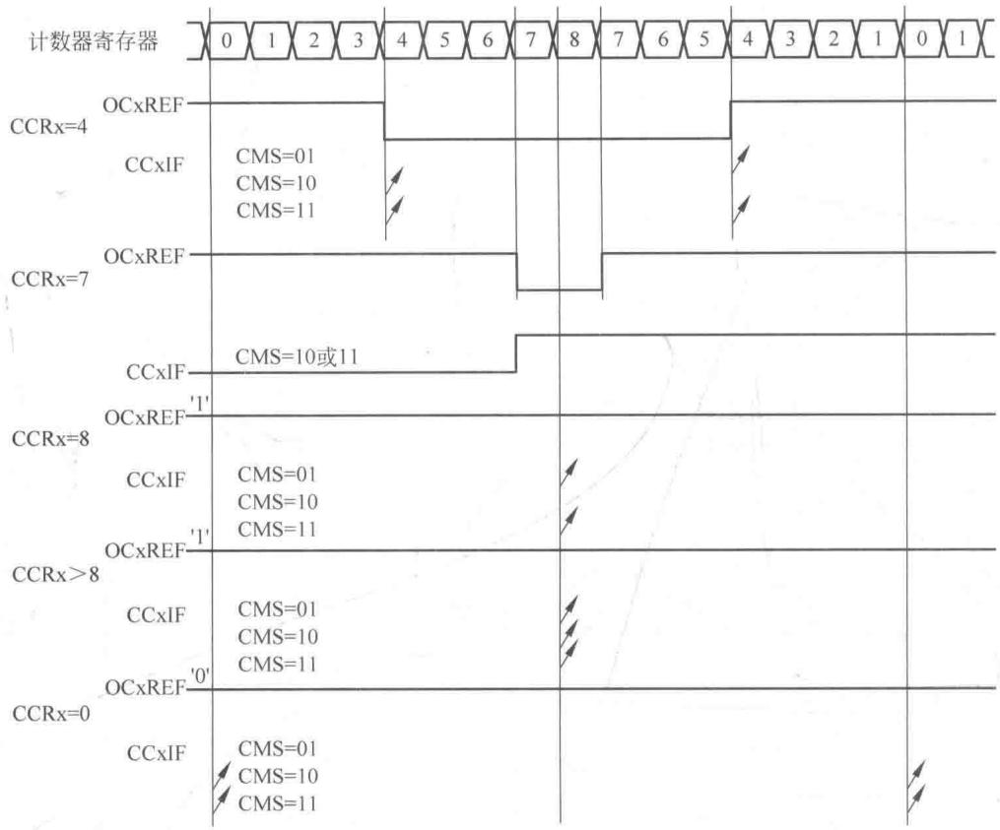

> 【补充解释】教材图 8-33 的题注印成了"APR=8"，结合上下文和图中内容判断，应为 **ARR = 8**。这是教材的排版笔误。

**逐行讲解：**

1. **最上面一行"计数器寄存器"**：`0 1 2 3 4 5 6 7 8 7 6 5 4 3 2 1 0 1 …`，清清楚楚的三角波。**验证了中央对齐的上界就是 ARR。**
2. **`CCRx=4` 那组**：
   - `OCxREF` 在上坡的 0~3 段为高，下坡的 3~0 段也为高，中间 4~8~4 段为低。整体左右对称。
   - 右边有三个小箭头分别标着 `CMS=01`、`CMS=10`、`CMS=11`，**它们指向不同的时刻**——这就是"比较标志 CCxIF 在什么时候置 1"的区别：
     - `CMS=01`（中央对齐模式 1）：**只在向下计数时**置比较标志。
     - `CMS=10`（中央对齐模式 2）：**只在向上计数时**置比较标志。
     - `CMS=11`（中央对齐模式 3）：**向上和向下都置**。
3. **`CCRx=7` 那组**：高电平更宽（7/8 = 87.5%）。
4. **`CCRx=8` 那组**：OCxREF 标着 "1"，几乎全程高。
5. **`CCRx>8` 那组**：全程高。
6. **`CCRx=0` 那组**：全程低。

**这张图要你理解什么：**

> 中央对齐模式下，PWM 脉冲是**居中**的；而且 CMS 位不仅决定计数方式，还决定**比较中断在哪个方向产生**。

### 8.9.5　【补充解释】PWM 配置的完整步骤（教材未展开）

> 教材在 8.5.2 节末尾说："STM32 定时器除了定时和计数功能外，另外一个重要功能是用作 PWM 控制。限于篇幅，PWM 控制的内容请参考产品手册。"
>
> 下面这一段是为了让讲义完整而补充的，标注为【补充解释】，不属于教材原文。

**配置一路 PWM 的六步：**

```text
第 1 步：开时钟
        RCC_APB1PeriphClockCmd(RCC_APB1Periph_TIM3, ENABLE);
        RCC_APB2PeriphClockCmd(RCC_APB2Periph_GPIOB, ENABLE);   // 引脚也要开时钟

第 2 步：把引脚配成复用推挽输出（AF_PP）
        （因为此时引脚不由 GPIO 控制，而是交给定时器控制）
        GPIO_InitStructure.GPIO_Mode = GPIO_Mode_AF_PP;

第 3 步：配置时基（PSC / ARR / 计数模式）
        TIM_TimeBaseInit(...);

第 4 步：配置输出比较通道
        TIM_OCInitTypeDef TIM_OCInitStructure;
        TIM_OCInitStructure.TIM_OCMode      = TIM_OCMode_PWM1;      // PWM 模式 1
        TIM_OCInitStructure.TIM_OutputState = TIM_OutputState_Enable; // 相当于 CCxE=1
        TIM_OCInitStructure.TIM_OCPolarity  = TIM_OCPolarity_High;  // 高电平有效
        TIM_OCInitStructure.TIM_Pulse       = 占空比对应的 CCR 值;
        TIM_OC1Init(TIM3, &TIM_OCInitStructure);

第 5 步：使能预装载
        TIM_OC1PreloadConfig(TIM3, TIM_OCPreload_Enable);   // 相当于 OCxPE=1
        TIM_ARRPreloadConfig(TIM3, ENABLE);                 // 相当于 ARPE=1

第 6 步：启动定时器
        TIM_Cmd(TIM3, ENABLE);
```

**运行时改占空比：**

```c
TIM_SetCompare1(TIM3, 新值);   // 就是改 CCR1
```

**注意第 2 步**：PWM 输出时引脚必须配成**复用功能（Alternate Function）**，而不是普通输出。这一点和第 6 章 GPIO 的知识直接相关——引脚不再由 GPIO 的 ODR 寄存器控制，而是由定时器的 OCx 信号控制。

### 本节真正要记住什么

| 参数 | 谁决定 | 边沿对齐公式 | 中央对齐公式 |
|---|---|---|---|
| 频率 | PSC、ARR | TIMxCLK ÷ ((PSC+1)(ARR+1)) | TIMxCLK ÷ ((PSC+1)·2·ARR) |
| 占空比 | CCRx | CCRx ÷ (ARR+1) | CCRx ÷ ARR |

---

## 8.10　其它工作模式（速览）

教材 8.3 节还介绍了许多模式，考试一般只考概念，这里做压缩但保留核心。

### 8.10.1　强置输出模式

#### 【教材内容】

> 在输出模式（TIMx_CCMRx 寄存器中 CCxS=00）下，输出比较信号（OCxREF 和相应的 OCx）能够直接由软件强置为有效或无效状态，而不依赖于输出比较寄存器和计数器间的比较结果。置 TIMx_CCMRx 寄存器中相应的 OCxM=101，即可强置输出比较信号（OCxREF/OCx）为有效状态。这样 OCxREF 被强置为高电平（OCxREF 始终为高电平有效），同时 OCx 得到 CCxP 极性位相反的值。
>
> ——教材 8.3 节 3（原书 p24）

**大白话：** 不看 CNT 和 CCR 的比较结果，**软件说高就高、说低就低**。

- `OCxM = 101` → 强置为**有效电平**（OCxREF 变高）
- `OCxM = 100` → 强置为**无效电平**（OCxREF 变低）

**用途：** 调试时手动控制引脚，或者在某些保护逻辑里强制把输出拉到一个安全状态。

### 8.10.2　单脉冲模式（OPM）

#### 【教材内容】

> 单脉冲模式（OPM）是前述众多模式的一个特例。这种模式允许计数器响应一个激励，并在一个程序可控的延时之后，产生一个脉宽可程序控制的脉冲。
>
> 可以通过从模式控制器启动计数器，在输出比较模式或者 PWM 模式下产生波形。设置 TIMx_CR1 寄存器中的 OPM 位将选择单脉冲模式，这样可以让计数器自动地在产生下一个更新事件 UEV 时停止。
>
> 向上计数方式：CNT < CCRx ≤ ARR（特别地，0 < CCRx）。
>
> 向下计数方式：CNT > CCRx。
>
> ——教材 8.3 节 6（原书 p27）

**大白话：** 平时定时器会一直循环数下去。单脉冲模式下，**数完一轮就自己停**。所以它只输出**一个**脉冲。

**两个时间参数：**

```text
触发信号 ───┐
            └──────────────────────────────────
            │←──── t_DELAY ────→│←─ t_PULSE ─→│
输出     ───────────────────────┌────────────┐────────
                                └────────────┘

t_DELAY = CCR1 的值（延时多久才输出）
t_PULSE = ARR − CCR1（脉冲持续多久）
```

#### 【教材内容】图 8-34：单脉冲模式的例子

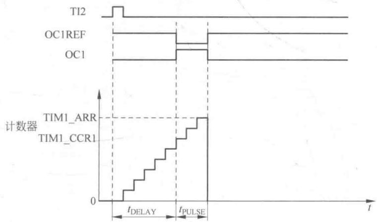

**看图要点：**

1. **最上面是 TI2 引脚上的触发信号**：出现一个上升沿，这就是"激励"。
2. **中间是 CNT**：从某个初值开始数。
3. **下面是 OC1 输出**：在触发之后延迟了一段时间才变高，高了一段时间又变低，**然后就不再重复了**。
4. **教材给的配置要点（原文）：**
   > 在这个例子中，TIMx_CR1 寄存器中的 DIR 和 CMS 位应该置低。因为只需一个脉冲，所以必须设置 TIMx_CR1 寄存器中的 OPM='1'，在下一个更新事件（当计数器从自动装载值翻转到 0）时停止计数。

**典型用途：** 超声波测距（发一个脉冲，然后等回波）、红外遥控发射、精确定时的单次触发。

### 8.10.3　编码器接口模式

#### 【教材内容】

> 选择编码器接口模式的方法是：如果计数器只在 TI2 的边沿计数，则置 TIMx_SMCR 寄存器中的 SMS=001；如果只在 TI1 边沿计数，则置 SMS=010；如果计数器同时在 TI1 和 TI2 边沿计数，则置 SMS=011。
>
> 在这个模式下，计数器依照增量编码器的速度和方向被自动的修改，因此计数器的内容始终指示着编码器的位置。计数方向与相连的传感器旋转的方向对应。
>
> ——教材 8.3 节 7（原书 p29）

**什么是"增量编码器"？**

【类比】就像老式收音机上的旋钮。你顺时针转，它就"加"；逆时针转，它就"减"。旋钮后面有一个编码器，会输出两路信号（叫 A 相和 B 相）。

**两路信号怎么表示方向？**

```text
顺时针转（A 相超前 B 相）：
A  ──┐  ┌──┐  ┌──
     └──┘  └──┘
B  ────┐  ┌──┐  ┌─
       └──┘  └──┘
       ↑ B 的上升沿到来时，A 是低电平

逆时针转（B 相超前 A 相）：
A  ────┐  ┌──┐  ┌─
       └──┘  └──┘
B  ──┐  ┌──┐  ┌──
     └──┘  └──┘
       ↑ B 的上升沿到来时，A 是高电平
```

**所以：看"B 变化时 A 是什么电平"，就知道转的方向。** 这就是教材表 8-2 在讲的内容。

#### 【教材内容】表 8-2　计数方向与编码器信号的关系

| 有效边沿 | 相对信号的电平 | TI1FP1 上升 | TI1FP1 下降 | TI2FP2 上升 | TI2FP2 下降 |
|---|---|---|---|---|---|
| 仅在 TI1 计数 | 高 | 向下计数 | 向上计数 | 不计数 | 不计数 |
| 仅在 TI1 计数 | 低 | 向上计数 | 向下计数 | 不计数 | 不计数 |
| 仅在 TI2 计数 | 高 | 不计数 | 不计数 | 向上计数 | 向下计数 |
| 仅在 TI2 计数 | 低 | 不计数 | 不计数 | 向下计数 | 向上计数 |
| 在 TI1 和 TI2 上计数 | 高 | 向下计数 | 向上计数 | 向上计数 | 向下计数 |
| 在 TI1 和 TI2 上计数 | 低 | 向上计数 | 向下计数 | 向下计数 | 向上计数 |

**"相对信号的电平"是什么意思？** 就是"另一个信号"当时的电平。比如"TI1FP1 上升"时，看 TI2 是什么电平。

#### 【教材内容】图 8-35 / 图 8-36：编码器接口实例

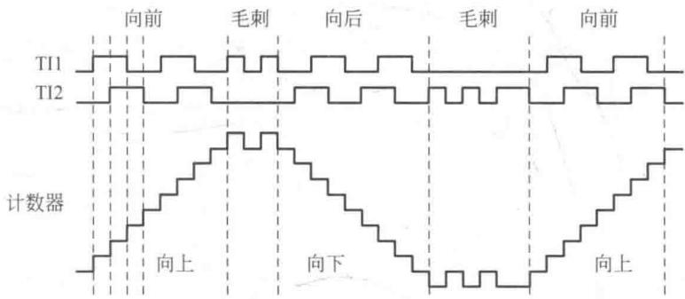

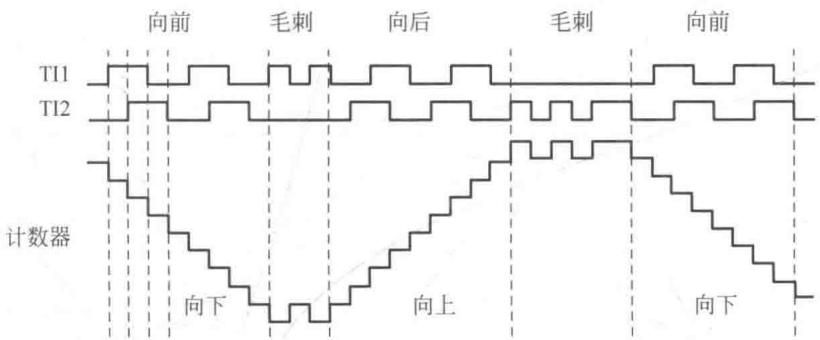

**图 8-35 看图要点：**

1. **上面两行是 TI1 和 TI2 两路信号**，都是方波，但相位有差。
2. **下面是 CNT 的值**，它在**增加和减少之间来回切换**，这就是"跟着转动方向走"。
3. **注意图中还画了"输入抖动"的部分**：信号上有一小段反复跳变。因为配了双边沿计数 + 滤波，这段抖动**被抑制住了**，没有让 CNT 乱跳。这是"数字滤波"在起作用。

**图 8-36 看图要点：** 和 8-35 唯一的区别是 **CC1P = 1（IC1FP1 反相）**。**结果计数方向整体反过来了。** 这说明：**只要把极性位改一下，就能把"正转"和"反转"的定义对调。** 实际接线时如果发现方向反了，改这一位就行。

### 8.10.4　定时器输入异或功能

#### 【教材内容】

> TIMx_CR2 寄存器中的 TI1S 位，允许通道 1 的输入滤波器连接到一个异或门的输出端，异或门的 3 个输入端为 TIMx_CH1、TIMx_CH2 和 TIMx_CH3。异或输出能够被用于所有定时器的输入功能，如触发或输入捕获。此特性可以用于连接霍尔传感器。
>
> ——教材 8.3 节 8（原书 p30）

**什么是异或（XOR）？** 两个输入"不一样"时输出 1，"一样"时输出 0。

```text
A B | A XOR B
0 0 |    0
0 1 |    1
1 0 |    1
1 1 |    0
```

**为什么这个功能用来接霍尔传感器？** 因为三相霍尔传感器有 3 路输出，每转动一个位置，3 路的组合就变一次。把它们异或起来，输出脉冲的数量正好反映转过的角度。

### 8.10.5　定时器和外部触发的同步

#### 【教材内容】

> TIMx 定时器能够在复位模式、门控模式或触发模式下和一个外部的触发同步。
>
> ——教材 8.3 节 9（原书 p31）

**三种从模式的对比：**

| 模式 | SMS 值 | 外部信号起什么作用 | 类比 |
|---|---|---|---|
| **复位模式** | 100 | 触发信号的有效边沿**把 CNT 清零** | 秒表"归零"按钮 |
| **门控模式** | 101 | 触发信号处于**有效电平**期间才允许计数；有效电平一结束，计数就停住（但**不清零**） | 秒表的"暂停/继续" |
| **触发模式** | 110 | 触发信号的有效边沿**启动计数**（启动后就不再受控） | 秒表的"开始"按钮 |

**"有效电平"到底是高还是低？这由通道的极性位 CCxP 决定**（就是 8.5.2 节用来选"上升沿还是下降沿"的那个位）：

- **CCxP = 0**（不反相）：触发输入**高电平**期间计数，变低就停。
- **CCxP = 1**（反相）：触发输入**低电平**期间计数，变高就停。

教材 8.3 节 9 的例子配的是"CC1P = 1，只检测低电平"，所以那一节正文写的是"**只要 TI1 为低，计数器开始依据内部时钟计数，在 TI1 变高时停止计数**"。

> 【补充解释】**这两种说法不矛盾**：寄存器描述里"触发输入为高时计数器的时钟开启"说的是**不反相（CCxP = 0）**这个默认前提；教材图 8-38 的例子把 CC1P 设成了 1，极性反过来了，所以变成"低电平计数、高电平停"。**看任何门控模式的描述，都要先问一句："这里的有效电平是反相前还是反相后的？"**

#### 【教材内容】图 8-37 / 图 8-38 / 图 8-39：三种模式的时序

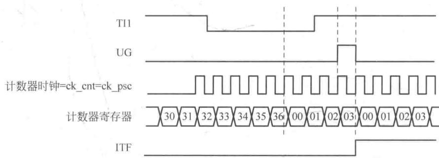

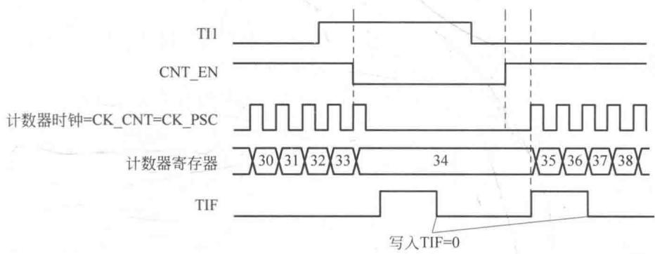

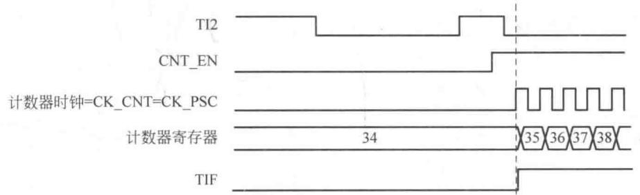

**三张图放在一起对比着看，最能说明问题：**

- **图 8-37（复位模式）**：CNT 本来在正常往上数（一直数到 0x36 附近），突然 TI1 来了一个上升沿，**CNT 立刻被清成 0**，然后重新开始数。看图上 CNT 那个"突然掉到 0"的位置，就对应触发信号的边沿。
- **图 8-38（门控模式）**：CNT 在 TI1 为**低**的时候正常数，TI1 一变**高**就**停住不动**（注意是"停住"，不是"清零"）。TI1 再变低，CNT 从刚才停住的地方**接着数**。**注意这个例子的前提**：它把 CC1P 设成了 1（低电平有效），所以"低"才是允许计数的有效电平；如果按默认的 CC1P = 0，就正好反过来——高电平时计数、低电平时停住。
- **图 8-39（触发模式）**：CNT 一开始**完全不动**，直到 TI2 来了一个上升沿，它才开始数，之后就一直数下去（除非你手动停）。

**共同点：三张图里，触发信号边沿和 CNT 的实际动作之间都有一小段延迟。** 教材解释了原因：

> 在 TI1 上升沿和计数器的实际复位之间的延时，取决于 TI1 输入端的重同步电路。

（和 8.5.2 节讲的是同一回事：外部信号要先同步到内部时钟上。）

### 8.10.6　定时器同步（主从模式）

#### 【教材内容】

> 所有 TIMx 定时器在内部相连，用于定时器同步或链接。当一个定时器处于主模式时，它可以对另一个处于从模式的定时器的计数器进行复位、启动、停止或提供时钟等操作。
>
> 定时器同步可以提供以下操作：
> - 使用一个定时器作为另一个定时器的预分频器。
> - 使用一个定时器使能另一个定时器。
> - 使用一个定时器去启动另一个定时器。
> - 使用一个外部触发同步地启动两个定时器。
>
> ——教材 8.3 节 10（原书 p32）

#### 【教材内容】图 8-40：主/从定时器的例子

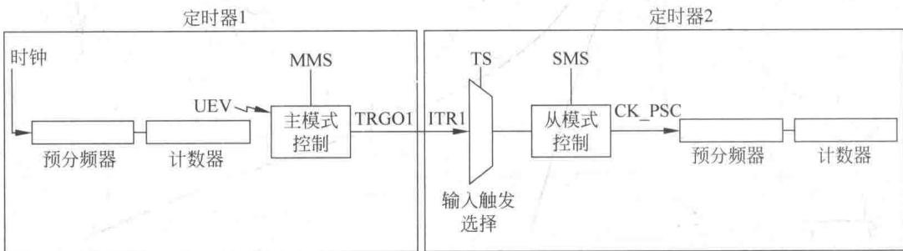

**教材给的例子：把定时器 1 配置成定时器 2 的预分频器。**

> （1）配置定时器 1 为主模式，它可以在每一个更新事件 UEV 时输出一个周期性的触发信号。在 TIM1_CR2 寄存器的 MMS = 010 时，每当产生一个更新事件时在 TRGO1 上输出一个上升沿信号。
> （2）连接定时器 1 的 TRGO1 输出至定时器 2，设置 TIM2_SMCR 寄存器的 TS=000，配置定时器 2 为使用 ITR1 作为内部触发的从模式。
> （3）把从模式控制器置于外部时钟模式 1（TIM2_SMCR 寄存器的 SMS=111）；这样定时器 2 即可由定时器 1 周期性的上升沿（即定时器 1 的计数器溢出）信号驱动。
> （4）必须设置相应（TIMx_CR1 寄存器）的 CEN 位分别启动两个定时器。

**看图要点：**

1. **左边是主定时器 TIM1**，它的溢出信号通过一根叫 **TRGO** 的内部线送出去。
2. **右边是从定时器 TIM2**，它把 TRGO1 当作自己的计数脉冲（外部时钟模式 1）。
3. **结果**：TIM1 每溢出一次，TIM2 就加 1。相当于 TIM2 的"预分频系数"被扩大了一大截。

**为什么要这么做？** 因为单个定时器最多只能定约 59.65 秒。级联之后：

```text
TIM1：72 MHz / (PSC+1) / (ARR+1) = 假设 1 kHz（每 1 ms 溢出一次）
TIM2：把 TIM1 的溢出当脉冲，再数 60000 次
      60000 × 1 ms = 60 s = 1 分钟
```

**这就是做"长定时"的标准做法。**

---

## 8.11　通用定时器的寄存器详解

### 8.11.1　先建立"地址"的概念

#### 【教材内容】

> 普通定时器 TIMx 的首地址是 0x4000_0000。普通定时器的寄存器可以用半字（16 位）或字（32 位）的方式操作。
>
> ——教材 8.4 节（原书 p33）

#### 【辅助理解图】定时器寄存器地址地图

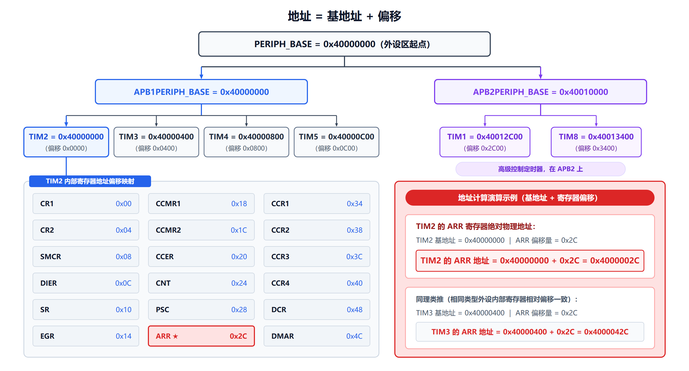

**这张图要按"从上往下"的顺序看，它建立的是这样一条逻辑链（教材 8.4 节从"普通定时器 TIMx 的首地址是 0x4000_0000"讲起，正是这条链里的一环）：**

```text
地址  →  地址空间  →  外设基地址  →  寄存器偏移  →  最终寄存器地址
```

**第一步：地址空间。**
STM32 把 4 GB 的地址空间划分成若干块。其中**外设区**从 `0x40000000` 开始。

```text
0x00000000  ┌──────────────┐
            │  Flash / 代码 │
0x20000000  ├──────────────┤
            │    SRAM      │
0x40000000  ├──────────────┤  ← 外设区从这里开始
            │  各种外设     │
0x60000000  ├──────────────┤
            │  外部存储器   │
0xE0000000  ├──────────────┤
            │ 内核私有外设  │（SysTick、NVIC 在这里）
0xFFFFFFFF  └──────────────┘
```

**第二步：外设基地址。**
教材给的宏定义（原书 p49）：

```c
#define PERIPH_BASE       ((u32)0x40000000)
#define APB1PERIPH_BASE   PERIPH_BASE                    // 0x40000000
#define APB2PERIPH_BASE   (PERIPH_BASE + 0x10000)        // 0x40010000
#define AHBPERIPH_BASE    (PERIPH_BASE + 0x20000)        // 0x40020000
```

**第三步：各定时器的基地址（教材原文）：**

```c
#define TIM2_BASE   (APB1PERIPH_BASE + 0x0000)   // 0x40000000
#define TIM3_BASE   (APB1PERIPH_BASE + 0x0400)   // 0x40000400
#define TIM4_BASE   (APB1PERIPH_BASE + 0x0800)   // 0x40000800
```

**算一遍给你看：**

```text
TIM3_BASE = APB1PERIPH_BASE + 0x0400
          = 0x40000000 + 0x00000400
          = 0x40000400          ✓
```

**第四步：寄存器偏移。**
每个定时器内部，各个寄存器相对于"基地址"有一个固定的偏移量：

| 寄存器 | 偏移 | 寄存器 | 偏移 | 寄存器 | 偏移 |
|---|---|---|---|---|---|
| TIMx_CR1 | 0x00 | TIMx_SR | 0x10 | TIMx_CCR1 | 0x34 |
| TIMx_CR2 | 0x04 | TIMx_EGR | 0x14 | TIMx_CCR2 | 0x38 |
| TIMx_SMCR | 0x08 | TIMx_CCMR1 | 0x18 | TIMx_CCR3 | 0x3C |
| TIMx_DIER | 0x0C | TIMx_CCMR2 | 0x1C | TIMx_CCR4 | 0x40 |
| TIMx_CNT | 0x24 | TIMx_CCER | 0x20 | TIMx_DCR | 0x48 |
| TIMx_PSC | 0x28 | TIMx_ARR | 0x2C | TIMx_DMAR | 0x4C |

**第五步：算最终地址。**

```text
TIM2 的 ARR 地址 = TIM2_BASE + ARR 偏移
                 = 0x40000000 + 0x2C
                 = 0x4000002C          ← 这就是 ARR 的门牌号

TIM2 的 CR1 地址 = 0x40000000 + 0x00 = 0x40000000
TIM2 的 CNT 地址 = 0x40000000 + 0x24 = 0x40000024

TIM3 的 ARR 地址 = 0x40000400 + 0x2C = 0x4000042C
TIM3 的 CR1 地址 = 0x40000400 + 0x00 = 0x40000400
```

**为什么要知道这些？** 因为库函数里那个 `TIM2` 其实就是一个指针：

```c
#define TIM2   ((TIM_TypeDef *) TIM2_BASE)
```

`TIM2->ARR = 999;` 这句代码，CPU 实际做的事情是"往地址 0x4000002C 写 999"。

> 【补充解释】TIM5、TIM6、TIM7、TIM1、TIM8 的基地址教材摘录里没有给出。按 STM32F10x 固件库 `stm32f10x.h` 的惯例（也与参考手册的存储器映像一致）：
>
> - TIM5_BASE = 0x40000C00、TIM6_BASE = 0x40001000、TIM7_BASE = 0x40001400（都在 APB1）
> - TIM1_BASE = 0x40012C00、TIM8_BASE = 0x40013400（都在 APB2）
>
> 这几个值不在本章教材摘录中，建议对照《STM32F10x 参考手册》的存储器映像表核验（已记入文末"待核验"）。

### 8.11.2　怎么读下面的寄存器讲解

下面每个寄存器都按同一个套路讲：

1. **它属于谁**（哪个定时器、偏移多少、复位值多少）；
2. **它控制什么、为什么需要它**；
3. **每个关键位的含义**（写 0 怎样、写 1 怎样）；
4. **ASCII 位图**（用箭头标出当前关心的位）；
5. **程序怎么操作**；
6. **操作之后硬件发生什么**。

---

### 8.11.3　控制寄存器 1（TIMx_CR1）

**属于谁：** 属于某个定时器 TIMx（TIM2~TIM5）；**偏移地址 0x00**；**复位值 0x0000**。

**控制什么：** 它是定时器的**总控台**。开不开机、往哪个方向数、怎么对齐、ARR 要不要缓冲、单脉冲要不要开——全在这里。

**为什么需要它：** 定时器有一堆功能，必须有一个"总开关 + 模式选择"的寄存器。

**位图（16 位）：**

```text
 15 14 13 12 11 10 | 9  8 |  7  | 6  5 | 4  | 3  | 2  |  1  | 0
+------------------+------+-----+------+----+----+----+-----+----+
|      保留        |CKD[1:0]|ARPE|CMS[1:0]|DIR|OPM|URS|UDIS|CEN |
+------------------+------+-----+------+----+----+----+-----+----+
                    （保留位始终读为 0）
```

**逐个字段讲解：**

**位 [15:10]　保留** —— 始终读为 0，别管。

**位 [9:8]　CKD[1:0]　时钟分频因子（Clock division）**

> 定义在定时器时钟（CK_INT）频率与数字滤波器（ETR、TIx）使用的采样频率之间的分频比例。
>
> - `00`：t_DTS = t_CK_INT
> - `01`：t_DTS = 2 × t_CK_INT
> - `10`：t_DTS = 4 × t_CK_INT
> - `11`：保留

**大白话：** 这个位**不改变计数速度**，只影响**输入滤波器采样的快慢**。用它做普通定时/输出时，写 `00` 就行。

**位 7　ARPE　自动重装载预装载允许位（Auto-reload preload enable）**

- **写 0**：TIMx_ARR 寄存器**没有缓冲**，你写进去**立刻生效**。
- **写 1**：TIMx_ARR 寄存器**被装入缓冲器**（预装载），新值要等到**下一次更新事件**才生效。

**程序怎么操作：**

```c
TIM_ARRPreloadConfig(TIM2, ENABLE);    // 相当于 ARPE = 1
```

**操作后硬件发生什么：** ARR 变成"双缓冲"结构，运行中改 ARR 不会破坏当前这一轮。

> 【补充解释】做 PWM 时**一定要把 ARPE 置 1**，否则你改 ARR 的瞬间波形会乱一下。

**位 [6:5]　CMS[1:0]　选择对齐模式（Center-aligned mode selection）**

- `00`：**边沿对齐模式**。计数器依据方向位（DIR）向上或向下计数。
- `01`：**中央对齐模式 1**。计数器交替地向上和向下计数。配置为输出的通道（CCxS=00）的输出比较中断标志位**只在计数器向下计数时**被设置。
- `10`：**中央对齐模式 2**。……比较中断标志位**只在计数器向上计数时**被设置。
- `11`：**中央对齐模式 3**。……比较中断标志位**在向上和向下计数时均被设置**。

**教材的注意事项（原文）：**

> 注：在计数器开启时（CEN=1），不允许从边沿对齐模式转换到中央对齐模式。

**大白话：** 想换对齐方式，**先停机再改**。

**位 4　DIR　方向（Direction）**

- **写 0**：计数器**向上**计数（0 → ARR）。
- **写 1**：计数器**向下**计数（ARR → 0）。

> 注：当计数器配置为中央对齐模式或编码器模式时，该位为**只读**（由硬件更新）。

**位 3　OPM　单脉冲模式（One pulse mode）**

- **写 0**：发生更新事件时，计数器**不停止**（一直数下去）。
- **写 1**：发生下一次更新事件时，计数器**停止**（硬件自动清除 CEN 位）。

**位 2　URS　更新请求源（Update Request Source）**

软件通过该位选择 UEV 事件的源。

- **写 0**：如果使能了更新中断或 DMA 请求，则下述**任一**事件都会产生更新中断/DMA 请求：
  - 计数器溢出/下溢；
  - 设置 UG 位；
  - 从模式控制器产生的更新。
- **写 1**：如果使能了更新中断或 DMA 请求，则**只有计数器溢出/下溢**才产生更新中断/DMA 请求。

**为什么要它？** 教材原文解释得很清楚：

> 这是为了避免在捕获模式下清除计数器时，同时产生更新和捕获中断。

**大白话：** 在捕获模式里，有时需要用 UG 位手动清一次计数器。如果 URS = 0，这个"手动清"也会触发一次更新中断，跟你真正想处理的捕获中断混在一起。把 URS 设成 1，就只剩"真的数满了"才会中断。

**位 1　UDIS　禁止更新（Update disable）**

软件通过该位允许/禁止 UEV 事件的产生。

- **写 0**：**允许** UEV。更新事件由下列任一事件产生：计数器溢出/下溢、设置 UG 位、从模式控制器产生的更新。具有缓存的寄存器被装入它们的预装载值（更新影子寄存器）。
- **写 1**：**禁止** UEV。不产生更新事件，影子寄存器（ARR、PSC、CCRx）保持它们的值。如果设置了 UG 位或从模式控制器发出了一个硬件复位，则计数器和预分频器被重新初始化。

**大白话：** UDIS = 1 就是"**暂时不许换挡**"。你在批量修改 ARR/PSC/CCRx 的时候，先把 UDIS 置 1，改完再清 0，这样中途不会因为一个意外的更新事件把半成品参数装进去。

**位 0　CEN　使能计数器**

- **写 0**：**禁止**计数器。
- **写 1**：**使能**计数器。

**教材的注（原文）：**

> 在软件设置了 CEN 位后，外部时钟、门控模式和编码器模式才能工作。触发模式可以自动地通过硬件设置 CEN 位。在单脉冲模式下，当发生更新事件时，CEN 被自动清除。

**程序怎么操作：**

```c
TIM_Cmd(TIM2, ENABLE);    // 相当于 CEN = 1
```

**操作后硬件发生什么：** 定时器开始数数。**注意教材 8.2.1 节的一句话：**

> 真正的计数器使能信号 CNT_EN 是在 CEN 的一个时钟周期后被设置。

也就是说，**写 CEN = 1 之后，要过一个时钟周期计数器才真的开始动**。

#### 【辅助理解图】CR1 位图

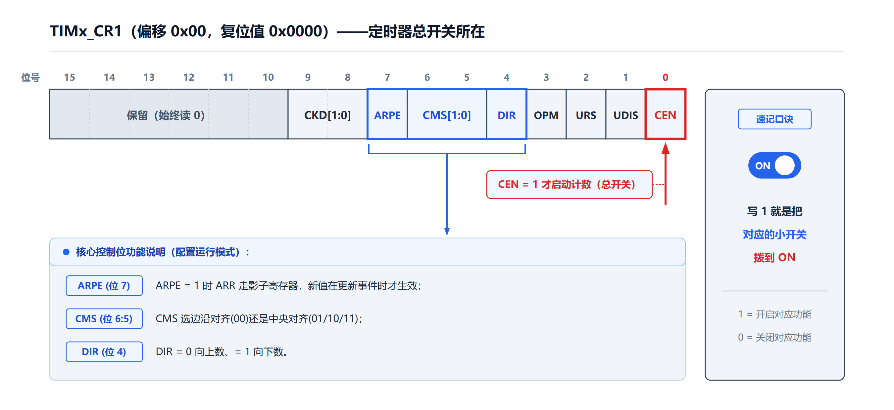

**看图要点：** 最右边那个红框是 **CEN**，它是"总开关"。旁边的 ARPE、CMS、DIR 是三个最常用的配置位。中间一大片"保留"位不用管。

---

### 8.11.4　控制寄存器 2（TIMx_CR2）

**属于谁：** TIMx；**偏移 0x04**；**复位值 0x0000**。

**位图：**

```text
 15 14 13 12 11 10  9  8 |  7  | 6  5  4 |  3  | 2  1  0
+------------------------+-----+---------+-----+--------+
|        保留            |TI1S |MMS[2:0] |CCDS |  保留  |
+------------------------+-----+---------+-----+--------+
```

**位 [15:8]　保留**。

**位 7　TI1S　TI1 选择（TI1 selection）**

- **写 0**：TIMx_CH1 引脚连到 TI1 输入。
- **写 1**：TIMx_CH1、TIMx_CH2 和 TIMx_CH3 引脚**经异或后**连到 TI1 输入。

（这就是 8.10.4 节讲的"输入异或功能"。）

**位 [6:4]　MMS[2:0]　主模式选择（Master mode selection）**

这 3 位选择在主模式下送到从定时器的同步信息（**TRGO**）：

| 值 | 含义 |
|---|---|
| `000` | **复位** —— TIMx_EGR 寄存器的 UG 位被用作触发输出（TRGO） |
| `001` | **使能** —— 计数器使能信号 CNT_EN 被用作 TRGO |
| `010` | **更新** —— 更新事件被选为 TRGO。例如，一个主定时器的时钟可以被用作一个从定时器的预分频器 |
| `011` | **比较脉冲** —— 发生捕获或比较成功、要设置 CC1IF 标志时，TRGO 送出一个正脉冲 |
| `100` | **比较** —— OC1REF 信号被用作 TRGO |
| `101` | **比较** —— OC2REF 信号被用作 TRGO |
| `110` | **比较** —— OC3REF 信号被用作 TRGO |
| `111` | **比较** —— OC4REF 信号被用作 TRGO |

**位 3　CCDS　捕获/比较的 DMA 选择**

- **写 0**：当发生 CCx 事件时，送出 CCx 的 DMA 请求。
- **写 1**：当发生更新事件时，送出 CCx 的 DMA 请求。

**位 [2:0]　保留**。

---

### 8.11.5　从模式控制寄存器（TIMx_SMCR）

**属于谁：** TIMx；**偏移 0x08**；**复位值 0x0000**。

**控制什么：** 定时器"听谁的话"。是听内部时钟（默认），还是听外部引脚、另一个定时器。

**位图：**

```text
 15  | 14 | 13 12   | 11 10  9  8 |  7  | 6  5  4 |  3  | 2  1  0
+----+----+---------+-------------+-----+---------+-----+---------+
|ETP |ECE |ETPS[1:0]|  ETF[3:0]   | MSM | TS[2:0] |保留 | SMS[2:0]|
+----+----+---------+-------------+-----+---------+-----+---------+
```

**位 15　ETP　外部触发极性（External Trigger Polarity）**

- **写 0**：ETR 不反相，**高电平或上升沿有效**。
- **写 1**：ETR 被反相，**低电平或下降沿有效**。

**位 14　ECE　外部时钟使能位（External Clock Enable）**

- **写 0**：禁止外部时钟模式 2。
- **写 1**：使能外部时钟模式 2。计数器由 ETRF 信号上的任意有效边沿驱动。

**位 [13:12]　ETPS[1:0]　外部触发预分频（External trigger prescaler）**

外部触发信号 ETRP 的频率最多是 CK_INT 频率的 1/4。

- `00`：关闭预分频；
- `01`：ETRP 频率除以 2；
- `10`：ETRP 频率除以 4；
- `11`：ETRP 频率除以 8。

**位 [11:8]　ETF[3:0]　外部触发滤波（External trigger filter）**

定义对 ETRP 信号采样的频率和对 ETRP 数字滤波的带宽。数字滤波器是一个事件计数器，记录到 N 个事件后会产生一个输出跳变。

| 值 | 采样频率 | N | 值 | 采样频率 | N |
|---|---|---|---|---|---|
| 0000 | 无滤波器，以 f_DTS 采样 | — | 1000 | f_DTS / 8 | 6 |
| 0001 | f_CK_INT | 2 | 1001 | f_DTS / 8 | 8 |
| 0010 | f_CK_INT | 4 | 1010 | f_DTS / 16 | 5 |
| 0011 | f_CK_INT | 8 | 1011 | f_DTS / 16 | 6 |
| 0100 | f_DTS / 2 | 6 | 1100 | f_DTS / 16 | 8 |
| 0101 | f_DTS / 2 | 8 | 1101 | f_DTS / 32 | 5 |
| 0110 | f_DTS / 4 | 6 | 1110 | f_DTS / 32 | 6 |
| 0111 | f_DTS / 4 | 8 | 1111 | f_DTS / 32 | 8 |

**位 7　MSM　主/从模式（Master/slave mode）**

- **写 0**：无作用；
- **写 1**：触发输入（TRGI）上的事件被延迟了，以允许在当前定时器（通过 TRGO）与它的从定时器间的完美同步。这对要求把几个定时器同步到一个单一的外部事件时是非常有用的。

**位 [6:4]　TS[2:0]　触发选择（Trigger selection）**

| 值 | 触发源 | 值 | 触发源 |
|---|---|---|---|
| `000` | 内部触发 0（ITR0），TIM1 | `100` | TI1 的边沿检测器（TI1F_ED） |
| `001` | 内部触发 1（ITR1），TIM2 | `101` | 滤波后的定时器输入 1（TI1FP1） |
| `010` | 内部触发 2（ITR2），TIM3 | `110` | 滤波后的定时器输入 2（TI2FP2） |
| `011` | 内部触发 3（ITR3），TIM4 | `111` | 外部触发输入（ETRF） |

（注意：ITRx 具体对应哪个定时器，要看表 8-3，因为不同的从定时器对应的主定时器不一样。）

**位 3　保留**。

**位 [2:0]　SMS[2:0]　从模式选择（Slave mode selection）**

| 值 | 模式 | 含义 |
|---|---|---|
| `000` | 关闭从模式 | 如果 CEN=1，则预分频器直接由内部时钟驱动 |
| `001` | 编码器模式 1 | 根据 TI1FP1 的电平，计数器在 TI2FP2 的边沿向上/下计数 |
| `010` | 编码器模式 2 | 根据 TI2FP2 的电平，计数器在 TI1FP1 的边沿向上/下计数 |
| `011` | 编码器模式 3 | 根据另一个信号的输入电平，计数器在 TI1FP1 和 TI2FP2 的边沿向上/下计数 |
| `100` | 复位模式 | 选中的触发输入（TRGI）的上升沿重新初始化计数器，并且产生一个更新寄存器的信号 |
| `101` | 门控模式 | 当触发输入（TRGI）为高时，计数器的时钟开启；一旦触发输入变为低，则计数器停止（但不复位） |
| `110` | 触发模式 | 计数器在触发输入 TRGI 的上升沿启动（但不复位），只有计数器的启动是受控的 |
| `111` | 外部时钟模式 1 | 选中的触发输入（TRGI）的上升沿驱动计数器 |

> 【补充解释】上表里门控模式写的"触发输入为高时时钟开启"，是**不反相（CCxP = 0）**时的说法；如果通道极性位设成反相（CCxP = 1），允许计数的就是**低**电平。详见 8.10.5 节的说明。

**教材的注（原文）：**

> 如果 TI1F_EN 被选为触发输入（TS=100）时，不要使用门控模式。这是因为，TI1F_ED 在每次 TI1F 变化时输出一个脉冲，然而门控模式是要检查触发输入的电平的。

---

### 8.11.6　DMA/中断使能寄存器（TIMx_DIER）

**属于谁：** TIMx；**偏移 0x0C**；**复位值 0x0000**。

**控制什么：** 它是定时器所有中断和 DMA 请求的"**开关面板**"。每一位对应一种事件。**这一位不置 1，事件发生了也只会默默地把标志位置 1，不会打扰 CPU。**

**位图：**

```text
 15  | 14 | 13 | 12   | 11   | 10   | 9    | 8
+----+----+----+------+------+------+------+------+
|保留|TDE |保留|CC4DE |CC3DE |CC2DE |CC1DE | UDE  |
+----+----+----+------+------+------+------+------+

  7  | 6  | 5  | 4    | 3    | 2    | 1    | 0
+----+----+----+------+------+------+------+------+
|保留|TIE |保留|CC4IE |CC3IE |CC2IE |CC1IE | UIE  |
+----+----+----+------+------+------+------+------+
```

**上半行（bit15~8）是 DMA 请求使能位：**

| 位 | 名称 | 含义 | 写 0 | 写 1 |
|---|---|---|---|---|
| 14 | **TDE** | 允许触发 DMA 请求 | 禁止 | 允许 |
| 12 | **CC4DE** | 允许捕获/比较 4 的 DMA 请求 | 禁止 | 允许 |
| 11 | **CC3DE** | 允许捕获/比较 3 的 DMA 请求 | 禁止 | 允许 |
| 10 | **CC2DE** | 允许捕获/比较 2 的 DMA 请求 | 禁止 | 允许 |
| 9 | **CC1DE** | 允许捕获/比较 1 的 DMA 请求 | 禁止 | 允许 |
| 8 | **UDE** | 允许更新的 DMA 请求 | 禁止 | 允许 |

**下半行（bit7~0）是中断使能位：**

| 位 | 名称 | 含义 | 写 0 | 写 1 |
|---|---|---|---|---|
| 6 | **TIE** | 触发中断使能 | 禁止触发中断 | 使能触发中断 |
| 4 | **CC4IE** | 允许捕获/比较 4 中断 | 禁止 | 允许 |
| 3 | **CC3IE** | 允许捕获/比较 3 中断 | 禁止 | 允许 |
| 2 | **CC2IE** | 允许捕获/比较 2 中断 | 禁止 | 允许 |
| 1 | **CC1IE** | 允许捕获/比较 1 中断 | 禁止 | 允许 |
| 0 | **UIE** | 允许更新中断 | 禁止更新中断 | 允许更新中断 |

**程序怎么操作：**

```c
TIM_ITConfig(TIM2, TIM_IT_Update, ENABLE);   // 把 UIE（bit0）置 1
```

**操作后硬件发生什么：** 以后每次计数器溢出产生 UIF 时，定时器会**同时**向 NVIC 发一个中断请求，CPU 就会跳进 `TIM2_IRQHandler`。

> 【补充解释】如果不写这一句，UIF 照样会被硬件置 1，但 NVIC 收不到请求，中断服务函数永远不会执行。**这是初学者第二个常踩的坑。**

---

### 8.11.7　状态寄存器（TIMx_SR）

**属于谁：** TIMx；**偏移 0x10**；**复位值 0x0000**。

**控制什么：** 它是"**事件公告栏**"。硬件把发生的各种事件写在这里（置 1），程序读它、清它。

**位图：**

```text
 15 14 13 | 12    11    10    9  | 8  7 | 6  | 5 | 4     3     2     1  | 0
+---------+----------------------+------+----+---+----------------------+---+
|  保留   |CC4OF CC3OF CC2OF CC1OF| 保留 |TIF |保留|CC4IF CC3IF CC2IF CC1IF|UIF|
+---------+----------------------+------+----+---+----------------------+---+
   读/写: rc_w0（写 0 清除，写 1 无效果）
```

**重点讲三个位：**

**位 0　UIF　更新中断标记（Update interrupt flag）**

- **硬件写 1 的时机**：产生更新事件时。
- **谁清除**：软件写 0。
- **写 0 的含义**：清除标志（"我看过了，别再报了"）。
- **写 1 的含义**：**没有作用**（rc_w0 类型）。

> 0：无更新事件产生；
> 1：更新中断等待响应。

**程序怎么操作：**

```c
TIM_ClearITPendingBit(TIM2, TIM_IT_Update);   // 清掉 UIF
```

**操作后硬件发生什么：** UIF 变 0。如果不清，中断会**一直反复触发**，主程序几乎跑不动。

**位 1~4　CC1IF ~ CC4IF　捕获/比较中断标记**

> 如果通道 CC1 配置为**输出**模式：当计数器值与比较值匹配时该位由硬件置 1（中心对称模式下除外，参考 CMS 位）。它由软件清 0。
> - 0：无匹配发生；
> - 1：TIMx_CNT 的值与 TIMx_CCR1 的值匹配。
>
> 如果通道 CC1 配置为**输入**模式：当捕获事件发生时该位由硬件置 1，它由软件清零**或通过读 TIMx_CCR1 清零**。
> - 0：无输入捕获产生；
> - 1：计数器值已被捕获（复制）至 TIMx_CCR1。

**注意那个"或通过读 TIMx_CCR1 清零"**——这是一个很方便的特性：**你只要把数据读走，标志就自动清了。**

**位 6　TIF　触发器中断标记（Trigger interrupt flag）**

> 当发生触发事件（当从模式控制器处于除门控模式外的其他模式时，在 TRGI 输入端检测到有效边沿，或门控模式下的任一边沿）时由硬件对该位置 1。它由软件清 0。

**位 9~12　CC1OF ~ CC4OF　重复捕获标记（overcapture flag）**

> 仅当相应的通道被配置为输入捕获时，该标记可由硬件置 1。写 0 可清除该位。
> - 0：无重复捕获产生；
> - 1：当计数器的值被捕获到 TIMx_CCR1 寄存器时，CC1IF 的状态已经为 1。

**大白话（复习 8.7.2 节的类比）：** 上一张照片还没取走，又拍了一张，把旧的挤掉了。这是"丢数据"的警告。

---

### 8.11.8　事件产生寄存器（TIMx_EGR）

**属于谁：** TIMx；**偏移 0x14**；**复位值 0x0000**。

**控制什么：** 这是"**软件手动制造事件**"的按钮面板。写 1 就产生对应事件，硬件自动把这一位清回 0。**这是一个"只写"（w）寄存器。**

**位图：**

```text
 15 14 13 12 11 10  9  8  7 | 6  | 5 | 4   3   2   1  | 0
+---------------------------+----+---+-----------------+----+
|          保留             | TG |保留|CC4G CC3G CC2G CC1G| UG |
+---------------------------+----+---+-----------------+----+
                          读/写: w（只写）
```

**位 0　UG　产生更新事件（Update Generation）**

- **写 0**：无动作。
- **写 1**：重新初始化计数器，并产生一个更新事件。

**教材的注（原文）：**

> 注意预分频器的计数器也被清零（但是预分频系数不变）。若在中心对称模式下或 DIR=0（向上计数），则计数器被清零；若 DIR=1（向下计数），则计数器取 TIMx_ARR 的值。

**这是最常用的一个位。** 三个典型用途：

```text
用途 1：初始化
       配好 PSC/ARR 后，先给 UG 写 1，
       让这些值立刻装进影子寄存器，避免第一轮时间不对。

用途 2：手动重置计时
       想让定时器"从现在开始重新数"，写 UG = 1 即可。

用途 3：PWM 启动前初始化
       教材原文："在计数器开始计数之前，必须通过设置 TIMx_EGR 寄存器中的 UG 位
                 来初始化所有的寄存器。"
```

**程序怎么操作：**

```c
TIM_GenerateEvent(TIM2, TIM_EventSource_Update);   // 相当于给 UG 写 1
```

**操作后硬件发生什么：** CNT 被清零（向上计数时），预分频器计数器清零，同时产生一次更新事件，UIF 被置 1（除非 URS = 1）。

**位 1~4　CC1G ~ CC4G　产生捕获/比较事件**

> 该位由软件置 1，用于产生一个捕获/比较事件，由硬件自动清零。
> - 0：无动作；
> - 1：在通道 CC1 上产生一个捕获/比较事件：
>   - 若通道 CC1 配置为**输出**：设置 CC1IF = 1，若开启对应的中断和 DMA，则产生相应的中断和 DMA。
>   - 若通道 CC1 配置为**输入**：当前的计数器值捕获至 TIMx_CCR1 寄存器；设置 CC1IF = 1……若 CC1IF 已经为 1，则设置 CC1OF = 1。

**位 6　TG　产生触发事件**

> 该位由软件置 1，用于产生一个触发事件，由硬件自动清零。
> - 0：无动作；
> - 1：TIMx_SR 寄存器的 TIF = 1，若开启对应的中断和 DMA，则产生相应的中断和 DMA。

---

### 8.11.9　捕获/比较模式寄存器 1（TIMx_CCMR1）

**属于谁：** TIMx；**偏移 0x18**；**复位值 0x0000**。

**控制什么：** 通道 1 和通道 2 的**工作方式**。这是最"烧脑"的一个寄存器，因为**同一个位在输入模式和输出模式下含义不同**。

**教材原文的提醒：**

> 通道可用于输入（捕获模式）或输出（比较模式），通道的方向由相应的 CCxS 定义。该寄存器其他位的作用在输入和输出模式下不同。OCxx 描述了通道在输出模式下的功能，ICxx 描述了通道在输入模式下的功能。因此必须注意，同一个位在输出模式和输入模式下的功能是不同的。

**位图（16 位，低 8 位管通道 1，高 8 位管通道 2）：**

```text
【输出模式下的含义】
 15  | 14 13 12  | 11   | 10   | 9  8
+----+----------+------+------+-------+
|OC2CE|OC2M[2:0]|OC2PE |OC2FE |CC2S[1:0]|
+----+----------+------+------+-------+
 7   | 6  5  4   | 3    | 2    | 1  0
+----+----------+------+------+-------+
|OC1CE|OC1M[2:0]|OC1PE |OC1FE |CC1S[1:0]|
+----+----------+------+------+-------+

【输入模式下的含义（同一位，含义不同）】

  15 14 13 12         11 10          9  8
 +---------------+----------------+---------+
 |   IC2F[3:0]   |  IC2PSC[1:0]   |CC2S[1:0]|
 +---------------+----------------+---------+
   （bit15~12）      （bit11~10）      （bit9~8）

   7  6  5  4          3  2           1  0
 +---------------+----------------+---------+
 |   IC1F[3:0]   |  IC1PSC[1:0]   |CC1S[1:0]|
 +---------------+----------------+---------+
   （bit7~4）        （bit3~2）        （bit1~0）
```

**先讲通道 1（bit7~0），通道 2 完全对称。**

#### （1）输出比较模式下的位

**位 7　OC1CE　输出比较 1 清零使能（Output compare 1 clear enable）**

- **写 0**：OC1REF 不受 ETRF 输入的影响；
- **写 1**：一旦检测到 ETRF 输入高电平，清除 OC1REF = 0。

**位 [6:4]　OC1M[2:0]　输出比较 1 模式**

这 3 位定义了输出参考信号 OC1REF 的动作，而 OC1REF 决定了 OC1 的值。**OC1REF 是高电平有效**，而 OC1 的有效电平取决于 CC1P 位。

| 值 | 名称 | 含义 |
|---|---|---|
| `000` | 冻结 | 输出比较寄存器 TIMx_CCR1 与计数器 TIMx_CNT 间的比较对 OC1REF 不起作用 |
| `001` | 匹配时置有效 | 当 TIMx_CNT 与 TIMx_CCR1 相同时，强制 OC1REF 为**高** |
| `010` | 匹配时置无效 | 当 TIMx_CNT 与 TIMx_CCR1 相同时，强制 OC1REF 为**低** |
| `011` | 翻转 | 当 TIMx_CCR1 = TIMx_CNT 时，翻转 OC1REF 的电平 |
| `100` | 强制无效 | 强制 OC1REF 为**低** |
| `101` | 强制有效 | 强制 OC1REF 为**高** |
| `110` | **PWM 模式 1** | 向上计数时，一旦 TIMx_CNT < TIMx_CCR1 则通道 1 为**有效**电平，否则为无效电平；向下计数时，一旦 TIMx_CNT > TIMx_CCR1 则通道 1 为无效电平（OC1REF = 0），否则为有效电平（OC1REF = 1） |
| `111` | **PWM 模式 2** | 向上计数时，一旦 TIMx_CNT < TIMx_CCR1 则通道 1 为**无效**电平，否则为有效电平；向下计数时，一旦 TIMx_CNT > TIMx_CCR1 则通道 1 为有效电平，否则为无效电平 |

**注意教材的两条注：**

> 注 1：一旦 LOCK 级别设为 3（TIMx_BDTR 寄存器中的 LOCK 位）并且 CC1S = 00（该通道配置成输出）则该位不能被修改。
> 注 2：在 PWM 模式 1 或 PWM 模式 2 中，只有当比较结果改变了或在输出比较模式中从冻结模式切换到 PWM 模式时，OC1REF 电平才改变。

**位 3　OC1PE　输出比较 1 预装载使能（Output compare 1 preload enable）**

- **写 0**：禁止 TIMx_CCR1 寄存器的预装载功能，**可随时写入 TIMx_CCR1 寄存器，并且新写入的数值立即起作用**。
- **写 1**：开启 TIMx_CCR1 寄存器的预装载功能，读写操作仅对预装载寄存器操作，TIMx_CCR1 的预装载值**在更新事件到来时**被传送至当前寄存器中。

**教材的注：**

> 注 2：仅在单脉冲模式下（TIMx_CR1 寄存器的 OPM = 1），可以在未确认预装载寄存器情况下使用 PWM 模式，否则其动作不确定。

**大白话：** 做 PWM 时**必须 OC1PE = 1**，否则改占空比会让波形抖动。

**位 2　OC1FE　输出比较 1 快速使能（Output compare 1 fast enable）**

用于加快 CC 输出对触发器输入事件的响应。

- **写 0**：根据计数器与 CCR1 的值，CC1 正常操作。当触发器的输入出现一个有效沿时，激活 CC1 输出的最小延时为 **5 个时钟周期**。
- **写 1**：输入到触发器的有效沿的作用就像发生了一次比较匹配。因此，OC 被设置为比较电平而与比较结果无关。采样触发器的有效沿和 CC1 输出间的延时被缩短为 **3 个时钟周期**。

> 该位只在通道被配置成 PWM1 或 PWM2 模式时起作用。

**位 [1:0]　CC1S[1:0]　捕获/比较 1 选择（Capture/Compare 1 selection）**

这 2 位定义通道的方向（输入/输出）及输入脚的选择：

| 值 | 含义 |
|---|---|
| `00` | CC1 通道被配置为**输出** |
| `01` | CC1 通道被配置为**输入**，IC1 映射在 **TI1** 上 |
| `10` | CC1 通道被配置为**输入**，IC1 映射在 **TI2** 上 |
| `11` | CC1 通道被配置为**输入**，IC1 映射在 **TRC** 上（仅当内部触发器输入被选中时） |

> 【补充解释】**TRC** = 内部触发输入信号（Trigger Input Connection，触发输入连接）。它不是芯片外面的引脚，而是"另一个定时器经 ITRx 送进来、又被选中的那个触发信号"（8.10.6 节的主从同步会用到它）。所以 CC1S = 11 的含义是：这个通道不去测引脚，改为测**芯片内部的触发信号**。

**教材的注：**

> 仅在通道关闭时（即 TIMx_CCER 寄存器的 CC1E = 0）CC1S 才是可写的。

**大白话：** 想改通道方向，**先把 CC1E 关掉**。

#### （2）输入捕获模式下的位（同一批位置，含义不同）

**位 [7:4]　IC1F[3:0]　输入捕获 1 滤波器（Input capture 1 filter）**

这几位定义了 TI1 输入的采样频率及数字滤波器长度。数字滤波器由一个事件计数器组成，它记录到 N 个事件后会产生一个输出的跳变：

| 值 | 采样频率 | N | 值 | 采样频率 | N |
|---|---|---|---|---|---|
| 0000 | 无滤波器，以 f_DTS 采样 | — | 1000 | f_DTS / 8 | 6 |
| 0001 | f_CK_INT | 2 | 1001 | f_DTS / 8 | 8 |
| 0010 | f_CK_INT | 4 | 1010 | f_DTS / 16 | 5 |
| 0011 | f_CK_INT | 8 | 1011 | f_DTS / 16 | 6 |
| 0100 | f_DTS / 2 | 6 | 1100 | f_DTS / 16 | 8 |
| 0101 | f_DTS / 2 | 8 | 1101 | f_DTS / 32 | 5 |
| 0110 | f_DTS / 4 | 6 | 1110 | f_DTS / 32 | 6 |
| 0111 | f_DTS / 4 | 8 | 1111 | f_DTS / 32 | 8 |

> 当 ICxF[3:0] = 1、2 或 3 时，公式中的 f_DTS 由 CK_INT 替代。

**怎么选？** 教材 8.3 节给了一个判断方法：

> 假设输入信号在最多 5 个内部时钟周期的时间内抖动，那么必须配置滤波器的带宽长于 5 个时钟周期。因此，可以（以 f_DTS 频率）连续采样 8 次……即在 TIMx_CCMR1 寄存器中写入 IC1F = 0011。

**大白话：信号抖得越厉害，采样次数就要选得越多。**

**位 [3:2]　IC1PSC[1:0]　输入/捕获 1 预分频器（Input capture 1 prescaler）**

定义 CC1 输入（IC1）的预分频系数。一旦 CC1E = 0（TIMx_CCER 寄存器中），则预分频器复位。

- `00`：无预分频器，捕获输入口上检测到的**每一个边沿**都触发一次捕获；
- `01`：每 **2** 个事件触发一次捕获；
- `10`：每 **4** 个事件触发一次捕获；
- `11`：每 **8** 个事件触发一次捕获。

**大白话：** 信号太快，捕获不过来，就"每 N 个边沿才记一次"。

---

### 8.11.10　捕获/比较模式寄存器 2（TIMx_CCMR2）

**属于谁：** TIMx；**偏移 0x1C**；**复位值 0x0000**。

**教材原文：**

> 寄存器的定义与 TIMx_CCMR1 完全对称，请参考 TIMx_CCMR1 的描述或产品参考手册。

**位图：**

```text
【输出模式】
 15  | 14 13 12  | 11   | 10   | 9  8
+----+----------+------+------+-------+
|OC4CE|OC4M[2:0]|OC4PE |OC4FE |CC4S[1:0]|
+----+----------+------+------+-------+
 7   | 6  5  4   | 3    | 2    | 1  0
+----+----------+------+------+-------+
|OC3CE|OC3M[2:0]|OC3PE |OC3FE |CC3S[1:0]|
+----+----------+------+------+-------+

【输入模式】
  15 14 13 12         11 10          9  8
 +---------------+----------------+---------+
 |   IC4F[3:0]   |  IC4PSC[1:0]   |CC4S[1:0]|
 +---------------+----------------+---------+
   （bit15~12）      （bit11~10）      （bit9~8）

   7  6  5  4          3  2           1  0
 +---------------+----------------+---------+
 |   IC3F[3:0]   |  IC3PSC[1:0]   |CC3S[1:0]|
 +---------------+----------------+---------+
   （bit7~4）        （bit3~2）        （bit1~0）
```

**记忆方法：CCMR1 管通道 1、2；CCMR2 管通道 3、4。位排列方式完全一样，只是编号从 1/2 变成 3/4。**

---

### 8.11.11　捕获/比较使能寄存器（TIMx_CCER）

**属于谁：** TIMx；**偏移 0x20**；**复位值 0x0000**。

**控制什么：** 每个通道的**输出开关**（CCxE）和**极性**（CCxP）。**这是"最后一道闸门"——不开 CCxE，前面配得再对，引脚上也没有信号。**

**位图：**

```text
 15 14 | 13  | 12 | 11 10 | 9   | 8  | 7  6 | 5   | 4  | 3  2 | 1   | 0
+-------+-----+----+-------+-----+----+------+-----+----+------+-----+----+
| 保留  |CC4P |CC4E| 保留  |CC3P |CC3E| 保留 |CC2P |CC2E| 保留 |CC1P |CC1E|
+-------+-----+----+-------+-----+----+------+-----+----+------+-----+----+
```

**位 1　CC1P　输入/捕获 1 输出极性（Capture/Compare 1 output polarity）**

**当 CC1 通道配置为输出：**

- **写 0**：OC1 **高电平有效**；
- **写 1**：OC1 **低电平有效**。

**当 CC1 通道配置为输入：** 该位选择是 IC1 还是 IC1 的反相信号作为触发或捕获信号。

- **写 0**：不反相：捕获发生在 IC1 的**上升沿**；当用作外部触发器时，IC1 不反相。
- **写 1**：反相：捕获发生在 IC1 的**下降沿**；当用作外部触发器时，IC1 反相。

**注意：同一个位，输出时管"极性"，输入时管"边沿"。**

**位 0　CC1E　输入/捕获 1 输出使能（Capture/Compare 1 output enable）**

**教材表 8-4 标准 OCx 通道的输出控制位：**

| CCxE 位 | OCx 输出状态 |
|---|---|
| 0 | 禁止输出（OCx = 0，OCx_EN = 0） |
| 1 | OCx = OCxREF + 极性，OCx_EN = 1 |

**教材的注（原文）：**

> 连接到标准 OCx 通道的外部 I/O 引脚状态，取决于 OCx 通道状态和 GPIO 以及 AFIO 寄存器。

> 【补充解释】这里第一次出现的 **AFIO** = Alternate Function I/O = 复用功能输入输出（也叫"引脚重映射控制器"）。大白话：STM32 的一个引脚往往"身兼数职"，AFIO 负责决定某个内部信号（比如定时器的 OCx）到底从哪个引脚出去。本节的通道用的是引脚的**默认复用功能**，一般不用改 AFIO；只有做"引脚重映射"时才需要配置它（第 3 章讲过 AFIO 的时钟开关）。

**大白话：** 引脚要真正输出波形，需要**三重开关都打开**：

```text
第一重：GPIO 配成"复用推挽输出"（AF_PP）     ← 第 6 章的知识
第二重：CCxE = 1（CCER 寄存器）               ← 本寄存器
第三重：OCxM 设成某种输出模式（CCMRx 寄存器）  ← 8.11.9 节
```

**任何一个没开，引脚上都没有波形。这是 PWM 调试不出来的最常见原因。**

---

### 8.11.12　计数器（TIMx_CNT）

**属于谁：** TIMx；**偏移 0x24**；**复位值 0x0000**。

**位图：**

```text
 15 14 13 12 11 10  9  8  7  6  5  4  3  2  1  0
+-----------------------------------------------+
|                  CNT[15:0]                    |
+-----------------------------------------------+
                  读/写: rw
```

**位 [15:0]　CNT[15:0]　计数器的值（Counter value）**

**它控制什么：** 这是"数到几了"的小本子。

- **程序读它**：能知道定时器当前数到哪了。
- **程序写它**：能强行把计数改成某个值（**不推荐在运行时改**，见中央对齐的注意事项）。

**取值变化：**

```text
向上计数：0 → 1 → 2 → … → ARR → 0 → 1 → …
向下计数：ARR → ARR-1 → … → 1 → 0 → ARR → …
```

**程序怎么操作：**

```c
u16 current = TIM_GetCounter(TIM2);      // 读当前值
TIM_SetCounter(TIM2, 0);                 // 写 0，重新开始数
```

---

### 8.11.13　预分频器（TIMx_PSC）

**属于谁：** TIMx；**偏移 0x28**；**复位值 0x0000**。

**位图：**

```text
 15 14 13 12 11 10  9  8  7  6  5  4  3  2  1  0
+-----------------------------------------------+
|                  PSC[15:0]                    |
+-----------------------------------------------+
                  读/写: rw
```

**位 [15:0]　PSC[15:0]　预分频器的值（Prescaler value）**

**教材原文：**

> 计数器的时钟频率 CK_CNT 等于 f_CK_PSC / (PSC[15:0] + 1)。PSC 包含了当更新事件产生时装入当前预分频器寄存器的值。

**再强调一次那个 +1：**

```text
PSC = 0      → CK_CNT = CK_PSC / 1      → 不分频
PSC = 1      → CK_CNT = CK_PSC / 2      → 二分频
PSC = 71     → CK_CNT = CK_PSC / 72     → 72 分频
PSC = 7199   → CK_CNT = CK_PSC / 7200
PSC = 65535  → CK_CNT = CK_PSC / 65536  → 最大分频
```

**程序怎么操作：**

```c
TIM_PrescalerConfig(TIM2, 7199, TIM_PSCReloadMode_Update);   // 设 PSC = 7199
```

**操作后硬件发生什么：** 分频器开始按新系数分频，**但要等到下一次更新事件**（因为 PSC 也有影子寄存器）。

---

### 8.11.14　自动重装载寄存器（TIMx_ARR）

**属于谁：** TIMx；**偏移 0x2C**；**复位值 0x0000**。

**位图：**

```text
 15 14 13 12 11 10  9  8  7  6  5  4  3  2  1  0
+-----------------------------------------------+
|                  ARR[15:0]                    |
+-----------------------------------------------+
                  读/写: rw
```

**位 [15:0]　ARR[15:0]　自动重装载的值（Auto reload value）**

**教材原文：**

> ARR 包含了将要传送至实际的自动重装载寄存器的数值。当自动重装载的值为空时，计数器不工作。

**"当自动重装载的值为空时，计数器不工作"是什么意思？**

【补充解释】这里说的"空"指 ARR 为 0 的极端情况。ARR = 0 时，CNT 从 0 数到 0，一个脉冲就溢出一轮，实际上相当于"每个 CK_CNT 溢出一次"。教材这句话的措辞来自参考手册译文，实际含义是"ARR 必须被正确配置，否则计数行为不正常"。

**它控制什么：** **定时周期**。

```text
ARR 越大 → 一轮数得越久 → 定时时间越长 → PWM 频率越低
ARR 越小 → 一轮数得越快 → 定时时间越短 → PWM 频率越高
```

**程序怎么操作：**

```c
TIM_TimeBaseStructure.TIM_Period = 9999;    // 相当于 ARR = 9999
TIM_SetAutoreload(TIM2, 9999);              // 运行时改 ARR
```

**操作后硬件发生什么（取决于 ARPE）：**

- ARPE = 0：立即生效，当前这一轮的时间可能变得"不完整"。
- ARPE = 1：先存进预装载寄存器，下一次更新事件才生效，当前这一轮照旧。

---

### 8.11.15　捕获/比较寄存器 1~4（TIMx_CCR1 ~ TIMx_CCR4）

**属于谁：** TIMx；**偏移分别是 0x34、0x38、0x3C、0x40**；**复位值都是 0x0000**。

**位图（四个寄存器完全一样，只是编号不同）：**

```text
 15 14 13 12 11 10  9  8  7  6  5  4  3  2  1  0
+-----------------------------------------------+
|                 CCR1[15:0]                    |    ← CCR1
+-----------------------------------------------+
                  读/写: rw
```

**它控制什么：** **一个寄存器，两种身份。**

#### 身份一：通道配置为输出时（比较值）

**教材原文（CCR1）：**

> 若 CC1 通道配置为输出：CCR1 包含了装入当前捕获/比较 1 寄存器的值（预装载值）。如果在 TIMx_CCMR1 寄存器（OC1PE 位）中未选择预装载特性，写入的数值会被立即传输至当前寄存器中。否则只有当更新事件发生时，此预装载值才传输至当前捕获/比较 1 寄存器中。当前捕获/比较寄存器参与同计数器 TIMx_CNT 的比较，并在 OC1 端口上产生输出信号。

**大白话：** 这是"门槛值"。CNT 数到这个值，引脚就做动作（PWM 里就是"变低"）。

```text
CCR1 = 4，ARR = 8：
    占空比 = 4 / 9 ≈ 44.4%

CCR1 改大 → 高电平时间变长 → 占空比变大 → LED 更亮
CCR1 改小 → 高电平时间变短 → 占空比变小 → LED 更暗
```

#### 身份二：通道配置为输入时（捕获值）

**教材原文（CCR1）：**

> 若 CC1 通道配置为输入：CCR1 包含了由上一次输入捕获 1 事件（IC1）传输的计数器值。

**大白话：** 这是"拍下来的照片"。**这个寄存器在输入模式下是只读的**（教材 8.3 节原文："只要 CC1S 不为 00，通道被配置为输入，并且 TIMx_CCR1 寄存器变为只读"）。

**程序怎么操作：**

```c
TIM_SetCompare1(TIM2, 500);              // 输出模式：设比较值（改占空比）
u16 captured = TIM_GetCapture1(TIM2);    // 输入模式：读捕获到的值
```

> 【补充解释】CCR2/CCR3/CCR4 的偏移依次 +4：0x38、0x3C、0x40。它们和 CCR1 的定义完全对称，只需把所有的"1"换成"2/3/4"。教材 8.4 节第 14~16 条逐条列出了它们，内容与 CCR1 相同。

**操作后硬件发生什么：**

- 输出模式：比较器用新值和 CNT 比较，波形占空比改变（有预装载时要等下一次更新事件）。
- 输入模式：读操作会把 CCxIF 标志**自动清 0**。

---

### 8.11.16　DMA 控制寄存器（TIMx_DCR）

**属于谁：** TIMx；**偏移 0x48**；**复位值 0x0000**。**这个寄存器只在用 DMA 批量读写定时器寄存器时才需要，初学可以先跳过。**

**位图：**

```text
 15 14 13 | 12 11 10  9  8 | 7  6  5 | 4  3  2  1  0
+---------+----------------+---------+----------------+
|  保留   |    DBL[4:0]    |  保留   |    DBA[4:0]    |
+---------+----------------+---------+----------------+
```

**位 [12:8]　DBL[4:0]　DMA 连续传送长度（DMA burst length）**

定义了 DMA 在连续模式下的传送长度（当对 TIMx_DMAR 寄存器进行读或写时，定时器则进行一次连续传送），即定义传输的字节数目：

```text
00000: 1 字节     00001: 2 字节     00010: 3 字节     …     10001: 18 字节
```

**位 [4:0]　DBA[4:0]　DMA 基地址（DMA base address）**

定义了 DMA 在连续模式下的基地址。DBA 定义为从 TIMx_CR1 寄存器所在地址开始的偏移量。

```text
00000: TIMx_CR1      00001: TIMx_CR2      00010: TIMx_SMCR
```

### 8.11.17　连续模式的 DMA 地址（TIMx_DMAR）

**属于谁：** TIMx；**偏移 0x4C**；**复位值 0x0000**。

**位图：**

```text
 15 14 13 12 11 10  9  8  7  6  5  4  3  2  1  0
+-----------------------------------------------+
|                 DMAB[15:0]                    |
+-----------------------------------------------+
```

**教材原文：**

> 对 TIMx_DMAR 寄存器的读或写会导致对以下地址所在寄存器的存取操作：
>
> TIMx_CR1 地址 + DBA + DMA 索引
>
> 其中："TIMx_CR1 地址"是控制寄存器 1（TIMx_CR1）所在的地址；"DBA"是 TIMx_DCR 寄存器中定义的基地址；"DMA 索引"是由 DMA 自动控制的偏移量，它取决于 TIMx_DCR 寄存器中定义的 DBL。

**大白话：** 这是一个"**传送门**"。你读写 DMAR，实际访问的是**定时器内部的其他寄存器**，具体是哪个由 DBA 和 DBL 算出来。这样 DMA 只要认准一个地址，就能连续搬运多个寄存器。

### 8.11.18　寄存器速查表

| 偏移 | 名称 | 一句话作用 | 本章要重点掌握 |
|---|---|---|---|
| 0x00 | TIMx_CR1 | 总控：使能、方向、对齐、ARR 缓冲 | ★★★ |
| 0x04 | TIMx_CR2 | TI1 异或、主模式输出选择、CCDMA 选择 | ★ |
| 0x08 | TIMx_SMCR | 从模式：外部时钟、复位/门控/触发、编码器 | ★★ |
| 0x0C | TIMx_DIER | 中断/DMA 使能开关面板 | ★★★ |
| 0x10 | TIMx_SR | 事件标志（UIF、CCxIF、CCxOF、TIF） | ★★★ |
| 0x14 | TIMx_EGR | 软件产生事件（UG 最常用） | ★★★ |
| 0x18 | TIMx_CCMR1 | 通道 1、2 的输入/输出模式 | ★★★ |
| 0x1C | TIMx_CCMR2 | 通道 3、4 的输入/输出模式 | ★★ |
| 0x20 | TIMx_CCER | 通道使能（CCxE）和极性（CCxP） | ★★★ |
| 0x24 | TIMx_CNT | 当前计数值 | ★★★ |
| 0x28 | TIMx_PSC | 预分频值（决定 CK_CNT） | ★★★ |
| 0x2C | TIMx_ARR | 自动重装值（决定周期） | ★★★ |
| 0x34 | TIMx_CCR1 | 通道 1 比较值/捕获值 | ★★★ |
| 0x38 | TIMx_CCR2 | 通道 2 比较值/捕获值 | ★★ |
| 0x3C | TIMx_CCR3 | 通道 3 比较值/捕获值 | ★★ |
| 0x40 | TIMx_CCR4 | 通道 4 比较值/捕获值 | ★★ |
| 0x48 | TIMx_DCR | DMA 连续传送配置 | 了解 |
| 0x4C | TIMx_DMAR | DMA 连续传送"传送门" | 了解 |

---

## 8.12　普通定时器的固件库函数

### 8.12.1　数据结构：TIM_TypeDef

#### 【教材内容】

> TIM 寄存器结构 TIM_TypeDef 在文件 stm32f10x.h 中定义如下：
>
> ```c
> typedef struct
> {
>     vu16 CR1;      //控制寄存器 1
>     u16  RESERVED0;
>     vu16 CR2;      //控制寄存器 2
>     u16  RESERVED1;
>     vu16 SMCR;     //从模式控制寄存器
>     u16  RESERVED2;
>     vu16 DIER;     //DMA/中断使能寄存器
>     u16  RESERVED3;
>     vu16 SR;       //状态寄存器
>     u16  RESERVED4;
>     vu16 EGR;      //事件产生寄存器
>     u16  RESERVED5;
>     vu16 CCMR1;    //捕获/比较模式寄存器 1
>     u16  RESERVED6;
>     vu16 CCMR2;    //捕获/比较模式寄存器 2
>     u16  RESERVED7;
>     vu16 CCER;     //捕获/比较使能寄存器
>     u16  RESERVED8;
>     vu16 CNT;      //计数器寄存器
>     u16  RESERVED9;
>     vu16 PSC;      //预分频寄存器
>     u16  RESERVED10;
>     vu16 ARR;      //自动重装载寄存器
>     u16  RESERVED11[3];
>     vu16 CCR1;     //捕获/比较寄存器 1
>     u16  RESERVED12;
>     vu16 CCR2;     //捕获/比较寄存器 2
>     u16  RESERVED13;
>     vu16 CCR3;     //捕获/比较寄存器 3
>     u16  RESERVED14;
>     vu16 CCR4;     //捕获/比较寄存器 4
>     u16  RESERVED15[3];
>     vu16 DCR;      //DMA 控制寄存器
>     u16  RESERVED16;
>     vu16 DMAR;     //连续模式的 DMA 地址寄存器
>     u16  RESERVED17;
> } TIM_TypeDef;
> ```
>
> 结构中包含了 TIM 所有寄存器。
>
> ——教材 8.5.1 节（原书 p48~p49）

**这个结构体怎么读？**

1. **`vu16`** = volatile unsigned 16-bit = "一个 16 位的、可能被硬件改动的变量"。
   - 【补充解释】**volatile** 是告诉编译器："这个变量的值可能在程序不知道的时候被硬件改掉，不要做优化，每次都老老实实去内存里读。" 定时器的 CNT、SR 就是典型的 volatile 变量——你不读它，硬件也会改它。
2. **`u16 RESERVED0;`** 是"占位"用的。为什么需要占位？因为**每个寄存器占 4 字节的地址空间**（即使实际只有 16 位），所以两个 16 位寄存器之间要隔一个 16 位的空位。

**验证一下偏移（把结构体的顺序和教材 8.4 节给的偏移对一遍）：**

```text
结构体成员        偏移    对不对
----------------------------------------
CR1              0x00    ✓ 教材：CR1 偏移 0x00
RESERVED0        0x02
CR2              0x04    ✓ 教材：CR2 偏移 0x04
RESERVED1        0x06
SMCR             0x08    ✓ 教材：SMCR 偏移 0x08
RESERVED2        0x0A
DIER             0x0C    ✓ 教材：DIER 偏移 0x0C
RESERVED3        0x0E
SR               0x10    ✓ 教材：SR 偏移 0x10
RESERVED4        0x12
EGR              0x14    ✓ 教材：EGR 偏移 0x14
RESERVED5        0x16
CCMR1            0x18    ✓ 教材：CCMR1 偏移 0x18
RESERVED6        0x1A
CCMR2            0x1C    ✓ 教材：CCMR2 偏移 0x1C
RESERVED7        0x1E
CCER             0x20    ✓ 教材：CCER 偏移 0x20
RESERVED8        0x22
CNT              0x24    ✓ 教材：CNT 偏移 0x24
RESERVED9        0x26
PSC              0x28    ✓ 教材：PSC 偏移 0x28
RESERVED10       0x2A
ARR              0x2C    ✓ 教材：ARR 偏移 0x2C
RESERVED11[3]    0x2E / 0x30 / 0x32   ← 一次跳过 3 个 16 位（6 字节）
CCR1             0x34    ✓ 教材：CCR1 偏移 0x34
RESERVED12       0x36
CCR2             0x38    ✓ 教材：CCR2 偏移 0x38
RESERVED13       0x3A
CCR3             0x3C    ✓ 教材：CCR3 偏移 0x3C
RESERVED14       0x3E
CCR4             0x40    ✓ 教材：CCR4 偏移 0x40
RESERVED15[3]    0x42 / 0x44 / 0x46
DCR              0x48    ✓ 教材：DCR 偏移 0x48
RESERVED16       0x4A
DMAR             0x4C    ✓ 教材：DMAR 偏移 0x4C
RESERVED17       0x4E
```

**`vu16` 是 16 位，只占 2 字节，为什么每个寄存器之间要空 2 字节？** 因为中间那个 `u16 RESERVEDn;` 又占了 2 字节。2 + 2 = 4，所以**每个寄存器正好占 4 字节的地址空间**（虽然实际只用到低 16 位）。

**C 结构体的成员顺序，和教材给出的偏移表完全对得上——这不是巧合，`TIM_TypeDef` 就是照着硬件寄存器布局一个一个写出来的。** 以后你看到任何外设的 `XXX_TypeDef`，都可以用这个办法自己把偏移表推出来。

### 8.12.2　外设声明

#### 【教材内容】

```c
#define PERIPH_BASE        ((u32)0x40000000)
#define APB1PERIPH_BASE    PERIPH_BASE
#define APB2PERIPH_BASE    (PERIPH_BASE + 0x10000)
#define AHBPERIPH_BASE     (PERIPH_BASE + 0x20000)
#define TIM2_BASE          (APB1PERIPH_BASE + 0x0000)
#define TIM3_BASE          (APB1PERIPH_BASE + 0x0400)
#define TIM4_BASE          (APB1PERIPH_BASE + 0x0800)
#define TIM2               ((TIM_TypeDef *) TIM2_BASE)
#define TIM3               ((TIM_TypeDef *) TIM3_BASE)
#define TIM4               ((TIM_TypeDef *) TIM4_BASE)
```

**逐行解释：**

```c
#define TIM2  ((TIM_TypeDef *) TIM2_BASE)
```

这句话的意思是：

> 把 `TIM2` 这个符号，定义成"**指向地址 0x40000000 的一个 TIM_TypeDef 结构体的指针**"。

所以当你写：

```c
TIM2->CR1 = 0x0001;
```

编译器实际生成的是：

```text
把 0x0001 写到地址 0x40000000（= TIM2_BASE + CR1 偏移 0x00）
```

**这就是"代码 → 地址 → 寄存器 → 硬件"这条链。** 请把它记牢：

```text
TIM2->CR1 = 0x0001;
    ↓
CPU 执行一次"写内存"操作
    ↓
写地址 0x40000000
    ↓
这个地址对应 TIM2 的控制寄存器 1
    ↓
CR1 的 bit0（CEN）变成 1
    ↓
定时器开始计数
```

### 8.12.3　常用固件库函数

### 1）TIM_DeInit

```c
函数原型：void TIM_DeInit(TIM_TypeDef *TIMx)
```

- **功能**：将外设 TIMx 寄存器重设为默认值。
- **参数**：TIMx，x 可以是 2~5，用来选择 TIM 外设。
- **例**：`TIM_DeInit(TIM2);` —— 复位 TIM2 的寄存器。

**什么时候用？** 程序开头做初始化时，先把定时器恢复成出厂状态，避免上一次的残留配置干扰。

### 2）TIM_TimeBaseInit

```c
函数原型：void TIM_TimeBaseInit(TIM_TypeDef *TIMx,
                                TIM_TimeBaseInitTypeDef *TIM_TimeBaseInitStruct)
```

- **功能**：根据 TIM_TimeBaseInitStruct 中指定的参数初始化 TIMx 的时间基数。
- **参数 2**：指向结构 TIM_TimeBaseInitTypeDef 的指针。

**这个结构体的定义（教材原文）：**

```c
typedef struct
{
    u16 TIM_Prescaler;          // 预分频值
    u16 TIM_CounterMode;        // 计数模式
    u16 TIM_Period;             // 自动重装载值
    u16 TIM_ClockDivision;      // 时钟分割
    u8  TIM_RepetitionCounter;  // 该系数只用于 TIM1 和 TIM8
} TIM_TimeBaseInitTypeDef;
```

**各字段说明（教材原文）：**

- **TIM_Period**：用于设置在下一个更新事件装入自动重装载寄存器周期的值。取值必须在 `0x0000` 和 `0xFFFF` 之间。
- **TIM_Prescaler**：用来设置作为 TIMx 时钟频率除数的预分频值，取值必须在 `0x0000` 和 `0xFFFF` 之间。
- **TIM_ClockDivision**：设置时钟分割，可取：
  - `TIM_CKD_DIV1` —— TDTS = T_ck_tim
  - `TIM_CKD_DIV2` —— TDTS = 2 T_ck_tim
  - `TIM_CKD_DIV4` —— TDTS = 4 T_ck_tim
- **TIM_CounterMode**：选择计数器模式，可取：
  - `TIM_CounterMode_Up` —— 向上计数模式
  - `TIM_CounterMode_Down` —— 向下计数模式
  - `TIM_CounterMode_CenterAligned1` —— 中央对齐模式 1
  - `TIM_CounterMode_CenterAligned2` —— 中央对齐模式 2
  - `TIM_CounterMode_CenterAligned3` —— 中央对齐模式 3

**教材给的例子（原书 p50）：**

```c
TIM_TimeBaseInitTypeDef TIM_TimeBaseStructure;
TIM_TimeBaseStructure.TIM_Period        = 0xFFFF;
TIM_TimeBaseStructure.TIM_Prescaler     = 0xF;
TIM_TimeBaseStructure.TIM_ClockDivision = 0x0;
TIM_TimeBaseStructure.TIM_CounterMode   = TIM_CounterMode_Up;
TIM_TimeBaseInit(TIM2, &TIM_TimeBaseStructure);
```

**这段代码在做什么？**

```text
TIM_Period = 0xFFFF = 65535  →  ARR = 65535，数 65536 个数一轮
TIM_Prescaler = 0xF = 15     →  PSC = 15，分频系数 = 15 + 1 = 16
TIM_CounterMode = Up         →  向上计数

算一下定时时间（假设 TIMxCLK = 72 MHz）：
T = (65535 + 1) × (15 + 1) ÷ 72 000 000
  = 65536 × 16 ÷ 72 000 000
  = 1 048 576 ÷ 72 000 000
  ≈ 0.01456 s
  ≈ 14.56 ms
```

### 3）TIM_ITConfig

```c
函数原型：void TIM_ITConfig(TIM_TypeDef *TIMx, u16 TIM_IT, FunctionalState NewState)
```

- **功能**：使能或者除能指定的 TIM 中断。
- **参数 2（TIM_IT）** 可取：
  - `TIM_IT_Update` —— TIM 更新中断源
  - `TIM_IT_CC1` ~ `TIM_IT_CC4` —— TIM 捕获/比较 1~4 中断源
  - `TIM_IT_Trigger` —— TIM 触发中断源
- **参数 3（NewState）**：`ENABLE` 或 `DISABLE`。
- **例**：`TIM_ITConfig(TIM2, TIM_IT_CC1, ENABLE);` —— 使能 TIM2 的捕获比较 1 中断。

**对应硬件：** 这个函数就是在写 TIMx_DIER 寄存器。`TIM_IT_Update` 对应 bit0（UIE）。

### 4）TIM_Cmd

```c
函数原型：void TIM_Cmd(TIM_TypeDef *TIMx, FunctionalState NewState)
```

- **功能**：使能或者除能 TIMx 外设。
- **参数 2**：`ENABLE` 或 `DISABLE`。

**对应硬件：** 写 CR1 的 CEN 位。

### 5）TIM_GetITStatus

```c
函数原型：ITStatus TIM_GetITStatus(TIM_TypeDef *TIMx, u16 TIM_IT)
```

- **功能**：检查指定的 TIM 中断发生与否。
- **参数 2**：待检查的 TIM 中断源（取值同 TIM_ITConfig）。
- **返回值**：`SET` 或 `RESET`。
- **例**：
  ```c
  if (TIM_GetITStatus(TIM2, TIM_IT_CC1) == SET)
  {
  }
  ```

**对应硬件：** 读 TIMx_SR 寄存器对应的标志位。

### 6）TIM_ClearITPendingBit

```c
函数原型：void TIM_ClearITPendingBit(TIM_TypeDef *TIMx, u16 TIM_IT)
```

- **功能**：清除 TIMx 的中断挂起位。
- **参数 2**：待清除的 TIM 中断挂起位。
- **例**：`TIM_ClearITPendingBit(TIM2, TIM_IT_CC1);` —— 清除 TIM2 捕获比较 1 的中断挂起位。

**对应硬件：** 往 TIMx_SR 对应位写 0。

> 【补充解释】**这是中断服务函数里必须写的一句。** 忘了写，中断会反复触发。
>
> 【补充解释】教材例 8-1 的代码里写的是 `TIM_ClearITPendingBit(TIM2, TIM_FLAG_Update);`（第二个参数用了 `TIM_FLAG_Update` 而不是 `TIM_IT_Update`）。在 STM32F10x 标准外设库中，`TIM_FLAG_Update` 和 `TIM_IT_Update` 的数值都是 `0x0001`，所以**实际运行效果是一样的**，但严格来说参数类型用错了。本讲义在例 8-1 的讲解中会指出这一点。

---

## 8.13　应用举例

### 8.13.1　例 8-1：定时中断（每 0.5 秒翻转一次 LED）

#### 【教材内容】题目

> 【例 8-1】使用固件库函数编程实现，利用定时器 2，每隔 0.5 秒，连接 PE0 的指示灯状态翻转一次。
>
> 解：要使用固件库函数编写定时器的应用程序，在创建工程出现 Manage Run-Time Environment 对话框时，选中 Device→Startup；选中 CMSIS→CORE。选中 StdPeriph Drivers 中的 GPIO、Framework、RCC 和 TIM。
>
> ——教材 8.5.2 节（原书 p52~p53）

### 先算清楚参数（动笔之前先算）

```text
要求：每 0.5 秒中断一次
TIM2CLK = 72 MHz

思路：让 CK_CNT = 10 kHz（即每 0.1 ms 加 1 个数）
      要数 0.5 s = 500 ms，500 ms ÷ 0.1 ms = 5000 个数

第 1 步：PSC + 1 = 72 000 000 ÷ 10 000 = 7200  →  PSC = 7200 - 1 = 7199
第 2 步：ARR + 1 = 5000                        →  ARR = 5000 - 1 = 4999

验证：T = (4999+1) × (7199+1) ÷ 72 000 000
        = 5000 × 7200 ÷ 72 000 000
        = 36 000 000 ÷ 72 000 000
        = 0.5 s   ✓
```

#### 【辅助理解图】例 8-1 的程序流程与硬件对应

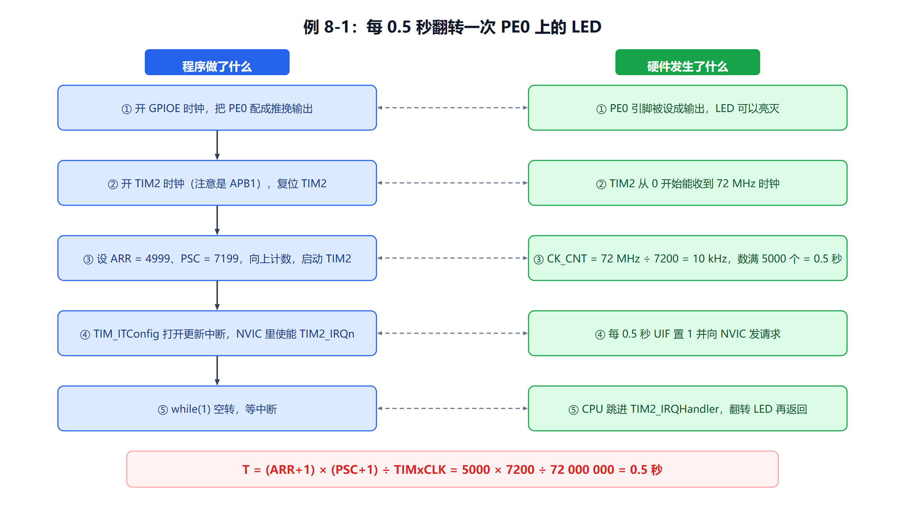

#### 【教材内容】完整代码（已对照原书第 248~249 页核验）

```c
#include "stm32f10x.h"
void TIMER2_Init(void);                    //定时器2初始化函数
void NVIC_Config(void);                    //NVIC配置函数
u8 turn = 0;

int main(void)
{
    GPIO_InitTypeDef GPIO_InitStructure;

    RCC_APB2PeriphClockCmd(RCC_APB2Periph_GPIOE, ENABLE);   //GPIOE时钟
    GPIO_InitStructure.GPIO_Pin   = GPIO_Pin_0;             //LED0-->PE0端口配置
    GPIO_InitStructure.GPIO_Mode  = GPIO_Mode_Out_PP;       //推挽输出
    GPIO_InitStructure.GPIO_Speed = GPIO_Speed_50MHz;       //I/O口速度为50MHz
    GPIO_Init(GPIOE, &GPIO_InitStructure);                  //根据设定参数初始化

    TIMER2_Init();
    NVIC_Config();

    while(1);
}

void NVIC_Config(void)                     //NVIC配置函数
{
    NVIC_InitTypeDef NVIC_InitStructure;

    NVIC_PriorityGroupConfig(NVIC_PriorityGroup_0);         //抢占式优先级别
    NVIC_InitStructure.NVIC_IRQChannel = TIM2_IRQn;         //指定中断源
    NVIC_InitStructure.NVIC_IRQChannelPreemptionPriority = 0;
    NVIC_InitStructure.NVIC_IRQChannelSubPriority = 0;      //指定副优先级别
    NVIC_InitStructure.NVIC_IRQChannelCmd = ENABLE;
    NVIC_Init(&NVIC_InitStructure);
}

void TIMER2_Init(void)                     //定时器2初始化函数
{
    TIM_TimeBaseInitTypeDef TIM_TimeBaseStructure;

    RCC_APB1PeriphClockCmd(RCC_APB1Periph_TIM2, ENABLE);    //打开TIM2时钟
    TIM_DeInit(TIM2);                                       //复位TIM2

    TIM_TimeBaseStructure.TIM_Period    = 5000 - 1;         //ARR的值
    TIM_TimeBaseStructure.TIM_Prescaler = 7200 - 1;         //PSC的值
    TIM_TimeBaseStructure.TIM_CounterMode = TIM_CounterMode_Up;  //向上计数模式
    TIM_TimeBaseInit(TIM2, &TIM_TimeBaseStructure);         //TIM2初始化

    TIM_ITConfig(TIM2, TIM_IT_Update, ENABLE);              //使能更新中断
    TIM_Cmd(TIM2, ENABLE);                                  //开启定时器
}

void TIM2_IRQHandler(void)                 //TIM2的中断服务函数，名字不能变
{
    if (TIM_GetITStatus(TIM2, TIM_IT_Update) == SET)
    {
        TIM_ClearITPendingBit(TIM2, TIM_FLAG_Update);       //清除中断标志
        turn = 1 - turn;                                    //翻转标志
        if (turn)
            GPIO_ResetBits(GPIOE, GPIO_Pin_0);              //PE0 输出低电平
        else
            GPIO_SetBits(GPIOE, GPIO_Pin_0);                //PE0 输出高电平
    }
}
```

> 【补充解释】教材印刷的清除标志语句为 `TIM_ClearITPendingBit(TIM2, TIM_FLAG_Update);`。标准写法应为 `TIM_ClearITPendingBit(TIM2, TIM_IT_Update);`。两者数值都是 0x0001，运行结果相同（详见 8.12.3 节第 6 条）。

### 代码逐块讲解

#### 第 1 块：main 函数里的 GPIO 初始化

```c
RCC_APB2PeriphClockCmd(RCC_APB2Periph_GPIOE, ENABLE);   //GPIOE时钟
GPIO_InitStructure.GPIO_Pin   = GPIO_Pin_0;
GPIO_InitStructure.GPIO_Mode  = GPIO_Mode_Out_PP;       //推挽输出
GPIO_InitStructure.GPIO_Speed = GPIO_Speed_50MHz;
GPIO_Init(GPIOE, &GPIO_InitStructure);
```

| 代码 | CPU 做什么 | 寄存器发生什么 | 硬件发生什么 |
|---|---|---|---|
| `RCC_APB2PeriphClockCmd(...)` | 往 RCC_APB2ENR 写 1 | RCC_APB2ENR 的 bit6（IOPEEN）置 1 | GPIOE 端口的时钟被打开，可以工作了 |
| `GPIO_Pin = GPIO_Pin_0` | 准备参数 | —— | —— |
| `GPIO_Mode = Out_PP` | 准备参数 | —— | —— |
| `GPIO_Init(...)` | 写 GPIOE 的 CRL 寄存器 | CRL 的低 4 位被设成推挽输出模式 | **PE0 引脚变成输出**，LED 可以亮灭 |

【补充解释】为什么 GPIO 也要开时钟？因为**不开时钟，外设就是"断电"状态**，你写它的寄存器也没用。这是第 6 章讲过的"外设使用四步曲"里的第一步。

#### 第 2 块：TIMER2_Init 里的定时器初始化

```c
RCC_APB1PeriphClockCmd(RCC_APB1Periph_TIM2, ENABLE);    //打开TIM2时钟
TIM_DeInit(TIM2);                                       //复位TIM2
```

| 代码 | CPU 做什么 | 寄存器发生什么 | 硬件发生什么 |
|---|---|---|---|
| `RCC_APB1PeriphClockCmd(...)` | 往 RCC_APB1ENR 写 1 | bit0（TIM2EN）置 1 | **TIM2 拿到 72 MHz 时钟**，可以开始工作 |
| `TIM_DeInit(TIM2)` | 往 TIM2 各寄存器写复位值 | CR1、PSC、ARR 等全部回 0 | 定时器回到"刚上电"的干净状态 |

**注意这里用的是 `RCC_APB1PeriphClockCmd`**，因为 TIM2 挂在 APB1 上。如果这里误写成 `RCC_APB2PeriphClockCmd`，TIM2 就不会工作。

```c
TIM_TimeBaseStructure.TIM_Period    = 5000 - 1;    // = 4999
TIM_TimeBaseStructure.TIM_Prescaler = 7200 - 1;    // = 7199
TIM_TimeBaseStructure.TIM_CounterMode = TIM_CounterMode_Up;
TIM_TimeBaseInit(TIM2, &TIM_TimeBaseStructure);
```

| 代码 | CPU 做什么 | 寄存器发生什么 | 硬件发生什么 |
|---|---|---|---|
| `TIM_Period = 4999` | 填结构体 | 稍后写进 TIM2_ARR | ARR = 4999，一轮数 5000 个数 |
| `TIM_Prescaler = 7199` | 填结构体 | 稍后写进 TIM2_PSC | 分频 7200，CK_CNT = 10 kHz |
| `TIM_CounterMode = Up` | 填结构体 | 稍后把 CR1 的 DIR 清 0 | 向上计数 |
| `TIM_TimeBaseInit(...)` | 写 ARR、PSC、CR1 | 三个寄存器被写入 | **定时周期 = 0.5 s 确定下来** |

```c
TIM_ITConfig(TIM2, TIM_IT_Update, ENABLE);
TIM_Cmd(TIM2, ENABLE);
```

| 代码 | CPU 做什么 | 寄存器发生什么 | 硬件发生什么 |
|---|---|---|---|
| `TIM_ITConfig(..., TIM_IT_Update, ENABLE)` | 写 TIM2_DIER | DIER 的 bit0（UIE）置 1 | 以后 UIF 置 1 时会向 NVIC 发中断请求 |
| `TIM_Cmd(TIM2, ENABLE)` | 写 TIM2_CR1 | CR1 的 bit0（CEN）置 1 | **定时器开始计数** |

#### 第 3 块：NVIC 配置

```c
NVIC_PriorityGroupConfig(NVIC_PriorityGroup_0);
NVIC_InitStructure.NVIC_IRQChannel = TIM2_IRQn;
NVIC_InitStructure.NVIC_IRQChannelPreemptionPriority = 0;
NVIC_InitStructure.NVIC_IRQChannelSubPriority = 0;
NVIC_InitStructure.NVIC_IRQChannelCmd = ENABLE;
NVIC_Init(&NVIC_InitStructure);
```

| 代码 | CPU 做什么 | 寄存器发生什么 | 硬件发生什么 |
|---|---|---|---|
| `NVIC_PriorityGroupConfig(...)` | 写 SCB->AIRCR | 优先级分组位被设置 | 定下"哪几位是抢占优先级" |
| `NVIC_IRQChannel = TIM2_IRQn` | 填参数 | —— | 指定中断源编号 28 |
| `NVIC_Init(...)` | 写 NVIC 的 ISER 和 IP 寄存器 | 对应位置 1 | **NVIC 开始接受 TIM2 的中断请求** |

【补充解释】**注意这里的先后顺序**：`TIMER2_Init()` 先执行（里面已经 `TIM_Cmd(TIM2, ENABLE)` 把定时器启动了），然后才执行 `NVIC_Config()`。

严格来说，定时器在 NVIC 配置好之前就已经开始数数了。因为 0.5 秒很长，NVIC 配置只要几微秒，所以实际上不会出问题。**但更稳妥的写法是：先配 NVIC，最后再 `TIM_Cmd(TIM2, ENABLE)`。**

#### 第 4 块：中断服务函数

```c
void TIM2_IRQHandler(void)                 //名字不能变
{
    if (TIM_GetITStatus(TIM2, TIM_IT_Update) == SET)
    {
        TIM_ClearITPendingBit(TIM2, TIM_FLAG_Update);
        turn = 1 - turn;
        if (turn)
            GPIO_ResetBits(GPIOE, GPIO_Pin_0);
        else
            GPIO_SetBits(GPIOE, GPIO_Pin_0);
    }
}
```

| 代码 | CPU 做什么 | 寄存器发生什么 | 硬件发生什么 |
|---|---|---|---|
| `void TIM2_IRQHandler(void)` | 中断发生时 CPU 自动跳到这里 | —— | 函数名必须和启动文件里的向量表名字**完全一致**，否则中断会跑飞 |
| `TIM_GetITStatus(...) == SET` | 读 TIM2_SR | 读 UIF（bit0） | 判断是不是"更新"引起的中断 |
| `TIM_ClearITPendingBit(...)` | 往 TIM2_SR 写 0 | UIF 清 0 | **下次溢出才能再产生新中断** |
| `turn = 1 - turn;` | 内存运算 | 变量 turn 在 0 和 1 之间切换 | —— |
| `if (turn)` | 判断 | —— | —— |
| `GPIO_ResetBits(GPIOE, GPIO_Pin_0)` | 写 GPIOE_BSRR/BRR | 对应位被写 | **PE0 输出低电平 → LED 亮（或灭）** |
| `GPIO_SetBits(GPIOE, GPIO_Pin_0)` | 写 GPIOE_BSRR | 对应位被写 | **PE0 输出高电平 → LED 灭（或亮）** |

**为什么函数名必须叫 `TIM2_IRQHandler`？**

【补充解释】启动文件（startup_stm32f10x_hd.s）里有一个"中断向量表"，里面写着：

```text
TIM2_IRQHandler     ← 这个地址就是中断发生时 CPU 要跳过去的地方
```

这个表里的名字是**芯片厂商定死的**。你写别的名字，链接器就找不到，中断发生时 CPU 会跳到一个空函数（默认的死循环）里。

**`turn = 1 - turn;` 这个写法很巧妙：**

```text
turn = 0 时：turn = 1 - 0 = 1
turn = 1 时：turn = 1 - 1 = 0
→ 每执行一次就在 0 和 1 之间切换，相当于"取反"
```

**为什么这里没有去抖？** 因为定时器中断是硬件产生的，每 0.5 秒才来一次，不存在按键那种机械抖动问题。

#### 【辅助理解图】定时中断的完整流程

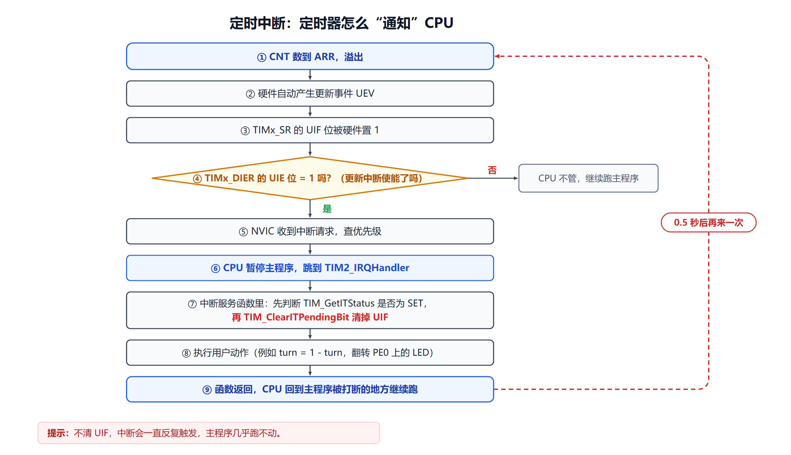

**这张图把"定时器"和"中断"两章的知识串起来了。按箭头从上往下看：**

1. **CNT 数到 ARR，溢出**（定时器内部的事）。
2. **硬件自动产生 UEV，把 UIF 置 1**（不需要程序参与）。
3. **判断 UIE 是不是 1**：
   - 不是 1 → 中断请求根本发不出去，CPU 什么都不做，主程序继续跑。**这就是"忘了 TIM_ITConfig"的后果。**
   - 是 1 → 往下走。
4. **NVIC 收到请求，查优先级，决定要不要打断 CPU**。
5. **CPU 跳进 TIM2_IRQHandler**。
6. **先判断标志、再清标志**。
7. **执行用户动作（翻转 LED）**。
8. **函数返回，CPU 回到主程序被打断的地方**。
9. **0.5 秒后，重复以上过程。**

**图右侧那条红色虚线**表示"循环"——中断不是只发生一次，而是每 0.5 秒发生一次，永远循环下去（因为 CNT 一直在数）。

---

### 8.13.2　【补充解释】例：用 TIM3 的 CH2 输出 PWM

> 教材在 8.5.2 节末尾说："STM32 定时器除了定时和计数功能外，另外一个重要功能是用作 PWM 控制。限于篇幅，PWM 控制的内容请参考产品手册。"
>
> 因此教材没有给出 PWM 的完整例程。下面这个例子是本讲义补充的，帮助你把 8.9 节的理论落地。

**题目**：用 TIM3 的通道 2（对应 PB5 引脚）输出一路 PWM，频率 1 kHz，占空比 50%。

**第一步：算参数**

```text
目标频率 f_PWM = 1 kHz = 1000 Hz
TIM3CLK = 72 MHz

取 PSC = 71  → CK_CNT = 72 MHz ÷ 72 = 1 MHz
则 (ARR + 1) = 1 MHz ÷ 1 kHz = 1000  → ARR = 999

验证频率：
f = 72 000 000 ÷ ((71+1) × (999+1))
  = 72 000 000 ÷ (72 × 1000)
  = 72 000 000 ÷ 72 000
  = 1000 Hz = 1 kHz   ✓

占空比 50%：
CCR2 = (ARR + 1) × 50% = 1000 × 0.5 = 500
```

**第二步：写代码**

```c
void TIM3_PWM_Init(void)
{
    GPIO_InitTypeDef        GPIO_InitStructure;
    TIM_TimeBaseInitTypeDef TIM_TimeBaseStructure;
    TIM_OCInitTypeDef       TIM_OCInitStructure;

    /* ---- ① 开时钟 ---- */
    RCC_APB1PeriphClockCmd(RCC_APB1Periph_TIM3, ENABLE);   // TIM3 在 APB1
    RCC_APB2PeriphClockCmd(RCC_APB2Periph_GPIOB, ENABLE);  // PB5 在 GPIOB

    /* ---- ② 把 PB5 配成复用推挽输出 ---- */
    GPIO_InitStructure.GPIO_Pin   = GPIO_Pin_5;
    GPIO_InitStructure.GPIO_Mode  = GPIO_Mode_AF_PP;       // 关键：复用推挽
    GPIO_InitStructure.GPIO_Speed = GPIO_Speed_50MHz;
    GPIO_Init(GPIOB, &GPIO_InitStructure);

    /* ---- ③ 配置时基：1 kHz ---- */
    TIM_TimeBaseStructure.TIM_Period        = 999;         // ARR
    TIM_TimeBaseStructure.TIM_Prescaler     = 71;          // PSC
    TIM_TimeBaseStructure.TIM_ClockDivision = 0;
    TIM_TimeBaseStructure.TIM_CounterMode   = TIM_CounterMode_Up;
    TIM_TimeBaseInit(TIM3, &TIM_TimeBaseStructure);

    /* ---- ④ 配置通道 2 为 PWM 模式 1，占空比 50% ---- */
    TIM_OCInitStructure.TIM_OCMode      = TIM_OCMode_PWM1;
    TIM_OCInitStructure.TIM_OutputState = TIM_OutputState_Enable;  // CC2E = 1
    TIM_OCInitStructure.TIM_OCPolarity  = TIM_OCPolarity_High;     // CC2P = 0
    TIM_OCInitStructure.TIM_Pulse       = 500;                     // CCR2
    TIM_OC2Init(TIM3, &TIM_OCInitStructure);

    /* ---- ⑤ 使能预装载 ---- */
    TIM_OC2PreloadConfig(TIM3, TIM_OCPreload_Enable);   // OC2PE = 1
    TIM_ARRPreloadConfig(TIM3, ENABLE);                 // ARPE = 1

    /* ---- ⑥ 启动 ---- */
    TIM_Cmd(TIM3, ENABLE);                              // CEN = 1
}
```

**运行中改占空比：**

```c
TIM_SetCompare2(TIM3, 250);   // 占空比变成 250/1000 = 25%
```

**代码 → 寄存器 → 硬件对照表：**

| 代码 | 写哪个寄存器 | 硬件发生什么 |
|---|---|---|
| `GPIO_Mode_AF_PP` | GPIOB->CRL | PB5 交给定时器控制（不再由 GPIO 控制） |
| `TIM_Period = 999` | TIM3_ARR | 一轮 1000 个计数，1 ms |
| `TIM_Prescaler = 71` | TIM3_PSC | CK_CNT = 1 MHz |
| `TIM_OCMode_PWM1` | TIM3_CCMR1 的 OC2M | 输出比较 2 通道设为 PWM 模式 1 |
| `TIM_OutputState_Enable` | TIM3_CCER 的 CC2E | 打开输出开关 |
| `TIM_Pulse = 500` | TIM3_CCR2 | 门槛值 500，占空比 50% |
| `TIM_OC2PreloadConfig(...Enable)` | TIM3_CCMR1 的 OC2PE | CCR2 走预装载，改值不抖动 |
| `TIM_ARRPreloadConfig(...ENABLE)` | TIM3_CR1 的 ARPE | ARR 走预装载 |
| `TIM_Cmd(TIM3, ENABLE)` | TIM3_CR1 的 CEN | 开始输出波形 |

**波形长这样（ASCII 示意）：**

```text
CNT   0  1  2 ... 499 500 501 ... 999 0  1  2 ...
      ┌──────────────────┐                  ┌─────
PB5   │      高电平       │      低电平       │
      └──────────────────┘                  └─────
      <--- 500 个计数 ---><--- 500 个计数 --->
      <------------- 1000 个计数 = 1 ms ---------->
      ↑ 频率 1 kHz，占空比 50%
```

---

### 8.13.3　【补充解释】例：用 TIM4 的 CH1 做输入捕获测频率

> 教材只讲了输入捕获的原理和配置步骤，没有给完整例程。下面这个例子是本讲义补充的。

**题目**：用 TIM4 的通道 1（对应 PB6 引脚）测量输入信号的频率。

**第一步：定参数**

```text
让 CK_CNT = 1 MHz（每 1 µs 加 1 个数）
PSC = 71  → 72 MHz ÷ 72 = 1 MHz
ARR = 0xFFFF = 65535（设成最大，这样两次捕获之间几乎不会溢出）
```

**第二步：写代码**

```c
u16 lastCapture = 0;      // 上一次的捕获值
u16 periodCount = 0;      // 两次捕获之差
u8  firstFlag   = 0;      // 是不是第一次捕获

void TIM4_Capture_Init(void)
{
    GPIO_InitTypeDef        GPIO_InitStructure;
    TIM_TimeBaseInitTypeDef TIM_TimeBaseStructure;
    TIM_ICInitTypeDef       TIM_ICInitStructure;

    /* ① 开时钟 */
    RCC_APB1PeriphClockCmd(RCC_APB1Periph_TIM4, ENABLE);
    RCC_APB2PeriphClockCmd(RCC_APB2Periph_GPIOB, ENABLE);

    /* ② PB6 配成浮空输入（信号从外面进来） */
    GPIO_InitStructure.GPIO_Pin  = GPIO_Pin_6;
    GPIO_InitStructure.GPIO_Mode = GPIO_Mode_IN_FLOATING;
    GPIO_Init(GPIOB, &GPIO_InitStructure);

    /* ③ 时基：CK_CNT = 1 MHz，ARR 最大 */
    TIM_TimeBaseStructure.TIM_Period    = 0xFFFF;
    TIM_TimeBaseStructure.TIM_Prescaler = 71;
    TIM_TimeBaseStructure.TIM_ClockDivision = TIM_CKD_DIV1;
    TIM_TimeBaseStructure.TIM_CounterMode   = TIM_CounterMode_Up;
    TIM_TimeBaseInit(TIM4, &TIM_TimeBaseStructure);

    /* ④ 通道 1 配成输入捕获，上升沿，不分频，不滤波 */
    TIM_ICInitStructure.TIM_Channel     = TIM_Channel_1;
    TIM_ICInitStructure.TIM_ICPolarity  = TIM_ICPolarity_Rising;   // CC1P = 0
    TIM_ICInitStructure.TIM_ICSelection = TIM_ICSelection_DirectTI; // CC1S = 01，IC1 接 TI1
    TIM_ICInitStructure.TIM_ICPrescaler = TIM_ICPSC_DIV1;          // 每个边沿都捕获
    TIM_ICInitStructure.TIM_ICFilter    = 0x0;                     // 不滤波
    TIM_ICInit(TIM4, &TIM_ICInitStructure);

    /* ⑤ 打开捕获中断 */
    TIM_ITConfig(TIM4, TIM_IT_CC1, ENABLE);
    TIM_Cmd(TIM4, ENABLE);

    /* ⑥ NVIC 配置 */
    NVIC_InitTypeDef NVIC_InitStructure;
    NVIC_InitStructure.NVIC_IRQChannel = TIM4_IRQn;
    NVIC_InitStructure.NVIC_IRQChannelPreemptionPriority = 0;
    NVIC_InitStructure.NVIC_IRQChannelSubPriority = 0;
    NVIC_InitStructure.NVIC_IRQChannelCmd = ENABLE;
    NVIC_Init(&NVIC_InitStructure);
}

void TIM4_IRQHandler(void)
{
    if (TIM_GetITStatus(TIM4, TIM_IT_CC1) != RESET)
    {
        u16 now = TIM_GetCapture1(TIM4);      // 读 CCR1（读操作会自动清 CC1IF）

        if (firstFlag == 0)
        {
            firstFlag = 1;
            lastCapture = now;                // 第一次只记录，不算
        }
        else
        {
            periodCount = now - lastCapture;  // 两次捕获之差 = 多少个计数
            lastCapture = now;

            /* 频率 = 1 / (periodCount × 1 µs) = 1 000 000 / periodCount */
            /* 例如 periodCount = 1000 → 频率 = 1000 Hz */
        }
        TIM_ClearITPendingBit(TIM4, TIM_IT_CC1);   // 保险起见再清一次
    }
}
```

**代码 → 寄存器 → 硬件对照：**

| 代码 | 写哪个寄存器 | 硬件发生什么 |
|---|---|---|
| `GPIO_Mode_IN_FLOATING` | GPIOB->CRL | PB6 变成输入 |
| `TIM_Prescaler = 71` | TIM4_PSC | CK_CNT = 1 MHz，每个计数 = 1 µs |
| `TIM_Period = 0xFFFF` | TIM4_ARR | 计数器最大范围，约 65.5 ms 才溢出一次 |
| `TIM_ICSelection_DirectTI` | TIM4_CCMR1 的 CC1S | CC1S = 01，通道 1 配成输入，接 TI1 |
| `TIM_ICPolarity_Rising` | TIM4_CCER 的 CC1P | 上升沿捕获 |
| `TIM_ICPrescaler = DIV1` | TIM4_CCMR1 的 IC1PSC | 每个边沿都捕获 |
| `TIM_ITConfig(..., TIM_IT_CC1, ENABLE)` | TIM4_DIER 的 CC1IE | 捕获时产生中断 |
| `TIM_GetCapture1(TIM4)` | 读 TIM4_CCR1 | **读到"拍照"时的计数值**，同时自动清 CC1IF |

**计算频率：**

```text
两次捕获之差 = periodCount 个计数
每个计数 = 1 µs
信号周期 = periodCount × 1 µs
信号频率 = 1 ÷ (periodCount × 1 µs) = 1 000 000 ÷ periodCount   （单位 Hz）

例：periodCount = 500  →  频率 = 1 000 000 ÷ 500 = 2000 Hz = 2 kHz
```

**注意 CNT 溢出的处理：** 上面这段代码在 `periodCount` 很大（接近 65535）时会出错，因为中间可能跨过了一次 CNT 回 0。实际工程中要么在更新中断里累加"溢出次数"，要么先保证 `ARR` 足够大、信号频率足够高。

---

## 8.14　容易搞混的地方

### 1. 忘了 "+1"

```text
✗  T = ARR × PSC / TIMxCLK
✓  T = (ARR + 1) × (PSC + 1) / TIMxCLK
```

**检验方法**：设 PSC = 0，公式应该给出"不分频"的结果，也就是 T = (ARR+1)/TIMxCLK。如果用 `PSC` 而不是 `PSC+1`，PSC=0 时结果变成 0，明显不对。

### 2. 边沿对齐和中央对齐的公式混了

```text
边沿对齐：f = TIMxCLK / ((PSC+1) × (ARR+1))     占空比 = CCRx / (ARR+1)
中央对齐：f = TIMxCLK / ((PSC+1) × 2 × ARR)     占空比 = CCRx / ARR
```

**记忆技巧**：中央对齐"上坡下坡都要走"，所以周期是两倍 → 频率是一半 → 分母多一个 2。

### 3. 开错了总线的时钟

```text
✗  RCC_APB2PeriphClockCmd(RCC_APB2Periph_TIM2, ENABLE);   // TIM2 不在 APB2！
✓  RCC_APB1PeriphClockCmd(RCC_APB1Periph_TIM2, ENABLE);

✗  RCC_APB1PeriphClockCmd(RCC_APB1Periph_TIM1, ENABLE);   // TIM1 不在 APB1！
✓  RCC_APB2PeriphClockCmd(RCC_APB2Periph_TIM1, ENABLE);
```

**口诀：TIM1、TIM8 走 APB2；TIM2~TIM7 走 APB1。**

### 4. PWM 输出时忘了把引脚配成"复用"

```text
✗  GPIO_Mode_Out_PP       ← 普通输出，引脚由 GPIO 的 ODR 控制，定时器管不着
✓  GPIO_Mode_AF_PP        ← 复用推挽输出，引脚交给定时器控制
```

### 5. 忘了 `CCxE = 1`

配好了 OCxM、CCxP、ARR、CCR，结果引脚上一点动静都没有——**十有八九是 CCxE 没打开**。

### 6. 忘了在中断服务函数里清标志

```c
void TIM2_IRQHandler(void)
{
    /* 忘了这一句 → UIF 永远是 1 → 中断疯狂反复触发 → 主程序几乎跑不动 */
    TIM_ClearITPendingBit(TIM2, TIM_IT_Update);
}
```

**症状**：LED 看起来"常亮"或者闪烁频率完全不对，程序像死机一样。

### 7. 忘了开 UG 就启动 PWM

教材原文：

> 仅当发生一个更新事件的时候，预装载寄存器才能被传送到影子寄存器，因此在计数器开始计数之前，必须通过设置 TIMx_EGR 寄存器中的 UG 位来初始化所有的寄存器。

**症状**：第一轮 PWM 的占空比不对，第二轮开始才对。

**注意，第一轮用的不是"上一次的旧值"，而是影子寄存器里的复位值（ARR、CCRx 的影子寄存器复位值都是 0）。** 因为你刚写进 ARR / CCRx 预装载寄存器的值，要等到一次更新事件（写 UG，或者第一轮真正数满溢出）才会被搬进影子寄存器；在此之前，比较器拿到的还是复位值。所以排查这类问题时，别按"旧值"去猜，直接记住："**启动前没产生一次更新事件 → 第一轮是复位值在起作用。**"

### 8. 把"计数模式"和"输出比较模式"搞混

这两个是**完全不同层面**的东西：

- **计数模式**（CR1 的 CMS、DIR）：CNT 怎么走。向上？向下？三角？
- **输出比较模式**（CCMRx 的 OCxM）：CNT 撞到 CCR 时引脚做什么。翻转？变高？PWM？

一个是"怎么数"，一个是"撞上了做什么"。

### 9. 以为"定时器只能定时"

定时器能干的事比"定时"多得多：

```text
定时（产生周期中断）
计数（数外部脉冲）
测量（输入捕获：测频率、测脉宽、测占空比）
产生波形（输出比较、PWM）
驱动电机（编码器接口、互补 PWM）
```

### 10. 把 TIM6/TIM7 当成通用定时器用

TIM6/TIM7 **没有捕获/比较通道**（表 8-1 里那一栏是 0），所以：

- ✗ 不能用它输出 PWM。
- ✗ 不能用它做输入捕获。
- ✓ 只能用它做定时、触发 DAC、触发 DMA。

---

## 8.15　本章真正要记住什么

### 数字类

| 要记住的 | 内容 |
|---|---|
| STM32F103 定时器总数 | 11 个 |
| 家族划分 | 高级 2（TIM1/TIM8）+ 普通 4（TIM2~TIM5）+ 基本 2（TIM6/TIM7）+ 看门狗 2 + SysTick 1 |
| 总线归属 | TIM1/TIM8 在 APB2；TIM2~TIM7 在 APB1 |
| 位数 | 计数器、PSC、ARR、CCR 全是 16 位 |
| 分频范围 | 1~65 536（PSC 写 0~65 535） |
| 单定时器最长定时 | 约 59.65 s（72 MHz 下 PSC、ARR 都取最大） |
| TIM2 基地址 | 0x40000000 |
| 关键偏移 | CR1=0x00、DIER=0x0C、SR=0x10、EGR=0x14、CCMR1=0x18、CCER=0x20、CNT=0x24、PSC=0x28、ARR=0x2C、CCR1=0x34 |

### 公式类

```text
定时时间     T = (ARR + 1) × (PSC + 1) ÷ TIMxCLK

边沿对齐 PWM  f = TIMxCLK ÷ ((PSC + 1) × (ARR + 1))
             占空比 = CCRx ÷ (ARR + 1)

中央对齐 PWM  f = TIMxCLK ÷ ((PSC + 1) × 2 × ARR)
             占空比 = CCRx ÷ ARR

输入捕获测频  f = 1 ÷ ((本次CCR − 上次CCR) × 每个计数的时间)
```

### 概念类

1. **时基单元 = PSC + CNT + ARR**。PSC 管"多久加 1"，ARR 管"数到几回 0"。
2. **三种计数模式**：向上、向下、中央对齐。
3. **一个通道两种身份**：输入（捕获）或输出（比较/PWM），由 CCxS 决定。
4. **输入捕获**：边沿来了，把 CNT 的值抄进 CCR。
5. **输出比较**：CNT 撞到 CCR，引脚做动作。
6. **PWM**：ARR 定频率，CCR 定占空比。
7. **影子寄存器**：改 PSC/ARR/CCR 有缓冲，新值在下一个更新事件才生效。
8. **UIF 标志必须由软件清 0**，否则中断会反复触发。

### 写程序的套路（背下来）

```text
第 1 步：开时钟（RCC）
         └─ TIM2~TIM7 用 APB1；TIM1/TIM8 用 APB2；引脚用对应 GPIO 的时钟

第 2 步：配 GPIO（如果是 PWM 输出，要配成 AF_PP）

第 3 步：配时基（TIM_TimeBaseInit）
         └─ 先算 PSC 和 ARR

第 4 步：配通道（如果是 PWM / 捕获）
         └─ PWM 用 TIM_OCxInit；捕获用 TIM_ICInit

第 5 步：开中断（TIM_ITConfig）+ 配 NVIC（NVIC_Init）

第 6 步：启动（TIM_Cmd）

第 7 步：写中断服务函数
         └─ 先判断标志，再清标志，最后做事
```

### 习题（教材 8.6 节）

**8-1　STM32F103VET6 的定时器有哪些？**

> 答：共 11 个。包括 2 个高级控制定时器（TIM1、TIM8）、4 个普通（通用）定时器（TIM2~TIM5）、2 个基本定时器（TIM6、TIM7）、2 个看门狗定时器（独立看门狗 IWDG、窗口看门狗 WWDG）和 1 个系统嘀嗒定时器（SysTick）。
>
> 其中 TIM1/TIM8 挂在 APB2 上，TIM2~TIM7 挂在 APB1 上。

**8-2　定时器的定时时间如何设定？定时范围是什么？**

> 答：定时时间由三个量共同决定：
>
> ```text
> T = (ARR + 1) × (PSC + 1) / TIMxCLK
> ```
>
> 其中 ARR 是自动重装载寄存器的值，PSC 是预分频寄存器的值，TIMxCLK 是定时器时钟频率。
>
> 设定方法：先根据 TIMxCLK 选定 PSC，使 CK_CNT 成为一个好算的频率；再根据目标时间算出 ARR。
>
> 以 TIMxCLK = 72 MHz 为例：
> - 最短：PSC = 0、ARR = 0 → T = 1 × 1 ÷ 72 000 000 ≈ 13.9 ns
> - 最长：PSC = 65535、ARR = 65535 → T = 65536 × 65536 ÷ 72 000 000 ≈ 59.65 s
>
> 所以单个普通定时器的定时范围约为 **13.9 ns ~ 59.65 s**。

**8-3　利用连接定时器定时 0.5 秒，将最小系统板上连接 PE 口的 16 个发光二极管循环点亮。**

> 思路提示：
> 1. 参数按例 8-1 算：PSC = 7199、ARR = 4999（0.5 s）。
> 2. GPIOE 的 16 个引脚（PE0~PE15）全部配成推挽输出。
> 3. 在 `TIM2_IRQHandler` 里维护一个变量 `n`（0~15），每次中断：
>    - 先把上一次点亮的 LED 关掉；
>    - `n = (n + 1) % 16;`
>    - 点亮第 n 个 LED；
>    - 清中断标志。
> 4. 注意清标志必须写在中断服务函数里，否则会反复触发。

---

## 待核验

本表条目尚未逐条回原 PDF 核验；核验方法见 tools/index/verification.md。

以下条目是在整理本章时发现的**教材正文与插图不一致、MinerU 解析缺失或疑似印刷错误**的地方。已尽量回到原 PDF 核验，但仍建议人工复核。

| 编号 | 页码 | 疑点 | 本讲义的处理 |
|---|---|---|---|
| 1 | 原书 p9（微机原理2 p9） | **图 8-2「普通定时器的结构框图」的图片文件在 MinerU 解析结果中缺失**，该页只保留了正文文字（"普通定时器的结构框图如图 8-2 所示"），`figures.md` 中也没有图 8-2 的条目。 | **已回原 PDF 核验并解决**：图 8-2 确实存在，但排在**原书第 205 页（页码索引 p10）**，而"如图 8-2 所示"这句话在 p9 末尾，所以按正文页找是找不到的。已从原始 PDF 重新截取该图（仅裁剪 + 旋转，未改动内容），存为 `notes/images/generated/ch08_fig8-2_textbook.png`；讲义 8.3.1 节现在同时给出**教材原图**（含三层拆图讲解）和自绘的时基单元简化图 `ch08_timebase_block.png`。 **确认为 MinerU 漏图（不是教材缺图）**：正文"如图 8-2 所示"在 p9 末尾，图本身排在下一页 p10，MinerU 没有提取它。已从原 PDF 重新截取为教材原图 `ch08_fig8-2_textbook.png` 并在 8.3.1 节引用；自绘简化图 `ch08_timebase_block.png` 同时保留，作为"逐层拆解"的第二张图。 |
| 2 | 原书 p15（微机原理2 p15） | **中央对齐模式的计数上界**：教材正文写"计数器从 0 开始计数到自动加载的值（TIMx_ARR 寄存器）−1"，但教材**图 8-16**（ARR = 0x6）实际画出的序列是 `04 03 02 01 00 01 02 03 04 05 06 05 04 03`，上界为 6 = ARR；教材**图 8-33**（ARR = 8）画出的序列是 `0 1 2 3 4 5 6 7 8 7 6 5 4 3 2 1 0`，上界同样为 8 = ARR。 | 讲义 8.4.3 节已同时列出正文说法与两张插图的画法，并明确说明**本讲义以插图为准（0 → ARR → 1 → 0）**。两处不一致的原因待人工确认（可能是译文沿用了旧版参考手册的措辞）。 |
| 3 | 原书 p26（微机原理2 p26） | 图 8-33 的题注印为「中央对齐的 PWM 波形（**APR**=8）」，结合正文（"TIMx_ARR=8"）与图内计数器序列判断应为 **ARR**。 | 讲义 8.9.4 节按 ARR = 8 讲解，并在正文中以【补充解释】指出这是教材的排版笔误。 |
| 4 | 原书 p44（微机原理2 p44） | 图 8-30「PWM 输入模式时序」在 `figures.md` 中没有带题注的条目，源文件中该图以 `(无题注)` 形式出现。 | 讲义 8.7.6 节引用了该图，题注按教材正文"PWM 输入模式时序如图 8-30 所示"补写。 |
| 5 | 原书 p6 vs p7（微机原理2 p6、p7） | 预分频系数范围表述不一致：**表 8-1** 写"1~65 536 的任意数"，而 **8.1.1 节特性第 (2) 条**写"分频系数为 1~65 535 的任意数值"；8.1.2 节特性第 (2) 条又写"1~65 536"。 | 讲义按 PSC 是 16 位寄存器、实际分频 = PSC + 1 推算，采用 **1~65 536**，并在 8.2 节以【补充解释】说明该矛盾。 |
| 6 | 原书 p48~p49（微机原理2 p53~p54） | 例 8-1 的中断服务函数里，清除标志写的是 `TIM_ClearITPendingBit(TIM2, TIM_FLAG_Update);`，第二个参数用的是 `TIM_FLAG_Update` 而非 `TIM_IT_Update`。 | **已用 gemini-3.8-flash-tiered 查看原书第 248~249 页（PDF 渲染页 p53/p54）逐字核验**，确认教材印刷确为 `TIM_FLAG_Update`。讲义保留教材原样，并在 8.12.3 节第 6 条以【补充解释】指出标准写法应为 `TIM_IT_Update`（两者数值都是 0x0001，运行结果相同）。 |
| 7 | 原书 p49（微机原理2 p49） | 教材只给出了 `TIM2_BASE`、`TIM3_BASE`、`TIM4_BASE` 三个定时器的基地址宏，**TIM5、TIM6、TIM7、TIM1、TIM8 的基地址没有出现在本章摘录中**。 | 讲义 8.11.1 节末尾以【补充解释】按 STM32F10x 固件库惯例补出 TIM5 = 0x40000C00、TIM6 = 0x40001000、TIM7 = 0x40001400、TIM1 = 0x40012C00、TIM8 = 0x40013400，并明确标注这几个值不在教材摘录中，**建议对照《STM32F10x 参考手册》存储器映像表核验**。 |
| 8 | 原书 p52（微机原理2 p52） | 教材该页的算式排版有缺失：正文出现 `$((1 + TIM\_Prescaler)/72M)*(1 + TIM\_Period) = ((1 + 7199)/72M)*(1 + 9999) = 1$` 与随后的"或者："以及另一组 `TIM_Prescaler = 35999 / TIM_Period = 1999`，但两段之间的衔接文字（题目原文）在 MinerU 解析中不完整。 | 讲义 8.3.3 节按"1 秒定时"这一目标把两组参数都完整验算了一遍（两组都能得到 1 s），未臆测缺失的题干文字。 |
| 9 | 原书 p16（微机原理2 p16） | 图 8-15 题注为「计数器时序图，当没有使用重复计数器时的更新事件」，但该图对应的正文段落属于"中央对齐模式"，图中未给出 ARR 的具体值。 | 讲义未引用图 8-15 作数值讲解，仅引用信息更明确的图 8-16。 |
| 10 | 全章 | MinerU 解析把部分公式渲染成了 LaTeX 片段（如 `$f_{\mathrm{SAMPLING}} = f_{\mathrm{DTS}} / 8, N = 6$`），部分表格的合并单元格（如 TIMx_CCMR1 的"输入模式/输出模式共用位"）在 Markdown 中无法表达。 | 讲义中的位图与表格均为重新绘制，位号与数值以教材正文逐条描述为准，并已用原 PDF 页面（p12、p17、p26、p27、p53、p54）抽查核验。 |

---

## 附：本章辅助图清单

本讲义正文中引用的辅助理解图（由绘图作业 `notes/images/jobs/ch08.json` 生成，共 17 张）：

| 图号 | 文件名 | 用途 |
|---|---|---|
| 图 8-A | `ch08_timer_family.png` | 11 个定时器家族对比 |
| 图 8-B | `ch08_timer_clock_source.png` | 定时器时钟来源与倍频器 |
| 图 8-C | `ch08_timebase_block.png` | 时基单元结构框图 |
| 图 8-D | `ch08_prescaler_analogy.png` | 预分频器在干什么 |
| 图 8-E | `ch08_count_up_timing.png` | 向上计数时序图 |
| 图 8-F1 | `ch08_count_modes_updown.png` | 向上计数 vs 向下计数 |
| 图 8-F2 | `ch08_count_modes_center.png` | 中央对齐计数（一个来回两次事件） |
| 图 8-G | `ch08_clock_select.png` | 计数脉冲的四种来源 |
| 图 8-H | `ch08_capture_compare_channel.png` | 捕获/比较通道结构 |
| 图 8-I | `ch08_input_capture_timing.png` | 输入捕获时序图 |
| 图 8-J | `ch08_output_compare.png` | 输出比较原理 |
| 图 8-K | `ch08_pwm_edge.png` | 边沿对齐 PWM 波形 |
| 图 8-L | `ch08_pwm_center.png` | 中央对齐 PWM 波形 |
| 图 8-M | `ch08_reg_addr_map.png` | 寄存器地址地图 |
| 图 8-N | `ch08_cr1_bits.png` | TIMx_CR1 位图 |
| 图 8-O | `ch08_example_flow.png` | 例 8-1 程序与硬件对应 |
| 图 8-P | `ch08_isr_flow.png` | 定时中断完整流程 |

> 注 1：以上 17 张绘图作业由 `tools/run_jobs.py` 调用 **gemini-3.8-flash-tiered** 生成。**截至本次修订，17 张里有 15 张已生成并写入 `notes/images/generated/`；图 8-F1、图 8-F2 两个作业因绘图服务持续返回 HTTP 503（服务不可用），多轮重试仍未成功，属于"待重跑"，作业保留在 `notes/images/jobs/ch08.json` 中，服务恢复后重跑 `python tools/run_jobs.py --only ch08` 即可补齐。**（原来的"三种计数模式对比"一张图内容太多、生成反复失败，已按"复杂图拆成 2~4 张简单图"的原则拆成图 8-F1 与图 8-F2 两个作业。）
>
> 注 2：本章正文另外还引用了一张**教材原图** `ch08_fig8-2_textbook.png`（8.3.1 节的图 8-2）。它不是绘图作业生成的，而是 MinerU 漏图时**从原始 PDF 第 205 页重新截取**的教材原图（见 8.3.1 节和文末"待核验"第 1 条），不属于上面的 17 张辅助理解图。
