# 第 9 章 串行通信（USART 与 SPI）

> 对应原教材第 9 章，原书第 2 分册 p55 ~ p119。
> 本章所有"教材内容"均来自 MinerU 解析结果；凡是我自己补充的解释、类比、图，都会明确标出来源。

---

## 本章在整本书里的位置

先回忆一下我们走过的路：

```
第1章  计算机最基本的零件：CPU、存储器、I/O、总线、二进制、地址
第2章  Cortex-M3 这个 CPU 内部：寄存器、栈、中断
第3章  STM32 把 CPU 和各种硬件攒成一块芯片：时钟、存储器映像、引脚
第6章  GPIO：怎么让一个引脚输出高电平 / 读入高电平
第7章  中断和事件：怎么让硬件主动"敲门"告诉 CPU
第8章  定时器：怎么数数、怎么计时、怎么产生 PWM
第9章  串行通信  ← 你现在在这里
```

前面几章，STM32 一直在"自己跟自己玩"：

- 点灯，是自己控制引脚；
- 定时器，是自己数自己的时钟；
- 中断，是自己内部的硬件给 CPU 发通知。

**但一个真正有用的系统，必须能和"外面的芯片"说话。**

比如：

- 把温度数据发给电脑看；
- 从一块 SPI Flash 里读出厂参数；
- 驱动一块 LCD 显示文字；
- 和另一个单片机互相传指令。

这种"把自己的数据一位一位地送出去、把别人的数据一位一位地收进来"的本事，就叫 **串行通信**。

本章讲两套最常用、也是 STM32F103 上最基础的串行通信硬件：

| 硬件 | 全称 | 一句话理解 | 典型用途 |
|---|---|---|---|
| USART | Universal Synchronous/Asynchronous Receiver/Transmitter（通用同步/异步收发器） | 一根线发、一根线收，双方约好速度，各自管各自的时钟 | 和电脑串口助手通信、和 GPS 模块通信、和蓝牙模块通信 |
| SPI | Serial Peripheral Interface（串行外设接口） | 一根时钟线由主机"打拍子"，主从双方一起把数据挤出去 | 读写 SPI Flash、驱动 LCD、接 AD 转换器 |

本章结构：

```
9.1 数据通信基础   ← 不管什么通信，都绕不开的共同概念
9.2 STM32 的 USART ← 异步串行通信
9.3 STM32 的 SPI   ← 同步串行通信
```

---

## 9.1 通信的有关概念

### 先别急着看教材：这一节到底要干什么？

这一节不碰 STM32，也不写代码。

它要做的事情只有一件：

> **把"通信"这件事拆成几个最基本的问题，一个一个回答清楚。**

比如：

1. 数据是"并排一起走"还是"排队一个一个走"？（并行 / 串行）
2. 双方能不能同时说话？（单工 / 半双工 / 全双工）
3. 收发双方的节拍怎么对齐？（同步 / 异步）
4. 一秒能传多少？（波特率 / 比特率）
5. 传错了怎么发现？（校验位）
6. 怎么知道一个字符从哪开始、到哪结束？（起始位 / 停止位 / 帧）

把这 6 个问题回答完，你再看 STM32 的 USART，就会发现它只是"把这 6 个问题的答案做成了硬件开关"。

---

### 你需要先知道的东西

#### 【先补一个前置知识：什么叫"电平"？什么叫"位"？】

通信线就是一根铜线。这根线上任意时刻只有两种稳定状态：

- 电压接近 0 V（地）→ 我们叫它 **低电平**，记作逻辑 **0**；
- 电压接近 3.3 V → 我们叫它 **高电平**，记作逻辑 **1**。

（数字电路里，中间的电压区间是不允许长时间停留的，因为那样"到底是 0 还是 1"就说不清了。）

所以一根线上一次只能表达 1 个二进制位，也就是 **1 个 bit（比特，位）**。

- 1 bit：要么 0，要么 1；
- 8 bit = 1 Byte（字节）；
- 1 Byte 可以表示 0~255 共 256 种状态，刚好够放一个 ASCII 字符（比如 'A' = 65 = 0x41）。

**记住一句话：一根线，一个时刻，只能有一个 bit。**

这句话是整章的起点。

#### 【先补一个前置知识：什么叫"时钟"？什么叫"时钟周期"？】

"时钟"就是芯片里一个不停"滴答滴答"的方波信号：

```
时钟  ┌──┐  ┌──┐  ┌──┐  ┌──┐
   ───┘  └──┘  └──┘  └──┘  └──
      ↑     ↑     ↑     ↑
     第1个上升沿  第2个上升沿 ...
```

- 一个"滴答"占用的时间，叫 **时钟周期**；
- 一秒钟有多少个"滴答"，叫 **频率**，单位 Hz（赫兹）。

例如 72 MHz，就是 1 秒钟滴答 72 000 000 次，一个周期约 13.9 ns。

**为什么通信要讲时钟？**

因为发送方"一位一位往外挤数据"，接收方"一位一位往里收数据"。如果接收方不知道发送方"每一位挤多久"，就会收错。所以双方必须对"每一位持续多长时间"达成一致——这就是后面要讲的**波特率**。

#### 【先补一个前置知识：0x 是什么意思？一个十六进制位对应几个 bit？】

`0x` 只是"后面这个数是十六进制"的标记，不是数字的一部分。

- 一个十六进制位（0~9、A~F）刚好对应 **4 个 bit**，因为 2⁴ = 16；
- 两个十六进制位 = 8 bit = 1 字节；
- 八个十六进制位 = 32 bit = 4 字节。

例子：`0x25`

```
十六进制   2        5
二进制    0010     0101
bit号     b7 b6 b5 b4  b3 b2 b1 b0
          0  0  1  0   0  1  0  1
```

所以 `0x25` = 0010 0101₂，其中 **bit0 = 1，bit1 = 0，bit2 = 1，bit3 = 0，bit4 = 0，bit5 = 1，bit6 = 0，bit7 = 0**。

这个 `0x25` 后面还会用到，先记住它的 8 个 bit。

---

### 9.1.1 并行通信和串行通信

#### 用大白话理解

假设你要把 8 个箱子从 A 楼搬到 B 楼。

**办法一：并排一起搬。**

找 8 个人，一人抱一个箱子，肩并肩同时走过去。8 个箱子在同一时刻一起到达。

**办法二：排队一个一个搬。**

只派 1 个人，先搬第 1 个，回来，再搬第 2 个……8 个箱子分 8 趟搬完。

- 办法一 = **并行通信**；
- 办法二 = **串行通信**。

#### 【类比】它对应计算机里的什么

| 生活里的东西 | 计算机里的对应 |
|---|---|
| 8 个人并排走 | 8 根数据线，8 个 bit 同时传 |
| 1 个人排队搬 | 1 根数据线，8 个 bit 一个一个传 |
| 人多 → 占地大、工资贵 | 线多 → 引脚多、PCB 布线复杂、成本高 |
| 8 趟搬完 → 慢 | 一位一位传 → 速度慢 |

**这个类比的边界：** 真实硬件里并不是"人"在搬，而是电压在线上跳变；"8 根线"也不是真的 8 个人，而是 8 根物理走线。但"同时 vs 排队""人多 vs 慢"这两个直觉是对的。

#### 【教材内容】

> 计算机的 CPU 与外部设备之间，以及计算机和计算机之间的信息交换称为**通信**。通信分为**并行通信**和**串行通信**。
>
> **并行通信**通常是以字节（Byte）或字节的倍数为传输单位，一次传送一个或一个以上字节的数据，数据的各位**同时**进行传送，适合于外部设备与计算机之间进行**近距离、大量和快速**的信息交换。计算机内部的各个总线传输数据时就是以并行方式进行的。并行通信的特点就是传输速度快，但当距离较远、位数较多时，通信线路复杂且成本高。
>
> 在**串行通信**中，通信双方使用**两根或三根**数据信号线相连，同一时刻，数据在一根数据信号线上**一位一位地顺序传送**，每一位数据都占据一个固定的时间长度。与并行通信相比，串行通信的优点是**传输线少、成本低、适合远距离传送及易于扩展**；缺点是**速度较慢**。

#### 看教材原图

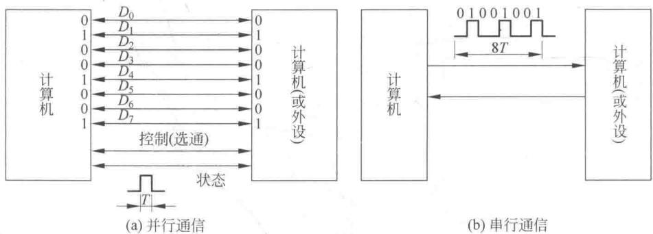

这张图怎么读：

1. **先看上下两部分。** 上半部分是并行通信，下半部分是串行通信。
2. **看中间的连线数量。** 上半部分发送方和接收方之间有一把"扁平的线束"（一般是 8 根、16 根甚至更多），下半部分只有两根细细的线。
3. **看线上的标注。** 并行那部分，每一根线上都标着一位（D0、D1、D2……），说明"8 个 bit 同时走"；串行那部分只有一根线标着数据方向，说明"8 个 bit 排队走"。
4. **这张图想让你理解什么？** 就一句话：**并行用"线多"换"快"，串行用"慢"换"线少"。**

#### 再画一张更容易懂的图

【辅助理解图】

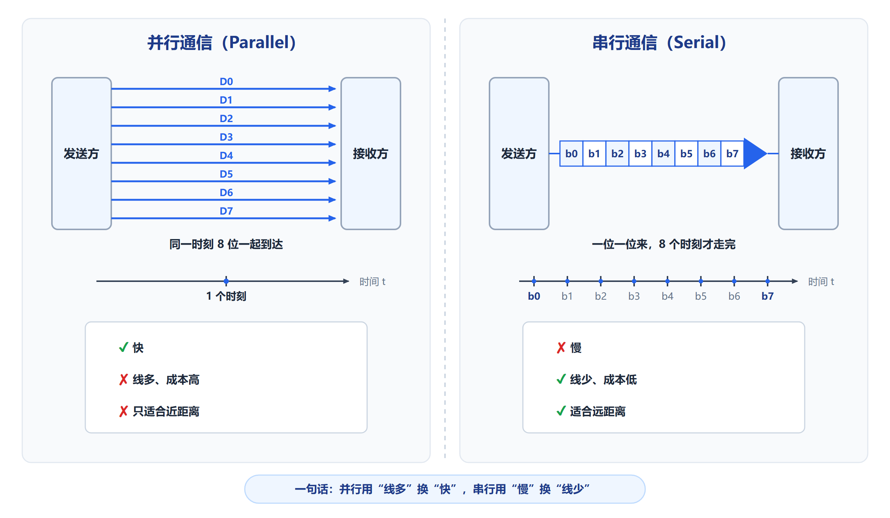

看图要点：

- 左半边画的是**并行**：8 条并排的水平箭头同时从"发送方"指向"接收方"，每条箭头里写着 D0~D7，标注"同一时刻 8 位一起到"。
- 右半边画的是**串行**：只有 1 条水平箭头，上面用 8 个小方格标出 b0、b1……b7，标着"一位一位来，8 个时刻才走完"。
- 两条时间轴的对比是最关键的：并行的 8 位"同时到达"，串行的 8 位"依次到达"。

#### 正式知识（考试怎么答）

**并行通信**：数据的各位同时传送，以字节或其倍数为单位，速度快，但线多、成本高、只适合近距离。

**串行通信**：数据在一条线上一位一位地顺序传送，每一位占固定时间长度，线少、成本低、适合远距离，但速度较慢。

**本课程要建立的一个直觉：**

> STM32 芯片内部，数据是并行跑的（32 位数据总线一次搬 32 个 bit）。
> 但芯片引脚的线很宝贵，不可能为了通信拉出 8 根线。
> 所以内部是"并行"，出门就变成"串行"。
> **把并行变串行、把串行变并行，这件事必须有人做——这就是串行接口（USART / SPI）存在的第一个理由。**

---

### 9.1.2 按数据传送方向分类：单工 / 半双工 / 全双工

#### 用大白话理解

三种"说话方式"：

1. **只能一个人说**：像收音机。电台只能发，收音机只能收，你对着收音机喊破喉咙也没用。
2. **能互相说，但不能同时说**：像对讲机。"喂喂，你那边情况怎么样？"——说完要松开按键，对方才能说。
3. **能同时说**：像打电话。两个人可以同时讲话、同时听。

#### 【教材内容】

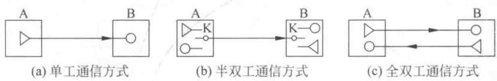

这张图分 (a)(b)(c) 三个小图：

**图 (a) 单工通信方式（simplex）：**

- A 是发送站，B 是接收站；
- 只有一根线，箭头只有一个方向：A → B；
- 数据**只能由 A 发到 B**，B 永远不能回话；
- 教材的类比：**类似无线电广播**，电台发送，收音机接收，收音机永远不能发送。

**图 (b) 半双工通信方式（half duplex）：**

- 也只有**一根**线，但箭头是双向的；
- 注意图上有一个开关 **K**（收发控制开关）。谁把开关拨到自己这边，谁才能发；
- 同一时间只能有一个方向在传；
- 教材的类比：**类似对讲机**，某时刻 A 发 B 收，另一时刻 B 发 A 收，双方不能同时收发。

**图 (c) 全双工通信方式（full duplex）：**

- 有**两根独立的线**（一根 A→B，一根 B→A）；
- A、B **既能同时发送，又能同时接收**；
- 教材的类比：**类似电话机**，双方可以同时说话、同时听。

#### 【类比】它对应计算机里的什么，以及类比的边界

| 生活 | 通信方式 | 硬件上的真实样子 |
|---|---|---|
| 广播电台 | 单工 | 只有一根数据线，方向固定 |
| 对讲机 | 半双工 | 只有一根数据线，方向可切换（要么靠开关，要么靠协议约定"现在轮到谁"） |
| 电话 | 全双工 | 两根独立数据线，一根专管发，一根专管收 |

**类比的边界：** 对讲机是靠人按按钮切换方向，而半双工通信靠的是硬件/软件去切换收发方向（比如 STM32 USART 的"单线半双工模式"），切换速度是微秒级的，人根本感觉不到。

#### 正式知识

- **单工（simplex）**：数据只能沿一个固定方向传送。
- **半双工（half duplex）**：数据可以双向传送，但同一时刻只能沿一个方向。
- **全双工（full duplex）**：数据可以同时双向传送。

**STM32 的 USART 默认就是全双工**：TX 引脚专门发，RX 引脚专门收，互不干扰。

#### 再画一张更容易懂的图

【辅助理解图】

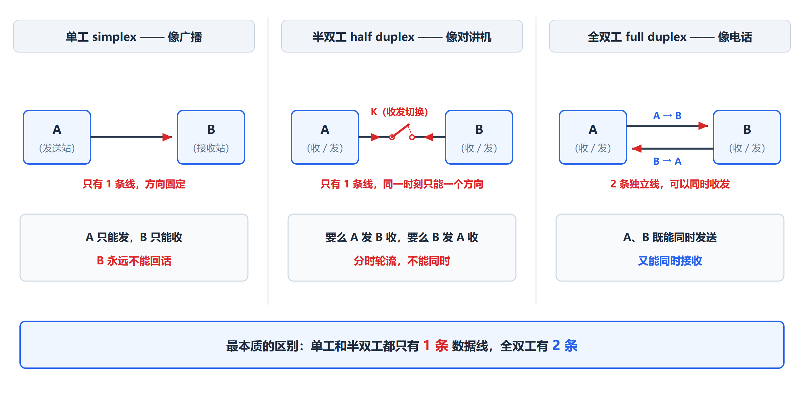

看图要点：

- 上排三张小图分别是"单工""半双工""全双工"，每张图里都画 A、B 两个方块和它们之间的连线。
- **单工**：只有一条箭头，从 A 指向 B，箭头旁标"只能这个方向"。
- **半双工**：只有一条线，线上画两个方向相反的箭头，中间画一个开关，标"同一时刻只能一个方向"。
- **全双工**：两条独立的线，一条 A→B，一条 B→A，标"可以同时收发"。
- 每张小图下面配一句生活类比：广播 / 对讲机 / 电话。
- **注意三张图里"线的数量"**：单工和半双工都是 1 条，全双工是 2 条——这是最本质的区别。

#### 多终端的情况

教材还介绍了**主从多终端通信方式**：

> 主机 A 可以向多个从机终端（B、C、D……）发出信息。在 A 允许的条件下，可以控制管理 B、C、D 等在不同的时间向 A 发出信息。根据数据传送的方向又分为多终端半双工通信和多终端全双工通信。

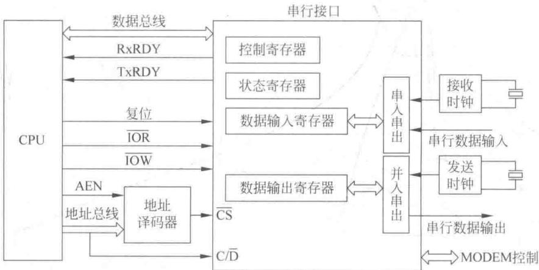

看图要点：一个"主机"在左边，右边挂着好几个"从机"，所有从机共享同一组线。主机像老师，从机像学生——老师点名，被点到的学生才能回答。

> **⚠️ 说明（图 9-6 与图 9-7 共用文件的问题，N19）：** MinerU 在教材 p59 这一页把**三张图的题注和图片合并/混在一起**：`6bf0e2b4…jpg`（多终端半双工）、`b17a5e0d…jpg`（多终端全双工），以及最后一条同时挂着"**图 9-6 主从多终端通信方式**"和"**图 9-7 CPU 与串行接口的连接**"两个题注的 `b2756e08…jpg`（就是上面这张）。
> 也就是说：**`b2756e08…jpg` 这个文件只可能是其中一张图（也不排除是把两张裁在了一起），在人工核对原 PDF p59 之前无法确定它到底是谁。**
> 本讲义的处理是：**在 9.1.2 这里把它按教材题注顺序当作图 9-6 使用；到 9.1.6 讲图 9-7 时不再重复贴同一张图**，避免同一个文件被讲成两张不同的图。已记入文末【待核验】N19。

---

### 9.1.3 按同步方式分类：异步通信和同步通信

#### 用大白话理解：这一节解决"节拍怎么对齐"的问题

假设你和一个朋友用**摩尔斯电码**隔着操场传消息。

- 你打算用"长音 = 1、短音 = 0"来发 8 个 bit。
- 问题是：朋友怎么知道你什么时候开始？每个音持续多久？第一个音结束了没有？

有两种解决办法：

**办法一：每传一个字符，先敲一声"注意，我要开始了"，再敲"我说完了"。**

朋友听到"开始"就掐表，按约定的节奏采样。传完一个字符，双方都停下来喘口气，下一个字符重新来一遍。

这就是 **异步通信**。"异步"不是"没有节奏"，而是"**每个字符各自重新对一次表**"。

**办法二：找一个节拍器，全程不停打拍子，数据跟着拍子走。**

朋友从头到尾听着节拍器的"哒哒哒"，每个"哒"就是一个 bit，根本不需要每传一个字符就重新对表。

这就是 **同步通信**。

#### 【教材内容】：异步通信（asynchronous communication）

> 在异步通信方式中，接收器和发送器**使用各自的时钟**，它们的工作是非同步的。在异步传送中，每一个字符要用**起始位和停止位**作为字符开始和结束的标志，**以字符为单位**一个个地发送和接收。

异步传送时，每个字符的组成格式如下：

1. 首先用**一个起始位**表示字符的开始；
2. 后面紧跟着的是字符的**数据字**，数据字通常是 **7 位或 8 位**数据（**低位在前，高位在后**），在数据字中可根据需要加入**奇偶校验位**；
3. 最后是**停止位**，其长度可以是 **1 位、1.5 位或 2 位**。

> 串行传送的数据字加上成帧信号的起始位和停止位就形成了一个串行传送的**帧**。
> **起始位用逻辑 0（低电平）表示，停止位用逻辑 1（高电平）表示。**
> 图 9-2(a) 所示为数据字为 7 位的 ASCII 码，第 8 位是奇偶校验位，加上起始位、停止位，一个字符帧由 **10 位**组成。
>
> 在异步传送中，字符间隔不固定，在停止位后可以加**空闲位**，空闲位用**高电平**表示，用于等待发送。这样，接收和发送可以随时进行，不受时间的限制。

#### 【先补一个前置知识：什么叫"帧"（frame）？】

"帧"就是"**一次完整传送的最小包装**"。

就像寄快递：你不能只寄一张纸，你得装进信封，写上收件人和寄件人。"信封 + 内容"一起寄出去，对方收到的是一整包。

串行通信里：

```
一个帧 = 起始位 + 数据位 + [校验位] + 停止位
         （信封开头）  （内容）   （封条）   （信封结尾）
```

对方每收到一帧，就得到一个完整字符。

#### 看教材原图：异步通信的格式

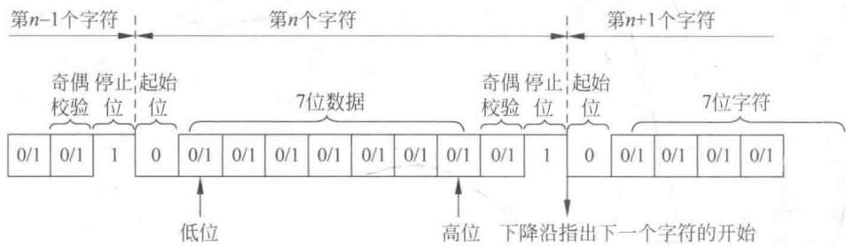

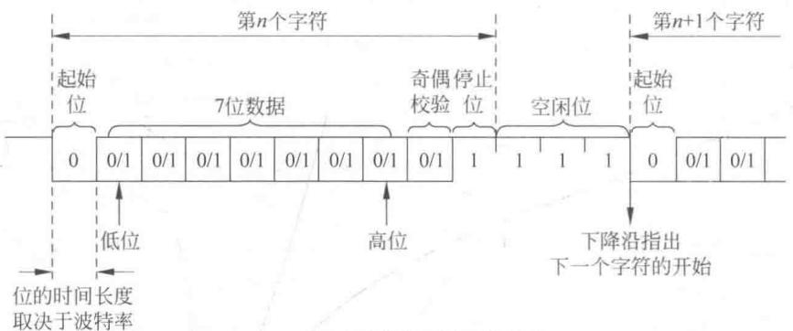

**图 9-2(a) 怎么读（从左到右）：**

1. 最左边一段是**高电平**，这叫**空闲状态**（线没事干的时候就是高的）。
2. 突然出现一个**低电平**——这就是**起始位**，告诉接收方："注意，我要开始发一个字符了！"
3. 接着是 **7 个数据位**，注意顺序是**低位在前**：先发 bit0，最后发 bit6。
4. 然后是 **1 个奇偶校验位**。
5. 最后是一个**高电平**——这就是**停止位**，告诉接收方："这个字符完了。"
6. 数一数：1（起始）+ 7（数据）+ 1（校验）+ 1（停止）= **10 位**。

**图 9-2(b) 怎么读：**

和图 (a) 基本一样，区别是：停止位之后**没有立刻接下一个字符的起始位**，而是一段持续的高电平。这段高电平就叫**空闲位**。它不代表任何数据，只是在"等"。什么时候要发下一个字符，什么时候再拉低产生起始位。

**这张图想让你理解什么？**

> **异步通信的精髓是"每次都用起始位重新对表"。**
> 因为发送方和接收方各自用自己的时钟，两个时钟频率不可能完全一样，传得越久误差积累越大。所以异步通信干脆"只保证一个字符内不跑偏"，每传一个字符就重新对齐一次。这也是为什么异步通信的帧都很短。

#### 【补充解释】"低位在前"为什么这么重要？

教材反复强调"**低位在前，高位在后**"（LSB first）。这不是随便定的，而是硬件实现的自然结果：发送时数据一位一位地往右移出移位寄存器，最右边的那位（最低位 bit0）自然最先出去。

看一个具体例子，数据是 `0x25`：

```
0x25 = 0010 0101
        b7 b6 b5 b4 b3 b2 b1 b0
        = 0  0  1  0  0  1  0  1
```

**先发的是 bit0 = 1，然后 bit1 = 0，bit2 = 1，bit3 = 0，bit4 = 0，bit5 = 1，bit6 = 0，bit7 = 0。**

所以线上看到的顺序是：`1, 0, 1, 0, 0, 1, 0, 0`。

**如果你按"从左往右读二进制"的习惯去理解线上波形，一定会错。** 这是初学者最容易翻车的地方之一。

#### 再画一张更容易懂的图：串行数据帧时序波形

【辅助理解图】

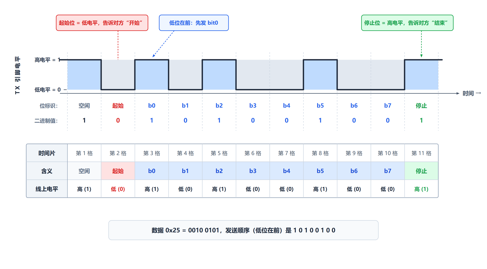

**精确版波形（ASCII，数值可核对）：**

下面用 `0x25`、9600、n、8、1（8 位数据、无校验、1 位停止位）画一个完整帧。

```
时间片:   |  0  |  1  |  2  |  3  |  4  |  5  |  6  |  7  |  8  |  9  | 10  |
含义:     |空闲 |起始 | b0  | b1  | b2  | b3  | b4  | b5  | b6  | b7  |停止 |
线上电平: | 高  | 低  | 高  | 低  | 高  | 低  | 低  | 高  | 低  | 低  | 高  |
对应数值: |  1  |  0  |  1  |  0  |  1  |  0  |  0  |  1  |  0  |  0  |  1  |
```

对应的波形（每一位宽度相同，横轴向右是时间）：

```
       空闲    起始    b0    b1    b2    b3    b4    b5    b6    b7   停止   空闲
      ────────┐     ┌────┐     ┌────┐     ┌────┐                 ┌────────────
              │     │    │     │    │     │    │                 │
              └─────┘    └─────┘    └─────┘    └─────────────────┘
       ↑
     高电平 = 空闲
```

> 说明：上面这张 ASCII 波形是"示意版"，横轴的每个小段宽度相同（都代表 1 位的时间）。因为中文字符在终端里是双倍宽，ASCII 图的对齐会有轻微偏差，**一切以中间那张数值表为准**。

**逐步讲解"先发生什么 → 再发生什么 → 为什么"：**

| 步骤 | 线上发生什么 | 接收方怎么反应 | 为什么 |
|---|---|---|---|
| ① | 线一直是**高**（空闲） | 接收方盯着线，等一个下降沿 | 空闲必须是高电平，这样起始位（低）才能被"看出来" |
| ② | 线被拉**低**，持续 1 位时间 | 检测到下降沿 → 知道"字符开始了" | 这就是起始位的作用：一次重新对表的信号 |
| ③ | b0 出现（本例是**高**） | 从起始位开始掐表，过 1.5 位时间后采样（采在正中间） | 采在中间最安全，前后都有余量，不怕时钟有一点点误差 |
| ④ | b1 出现（**低**） | 再过 1 位时间，再采一次 | 每 1 位时间采一次，连采 8 次 |
| ⑤ | b2~b7 依次出现 | 依次采 8 个 bit，凑成一个字节 | 采完后按"低位在前"拼回原值 |
| ⑥ | 线变**高**（停止位） | 检查这一位是不是高 | 如果是低 → 说明双方节拍乱了，产生**帧错误（FE）** |
| ⑦ | 线保持高（空闲） | 回到步骤 ①，等下一个下降沿 | 等待下一个字符 |

**为什么采样要采在"位正中间"？**

假设双方时钟有 2% 的误差，传 10 位下来，累计偏差是 0.2 位。如果采样点在第 0.5 位（正中间），还有 0.3 位的余量，安全；如果采样点在第 0.1 位，一偏就采错。**所以"采在中间"是串行接收的第一条铁律。**

#### 【教材内容】：同步通信（synchronous communication）

> 同步通信是一种**连续**串行传送数据的通信方式，一次通信只传送一帧信息。这里的**信息帧**和异步通信中的**字符帧**不同，通常含有**若干个数据字符**。

同步通信的数据格式分两种：

##### ① 面向字符型的数据格式

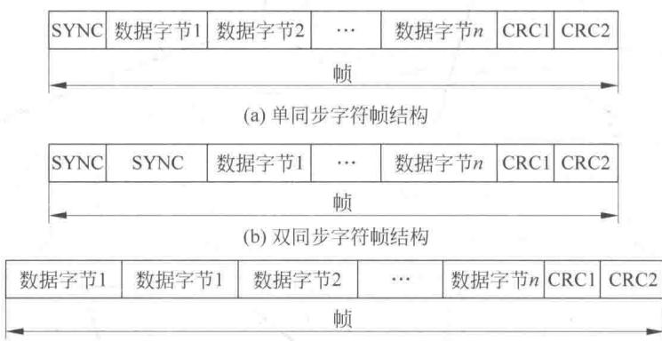

> 面向字符型的同步通信数据格式可采用**单同步、双同步和外同步** 3 种数据格式。
>
> 单同步和双同步均由**同步字符、数据字符和校验字符 CRC** 3 部分组成。
> - **单同步**是指在传送数据之前先传送**一个**同步字符 SYNC；
> - **双同步**则先传送**两个**同步字符 SYNC；
> - **同步字符位于帧结构的开头**，用于确认数据字符的开始。接收端不断地对传输线采样，并把采样到的字符和双方约定的同步字符比较，**只有比较成功后才会把后面接收到的字符加以存储**；
> - **数据字符**在同步字符之后，个数不受限制，由所需传输的数据块长度决定；
> - **校验字符**有 1~2 个，位于帧结构末尾，用于接收端对接收到的数据字符的正确性校验。
> - **外同步**通信的数据格式中**没有同步字符**，而是用一条**专用控制线**来传送同步字符，使接收端及发送端实现同步。当每一帧信息结束时均用两个字节的循环控制码 CRC 为结束。
>
> 在单同步字符帧结构中，同步字符常采用 ASCII 码中规定的 **SYN（即 16H）**；在双同步字符帧结构中，同步字符一般采用国际通用标准代码 **EB90H**。

**看图要点（图 9-3(c) 外同步）：** 左边有一条单独的"同步信号线"（不是数据线），它给出一个脉冲，告诉接收方"从这里开始算数据"。数据线上本身**没有**同步字符。

##### ② 面向比特型的数据格式

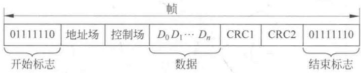

> 根据同步数据链路控制规程（SDLC），面向比特型的数据每帧由 6 个部分组成：
> 1. 开始标志 "**7EH**"；
> 2. 一个字节的**地址场**；
> 3. 一个字节的**控制场**；
> 4. 需要传送的**数据**（数据都是 bit 的集合）；
> 5. 两个字节的**循环控制码 CRC**；
> 6. 又是 "**7EH**"，作为结束标志。
>
> 在 SDLC 规程中不允许在数据段和 CRC 段中连续出现 6 个 1，否则会误认为是结束标志（因为 7EH = 0111 1110，有 6 个连续的 1）。要求在发送端进行检验，**当连续出现 5 个 1 时，则立即插入一个 0**，到接收端要将这个插入的 0 去掉，恢复原来的数据。

**看图要点（图 9-4）：** 从左到右依次是：`7E | 地址 | 控制 | 数据…… | CRC | CRC | 7E`。首尾两个 7EH 像一对括号，把整帧夹起来。

**这张图想让你理解什么？**

> 同步通信不像异步那样"每传一个字符就重新对表"，而是"**先用一个特殊标志对准，然后一大串数据一口气传完**"。
> 好处是效率高（不用给每个字符都加起始位、停止位）；
> 代价是**收发双方的时钟必须严格同步**，否则传得越长偏得越多。

#### 同步 vs 异步 对比表

| 对比项 | 异步通信 | 同步通信 |
|---|---|---|
| 时钟 | 收发各用自己的时钟，不要求严格一致 | 收发时钟必须严格同步（发送时钟还要送到接收端） |
| 传输单位 | 一个字符（一帧 = 起始位 + 数据 + 校验 + 停止位） | 一帧含若干数据字符 |
| 帧的标志 | 每个字符都加起始位、停止位 | 帧头加同步字符（或专用同步线） |
| 效率 | 低（每个字符都要额外的起始/停止位） | 高 |
| 速度 | 较慢 | 较高，通常可达 56000 b/s 或更高 |
| 适合场合 | 数据零散、随时可能发 | 信息量大、速率高的系统 |
| STM32 里谁用 | USART 的异步模式（最常用） | USART 的同步模式 / SPI |

#### 正式知识（考试怎么答）

**异步通信**：收发双方使用各自的时钟，以字符为单位传送，每个字符用起始位和停止位作为开始和结束标志。

**同步通信**：收发双方时钟保持严格同步，一次通信传送一帧信息，帧内可含多个数据字符，靠同步字符（或专用同步线）实现同步。

---

### 9.1.4 波特率、比特率和码元

#### 用大白话理解

"波特率"就是**通信的语速**。

就像你说话快慢：说得快，一分钟能说很多字；说得慢，就要说很久。

只不过计算机的"字"是 bit。

#### 【教材内容】

> 在异步数据传送中，通信双方必须约定好两项事宜：
>
> ① **字符格式**。包括字符的编码形式、奇偶校验以及起始位和停止位的规定。
>
> ② **通信速率**。通信速率通常使用**比特率**来表示。在数字通信中，比特率是数字信号的传输速率，它用**单位时间内传输的二进制代码的有效位（bit）数**来表示，其单位为每秒比特数 **bit/s（bps）**、每秒千比特数 kbps 或每秒兆比特数 Mbps。
>
> 在描述通信速率中，还经常遇到**波特率**这个概念。**波特率指数据信号对载波的调制速率**，它用单位时间内载波调制状态改变次数来表示，其单位为**波特（Baud）**。
>
> **波特率与比特率的关系是：比特率 = 波特率 × 单个调制状态对应的二进制位数。**
>
> 在信息传输通道中，携带数据信息的信号单元叫**码元**，每秒钟通过信道传输的码元数称为**码元传输速率**，简称波特率。波特率是传输通道频宽的指标。
>
> 例如，数据传送速率为 **120 字符/秒**（这个速率可以称为波特率），而每一个字符为 **10 位**，则其传送的比特率为 **10 × 120 = 1200 位/秒 = 1200 比特**。
>
> 在后面的描述中，为了适应习惯用法，**将比特率和波特率统一使用波特率来表示**。

#### 【补充解释】到底什么时候"波特率 ≠ 比特率"？

上面那段话里有个容易绕晕的点：**波特率是"每秒多少个码元"，比特率是"每秒多少个 bit"。**

- 如果 1 个码元只携带 1 个 bit（我们的 USART 就是这种情况，线上只有高/低两种状态），那么 **波特率 = 比特率**。
- 如果 1 个码元携带多个 bit（比如某些调制解调器，一个码元有 4 种电平，携带 2 bit），那么 **比特率 = 波特率 × 2**。

**好消息：本课程里，USART 和 SPI 都是"一个码元 = 一个 bit"，所以可以直接认为：**

> **波特率 = 比特率 = 每秒传多少个 bit。**

**⚠️ 教材那句话"120 字符/秒这个速率可以称为波特率"其实是教材自己的习惯用法。** 严格说，"字符/秒"是字符速率，不是波特率。教材自己也承认了这一点——它在最后说"为了适应习惯用法，将比特率和波特率统一使用波特率来表示"。所以**考试时按教材的说法写**，但心里要清楚真正的区别。

#### 波特率决定了什么？

波特率决定了**每一位占多长时间**：

```
1 位的时间 T(位) = 1 / 波特率
```

举例：

| 波特率 | 1 位时间 | 传 1 个字节（10 位）要多久 |
|---|---|---|
| 9600 bps | 1/9600 ≈ 104.17 μs | 10 × 104.17 ≈ 1.04 ms |
| 115200 bps | 1/115200 ≈ 8.68 μs | 10 × 8.68 ≈ 86.8 μs |

**为什么通信双方必须约定同一个波特率？**

因为接收方是"按时间采样"的。如果发送方按 9600 发（每位 104 μs），接收方却按 19200 收（以为每位 52 μs），那么接收方会在第 52 μs 就去采第 1 位，采到的还是第 1 位；但到第 8 位时，接收方的采样点已经跑到第 4 位去了——数据全乱。

**一句话：波特率不一致 = 鸡同鸭讲。**

【辅助理解图】

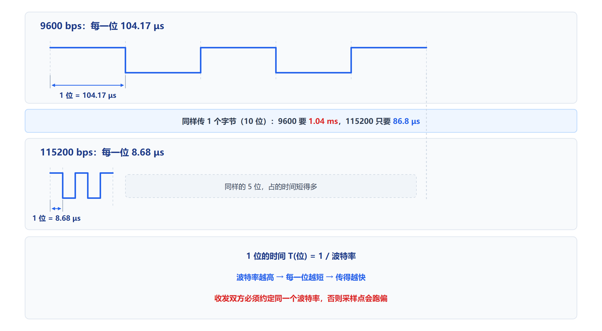

看图要点：图上方是一条 9600 bps 的波形（每位很宽），下方是一条 115200 bps 的波形（每位很窄），两条波形的位数相同，但下面的明显"挤"在一起。右侧标注"同样传 10 位，9600 要 1.04 ms，115200 只要 86.8 μs"。

#### 正式知识（考试怎么答）

- **比特率**：单位时间内传输的二进制位数，单位 bit/s（bps）。
- **波特率**：单位时间内传输的码元数，单位 Baud。
- **关系**：比特率 = 波特率 × 单个调制状态对应的二进制位数。本课程中一个码元携带 1 bit，故二者数值相等。

---

### 9.1.5 校验位：怎么发现"传错了"

#### 用大白话理解

你在电话里念一串数字："3、8、5、2、7、4、1、9"。

对方听完问："你念了几个 9？"你说"1 个"。对方数了数自己记下的，发现也是 1 个，就放心了。

**奇偶校验就是这个意思：在数据后面加一位，专门用来"数 1 的个数"。**

#### 【教材内容】

> （1）**奇偶错误（parity error）**。
> 为了检测传送中可能发生的错误，UART 在发送时会检查每个要传送的字符中 **1 的个数**，自动在奇偶校验位上添加 1 或 0，使得 1 的总和（包括奇偶校验位）在**偶校验时为偶数**，**奇校验时为奇数**。UART 在接收时会检查字符中的每一位（包括奇偶校验位），计算其 1 的总和是否符合奇偶检验的要求，以确定是否发生传送错误。

#### 具体演算（不跳步）

**例：数据 = 00110101，问偶校验和奇校验分别填什么？**

第一步：数数据里有几个 1。

```
0 0 1 1 0 1 0 1
        ↑   ↑   ↑
        共 4 个 1
```

第二步：按规则决定校验位。

- **偶校验**（USART_CR1 中的 PS = 0）：希望"数据 + 校验位"里 1 的总数是**偶数**。
  现在已经有 4 个 1（偶数），所以校验位填 **0**，总数还是 4（偶数）。
- **奇校验**（USART_CR1 中的 PS = 1）：希望 1 的总数是**奇数**。
  现在有 4 个（偶数），所以校验位填 **1**，总数变成 5（奇数）。

**答案：偶校验 → 校验位 = 0；奇校验 → 校验位 = 1。**（这正是教材 p73 的原文例子。）

再算一个：数据 = 00110100（3 个 1）。

```
0 0 1 1 0 1 0 0
        ↑   ↑
        共 3 个 1
```

- 偶校验：3 是奇数，要凑成偶数 → 校验位 = **1**（总数 4）。
- 奇校验：3 已经是奇数 → 校验位 = **0**（总数还是 3）。

#### 【补充解释】奇偶校验能发现什么，不能发现什么？

- 能发现：**任意 1 位出错**（因为 1 的个数奇偶性一定被改变）。
- 不能发现：**同时错 2 位**（奇偶性又变回来了，看起来"正常"）。
- 不能发现：错在哪儿。

所以奇偶校验是"最便宜、最弱"的一种校验。想要更强，就要用 CRC（后面 SPI 那节会讲）。

---

### 9.1.6 串行接口：并行和串行之间的"翻译官"

#### 用大白话理解

前面说过：

- STM32 内部的数据是**并行**的（32 位总线一次搬 32 个 bit）；
- 出了芯片就是**串行**的（一根线一位一位走）。

那么问题来了：**谁来把"并排的 8 个人"改成"排队的 1 个人"？**

答案：**串行接口**。

它就像一个翻译官，站在芯片内部总线和外部引脚之间：

```
STM32 内部（并行）          串行接口          芯片外部（串行）
  32 位数据总线  ←──────→  [并↔串转换]  ←──────→  TX 引脚（1 根线）
                                                 RX 引脚（1 根线）
```

#### 【教材内容】

> 串行通信中的数据是一位一位依次传送的，而计算机系统或计算机终端中数据是并行传送的。因此，**发送端必须把并行数据变成串行**才能在线路上传送，**接收端接收到的串行数据又需要变换成并行数据**才可以进一步处理。上述并→串或串→并的转换既可以用软件实现，也可用硬件实现。由于用软件实现会增加 CPU 的负担，目前往往用**硬件（串行接口）**完成这种转换。串行接口通过**系统总线**和 CPU 相连。

> **⚠️ 说明（为什么这里没有贴图 9-7）：** MinerU 把图 9-6 和图 9-7 的题注合并到了同一个条目，并且这一页**只提供了一个图片文件**；这个文件已经用在 9.1.2 节的图 9-6 位置了，**在没有核对原 PDF 之前，我们无法确认它到底是图 9-6 还是图 9-7（也不排除原文件是把两张图裁在了一起）**。为了避免读者把一张图误认成两张，本讲义在这里**不重复引用**，改用上面的文字和结构示意说明。图 9-7 的图片待人工从原 PDF p59 提取后补上，已记入文末【待核验】N19。

**图 9-7 想让你看懂什么（按教材文字 + 讲义示意）：** CPU 和串行接口之间是通过**系统总线**连的（左边是并行的数据总线、控制总线），串行接口的另一侧才是"一位一位走"的串行数据线。也就是说，图 9-7 要表达的就是本节上面那张 ASCII 结构图：**左边并行、右边串行、中间是完成"并↔串"转换的串行接口**。

#### 串行接口的四个组成部分

教材说，串行接口主要由 **4 个部分**组成：

| 部件 | 中文名 | 它是干什么的 | 类比 |
|---|---|---|---|
| 数据输入寄存器 | 接收数据缓冲器 | 收进来的数据先放这儿，等 CPU 来拿 | 收件箱 |
| 数据输出寄存器 | 发送数据缓冲器 | CPU 要发的数据先放这儿，等硬件慢慢发 | 发件箱 |
| 状态寄存器 | status register | 告诉 CPU"现在忙不忙、收到没有、出错没有" | 门口的指示灯 |
| 控制寄存器 | control register | CPU 在这里写"我要用多少波特率、多少数据位" | 遥控器上的按钮 |

教材对每个部件的原文解释：

> **（1）数据输入寄存器。** 在输入过程中，串行数据一位一位地从传输线进入串行接口的**接收移位寄存器**，经过**串入并出**电路的转换，当接收完一个字符之后，数据就从接收移位寄存器传送到**数据输入缓冲器**，等待 CPU 读取。
>
> **（2）数据输出寄存器。** 当 CPU 输出数据时，先送到**数据输出缓冲器**，然后，数据由输出寄存器传到**发送移位寄存器**，经过**并入串出**电路转换一位一位地通过输出传输线送到外部设备。
>
> **（3）状态寄存器。** 用来存放外部设备运行的状态信息，CPU 通过访问这个寄存器来了解某个外部设备的状态，进而控制外部设备的工作，以便与外部设备进行数据交换。
>
> **（4）控制寄存器。** 串行接口中有一个控制寄存器，CPU 对外部设备设置的工作方式命令、操作命令都存放在控制寄存器中，通过控制寄存器控制外部设备运行。

#### 【先补一个前置知识：什么叫"移位寄存器"？】

"寄存器"你先理解成"芯片内部一排能存 0/1 的小格子"（这个第 2 章讲过）。

**移位寄存器**就是"**每个时钟滴答，所有格子里的内容一起往旁边挪一格**"的寄存器。

假设有 8 个格子，初始是 `1 0 1 1 0 0 1 0`，让它"每来一个时钟就往右挪一格，最右边那格的内容送出去"：

```
初始:      [1][0][1][1][0][0][1][0]   → 送出的位: （无）
第1拍后:   [?][1][0][1][1][0][0][1]   → 送出的位: 0
第2拍后:   [?][?][1][0][1][1][0][0]   → 送出的位: 1
第3拍后:   [?][?][?][1][0][1][1][0]   → 送出的位: 0
...
```

（`?` 表示新补进来的位。）

**这就是"并入串出"**：一次性把 8 个 bit 装进去（并行输入），然后一拍一拍地一位一位挤出去（串行输出）。

反过来，**"串入并出"**是：一位一位从左边塞进来，塞满 8 位之后一次性整体交给 CPU。

> **这一条极其重要，本章后面的 USART 发送器、SPI 收发，全靠它。**

#### 串行接口的基本工作原理

> 从本质上讲，所有的串行接口电路都是**以并行数据形式与 CPU 接口，而以串行数据形式与外部逻辑接口**。
>
> **串行发送时：** CPU 通过数据总线把 8 位并行数据送到数据输出寄存器，然后送给**并行输入/串行输出移位寄存器**，并在**发送时钟和发送控制电路**控制下通过串行数据输出端一位一位串行发送出去。**起始位和停止位是由串行接口在发送时自动添加上去的。** 串行接口发送完一帧后产生中断请求，CPU 响应后可以把下一个字符送到发送数据缓冲器。
>
> **串行接收时：** 串行接口监视串行数据输入端，并在检测到有一个**低电平（起始位）**时就开始一个新的字符接收过程。串行接口每接收到一位二进制数据位后就使**接收移位寄存器**（即串行输入并行输出寄存器）**左移一次**，连续接收到一个字符后将其**并行传送到数据输入寄存器**，并产生中断促使 CPU 从中取走所接收的字符。

#### 看教材原图：硬件 UART 的结构

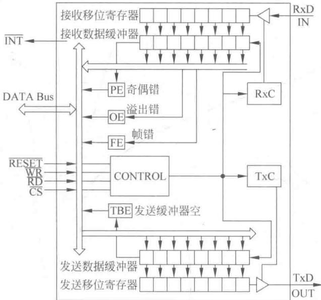

**这张图信息量不小，我们分三层看。**

**第一层：只看三个大块（先建立骨架）**

1. **左边**：CPU 和系统总线（数据总线、控制总线）。
2. **中间**：UART 内部——发送通路（上）和接收通路（下）。
3. **右边**：外部的串行线（TXD 出去、RXD 进来）。

**第二层：看发送通路（从上往下）**

```
CPU 写数据
   ↓（数据总线）
发送数据缓冲器（TDR）
   ↓
发送移位寄存器（并入串出）
   ↓（一位一位，按波特率节拍）
TXD 引脚 → 外部设备
```

**第三层：看接收通路（从下往上）**

```
RXD 引脚 ← 外部设备
   ↓（一位一位进来）
接收移位寄存器（串入并出）
   ↓（收满一个字符，整包搬运）
接收数据缓冲器（RDR）
   ↓（CPU 读）
CPU
```

**再看几个细节：**

- **波特率发生器**（图中间偏下）：它给发送和接收提供"节拍"。发送移位寄存器和接收移位寄存器都听它的。
- **控制寄存器**：CPU 通过它设置波特率、数据位数、要不要校验等。
- **状态寄存器**：里面有 TXE、TC、RXNE 这些标志位，CPU 靠读它来判断"能不能发下一个""收到没有"。

**这张图到底想让你理解什么？**

> 1. **发送和接收是两条独立的流水线**，所以可以全双工。
> 2. **中间有一个缓冲器 + 一个移位寄存器**，所以 CPU 把数据丢进缓冲器就可以走了，不用傻等着发完——这叫"**双缓冲**"。
> 3. **起始位、停止位是硬件自动加的**，程序员不用管。

#### 【辅助理解图】一张更简单的串行接口内部图

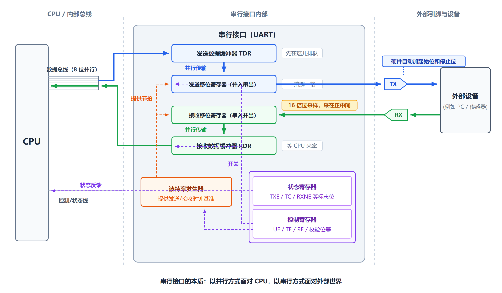

**这张图比图 9-8 简单得多，先看这张，再看图 9-8。**

看图要点（按"发送"和"接收"两条路分别看）：

**发送路径（图上用蓝色箭头，从下往上或从左往右）：**

1. 左边方块写"CPU"，它把 8 位并行数据放到"数据总线"（画成 8 条并排的小线）；
2. 数据进入方块"**发送数据缓冲器 TDR**"（标"先在这儿排队"）；
3. 数据被整包搬进方块"**发送移位寄存器**"（标"并入串出"）；
4. 在方块"**波特率发生器**"的节拍下（用虚线箭头标注），数据一位一位从方块右边的"**TX 引脚**"出去；
5. TX 引脚旁标注"硬件自动加起始位和停止位"。

**接收路径（图上用绿色箭头，方向相反）：**

1. 外部数据从"**RX 引脚**"一位一位进来；
2. 进入方块"**接收移位寄存器**"（标"串入并出"）；
3. 收满 8 位后整包搬进方块"**接收数据缓冲器 RDR**"（标"等 CPU 来拿"）；
4. CPU 通过数据总线读走。

**图下方另画两个小方块：**

- "**状态寄存器**"：箭头指回 CPU，标"告诉 CPU 忙不忙、收到没有、出错没有"；
- "**控制寄存器**"：箭头从 CPU 指过来，标"CPU 在这里设置波特率、数据位数"。

**这张图想让你理解什么？**

> **两条方向相反的流水线 + 一个共同节拍源 + 两个"管理用"寄存器。**
> 记住这个骨架，USART 和 UART 的结构就都通了。

#### UART / USART / USRT 是什么关系？

教材原文：

> 常见的串行接口——**通用同步/异步串行接收发送器**（Universal Synchronous/Asynchronous Receiver/Transmitter, **USART**）是一个**全双工**通用同步/异步串行收发模块，是一个高度灵活的串行接口通信设备。USART 收发模块一般分为 3 部分：**时钟发生器、数据发送器和接收器**。
>
> - **时钟发生器**由同步逻辑电路（在同步从模式下由外部时钟输入驱动）和**波特率发生器**组成。发送时钟引脚仅用于同步发送模式下。
> - **发送器**部分由一个单独的**写入缓冲器（发送 UDR）**、一个**串行移位寄存器**、**校验位发生器**和用于处理不同帧结构的**控制逻辑电路**构成。使用写入缓冲器，实现了**连续发送多帧数据无延时**的通信。
> - **接收器**是 USART 模块最复杂的部分，最主要的是**时钟和数据接收单元**。数据接收单元用于异步数据的接收。除了接收单元，接收器还包括**校验位校验器、控制逻辑、移位寄存器和两级接收缓冲器（接收 UDR）**。接收器支持与发送器相同的帧结构，同时支持**帧错误、数据溢出和校验错误**的检测。
>
> **通用异步收发器**（Universal Asynchronous Receiver and Transmitter, **UART**）除了没有 USART 中的同步时钟信号外，其他模块与 USART 相同。同步时钟信号较少使用，因此，经常把 USART 接口当成 UART 接口使用。

**术语表（第一次出现，按规矩给全）：**

| 缩写 | 英文全称 | 中文名 | 大白话 |
|---|---|---|---|
| UART | Universal Asynchronous Receiver and Transmitter | 通用异步收发器 | 只会"异步"这一种玩法的串口硬件 |
| USART | Universal Synchronous/Asynchronous Receiver and Transmitter | 通用同步/异步收发器 | 异步、同步都会的串口硬件，UART 的"升级版" |
| TDR | Transmit Data Register | 发送数据寄存器 | 要发出去的数据先放这儿 |
| RDR | Receive Data Register | 接收数据寄存器 | 收进来的数据放这儿等 CPU 拿 |

> **⚠️ 待核验：** 素材里把 UART 的英文全称写成了 "Universal Asynchronous Receiver and Transmitter, **USRT**"，缩写与后文不一致（后文一直用 UART）。这明显是 OCR 错误，已记入【待核验】。

#### UART 的三种出错标志

教材原文：

> 在 UART 中设置有出错标志，一般有以下 3 种：
>
> **（1）奇偶错误（parity error）。** 见 9.1.5 节。
>
> **（2）帧错误（frame error）**，表示字符格式不符合规定。
> 虽然接收端和发送端的时钟没有直接的联系，但是因为接收端总是在每个字符的**起始位处进行一次重新定位**，因此，必须要保证每次采样都对应一个数据位。只有在接收时钟和发送时钟的频率相差太大，从而引起在起始位之后刚采样几次就造成错位的情况下，才出现采样造成的接收错误。如果遇到这种情况，就会出现**停止位（按规定停止位应为高电平）为低电平**，从而引起信息帧格式错误，帧错误标志 **FE** 置位。
>
> **（3）溢出（丢失）错误（overrun error）。**
> UART 是一种**双缓冲器**结构的部件。UART 接收端接收到第一个字符后便放入接收数据缓冲器，然后继续从 RxD 线上接收第二个字符，并等待 CPU 从接收数据缓冲器中取走第一个字符。**如果 CPU 很忙，一直没有机会取走第一个字符，以致接收到的第二字符进入接收数据缓冲器而造成第一个字符被丢失**，于是产生了溢出错误，UART 自动使溢出错误标志 **OE** 置位。

**用大白话再讲一遍这三种错误：**

| 错误 | 什么时候发生 | 谁来发现 |
|---|---|---|
| 奇偶错误 PE | 数据里有奇数个 bit 被干扰翻转了 | 校验器发现"1 的个数不对" |
| 帧错误 FE | 该是停止位（高电平）的地方收到了低电平 | 说明双方节拍乱了，或者线被干扰 |
| 溢出错误 OE | 上一个字节 CPU 还没拿走，下一个又来了，把旧的挤掉了 | 硬件发现"缓冲器满了还往里塞" |

**溢出错误最值得注意**：它不是"线的问题"，而是"**软件太慢**"。解决办法通常是：

- 用中断而不是查询；
- 用 DMA（第 11 章）；
- 提高 CPU 处理速度 / 降低波特率。

---

### 9.1.7 并行通信和并行接口（教材 9.1.2 节）

> **说明：** 教材把这一节放在串行通信章里讲，是为了做对比。对本章主线（USART / SPI）来说，它属于背景知识，我们**压缩讲**，但该有的知识点一个不少。

#### 【教材内容】

> 实现并行通信的接口电路，称为**并行接口**。根据并行接口的特点可以分为输入并行接口、输出并行接口和输入/输出并行接口。并行通信以**同步方式**传输，其特点是：**传输速度快，硬件开销大，只适合近距离传输**。

一个并行接口的信息传输中包括三类信息：

| 信息类型 | 作用 | 例子 |
|---|---|---|
| **状态信息** | 表示外部设备当前所处的工作状态 | 准备好信号 READY=1 表示接口已准备好，可以和 CPU 交换数据；忙信号 BUSY=1 表示接口正在传输信息，CPU 需要等待 |
| **控制信息** | 由 CPU 发出，用于控制外部设备接口的工作方式以及外部设备的启动和复位等 | 启动信号、复位信号 |
| **数据信息** | CPU 与并行接口交换的主要内容 | 要传送的实际数据 |

> 状态信息、控制信息和数据信息通过**总线**传送，这些信息在外部设备接口中分别存放在**不同端口寄存器**中。接口电路需要几个端口相互配合，才能协调外部设备的工作。

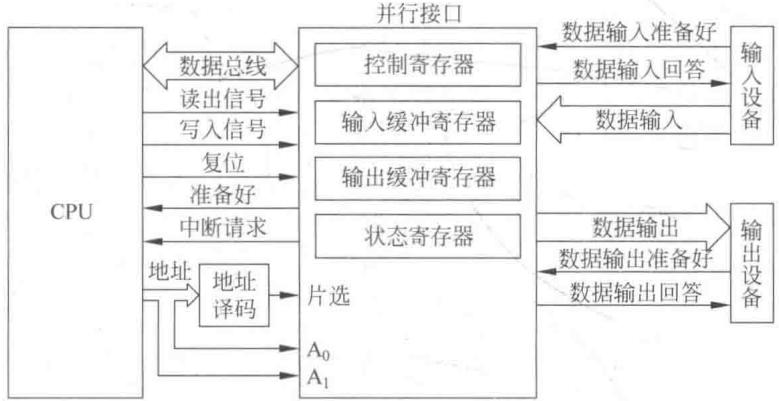

**看图要点：** 左边是 CPU 和总线，中间是并行接口（里面分成"输入数据缓冲器""输出数据缓冲器""状态寄存器""控制寄存器"四块），右边是被控制的外部设备。注意数据线上画的是**多条平行线**（表示多位同时传），而控制线和状态线是**单根线**（表示一位信号）。

#### 并行接口的组成

一个并行接口电路通常由 **输入数据缓冲器、输出数据缓冲器、状态寄存器和控制寄存器** 组成：

> **（1）输入缓冲寄存器。** 主要功能是负责接收设备送来的数据，CPU 通过读操作指令执行读操作，从输入数据缓冲器读取数据。
>
> **（2）输出缓冲寄存器。** 主要功能是负责接收 CPU 送来的数据，如果设备处于空闲状态，则从输出数据缓冲器取走数据，接口通知 CPU 进行下一次输出操作。
>
> **（3）状态寄存器。** 用来存放外部设备运行的状态信息，CPU 通过访问状态寄存器来了解外部设备状态，进而控制外部设备的工作。
>
> **（4）控制寄存器。** CPU 对外部设备设置的工作方式命令、操作命令都存放在控制寄存器中，通过控制寄存器控制外部设备的运行。

**注意：这 4 个部件和串行接口的 4 个部件是一模一样的。** 区别只在"数据线上是 8 位一起走，还是一位一位走"。

#### 并行通信接口的基本输入/输出工作过程

**（1）输入过程：**

> 外部设备首先将并行传输的数据放到外部设备与接口之间的数据总线上，并使"**数据输入准备好**"状态选通信号有效，该选通信号使数据传输到接口的输入数据缓冲器内。当数据写入输入数据缓冲器后，接口使"**数据输入应答**"信号有效，作为对外部设备输入的响应。外部设备收到此信号后，便撤销输入数据和"数据输入准备好"信号。
>
> 数据到达接口后，接口在状态寄存器中设置"**输入准备好**"状态位，以便 CPU 进行查询；接口也可以在此时向 CPU 发送**中断请求**，表示数据已输入到接口。CPU 既可以用**查询程序方式**，也可以用**程序中断方式**来读取接口中的数据。CPU 从输入缓冲器中读取数据后，接口自动清除状态寄存器中"输入准备好"状态位，并使数据总线处于**高阻状态**。至此，一个数据的传送结束。

**（2）输出过程：**

> 当外部设备从接口取走数据后，接口就会将状态寄存器中"**输出准备好**"状态位置 1，表示 CPU 当前可以向接口输出数据，这个状态位可供 CPU 进行查询。接口此时也可以向 CPU 发中断请求。CPU 既可以用程序查询方式，也可以用程序中断方式向接口输出数据。
>
> 当 CPU 将数据送到输出缓冲器后，接口自动清除"输出准备好"状态位，并将数据送往外部设备的数据线上，同时，接口将给外部设备发送"**启动信号**"来启动外部设备接收数据。外部设备被启动后，开始接收数据，并向接口发"**数据输出应答**"信号。接口收到此信号，便将状态寄存器中的"输出准备好"状态位置 1，以便 CPU 输出下一个数据。

#### 【类比】这个过程像什么？

像**食堂打饭**：

- 你（外部设备）把饭盆放到窗口（数据放到数据线上），说"我准备好了"（选通信号）；
- 阿姨（接口）接过饭盆（数据进缓冲器），回一句"收到了"（应答信号）；
- 你把手收回去（撤销数据和选通信号）；
- 阿姨在窗口挂个牌子"已备好一份"（状态位置 1），或者直接喊你（中断请求）；
- 你（CPU）来把饭端走（读数据），阿姨把牌子摘掉（清状态位）。

**类比的边界：** 真实硬件里，"说一句""回一句"都是电平信号，时间尺度是纳秒级；而且"高阻状态"并不是真的断开，而是让输出端呈高阻抗，相当于"松手不拉线"。

---

### 9.1 节小结

| 概念 | 一句话记住 |
|---|---|
| 并行通信 | 多位同时走，快，但线多、贵、近 |
| 串行通信 | 一位一位走，慢，但线少、便宜、远 |
| 单工 | 只能单向 |
| 半双工 | 能双向，但不能同时 |
| 全双工 | 能同时双向（USART 默认） |
| 异步通信 | 每个字符靠起始位重新对表，用停止位收尾 |
| 同步通信 | 全程一个节拍，靠同步字符对齐，效率高 |
| 波特率 | 每秒多少个码元；本课程里就等于每秒多少 bit |
| 校验位 | 用"1 的个数"的奇偶性发现 1 位错误 |
| 帧 | 起始位 + 数据位 + [校验位] + 停止位 |
| 串行接口 | 并行↔串行的翻译官，含数据/状态/控制寄存器 |

---

## 9.2 STM32 的异步串行通信接口（USART）

### 先别急着看教材：这一节到底要干什么？

9.1 节讲的全是"通信的一般规律"，那些规律是**纸上的规则**。

9.2 节要做的事情是：

> **把那些纸上的规则，变成 STM32 芯片里一堆可以写 0 写 1 的小开关（寄存器），然后学会怎么拨这些开关。**

具体来说，学完 9.2 节你要能回答：

1. STM32 上用哪几个引脚做串口？
2. 一个字节是怎么从 CPU 一路走到 TX 引脚、又怎么从 RX 引脚一路走回 CPU 的？
3. 波特率 9600 到底是怎么算出来的？
4. 哪些寄存器管哪些事？
5. 用固件库怎么把串口开起来、怎么发、怎么收、怎么用中断收？

### 你需要先知道的东西

#### 【先补一个前置知识：什么叫"寄存器"？（快速复习）】

第 2 章讲过：**寄存器就是芯片内部一排能存 0/1 的小格子**，一个 32 位寄存器就是 32 个小开关。

程序"配置外设"，本质就是**往某个特定地址写一个特定的数**，把这一排小开关拨成某种图案。

比如：

```
USART1->CR1 = 0x200C;
              ↓ 展开成二进制
0000 0000 0000 0000 0010 0000 0000 1100
                                ↑      ↑↑
                          bit13=1  bit3=1 bit2=1
                          UE=1     TE=1  RE=1
```

这一行代码的意思就是："把 USART1 的 UE、TE、RE 三个开关拨到 1"——即"打开 USART、允许发送、允许接收"。

#### 【先补一个前置知识：什么叫"地址"？"基地址 + 偏移"是什么意思？（快速复习）】

CPU 眼里，芯片里所有东西（内存、外设的寄存器）**都是排成一排的、有编号的格子**。这个编号就叫**地址**。

STM32 的做法是：

- 每个外设（比如 USART1）有一大块地盘，这块地盘的起始地址叫**基地址**（base address）；
- 外设内部的每个寄存器，相对基地址有一个固定的距离，叫**偏移**（offset）；
- 所以：

```
最终寄存器地址 = 外设基地址 + 寄存器偏移
```

例：

```
USART1 基地址   = 0x40013800
USART_SR 偏移   = 0x00
→ USART1_SR 的地址 = 0x40013800 + 0x00 = 0x40013800

USART1 基地址   = 0x40013800
USART_CR1 偏移  = 0x0C
→ USART1_CR1 的地址 = 0x40013800 + 0x0C = 0x4001380C
```

**这条"地址 → 地址空间 → 外设基地址 → 寄存器偏移 → 最终地址"的链条，是理解 STM32 最重要的一条链。** 本节 9.2.11 会用它把 USART 的 7 个寄存器全部算一遍。

#### 【先补一个前置知识：C 语言里的指针和 `->` 是什么意思？】

C 语言里：

```c
USART1->CR1 = 0x200C;
```

- `USART1` 在固件库里被定义成 `((USART_TypeDef *) USART1_BASE)`，也就是"**一个指向地址 0x40013800 的指针**"；
- `USART1->CR1` 的意思是"**去 USART1 这个结构体里找 CR1 这个成员**"，翻译成地址就是 `0x40013800 + 0x0C`；
- 赋值 `= 0x200C` 就是"**往地址 0x4001380C 写 0x200C**"。

**所以一行 `USART1->CR1 = ...`，在硬件上发生的事是：**

```
程序 → CPU 执行一次"存储"指令 → 在总线上发出地址 0x4001380C 和数据 0x200C
     → USART1 的 CR1 寄存器被写入 0x200C
     → USART1 硬件的 UE/TE/RE 三个开关被拨到 1
     → 收发器开始工作
```

这就是 TASK.md 第十一节要求的"**软硬件联动**"。后面每段代码我们都会这样拆。

---

### 9.2.1 STM32 异步串行通信接口简介

#### 【教材内容】

> **STM32F103VET6 集成了 3 个通用同步/异步串行接收发送器 USART（USART1~USART3）和 2 个通用异步收发器（UART4 和 UART5）。**
>
> 通用同步/异步收发器（USART）提供了一种灵活的方法与使用工业标准 **NRZ 异步串行数据格式**的外部设备之间进行**全双工**数据交换。USART 利用**分数波特率发生器**提供宽范围的波特率选择。它支持**同步单向通信和半双工单线通信**，也支持 **LIN**（局部互联网）、**智能卡协议**和 **IrDA**（红外数据组织）**SIR ENDEC 规范**，以及调制解调器（CTS/RTS）操作。它还允许多处理器通信。使用多缓冲器配置的 **DMA** 方式，可以实现高速数据通信。

#### 第一次出现的术语，按规矩给全

| 缩写 | 英文全称 | 中文名 | 大白话 |
|---|---|---|---|
| USART | Universal Synchronous/Asynchronous Receiver and Transmitter | 通用同步/异步收发器 | 会异步也会同步的串口硬件 |
| UART | Universal Asynchronous Receiver and Transmitter | 通用异步收发器 | 只会异步的串口硬件 |
| NRZ | Non-Return-to-Zero | 不归零码 | 一种最朴素的编码：高电平就是 1，低电平就是 0，中间不回零 |
| LIN | Local Interconnect Network | 局部互联网络 | 汽车里常用的一种低成本串行总线，本质是"串口的特殊用法" |
| IrDA | Infrared Data Association | 红外数据协会 | 用红外光传数据（老式手机红外口那种），也是"串口的特殊用法" |
| CTS | Clear To Send | 清除发送 | 硬件流控信号：对方说"我这边可以收了" |
| RTS | Request To Send | 请求发送 | 硬件流控信号：我说"我想发数据了" |
| DMA | Direct Memory Access | 直接存储器访问 | 第 11 章的内容：让一个"搬运工"替 CPU 搬数据 |

> **注意 STM32F103VET6 的串口分布：**
>
> - **USART1** 挂在 **APB2** 总线上（速度快，最高 72 MHz）；
> - **USART2、USART3** 挂在 **APB1** 总线上（最高 36 MHz）；
> - **UART4、UART5** 也挂在 **APB1** 上，但它们**没有同步模式、没有硬件流控、没有智能卡模式**。
>
> 【补充解释】"挂在哪条总线上"决定了它的最高波特率和时钟来源，这个后面算波特率时会直接用到。

#### USART 主要特性（教材 p63 原文，按主题重新归类）

**【通信能力】**

> - 全双工的异步通信。
> - NRZ 标准格式。
> - 分数波特率发生器系统：发送和接收共用的可编程波特率，最高达 4.5 Mb/s。
> - 可编程数据字长度（8 位或 9 位）。
> - 可配置的停止位——支持 1 或 2 个停止位。
> - 单线半双工通信。
> - 发送方为同步传输提供时钟。

**【特殊协议】**

> - LIN 主机发送同步断开符的能力以及 LIN 从机检测断开符的能力：当 USART 硬件配置成 LIN 时，生成 13 位断开符；检测 10/11 位断开符。
> - IRDA SIR 编码器译码器：在正常模式下支持 3/16 位的持续时间。
> - 智能卡模拟功能：智能卡接口支持 ISO7816-3 标准定义的异步智能卡协议；智能卡用到的 0.5 和 1.5 个停止位。

**【数据搬运】**

> - 可配置的使用 DMA 的多缓冲器通信：在 SRAM 里利用集中式 DMA 缓冲接收/发送字节。
> - 单独的发送器和接收器使能位。

**【状态与错误】**

> - 检测标志：接收缓冲器满标志、发送缓冲器空标志和传输结束标志。
> - 校验控制：包括发送校验位和对接收数据进行校验。
> - 4 个错误检测标志：溢出错误标志、噪音错误标志、帧错误标志和校验错误标志。
> - 10 个带标志的中断源，包括 CTS 改变、LIN 断开符检测、发送数据寄存器空、发送完成、接收数据寄存器满、检测到总线为空闲、溢出错误、帧错误、噪音错误、校验错误。

**【多机通信】**

> - 多处理器通信——如果地址不匹配，则进入静默模式。
> - 从静默模式中唤醒（通过空闲总线检测或地址标志检测）。
> - 两种唤醒接收器的方式：地址位（MSB，第 9 位），总线空闲。

#### STM32 的 USART 支持的模式（表 9-1）

| USART 模式 | USART1 | USART2 | USART3 | UART4 | UART5 |
|---|---|---|---|---|---|
| 异步模式 | √ | √ | √ | √ | √ |
| 硬件流控制 | √ | √ | √ | NA | NA |
| 多缓存通信（DMA） | √ | √ | √ | √ | √ |
| 多处理器通信 | √ | √ | √ | √ | √ |
| 同步 | √ | √ | √ | NA | NA |
| 智能卡 | √ | √ | √ | NA | NA |
| 半双工（单线模式） | √ | √ | √ | √ | √ |
| IrDA | √ | √ | √ | √ | √ |
| LIN | √ | √ | √ | √ | √ |

> （√ = 支持；NA = 不支持）
>
> **本课程最常用的是"异步模式"这一行，而且 5 个串口都支持。**

---

### 9.2.2 STM32 的 USART 引脚重映射

#### 用大白话理解：为什么要"重映射"？

STM32 的引脚是"一物多用"的。同一根物理引脚，可以当普通 GPIO 用，也可以当某个外设的功能引脚用。这叫**复用功能**（alternate function）。

问题是：**好用的引脚大家抢。** 比如你设计一块板子，PA9/PA10 已经被别的电路占了，但你还想用 USART1，怎么办？

ST 的解决办法是：**给一部分外设引脚准备"备用位置"**。默认位置被占了，就搬到备用引脚上去。这个"搬家"的动作就叫**重映射（remap）**。

#### 【先补一个前置知识：什么叫"复用功能"？】

一根 STM32 引脚内部其实连着好几个"信号源"，由一个**多路开关**决定引脚到底听谁的：

```
                ┌──── 普通 GPIO 输出
                ├──── USART1_TX
引脚 PA9 ──[多路开关]──── TIM1_CH2
                ├──── ...
                └────
```

拨到"USART1_TX"这一档，PA9 就变成串口的发送脚。这个"拨开关"的操作，是在 GPIO 的配置寄存器里做的（第 6 章讲过 GPIO 的复用推挽模式 `GPIO_Mode_AF_PP`）。

**重映射**则更进一步：不只是"这根脚当什么用"，而是"这个外设的功能到底出现在哪几根脚上"。

#### 【教材内容】

> 通过软件设置**复用重映射寄存器（AFIO_MAPR）**中的 **USART1_REMAP、USART2_REMAP 和 USART3_REMAP[1:0]**，USART1~USART3 的功能引脚可以切换（称为功能引脚重映射）。这种功能引脚重映射功能为系统的设计带来了极大的便利。

**表 9-2 USART1 引脚重映射**

| 复用功能 | USART1_REMAP = 0 | USART1_REMAP = 1 |
|---|---|---|
| USART1_TX | PA9 | PB6 |
| USART1_RX | PA10 | PB7 |

**表 9-3 USART2 引脚重映射**

| 复用功能 | USART2_REMAP = 0 | USART2_REMAP = 1（只适用于 100 和 144 脚的封装） |
|---|---|---|
| USART2_CTS | PA0 | PD3 |
| USART2_RTS | PA1 | PD4 |
| USART2_TX | PA2 | PD5 |
| USART2_RX | PA3 | PD6 |
| USART2_CK | PA4 | PD7 |

**表 9-4 USART3 引脚重映射**

| 复用功能 | USART3_REMAP[1:0]=00（没有重映射） | USART3_REMAP[1:0]=01（部分重映射） | USART3_REMAP[1:0]=11（完全重映像） |
|---|---|---|---|
| USART3_TX | PB10 | PC10 | PD8 |
| USART3_RX | PB11 | PC11 | PD9 |
| USART3_CK | PB12 | PC12 | PD10 |
| USART3_CTS | PB13 | PB13 | PD11 |
| USART3_RTS | PB14 | PB14 | PD12 |

**怎么读这三张表：**

- **第一列**是"这个外设需要哪些信号"。TX 是发送、RX 是接收、CK 是同步时钟、CTS/RTS 是硬件流控。
- **后面几列**是"选了不同的重映射值，这个信号出现在哪根引脚上"。
- 例：你选了 `USART1_REMAP = 1`，那么 USART1 的发送脚就从 PA9 搬到了 **PB6**，接收脚从 PA10 搬到了 **PB7**。

> **⚠️ 待核验：** 表 9-4 中 `USART3_REMAP[1:0]` 只列出了 `00 / 01 / 11` 三种取值，**没有列 `10`**。按参考手册，`10` 是"保留（不用）"的组合，教材省略了它。已记入【待核验】。
>
> **⚠️ 待核验：** 表 9-4 中"部分重映射"列的 USART3_CTS/RTS 用了合并单元格（`PB13`/`PB14`），按参考手册部分重映射时 CTS/RTS 确实仍在 PB13/PB14，与"没有重映射"相同。此处合并单元格的语义建议与原 PDF p64 核对。已记入【待核验】。

#### 【补充解释】重映射在固件库里怎么操作？

固件库用 `GPIO_PinRemapConfig()` 来设置，并且**必须先打开 AFIO 的时钟**：

```c
RCC_APB2PeriphClockCmd(RCC_APB2Periph_AFIO, ENABLE);        // 先给 AFIO 开时钟
GPIO_PinRemapConfig(GPIO_Remap_USART1, ENABLE);             // 把 USART1 搬到 PB6/PB7
```

**为什么一定要先开 AFIO 时钟？** 因为"重映射开关"这个硬件本身也是一个外设，外设没时钟就不工作，你写进去的值不生效。这是 STM32 的一个通用套路：**用哪个外设，先给它开时钟。**

---

### 9.2.3 STM32 的 USART 接口结构

#### 看教材原图（先建立大图景）

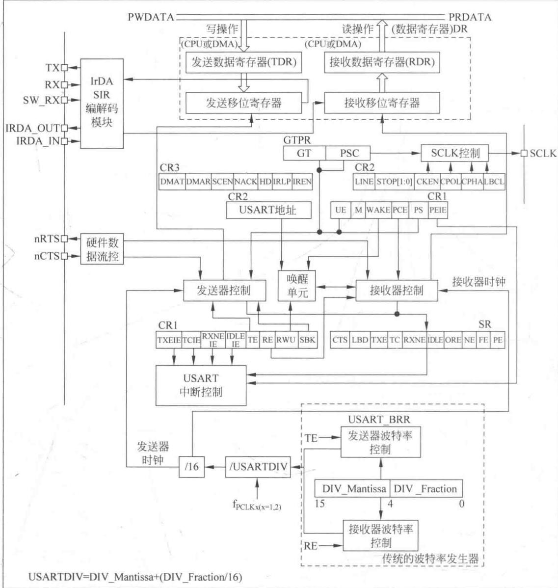

**这张图信息量很大。按"逐层搭积木"的方法，我们分三层看。**

##### 第一层：只看三大块（先不管所有小方框）

```
        ┌─────────────────────────────────────────────┐
        │                  USART                      │
  内部  │  ┌──────────┐   ┌──────────┐   ┌─────────┐  │  外部
  总线  │  │  发送器  │   │  接收器  │   │ 波特率  │  │  引脚
 ──────►│  │ (TX 通路)│   │ (RX 通路)│   │ 发生器  │  │──────► TX
        │  └──────────┘   └──────────┘   └─────────┘  │◄────── RX
        └─────────────────────────────────────────────┘
```

**先只记住这三块：发送器、接收器、波特率发生器。**

- **发送器**：把并行的字节变成串行的位，从 TX 送出去；
- **接收器**：把 RX 上串行的位收回来，变成并行的字节；
- **波特率发生器**：给上面两个提供"节拍"。

##### 第二层：看发送器内部的流水线

```
CPU 写 USART_DR
      ↓
   TDR（发送数据寄存器，1 个字节的缓冲）
      ↓  （当前一帧发完时，自动搬过来）
   发送移位寄存器
      ↓  （按波特率节拍，一位一位右移出去）
   TX 引脚
```

##### 第三层：看接收器内部的流水线

```
RX 引脚
   ↓  （16 倍过采样 + 起始位侦测）
  接收移位寄存器
   ↓  （收满 8/9 位，整包搬运）
   RDR（接收数据寄存器，1 个字节的缓冲）
   ↓  （CPU 读 USART_DR）
CPU
```

##### 再回头看图上的控制部分

- **USART_CR1 / CR2 / CR3**：三个控制寄存器，管所有开关（这些在 9.2.11 细讲）。
- **USART_SR**：状态寄存器，里面的 TXE、TC、RXNE 等标志就是"流水线上的指示灯"。
- **USART_BRR**：波特率寄存器，决定节拍快慢。
- **USART_GTPR**：智能卡模式才用，平时不用管。

**这张图到底想让你理解什么？**

> **USART 的本质就是"两条方向相反的流水线 + 一个共同的节拍源"。**
> 因为两条流水线互相独立，所以可以全双工（一边发一边收）。
> 因为中间有"缓冲器 + 移位寄存器"两级，所以 CPU 不用傻等（这叫**双缓冲**）。

#### 【辅助理解图】一张更简单的 USART 结构图

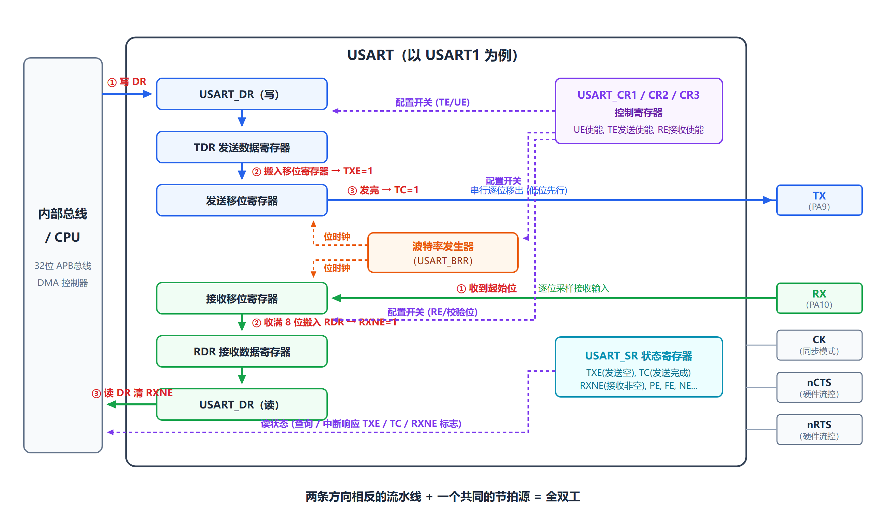

看图要点（按箭头顺序）：

1. 左边是"内部总线"，CPU 通过它读写 USART 的寄存器；
2. 中间上方是**发送通路**：TDR → 发送移位寄存器 → TX 引脚，箭头方向是从左到右；
3. 中间下方是**接收通路**：RX 引脚 → 接收移位寄存器 → RDR，箭头方向是从右到左；
4. 中间下方还有一个**波特率发生器**，用虚线箭头分别指向两个移位寄存器，标注"提供节拍"；
5. 右侧是三个控制寄存器 CR1/CR2/CR3，用虚线箭头指向各个部件，标注"开关"；
6. 右侧还有 SR，用虚线箭头反向指回总线，标注"状态反馈"。

#### USART 的引脚

教材原文：

> 任何双向通信的 USART 至少通过 2 个引脚与其他设备连接：**接收数据输入（RX）**和**发送数据输出（TX）**。
>
> - **RX**：接收数据串行输入。通过**过采样技术**来区别数据和噪音，从而恢复数据。
> - **TX**：发送数据输出。当发送器被禁止时，输出引脚恢复到它的 I/O 口配置。当发送器被激活，并且不发送数据时，**TX 引脚处于高电平**。在单线和智能卡模式下，此 I/O 口被同时用于数据的发送和接收（用作 USART 时，在 SW_RX 上接收数据）。
>
> 通过这些引脚，在 USART 模式下，串行数据作为**帧**发送和接收，数据帧包括：
>
> - 总线在发送或接收前处于**空闲状态**（一般为高电平）。
> - 一个**起始位**。
> - 一个**数据字**（8 或 9 位），**最低有效位在前**。
> - **0.5、1.5 或 2 个停止位**，由此表明数据帧的结束。

**同步模式下还需要一个引脚：**

> **CK**——发送器时钟输出。此引脚输出用于同步传输的时钟，这和 SPI 主模式类似。在 Start 位和 Stop 位上没有时钟脉冲，由软件设置在最后一个数据位是否送出一个时钟脉冲。在 RX 上同步接收数据。这可以用来控制带有移位寄存器的外部设备（例如 LCD 驱动器）。**时钟相位和极性都是软件可编程的**。在智能卡模式下，CK 可以为智能卡提供时钟。

**IrDA 模式下还需要：**

> - **IrDA_RDI**——IrDA 模式下的数据输入。
> - **IrDA_TDO**——IrDA 模式下的数据输出。

**硬件流控模式下还需要：**

> - **nCTS**——清除发送，若是高电平，则在当前数据传输结束时阻断下一次的数据发送。
> - **nRTS**——发送请求，若是低电平，则表明 USART 准备好接收数据。

> **注意 nCTS / nRTS 前面的那个小写 n**：它表示"**低电平有效**"。也就是说，nCTS 为**低**时才是"可以发"，为高时是"不许发"。这是数字电路里很常见的记法。

**USART 内部的 7 个寄存器（教材原文）：**

> - 一个状态寄存器（**USART_SR**）。
> - 数据寄存器（**USART_DR**）。
> - 一个波特率寄存器（**USART_BRR**），12 位的整数和 4 位小数。
> - 一个智能卡模式下的保护时间寄存器（**USART_GTPR**）。
> - 控制寄存器 1/2/3（**USART_CR1 / CR2 / CR3**）。

---

### 9.2.4 USART 的数据格式

#### 【教材内容】

> 通过编程 **USART_CR1 寄存器中的 M 位**，选择字长为 8 或 9 位。
>
> 在起始位期间，TX 脚处于低电平，在停止位期间处于高电平。**空闲符号**被视为完全由 1 组成的一个完整的数据帧，后面跟着包含了数据的下一帧的开始位（1 的位数也包括了停止位的位数）。
>
> **断开符号**被视为在一个帧周期内全部收到 0（包括停止位期间，也是 0）。在断开帧结束时，发送器再插入 1 或 2 个停止位（1）来应答起始位。
>
> 发送和接收由一个**公用的波特率发生器**驱动，当发送器和接收器的使能位分别置位时，分别为其产生时钟。

#### 看教材原图：USART 的数据格式

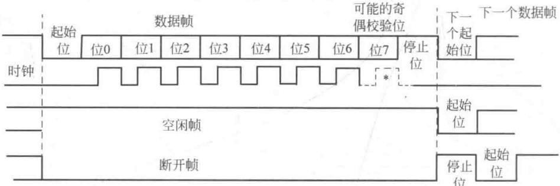

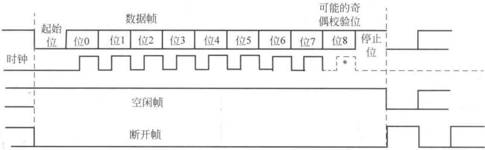

**怎么读这两张图：**

1. 图上从左到右是一条**时间轴**，横轴上每一小格是"一位的时间"。
2. 图 (b)（M=0）的格子数：**1（起始）+ 8（数据）+ 1（停止）= 10 格**。
3. 图 (a)（M=1）的格子数：**1（起始）+ 9（数据）+ 1（停止）= 11 格**。
4. 数据位上标着 **Bit0、Bit1、……、Bit7（或 Bit8）**，注意顺序是 **Bit0 在最左边**——这就是"**最低有效位在前**"。
5. 起始位那一格画的是**低电平**，停止位那一格画的是**高电平**。
6. **这两张图想让你理解什么？** 一个字节在线上长什么样、一共占多少位，完全由 M 位和停止位个数决定。

#### 【辅助理解图】8 位数据帧的完整波形（再画一遍，加强印象）

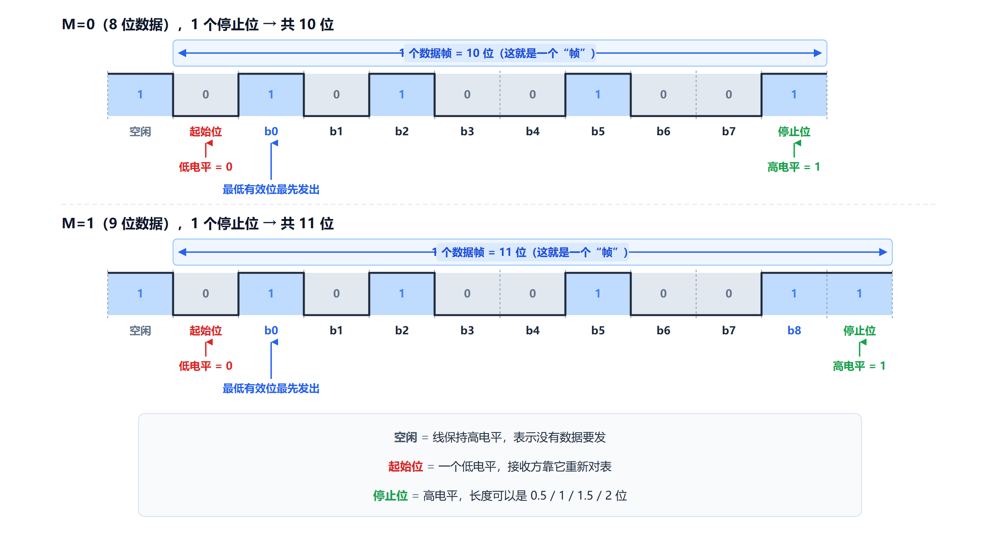

**精确版（ASCII）：** 以 `0x25`、M=0（8 位）、无校验、1 个停止位为例。

```
       空闲    起始    b0    b1    b2    b3    b4    b5    b6    b7   停止   空闲
      ────────┐     ┌────┐     ┌────┐     ┌────┐                 ┌────────────
              │     │    │     │    │     │    │                 │
              └─────┘    └─────┘    └─────┘    └─────────────────┘
       ↑
     空闲（高）

线上电平顺序: 高  低  高  低  高  低  低  高  低  低  高  高
对应数值顺序: 1   0   1   0   1   0   0   1   0   0   1   1
                    ↑                           ↑
                 bit0=1                      bit7=0
```

**再看 M=1（9 位数据）的情况：**

```
       空闲  起始  b0   b1   b2   b3   b4   b5   b6   b7   b8   停止  空闲
      ──────┐    ┌──┐    ┌──┐    ┌──┐    ┌──┐    ┌──┐    ┌──┐    ┌──────
            │    │  │    │  │    │  │    │  │    │  │    │  │    │
            └────┘  └────┘  └────┘  └────┘  └────┘  └────┘  └────┘
       共 1 + 9 + 1 = 11 位
```

> **9 位数据有什么用？** 两个常见用途：
> 1. **多处理器通信**：第 9 位（最高位）当"地址标志"，1 表示这一帧是地址，0 表示是数据；
> 2. **带校验的 8 位数据**：M=1 且 PCE=1 时，第 9 位被硬件换成校验位（见 9.2.9 的表 9-6）。

#### 各种帧格式对照表（教材表 9-6）

| M 位 | PCE 位 | USART 帧 |
|---|---|---|
| 0 | 0 | 起始位 + 8 位数据 + 停止位 |
| 0 | 1 | 起始位 + 7 位数据 + 奇偶检验位 + 停止位 |
| 1 | 0 | 起始位 + 9 位数据 + 停止位 |
| 1 | 1 | 起始位 + 8 位数据 + 奇偶检验位 + 停止位 |

**怎么用这张表：**

- **M 决定"数据位 + 校验位"一共占几位**（M=0 时占 8 位，M=1 时占 9 位）；
- **PCE 决定这几位里有没有一位是校验位**；
- 所以 M=0、PCE=1 时，8 位里有 1 位是校验位，真正的数据只剩 7 位。

> **注意一个容易搞混的点：** M 位说的"字长 8 位/9 位"指的是"**数据位 + 校验位**的总宽度"，不是"纯数据位"。教材原文说得很清楚：
>
> > **传输模式：** 如果 USART_CR1 的 PCE 位被置位，**写进数据寄存器的数据的最高位被校验位替换后发送出去**。
>
> 也就是说：你往 DR 里写 8 位数据，如果开了校验，**硬件会把最高位（bit7）换掉，改成校验位**。所以你真正能用的数据只有 7 位。**这一点写程序时特别容易踩坑。**

---

### 9.2.5 发送器

#### 【教材内容】

> 发送器根据 M 位的状态发送 8 位或 9 位数据字。当**发送使能位（TE）**被设置时，发送移位寄存器中的数据在 TX 脚上输出，相应的时钟脉冲在 CK 脚上输出。

#### 字符发送

> 在 USART 发送期间，在 TX 引脚上**首先移出数据的最低有效位**。在此模式下，**USART_DR 寄存器包含了一个内部总线和发送移位寄存器之间的缓冲器**（见图 9-10）。每个字符之前都有一个低电平的起始位；之后跟着停止位，其数目可配置。USART 支持 0.5、1、1.5 和 2 个停止位。
>
> **注意：**
> （1）**在数据传输期间不能复位 TE 位**，否则将破坏 TX 脚上的数据，因为波特率计数器停止计数。正在传输的当前数据将丢失。
> （2）TE 位被激活后将发送一个**空闲帧**。

#### 可配置的停止位

> 随每个字符发送的停止位的位数可以通过**控制寄存器 2 的位 13、12（STOP[1:0]）**进行编程。可以包含 1 个、2 个、0.5 个或者 1.5 个停止位。
>
> （1）**1 个停止位**：停止位位数的默认值。
> （2）**2 个停止位**：可用于常规 USART 模式、单线模式以及调制解调器模式。
> （3）**0.5 个停止位**：在智能卡模式下接收数据时使用。
> （4）**1.5 个停止位**：在智能卡模式下发送和接收数据时使用。
>
> 空闲帧包括了停止位。
>
> 断开帧是 10 位低电平，后跟停止位（当 m=0 时）；或者 11 位低电平，后跟停止位（m=1 时）。不可能传输更长的断开帧（长度大于 10 或者 11 位）。

**STOP[1:0] 编码表：**

| STOP[1:0] | 停止位个数 |
|---|---|
| 00 | 1 个停止位 |
| 01 | 0.5 个停止位 |
| 10 | 2 个停止位 |
| 11 | 1.5 个停止位 |

> **⚠️ 待核验：** 素材在 CR2 的 STOP 位说明处，把 `00:1个停止位；01:0.5个停止位；10:2个停止位；11:1.5个停止位` 写对了，但正文 9.2.4 节又写"USART 支持 0.5、1、1.5 和 2 个停止位"，而 9.2.1 特性列表里只写了"支持 1 或 2 个停止位"。三处说法不完全一致（1.5 在 STOP 编码表里是 `11`，0.5 是 `01`）。已记入【待核验】，以 CR2 的 STOP[1:0] 表为准。

#### 看教材原图：8 位字长时不同位数停止位的波形

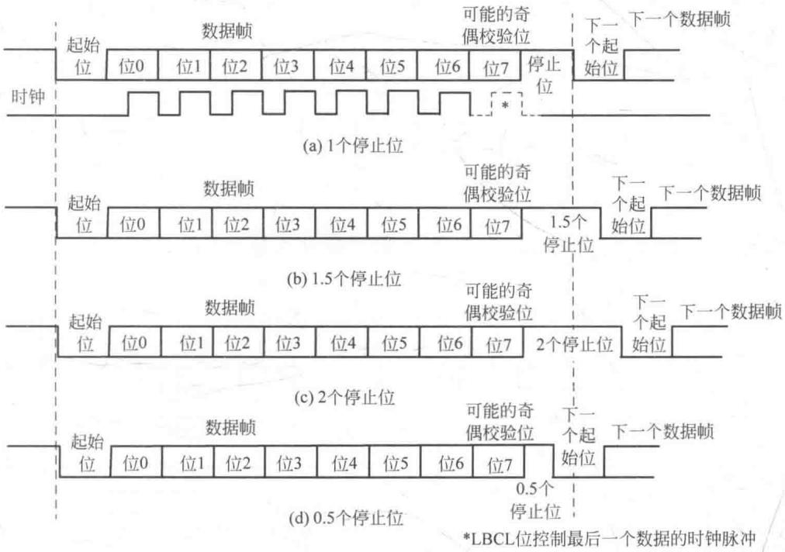

**怎么读：**

1. 图里画了多条波形，每条都是"起始位 + 8 位数据 + 停止位"的结构。
2. 区别只在**最后那段高电平有多长**：
   - 1 个停止位 = 1 位宽度的高电平；
   - 2 个停止位 = 2 位宽度的高电平；
   - 0.5 个停止位 = 半位宽度的高电平；
   - 1.5 个停止位 = 1.5 位宽度的高电平。
3. **这张图想让你理解什么？** 停止位不是一个"特殊信号"，它只是"**高电平持续多久**"。

#### 字符发送的配置步骤（教材原文 8 步）

> （1）通过在 USART_CR1 寄存器上置位 **UE** 位来激活 USART。
> （2）编程 USART_CR1 的 **M** 位来定义字长。
> （3）在 USART_CR2 中编程停止位的位数。
> （4）如果采用多缓冲器通信，配置 USART_CR3 中的 **DMAT**。按多缓冲器通信中的描述配置 DMA 寄存器。
> （5）利用 USART_BRR 寄存器选择要求的波特率。
> （6）设置 USART_CR1 中的 **TE** 位，发送一个空闲帧作为第一次数据发送。
> （7）把要发送的数据写进 USART_DR 寄存器（此操作清除 **TXE** 位）。在只有一个缓冲器的情况下，对每个待发送的数据重复步骤（7）。
> （8）在 USART_DR 寄存器中写入最后一个数据字后，要等待 **TC=1**，它表示最后一个数据帧的传输结束。当需要关闭 USART 或需要进入停机模式之前，需要确认传输结束，避免破坏最后一次传输。

**把这 8 步翻译成人话：**

| 步骤 | 人话 | 对应寄存器动作 |
|---|---|---|
| 1 | 先给 USART 通电 | `CR1.UE = 1` |
| 2 | 定好一个字符有几个数据位 | `CR1.M = 0 或 1` |
| 3 | 定好停止位几个 | `CR2.STOP[1:0]` |
| 4 | 如果要用 DMA 搬数据，就打开 | `CR3.DMAT = 1` |
| 5 | 定好说话速度 | 写 `BRR` |
| 6 | 打开"发送"开关 | `CR1.TE = 1` |
| 7 | 把要发的字节丢进 DR | 写 `DR` |
| 8 | 等最后一个字节真的发完，再关电 | 等 `SR.TC == 1` |

#### 单字节通信：TXE 和 TC 到底在说什么？

> 通过对数据寄存器的写操作清零 **TXE** 位。TXE 位由硬件设置，如果 TXE 被置位表明：
>
> - 数据已经从 **TDR** 移送到**移位寄存器**，数据发送已经开始。
> - TDR 寄存器被清空。
> - 下一个数据可以被写进 USART_DR 寄存器而不会覆盖先前的数据。
>
> 如果 **TXEIE** 位被设置，那么 TXE 标志将产生一个中断。
>
> - 如果 USART **正在发送**数据，那么对 USART_DR 寄存器的写操作把数据存进 **TDR** 寄存器，并在当前传输结束时把该数据复制进移位寄存器。
> - 如果 USART **没有发送**数据，处于空闲状态，那么对 USART_DR 寄存器的写操作**直接把数据放进移位寄存器**，数据传输开始，TXE 位立即被置位。
>
> 当一帧发送完成时（停止位发送后）并设置了 TXE 位，**TC** 位被置位，如果 USART_CR1 寄存器中的 TCIE 位被置位，则会产生中断。
>
> 在 USART_DR 寄存器中写入了最后一个数据字后，在关闭 USART 模块之前或设置微控制器进入低功耗模式之前，**必须先等待 TC=1**。

**TC 位的清除步骤：**

> （1）读一次 USART_SR 寄存器；
> （2）写一次 USART_DR 寄存器。
>
> 也可以通过软件对 TC 位写 0 来清除，此清零方式只推荐在多缓冲器通信模式下使用。

#### 看教材原图：发送时 TC/TXE 的变化情况

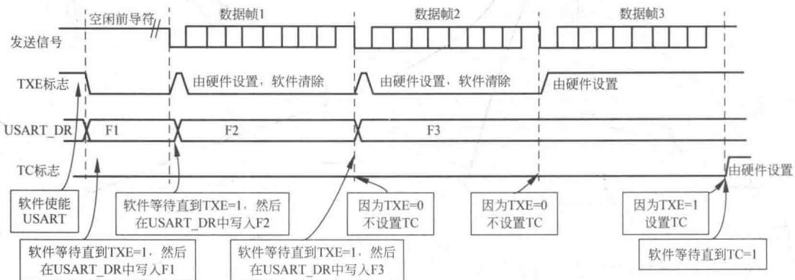

**这张图要看的是三条横线之间的先后关系。**

```
时间 →
TX 引脚：   ──空闲──[起][b0][b1][b2][b3][b4][b5][b6][b7][停]──空闲──[起][b0]...
TXE 标志：  1        0                         1     1        0
TC  标志：  0        0                         0     1        0
```

**逐段讲解（"先发生什么 → 再发生什么 → 为什么"）：**

| 时刻 | TX 引脚 | TXE | TC | 为什么 |
|---|---|---|---|---|
| 初始（空闲） | 高 | 1 | 0 | 发送缓冲器是空的，随时可以接收新数据 |
| CPU 写 DR 的那一瞬间 | 高 | **0** | 0 | 写 DR 会**清 TXE**，表示"缓冲器里已经有东西了，别急着再写" |
| 硬件把数据从 TDR 搬到移位寄存器 | 开始出现起始位 | **1** | 0 | TDR 又空了 → TXE 由硬件置 1，允许写下一个字节。**注意：这时数据还没发完，只是"搬走了"** |
| 一帧的最后一位（停止位）发完 | 回到高 | 1 | **1** | 整帧发完了 → TC 由硬件置 1，表示"发送完成" |

**关键理解（非常重要）：**

> **TXE = 1 表示"缓冲器空了，可以塞下一个字节"；**
> **TC = 1 表示"整个一帧已经发完了"。**
>
> 所以：
> - **连续发送时，只看 TXE**（一个字节一个字节地塞）；
> - **发完最后一个字节、准备关串口/进低功耗时，必须看 TC**（确认真的发完了）。

**为什么 TXE 比 TC 先置位？**

因为数据先被"搬"进移位寄存器（此时 TDR 空了 → TXE=1），然后移位寄存器才开始一位一位地往外发（要发 10 个位时间才发完 → 之后才 TC=1）。

**这正是"双缓冲"带来的好处：** 移位寄存器在慢慢发的时候，CPU 已经可以把下一个字节放进 TDR 了。于是字节与字节之间没有空隙，可以连续不断地发——这就是教材说的"**使用写入缓冲器，实现了连续发送多帧数据无延时的通信**"。

【辅助理解图】

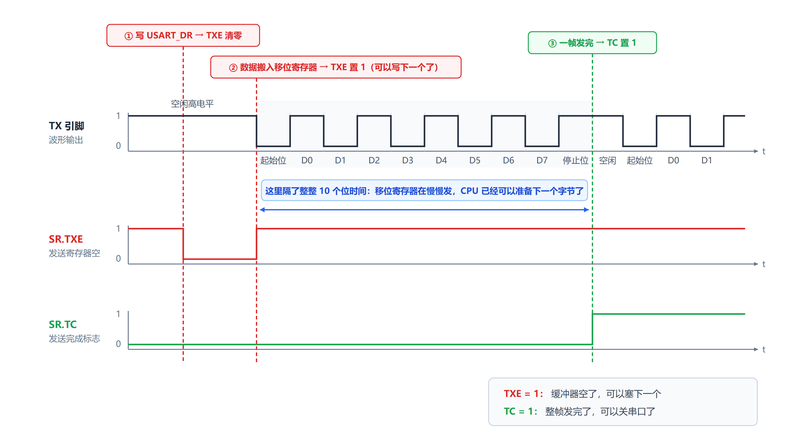

看图要点：横轴是时间，从上到下三条线分别是 TX 引脚波形、TXE 标志、TC 标志。图中用竖虚线标出三个关键时刻：①"写 DR → TXE 清零"，②"数据搬入移位寄存器 → TXE 置 1"，③"停止位发完 → TC 置 1"。注意 ② 和 ③ 之间隔了整整 10 个位时间。

#### 断开符号和空闲符号

> **1）断开符号**
> 设置 **SBK** 可发送一个断开符号。断开帧长度取决于 M 位。如果设置 SBK=1，在完成当前数据发送后，将在 TX 线上发送一个断开符号。断开字符发送完成时（在断开符号的停止位时）**SBK 被硬件复位**。USART 在最后一个断开帧的结束处插入一个逻辑 1，以保证能识别下一帧的起始位。
>
> 如果在开始发送断开帧之前，软件又复位了 SBK 位，断开符号将不被发送。如果要发送两个连续的断开帧，SBK 位应该在前一个断开符号的停止位之后置位。
>
> **2）空闲符号**
> 置位 TE 将使得 USART 在第一个数据帧前发送一个空闲帧。

**用大白话说：**

- **断开符号（Break）**：就是"故意把线拉低很长一段时间"（10 位或 11 位全是 0）。接收方一看就知道："这不是数据，这是一个特殊信号。"它常被用来做**帧同步**或者**唤醒**（LIN 总线里就用它）。
- **空闲符号（Idle）**：就是"线保持高电平一整帧的时间"。它表示"我现在没数据要发"。**刚打开 TE 时硬件会自动发一个空闲帧**，用来告诉对方"我上线了"。

---

### 9.2.6 接收器

#### 【教材内容】

> USART 可以根据 USART_CR1 的 M 位接收 8 位或 9 位的数据字。

#### 起始位侦测（这是接收器最精彩的部分）

> 在 USART 中，如果辨认出一个特殊的采样序列 **（1 1 1 0 X 0 X 0 X 0 0 0 0）**，就认为侦测到一个起始位。
>
> 如果该序列不完整，那么接收端将退出起始位侦测并回到空闲状态（不设置标志位）等待下降沿。
>
> 如果 **3 个采样点都为 0**（在第 3、5、7 位的第一次采样，和在第 8、9、10 的第二次采样都为 0），则确认收到起始位，这时设置 **RXNE** 标志位，如果 RXNEIE=1，则产生中断。
>
> 如果两次 3 个采样点上**仅有 2 个是 0**，那么起始位仍然是有效的，但是会设置 **NE（噪声）标志位**。如果不满足这个条件，则中止起始位的侦测过程，接收器会回到空闲状态（不设置标志位）。

#### 【先补一个前置知识：什么叫"过采样"？为什么要采 16 次？】

接收方不能"一位只采一次"。因为线可能被干扰，采一次万一采到个毛刺就错了。

所以 STM32 的做法是：**每一位时间，内部采 16 次。**

```
一位的时间（比如 104 μs）
├────────────────────────────────────────┤
1  2  3  4  5  6  7  8  9 10 11 12 13 14 15 16
               ↑        ↑        ↑
             第8次    第9次    第10次   ← 只取中间这 3 次
```

**为什么取中间 3 次？**

- 中间离两边的边沿最远，最不容易采到"正在跳变"的毛刺；
- 采 3 次可以"**三局两胜**"：3 个都是 0 就确信是 0；2 个是 0 就"勉强算 0 但报个噪声警告"。

**注意教材素材里那串 `1 1 1 0 X 0 X 0 X 0 0 0 0` 的含义：**

- 前 3 个采样点（1、2、3）还是高电平 → 说明刚才线是空闲的（高）；
- 第 4 个采样点开始变低 → 这是**下降沿**，就是起始位的开始；
- 第 8、9、10 次采样（起始位的正中间）都是 0 → 确认起始位；
- 后面的 0 表示继续是低电平。

**这就是"16 倍过采样 + 中间三点采样 + 多数表决"**，STM32 靠它来"区分数据和噪音"（教材原话）。

> **⚠️ 待核验：** 教材素材 p70 这段文字 OCR 质量较差："在第 3、5、7 位的第一次采样，和在第 8、9、10 的第二次采样都为 0"这句话前后重复了三次，措辞互相矛盾（一处说"两次 3 个采样点"、一处说"一次 3 个采样点"）。按 STM32F10x 参考手册，正确描述是：**起始位在 8、9、10 三个采样点上采样，若三个都是 0 则确认；若只有两个是 0 则确认但置 NE 噪声标志；否则中止侦测。** 本节按参考手册的语义讲解，已记入【待核验】。

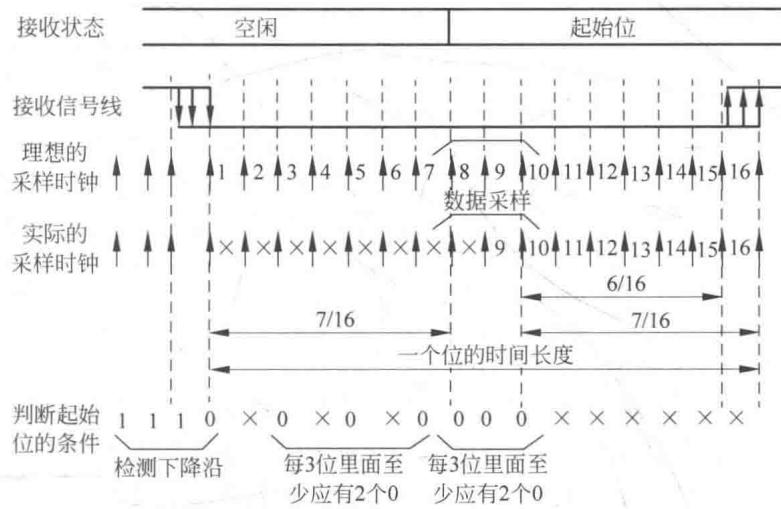

**看图要点：**

1. 最上面一行是 **RX 引脚的波形**，一开始是高（空闲），然后出现下降沿。
2. 中间一行画了**采样脉冲**，密密麻麻的——那是 16 倍采样时钟。在起始位那一段，可以看到采样点在中间位置密集出现。
3. 下面标出了 **8、9、10** 三个采样点，用箭头指出来。
4. **这张图想让你理解什么？** 接收方不是"看到低电平就认为是起始位"，而是"**在正确的时间、采三次、多数表决**"才确认。这样才不会把线上的毛刺误当成起始位。

【辅助理解图】

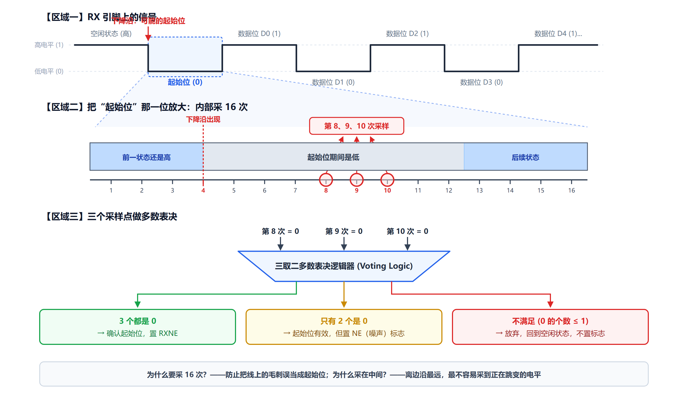

看图要点：图上半部分是 RX 引脚波形（空闲高 → 下降沿 → 起始位低 → 数据位）；中间放大画出起始位那一位的 16 个采样点，并把第 8、9、10 三个点用红色圆圈标出；下方画一个"三取二"的表决逻辑，三条输入线进、一条输出线出，标注"全 0 → 确认起始位 / 有 1 个 1 → 确认但置 NE / 有 2 个以上 1 → 放弃"。

#### 字符接收

> 在 USART 接收期间，数据的**最低有效位首先从 RX 脚移进**。USART_DR 寄存器包含的缓冲器位于内部总线和接收移位寄存器之间。
>
> **接收字符的配置步骤：**
> （1）将 USART_CR1 寄存器的 **UE** 置 1 来激活 USART。
> （2）编程 USART_CR1 的 **M** 位定义字长。
> （3）在 USART_CR2 中编写停止位的个数。
> （4）如果需多缓冲器通信，选择 USART_CR3 中的 **DMAR**。
> （5）利用波特率寄存器 USART_BRR 选择希望的波特率。
> （6）设置 USART_CR1 的 **RE** 位。激活接收器，使它开始寻找起始位。
>
> **当一个字符被接收到时：**
> - **RXNE** 位被置位。它表明移位寄存器的内容被转移到 RDR。换句话说，数据已经被接收并且可以被读出（包括与之有关的错误标志）。
> - 如果 RXNEIE 位被设置，则产生中断。
> - 在接收期间如果检测到帧错误、噪音或溢出错误，错误标志将被置位。
> - 在多缓冲器通信时，RXNE 在每个字节接收后被置位，并由 DMA 对数据寄存器的读操作而清零。
> - 在单缓冲器模式下，由软件读 USART_DR 寄存器完成对 RXNE 位清除。RXNE 标志也可以通过对它写零来清除。**RXNE 位必须在下一字符接收结束前被清零，以避免溢出错误。**
>
> 在接收数据时，**RE 位不应该被复位**。如果 RE 位在接收时被清零，当前字节的接收被丢失。

**接收步骤翻译成人话：**

| 步骤 | 人话 |
|---|---|
| 1 | 给 USART 通电（UE=1） |
| 2 | 定好一个字几位（M） |
| 3 | 定好停止位几个（STOP） |
| 4 | 要用 DMA 收就打开 DMAR |
| 5 | 定好波特率（BRR） |
| 6 | 打开"接收"开关（RE=1），接收器开始盯着 RX 找起始位 |
| 收到后 | 硬件置 RXNE=1；如果开了 RXNEIE，还会中断 |
| 拿走数据 | CPU 读 USART_DR，RXNE 自动清 0 |

**"RXNE 必须在下一字符接收结束前清零"这句话最重要。** 如果 CPU 磨蹭，下一个字节又来了，就会发生**溢出错误（ORE）**——这正是 9.1.6 里讲的那种错误。

#### 断开符号、空闲符号、溢出错误

> **3）断开符号**：当接收到一个断开帧时，USART 的处理过程与处理帧错误一样。
>
> **4）空闲符号**：当检测到空闲帧，其处理步骤和接收到普通数据帧一样，如果 **IDLEIE** 位被置位将产生一个中断。
>
> **5）溢出错误**
> 如果 RXNE 还没有被复位，又接收到一个字符，则发生溢出错误。数据只有当 RXNE 位被清零后才能从移位寄存器转移到 RDR 寄存器。RXNE 标记是接收到每个字节后被置位的。如果下一个数据已被收到或先前 DMA 请求还没被服务时，RXNE 标志仍是置位的，溢出错误产生。
>
> **当溢出错误产生时：**
> - **ORE** 位被置位。
> - RDR 内容将不会丢失。读 USART_DR 寄存器仍能得到先前的数据。
> - 移位寄存器中以前的内容将被覆盖。随后接收到的数据都将丢失。
> - 如果 RXNEIE 位被设置或 EIE 和 DMAR 位都被设置，中断产生。
> - **顺序执行对 USART_SR 和 USART_DR 寄存器的读操作，可复位 ORE 位。**
>
> **注意：当 ORE 位置位时，表明至少有一个数据已经丢失。有两种可能性：**
> - 如果 **RXNE=1**，上一个有效数据还在接收寄存器 RDR 上，可以被读出。
> - 如果 **RXNE=0**，这意味着上一个有效数据已经被读走，RDR 已经没有东西可读。当上一个有效数据在 RDR 中被读取的同时又接收到新的（也就是丢失的）数据时，此种情况可能发生。
> - 在读序列期间（在 USART_SR 寄存器读访问和 USART_DR 读访问之间）接收到新的数据，此种情况也可能发生。

**用一张表把"错误标志"和"怎么清除"总结清楚：**

| 标志 | 含义 | 怎么清 |
|---|---|---|
| PE | 校验错误 | 先读 SR，再读 DR |
| FE | 帧错误（该是停止位的地方不是高） | 先读 SR，再读 DR |
| NE | 噪声错误（采样三取二没全中） | 先读 SR，再读 DR |
| ORE | 溢出错误（CPU 没及时取走数据） | 先读 SR，再读 DR |
| IDLE | 检测到空闲总线 | 先读 SR，再读 DR |
| RXNE | 收到一个字节，可以读 | 读 DR（或写 0） |
| TXE | 发送缓冲器空，可以写下一个 | 写 DR |
| TC | 一帧发送完成 | 先读 SR，再写 DR（或写 0） |

> **注意"先读 SR 再读 DR"这个"清除序列"**：STM32 里很多标志位不是"写 1 清零"也不是"写 0 清零"，而是要按特定顺序访问才能清掉。这是初学者最容易踩的坑之一：**忘了读 SR，标志位就一直在，中断就会一直进。**

---

### 9.2.7 分数波特率的产生（本节是全章的计算重点）

#### 用大白话理解

前面说过，波特率就是"每位占多长时间"。STM32 内部有 72 MHz / 36 MHz 这么快的时钟，怎么可能直接变成 9600 Hz？

答案是：**分频**。

#### 【先补一个前置知识：什么叫"分频"？】

"分频"就是"**把一个快时钟变成慢时钟**"。

比如 72 MHz 的时钟，每来 16 个脉冲，我只输出 1 个脉冲，那么输出就是 72/16 = 4.5 MHz。这就叫"**16 分频**"。

如果只能整数分频（16、17、18……），那频率只能跳着变，很多标准波特率就凑不出来。所以 STM32 用了**分数分频**：可以"16.5 分频""27.75 分频"——**整数部分和小数部分分开设置**。

**这就是"分数波特率发生器"这个名字的由来。**

#### 【教材内容】

> 接收器和发送器的波特率在 **USARTDIV** 的整数和小数寄存器中的值应设置成相同。波特率的计算公式如公式 (9-1) 所示。
>
> **公式 (9-1)：**
>
> ```
> Tx/Rx 波特率 = f_CK / (16 × USARTDIV)
> ```
>
> 这里的 **f_CK 是给外设的时钟**（**PCLK1 用于 USART2、3、4、5，PCLK2 用于 USART1**）。
>
> **USARTDIV 是一个无符号的定点数，通过 USART_BRR 寄存器设置。**
>
> **注意：在写入 USART_BRR 之后，波特率计数器会被波特率寄存器的新值替换。因此，不要在通信进行中改变波特率寄存器的数值。**

**把公式反过来用（这才是实际写程序时用的）：**

```
USARTDIV = f_CK / (16 × 目标波特率)
```

#### 具体演算（不跳步）

**例 1（教材原例）：已知 DIV_Mantissa = 27，DIV_Fraction = 12，求 USARTDIV。**
（教材是反着给的：它先给出 `USART_BRR = 0x1BC`，然后说明这个值拆开来正好是 27 和 12。）

**第一步：把 0x1BC 补成完整的 16 位二进制。**

前面说过 BRR 寄存器是 16 位的（高 12 位是整数部分，低 4 位是小数部分）。`0x1BC` 只是"省掉了前导 0"的写法，展开时要占满 16 位：

```
USART_BRR = 0x1BC = 0000 0001 1011 1100
                    bit15              bit0
                    高 12 位（整数）     低 4 位（小数）
                    bit15 ~ bit4        bit3 ~ bit0
```

**第二步：按位图切两段（同一个 bit 只会被数一次）。**

```
  寄存器位[15:4] = DIV_Mantissa[11:0] = 0000 0001 1011 = 0x01B = 27
  寄存器位[3:0]  = DIV_Fraction[3:0]  = 1100          = 0xC   = 12
```

用移位和掩码算，就是：

```
DIV_Mantissa = 0x1BC >> 4    = 0x1B = 27
DIV_Fraction = 0x1BC & 0x0F  = 0xC  = 12
```

> **⚠️ 小心一个常见错误：** 千万不要把 `0x1BC` 当成"12 位的整数"来切，更不能把 `0001 1011 1100` 整段当成整数部分、又把它末尾的 `1100` 当成小数部分——**那样 bit3~bit0 就被重复数了两次**。
> 正确的切法只有一种：**整数取 bit15~bit4，小数取 bit3~bit0，两段首尾相接、互不重叠。**

**第三步：算出 USARTDIV。**

```
整数部分 = 27
小数部分 = 12 / 16 = 0.75

USARTDIV = 27 + 0.75 = 27.75
```

**和教材的答案一致。**

**例 2（反过来算，这才是真正要会的）：PCLK2 = 72 MHz，想要 9600 bps，USART_BRR 该写多少？**

第一步：算 USARTDIV。

```
USARTDIV = 72 000 000 / (16 × 9600)
         = 72 000 000 / 153 600
         = 468.75
```

第二步：拆成整数和小数。

```
整数部分 DIV_Mantissa = 468
小数部分 = 0.75

DIV_Fraction = 0.75 × 16 = 12
```

第三步：拼成 16 位数。

```
USART_BRR = (DIV_Mantissa << 4) | DIV_Fraction
          = (468 << 4) | 12

468 << 4 = 468 × 16 = 7488 = 0x1D40
0x1D40 | 0x00C = 0x1D4C

所以 USART_BRR = 0x1D4C
```

**验算：**

```
USARTDIV = 468 + 12/16 = 468.75
实际波特率 = 72 000 000 / (16 × 468.75) = 72 000 000 / 7500 = 9600  ✓ 完全正确
```

**例 3（有误差的情况）：PCLK1 = 36 MHz，想要 115200 bps。**

第一步：

```
USARTDIV = 36 000 000 / (16 × 115200)
         = 36 000 000 / 1 843 200
         = 19.53125
```

第二步：

```
整数部分 = 19
小数部分 = 0.53125

DIV_Fraction = 0.53125 × 16 = 8.5
```

8.5 不是整数，**必须四舍五入**（固件库里的做法就是 `+ 0.5` 再取整）：

```
DIV_Fraction = 8.5 → 取 9
```

第三步：

```
USART_BRR = (19 << 4) | 9 = 304 | 9 = 313 = 0x139
```

**验算实际波特率：**

```
USARTDIV = 19 + 9/16 = 19.5625
实际波特率 = 36 000 000 / (16 × 19.5625)
           = 36 000 000 / 313
           = 115 015.97 bps

误差 = (115200 - 115015.97) / 115200 = 0.16%
```

**0.16% 的误差能不能用？** 能用。串行通信一般允许 2%~3% 以内的误差（因为接收方是在每位中间采样，有半个位的余量）。**但这也说明了：不是所有波特率都能"精确"配出来，越高的波特率误差越大。**

#### 教材表 9-5：常见波特率设置

| 波特率（bps） | 波特率寄存器中的值（f_PCLK = 36 MHz） | 波特率寄存器中的值（f_PCLK = 72 MHz） |
|---|---|---|
| 2400 | 937.5 | 1875 |
| 9600 | 234.375 | 468.75 |
| 19200 | 117.1875 | 234.375 |
| 57600 | 39.0625 | 78.125 |

> 注：只有 USART1 使用 PCLK2（最高 72 MHz），其他 USART 使用 PCLK1（最高 36 MHz）。

**注意：表里的数值是 USARTDIV（带小数的那个值），不是直接写进 BRR 的整数。** 写进 BRR 之前还要按上面的方法拆成"整数 × 16 + 小数"。

**我们挑一个验证一下：36 MHz、2400 bps。**

```
USARTDIV = 36 000 000 / (16 × 2400) = 36 000 000 / 38 400 = 937.5  ✓ 和表一致

拆开：整数 937，小数 0.5 → DIV_Fraction = 0.5 × 16 = 8
BRR = (937 << 4) | 8 = 14 992 | 8 = 15 000 = 0x3A98

验算：36 000 000 / (16 × 937.5) = 36 000 000 / 15 000 = 2400  ✓
```

**再验证 36 MHz、57600 bps：**

```
USARTDIV = 36 000 000 / (16 × 57600) = 36 000 000 / 921 600 = 39.0625  ✓ 和表一致

拆开：整数 39，小数 0.0625 → DIV_Fraction = 0.0625 × 16 = 1
BRR = (39 << 4) | 1 = 624 | 1 = 625 = 0x271

验算：36 000 000 / (16 × 39.0625) = 36 000 000 / 625 = 57 600  ✓
```

**所以：表里的数确实可以用，公式也是对的。**

#### 【补充解释】固件库是怎么替你算的？

教材给出的库函数算法：

```c
IntegerDivider    = ((APBClock) / (16 * (USART_InitStruct->USART_BaudRate)))
FractionalDivider = ((IntegerDivider - ((u32) IntegerDivider)) * 16) + 0.5
```

逐行解释：

- `IntegerDivider` 算出的是**带小数的 USARTDIV**（注意变量名骗人，它其实是浮点数）；
- `((u32) IntegerDivider)` 把小数部分砍掉，得到整数部分；
- 两者相减 → 得到**纯小数部分**；
- 乘以 16 → 换成"十六分之一"为单位的整数；
- `+ 0.5` → **四舍五入**（因为 C 语言强制转换是"截断"而不是"四舍五入"）。

**所以：** 你在固件库里写 `USART_InitStructure.USART_BaudRate = 9600;`，库函数会自己去算 BRR，你不用手算。但**你必须懂这个公式**，因为考试会考，而且换芯片/改时钟时要会自己判断误差。

---

### 9.2.8 多处理器通信（了解即可）

#### 【教材内容】

> 通过 USART 可以实现多处理器通信（将几个 USART 连在一个网络里）。例如，某个 USART 设备可以是**主**，它的 TX 输出和其他 USART **从**设备的 RX 输入相连接；USART 从设备的 TX 输出**逻辑地与在一起**，并且和主设备的 RX 输入相连接。
>
> 在多处理器配置中，通常希望**只有被寻址的接收者才被激活**，接收随后的数据，这样可以减少由未被寻址的接收器的参与所带来的多余的 USART 服务开销。
>
> 未被寻址的设备可启用其**静默功能**置于**静默模式**。在静默模式下：
> - 任何接收状态位都不会被设置。
> - 所有接收中断被禁止。
> - USART_CR1 寄存器中的 **RWU** 位被置 1。RWU 可以被硬件自动控制或在某个条件下由软件写入。
>
> 根据 USART_CR1 寄存器中的 **WAKE** 位状态，USART 可以用两种方法进入或退出静默模式：
> - 如果 WAKE 位被复位（=0），则进行**空闲总线检测**。
> - 如果 WAKE 位被设置（=1），则进行**地址标记检测**。

**1）空闲总线检测（WAKE=0）**

> 当 RWU 位被写 1 时，USART 进入静默模式。当检测到一空闲帧时，它被唤醒。然后 RWU 被硬件清零，但是 USART_SR 寄存器中的 IDLE 位并不置起。RWU 还可以被软件写 0。

**2）地址标记（address mark）检测（WAKE=1）**

> 在这个模式里，如果 **MSB 是 1，该字节被认为是地址**，否则被认为是数据。在一个地址字节中，目标接收器的地址被放在 **4 个 LSB** 中。这个 4 位地址被接收器同它自己地址做比较，接收器的地址被编程在 **USART_CR2 寄存器的 ADD[3:0]**。
>
> - 如果接收到的字节与它的编程地址**不匹配**时，USART 进入静默模式。此时，硬件设置 RWU 位。接收该字节既不会设置 RXNE 标志，也不会产生中断或发出 DMA 请求。
> - 当接收到的字节与接收器内编程地址**匹配**时，USART 退出静默模式。然后 RWU 位被清零，随后的字节被正常接收。收到这个匹配的地址字节时将设置 RXNE 位，因为 RWU 位已被清零。
>
> 当接收缓冲器不包含数据时（USART_SR 的 RXNE=0），RWU 位可以被写 0 或 1。否则，该次写操作被忽略。

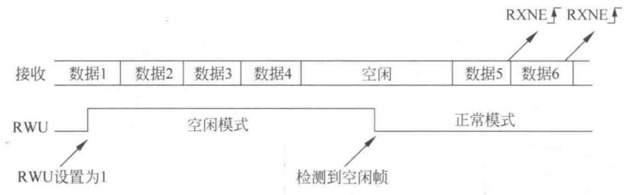

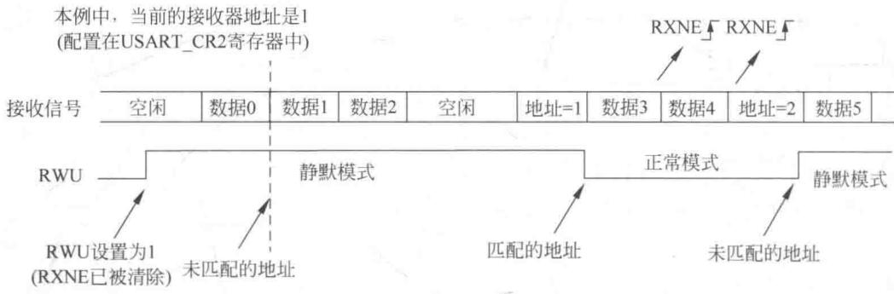

**用大白话理解这两张图：**

- **图 9-15（空闲总线唤醒）**：一群从机都"睡着了"（静默模式）。主机先发一段"长时间的线保持高电平"（空闲帧）。所有从机听到这个信号就都醒了。**缺点是：所有从机都被唤醒，哪怕不是找它。**
- **图 9-16（地址标记唤醒）**：主机先发一个"第 9 位 = 1"的字节，字节的低 4 位是目标地址。所有从机都看一眼："这是找 3 号吗？我是 5 号，继续睡。"只有 3 号从机醒了。**优点是：只唤醒该醒的那个。**

**用一句话总结这个机制：** 就像宿舍楼下的广播——"全体注意"（空闲唤醒）会吵醒所有人；"305 室下来拿快递"（地址唤醒）只吵醒一个人。

---

### 9.2.9 校验控制

#### 【教材内容】

> 设置 **USART_CR1 寄存器上的 PCE 位**，可以使能奇偶控制（发送时生成一个奇偶位，接收时进行奇偶校验）。根据 M 位定义的帧长度，可能的 USART 帧格式如表 9-6 所示（见 9.2.4 节）。
>
> 在用地址标记唤醒设备时，地址的匹配只考虑到数据的最高位，而不用关心校验位。（最高位是数据位中最后发出的，后面紧跟校验位或者停止位。）
>
> **偶校验**：校验位使得一帧中的 7 或 8 个低位数据以及校验位中 1 的个数为**偶数**。
> 例如，数据 = 00110101，有 4 个 1，如果选择偶校验（在 USART_CR1 中的 **PS=0**），校验位将是 **0**。
>
> **奇校验**：此校验位使得一帧中的 7 或 8 个低位数据以及校验位中 1 的个数为**奇数**。
> 例如，数据 = 00110101，有 4 个 1，如果选择奇校验（在 USART_CR1 中的 **PS=1**），校验位将是 **1**。
>
> **传输模式**：如果 USART_CR1 的 PCE 位被置位，**写进数据寄存器的数据的最高位被校验位替换后发送出去**。如果奇偶校验失败，USART_SR 寄存器中的 **PE 标志**被置 1，并且如果 USART_CR1 寄存器的 **PEIE** 置位，则将产生中断。

**把"最高位被校验位替换"这句话画出来：**

```
PCE=0（不开校验）时，你写 0x25：
  DR[7:0] = 0 0 1 0 0 1 0 1   ← 8 位全是数据
            b7          b0

PCE=1（开校验，M=0）时，你写 0x25：
  DR[7:0] = 0 0 1 0 0 1 0 1
                              ↑
                        硬件把 b7 换成校验位！
  b7 = 偶数个 1？ 0x25 里有 3 个 1（bit0、bit2、bit5）
  偶校验 → 校验位 = 1（凑成 4 个 1）
  b7 = 1（校验位）

  实际线上发的 8 位是：1 0 1 0 0 1 0 1
                        ↑             ↑
                     校验位        真正的数据只剩 7 位
```

**所以：开了校验之后，你能用的数据只有 7 位（0~127）。** 这一点教材原文说得很清楚，但很多人第一次读会漏掉。

**这也解释了表 9-6 为什么这么设计：**

```
M=0, PCE=1 → 起始位 + 7 位数据 + 校验位 + 停止位
                └─ 8 位数据字段 = 7 位数据 + 1 位校验 ─┘
```

---

### 9.2.10 USART 的中断请求

#### 【教材内容】

**表 9-7 USART 的中断请求**

| 中断事件 | 事件标志 | 使能位 |
|---|---|---|
| 发送数据寄存器空 | TXE | TXEIE |
| CTS 标志 | CTS | CTSIE |
| 发送完成 | TC | TCIE |
| 接收数据就绪可读 | RXNE | RXNEIE |
| 检测到数据溢出 | ORE | RXNEIE |
| 检测到空闲线路 | IDLE | IDLEIE |
| 奇偶检验错 | PE | PEIE |
| 断开标志 | LBD | LBDIE |
| 噪声标志、多缓冲通信中的溢出错误和帧错误 | NE 或 ORE 或 FE | EIE（仅当使用 DMA 接收数据时使用） |

> USART 的各种中断事件被连接到**同一个中断向量**，中断映像如图 9-17 所示。
>
> USART 可以产生以下中断事件：
> - **发送**：发送完成、清除发送、发送数据寄存器空。
> - **接收**：空闲总线检测、溢出错误、接收数据寄存器非空、校验错误、LIN 断开符号检测、噪音标志（仅在多缓冲器通信中使用）和帧错误（仅在多缓冲器通信中使用）。如果设置了对应的使能控制位，这些事件就可以产生各自的中断。

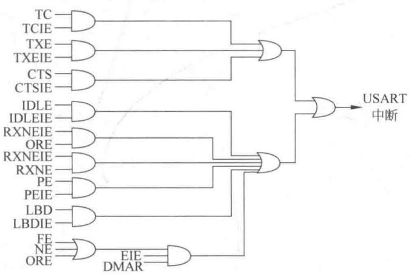

**这张图怎么读：**

1. **左边一列**是各种事件标志（TXE、TC、RXNE、ORE、IDLE、PE、LBD、NE、FE、CTS）。
2. **中间一列**是"使能位"（相当于每个事件前面的一个小开关）。
3. **右边**所有线**汇成一条**，指向同一个中断向量（比如 `USART1_IRQn`）。

**这张图想让你理解什么（非常关键）：**

> **USART 的十几个中断事件，共用一个中断入口函数。**
>
> 也就是说：不管是因为"收到数据"还是"发送完成"还是"校验出错"进的中断，CPU 都会跳进**同一个** `USART1_IRQHandler`。
>
> 所以**中断服务程序里必须自己判断"到底是哪个事件"**——这就是为什么后面例 9-1 的代码里会写 `if (USART_GetITStatus(USART1, USART_IT_RXNE) != RESET) { ... }`。

【辅助理解图】

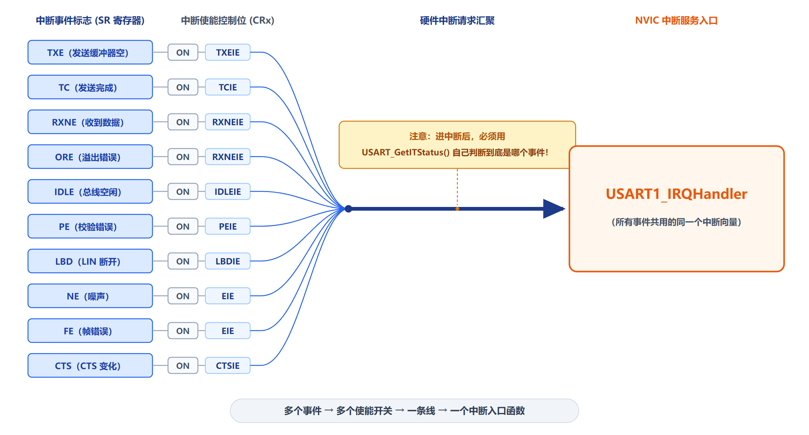

看图要点：左侧一排"事件"方块（TXE / TC / RXNE / ORE / IDLE / PE / LBD / NE / FE / CTS），每个方块右侧连一个"使能开关"（TXEIE / TCIE / RXNEIE / IDLEIE / PEIE / LBDIE / EIE / CTSIE），所有开关的输出线汇聚成一条粗线，指向最右边的方块"USART1_IRQHandler（同一个中断向量）"。图下方小字注明："进中断后必须自己判断是哪个事件"。

---

### 9.2.11 STM32 的 USART 寄存器（本节按 AGENTS.md 第 11 节逐位讲）

#### 先把地址这条链算清楚（AGENTS.md 第 12 节）

教材原文：

> **USART1 寄存器的起始地址是 0x40013800，USART2 寄存器的起始地址是 0x40004400，USART3 寄存器的起始地址是 0x40004800，UART4 寄存器的起始地址是 0x40004C00，UART5 寄存器的起始地址是 0x40005000。**
>
> 这些寄存器的**高 16 位都是保留位**，硬件强制为 0。可以用**半字（16 位）或字（32 位）**的方式操作 USART 寄存器。

这些地址是怎么来的？看教材给的宏定义：

```c
#define PERIPH_BASE       ((u32)0x40000000)
#define APB1PERIPH_BASE   PERIPH_BASE
#define APB2PERIPH_BASE   (PERIPH_BASE + 0x10000)
#define AHBPERIPH_BASE    (PERIPH_BASE + 0x20000)
#define USART1_BASE       (APB2PERIPH_BASE + 0x3800)
#define USART2_BASE       (APB1PERIPH_BASE + 0x4400)
#define USART3_BASE       (APB1PERIPH_BASE + 0x4800)
```

**一步步算：**

```
第 1 步：外设区总起点
  PERIPH_BASE = 0x40000000

第 2 步：分出两条总线区域
  APB1PERIPH_BASE = PERIPH_BASE              = 0x40000000
  APB2PERIPH_BASE = PERIPH_BASE + 0x10000    = 0x40010000

第 3 步：加上每个外设自己的偏移
  USART1_BASE = 0x40010000 + 0x3800 = 0x40013800   ✓ 和教材一致
  USART2_BASE = 0x40000000 + 0x4400 = 0x40004400   ✓ 和教材一致
  USART3_BASE = 0x40000000 + 0x4800 = 0x40004800   ✓ 和教材一致
```

**用一张图看这条链：**

```
0x40000000  ┌──────────────────────────────┐
            │  PERIPH_BASE（外设区起点）    │
            ├──────────────────────────────┤
            │  APB1 区（低速外设）           │
            │    0x40000000 + 0x4400 ───────┼──► USART2 基地址 = 0x40004400
            │    0x40000000 + 0x4800 ───────┼──► USART3 基地址 = 0x40004800
            │    0x40000000 + 0x4C00 ───────┼──► UART4  基地址 = 0x40004C00
            │    0x40000000 + 0x5000 ───────┼──► UART5  基地址 = 0x40005000
            ├──────────────────────────────┤
            │  APB2 区（高速外设）           │
  0x40010000│    0x40010000 + 0x3800 ───────┼──► USART1 基地址 = 0x40013800
            └──────────────────────────────┘
```

**再从基地址算出每一个寄存器的最终地址（USART1 为例）：**

| 寄存器 | 偏移 | 最终地址计算 | 最终地址 |
|---|---|---|---|
| USART_SR | 0x00 | 0x40013800 + 0x00 | **0x40013800** |
| USART_DR | 0x04 | 0x40013800 + 0x04 | **0x40013804** |
| USART_BRR | 0x08 | 0x40013800 + 0x08 | **0x40013808** |
| USART_CR1 | 0x0C | 0x40013800 + 0x0C | **0x4001380C** |
| USART_CR2 | 0x10 | 0x40013800 + 0x10 | **0x40013810** |
| USART_CR3 | 0x14 | 0x40013800 + 0x14 | **0x40013814** |
| USART_GTPR | 0x18 | 0x40013800 + 0x18 | **0x40013818** |

【辅助理解图】

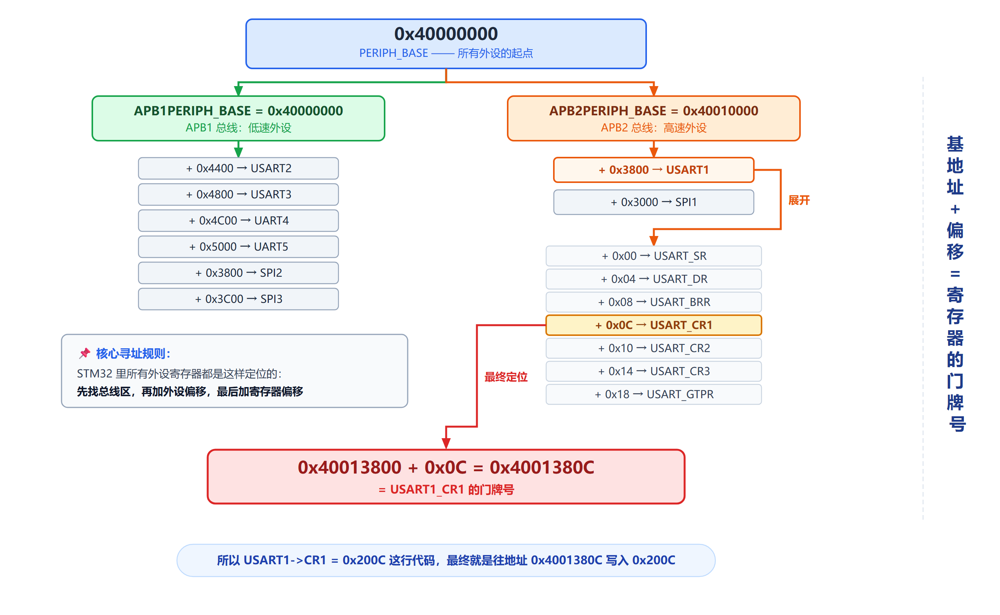

看图要点（从上往下逐层"加偏移"）：

1. **最上层**一个大方块写 `0x40000000  PERIPH_BASE（外设区起点）`，标注"CPU 眼里所有外设都住在这片区域"。
2. **第二层**分成左右两条分支：
   - 左边 `APB1PERIPH_BASE = 0x40000000`，下面挂一串小方块 `+0x4400 → USART2`、`+0x4800 → USART3`、`+0x4C00 → UART4`、`+0x5000 → UART5`、`+0x3800 → SPI2`、`+0x3C00 → SPI3`；
   - 右边 `APB2PERIPH_BASE = 0x40010000`，下面挂 `+0x3800 → USART1`、`+0x3000 → SPI1`。
3. **第三层**（只展开 USART1 这一支）：一个竖排列表，写 `+0x00 → SR`、`+0x04 → DR`、`+0x08 → BRR`、`+0x0C → CR1`、`+0x10 → CR2`、`+0x14 → CR3`、`+0x18 → GTPR`。
4. **最下层**一个高亮方块写最终结果：`0x40013800 + 0x0C = 0x4001380C  →  USART1_CR1`。
5. 图的右侧竖排一行大字：**"基地址 + 偏移 = 寄存器的门牌号"**。
6. 配色：每层用不同深浅的蓝色，最终结果那一块用橙红色强调；连线用细灰线，箭头一律向下。

**现在你再看这行代码，就知道它到底在干什么了：**

```c
USART1->CR1 = 0x200C;
```

```
USART1 是 (USART_TypeDef *)0x40013800
CR1 在结构体里排第 4 个成员（SR, DR, BRR, CR1），偏移 0x0C
→ 实际写入的地址 = 0x40013800 + 0x0C = 0x4001380C
→ 把 0x200C 写进这个地址
→ USART1 的 CR1 寄存器变成 0x200C
→ 硬件上 UE(bit13)、TE(bit3)、RE(bit2) 三个开关被拨到 1
→ USART1 被使能，发送器和接收器都打开
```

**这就是"程序 → 地址 → 寄存器 → 硬件"这条完整的链。**

#### 寄存器 1：状态寄存器 USART_SR

**它属于谁？** 属于 USART1/2/3/4/5 各一份。
**它控制什么？** 它不控制任何东西，它是"**只读的状态报告**"（少数几位可写 0 清除）。
**为什么需要它？** 因为 CPU 需要知道"现在能不能发""收到没有""出错了没有"。

**地址偏移：0x00，复位值：0x00C0**

> 复位值 0x00C0 = 0000 0000 1100 0000，也就是 **bit7(TXE)=1、bit6(TC)=1**。这很合理：刚上电时发送缓冲器是空的、发送也是"完成"状态。

**位图：**

```
bit   15 14 13 12 11 10 |  9  |  8  |  7  |  6  |  5   |  4   |  3  |  2  |  1  |  0  |
      +-----------------+-----+-----+-----+-----+------+------+-----+-----+-----+-----+
      |      保留       | CTS | LBD | TXE | TC  | RXNE | IDLE | ORE | NE  | FE  | PE  |
      +-----------------+-----+-----+-----+-----+------+------+-----+-----+-----+-----+
读写                      rcw0  rcw0   r    rcw0  rcw0    r      r     r     r     r
```

**当前最关心哪几位？**

- **发数据时看 bit7（TXE）**；
- **发完最后一个字节时看 bit6（TC）**；
- **收数据时看 bit5（RXNE）**；
- **出错时看 bit0~bit3（PE / FE / NE / ORE）**。

```
bit  7   6   5
    +---+---+---+
    |TXE| TC|RXNE|
    +---+---+---+
      ↑   ↑    ↑
   能写下一个  能读一个字节
   （缓冲器空） （收到数据）
```

**逐位详解（教材原文 + 人话）：**

**位 9：CTS，CTS 标志（CTS flag）。**
> 如果设置了 CTSE 位，当 nCTS 输入状态变化时，CTS 由硬件置位。由软件写 0 清零。如果 USART_CR3 中的 CTSIE=1，则产生中断。UART4 和 UART5 中不存在该位。
> - 0：nCTS 状态线上没有变化；1：nCTS 状态线上发生变化。

**位 8：LBD，LIN 断开检测标志（LIN break detection flag）。**
> 当探测到 LIN 断开时，该位由硬件置 1，由软件写 0 清零。如果 USART_CR3 中的 LBDIE=1，则 LBD 为 1 时产生中断。
> - 0：没有检测到 LIN 断开；1：检测到 LIN 断开。

**位 7：TXE，发送数据寄存器空（Transmit data register empty）。**
> 当 TDR 寄存器中的数据被硬件转移到移位寄存器时，该位由硬件置位。如果 USART_CR1 寄存器中的 TXEIE=1，则产生中断。**对 USART_DR 的写操作，将该位清零。** 在单缓冲器传输中使用该位。
> - 0：数据还没有被转移到移位寄存器；1：数据已经被转移到移位寄存器。

**位 6：TC，发送完成（Transmission complete）。**
> 当包含有数据的一帧发送完成后，并且 TXE=1 时，该位由硬件置位。如果 USART_CR1 中的 TCIE=1，则产生中断。**由软件序列清除该位（先读 USART_SR，然后写入 USART_DR）。** TC 位也可以通过写 0 来清除，只有在多缓存通信中才推荐这种清除方式。
> - 0：发送还未完成；1：发送完成。

**位 5：RXNE，读数据寄存器非空（Read data register not empty）。**
> 当 RDR 移位寄存器中的数据被转移到 USART_DR 寄存器中时，该位由硬件置位。如果 USART_CR1 寄存器中的 RXNEIE=1，则产生中断。**对 USART_DR 的读操作可以将该位清零。** RXNE 位也可以通过写入 0 来清除，只有在多缓存通信中才推荐这种清除方式。
> - 0：数据没有收到；1：收到数据，可以读出。

**位 4：IDLE，监测到总线空闲（IDLE line detected）。**
> 当检测到总线空闲时，该位由硬件置位。如果 USART_CR1 中的 IDLEIE=1，则产生中断。**由软件序列清除该位（先读 USART_SR，然后读 USART_DR）。** IDLE 位不会再次被置位直到 RXNE 位被置位（即又检测到一次空闲总线）。
> - 0：没有检测到空闲总线；1：检测到空闲总线。

**位 3：ORE，过载错误（Overrun error）。**
> 当 RXNE=1 时，当前接收在移位寄存器中的数据需要传送至 RDR 寄存器时，该位由硬件置位。如果 USART_CR1 中的 RXNEIE=1，则产生中断。**由软件序列将其清零（先读 USART_SR，然后读 USART_DR）。**
> - 0：没有过载错误；1：检测到过载错误。
> 该位被置位时，**RDR 寄存器中的值不会丢失，但是移位寄存器中的数据会被覆盖**。如果设置了 EIE 位，在多缓冲器通信模式下，ORE 标志置位会产生中断。

**位 2：NE，噪声错误标志（Noise error flag）。**
> 在接收到的帧检测到噪音时，该位由硬件置位。**由软件序列对其清零（先读 USART_SR，再读 USART_DR）。**
> - 0：没有检测到噪声；1：检测到噪声。
> 该位**不会单独产生中断**，因为它和 RXNE 一起出现，硬件会在设置 RXNE 标志时产生中断。在多缓冲区通信模式下，如果设置了 EIE 位，则设置 NE 标志时会产生中断。

**位 1：FE，帧错误（Framing error）。**
> 当检测到同步错位、过多的噪声或者检测到断开符，该位由硬件置位。**由软件序列将其清零（先读 USART_SR，再读 USART_DR）。**
> - 0：没有检测到帧错误；1：检测到帧错误或者 break 符。
> 该位不会单独产生中断，因为它和 RXNE 一起出现。如果当前传输的数据既产生了帧错误，又产生了过载错误，硬件还是会继续该数据的传输，并且**只设置 ORE 标志位**。在多缓冲区通信模式下，如果设置了 EIE 位，则设置 FE 标志时会产生中断。

**位 0：PE，校验错误（Parity error）。**
> 在接收模式下，如果出现奇偶校验错误，该位由硬件置位。**由软件序列对其清零（依次读 USART_SR 和 USART_DR）。在清除 PE 位前，软件必须等待 RXNE 标志位被置 1。** 如果 USART_CR1 中的 PEIE=1，则产生中断。
> - 0：没有奇偶校验错误；1：奇偶校验错误。

**读 SR 的小技巧：**

```c
// 读一次 SR，就把状态全读出来了
u16 status = USART1->SR;

if (status & (1 << 5)) { /* RXNE=1，有数据可读 */ }
if (status & (1 << 7)) { /* TXE=1，可以写下一个 */ }
if (status & (1 << 6)) { /* TC=1，发完了 */ }
```

**位运算不跳步演示（判断 RXNE 是否置位）：**

```
运算前 status = 0x00E0 = 0000 0000 1110 0000
掩码   (1<<5)  = 0x0020 = 0000 0000 0010 0000
                         ───────────────────── AND
运算后          0x0020 = 0000 0000 0010 0000   ← 非 0，说明 bit5(RXNE)=1
```

```
另一例 status = 0x00C0 = 0000 0000 1100 0000
掩码   (1<<5)  = 0x0020 = 0000 0000 0010 0000
                         ───────────────────── AND
运算后          0x0000 = 0000 0000 0000 0000   ← 等于 0，说明 bit5(RXNE)=0
```

#### 寄存器 2：数据寄存器 USART_DR

**它属于谁？** USARTx。
**它控制什么？** 它是"数据进出口"：**写它 = 往发送缓冲器 TDR 里放数据；读它 = 从接收缓冲器 RDR 里取数据。**
**为什么需要它？** CPU 通过它和串口的收发流水线交换数据。

**地址偏移：0x04，复位值：不确定**

**位图：**

```
bit   15 14 13 12 11 10  9 |  8  |  7  |  6  |  5  |  4  |  3  |  2  |  1  |  0  |
      +--------------------+-----+-----+-----+-----+-----+-----+-----+-----+-----+
      |        保留        |                   DR[8:0]                          |
      +--------------------+-----+-----+-----+-----+-----+-----+-----+-----+-----+
                                 rw    rw    rw    rw    rw    rw    rw    rw    rw
```

> 位 [15:9]：保留。
> 位 [8:0]：**DR[8:0]，数据值（Data value）**。包含了发送或接收的数据。由于它是**由两个寄存器组成的**：一个给发送用（**TDR**），一个给接收用（**RDR**），该寄存器**既可以写入也可以读出**。TDR 寄存器提供了内部总线和输出移位寄存器之间的并行接口。RDR 寄存器提供了输入移位寄存器和内部总线之间的并行接口。
>
> 当使能校验位（USART_CR1 中 PCE 位被置位）进行发送时，**写到最高位的值（根据数据的长度不同，最高位是第 7 位或者第 8 位）会被后来的校验位取代**。当使能校验位进行接收时，**读到的最高位是接收到的校验位**。

**为什么 DR 只有一个地址，却能当两个寄存器用？**

因为它内部是"一个地址，两扇门"：

```
              ┌─────────────┐
CPU 写 DR ───►│  TDR（发送） │───► 发送移位寄存器 ───► TX
              ├─────────────┤
CPU 读 DR ◄───│  RDR（接收） │◄─── 接收移位寄存器 ◄─── RX
              └─────────────┘
              同一个地址 0x40013804
```

**这就是"读的时候走接收门、写的时候走发送门"。** 同一行代码 `USART1->DR = x;` 和 `y = USART1->DR;` 访问的是同一个地址，但硬件走的路径完全不同。

#### 寄存器 3：波特率寄存器 USART_BRR

**它属于谁？** USARTx。
**它控制什么？** 控制发送和接收的**节拍快慢**。
**为什么需要它？** 通信双方必须速度一致。

**地址偏移：0x08，复位值：0x0000**

**位图：**

```
bit   15 14 13 12 11 10  9  8  7  6  5  4 |  3   2   1   0
      +-----------------------------------+-----------------+
      |         DIV_Mantissa[11:0]        |DIV_Fraction[3:0]|
      +-----------------------------------+-----------------+
      |              rw                   |       rw        |
```

> 位 [15:4]：**DIV_Mantissa[11:0]**，USART 分频器除法因子 USARTDIV 的**整数部分**。
> 位 [3:0]：**DIV_Fraction[3:0]**，USART 分频器除法因子 USARTDIV 的**小数部分**。

**注意：位 [3:0] 虽然叫"小数部分"，但存的是"十六分之几"。**

```
DIV_Fraction = 0  → 小数 = 0/16 = 0
DIV_Fraction = 1  → 小数 = 1/16 = 0.0625
DIV_Fraction = 4  → 小数 = 4/16 = 0.25
DIV_Fraction = 8  → 小数 = 8/16 = 0.5
DIV_Fraction = 12 → 小数 = 12/16 = 0.75
DIV_Fraction = 15 → 小数 = 15/16 = 0.9375
```

**写 0 意味着什么？** 整数部分写 0 → USARTDIV < 1 → 波特率会大于 f_CK/16，这通常是不合法的（太小），实际不会这么用。
**写 1 意味着什么？** DIV_Fraction 每加 1，USARTDIV 加 0.0625。

**程序怎么操作？**

```c
USART1->BRR = 0x1D4C;    // 72MHz 下配 9600 bps（前面算过）
```

**操作之后硬件发生什么？**

```
BRR = 0x1D4C
      ↓ 硬件解读
DIV_Mantissa = 0x1D4 = 468
DIV_Fraction = 0xC   = 12
      ↓
USARTDIV = 468 + 12/16 = 468.75
      ↓
波特率 = 72 000 000 / (16 × 468.75) = 9600 bps
      ↓
波特率发生器按 9600 Hz 的节拍驱动发送/接收移位寄存器
      ↓
每一位持续 104.17 μs
```

**⚠️ 重要警告（教材原文）：** **在写入 USART_BRR 之后，波特率计数器会被波特率寄存器的新值替换。因此，不要在通信进行中改变波特率寄存器的数值。**

#### 寄存器 4：控制寄存器 1（USART_CR1）

**它属于谁？** USARTx。
**它控制什么？** 这是**最常用的一个控制寄存器**：使能、字长、校验、中断开关、收发开关，全在这里。
**为什么需要它？** 没有它，你没法告诉 USART "我要怎么工作"。

**地址偏移：0x0C，复位值：0x0000**

**位图：**

```
bit   15 14 | 13 | 12 |  11 | 10 | 9  |  8   |  7    |  6   |   5    |   4    | 3  | 2  |  1 |  0 |
      +------+----+----+-----+----+----+------+-------+------+--------+--------+----+----+----+----+
      | 保留 | UE | M  |WAKE |PCE | PS | PEIE | TXEIE | TCIE | RXNEIE | IDLEIE | TE | RE |RWU |SBK |
      +------+----+----+-----+----+----+------+-------+------+--------+--------+----+----+----+----+
                rw   rw   rw    rw   rw   rw     rw      rw     rw       rw      rw   rw   rw   rw
```

**最常用的 5 位（先看这 5 个就够了）：**

```
bit     13        12        3        2        0
      +----+    +----+    +----+    +----+    +----+
      | UE |    | M  |    | TE |    | RE |    |SBK |
      +----+    +----+    +----+    +----+    +----+
      总开关    字长     发送使能  接收使能  发断开符
```

**逐位详解（教材原文 + 人话）：**

**位 13：UE，USART 使能（USART enable）。**
> 该位被清零时，USART 的分频器和输出在当前字节传输完成后停止工作，以减少功耗。该位由软件置位和清零。
> - 0：USART 分频器和输出被禁止；1：USART 模块使能。

【人话】**总开关。** 不打开它，其他所有设置都不生效。

**位 12：M，字长（Word length）。**
> 该位定义了数据字的长度，由软件置位和清零。**在数据传输过程中，不能修改这个位。**
> - 0：一个起始位，8 个数据位，n 个停止位；1：一个起始位，9 个数据位，n 个停止位。

**位 11：WAKE，唤醒的方法（Wakeup method）。**
> 该位决定了唤醒 USART 的方法，由软件置位和清零。
> - 0：被空闲总线唤醒；1：被地址标记唤醒。

**位 10：PCE，检验控制使能（Parity control enable）。**
> 该位用于选择是否进行硬件校验控制（对于发送来说就是校验位的产生；对于接收来说就是校验位的检测）。如果使能了该位，在发送数据的最高位（如果 M=1，最高位就是第 9 位；如果 M=0，最高位就是第 8 位）插入校验位；对接收到的数据检查其校验位。由软件对它置位或清零。**一旦设置了该位，当前字节传输完成后，校验控制才生效。**
> - 0：禁止校验控制；1：使能校验控制。

**位 9：PS，校验选择（Parity selection）。**
> 当校验控制使能后，该位用来选择采用偶校验还是奇校验。软件对它置位或清零。当前字节传输完成后，该选择生效。
> - **0：偶校验；1：奇校验。**

**位 8：PEIE，PE 中断使能（PE interrupt enable）。**
> 0：禁止产生中断；1：当 USART_SR 中的 PE=1 时，产生 USART 中断。

**位 7：TXEIE，发送缓冲区空中断使能（TXE interrupt enable）。**
> 0：禁止产生中断；1：当 USART_SR 中的 TXE=1 时，产生 USART 中断。

**位 6：TCIE，发送完成中断使能（Transmission complete interrupt enable）。**
> 0：禁止产生中断；1：当 USART_SR 中的 TC=1 时，产生 USART 中断。

**位 5：RXNEIE，接收缓冲区非空中断使能（RXNE interrupt enable）。**
> 0：禁止产生中断；1：当 USART_SR 中的 **ORE 或者 RXNE** 为 1 时，产生 USART 中断。

【人话】**最常用的中断使能位。** 收一个字节就进一次中断，靠它。

**位 4：IDLEIE，IDLE 中断使能（IDLE interrupt enable）。**
> 0：禁止产生中断；1：当 USART_SR 中的 IDLE=1 时，产生 USART 中断。

**位 3：TE，发送使能（Transmitter enable）。**
> 该位使能发送器。该位由软件置位或清零。
> - 0：禁止发送；1：使能发送。
> **注意：**
> （1）在数据传输过程中，除了在智能卡模式下，如果 TE 位上有个 0 脉冲（即设置为 0 之后再设置为 1），会在当前数据字传输完成后，发送一个"前导符"（空闲总线）。
> （2）当 TE 被置位后，在真正发送开始之前，有一个位的时间延迟。

**位 2：RE，接收使能（Receiver enable）。**
> 0：禁止接收；1：使能接收，并开始搜寻 RX 引脚上的起始位。

**位 1：RWU，接收唤醒（Receiver wakeup）。**
> 该位用来决定是否把 USART 置于静默模式。该位由软件置位或清零。当唤醒序列到来时，硬件也会将其清零。
> - 0：接收器处于正常工作模式；1：接收器处于静默模式。
> **注意：**
> （1）在把 USART 置于静默模式（设置 RWU 位）之前，USART 要已经先接收了一个数据字节。否则在静默模式下，不能被空闲总线检测唤醒。
> （2）如果配置成地址标记检测唤醒（WAKE 位=1），RXNE 位被置位时，不能用软件修改 RWU 位。

**位 0：SBK，发送断开帧（Send break）。**
> 使用该位来发送断开字符。该位可以由软件置位或清零。操作过程是由软件置位，然后在断开帧的停止位时，由硬件将该位复位。
> - 0：没有发送断开字符；1：将要发送断开字符。

**典型配置示例：**

```c
// 8 位数据、无校验、使能收发、打开 USART
USART1->CR1 = (1<<13) | (0<<12) | (0<<10) | (1<<3) | (1<<2);
//             UE=1      M=0       PCE=0      TE=1     RE=1
// = 0x200C
```

**位运算不跳步演示：**

```
(1<<13) = 0x2000 = 0010 0000 0000 0000
(1<<3)  = 0x0008 = 0000 0000 0000 1000
(1<<2)  = 0x0004 = 0000 0000 0000 0100

按位或：
  0x2000  0010 0000 0000 0000
| 0x0008  0000 0000 0000 1000
| 0x0004  0000 0000 0000 0100
──────────────────────────────
= 0x200C  0010 0000 0000 1100
              ↑            ↑↑
            UE=1        RE=1 TE=1
```

#### 寄存器 5：控制寄存器 2（USART_CR2）

**它属于谁？** USARTx。
**它控制什么？** 停止位个数、LIN 模式、同步模式下的时钟极性/相位、多处理器地址等。

**地址偏移：0x10，复位值：0x0000**

**位图：**

```
bit   15 |  14  | 13 12 |  11  | 10  |  9  |  8  |  7 |  6   |  5  |  4 | 3  2  1  0 |
      +----+------+-------+------+-----+-----+-----+----+------+-----+----+-----------+
      |保留|LINEN |STOP[1:0]|CLKEN|CPOL |CPHA |LBCL |保留|LBDIE |LBDL |保留|  ADD[3:0] |
      +----+------+-------+------+-----+-----+-----+----+------+-----+----+-----------+
             rw      rw      rw     rw    rw    rw         rw     rw        rw
```

**当前最关心的是 bit[13:12]（STOP）：**

```
bit   13  12
     +----+----+
     |STOP[1:0]|
     +----+----+
      00 → 1 个停止位（默认）
      01 → 0.5 个停止位
      10 → 2 个停止位
      11 → 1.5 个停止位
```

**逐位详解：**

**位 15：保留位，硬件强制为 0。**

**位 14：LINEN，LIN 模式使能（LIN mode enable）。**
> 0：禁止 LIN 模式；1：使能 LIN 模式。
> 在 LIN 模式下，可以用 USART_CR1 寄存器中的 SBK 位发送 LIN 同步断开符（低 13 位），以及检测 LIN 同步断开符。

**位 [13:12]：STOP，用来设置停止位的位数（STOP bits）。**
> 00：1 个停止位；01：0.5 个停止位；10：2 个停止位；11：1.5 个停止位。
> **注：UART4 和 UART5 不能用 0.5 停止位和 1.5 停止位。**

**位 11：CLKEN，时钟使能（Clock enable）。**
> 该位用来使能 CK 引脚。
> - 0：禁止 CK 引脚；1：使能 CK 引脚。
> **注：UART4 和 UART5 上不存在这一位。**

**位 10：CPOL，时钟极性（Clock polarity）。**
> 在同步模式下，该位用来选择 SCLK 引脚上时钟输出的极性。配合 CPHA 位一起产生需要的时钟/数据的采样关系。
> - **0：总线空闲时 CK 引脚上保持低电平；1：总线空闲时 CK 引脚上保持高电平。**
> **注：UART4 和 UART5 上不存在这一位。**

**位 9：CPHA，时钟相位（Clock phase）。**
> 在同步模式下，该位用来选择 SCLK 引脚上时钟输出的相位。配合 CPOL 位一起产生需要的时钟/数据的采样关系。
> - **0：在时钟的第一个边沿进行数据捕获；1：在时钟的第二个边沿进行数据捕获。**
> **注：UART4 和 UART5 上不存在这一位。**

> **【重要提示】** 这里的 **CPOL / CPHA 和 9.3 节 SPI 的 CPOL / CPHA 是同一套概念**。也就是说：**USART 的同步模式本质上就是一个"带起始位和停止位的 SPI"**。学完 9.3 节再回头看这里，会非常清楚。本章后面会反复用到这两个概念，所以现在先记一句话：
>
> - **CPOL 管"空闲时时钟是高还是低"；**
> - **CPHA 管"在第几个边沿采样数据"。**

**位 8：LBCL，最后一位时钟脉冲（Last bit clock pulse）。**
> 在同步模式下，该位用于控制是否在 CK 引脚上输出最后发送的那个数据位（最高位）对应的时钟脉冲。
> - 0：最后一位数据的时钟脉冲不从 CK 输出；1：最后一位数据的时钟脉冲会从 CK 输出。
> **注：**（1）最后一个数据位就是第 8 或者第 9 个发送的位（根据 USART_CR1 寄存器中的 M 位所定义的 8 或者 9 位数据帧格式）。（2）UART4 和 UART5 上不存在这一位。

**位 7：保留位，硬件强制为 0。**

**位 6：LBDIE，LIN 断开符检测中断使能（LIN break detection interrupt enable）。**
> 0：禁止中断；1：只要 USART_SR 寄存器中的 LBD 为 1 就产生中断。

**位 5：LBDL，LIN 断开符检测长度（LIN break detection length）。**
> 0：10 位的断开符检测；1：11 位的断开符检测。

**位 4：保留位，硬件强制为 0。**

**位 [3:0]：ADD[3:0]，本设备的 USART 节点地址。**
> 该位域给出本设备 USART 节点的地址。这是在多处理器通信的静默模式下使用的，使用地址标记来唤醒某个 USART 设备。

**位运算演示（设置 1 个停止位）：**

```
想要 STOP[1:0] = 00（1 个停止位）

先把掩码完整算出来（不跳步）：
  3 << 12     = 0x3000 = 0011 0000 0000 0000   ← 把二进制 11 挪到 bit13、bit12
  ~(3<<12)    = 0xCFFF = 1100 1111 1111 1111   ← 取反：把 bit13、bit12 挖成 0，其余位保留

运算前 CR2 = 0x0000 = 0000 0000 0000 0000
掩码   ~(3<<12)     = 1100 1111 1111 1111
                        ─────────────────── AND
运算后        0x0000 = 0000 0000 0000 0000

所以"设 1 个停止位"就是让 bit13、bit12 保持 0，不用做任何事。
（注意：掩码本身是 1100 1111 1111 1111 即 0xCFFF，不是全 1。本例中 CR2 本来就全是 0，所以结果不变；但掩码该怎么写就必须怎么写，不能记成"全 1"。）
```

**位运算演示（设置 2 个停止位）：**

```
想要 STOP[1:0] = 10（2 个停止位）

运算前 CR2 = 0x0000 = 0000 0000 0000 0000
掩码   (2<<12)      = 0010 0000 0000 0000
                        ─────────────────── OR
运算后        0x2000 = 0010 0000 0000 0000
                         ↑
                      bit13=1, bit12=0 → STOP=10 → 2 个停止位
```

#### 寄存器 6：控制寄存器 3（USART_CR3）

**它属于谁？** USARTx。
**它控制什么？** DMA、硬件流控（CTS/RTS）、智能卡、红外、半双工、错误中断。

**地址偏移：0x14，复位值：0x0000**

**位图：**

```
bit   15 14 13 12 11 |  10  |  9  |  8  |  7  |  6  |  5  |  4  |   3   |  2  |  1  |  0 |
      +---------------+------+-----+-----+-----+-----+-----+-----+-------+-----+-----+----+
      |     保留      |CTSIE |CTSE |RTSE |DMAT |DMAR |SCEN |NACK |HDSEL  |IRLP |IREN |EIE |
      +---------------+------+-----+-----+-----+-----+-----+-----+-------+-----+-----+----+
                       rw     rw    rw    rw    rw    rw    rw     rw     rw    rw    rw
```

**当前最关心的是 bit7（DMAT）和 bit6（DMAR）：**

```
bit    7      6
     +-----+-----+
     |DMAT |DMAR |
     +-----+-----+
       1      1
       │      └── 1：接收时用 DMA（第 11 章会讲）
       └───────── 1：发送时用 DMA
```

**逐位详解：**

**位 [15:11]：保留位，硬件强制为 0。**

**位 10：CTSIE，CTS 中断使能（CTS interrupt enable）。**
> 0：禁止中断；1：USART_SR 寄存器中的 CTS 为 1 时产生中断。
> **注：UART4 和 UART5 上不存在这一位。**

**位 9：CTSE，CTS 使能（CTS enable）。**
> 0：禁止 CTS 硬件流控制；
> 1：CTS 模式使能，**只有 nCTS 输入信号有效（拉成低电平）时才能发送数据**。如果在数据传输的过程中，nCTS 信号变成无效，那么发完这个数据后，传输就停止下来。如果当 nCTS 为无效时，往数据寄存器里写数据，则要等到 nCTS 有效时才会发送这个数据。
> **注：UART4 和 UART5 上不存在这一位。**

**位 8：RTSE，RTS 使能（RTS enable）。**
> 0：禁止 RTS 硬件流控制；
> 1：RTS 中断使能，只有接收缓冲区内有空余的空间时才请求下一个数据。当前数据发送完成后，发送操作就需要暂停下来。如果可以接收数据了，将 nRTS 输出置为有效（拉至低电平）。
> **注：UART4 和 UART5 上不存在这一位。**

**位 7：DMAT，DMA 使能发送（DMA enable transmitter）。**
> 0：禁止发送时的 DMA 模式；1：使能发送时的 DMA 模式。
> **注：UART4 和 UART5 上不存在这一位。**

**位 6：DMAR，DMA 使能接收（DMA enable receiver）。**
> 0：禁止接收时的 DMA 模式；1：使能接收时的 DMA 模式。
> **注：UART4 和 UART5 上不存在这一位。**

**位 5：SCEN，智能卡模式使能（Smartcard mode enable）。**
> 0：禁止智能卡模式；1：使能智能卡模式。

**位 4：NACK，智能卡 NACK 使能（Smartcard NACK enable）。**
> 0：校验错误出现时，不发送 NACK；1：校验错误出现时，发送 NACK。

**位 3：HDSEL，半双工选择（Half-duplex selection）。**
> 选择单线半双工模式。
> - 0：不选择半双工模式；1：选择半双工模式。

**位 2：IRLP，红外低功耗（IrDA low-power）。**
> 0：通常模式；1：低功耗模式。

**位 1：IREN，红外模式使能（IrDA mode enable）。**
> 0：不使能红外模式；1：使能红外模式。

**位 0：EIE，错误中断使能（Error interrupt enable）。**
> 在多缓冲区通信模式下，当有帧错误、过载或者噪声错误时（USART_SR 中的 FE=1 或者 ORE=1 或者 NE=1）产生中断。
> - 0：禁止中断；
> - 1：只要 USART_CR3 中的 DMAR=1，并且 USART_SR 中的 FE=1 或者 ORE=1 或者 NE=1，则产生中断。

#### 寄存器 7：保护时间和预分频寄存器（USART_GTPR）

**它属于谁？** USARTx。
**它控制什么？** 智能卡模式下的保护时间，以及红外模式/智能卡模式下的时钟预分频。
**为什么需要它？** 智能卡需要"发完一帧后等一小会儿再发下一帧"（保护时间），还要给卡提供特定频率的时钟。

**地址偏移：0x18，复位值：0x0000**

**位图：**

```
bit    15 14 13 12 11 10  9  8 |  7   6   5   4   3   2   1   0
      +-----------------------+-------------------------------+
      |        GT[7:0]        |          PSC[7:0]             |
      +-----------------------+-------------------------------+
      |         rw            |             rw                |
```

> 位 [15:8]：**GT[7:0]，保护时间值（Guard time value）。** 该位域规定了**以波特时钟为单位**的保护时间。在智能卡模式下，需要这个功能。**当保护时间过去后，才会设置发送完成标志。** UART4 和 UART5 上不存在这些位。
>
> 位 [7:0]：**PSC[7:0]，预分频器值（Prescaler value）。**
> - 在**红外（IrDA）低功耗模式**下：PSC[7:0] 为红外低功耗波特率。对系统时钟分频以获得低功耗模式下的频率，源时钟被寄存器中的值（仅有 8 位有效）分频：
>   - 00000000：保留——不要写入该值；
>   - 00000001：对源时钟 1 分频；
>   - 00000010：对源时钟 2 分频；
> - 在**红外（IrDA）的正常模式**下，PSC 只能设置为 00000001。
> - 在**智能卡模式**下：PSC[4:0] 为预分频值。对系统时钟进行分频，给智能卡提供时钟。寄存器中给出的值（低 5 位有效）**乘以 2** 后，作为对源时钟的分频因子。
>   - 00000：保留——不要写入该值；
>   - 00001：对源时钟进行 2 分频；
>   - 00010：对源时钟进行 4 分频；
>   - 00011：对源时钟进行 6 分频；
> - **注意：**（1）位 [7:5] 在智能卡模式下没有意义。（2）UART4 和 UART5 上不存在这些位。

**用大白话说：**

- **GT（保护时间）**：智能卡很"娇气"，你发完一帧之后不能立刻发下一帧，得等几个"位时间"。等多久由 GT 决定。
- **PSC（预分频）**：智能卡需要的时钟频率和 STM32 的主频不一样，得先分频再给卡。

**本课程里这个寄存器基本用不到**（除非做智能卡或红外），知道它存在、知道它是干什么的就行。

---

### 9.2.12 STM32 的 USART 固件库函数

#### 1. USART 寄存器结构（`USART_TypeDef`）

教材原文：

> USART 寄存器结构 `USART_TypeDef` 在文件 `stm32f10x.h` 中定义如下：

```c
typedef struct
{
    vu16 SR;          // USART 状态寄存器
    u16  RESERVED0;
    vu16 DR;          // USART 数据寄存器
    u16  RESERVED1;
    vu16 BRR;         // USART 波特率寄存器
    u16  RESERVED2;
    vu16 CR1;         // USART 控制寄存器 1
    u16  RESERVED3;
    vu16 CR2;         // USART 控制寄存器 2
    u16  RESERVED4;
    vu16 CR3;         // USART 控制寄存器 3
    u16  RESERVED5;
    vu16 GTPR;        // USART 保护时间和预分频寄存器
    u16  RESERVED6;
} USART_TypeDef;
```

**【补充解释】为什么每个成员后面都跟着一个 `RESERVED`？**

因为 STM32 的 USART 寄存器是 **16 位宽**的，但地址空间是按 32 位（4 字节）分配的。硬件规定：**每个寄存器占 4 个字节的地址，但只用了低 2 个字节，高 2 个字节是保留的。**

所以结构体里要写一个 `u16 RESERVED0` 来"占位"，保证后面的成员地址对得上：

```
偏移 0x00：SR      （低 16 位）
偏移 0x02：RESERVED0（高 16 位，保留）
偏移 0x04：DR
偏移 0x06：RESERVED1
偏移 0x08：BRR
...
偏移 0x0C：CR1
偏移 0x10：CR2
偏移 0x14：CR3
偏移 0x18：GTPR
```

**这就解释了为什么偏移是 0x00、0x04、0x08、0x0C、0x10、0x14、0x18——每个跳 4 个字节。**

> `vu16` 里的 `v` 是 `volatile`，意思是"**这个值随时可能被硬件改掉，编译器不要自作聪明地优化它**"。
> `u16` = `unsigned short` = 16 位无符号整数。

**外设基地址宏定义（教材原文）：**

```c
#define PERIPH_BASE       ((u32)0x40000000)
#define APB1PERIPH_BASE   PERIPH_BASE
#define APB2PERIPH_BASE   (PERIPH_BASE + 0x10000)
#define AHBPERIPH_BASE    (PERIPH_BASE + 0x20000)
#define USART1_BASE       (APB2PERIPH_BASE + 0x3800)
#define USART2_BASE       (APB1PERIPH_BASE + 0x4400)
#define USART3_BASE       (APB1PERIPH_BASE + 0x4800)
...
#define USART1 ((USART_TypeDef *) USART1_BASE)
#define USART2 ((USART_TypeDef *) USART2_BASE)
#define USART3 ((USART_TypeDef *) USART3_BASE)
...
```

**逐行解释：**

| 宏 | 值 | 含义 |
|---|---|---|
| `PERIPH_BASE` | 0x40000000 | 所有外设的"总大门"地址 |
| `APB1PERIPH_BASE` | 0x40000000 | APB1 总线上的外设从这儿开始排 |
| `APB2PERIPH_BASE` | 0x40010000 | APB2 总线上的外设从这儿开始排 |
| `AHBPERIPH_BASE` | 0x40020000 | AHB 总线上的外设从这儿开始排 |
| `USART1_BASE` | 0x40013800 | USART1 这个外设的"门牌号" |
| `USART1` | (指针) | 把门牌号变成一个"结构体指针"，于是可以用 `USART1->CR1` 这种写法 |

#### 2. 常用的固件库函数

##### （1）`USART_Init` —— 一次性配好所有参数

```c
void USART_Init(USART_TypeDef * USARTx, USART_InitTypeDef * USART_InitStruct)
```

**功能：** 根据 `USART_InitStruct` 中指定的参数初始化外设 `USARTx` 寄存器。

**参数 1 `USARTx`：** 选择 USART 外设，可以是 USART1、USART2、USART3、UART4 或 UART5。

**参数 2 `USART_InitStructure`：** 指向结构 `USART_InitTypeDef` 的指针，包含外设 USART 的配置信息。

```c
typedef struct
{
    u32 USART_BaudRate;
    u16 USART_WordLength;
    u16 USART_StopBits;
    u16 USART_Parity;
    u16 USART_Mode;
    u16 USART_HardwareFlowControl;
} USART_InitTypeDef;
```

**结构成员逐个讲：**

**① `USART_BaudRate` —— 传输的波特率。**

计算公式（教材原文）：

```c
IntegerDivider    = ((APBClock) / (16 * (USART_InitStruct->USART_BaudRate)))
FractionalDivider = ((IntegerDivider - ((u32) IntegerDivider)) * 16) + 0.5
```

> 在实际应用中，可以直接写波特率的值，如 9600、19200 等。

**② `USART_WordLength` —— 一个帧中传输或者接收到的数据位数。**

- `USART_WordLength_8b`：8 位数据。
- `USART_WordLength_9b`：9 位数据。

**③ `USART_StopBits` —— 定义停止位数目。**

- `USART_StopBits_1`：在帧结尾传输 1 个停止位。
- `USART_StopBits_0.5`：在帧结尾传输 0.5 个停止位。
- `USART_StopBits_2`：在帧结尾传输 2 个停止位。
- `USART_StopBits_1.5`：在帧结尾传输 1.5 个停止位。

**④ `USART_Parity` —— 定义奇偶校验模式。**

- `USART_Parity_No`：不用奇偶校验。
- `USART_Parity_Even`：偶校验模式。
- `USART_Parity_Odd`：奇校验模式。

> 奇偶校验一旦使能，在发送数据的**最高位**插入经计算的奇偶位（字长 9 位时的第 9 位，字长 8 位时的第 8 位）。

**⑤ `USART_Mode` —— 指定发送使能和接收使能。** 可以是二者的"或"组合。

- `USART_Mode_Tx`：发送使能。
- `USART_Mode_Rx`：接收使能。

**⑥ `USART_HardwareFlowControl` —— 指定硬件流控制模式。**

- `USART_HardwareFlowControl_None`：不使用硬件流控制。
- `USART_HardwareFlowControl_RTS`：发送请求 RTS 使能。
- `USART_HardwareFlowControl_CTS`：清除发送 CTS 使能。
- `USART_HardwareFlowControl_RTS_CTS`：RTS 和 CTS 使能。

**典型初始化代码（教材原文）：**

```c
USART_InitStructure.USART_BaudRate = 9600;                          // 波特率 9600
USART_InitStructure.USART_WordLength = USART_WordLength_8b;         // 字长 8 位
USART_InitStructure.USART_StopBits = USART_StopBits_1;              // 1 位停止位
USART_InitStructure.USART_Parity = USART_Parity_No;                 // 无奇偶校验
USART_InitStructure.USART_HardwareFlowControl =
    USART_HardwareFlowControl_None;                                 // 无流控制
// 打开 Rx 接收和 Tx 发送功能
USART_InitStructure.USART_Mode = USART_Mode_Rx | USART_Mode_Tx;
USART_Init(USART1, &USART_InitStructure);                           // 初始化
```

**这段代码在硬件上做了什么？（逐行软硬件联动）**

| 代码 | CPU 做什么 | 寄存器发生什么 | 硬件发生什么 |
|---|---|---|---|
| `USART_BaudRate = 9600` | 只是往结构体变量里存了个数 | 还没碰硬件 | 无 |
| `USART_WordLength = ..._8b` | 存数 | 还没碰硬件 | 无 |
| `...` | 存数 | 还没碰硬件 | 无 |
| `USART_Init(USART1, &...)` | 调用库函数，库函数根据这些数**算出 BRR**，然后把各个字段**拆成位**写进 CR1/CR2/CR3/BRR | BRR、CR1、CR2、CR3 被写入 | USART1 的波特率、字长、停止位、校验、收发方向全部确定下来 |

> **注意：`USART_Init` 不会打开 UE（总开关）。** 打开总开关要用 `USART_Cmd()`。这是新手最常忘的一步。

##### （2）`USART_ITConfig` —— 打开/关闭某个中断

```c
void USART_ITConfig(USART_TypeDef * USARTx, u16 USART_IT, FunctionalState NewState)
```

**功能：** 使能或者除能指定的 USART 中断。

- `USARTx`：选择 USART 外设。
- `USART_IT`：待使能或者除能的 USART 中断源。
- `NewState`：`ENABLE` 或 `DISABLE`。

**`USART_IT` 的取值：**

| 取值 | 含义 |
|---|---|
| `USART_IT_PE` | 奇偶错误中断 |
| `USART_IT_TXE` | 发送中断（发送缓冲器空） |
| `USART_IT_TC` | 传输完成中断 |
| `USART_IT_RXNE` | 接收中断（接收缓冲器非空） |
| `USART_IT_IDLE` | 空闲总线中断 |
| `USART_IT_LBD` | LIN 中断检测中断 |
| `USART_IT_CTS` | CTS 中断 |
| `USART_IT_ERR` | 错误中断 |

**示例：**

```c
USART_ITConfig(USART1, USART_IT_TXE | USART_IT_RXNE, ENABLE);
```

**这行代码做了什么？**

```
库函数把 USART_IT_RXNE 翻译成 "CR1 的 bit5"、USART_IT_TXE 翻译成 "CR1 的 bit7"
→ 执行 USART1->CR1 |= (1<<5) | (1<<7)
→ CR1 的 RXNEIE=1、TXEIE=1
→ 以后只要 SR 里 RXNE 或 TXE 置位，就会向 NVIC 发出中断请求
```

**位运算不跳步：**

```
运算前 CR1 = 0x200C = 0010 0000 0000 1100
掩码       = 0x00A0 = 0000 0000 1010 0000   （bit7|bit5）
                      ───────────────────── OR
运算后       = 0x20AC = 0010 0000 1010 1100
                          ↑        ↑   ↑↑
                        UE=1   TXEIE=1 RE=1 TE=1
                                RXNEIE=1 ↑（在 bit5）
```

##### （3）`USART_Cmd` —— 打开总开关

```c
void USART_Cmd(USART_TypeDef * USARTx, FunctionalState NewState)
```

**功能：** 使能或者除能 USART 外设。

**示例：**

```c
USART_Cmd(USART1, ENABLE);
```

**这行代码做了什么？**

```
库函数执行 USART1->CR1 |= (1<<13)
→ CR1 的 bit13（UE）= 1
→ USART 的分频器开始工作、输出使能
→ 串口"活了"
```

##### （4）`USART_SendData` —— 发一个字节

```c
void USART_SendData(USART_TypeDef * USARTx, u16 Data)
```

**功能：** 通过外设 `USARTx` 发送单个数据。

**示例：**

```c
USART_SendData(USART1, 0x25);
```

**这行代码做了什么？**

```
库函数执行 USART1->DR = 0x25
→ 把 0x25 写进地址 0x40013804
→ 硬件把 0x25 放进 TDR（发送缓冲器）
→ 同时 SR 的 TXE 位被清零
→ 等当前帧发完（或立即，如果空闲），TDR 的内容被搬进发送移位寄存器
→ 移位寄存器按波特率节拍，一位一位往 TX 引脚送：
   先送 bit0=1，再 bit1=0，再 bit2=1 …… 最后送停止位
→ 外部设备就在线上看到了我们前面画的那段波形
```

**⚠️ 注意：** `USART_SendData` **不会等你发完**。它只是把数据丢进缓冲器就返回了。所以连续发送时必须先等 TXE：

```c
while (USART_GetFlagStatus(USART1, USART_FLAG_TXE) == RESET);  // 等缓冲器空
USART_SendData(USART1, 0x25);                                   // 再丢下一个
```

##### （5）`USART_ReceiveData` —— 收一个字节

```c
u16 USART_ReceiveData(USART_TypeDef * USARTx)
```

**功能：** 返回 `USARTx` 最近接收到的数据。

**示例：**

```c
u16 RxData;
RxData = USART_ReceiveData(USART1);
```

**这行代码做了什么？**

```
库函数执行 return (u16)(USART1->DR & 0x1FF)
→ 读地址 0x40013804
→ 硬件把 RDR（接收缓冲器）里的数据放到总线上，CPU 读走
→ 同时 SR 的 RXNE 位被清零（"我已经拿走了"）
→ 如果下一个字节还没来，就不会发生溢出错误
```

##### （6）`USART_GetFlagStatus` —— 查状态

```c
FlagStatus USART_GetFlagStatus(USART_TypeDef * USARTx, uint16_t USART_FLAG)
```

**功能：** 检查指定的 USART 标志位。

**`USART_FLAG` 的取值：**

| 取值 | 含义 |
|---|---|
| `USART_FLAG_CTS` | CTS 标志位（UART4 和 UART5 中不存在） |
| `USART_FLAG_LBD` | LIN 中断检测标志位 |
| `USART_FLAG_TXE` | 发送数据寄存器空标志位 |
| `USART_FLAG_TC` | 发送完成标志位 |
| `USART_FLAG_RXNE` | 接收数据寄存器非空标志位 |
| `USART_FLAG_IDLE` | 空闲总线标志位 |
| `USART_FLAG_ORE` | 溢出错误标志位 |
| `USART_FLAG_NE` | 噪声错误标志位 |
| `USART_FLAG_FE` | 帧错误标志位 |
| `USART_FLAG_PE` | 奇偶错误标志位 |

**返回值：** 中断标志位状态（读 SR 寄存器），`SET` 或者 `RESET`。

**示例：**

```c
USART_GetFlagStatus(USART1, USART_FLAG_TC);
```

> **【补充解释】`GetFlagStatus` 和 `GetITStatus` 有什么区别？**
> - `USART_GetFlagStatus(USART1, USART_FLAG_RXNE)` —— 只看 **SR 里的标志位**，**不管中断使能位开没开**。
> - `USART_GetITStatus(USART1, USART_IT_RXNE)` —— 会**同时检查标志位和对应的中断使能位**，两个都满足才返回 SET。
>
> **在中断服务程序里应该用 `GetITStatus`**（因为只有使能了才会进中断），**在查询方式的 `while` 等待里应该用 `GetFlagStatus`**。

##### （7）`USART_ClearFlag` —— 清标志位

```c
void USART_ClearFlag(USART_TypeDef * USARTx, uint16_t USART_FLAG)
```

**功能：** 清除 `USARTx` 的标志位。

**可清除的标志：** `USART_FLAG_CTS`、`USART_FLAG_LBD`、`USART_FLAG_TC`、`USART_FLAG_RXNE`。

**示例：**

```c
USART_ClearFlag(USART1, USART_FLAG_TC);
```

> **⚠️ 教材这里印成了 `USART_USART_ClearFlag(USART1, USART_FLAG_TC);`，函数名重复了一次，明显是排版错误。** 已记入【待核验】。

##### （8）`USART_GetITStatus` —— 查中断

```c
ITStatus USART_GetITStatus(USART_TypeDef *USARTx, u16 USART_IT)
```

**功能：** 检查指定的 USART 中断发生与否。

**返回值：** `USART_IT` 的新状态，`RESET` 或者 `SET`。

**示例：**

```c
USART_GetITStatus(USART1, USART_IT_RXNE);
```

##### （9）`USART_ClearITPendingBit` —— 清中断挂起位

```c
void USART_ClearITPendingBit(USART_TypeDef * USARTx, u16 USART_IT)
```

**功能：** 清除 `USARTx` 的中断待处理位。

**示例：**

```c
USART_ClearITPendingBit(USART1, USART_IT_RXNE);
```

> **【补充解释】为什么例 9-1 里清 RXNE 的那行被注释掉了？**
> 因为 `USART_ReceiveData(USART1)` **本身就会读 DR，读 DR 就自动清了 RXNE**。所以不需要再手动清一次。这是 USART 的一个"贴心"设计（但也有代价：如果忘了读 DR，标志位就一直在，中断就会一直进）。

---

### 9.2.13 USART 使用举例（教材例 9-1 完整讲解）

#### 【教材内容】：USART 使用的标准步骤

> 在工程应用中，USART 一般采用中断方式，步骤如下：
>
> （1）**串口时钟使能**，对应的 **GPIO 时钟也要使能**。
> （2）**GPIO 端口模式设置**，一般 TX 引脚设置为 `GPIO_Mode_AF_PP`、`GPIO_Speed_50MHz`；RX 引脚设置为 `GPIO_Mode_IN_FLOATING`。
> （3）调用 `USART_Init()` 函数进行**串口参数初始化**，包括波特率、数据字长、奇偶校验、硬件流控以及收发使能等。
> （4）调用 `USART_ITConfig()` 函数**开启串口中断**，调用 `NVIC_Init()` 函数**初始化 NVIC**。
> （5）`USART_Cmd()` **使能串口**。
> （6）**处理中断函数**。

**【补充解释】为什么 TX 用"复用推挽输出"、RX 用"浮空输入"？**

- **TX 是芯片往外输出**，所以要配成"输出"，而且是"**复用**输出"（因为引脚要交给 USART 外设而不是普通 GPIO 控制），推挽（能主动输出高和低）。
- **RX 是外部信号进芯片**，所以要配成"输入"。为什么是"**浮空**"？因为串口空闲时线是高电平，如果开内部上拉，会干扰外部驱动；如果开下拉，空闲就变低电平了，会被误认为起始位。所以**既不上拉也不下拉，跟着外部信号走**——这就是"浮空输入"。

#### 【例 9-1】题目

> 利用 STM32 最小系统板实现 STM32F103VET6 串口 1 与计算机的串行通信功能。**计算机通过串口助手发送一个数据到 STM32，STM32 收到数据后，将数据按位取反后回送给计算机。** 假设串行通信参数是 **9600、n、8、1**。

**"9600、n、8、1" 是什么意思？** 这是串口通信的"黑话"：

```
9600  = 波特率 9600 bps
n     = no parity，无校验
8     = 8 位数据位
1     = 1 位停止位
```

**题目要做的事，用一张图表示：**

```
计算机（串口助手）                          STM32F103VET6
      │                                          │
      │  发一个字节（比如 0x25）                  │
      ├─────────────────────────────────────────►│
      │                                      收到 0x25
      │                                      按位取反 → 0xDA
      │  收到 0xDA                               │
      │◄─────────────────────────────────────────┤
```

**"按位取反"是什么意思？**

```
0x25 = 0010 0101
取反 = 1101 1010 = 0xDA
```

每一位 0 变 1、1 变 0。

#### 看教材原图（硬件连接）

教材说："在 STM32 最小系统板上已经设计了 **USB 转串口的电路**，如图 3-11 所示。"

> **⚠️ 待核验：** 素材里写的是"图 3-11"，但本章 p86 上下文说的是"USB 转串口的电路"。在 figures.md 中，第 3 章的"图 3-10 USB 转 TTL 串口电路"对应文件 `mineru/微机原理1/images/c4c958b83b0f84be72ccab066ad31519d80f96bdf0f748cac85b86ad94878ae5.jpg`，而"图 3-11"是"独立按键电路"。**教材此处引用图号可能有误（应为图 3-10）。** 已记入【待核验】。

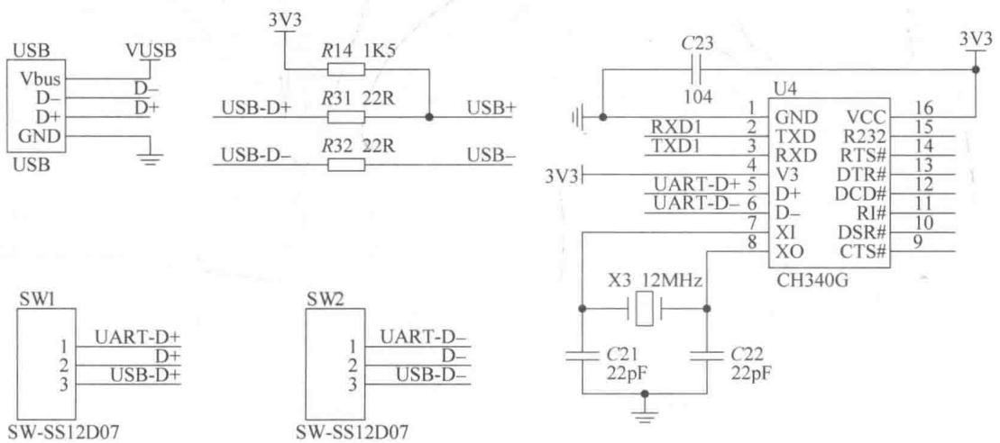

**这张图怎么看：** 图里是一个 USB 转串口芯片（常见的是 CH340 或 PL2303），一边接 USB 口（连电脑），另一边出 TXD/RXD 两根线，分别接到 STM32 的 PA10（RX）和 PA9（TX）。**注意要交叉连接：芯片的 TXD 接 STM32 的 RX，芯片的 RXD 接 STM32 的 TX。** 这是因为"我发你收"。

【辅助理解图】

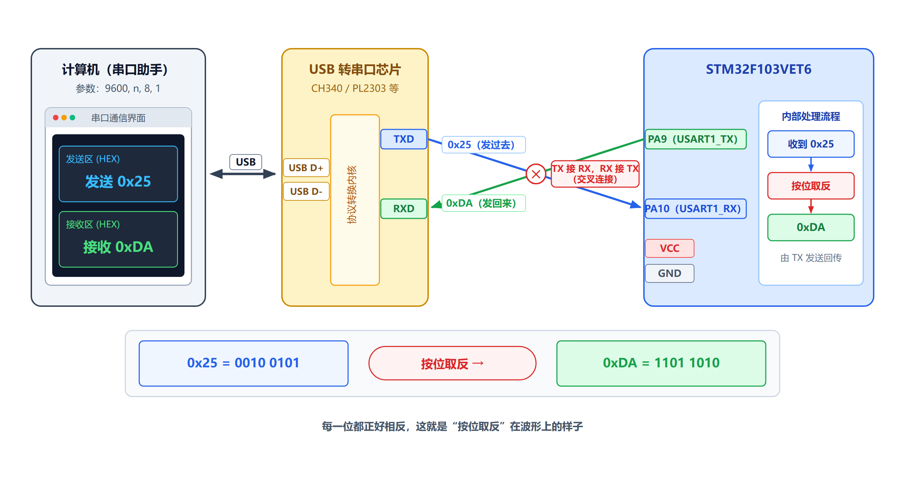

看图要点：左边画一台电脑（标"串口助手 9600,n,8,1"），中间画 USB 转串口芯片，右边画 STM32 方框，框内标出 PA9(TX)、PA10(RX)。用两条带箭头的线表示：电脑→STM32 方向是"0x25"，STM32→电脑 方向是"0xDA"。图下方小字标注"TX 接 RX，RX 接 TX（交叉连接）"。

#### 完整代码（教材原文）

```c
#include "stm32f10x.h"

void NVIC_Config(void);

int main(void)
{
    GPIO_InitTypeDef GPIO_InitStructure;
    USART_InitTypeDef USART_InitStructure;

    // 使能 PA 口和 USART1 时钟
    RCC_APB2PeriphClockCmd(RCC_APB2Periph_GPIOA | RCC_APB2Periph_USART1, ENABLE);

    // 配置 USART1_TX 引脚
    GPIO_InitStructure.GPIO_Pin = GPIO_Pin_9;
    GPIO_InitStructure.GPIO_Mode = GPIO_Mode_AF_PP;      // 复用推挽输出
    GPIO_InitStructure.GPIO_Speed = GPIO_Speed_50MHz;    // I/O 口速度为 50MHz
    GPIO_Init(GPIOA, &GPIO_InitStructure);               // 根据设定参数初始化 PA9

    // USART1_RX 引脚
    GPIO_InitStructure.GPIO_Pin = GPIO_Pin_10;
    GPIO_InitStructure.GPIO_Mode = GPIO_Mode_IN_FLOATING; // 悬空输入
    GPIO_Init(GPIOA, &GPIO_InitStructure);                // 配置 PA10

    // USART1 成员设置
    USART_InitStructure.USART_BaudRate = 9600;                   // 波特率 9600
    USART_InitStructure.USART_WordLength = USART_WordLength_8b;  // 字长 8 位
    USART_InitStructure.USART_StopBits = USART_StopBits_1;       // 1 位停止位
    USART_InitStructure.USART_Parity = USART_Parity_No;          // 无奇偶校验
    USART_InitStructure.USART_HardwareFlowControl =
        USART_HardwareFlowControl_None;                          // 无流控制
    // 打开 Rx 接收和 Tx 发送功能
    USART_InitStructure.USART_Mode = USART_Mode_Rx | USART_Mode_Tx;
    USART_Init(USART1, &USART_InitStructure);                    // 初始化
    USART_Cmd(USART1, ENABLE);                                   // 启动串口

    // 使能 USART 模块的中断
    USART_ITConfig(USART1, USART_IT_RXNE, ENABLE);               // 接收使能
    // USART_ITConfig(USART1, USART_IT_TC, ENABLE);              // 发送完使能
    USART_ITConfig(USART1, USART_IT_TXE, ENABLE);                // 发送使能
    USART_ClearITPendingBit(USART1, USART_IT_TC);
    NVIC_Config();                                               // 中断配置
    while(1);
}

void NVIC_Config(void)
{
    NVIC_InitTypeDef NVIC_InitStructure;
    NVIC_PriorityGroupConfig(NVIC_PriorityGroup_2);              // 抢占式优先级别
    NVIC_InitStructure.NVIC_IRQChannel = USART1_IRQn;            // 指定中断源
    NVIC_InitStructure.NVIC_IRQChannelPreemptionPriority = 1;
    NVIC_InitStructure.NVIC_IRQChannelSubPriority = 0;           // 指定副优先级
    NVIC_InitStructure.NVIC_IRQChannelCmd = ENABLE;
    NVIC_Init(&NVIC_InitStructure);
}

void USART1_IRQHandler(void)
{
    u8 recdata;
    if (USART_GetITStatus(USART1, USART_IT_RXNE) != RESET)
    {
        // USART_ClearITPendingBit(USART1, USART_IT_RXNE);       // 清除接收中断挂起标志
        recdata = USART_ReceiveData(USART1);                     // 从串口 1 接收一个字节
        USART_SendData(USART1, ~recdata);
    }
    if (USART_GetITStatus(USART1, USART_IT_TC) != RESET)         // 发送中断
    {
    }
}
```

#### 逐块讲解

##### 【第一块】开时钟

```c
RCC_APB2PeriphClockCmd(RCC_APB2Periph_GPIOA | RCC_APB2Periph_USART1, ENABLE);
```

**这一段想完成什么？** 给两个外设"通电"：GPIOA 和 USART1。

**为什么要这么做？** STM32 为了省电，所有外设**默认都是关着时钟的**。你不开时钟，写它的寄存器就是白写（值进不去，读出来还是 0）。

**为什么是 `RCC_APB2Periph_...` 而不是 `APB1`？** 因为 **GPIOA 和 USART1 都挂在 APB2 总线上**（前面 9.2.11 讲过：`USART1_BASE = APB2PERIPH_BASE + 0x3800`）。

**硬件发生了什么？**

```
库函数执行 RCC->APB2ENR |= (1<<2) | (1<<14)
→ APB2ENR 的 bit2（IOPAEN）和 bit14（USART1EN）置 1
→ APB2 总线开始给 GPIOA 和 USART1 送时钟
→ 这两个外设"醒了"
```

> **⚠️ 待核验：** `RCC_APB2ENR` 里 IOPAEN = bit2、USART1EN = bit14 这个位号来自 STM32F10x 参考手册，**教材本章没有列出 RCC 寄存器的位定义**（第 3 章/第 6 章应该讲过）。已记入【待核验】，请以参考手册为准。

##### 【第二块】配置 GPIO

```c
GPIO_InitStructure.GPIO_Pin = GPIO_Pin_9;
GPIO_InitStructure.GPIO_Mode = GPIO_Mode_AF_PP;      // 复用推挽输出
GPIO_InitStructure.GPIO_Speed = GPIO_Speed_50MHz;
GPIO_Init(GPIOA, &GPIO_InitStructure);
```

**这一段想完成什么？** 把 **PA9 配成 USART1 的发送脚**。

**为什么是"复用推挽"？**

- "复用"：这根引脚不归普通 GPIO 管了，交给 USART1 外设管；
- "推挽"：能主动输出高电平和低电平（不是"开漏"那种只能拉低、要靠外部上拉才能高的方式）。

**硬件发生了什么？**

```
GPIO_Init 内部会去写 GPIOA 的 CRH 寄存器（因为 PA9 属于高 8 位，用 CRH）
→ 把 PA9 对应的 4 个配置位设成 1011（复用功能推挽输出，50MHz）
→ GPIOA 内部的多路开关拨到"USART1_TX"
→ 从此 PA9 上出现的电平由 USART1 的发送器决定
```

```c
GPIO_InitStructure.GPIO_Pin = GPIO_Pin_10;
GPIO_InitStructure.GPIO_Mode = GPIO_Mode_IN_FLOATING; // 悬空输入
GPIO_Init(GPIOA, &GPIO_InitStructure);
```

**这一段想完成什么？** 把 **PA10 配成 USART1 的接收脚**。

**为什么是"悬空输入"（浮空）？** 前面讲过：串口空闲时线是高电平，不能开内部下拉（否则被拉低，误判为起始位），也不建议开内部上拉（会和外部驱动"打架"）。所以让它"浮空"，完全跟随外部信号。

##### 【第三块】配置 USART 参数

```c
USART_InitStructure.USART_BaudRate = 9600;
USART_InitStructure.USART_WordLength = USART_WordLength_8b;
USART_InitStructure.USART_StopBits = USART_StopBits_1;
USART_InitStructure.USART_Parity = USART_Parity_No;
USART_InitStructure.USART_HardwareFlowControl = USART_HardwareFlowControl_None;
USART_InitStructure.USART_Mode = USART_Mode_Rx | USART_Mode_Tx;
USART_Init(USART1, &USART_InitStructure);
```

**这一段想完成什么？** 把"9600、n、8、1"这组参数变成寄存器里的位。

**硬件发生了什么？**

```
USART_Init 内部：
  ① 用 APB2 时钟（72MHz）和 9600 算出 BRR = 0x1D4C，写入 USART1->BRR
  ② 把 WordLength=8b 翻译成 CR1 的 M 位 = 0
  ③ 把 StopBits=1 翻译成 CR2 的 STOP[1:0] = 00
  ④ 把 Parity=No 翻译成 CR1 的 PCE = 0
  ⑤ 把 Mode=Rx|Tx 翻译成 CR1 的 RE=1、TE=1
→ 到这里，USART1 的"工作方式"已经全部确定，但还没有"通电"（UE 还是 0）
```

**注意：`USART_Init` 不会置 UE 位。** 所以下一步必须调用 `USART_Cmd`。

##### 【第四块】打开总开关

```c
USART_Cmd(USART1, ENABLE);
```

**硬件发生了什么？** `USART1->CR1` 的 **bit13（UE）** 置 1，USART1 的分频器和收发器开始工作。

##### 【第五块】开中断

```c
USART_ITConfig(USART1, USART_IT_RXNE, ENABLE);   // 接收中断
USART_ITConfig(USART1, USART_IT_TXE, ENABLE);    // 发送中断
USART_ClearITPendingBit(USART1, USART_IT_TC);
NVIC_Config();
```

**这一段想完成什么？**

1. 让"收到数据"这件事能产生中断；
2. 让"发送缓冲器空"这件事也能产生中断；
3. 把 TC 的挂起位先清掉（防止一进中断就被误触发）；
4. 告诉 NVIC："USART1 的中断我接收，请放行。"

**为什么需要 NVIC？** 因为 STM32 有几十个中断源，NVIC（嵌套向量中断控制器，第 7 章讲过）是"**总机**"。光在外设里开中断使能还不够，还得在 NVIC 里"**放行**"这个中断号。

**硬件发生了什么？**

```
USART_ITConfig(..., RXNE, ENABLE) → USART1->CR1 的 bit5（RXNEIE）= 1
USART_ITConfig(..., TXE,  ENABLE) → USART1->CR1 的 bit7（TXEIE） = 1
NVIC_Config() → NVIC 的 ISER 寄存器里，USART1_IRQn 对应的位置 1
→ 以后 USART1 一有事件，NVIC 就会让 CPU 跳去执行 USART1_IRQHandler
```

> **⚠️ 待核验（重要）：** 例 9-1 打开了 **TXE 中断**（`USART_IT_TXE`），但它的中断服务程序 `USART1_IRQHandler` 里**只处理了 RXNE 和 TC，没有处理 TXE**。由于 USART 空闲时 TXE 一直是 1，这会导致 **CPU 反复进入中断**（虽然每次进去什么都不做）。教材的注释里也把 `USART_IT_TC` 那行注释掉了。**这很可能是教材示例的简化/笔误**（本意可能只是想演示"发送中断怎么开"）。已记入【待核验】。实际工程中，正确做法是：**只在"有数据要发、且 TXE=1"时才开 TXE 中断，发送完成后立刻关掉它。**

##### 【第六块】中断服务程序

```c
void USART1_IRQHandler(void)
{
    u8 recdata;
    if (USART_GetITStatus(USART1, USART_IT_RXNE) != RESET)
    {
        recdata = USART_ReceiveData(USART1);   // 从串口 1 接收一个字节
        USART_SendData(USART1, ~recdata);
    }
    if (USART_GetITStatus(USART1, USART_IT_TC) != RESET)
    {
    }
}
```

**这一段想完成什么？** 收到一个字节后，把它取反再发回去。

**逐行软硬件联动：**

| 代码 | CPU 做什么 | 寄存器发生什么 | 硬件发生什么 |
|---|---|---|---|
| `USART_GetITStatus(USART1, USART_IT_RXNE)` | 读 SR 和 CR1，判断 bit5 是否为 1 | 读操作，不改寄存器 | 无 |
| `recdata = USART_ReceiveData(USART1)` | 读地址 0x40013804 | **SR 的 RXNE 位被硬件清零** | RDR 里的字节被搬到 CPU 的 recdata 变量 |
| `~recdata` | 对 recdata 按位取反 | 无 | 无 |
| `USART_SendData(USART1, ~recdata)` | 写地址 0x40013804 | **SR 的 TXE 位被清零** | 数据进 TDR → 等移位寄存器空 → 一位一位从 PA9 发出去 |

**⚠️ 这里有个 C 语言的坑必须讲清楚：**

```c
u8 recdata;                          // 8 位无符号
USART_SendData(USART1, ~recdata);    // ~recdata 是 int 类型！
```

`~recdata` 在 C 语言里会先被"整型提升"成 `int`（32 位）。比如 `recdata = 0x25`：

```
recdata      = 0000 0000 0000 0000 0000 0000 0010 0101  (提升成 int)
~recdata     = 1111 1111 1111 1111 1111 1111 1101 1010  = 0xFFFFFFDA
```

`USART_SendData` 的第二个参数是 `u16`，所以会截断成 `0xFFDA`。**但 USART 只会用低 9 位（DR[8:0]），在 M=0、无校验的情况下只用低 8 位**：

```
0xFFDA 的低 8 位 = 0xDA   ✓ 正是我们想要的结果
```

**所以这段代码虽然写法上有点"脏"（依赖了类型截断），但结果是正确的。** 更规范的写法是：

```c
USART_SendData(USART1, (u8)(~recdata));
```

**⚠️ 还有一个坑：** 这段代码 `USART_SendData` 之后**没有等 TXE**。如果计算机连续发很多字节，中断频繁进入，可能上一个字节还没搬进移位寄存器就写新的，**旧数据会被覆盖**。教材这样写是为了代码简短；实际工程中应该：

```c
while (USART_GetFlagStatus(USART1, USART_FLAG_TXE) == RESET);
USART_SendData(USART1, (u8)(~recdata));
```

（或者用 TXE 中断来做发送，也就是例 9-1 里开了但没用起来的那个中断。）

#### 例 9-1 的完整数据流图

```
① 计算机串口助手发 0x25
        │
        ▼（USB 转串口芯片 → STM32 的 PA10）
② PA10（RX）线上出现波形：起始位 低, 1,0,1,0,0,1,0,0, 停止位 高
        │
        ▼
③ USART1 接收器 16 倍过采样，侦测起始位，采 8 个数据位
        │
        ▼（低位在前拼装）
④ 拼成 0x25，搬进 RDR，硬件置 SR.RXNE = 1
        │
        ▼（RXNEIE=1，向 NVIC 发中断请求）
⑤ NVIC 放行 → CPU 跳进 USART1_IRQHandler
        │
        ▼
⑥ 读 DR 得到 0x25（RXNE 自动清 0），取反得 0xDA
        │
        ▼
⑦ 写 DR 放入 0xDA，硬件自动加起始位/停止位
        │
        ▼（移位寄存器一位一位从 PA9 输出）
⑧ PA9（TX）线上出现波形：起始位 低, 0,1,0,1,1,0,1,1, 停止位 高
        │
        ▼（USB 转串口芯片 → 计算机）
⑨ 串口助手显示收到 0xDA
```

**注意第 ② 步和第 ⑧ 步的波形是"镜像"的**：

```
0x25 = 0010 0101 → 低位在前发出：1 0 1 0 0 1 0 0
0xDA = 1101 1010 → 低位在前发出：0 1 0 1 1 0 1 1
```

**每一位都正好相反。** 这就是"按位取反"在波形上的样子。

---

## 9.3 STM32 的 SPI 接口

### 先别急着看教材：这一节到底要干什么？

9.2 节的 USART 是**异步**通信：收发双方各用自己的时钟，靠起始位重新对表。

这种方式很皮实，但有两个缺点：

1. **慢**：每个字节都要额外加起始位和停止位（8 位数据要发 10 位，效率只有 80%）；
2. **收发双方的时钟有误差**：所以每个字符都要重新对齐。

**SPI 换了个思路：既然双方时钟容易跑偏，那就干脆派一根专门的线来送时钟。**

```
USART（异步）：  A 用自己的时钟 ~~~~  B 用自己的时钟 ~~~~
                 靠起始位对齐，各走各的

SPI（同步）：    A ──── 时钟线 SCK ────► B
                 B 完全听 A 的节拍，A 敲一下，B 就走一步
```

**这样双方节拍绝对一致，一个字节连着一个字节地传，中间不需要任何"暂停符"，效率接近 100%。**

SPI 的定位是：**短距离、高速、芯片和芯片之间（板内）**。典型用途：

- 读写 SPI Flash（存图片、字库、参数）；
- 驱动 LCD 显示屏；
- 接 AD 转换器 / DA 转换器；
- 接 SD 卡；
- 两块单片机互相通信。

### 你需要先知道的东西

#### 【先补一个前置知识：什么叫"主"（Master）和"从"（Slave）？】

- **主设备（Master）**：发号施令的那个。它**产生时钟**，决定什么时候开始传、传多快。
- **从设备（Slave）**：听命令的那个。它**不产生时钟**，只是跟着主设备的节拍走。

**SPI 的规矩：永远由主设备发起通信。从设备不能主动说话。**

> 【类比】主设备像**老师**，从设备像**学生**。老师点名（拉低片选），学生才能答话；老师不点名，学生就闭嘴。

#### 【先补一个前置知识：什么叫"片选"（Chip Select）？】

一条 SPI 总线上可以挂好几个从设备。问题是：**主设备怎么保证只有"我想找的那个"在说话，别的都不吭声？**

办法是：**每个从设备单独拉一根"点名线"。** 主设备把这根线拉低（有效），这个从设备才知道"是在叫我"，才开始工作。别的从设备的线还是高，它们就"装死"。

这根线就叫**片选（CS，Chip Select）**，在 STM32 里叫 **NSS（Negative Slave Select，"负"表示低电平有效）**。

---

### 9.3.1 STM32 的 SPI 接口简介

#### 【教材内容】

> **串行外设接口**（Serial Peripheral Interface, **SPI**）既可以与其他微处理器通信，也可以与具有 SPI 兼容接口的器件，如存储器、A/D 转换器、D/A 转换器、LED 或 LCD 驱动器等进行**半/全双工、同步**串行方式通信。SPI 接口可以被配置成**主模式**，并为外部从设备提供通信时钟（**SCK**）；还能以**多主配置**方式工作。SPI 接口可用于多种用途，包括使用一条双向数据线的双线单工同步传输，还可使用 **CRC 校验**的可靠通信。

**STM32F103VET6 集成了 3 个 SPI 接口，具有以下特点（教材原文，按主题归类）：**

**【传输方式】**

> - 3 线全双工同步传输。
> - 第三根双向数据线的双线单工同步传输。
> - 8 或 16 位传输帧格式选择。
> - 主或从操作。
> - 支持多主模式。
> - 可编程的数据顺序，最高位（MSB）在前或最低位（LSB）在前。

**【速度】**

> - 8 个主模式波特率预分频系数最大为 f_PCLK / 2。
> - 从模式频率最大为 f_PCLK / 2。
> - 主模式和从模式的快速通信。

**【控制】**

> - 主模式和从模式下均可以由软件或硬件进行 NSS 管理：主/从操作模式的动态改变。
> - 可编程的时钟极性和相位。
> - 可触发中断的专用发送和接收标志。
> - SPI 总线忙状态标志。

**【校验】**

> - 支持可靠通信的硬件 CRC。
> - 在发送模式下，CRC 值可以被作为最后一个字节发送。
> - 在全双工模式中对接收到的最后一个字节自动进行 CRC 校验。
> - 可触发中断的主模式故障、过载以及 CRC 错误标志。

**【DMA】**

> - 支持 DMA 功能的 1 字节发送和接收缓冲器：产生发送和接收请求。

#### 术语表（第一次出现，按规矩给全）

| 缩写 | 英文全称 | 中文名 | 大白话 |
|---|---|---|---|
| SPI | Serial Peripheral Interface | 串行外设接口 | 一种"主机打拍子、大家一起移位"的高速同步串口 |
| SCK | Serial Clock | 串行时钟 | 主机发出的节拍线 |
| MISO | Master In Slave Out | 主入从出 | 数据从从设备流向主设备的线 |
| MOSI | Master Out Slave In | 主出从入 | 数据从主设备流向从设备的线 |
| NSS / SS | Negative Slave Select / Slave Select | 从设备选择（片选） | "点名线"，低电平有效 |
| CPOL | Clock Polarity | 时钟极性 | 空闲时 SCK 是高还是低 |
| CPHA | Clock Phase | 时钟相位 | 在第几个边沿采数据 |
| DFF | Data Frame Format | 数据帧格式 | 8 位还是 16 位一帧 |
| LSBFIRST | Least Significant Bit First | 低位在前 | 先发最低位还是最高位 |
| CRC | Cyclic Redundancy Check | 循环冗余校验 | 一种很强的"查错码" |

---

### 9.3.2 STM32 的 SPI 接口结构

#### 看教材原图

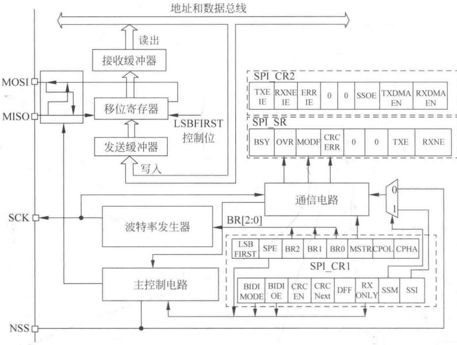

**这张图怎么读（分三层）：**

**第一层：先找四根引脚。**

图的最右边（或最左边，看排版）会看到 4 根引脚：**MISO、MOSI、SCK、NSS**。这四根就是 SPI 的全部外部接口。

**第二层：找发送缓冲器和接收缓冲器。**

图中间会看到：

```
        ┌──────────────────┐
        │  发送缓冲器       │◄──── CPU 写 SPI_DR
        └────────┬─────────┘
                 │（并行搬运）
        ┌────────▼─────────┐
        │  移位寄存器       │────► MOSI
        │                  │◄──── MISO
        └──────────────────┘
                 │（并行搬运）
        ┌────────▼─────────┐
        │  接收缓冲器       │────► CPU 读 SPI_DR
        └──────────────────┘
```

**注意：SPI 的移位寄存器是"一个"，不是"两个"。** 发送和接收共用同一个移位寄存器（这一点和 USART 不一样）。

**第三层：找时钟和控制。**

图左边是 **SPI_CR1 / CR2**（控制寄存器）和 **SPI_SR**（状态寄存器），以及**波特率发生器**（由 CR1 的 BR[2:0] 控制）。

**这张图到底想让你理解什么？**

> **SPI 的本质是一个"首尾相连的移位寄存器环"。** 主设备每打一个时钟，主设备的移位寄存器就把一位挤出去，同时从设备的一位被挤进来。**发和收是同一件事的两面**——这就是 SPI 全双工的原理（下面马上细讲）。

#### 【辅助理解图】SPI 四线主从连接

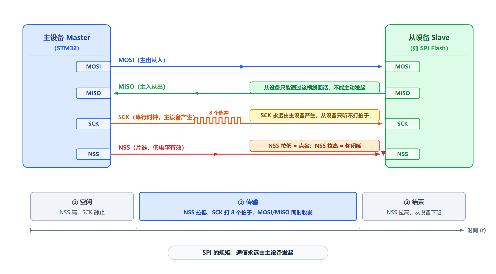

看图要点：

1. 左边一个方框标"主设备（Master）"，右边一个方框标"从设备（Slave）"；
2. 两条水平线从主设备指向从设备：**SCK（时钟，带节拍符号）** 和 **MOSI（主出从入，箭头向右）**；
3. 一条水平线从从设备指向主设备：**MISO（主入从出，箭头向左）**；
4. 一条水平线从主设备指向从设备的 **NSS**，上面画一个"低电平有效"的标记（一个小三角加横线），标注"片选：拉低才理你"；
5. 图下方画一个时间轴，标注"通信开始前 NSS 必须先拉低，通信结束后才能拉高"。

#### 四根引脚详解（教材原文）

> 通常 SPI 通过 **4 个引脚**与外部器件相连。
>
> **（1）MISO：** 主设备输入/从设备输出引脚。该引脚在从模式下发送数据，在主模式下接收数据。
> **（2）MOSI：** 主设备输出/从设备输入引脚。该引脚在主模式下发送数据，在从模式下接收数据。
> **（3）SCK：** 串口时钟，作为主设备的输出，从设备的输入。
> **（4）NSS：** 从设备选择。这是一个可选的引脚，用来选择主/从设备。它的功能是用来作为"**片选引脚**"，让主设备可以单独地与特定的从设备通信，避免数据线上的冲突。从设备的 NSS 引脚可以由主设备的一个标准 I/O 引脚来驱动。一旦被使能（**SSOE 位**），NSS 引脚就可以作为输出引脚，并在 SPI 处于主模式时拉低；此时，所有的 SPI 设备，如果它们的 NSS 引脚连接到主设备的 NSS 引脚，则会检测到低电平，如果它们被设置为 NSS 硬件模式，则会自动进入从设备状态。当配置为主设备、NSS 配置为输入引脚（**MSTR=1, SSOE=0**）时，如果 NSS 被拉低，则这个 SPI 设备进入**主模式失败状态**：即 MSTR 位被自动清除，此设备进入从模式。

**用一张表总结四根线的方向：**

| 引脚 | 主设备（Master） | 从设备（Slave） | 谁产生 |
|---|---|---|---|
| SCK | 输出 | 输入 | 主设备 |
| MOSI | 输出 | 输入 | 主设备 |
| MISO | 输入 | 输出 | 从设备 |
| NSS | 输出（可选） | 输入 | 主设备（或软件） |

**记忆口诀：**

- **MOSI** = **M**aster **O**ut **S**lave **I**n → "**主出从入**"，看缩写就知道方向；
- **MISO** = **M**aster **I**n **S**lave **O**ut → "**主入从出**"；
- **SCK** 永远由主设备产生；
- **NSS** 永远由主设备（或主设备的软件）控制。

#### 看教材原图：单主机和单从机互连

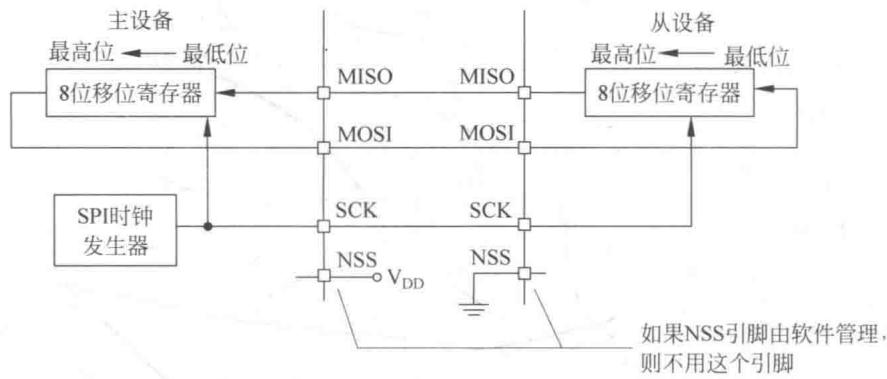

> 教材原文：**MOSI 脚相互连接，MISO 脚相互连接。** 这样，数据在主和从之间串行地传输（**最高位在前**）。通信总是由主设备发起。主设备通过 MOSI 脚把数据发送给从设备，从设备通过 MISO 引脚回传数据。这意味着全双工通信的数据输出和数据输入是用**同一个时钟信号**同步的；时钟信号由主设备通过 SCK 脚提供。

**这张图想让你理解什么？**

> **两根数据线，一进一出，方向相反，共用一个时钟。**
> 所以 SPI 全双工**不需要像 USART 那样配两个独立的波特率**——一个时钟同时管发和收。

#### 【重点】SPI 全双工的真正原理：一个环形移位寄存器

这是理解 SPI 最关键的一步，教材没有单独画图，我们补一张。

【辅助理解图】

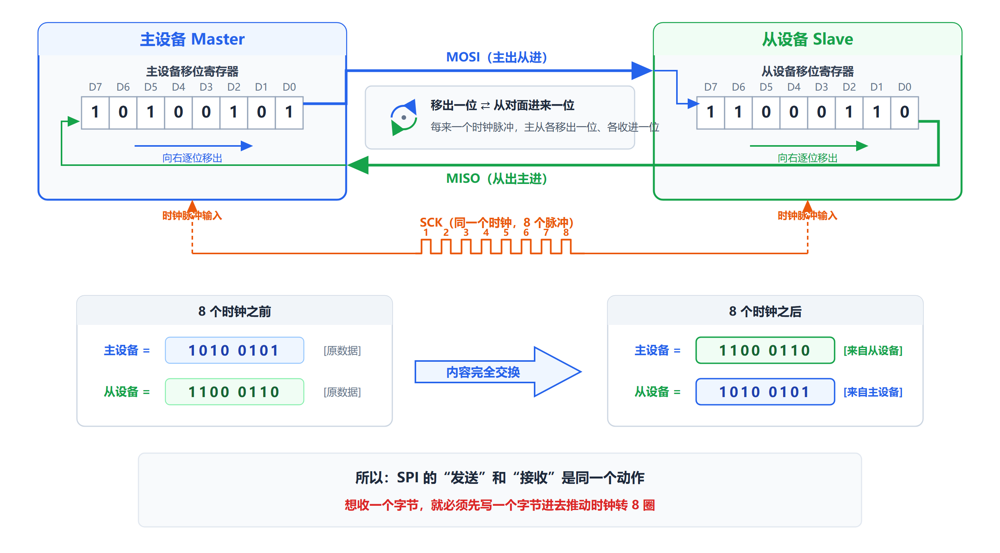

**用 ASCII 再画一遍：**

```
主设备（Master）                          从设备（Slave）
┌─────────────────────┐                  ┌─────────────────────┐
│  移位寄存器 8 位     │                  │  移位寄存器 8 位     │
│  ┌─┬─┬─┬─┬─┬─┬─┬─┐  │   MOSI ───────►  │  ┌─┬─┬─┬─┬─┬─┬─┬─┐  │
│  │1│0│1│0│0│1│0│1│  │                  │  │1│1│0│0│0│1│1│0│  │
│  └─┴─┴─┴─┴─┴─┴─┴─┘  │  ◄─────── MISO   │  └─┴─┴─┴─┴─┴─┴─┴─┘  │
└─────────────────────┘                  └─────────────────────┘
        ▲                                        ▲
        │            SCK（同一个时钟）            │
        └────────────────────────────────────────┘
```

**每来一个时钟脉冲，发生两件事（同时）：**

```
① 主设备移位寄存器往左挤出一位 → 从 MOSI 出去 → 从设备移位寄存器的右端进来
② 从设备移位寄存器往左挤出一位 → 从 MISO 出来 → 主设备移位寄存器的右端进来
```

**8 个时钟之后，两个移位寄存器的内容就完全交换了。**

```
开始：主设备 = 10100101，从设备 = 11000110
8 个时钟后：
      主设备 = 11000110  ← 收到了从设备原来发的
      从设备 = 10100101  ← 收到了主设备原来发的
```

**这就是"全双工"：你发一个字节出去的同时，必然也收到一个字节。你不想收也得收（收进来的东西放在接收缓冲器里，你读不读是另一回事）。**

**⚠️ 这一点非常重要，很多初学者的困惑都来自这里：**

> **在 SPI 里，"发送"和"接收"是同一个动作。**
> 你想从从设备读一个字节，就必须**先往主设备的移位寄存器里写一个字节**（哪怕写的是 0xFF 这种"废话"），因为时钟要转 8 次才能把从设备的字节挤过来。转 8 次就意味着主设备也挤出去了 8 位。
>
> **这就是后面例 9-2 里，为什么"发送"一个字节就是在"读写"一个字节。**

---

### 9.3.3 NSS 从选择脚管理

#### 【教材内容】

> 有两种 NSS 模式：

**（1）软件 NSS 模式。**

> 可以通过设置 **SPI_CR1 寄存器**（的 SSM 位）来使能。在这种模式下 **NSS 引脚可以用作他用**，而内部 NSS 信号电平可以通过写 SPI_CR1 的 **SSI 位**来驱动。

**（2）硬件 NSS 模式，分两种情况。**

> ① **NSS 输出被使能**：这时 NSS 引脚被拉低，所有 NSS 引脚与这个主 SPI 的 NSS 引脚相连并配置为硬件 NSS 的 SPI 设备，将自动变成从 SPI 设备。
> 当一个 SPI 设备需要发送广播数据，它必须拉低 NSS 信号，以通知所有其他设备它是主设备；如果它不能拉低 NSS，则这意味着总线上有另外一个主设备在通信，这时将产生一个**硬 Fault**。
>
> ② **NSS 输出被关闭**：允许操作于**多主环境**。

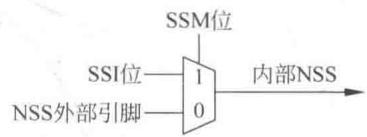

**这张图怎么读：**

1. 图分左右两半，左边是**硬件 NSS 管理**，右边是**软件 NSS 管理**。
2. **硬件方式**：NSS 引脚真的接到外面，外部的电平直接决定内部 NSS 信号。图里能看到 NSS 引脚上有一根线直接连到内部。
3. **软件方式**：NSS 引脚被"断开"（图里画成一个开关断开），内部 NSS 信号由 **SSI 位**（寄存器里的一个 bit）来产生。
4. **这张图想让你理解什么？** NSS 这个"点名信号"可以从外面来（硬件），也可以从寄存器里来（软件）。

**用大白话理解"软件 NSS"：**

单主机单从机的时候，其实根本不需要"点名"（反正只有一个从设备）。但 SPI 硬件要求 NSS 必须是"有效"状态（低电平），否则它会以为"有人抢我的主控权"，然后自动把自己降级成从设备（这就是"主模式失败"）。

所以工程师的常用做法是：**把 NSS 引脚从 SPI 手里拿开（不接），用软件把内部 NSS 信号"假装"拉低。** 这就是"软件 NSS 模式"：

```c
SPI_InitStructure.SPI_NSS = SPI_NSS_Soft;   // 用软件管理 NSS
```

**在固件库里，`SPI_NSS_Soft` 会同时设置 SSM=1 和 SSI=1**（内部 NSS 信号 = 1 表示"我是主设备，没人跟我抢"）。

> 【补充解释】**注意 SSI=1 的含义容易搞混**：NSS 引脚上"低电平有效"，但在软件模式下 SSI 位写 1 才表示"内部 NSS 有效"（因为 SSI 位是"内部从设备选择"，写 1 = 选中自己为主）。这是 STM32 手册里一个有名的"反直觉点"，按库函数用 `SPI_NSS_Soft` 就不会错。

---

### 9.3.4 时钟信号的相位和极性（CPOL / CPHA）—— 本节是 SPI 的核心

#### 用大白话理解：SPI 的两个"约定"

SPI 用一根 SCK 线打拍子。但"打拍子"这件事有两个细节必须双方事先约好：

**约定一：不打拍子的时候，SCK 是高的还是低的？** → 这叫**时钟极性 CPOL**。

- 就像乐队指挥：起手前指挥棒是举着还是放下？
  - **CPOL = 0**：空闲时 SCK 是**低**电平（指挥棒放下）；
  - **CPOL = 1**：空闲时 SCK 是**高**电平（指挥棒举着）。

**约定二：数据是在"第几个边沿"被采集的？** → 这叫**时钟相位 CPHA**。

- 一个时钟周期有**两个边沿**：先来的那个叫**第一个边沿**，后来的那个叫**第二个边沿**。
  - **CPHA = 0**：在**第一个边沿**采样数据；
  - **CPHA = 1**：在**第二个边沿**采样数据。

**两个约定一组合，就是 4 种模式。** 主从双方必须配成**完全相同**的模式，否则收到的全是乱的。

#### 【教材内容】

> SPI_CR 寄存器的 **CPOL 和 CPHA 位**，可以组合成四种可能的时序关系。
>
> **CPOL（时钟极性）** 位控制在没有数据传输时时钟的**空闲状态电平**，此位对主模式和从模式下的设备都有效。如果 CPOL 被清零，SCK 引脚在空闲状态**保持低电平**；如果 CPOL 被置 1，SCK 引脚在空闲状态**保持高电平**。
>
> 如果 **CPHA（时钟相位）** 位被置 1，SCK 时钟的**第二个边沿**（CPOL 位为 0 时就是下降沿，CPOL 位为 1 时就是上升沿）进行数据位的采样，数据在第二个时钟边沿被锁存。如果 CPHA 位被清 0，SCK 时钟的**第一边沿**（CPOL 位为 0 时就是下降沿，CPOL 位为 1 时就是上升沿）进行数据位采样，数据在第一个时钟边沿被锁存。
>
> **⚠️ 待核验（N26）：** 上面这段是**教材原文照录**（素材 `ch09_source.md:1551`），讲义没有改动它。但**教材这句话里"CPHA 被清 0"那半句的括号注写反了**：
> CPHA=0 表示"从空闲电平出发，遇到的**第一个**边沿就采样"。CPOL=0（空闲为低）时，从低出发遇到的第一个边沿是**上升沿**；CPOL=1（空闲为高）时第一个边沿是**下降沿**。教材却写成了"CPOL 位为 0 时就是下降沿，CPOL 位为 1 时就是上升沿"，恰好相反。
> **本讲义按正确的说法讲解**（见下面"逐步讲解"和 9.3.12 的 CPHA 位说明），并把教材原文保留在这里以便对照。已记入文末【待核验】N26。
>
> CPOL 时钟极性和 CPHA 时钟相位的组合选择数据捕捉的时钟边沿。SPI 传输的 4 种 CPHA 和 CPOL 位组合如图 9-21 所示，图中显示的是 SPI_CR1 寄存器的 **LSBFIRST=0**（最高位在前）时的时序。
>
> **注意：**
> （1）在改变 CPOL/CPHA 位之前，**必须清除 SPE 位将 SPI 禁止**。
> （2）**主机和从机必须配置成相同的时序模式。**
> （3）SCK 的空闲状态必须和 SPI_CR1 寄存器指定的极性一致（CPOL 为 1 时，空闲时应上拉 SCK 为高电平；CPOL 为 0 时，空闲时应下拉 SCK 为低电平）。
> （4）数据帧格式（8 位或 16 位）由 SPI_CR1 寄存器的 **DFF** 位选择，并且决定发送/接收的数据长度。

#### 看教材原图

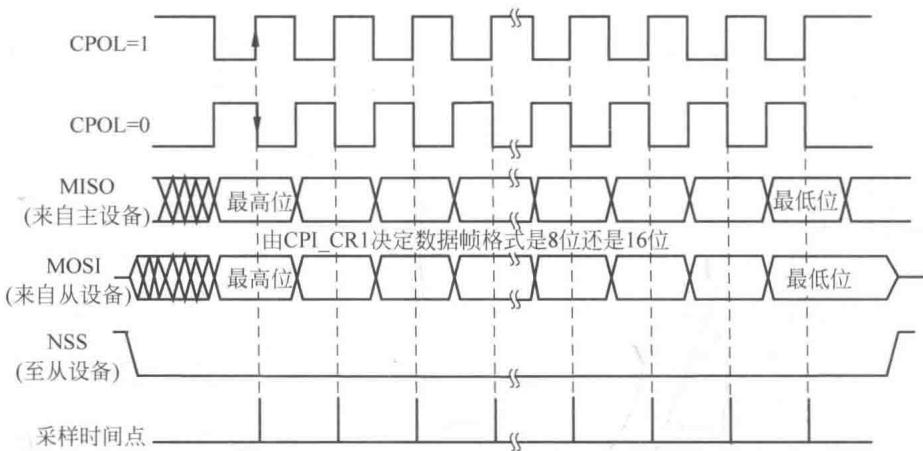

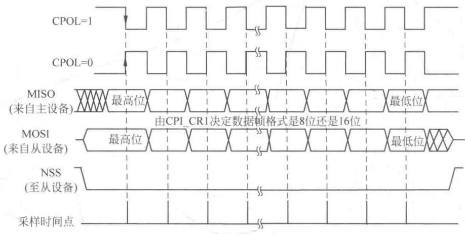

**怎么读这两张图：**

1. 每张图里有 3~4 条横线：最上面是 **SCK**，往下依次是 **MOSI**（主发）、**MISO**（从发），有时还有 **NSS**。
2. 竖着看，每一列对应一个时钟边沿。
3. **关键看 SCK 的边沿和 MOSI/MISO 上"数据稳定区间"的对应关系**：
   - 如果数据在**边沿之后**才变、在**下一个边沿**被采走 → CPHA = 0；
   - 如果数据在**边沿上**变、在**下下个边沿**被采走 → CPHA = 1。
4. 图里通常会用虚线或箭头标出"**采样时刻**"，你要找的就是这个标记落在哪个边沿上。

#### 【辅助理解图】四种模式的波形

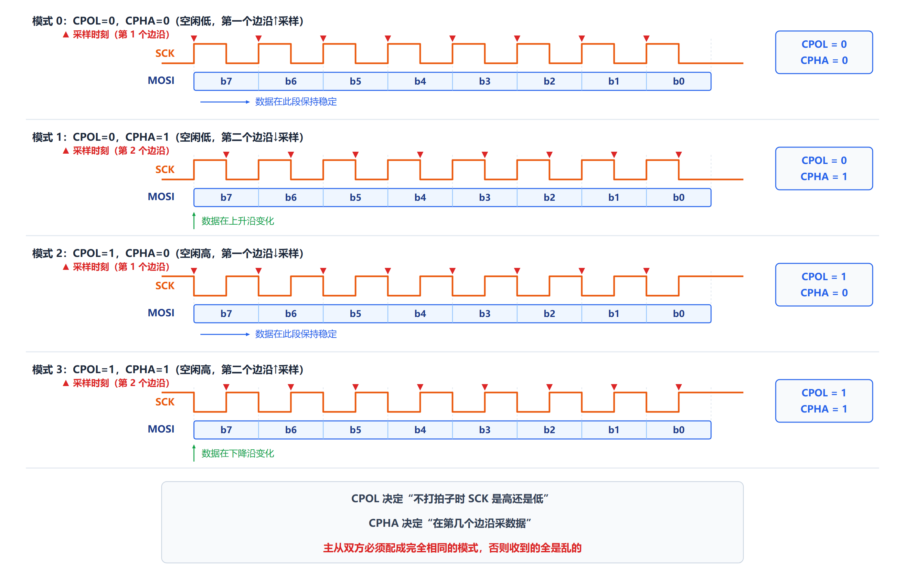

**ASCII 精确版（4 种模式，各画两个时钟周期）：**

约定记号：`↑` 表示上升沿，`↓` 表示下降沿，`▲` 表示**采样时刻**。

---

**模式 0：CPOL = 0，CPHA = 0（空闲低，第一个边沿=上升沿采样）**

```
SCK   ────┐   ┌───┐   ┌───┐   ┌───┐   ┌───┐   ┌───┐   ┌───┐   ┌────
          │   │   │   │   │   │   │   │   │   │   │   │   │   │
      ────┘   └───┘   └───┘   └───┘   └───┘   └───┘   └───┘   └────
          ▲       ▲       ▲       ▲       ▲       ▲       ▲       ▲
        采样     采样    采样    采样    采样    采样    采样    采样

MOSI  ══════╤══ b7 ══╤══ b6 ══╤══ b5 ══╤══ b4 ══╤══ b3 ══╤══ b2 ══╤══ b1
            ↑(边沿前就稳定)  ↑           ↑           ↑
```

- **空闲时 SCK = 低。**
- 数据在**下降沿**（每周期末尾）变化，在**上升沿**（每周期开头）被采样。
- **这是最常用的一种模式**（大多数 SPI Flash 用模式 0 或模式 3）。

---

**模式 1：CPOL = 0，CPHA = 1（空闲低，第二个边沿=下降沿采样）**

```
SCK   ────┐   ┌───┐   ┌───┐   ┌───┐   ┌───┐   ┌───┐   ┌───┐   ┌────
          │   │   │   │   │   │   │   │   │   │   │   │   │   │
      ────┘   └───┘   └───┘   └───┘   └───┘   └───┘   └───┘   └────
              ▼       ▼       ▼       ▼       ▼       ▼       ▼
            采样     采样    采样    采样    采样    采样    采样

MOSI  ══════╤══ b7 ══╤══ b6 ══╤══ b5 ══╤══ b4 ══╤══ b3 ══╤══ b2 ══╤══ b1
            ↑（在上升沿变化）
```

- **空闲时 SCK = 低。**
- 数据在**上升沿**变化，在**下降沿**被采样。
- 和模式 0 的波形**完全一样**，区别只是"采样点挪到了另一个边沿"。

---

**模式 2：CPOL = 1，CPHA = 0（空闲高，第一个边沿=下降沿采样）**

```
SCK   ────┐   ┌───┐   ┌───┐   ┌───┐   ┌───┐   ┌───┐   ┌───┐   ┌────
          │   │   │   │   │   │   │   │   │   │   │   │   │   │
      ────┘   └───┘   └───┘   └───┘   └───┘   └───┘   └───┘   └────
          ▼       ▼       ▼       ▼       ▼       ▼       ▼
        采样     采样    采样    采样    采样    采样    采样
```

- **空闲时 SCK = 高。**
- 第一个边沿是**下降沿**，在下降沿采样。
- 注意：模式 2 的波形和模式 0 是**上下颠倒**的（把模式 0 的波形取反就是模式 2）。

---

**模式 3：CPOL = 1，CPHA = 1（空闲高，第二个边沿=上升沿采样）**

```
SCK   ────┐   ┌───┐   ┌───┐   ┌───┐   ┌───┐   ┌───┐   ┌───┐   ┌────
          │   │   │   │   │   │   │   │   │   │   │   │   │   │
      ────┘   └───┘   └───┘   └───┘   └───┘   └───┘   └───┘   └────
              ▲       ▲       ▲       ▲       ▲       ▲       ▲
            采样     采样    采样    采样    采样    采样    采样
```

- **空闲时 SCK = 高。**
- 第二个边沿是**上升沿**，在上升沿采样。
- **这是第二常用的模式**（很多 SPI Flash 用模式 0 或模式 3）。

---

#### 四种模式的速查表

| 模式 | CPOL | CPHA | 空闲时 SCK | 第一个边沿 | 采样边沿 | 数据变化边沿 |
|---|---|---|---|---|---|---|
| 模式 0 | 0 | 0 | 低 | 上升 ↑ | **第一个边沿（↑）** | 下降 ↓ |
| 模式 1 | 0 | 1 | 低 | 上升 ↑ | **第二个边沿（↓）** | 上升 ↑ |
| 模式 2 | 1 | 0 | 高 | 下降 ↓ | **第一个边沿（↓）** | 上升 ↑ |
| 模式 3 | 1 | 1 | 高 | 下降 ↓ | **第二个边沿（↑）** | 下降 ↓ |

**记忆技巧：**

- **CPOL 决定"起点电平"**：0 = 低，1 = 高；
- **CPHA 决定"数到第几个边沿才采样"**：0 = 第一个，1 = 第二个；
- **采样的那个边沿，一定和数据变化的边沿相反**（因为数据要"先稳定、后采样"）。

#### 逐步讲解："先发生什么 → 再发生什么 → 为什么"

以**模式 0** 发送 `0xA5 = 1010 0101` 为例（LSBFIRST=0，最高位在前）：

| 步骤 | 时刻 | SCK | MOSI 上是什么 | 为什么 |
|---|---|---|---|---|
| ① | 通信前 | 低（空闲） | 无关 | 空闲电平必须是 CPOL 指定的值 |
| ② | NSS 被主设备拉低 | 低 | 主设备先把 b7 放上 MOSI | 从设备要知道"开始了"；数据要**在第一个边沿之前**就稳定 |
| ③ | 第 1 个上升沿 ↑ | 低→高 | **采样 b7** | 这是"第一个边沿"，CPHA=0 就采在这里 |
| ④ | 第 1 个下降沿 ↓ | 高→低 | 主设备换上 b6 | 采样完了才能换数据，否则会采到正在跳变的值 |
| ⑤ | 第 2 个上升沿 ↑ | 低→高 | **采样 b6** | 同样采在第一个边沿 |
| ⑥ | ……重复 8 次…… | | | |
| ⑦ | 第 8 个上升沿 ↑ | 低→高 | **采样 b0** | 第 8 位也采完了 |
| ⑧ | NSS 被拉高 | 回到空闲低 | 无关 | 通信结束，从设备"下班" |

**为什么"数据变化"和"数据采样"要放在不同的边沿？**

因为**数据线上的电平从 0 跳到 1（或从 1 跳到 0）需要时间**，跳变过程中电平是不稳定的。如果"变化"和"采样"在同一个边沿，接收方可能正好采到"正在跳变中"的电压，采出来的值就随机了。

**所以 SPI 的规矩是：一个边沿变、另一个边沿采，中间隔半个时钟周期。** 这半个周期就是"稳定时间"。

**这也解释了一个常见的疑问：**

> **为什么 CPOL=0 时，"第一个边沿"是上升沿，"第二个边沿"是下降沿？**
>
> 因为 CPOL=0 表示空闲是低电平。从低电平出发，**第一个遇到的边沿当然是上升沿**；一个完整周期之后回到低电平，中间必然有一个下降沿，那是**第二个边沿**。
>
> 反过来，CPOL=1 时空闲是高电平，**第一个边沿就是下降沿**，第二个边沿是上升沿。

---

### 9.3.5 数据帧格式

#### 【教材内容】

> 根据 SPI_CR1 寄存器中的 **LSBFIRST** 位，输出数据位时可以**先发送最高位，也可以先发送最低位**。
>
> 根据 SPI_CR1 寄存器的 **DFF** 位，每个数据帧可以是 **8 位或 16 位**。所选择的数据帧格式对发送和接收都有效。

**两位决定两件事：**

| 位 | 取值 | 含义 |
|---|---|---|
| DFF | 0 | 8 位数据帧 |
| DFF | 1 | 16 位数据帧 |
| LSBFIRST | 0 | 先发**最高位**（MSB first） |
| LSBFIRST | 1 | 先发**最低位**（LSB first） |

> **⚠️ 重要提醒：** USART 是**强制低位在前**的，SPI 却可以选。**所以 SPI 通信前必须和对方确认"先发哪一位"**，选错了收到的数据就是"位序颠倒"的。大多数 SPI 器件（包括 SPI Flash、LCD）都是 **MSB first**。

**举例：`0xA5 = 1010 0101`**

```
MSB first（LSBFIRST=0）发出的顺序：
  b7  b6  b5  b4  b3  b2  b1  b0
  1   0   1   0   0   1   0   1

LSB first（LSBFIRST=1）发出的顺序：
  b0  b1  b2  b3  b4  b5  b6  b7
  1   0   1   0   0   1   0   1
```

**注意：这个例子里两种顺序看起来一样（因为 0xA5 是回文位串）。换一个就好区分了：**

```
0xB4 = 1011 0100

MSB first：1 0 1 1 0 1 0 0
LSB first：0 0 1 0 1 1 0 1   ← 正好是反过来
```

---

### 9.3.6 STM32 的 SPI 接口配置

#### 1. 配置 SPI 为从模式

> 在从模式下，SCK 引脚用于接收从主设备来的串行时钟。**SPI_CR1 寄存器中 BR[2:0] 的设置不影响数据传输速率。**
>
> 建议在**主设备发送时钟之前使能 SPI 从设备**，否则可能会发生意外的数据传输。在通信时钟的第一个边沿到来之前或正在进行的通信结束之前，从设备的数据寄存器必须就绪。在使能从设备和主设备之前，通信时钟的极性必须处于稳定的数值。

**SPI 从模式的配置步骤（教材原文）：**

> （1）设置 **DFF** 位以定义数据帧格式为 8 位或 16 位。
> （2）选择 **CPOL 和 CPHA** 位来定义数据传输和串行时钟之间的相位关系。为保证正确的数据传输，从设备和主设备的 CPOL 和 CPHA 位必须配置成相同的方式。
> （3）帧格式（SPI_CR1 寄存器中的 **LSBFIRST** 位定义的"最高位在前"还是"最低位在前"）必须与主设备相同。
> （4）在 NSS 引脚管理**硬件模式**下，在数据帧传输过程中，**NSS 引脚必须为低电平**。在 NSS **软件模式**下，设置 SPI_CR1 寄存器中的 **SSM** 位并清除 **SSI** 位。
> （5）在 SPI_CR1 寄存器中，**清除 MSTR 位、设置 SPE 位**，使相应引脚工作于 SPI 模式下。
>
> 在这个配置中，**MOSI 引脚是数据输入，MISO 引脚是数据输出。**

**注意最后一句：从模式下 MOSI/MISO 的方向是反的。** 因为名字是从主设备的角度起的。

**从模式下的数据发送过程（教材原文）：**

> 在写操作中，数据字被并行地写入发送缓冲器。当从设备收到时钟信号，并且在 MOSI 引脚上出现第一个数据位时，发送过程开始，此时第一个位被发送出去，余下的位被装进移位寄存器。当发送缓冲器中的数据传输到移位寄存器时，SPI_SR 寄存器的 **TXE** 标志被置位，如果设置了 SPI_CR2 寄存器的 TXEIE 位，将会产生中断。

**从模式下的数据接收过程（教材原文）：**

> 对于接收器，当数据接收完成时，在最后一个采样时钟边沿后，移位寄存器中的数据传送到接收缓冲器，SPI_SR 寄存器中的 **RXNE** 标志被置位。如果设置了 SPI_CR2 寄存器中的 RXNEIE 位，则产生中断。当读 SPI_DR 寄存器时，SPI 设备返回接收缓冲器的数值，同时，清除 RXNE 位。

#### 2. 配置 SPI 为主模式

> 在主模式时，**MOSI 引脚是数据输出，而 MISO 引脚是数据输入，在 SCK 脚产生串行时钟。**

**SPI 主模式的配置步骤（教材原文）：**

> （1）通过 SPI_CR1 寄存器的 **BR[2:0]** 位定义串行时钟波特率。
> （2）选择 **CPOL 和 CPHA** 位，定义数据传输和串行时钟间的相位关系。
> （3）设置 **DFF** 位来定义 8 位或 16 位数据帧格式。
> （4）配置 SPI_CR1 寄存器的 **LSBFIRST** 位定义帧格式。
> （5）如果需要 NSS 引脚工作在输入模式，在硬件模式下，在整个数据帧传输期间应把 NSS 引脚连接到高电平；在软件模式下，需设置 SPI_CR1 寄存器的 **SSM 位和 SSI 位**。如果 NSS 引脚工作在输出模式，则只需设置 **SSOE** 位。
> （6）必须设置 **MSTR 位和 SPE 位**（只当 NSS 引脚被连到高电平，这些位才能保持置位）。

**主模式下的数据发送过程（教材原文）：**

> 当写入数据到发送缓冲器时，发送过程开始。在发送第一个数据位时，数据字通过内部总线被并行地传入移位寄存器，然后串行地移出到 MOSI 脚上；先输出最高位还是最低位，取决于 SPI_CR1 寄存器中的 LSBFIRST 位的设置。数据从发送缓冲器传输到移位寄存器时 **TXE 标志**将被置位，如果设置了 SPI_CR1 寄存器中的 TXEIE 位，将产生中断。

**主模式下的数据接收过程（教材原文）：**

> 对于接收器来说，当数据传输完成时，在最后的采样时钟沿，移位寄存器中接收到的数据字被传送到接收缓冲器，并且 **RXNE 标志**被置位。如果设置了 SPI_CR2 寄存器中的 RXNEIE 位，则产生中断。读 SPI_DR 寄存器时，SPI 设备返回接收缓冲器中的数据，同时，将清除 RXNE 标志位。
>
> 一旦传输开始，如果下一个将发送的数据被放进了发送缓冲器，就可以维持一个连续的传输流。**在试图写发送缓冲器之前，需确认 TXE 标志应该为 1。**
>
> 在 NSS 硬件模式下，从设备的 NSS 输入由 NSS 引脚控制或另一个由软件驱动的 GPIO 引脚控制。

#### 3. 配置 SPI 为单工通信

> SPI 模块能够以两种配置工作于单工方式：
> （1）1 条时钟线和 1 条双向数据线；
> （2）1 条时钟线和 1 条数据线（只接收或只发送）。

**1）1 条时钟线和 1 条双向数据线（BIDIMODE=1）**

> 通过设置 SPI_CR1 寄存器中的 **BIDIMODE** 位启用此模式。在这个模式下，SCK 引脚作为时钟，主设备使用 **MOSI** 引脚而从设备使用 **MISO** 引脚作为数据通信。传输的方向由 SPI_CR1 寄存器里的 **BIDIOE** 控制，当这个位是 1 的时候，数据线是输出，否则是输入。

**2）1 条时钟和 1 条单向数据线（BIDIMODE=0）**

> 在这个模式下，SPI 模块可以或者作为只发送，或者作为只接收。
>
> （1）**只发送模式**类似于全双工模式（BIDIMODE=0, RXONLY=0）：数据在发送引脚（主模式时是 MOSI、从模式时是 MISO）上传输，而接收引脚（主模式时是 MISO、从模式时是 MOSI）可以作为通用的 I/O 使用。此时，软件不必理会接收缓冲器中的数据（数据寄存器不包含任何接收数据）。
>
> （2）在**只接收模式**，可以通过设置 SPI_CR2 寄存器的 **RXONLY** 位而关闭 SPI 的输出功能；此时，发送引脚（主模式时是 MOSI、从模式时是 MISO）被释放，可以作为其他功能使用。
>
> **⚠️ 待核验（教材前后矛盾，N25）：** 上面这句是**教材原文**，但教材自己前后不一致——**教材 9.3.12 节的 SPI_CR1 位图明确把 RXONLY 画在 SPI_CR1 的 bit10**，本节后面 9.3.7 讲"只接收过程"时写的却是 `SPI_CR2`。
> 同一个位不可能既属于 CR1 又属于 CR2。**本讲义在讲寄存器（9.3.12）时按"RXONLY = SPI_CR1 的 bit10"处理**，理由是该位表与 STM32F10x 参考手册的寄存器定义一致；教材正文的 "SPI_CR2" 疑为笔误。
> 读者自己写代码时不必纠结这一点：用固件库的 `SPI_Direction_2Lines_RxOnly` 或 `SPI_BidirectionalLineConfig()`（见 9.3.13），库函数会替你写到正确的位上。已记入文末【待核验】N25。
>
> **配置并使能 SPI 模块为只接收模式的方法是：**
> （1）在**主模式**时，一旦使能 SPI，通信立即启动，当清除 SPE 位时立即停止当前的接收。在此模式下，不必读取 BSY 标志，在 SPI 通信期间这个标志始终为 1。
> （2）在**从模式**时，只要 NSS 被拉低（或在 NSS 软件模式时，SSI 位为 0）同时 SCK 有时钟脉冲，SPI 就一直在接收。

**【补充解释】"单工模式"有什么用？**

- **只发送**：驱动 LCD、DAC —— 只要往外送数据，不需要读回来。可以省一根线。
- **只接收**：接 ADC —— 只要往里读数据。
- **一条双向线**：省引脚，但同一时刻只能一个方向。

**本课程最常用的还是"标准 4 线全双工"。** 单工模式了解即可。

#### 【辅助理解图】四种"数据方向"配置一页看懂

上面这段文字里的 BIDIMODE / BIDIOE / RXONLY 三个位很容易绕晕，我们画一张图，把四种配置并排放在一起：

【辅助理解图】

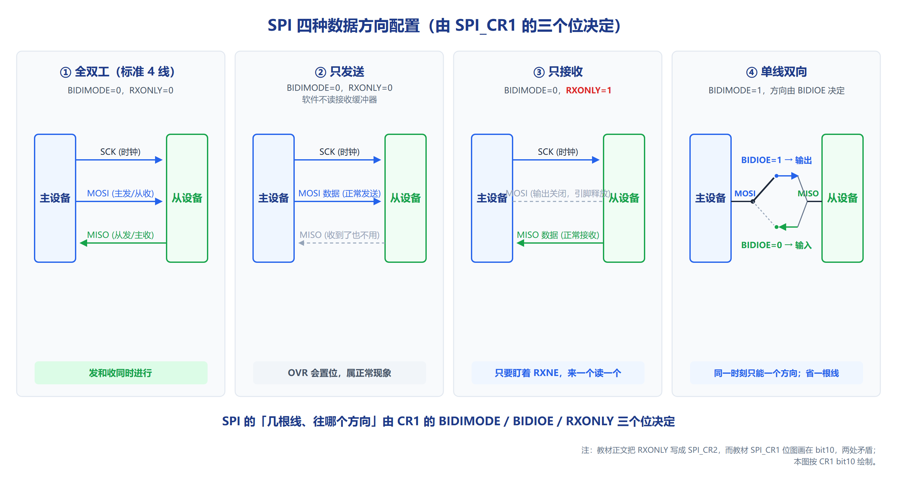

看图要点（四张小图，从左到右）：

1. **第 1 张：全双工（标准 4 线）**。BIDIMODE=0、RXONLY=0。画 MOSI（主→从）和 MISO（从→主）两条方向相反的箭头，再加 SCK。标注"发和收同时进行"。
2. **第 2 张：只发送**。BIDIMODE=0、RXONLY=0，但软件不读接收缓冲器。画 MOSI 一条箭头（有数据），MISO 画成灰色虚线并标"收到了也不用（OVR 会置位，属正常）"。
3. **第 3 张：只接收**。BIDIMODE=0、**RXONLY=1**。画 MISO 一条箭头进主设备（有数据），MOSI 画成灰色虚线并标"输出被关闭，引脚释放"。
4. **第 4 张：单线双向**。**BIDIMODE=1**，只有一根数据线（主设备的 MOSI）。用**BIDIOE** 决定这根线此刻是输出（BIDIOE=1）还是输入（BIDIOE=0），图上画一个双掷开关，标"同一时刻只能一个方向"。
5. 每张小图下方都标出**控制这些行为的位名**（BIDIMODE / BIDIOE / RXONLY），并在第 3 张图上用红框强调 **RXONLY**，写明它是"只接收"的总开关。
6. 图的最下方写一行大字：**"SPI 的'几根线、往哪个方向'由 CR1 的三个位决定：BIDIMODE、BIDIOE、RXONLY。"**

> **⚠️ 提醒：** 第 3 张图里的 **RXONLY 位，教材正文（9.3.6 / 9.3.7）写成"SPI_CR2 寄存器"，而教材 9.3.12 的位图把它画在 SPI_CR1 的 bit10**——两处矛盾，详见本节正文的说明和文末【待核验】N25。

---

### 9.3.7 STM32 的 SPI 接口数据发送与接收过程

#### 1. 接收与发送缓冲器

> 接收时，接收到的数据被存放在**接收缓冲器**中；发送时，在数据被发送之前，首先被存放在**发送缓冲器**中。
>
> **读 SPI_DR 寄存器将返回接收缓冲器的内容；写入 SPI_DR 寄存器的数据将被写入发送缓冲器中。**

**和 USART 的 DR 一样，SPI_DR 也是"一个地址、两扇门"：**

```
              ┌────────────────┐
CPU 写 DR ───►│ 发送缓冲器      │───► 移位寄存器 ───► MOSI
              ├────────────────┤
CPU 读 DR ◄───│ 接收缓冲器      │◄─── 移位寄存器 ◄─── MISO
              └────────────────┘
              同一个地址（SPI1 是 0x4001300C）
```

#### 2. 主模式下的数据传输（教材原文）

**1）全双工模式（BIDIMODE=0 并且 RXONLY=0）**

> （1）当写入数据到 SPI_DR 寄存器（发送缓冲器）后，传输开始；
> （2）在传送第一位数据的同时，数据被并行地从发送缓冲器传送到 8 位移位寄存器中，然后按顺序被串行地移位送到 MOSI 引脚上；
> （3）与此同时，在 MISO 引脚上接收到的数据，按顺序被串行地移位进入 8 位移位寄存器中，然后被并行地传送到 SPI_DR 寄存器（接收缓冲器）中。

**2）单向的只接收模式（BIDIMODE=0 并且 RXONLY=1）**

> （1）SPE=1 时，传输开始；
> （2）只有接收器被激活，在 MISO 引脚上接收到的数据，按顺序被串行地移位进入 8 位移位寄存器，然后被并行地传送到 SPI_DR 寄存器（接收缓冲器）中。

**3）双向模式，发送时（BIDIMODE=1 并且 BIDIOE=1）**

> （1）当写入数据到 SPI_DR 寄存器（发送缓冲器）后，传输开始；
> （2）在传送第一位数据的同时，数据被并行地从发送缓冲器传送到 8 位移位寄存器中，然后按顺序被串行地移位送到 MOSI 引脚上；
> （3）不接收数据。

**4）双向模式，接收时（BIDIMODE=1 并且 BIDIOE=0）**

> （1）SPE=1 并且 BIDIOE=0 时，传输开始；
> （2）在 MOSI 引脚上接收到的数据，按顺序被串行地移位进入 8 位移位寄存器中，然后被并行地传送到 SPI_DR 寄存器（接收缓冲器）中；
> （3）不激活发送缓冲器，没有数据被串行地送到 MOSI 引脚上。

#### 3. 从模式下的数据传输（教材原文）

**1）全双工模式（BIDIMODE=0 并且 RXONLY=0）**

> （1）当从设备接收到时钟信号并且第一个数据位出现在 MOSI 时，数据传输开始，随后的数据位依次移动进入移位寄存器；
> （2）与此同时，发送缓冲器中的数据被并行地传送到 8 位移位寄存器，随后被串行地发送到 MISO 引脚上。**必须保证在 SPI 主设备开始数据传输之前在发送缓冲器中写入要发送的数据。**

**2）单向的只接收模式（BIDIMODE=0 并且 RXONLY=1）**

> （1）当从设备接收到时钟信号并且第一个数据位出现在 MOSI 时，数据传输开始，随后数据位依次移动进入移位寄存器；
> （2）不启动发送缓冲器，没有数据被串行地传送到 MISO 引脚上。

**3）双向模式发送时（BIDIMODE=1 并且 BIDIOE=1）**

> （1）当从设备接收到时钟信号并且发送缓冲器中的第一个数据位被传送到 MISO 引脚时，数据传输开始。
> （2）在第一个数据位被传送到 MISO 引脚上的同时，发送缓冲器中要发送的数据被平行地传送到 8 位的移位寄存器中，随后被串行地发送到 MISO 引脚上。**软件必须保证在 SPI 主设备开始数据传输之前在发送缓冲器中写入要发送的数据。**
> （3）不接收数据。

**4）双向模式接收时（BIDIMODE=1 并且 BIDIOE=0）**

> （1）当从设备接收到时钟信号并且第一个数据位出现在 MOSI 引脚上时，数据传输开始；
> （2）从 MISO 引脚上接收到的数据被串行地传送到 8 位移位寄存器中，然后被并行地传送到 SPI_DR 寄存器（接收缓冲器）；
> （3）不启动发送器，没有数据被串行地传送到 MISO 引脚上。

#### 4. 处理数据的发送与接收（TXE / RXNE / BSY 三大标志）

> 当数据从发送缓冲器传送到移位寄存器时，**TXE 标志**置位（发送缓冲器空），表示发送缓冲器可以接收下一个数据；如果在 SPI_CR2 寄存器中设置了 TXEIE 位，则此时会产生中断；**写入数据到 SPI_DR 寄存器即可清除 TXE 位。**
>
> 在写入发送缓冲器之前，软件必须确认 **TXE 标志为 1**，否则新的数据会覆盖已经在发送缓冲器中的数据。
>
> 在采样时钟的最后一个边沿，当数据被从移位寄存器传送到接收缓冲器时，设置 **RXNE 标志**（接收缓冲器非空），表示数据已经就绪，可以从 SPI_DR 寄存器读出；如果在 SPI_CR2 寄存器中设置了 RXNEIE 位，则此时会产生一个中断；**读 SPI_DR 寄存器即可清除 RXNE 标志位。**
>
> 在一些配置中，传输最后一个数据时，可以使用 **BSY 标志**等待数据传输的结束。

**三大标志一句话总结：**

| 标志 | 含义 | 什么时候是 1 | 怎么清 |
|---|---|---|---|
| **TXE** | 发送缓冲器空 | 数据从发送缓冲器搬进移位寄存器时 | 写 SPI_DR |
| **RXNE** | 接收缓冲器非空 | 8 个（或 16 个）时钟走完，移位寄存器搬进接收缓冲器时 | 读 SPI_DR |
| **BSY** | 总线忙 | 传输开始后，直到传输结束 | 硬件自动（写它没用） |

**全双工发送和接收的标准流程（教材原文）：**

> （1）设置 **SPE 位为 1**，使能 SPI 模块。
> （2）在 **SPI_DR 寄存器中写入第一个要发送的数据**，这个操作会清除 TXE 标志。
> （3）等待 **TXE=1**，然后写入第二个要发送的数据。等待 **RXNE=1**，然后读出 SPI_DR 寄存器并获得第一个接收到的数据，读 SPI_DR 的同时清除了 RXNE 位。重复操作，发送后续数据同时接收后续数据。
> （4）等待 RXNE=1，然后接收最后一个数据。
> （5）等待 TXE=1，在 **BSY=0** 之后关闭 SPI 模块。
>
> 也可以在响应 RXNE 或 TXE 标志的上升沿产生的中断处理程序中实现上述过程。

**注意第（3）步的顺序**：**先写下一个要发的，再去读刚收到的**。为什么？因为 SPI 是"边发边收"——你写进去的那个字节，正是"推动时钟转 8 圈"的燃料。你读到的那个字节，是"上一轮 8 圈转完后从 MISO 挤进来的"。

#### 看教材原图：连续传输时的 TXE/RXNE/BSY

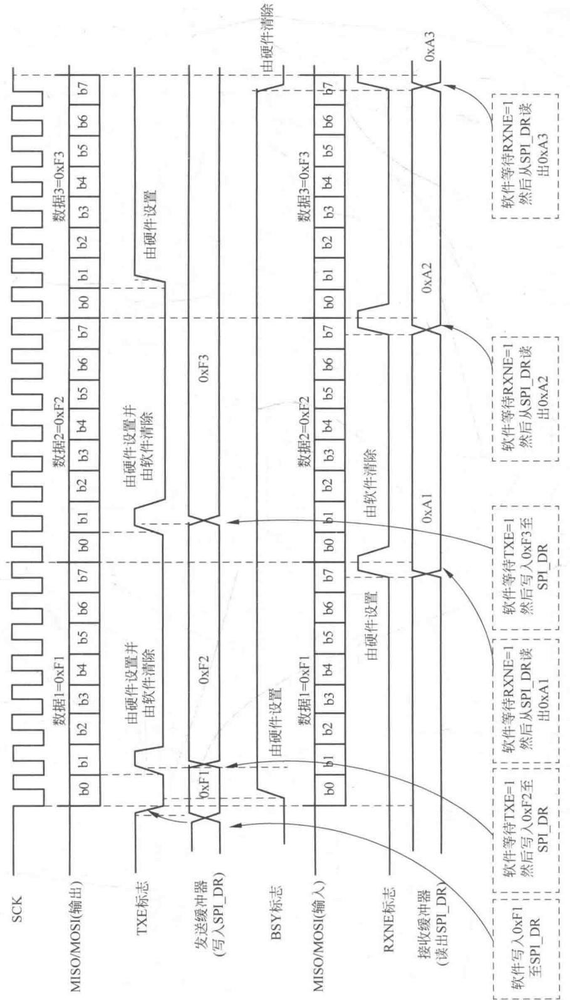

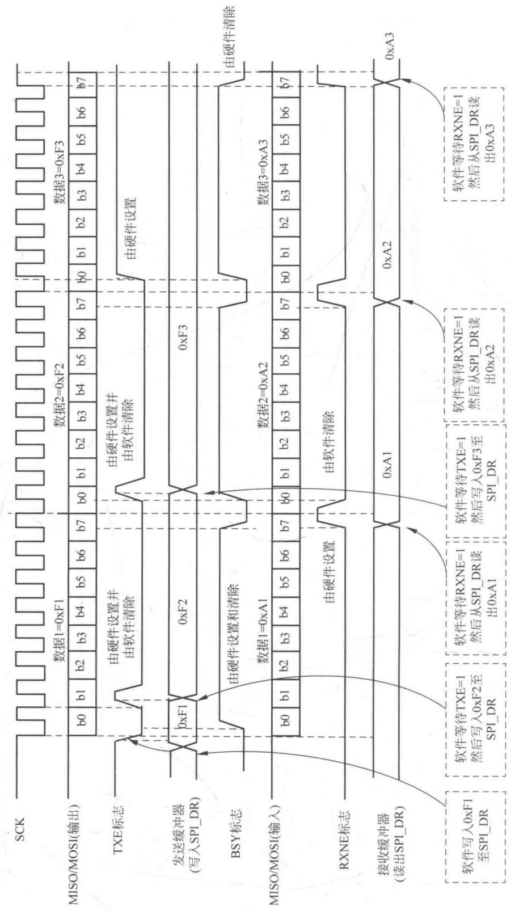

> **⚠️ 待核验（重要）：** MinerU 对图 9-22 的解析完全失败——它在 ch09_source.md 中把这张时序图错误地识别成了一个有 100 多列、内容全是 `0xF1`、`0xF2`……这种垃圾数据的表格（见 ch09_source.md 第 1794 行）。**这说明图 9-22 的原始内容无法从 Markdown 可靠读出。** 本节对 TXE/RXNE/BSY 时序的讲解依据的是教材正文文字描述和 STM32F10x 参考手册的通用描述，**图 9-22 的细节需要回到原 PDF p96 用图像工具核验**。已记入【待核验】。

**根据教材正文，连续传输时这三个标志的规律是：**

【辅助理解图】

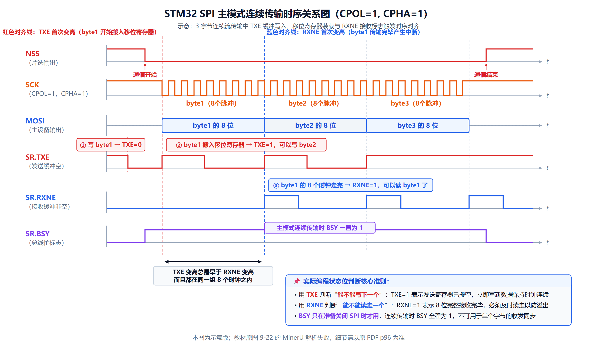

看图要点（从上到下 5 条时间轴，横轴是时间）：

1. **第 1 条：NSS**——通信开始时被拉低，整个传输期间保持低，最后拉高。
2. **第 2 条：SCK**——连续的方波，中间**不停**（这就是"连续传输"）。
3. **第 3 条：MOSI**——用 8 格一组标出 `byte1`、`byte2`、`byte3`，每组正好对应 SCK 的 8 个脉冲。
4. **第 4 条：TXE 标志**——在"byte1 从发送缓冲器搬进移位寄存器"的时刻由低变高（用红色竖虚线标出），提示"可以写 byte2 了"；软件写 DR 后它又变低。如此反复。
5. **第 5 条：RXNE 标志**——在"byte1 的 8 个时钟走完"的时刻由低变高（用蓝色竖虚线标出），提示"可以读 byte1 了"；软件读 DR 后它又变低。
6. **第 6 条：BSY 标志**——整个连续传输期间保持高（标注"主模式连续传输时一直为 1"）。
7. 图底部用两条时间标尺对齐：**TXE 变高的时刻总是早于 RXNE 变高的时刻**，并且都发生在同一组 8 个时钟之内。
8. 图右上角小字："例子配置：CPOL=1，CPHA=1（模式 3）"。

**注意：** 这张辅助图是根据教材正文的文字描述绘制的**示意版**；教材原图 9-22 的 MinerU 解析失败（见文末【待核验】N18），**细节请以原 PDF p96 为准**。

**（下图为教材原图，与上图配合看）**

```
主模式连续传输（每 8 个 SCK 是一轮）：

SCK    ┌┐┌┐┌┐┌┐┌┐┌┐┌┐┌┐  ┌┐┌┐┌┐┌┐┌┐┌┐┌┐┌┐┌┐  ┌┐┌┐...
       ┘└┘└┘└┘└┘└┘└┘└┘└  ┘└┘└┘└┘└┘└┘└┘└┘└  ┘└┘└...
       ←── 第 1 个字节 ──→  ←── 第 2 个字节 ──→

BSY   ─────────────────────────────────────────────  （主模式连续传输时一直为 1）
TXE        ┌───────┐              ┌───────┐
      ─────┘       └──────────────┘       └──────
           ↑ 数据搬入移位寄存器（可以写下一个了）
RXNE              ┌───────┐              ┌───────┐
      ────────────┘       └──────────────┘       └──
                  ↑ 8 个时钟走完，收到一个字节
```

**关键点：**

- **主模式连续传输时，BSY 一直是 1**（因为时钟不停）。
- **TXE 在"数据被搬进移位寄存器"时变 1**，提示 CPU"可以写下一个了"。
- **RXNE 在"8 个时钟走完"时变 1**，提示 CPU"可以读走刚收到的了"。

**从模式（图 9-23）的区别：**

> 在从模式下，通信的连续性由 SPI 主设备决定。**即使通信是连续的，BSY 标志也会在每个数据项之间至少有一个 SPI 时钟周期为低。**

**为什么从模式的 BSY 会闪一下低？** 因为从设备"不知道主设备什么时候开始下一轮"，它只能在每一轮结束、下一轮还没开始时，短暂地认为"我不忙"。主设备则自己掌控节奏，所以一直忙。

#### 只发送过程（教材原文）

> 在此模式下，使用 BSY 位等待传输的结束。
>
> 传输过程可以简要说明如下：
> （1）设置 SPE 位为 1，使能 SPI 模块。
> （2）在 SPI_DR 寄存器中写入第一个要发送的数据，该操作会清除 TXE 标志。
> （3）等待 TXE=1，然后写入第二个要发送的数据。重复这个操作，发送后续的数据。
> （4）写入最后一个数据到 SPI_DR 寄存器之后，等待 TXE=1；然后等待 BSY=0，这表示最后一个数据的传输已经完成。
>
> **注：**
> （1）对于不连续的传输，在写入 SPI_DR 寄存器的操作与设置 BSY 位之间有 **2 个 APB 时钟周期的延迟**，因此在只发送模式下，写入最后一个数据后，最好先等待 TXE=1，然后再等待 BSY=0。
> （2）只发送模式下，在传输 2 个数据之后，由于不会读出接收到的数据，SPI_SR 寄存器中的 **OVR 位会变为 1**（软件不必理会 OVR 标志位）。

**【补充解释】为什么"只发送模式"下 OVR 会置位？**

因为 SPI 硬件**总是**在收（移位寄存器在转，MISO 上的数据会挤进来）。但只发送模式下软件不读 SPI_DR，于是接收缓冲器一直被占着，第二个字节进来时发现"满了"，就产生**溢出（OVR）**。

**这不是错误，是正常现象**——因为你本来就不打算收。所以教材说"软件不必理会 OVR 标志位"。

**看教材原图：只发送模式下的 TXE/BSY 变化**

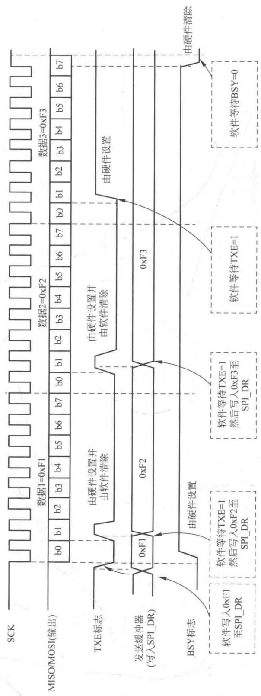

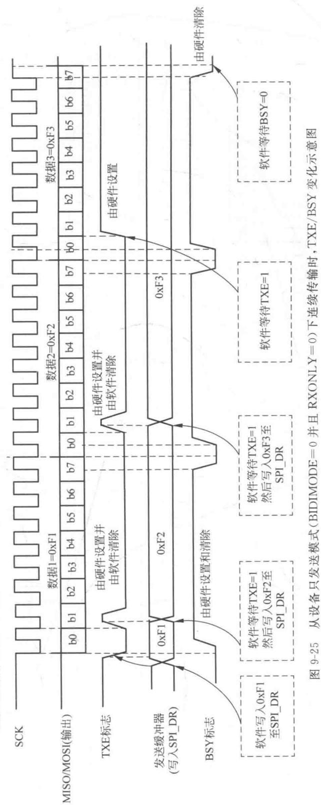

> **⚠️ 待核验：** MinerU 把"图 9-25"的题注丢失了，只留下一句"从模式的例子 CPOL=1，CPHA=1"，与 p97 的图 9-23 题注重复。上面第二张图按内容判断是"从设备只发送模式"的图，**需回原 PDF p100 核对**。已记入【待核验】N24。

**怎么读这两张图：**

1. **只有两条线**：SCK 和 TXE/BSY 标志（没有 RXNE，因为不关心接收）。
2. **主模式（图 9-24）**：SCK 连续不断，**BSY 全程为高**；TXE 在每轮数据搬入移位寄存器时变高。
3. **从模式（图 9-25）**：SCK 由主设备决定；**BSY 在每两个数据之间会短暂变低**。
4. **要理解的重点**：只发送模式下，"什么时候能发下一个"看 **TXE**，"什么时候彻底发完了"看 **BSY**。**因为不读 RXNE，所以没法用 RXNE 判断进度。**

#### 只接收过程（教材原文）

> 在只接收模式（BIDIMODE=0 并且 RXONLY=1）下连续传输时，RXNE 变化示意图如图 9-26 所示。
>
> 该模式的传输过程简要说明如下：
> （1）在 SPI_CR2 寄存器中，设置 **RXONLY=1**。
>
> **⚠️ 注意：** 与 9.3.6 节同样的问题——教材这里又写成了 **SPI_CR2**，而教材 9.3.12 的位图把 RXONLY 放在 **SPI_CR1 的 bit10**。两处矛盾，讲义按 SPI_CR1 bit10 讲解，详见【待核验】N25。
>
> （2）设置 **SPE=1**，使能 SPI 模块。
> 　 ① 在**主模式**下，立刻产生 SCK 时钟信号，在关闭 SPI（SPE=0）之前，不断地接收串行数据；
> 　 ② 在**从模式**下，当 SPI 主设备拉低 NSS 信号并产生 SCK 时钟时，接收串行数据。
> （3）等待 **RXNE=1**，然后读出 SPI_DR 寄存器以获得收到的数据（同时会清除 RXNE 位）。重复这个操作接收所有数据。
>
> 也可以在响应 RXNE 标志的上升沿产生的中断处理程序中实现这个过程。
>
> 在主模式的只接收模式下（RXONLY=1），**通信总是连续的，而且 BSY 标志始终为 1。**

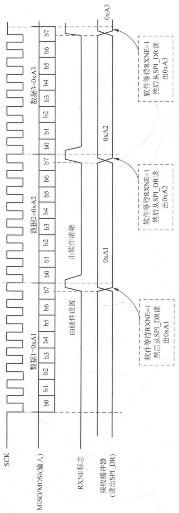

**怎么读这张图：**

1. 图上只有 SCK、MOSI/MISO 和 **RXNE** 三条线（没有 TXE，因为不需要发送缓冲器）。
2. **主模式只接收时 SCK 一直不停**——因为主设备一使能就开始"自己打拍子自己收"。
3. **RXNE 每隔 8 个时钟变高一次**，提示 CPU"又来一个字节，快读走"。
4. **BSY 全程为 1**（教材原文明确说了）。
5. **要理解的重点**：只接收模式最简单——**只要盯着 RXNE，来一个读一个**。

**【补充解释】只接收模式下"数据从哪来"？**

主设备只接收时，**它自己产生 SCK，但 MOSI 上没有数据发出去**。数据是从 MISO 上被"挤"进来的——对面的从设备必须在每个时钟把自己的数据放到 MISO 上。**如果对面什么都没接，你收到的就是一堆随机的 0 或 1。**

#### 连续和非连续传输（教材原文）

> 在主模式下发送数据时，每次检测到 TXE 的上升沿（或 TXE 中断）后，如果软件能够在当前的传输结束之前将数据写入 SPI_DR 寄存器，则能够实现**连续的通信**；此时，每个数据项传输之间的 SPI 时钟保持连续，同时 **BSY 位不会被清除**。如果软件速度不够快，则会导致**不连续的通信**；这时，在每个数据传输之间 BSY 位会被清除。

**用大白话说：**

- **连续传输**：CPU 手快，上一轮还没结束就把下一个字节写进去了 → SCK 不停，效率最高；
- **非连续传输**：CPU 手慢，上一轮都结束了下一个字节还没写 → SCK 停一下，BSY 掉下来。

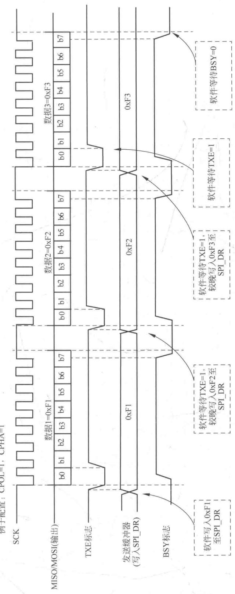

**怎么读这张图（和图 9-22 对比着看）：**

1. **看 SCK**：图 9-22 里 SCK 是一条连续的脉冲串；**这张图里 SCK 被"切"成了一段一段，每段之间有空隙**。
2. **看 BSY**：图 9-22 里 BSY 一直是高；**这张图里 BSY 在每段之间掉下来一次**，形成一个个"高-低-高-低"的阶梯。
3. **看 TXE**：每次 BSY 掉下来之前，TXE 已经变高了——说明"缓冲器早就空了，但 CPU 还没写新数据进去"。
4. **这张图想让你理解什么？** **"非连续"不是硬件的问题，是软件跟不上的问题。** SCK 停下来的那段时间，就是 CPU 在"磨蹭"。

**所以高速 SPI 通信时，CPU 经常跟不上，这就是为什么要用 DMA（第 11 章）。**

---

### 9.3.8 CRC 计算（了解即可）

#### 【教材内容】

> CRC 校验用于保证全双工通信的可靠性。数据发送和接收分别使用单独的 CRC 计算器。通过对每一个接收位进行可编程的多项式运算来计算 CRC。CRC 的计算是在由 SPI_CR1 寄存器中 CPHA 和 CPOL 位定义的**采样时钟边沿**进行的。
>
> STM32 的 SPI 接口提供了两种 CRC 计算方法，取决于所选的发送和接收的数据帧格式：**8 位数据帧采用 CRC8，16 位数据帧采用 CRC16。**
>
> CRC 计算通过设置 SPI_CR1 寄存器中的 **CRCEN 位**启用。设置 CRCEN 位时同时复位 CRC 寄存器（SPI_RXCRCR 和 SPI_TXCRCR）。当设置了 SPI_CR1 的 **CRCNEXT 位**，SPI_TXCRCR 的内容将在当前字节发送之后发出。
>
> 在传输 SPI_TXCRCR 的内容时，如果在移位寄存器中收到的数值与 SPI_RXCRCR 的内容不匹配，则 SPI_SR 寄存器的 **CRCERR 标志位**置位。
>
> 如果在发送缓冲器中还有数据，CRC 的数值仅在数据字节传输结束后传送。在传输 CRC 期间，CRC 计算器关闭，寄存器的数值保持不变。

**使用 CRC 的步骤（教材原文）：**

> （1）设置 CPOL、CPHA、LSBFIRST、BR、SSM、SSI 和 MSTR 的值。
> （2）在 SPI_CRCPR 寄存器输入多项式。
> （3）通过设置 SPI_CR1 寄存器 **CRCEN 位**使能 CRC 计算，该操作同时清除寄存器 SPI_RXCRCR 和 SPI_TXCRC。
> （4）设置 SPI_CR1 寄存器的 **SPE 位**启动 SPI 功能。
> （5）启动通信并且维持通信，直到只剩最后一个字节或者半字。
> （6）在把最后一个字节或半字写进发送缓冲器时，设置 SPI_CR1 的 **CRCNEXT 位**，指示硬件在发送完成最后一个数据之后，发送 CRC 的数值。在发送 CRC 数值期间，停止 CRC 计算。
> （7）当最后一个字节或半字被发送后，SPI 发送 CRC 数值，CRCNEXT 位被清除。同样，接收到的 CRC 与 SPI_RXCRCR 值进行比较，如果比较不相配，则设置 SPI_SR 中的 **CRCERR 标志位**；如果设置了 SPI_CR2 寄存器的 **ERRIE 位**，则产生中断。

**其他注意事项（教材原文）：**

> - 当 SPI 模块处于从设备模式时，需在时钟稳定之后再使能 CRC 计算，否则可能会得到错误的 CRC 计算结果。事实上，一旦设置了 CRCEN 位，只要在 SCK 引脚上有输入时钟，不管 SPE 位的状态，都会进行 CRC 的计算。
> - 当 SPI 时钟频率较高时，用户在发送 CRC 时必须小心。因为 CPU 的操作会影响 SPI 的带宽，在 CRC 传输期间，使用 CPU 的时间应尽可能少，建议采用 DMA 模式以避免 SPI 降低速度。为了避免在接收最后的数据和 CRC 时出错，在发送 CRC 过程中应禁止函数调用。必须在发送/接收最后一个数据之前完成设置 CRCNEXT 位的操作。
> - 如果 STM32 配置为从模式并且使用了 NSS 硬件模式，NSS 引脚应在数据传输和 CRC 传输期间保持为低电平。
> - 如果配置 SPI 为从模式并且使用 CRC 的功能，即使 NSS 引脚为高时仍然会执行 CRC 的计算。例如，当主设备交替地与多个从设备进行通信时，将会出现这种情况（此时要注意避免 CRC 的误操作）。
>
> **清除 CRC 数值步骤如下：**
> （1）关闭 SPI 模块（SPE=0）；
> （2）清除 CRCEN 位为 0；
> （3）设置 CRCEN 位为 1；
> （4）使能 SPI 模块（SPE=1）。

#### 【先补一个前置知识：CRC 是什么？为什么比奇偶校验强？】

9.1.5 讲过奇偶校验：只能发现"1 位出错"，错 2 位就查不出来。

**CRC（Cyclic Redundancy Check，循环冗余校验）** 是另一种查错方法：

- 发送方把整串数据当成一个巨大的二进制数，**除以一个约定的"多项式"**，取余数；
- 把这个**余数**附在数据后面一起发出去；
- 接收方用同样的方法算一遍，比较余数是否一致。

**好处：** 能发现绝大多数多位的错误（突发错误）。代价是要多做几次除法运算（硬件做很快）。

**"多项式"是什么？** 就是一个约定的二进制数。比如 `SPI_CRCPR` 的复位值是 `0x0007`，意思就是"用 x³ + x² + x + 1 这个多项式"。

**本课程不要求手算 CRC**，只要知道：**它是比奇偶校验更强的查错手段，STM32 的 SPI 硬件可以自动算。**

---

### 9.3.9 状态标志

#### 【教材内容】

> 应用程序通过 3 个状态标志可以监控 SPI 总线的状态。

**1. 发送缓冲器空闲标志（TXE）**

> 此标志为 1 时表明发送缓冲器为空，可以将下一个待发送的数据写入缓冲器。**当写入 SPI_DR 时，TXE 标志被清除。**

**2. 接收缓冲器非空（RXNE）**

> 此标志为 1 时表明在接收缓冲器中包含有效的接收数据。**读 SPI 数据寄存器可以清除此标志。**

**3. 忙标志（BSY）**

> BSY 标志由**硬件设置与清除**（写入此位无效果），此标志表明 SPI 通信层的状态。当 BSY=1 时，表明 SPI 正忙于通信，但有一个例外：在主模式的双向接收模式下（MSTR=1、BDM=1 并且 BDOE=0），在接收期间 BSY 标志保持为低。
>
> 在软件要关闭 SPI 模块并进入停机模式（或关闭设备时钟）之前，可以使用 BSY 标志检测传输是否结束，这样可以避免破坏最后一次传输。
>
> BSY 标志还可以用于在多主系统中避免写冲突。
>
> 除了主模式的双向接收模式（MSTR=1、BDM=1 并且 BDOE=0），当传输开始时，BSY 标志被置 1。
>
> **以下情况时，BSY 标志将被清为 0：**
> （1）传输结束（主模式下，如果是连续通信的情况例外）；
> （2）关闭 SPI 模块；
> （3）产生主模式失效（MODF=1）。
>
> 如果通信不是连续的，则在每个数据项的传输之间，BSY 标志为低。
>
> 如果通信是连续的，那么：
> - **主模式下：在整个传输过程中，BSY 标志保持为高；**
> - **从模式下：在每个数据项的传输之间，BSY 标志在一个 SPI 时钟周期中为低。**
>
> **在实际应用中，不要使用 BSY 标志处理每一个数据项的发送和接收，最好使用 TXE 和 RXNE 标志。**

**用一张表把三个标志对比清楚：**

| 标志 | 从谁的角度看 | 什么时候用 | 别什么时候用 |
|---|---|---|---|
| TXE | 发送方 | 判断"能不能写下一个字节" | —— |
| RXNE | 接收方 | 判断"能不能读走收到的字节" | —— |
| BSY | 整个通信层 | 只在"**准备关闭 SPI**"时等它变 0 | **不要用它来逐字节判断** |

**为什么"不要用 BSY 逐字节判断"？** 因为 BSY 在连续传输时一直是 1，你等它变 0 会一直等下去。它是"整个总线忙不忙"，不是"这个字节发完没有"。

---

### 9.3.10 关闭 SPI

#### 【教材内容】

> SPI 通信结束后，可以通过关闭 SPI 模块来终止通信，降低功耗。**清除 SPE 位即可关闭 SPI。**
>
> 在某些配置下，如果在传输还未完成时，就关闭 SPI 模块并进入停机模式，则可能导致当前的传输被破坏，而且 BSY 标志也变得不可信。为了避免发生这种情况，关闭 SPI 模块时，建议按照下述步骤操作：

**（1）在主或从模式下的全双工模式（BIDIMODE=0, RXONLY=0）**

> ① 等待 RXNE=1 并接收最后一个数据；
> ② 等待 TXE=1；
> ③ 等待 BSY=0；
> ④ 关闭 SPI（SPE=0），最后进入停机模式（或关闭该模块的时钟）。

**（2）在主或从模式下的单向只发送模式（BIDIMODE=0, RXONLY=0）或双向的发送模式（BIDIMODE=1, BIDIOE=1），在 SPI_DR 寄存器中写入最后一个数据后：**

> ① 等待 TXE=1；
> ② 等待 BSY=0；
> ③ 关闭 SPI（SPE=0），最后进入停机模式（或关闭该模块的时钟）。

**（3）在主或从模式下的单向只接收模式（MSTR=1, BIDIMODE=0, RXONLY=1）或双向的接收模式（MSTR=1, BIDIMODE=1, BIDIOE=0），这种情况需要特别处理，以保证 SPI 不会开始一次新的传输：**

> ① 等待倒数第二个（第 n-1 个）RXNE=1；
> ② 在关闭 SPI（SPE=0）之前等待一个 SPI 时钟周期（使用软件延迟）；
> ③ 在进入停机模式（或关闭该模块的时钟）之前等待最后一个 RXNE=1。
>
> 在主模式下的单向只发送模式（MSTR=1, BDM=1, BDOE=0）时，传输过程中 BSY 标志始终为低。

**（4）在从模式下的只接收模式（MSTR=0, BIDIMODE=0, RXONLY=1）或双向的接收模式（MSTR=0, BIDIMODE=1, BIDIOE=0）：**

> ① 可以在任何时候关闭 SPI（SPE=0），SPI 会在当前的传输结束后被关闭；
> ② 如果希望进入停机模式，在进入停机模式（或关闭该模块的时钟）之前必须首先等待 BSY=0。

**【补充解释】为什么关 SPI 这么麻烦？**

因为 SPI 的移位寄存器是"转起来就停不下来"的。如果你在它转到一半时把 SPE 清 0，可能：

- 当前字节发了一半，从设备收到一个"残废"的字节；
- 或者 BSY 标志还没更新，你以为停了其实没停。

**所以规矩是：先等"该收的收完、该发的发完、总线不忙了"，再关。**

---

### 9.3.11 STM32 的 SPI 接口中断

**表 9-8 STM32 的 SPI 中断请求**

| 中断事件 | 事件标志 | 使能控制位 |
|---|---|---|
| 发送缓冲器空标志 | TXE | TXEIE |
| 接收缓冲器非空标志 | RXNE | RXNEIE |
| 主模式失效事件 | MODF | ERRIE |
| 溢出错误 | OVR | ERRIE |
| CRC 错误标志 | CRCERR | ERRIE |

**和 USART 一样，SPI 的多个中断事件也共用一个中断向量**（SPI1 是 `SPI1_IRQn`）。所以中断服务程序里同样要先判断"是哪个事件"。

**表里三个错误（都用 ERRIE 使能）分别是什么：**

| 错误 | 含义 |
|---|---|
| **MODF**（主模式失效） | 你本来是从设备，结果 NSS 被拉低了 → 有人抢主控权。**或者**：你本来是主设备，但 NSS 被别人拉低了（多主冲突）。 |
| **OVR**（溢出） | 接收缓冲器里的数据还没被读走，新的又来了，旧的被覆盖。 |
| **CRCERR** | CRC 校验不通过，说明数据在传输中出错了。 |

---

### 9.3.12 STM32 的 SPI 接口的寄存器（按 AGENTS.md 第 11 节逐位讲）

#### 先把地址这条链算清楚

教材原文：

> **SPI1 寄存器的首地址是 0x40013000；SPI2 寄存器的首地址是 0x40003800；SPI3 寄存器的首地址是 0x40003C00。** SPI 的寄存器可以用半字（16 位）或字（32 位）的方式操作。

**这些地址怎么来的？** 看教材给的宏：

```c
#define PERIPH_BASE       ((u32)0x40000000)
#define APB1PERIPH_BASE   PERIPH_BASE
#define APB2PERIPH_BASE   (PERIPH_BASE + 0x10000)
#define AHBPERIPH_BASE    (PERIPH_BASE + 0x20000)
...
#define SPI1_BASE         (APB2PERIPH_BASE + 0x3000)
#define SPI2_BASE         (APB1PERIPH_BASE + 0x3800)
...
```

**一步步算：**

```
第 1 步：外设区总起点
  PERIPH_BASE = 0x40000000

第 2 步：分总线
  APB2PERIPH_BASE = 0x40000000 + 0x10000 = 0x40010000
  APB1PERIPH_BASE = 0x40000000

第 3 步：加外设偏移
  SPI1_BASE = 0x40010000 + 0x3000 = 0x40013000   ✓ 和教材一致
  SPI2_BASE = 0x40000000 + 0x3800 = 0x40003800   ✓ 和教材一致
  SPI3_BASE = 0x40000000 + 0x3C00 = 0x40003C00   ✓ 和教材一致
```

**地址空间定位图：**

```
0x40000000  ┌────────────────────────────────┐
            │  PERIPH_BASE（外设区起点）      │
            ├────────────────────────────────┤
            │  APB1 区                        │
            │    + 0x3800 ──────────────────┼──► SPI2 基地址 = 0x40003800
            │    + 0x3C00 ──────────────────┼──► SPI3 基地址 = 0x40003C00
            ├────────────────────────────────┤
  0x40010000│  APB2 区                        │
            │    + 0x3000 ──────────────────┼──► SPI1 基地址 = 0x40013000
            └────────────────────────────────┘
```

**从基地址算出每个寄存器的最终地址（以 SPI1 为例）：**

| 寄存器 | 偏移 | 最终地址计算 | 最终地址 |
|---|---|---|---|
| SPI_CR1 | 0x00 | 0x40013000 + 0x00 | **0x40013000** |
| SPI_CR2 | 0x04 | 0x40013000 + 0x04 | **0x40013004** |
| SPI_SR | 0x08 | 0x40013000 + 0x08 | **0x40013008** |
| SPI_DR | 0x0C | 0x40013000 + 0x0C | **0x4001300C** |
| SPI_CRCPR | 0x10 | 0x40013000 + 0x10 | **0x40013010** |
| SPI_RXCRCR | 0x14 | 0x40013000 + 0x14 | **0x40013014** |
| SPI_TXCRCR | 0x18 | 0x40013000 + 0x18 | **0x40013018** |

**于是这行代码的含义就清楚了（下面这个 0x0344 是讲义为了演示"位"而举的例子，不是教材原文的值）：**

```c
SPI1->CR1 = 0x0344;
```

```
SPI1 = (SPI_TypeDef *)0x40013000
CR1 是结构体第 1 个成员，偏移 0x00
→ 实际写入地址 = 0x40013000 + 0x00 = 0x40013000
→ SPI1 的 CR1 被写入 0x0344
```

**拆位必须先展开成完整的 16 位二进制，一位一位数（不跳步）：**

```
0x0344 = 0000 0011 0100 0100
 bit    15 14 13 12 11 10  9  8   7  6  5  4  3  2  1  0
        0  0  0  0  0  0  1  1   0  1  0  0  0  1  0  0
                          ↑  ↑      ↑            ↑
                        SSM  SSI    SPE         MSTR
                       bit9  bit8   bit6        bit2
```

对照本节后面给出的 SPI_CR1 位图逐位核对：

| bit | 名称 | 值 | 含义 |
|---|---|---|---|
| 15 | BIDIMODE | 0 | 双线（标准 4 线）模式 |
| 14 | BIDIOE | 0 | 单线双向的输出使能——本模式用不到 |
| 13 | CRCEN | 0 | 不用硬件 CRC |
| 12 | CRCNEXT | 0 | 下一个发的是数据不是 CRC |
| 11 | DFF | 0 | **8 位**数据帧 |
| 10 | RXONLY | 0 | 全双工（不是"只接收"） |
| **9** | **SSM** | **1** | 软件管理 NSS（NSS 引脚不参与） |
| **8** | **SSI** | **1** | 内部 NSS 信号有效（"我是主设备"） |
| 7 | LSBFIRST | 0 | 先发最高位（MSB first） |
| **6** | **SPE** | **1** | SPI 使能（总开关打开） |
| **5:3** | **BR[2:0]** | **000** | 分频系数 = 2 → SCK = f_PCLK / 2 |
| **2** | **MSTR** | **1** | 主模式 |
| 1 | CPOL | 0 | 空闲时 SCK 为低 |
| 0 | CPHA | 0 | 第一个边沿采样 |

**所以 0x0344 的真实含义是：主模式 + 8 位帧 + 模式 0 + 软件 NSS（SSM=1、SSI=1）+ 使能 + SCK = f_PCLK/2。**

> **⚠️ 读数的正确姿势：** 一个十六进制数写进寄存器，**不能靠"感觉某几位是几"**。先把 16 位全部写出来，再对着位图一段一段圈。这里特别注意两点：
> 1. **bit9（SSM）和 bit8（SSI）是 1**——说明这份配置用的是软件 NSS（固件库里就是 `SPI_NSS_Soft` 的效果），必须和 9.3.3 节连起来看；
> 2. **BR[2:0] = 000 表示 f_PCLK/2**（不是 011 的 f_PCLK/16）。分频系数是 2 的时候 SCK 会跑到 f_PCLK/2，属于"能吃多快吃多快"的配置，接慢速外设（比如 LCD）时不会这么设。

> **⚠️ 待核验：** 素材在讲 SPI 基地址时写"**2 个 SPI 外设在文件 stm32f10x.h 中声明**"（只列了 SPI1、SPI2），但同一章前面又说"STM32F103VET6 集成了 **3 个** SPI 接口"（SPI1/SPI2/SPI3）。这两个说法不一致——很可能教材引用的是**中容量**器件的头文件（只有 SPI1/SPI2），而 STM32F103VET6 是**大容量**器件（有 SPI1/SPI2/SPI3）。已记入【待核验】。

#### SPI 寄存器结构（`SPI_TypeDef`）

教材原文：

```c
typedef struct
{
    vu16 CR1;       // SPI 控制寄存器 1
    u16  RESERVED0;
    vu16 CR2;       // SPI 控制寄存器 2
    u16  RESERVED1;
    vu16 SR;        // SPI 状态寄存器
    u16  RESERVED2;
    vu16 DR;        // SPI 数据寄存器
    u16  RESERVED3;
    vu16 CRCPR;     // SPI CRC 多项式寄存器
    u16  RESERVED4;
    vu16 RXCRCR;    // SPI 接收 CRC 寄存器
    u16  RESERVED5;
    vu16 TXCRCR;    // SPI 发送 CRC 寄存器
    u16  RESERVED6;
    vu16 I2SCFGR;   // I2S 配置寄存器
    u16  RESERVED7;
    vu16 I2SPR;     // I2S 预分频寄存器
    u16  RESERVED8;
} SPI_TypeDef;
```

**和 USART 一样的道理**：每个寄存器占 4 字节地址空间，只用低 16 位，高 16 位保留（所以每个成员后面跟一个 `RESERVED`）。

**注意最后两个成员 `I2SCFGR` 和 `I2SPR`**：STM32 的这个硬件模块既能当 SPI 用，也能当 **I²S**（Inter-IC Sound，芯片间音频接口）用。所以结构体里也有 I²S 的寄存器。**本课程只用 SPI 模式，这两个寄存器不管。**

#### 寄存器 1：SPI 控制寄存器 1（SPI_CR1）

**它属于谁？** SPI1/2/3 各一份。
**它控制什么？** 工作模式（主/从）、时钟极性相位、数据帧格式、位序、波特率、NSS 管理、CRC、单/双向。**这是 SPI 最重要的寄存器。**

**偏移地址：0x00，复位值：0x0000**

**位图（分两行画，因为 16 位一行放不下）：**

```
bit     15       |  14   |  13  |   12    | 11  |   10   |  9 |  8 |
      +----------+-------+------+---------+-----+--------+----+----+
      | BIDIMODE | BIDIOE| CRCEN| CRCNEXT | DFF | RXONLY | SSM| SSI|
      +----------+-------+------+---------+-----+--------+----+----+
          rw        rw      rw      rw       rw     rw      rw   rw

bit      7     |  6  | 5   4   3 |  2  |  1   |  0   |
      +--------+-----+-----------+-----+------+------+
      |LSBFIRST| SPE |  BR[2:0]  |MSTR | CPOL | CPHA |
      +--------+-----+-----------+-----+------+------+
          rw      rw      rw        rw     rw     rw
```

**最常用的 6 位（先看这 6 个）：**

```
bit     2        1        0        6        11       5 4 3
      +----+   +----+   +----+   +----+   +----+   +--------+
      |MSTR|   |CPOL|   |CPHA|   | SPE|   | DFF|   | BR[2:0]|
      +----+   +----+   +----+   +----+   +----+   +--------+
       主/从    极性     相位    使能     8/16位    波特率分频
```

**逐位详解（教材原文 + 人话）：**

**位 15：BIDIMODE，双向数据模式使能（Bidirectional data mode enable）**
> 0：选择"双线双向"模式；1：选择"单线双向"模式。

**【人话】** 0 = 标准的 4 线 SPI（MOSI 和 MISO 分开）；1 = 只用一根线双向传（省引脚）。

**位 14：BIDIOE，双向模式下的输出使能（Output enable in bidirectional mode）**
> 和 BIDIMODE 位一起决定在"单线双向"模式下数据的输出方向。
> 0：输出禁止（只收模式）；1：输出使能（只发模式）。
> 这个"单线"数据线在**主设备端为 MOSI 引脚，在从设备端为 MISO 引脚**。

**位 13：CRCEN，硬件 CRC 校验使能（Hardware CRC calculation enable）**
> 0：禁止 CRC 计算；1：启动 CRC 计算。
> **只有在禁止 SPI 时（SPE=0），才能写该位，否则出错。该位只能在全双工模式下使用。**

**位 12：CRCNEXT，下一个发送 CRC（Transmit CRC next）**
> 0：下一个发送的值来自发送缓冲区；1：下一个发送的值来自发送 CRC 寄存器。
> **在 SPI_DR 寄存器写入最后一个数据后应马上设置该位。**

**位 11：DFF，数据帧格式（Data frame format）**
> **只有当 SPI 禁止时，才能写该位，否则出错。**
> 0：使用 **8 位**数据帧格式进行发送/接收；1：使用 **16 位**数据帧格式进行发送/接收。

**位 10：RXONLY，只接收（Receive only）**
> 该位和 BIDIMODE 位一起决定在"双线双向"模式下的传输方向。**在多个从设备的配置中，在未被访问的从设备上该位被置 1，使得只有被访问的从设备有输出，从而不会造成数据线上数据冲突。**
> 0：全双工（发送和接收）；1：禁止输出（只接收模式）。

**【人话】** 想省一根线、或者只想听不想说，就置 1。**多从机时，没被点名的从机把它置 1，免得它乱说话。**

> **⚠️ 教材前后矛盾（N25）：** 本节位图（来自教材 9.3.12 的 SPI_CR1 位表）把 **RXONLY 画在 SPI_CR1 的 bit10**，但教材 9.3.6 和 9.3.7 的正文两处都写成"SPI_CR2 寄存器的 RXONLY 位"。**同一个位不可能同时在两个寄存器里。** 讲义在这里（寄存器定义处）按 **SPI_CR1 bit10** 处理，并在 9.3.6 / 9.3.7 的原文引用处都加了提示。已记入文末【待核验】N25，等人工核对原 PDF 后统一。

**位 9：SSM，软件从设备管理（Software slave management）**
> 当 SSM 被置位时，**NSS 引脚上的电平由 SSI 位的值决定**。
> 0：禁止软件从设备管理；1：启用软件从设备管理。

**位 8：SSI，内部从设备选择（Internal slave select）**
> 该位**只在 SSM 位为 1 时有意义**。它决定了 NSS 上的电平，在 NSS 引脚上的 I/O 操作无效。

**【人话】** SSM 和 SSI 是一对搭档：SSM=1 表示"NSS 不听引脚，听 SSI 位"；SSI=1 表示"内部 NSS 有效（我是主）"。

**位 7：LSBFIRST，帧格式（Frame format）**
> **当通信在进行时不能改变该位的值。**
> 0：先发送**最高位**；1：先发送**最低位**。

**位 6：SPE，SPI 使能（SPI enable）**
> 0：禁止 SPI 设备；1：开启 SPI 设备。

**【人话】** SPI 的总开关。

**位 [5:3]：BR[2:0]，波特率控制（Baud rate control）**
> **当通信正在进行的时候，不能修改这些位。**

| BR[2:0] | 分频系数 | 主模式 SCK 频率（PCLK = 72 MHz 时） |
|---|---|---|
| 000 | f_PCLK / 2 | 36 MHz |
| 001 | f_PCLK / 4 | 18 MHz |
| 010 | f_PCLK / 8 | 9 MHz |
| 011 | f_PCLK / 16 | 4.5 MHz |
| 100 | f_PCLK / 32 | 2.25 MHz |
| 101 | f_PCLK / 64 | 1.125 MHz |
| 110 | f_PCLK / 128 | 562.5 kHz |
| 111 | f_PCLK / 256 | 281.25 kHz |

**【人话】** 这是 SPI 的"速度旋钮"。**只有主模式才管用**，从模式由外部 SCK 决定。

**位 2：MSTR，主设备选择（Master selection）**
> 0：配置为**从设备**；1：配置为**主设备**。

**位 1：CPOL，时钟极性（Clock polarity）**
> **当通信正在进行的时候，不能修改该位。**
> 0：空闲状态时，SCK 保持**低**电平；1：空闲状态时，SCK 保持**高**电平。

**位 0：CPHA，时钟相位（Clock phase）**
> **当通信正在进行的时候，不能修改该位。**
> 0：数据采样从**第一个**时钟边沿开始；1：数据采样从**第二个**时钟边沿开始。

**位运算演示（配一个典型的主模式初始化）：**

目标：主模式、8 位帧、CPOL=0、CPHA=0、软件 NSS、分频 128、MSB 先发、使能 SPI。

```
运算前 CR1 = 0x0000 = 0000 0000 0000 0000

各项掩码：
  MSTR      (1<<2)  = 0x0004 = 0000 0000 0000 0100
  DFF=0     (0<<11) = 0x0000
  CPOL=0    (0<<1)  = 0x0000
  CPHA=0    (0<<0)  = 0x0000
  SSM       (1<<9)  = 0x0200 = 0000 0010 0000 0000
  SSI       (1<<8)  = 0x0100 = 0000 0001 0000 0000
  BR=110    (6<<3)  = 0x0030 = 0000 0000 0011 0000
  LSBFIRST=0(0<<7)  = 0x0000
  SPE       (1<<6)  = 0x0040 = 0000 0000 0100 0000

全部按位或：
  0x0200  0000 0010 0000 0000   (SSM)
| 0x0100  0000 0001 0000 0000   (SSI)
| 0x0040  0000 0000 0100 0000   (SPE)
| 0x0030  0000 0000 0011 0000   (BR=110)
| 0x0004  0000 0000 0000 0100   (MSTR)
────────────────────────────────
= 0x0374  0000 0011 0111 0100

核对：
  bit15 BIDIMODE = 0  ✓ 双线模式
  bit14 BIDIOE   = 0  ✓
  bit13 CRCEN    = 0  ✓ 不用 CRC
  bit12 CRCNEXT  = 0  ✓
  bit11 DFF      = 0  ✓ 8 位帧
  bit10 RXONLY   = 0  ✓ 全双工
  bit9  SSM      = 1  ✓ 软件 NSS
  bit8  SSI      = 1  ✓ 内部 NSS 有效
  bit7  LSBFIRST = 0  ✓ MSB 先发
  bit6  SPE      = 1  ✓ 使能
  bit5:3 BR      = 110 ✓ 128 分频
  bit2  MSTR     = 1  ✓ 主模式
  bit1  CPOL     = 0  ✓ 空闲低
  bit0  CPHA     = 0  ✓ 第一边沿采样
```

#### 寄存器 2：SPI 控制寄存器 2（SPI_CR2）

**它属于谁？** SPIx。
**它控制什么？** 中断使能、SS 输出使能、DMA 使能。

**偏移地址：0x04，复位值：0x0000**

**位图：**

```
bit   15 14 13 12 11 10  9  8 |  7    |   6    |  5   | 4  3 |  2  |   1     |   0     |
      +-----------------------+-------+--------+------+------+-----+---------+---------+
      |        保留           | TXEIE | RXNEIE |ERRIE | 保留 |SSOE |TXDMAEN  |RXDMAEN  |
      +-----------------------+-------+--------+------+------+-----+---------+---------+
                                rw       rw      rw            rw     rw        rw
```

**逐位详解：**

**位 [15:8]：保留位，硬件强制为 0。**

**位 7：TXEIE，发送缓冲区空中断使能（Tx buffer empty interrupt enable）**
> 0：禁止 TXE 中断；1：允许 TXE 中断，当 TXE 标志置位时产生中断请求。

**位 6：RXNEIE，接收缓冲区非空中断使能（RX buffer not empty interrupt enable）**
> 0：禁止 RXNE 中断；1：允许 RXNE 中断，当 RXNE 标志置位时产生中断请求。

**位 5：ERRIE，错误中断使能（Error interrupt enable）**
> 当产生错误（CRCERR、OVR、MODF）时，该位控制是否产生中断。
> 0：禁止错误中断；1：允许错误中断。
>
> **⚠️ 教材素材把这一位印成了 "ERRIR"（应为 ERRIE）。** 已记入【待核验】。

**位 [4:3]：保留位，硬件强制为 0。**

**位 2：SSOE，SS 输出使能（SS output enable）**
> 0：禁止在主模式下 SS 输出，该设备可以工作在**多主设备**模式；
> 1：设备开启时，开启主模式下 SS 输出，该设备**不能**工作在多主设备模式。

**【人话】** SSOE=1 表示"NSS 引脚由硬件自动拉低"（单主机时方便）；SSOE=0 表示"NSS 引脚留给我自己用 GPIO 控制"（多主机时需要）。

**位 1：TXDMAEN，发送缓冲区 DMA 使能（Tx buffer DMA enable）**
> 当该位被设置时，TXE 标志一旦被置位就发出 DMA 请求。
> 0：禁止发送缓冲区 DMA；1：启动发送缓冲区 DMA。

**位 0：RXDMAEN，接收缓冲区 DMA 使能（Rx buffer DMA enable）**
> 当该位被设置时，RXNE 标志一旦被置位就发出 DMA 请求。
> 0：禁止接收缓冲区 DMA；1：启动接收缓冲区 DMA。

#### 寄存器 3：SPI 状态寄存器（SPI_SR）

**它属于谁？** SPIx。
**它控制什么？** 不控制，只报告状态。

**偏移地址：0x08，复位值：0x0001**

> 复位值 0x0001 = 0000 0000 0000 0001，即 **bit0（RXNE）= 1**。**⚠️ 这个复位值看起来不太合理**（刚上电接收缓冲器应该是空的，RXNE 应该是 0）。按 STM32F10x 参考手册，SPI_SR 的复位值确实是 `0x0002`（即 **bit1 TXE = 1**，表示发送缓冲器空——这才合理）。**教材此处很可能是 OCR 把 0x0002 误识别成了 0x0001。** 已记入【待核验】。

**位图：**

```
bit   15 14 13 12 11 10  9  8 |  7 |  6  |  5   |   4    |  3  |   2    |  1  |  0   |
      +-----------------------+----+-----+------+--------+-----+--------+-----+------+
      |        保留           |BSY | OVR | MODF | CRCERR | UDR | CHSIDE | TXE | RXNE |
      +-----------------------+----+-----+------+--------+-----+--------+-----+------+
                                 r    r     r     rc_w0     r      r       r     r
```

**逐位详解：**

**位 [15:8]：保留位，硬件强制为 0。**

**位 7：BSY，忙标志（Busy flag）**
> 该位由硬件置位或者复位。
> 0：SPI 不忙；1：SPI 正忙于通信，或者发送缓冲非空。

**位 6：OVR，溢出标志（Overrun flag）**
> 该位由硬件置位，由软件序列复位。
> 0：没有出现溢出错误；1：出现溢出错误。

**位 5：MODF，模式错误（Mode fault）**
> 该位由硬件置位，由软件序列复位。
> 0：没有出现模式错误；1：出现模式错误。

**位 4：CRCERR，CRC 错误标志（CRC error flag）**
> 该位由硬件置位，**由软件写 0 而复位**。
> 0：收到的 CRC 值和 SPI_RXCRCR 寄存器中的值匹配；1：不匹配。

**位 3：UDR，下溢标志位（Underrun flag）**
> 该标志位由硬件置 1，由一个软件序列清 0。**该位在 SPI 模式下不使用。**
> 0：未发生下溢；1：发生下溢。

**位 2：CHSIDE，声道（Channel side）**
> **在 SPI 模式下不使用。** 在 PCM 模式下无意义。
> 0：需要传输或者接收左声道；1：需要传输或者接收右声道。

**位 1：TXE，发送缓冲为空（Transmit buffer empty）**
> 0：发送缓冲非空；1：发送缓冲为空。

**位 0：RXNE，接收缓冲非空（Receive buffer not empty）**
> 0：接收缓冲为空；1：接收缓冲非空。

**位运算演示（用轮询方式判断 TXE）：**

```
运算前 SR   = 0x0002 = 0000 0000 0000 0010
掩码 (1<<1)= 0x0002 = 0000 0000 0000 0010
                      ───────────────────── AND
运算后       0x0002 = 0000 0000 0000 0010   ← 非 0 → TXE=1，可以写下一个
```

```
另一例 SR   = 0x0000 = 0000 0000 0000 0000
掩码 (1<<1)= 0x0002 = 0000 0000 0000 0010
                      ───────────────────── AND
运算后       0x0000 = 0000 0000 0000 0000   ← 等于 0 → TXE=0，要等
```

#### 寄存器 4：SPI 数据寄存器（SPI_DR）

**它属于谁？** SPIx。
**它控制什么？** 数据进出口：**写 = 进发送缓冲器；读 = 取接收缓冲器。**

**偏移地址：0x0C，复位值：0x0000**

**位图：**

```
bit   15 14 13 12 11 10  9  8  7  6  5  4  3  2  1  0
      +-----------------------------------------------+
      |                  DR[15:0]                     |
      +-----------------------------------------------+
      |                    rw                         |
```

> 位 [15:0]：**DR[15:0]，数据寄存器（Data register）**。待发送或者已经收到的数据。
>
> 数据寄存器对应**两个缓冲器**：一个用于**写**（发送缓冲）；另外一个用于**读**（接收缓冲）。写操作将数据写到发送缓冲器；读操作将返回接收缓冲器里的数据。
>
> 根据 SPI_CR1 的 **DFF 位**选择数据帧格式，可以是 8 位或者 16 位数据。**为保证正确的操作，需要在启用 SPI 之前就确定好数据帧格式。**
>
> - 对于 **8 位**数据，缓冲器是 8 位的，发送和接收时只会用到 **SPI_DR[7:0]**。**在接收时，SPI_DR[15:8] 被强制为 0。**
> - 对于 **16 位**数据，缓冲器是 16 位的，发送和接收时会用到整个数据寄存器，即 **SPI_DR[15:0]**。

**⚠️ 注意最后那条：8 位模式下接收时，SPI_DR[15:8] 会被强制为 0。** 所以你读回来的值高 8 位一定是 0，**不能靠"高 8 位有没有值"来判断什么**。

#### 寄存器 5：SPI CRC 多项式寄存器（SPI_CRCPR）

**偏移地址：0x10，复位值：0x0007**

```
bit   15 ... 0
      +---------------------+
      |    CRCPOLY[15:0]    |
      +---------------------+
      |         rw          |
```

> 位 [15:0]：**CRCPOLY[15:0]，CRC 多项式寄存器**。该寄存器包含了 CRC 计算时用到的多项式。**其复位值为 0x0007**，根据应用可以设置其他数值。

#### 寄存器 6：SPI 接收 CRC 寄存器（SPI_RXCRCR）

**偏移地址：0x14，复位值：0x0000**

```
bit   15 ... 0
      +---------------------+
      |     RxCRC[15:0]     |
      +---------------------+
      |         r           |
```

> 位 [15:0]：**RXCRC[15:0]，接收 CRC 寄存器**。在启用 CRC 计算时，RXCRC[15:0] 中包含了依据**收到的字节**计算的 CRC 数值。当在 SPI_CR1 的 **CRCEN 位写入 1 时，该寄存器被复位**。CRC 计算使用 SPI_CRCPR 中的多项式。
>
> 当数据帧格式被设置为 **8 位**时，仅低 8 位参与计算，并且按照 **CRC8** 的方法进行；当数据帧格式为 **16 位**时，寄存器中的所有 16 位都参与计算，并且按照 **CRC16** 的标准。
>
> **当 BSY 标志为 1 时，读该寄存器将可能读到不正确的数值。**

#### 寄存器 7：SPI 发送 CRC 寄存器（SPI_TXCRCR）

**偏移地址：0x18，复位值：0x0000**

```
bit   15 ... 0
      +---------------------+
      |     TxCRC[15:0]     |
      +---------------------+
      |         r           |
```

> 位 [15:0]：**TXCRC[15:0]，发送 CRC 寄存器**。在启用 CRC 计算时，TXCRC[15:0] 中包含了依据**将要发送的字节**计算的 CRC 数值。当在 SPI_CR1 中的 CRCEN 位写入 1 时，该寄存器被复位。CRC 计算使用 SPI_CRCPR 中的多项式。
>
> 当数据帧格式被设置为 8 位时，仅低 8 位参与计算，并且按照 CRC8 的方法进行；当数据帧格式为 16 位时，寄存器中的所有 16 个位都参与计算，并且按照 CRC16 的标准。
>
> **当 BSY 标志为 1 时读该寄存器，将可能读到不正确的数值。**

---

### 9.3.13 STM32 的 SPI 接口固件库函数

#### 1. SPI 寄存器结构（前面已给出，此处不再重复）

#### 2. 常用的 SPI 固件库函数

##### （1）`SPI_Init` —— 一次性配好所有参数

```c
void SPI_Init(SPI_TypeDef *SPIx, SPI_InitTypeDef *SPI_InitStruct)
```

**功能：** 根据 `SPI_InitStructure` 中指定的参数初始化外设 `SPIx` 寄存器。

**参数 1 `SPIx`：** x 可以是 1、2 或者 3。

**参数 2 `SPI_InitStructure`：** 指向结构 `SPI_InitTypeDef` 的指针。

```c
typedef struct
{
    u16 SPI_Direction;
    u16 SPI_Mode;
    u16 SPI_DataSize;
    u16 SPI_CPOL;
    u16 SPI_CPHA;
    u16 SPI_NSS;
    u16 SPI_BaudRatePrescaler;
    u16 SPI_FirstBit;
    u16 SPI_CRCPolynomial;
} SPI_InitTypeDef;
```

**成员逐个讲：**

**（1）`SPI_Direction` —— 设置 SPI 单向或者双向的数据模式：**

| 取值 | 含义 |
|---|---|
| `SPI_Direction_2Lines_FullDuplex` | 双线双向**全双工**（最常用） |
| `SPI_Direction_2Lines_RxOnly` | 双线**单向接收** |
| `SPI_Direction_1Line_Rx` | 单线双向**接收** |
| `SPI_Direction_1Line_Tx` | 单线双向**发送** |

**（2）`SPI_Mode` —— 设置 SPI 工作模式：**

| 取值 | 含义 |
|---|---|
| `SPI_Mode_Master` | 主 SPI |
| `SPI_Mode_Slave` | 从 SPI |

**（3）`SPI_DataSize` —— 设置 SPI 的数据帧大小：**

| 取值 | 含义 |
|---|---|
| `SPI_DataSize_16b` | 发送接收 16 位帧结构 |
| `SPI_DataSize_8b` | 发送接收 8 位帧结构 |

**（4）`SPI_CPOL` —— 选择串行时钟的稳态状态（空闲时状态）：**

| 取值 | 含义 |
|---|---|
| `SPI_CPOL_High` | 时钟空闲时为**高**电平 |
| `SPI_CPOL_Low` | 时钟空闲时为**低**电平 |

**（5）`SPI_CPHA` —— 设置位捕获的时钟活动沿：**

| 取值 | 含义 |
|---|---|
| `SPI_CPHA_2Edge` | 数据捕获于**第二个**时钟沿 |
| `SPI_CPHA_1Edge` | 数据捕获于**第一个**时钟沿 |

**（6）`SPI_NSS` —— 指定 NSS 信号由硬件还是软件管理：**

| 取值 | 含义 |
|---|---|
| `SPI_NSS_Hard` | NSS 由**外部引脚**管理 |
| `SPI_NSS_Soft` | 内部 NSS 信号由 **SSI 位**控制 |

**（7）`SPI_BaudRatePrescaler` —— 定义波特率预分频的值：**

| 取值 | 分频值 |
|---|---|
| `SPI_BaudRatePrescaler_2` | 2 |
| `SPI_BaudRatePrescaler_4` | 4 |
| `SPI_BaudRatePrescaler_8` | 8 |
| `SPI_BaudRatePrescaler_16` | 16 |
| `SPI_BaudRatePrescaler_32` | 32 |
| `SPI_BaudRatePrescaler_64` | 64 |
| `SPI_BaudRatePrescaler_128` | 128 |
| `SPI_BaudRatePrescaler_256` | 256 |

> 通信时钟由**主 SPI 的时钟分频**而得，**不需要设置从 SPI 的时钟**。

**（8）`SPI_FirstBit` —— 指定数据传输从最高位还是最低位开始：**

| 取值 | 含义 |
|---|---|
| `SPI_FirstBit_MSB` | 从最高位（MSB）开始 |
| `SPI_FirstBit_LSB` | 从最低位（LSB）开始 |

> **⚠️ 待核验：** 教材素材里这个枚举名被印成了 `SPI_FisrtBit_MSB` / `SPI_FisrtBit_LSB`（"Fisrt" 拼写错误），正确的库函数名是 `SPI_FirstBit_MSB` / `SPI_FirstBit_LSB`。已记入【待核验】。

**（9）`SPI_CRCPolynomial` —— 定义 CRC 值计算的多项式。**

**教材给出的典型初始化代码：**

```c
SPI_InitTypeDef SPI_InitStructure;
SPI_InitStructure.SPI_Direction = SPI_Direction_2Lines_FullDuplex;
SPI_InitStructure.SPI_Mode = SPI_Mode_Master;
SPI_InitStructure.SPI_DatSize = SPI_DatSize_16b;
SPI_InitStructure.SPI_CPOL = SPI_CPOL_Low;
SPI_InitStructure.SPI_CPHA = SPI_CPHA_2Edge;
SPI_InitStructure.SPI_NSS = SPI_NSS_Soft;
SPI_InitStructure.SPI_BaudRatePrescaler = SPI_BaudRatePrescaler_128;
SPI_InitStructure.SPI_FirstBit = SPI_FirstBit_MSB;
SPI_InitStructure.SPI_CRCPolynomial = 7;
SPI_Init(SPI1, &SPI_InitStructure);
```

> **⚠️ 待核验：** 教材这段代码里写的是 `SPI_InitStructure.SPI_DatSize = SPI_DatSize_16b;`，成员名和枚举名都少了字母 `a`（正确应为 `SPI_DataSize` / `SPI_DataSize_16b`）。已记入【待核验】。

##### （2）`SPI_Cmd` —— 使能/除能 SPI

```c
void SPI_Cmd(SPI_TypeDef *SPIx, FunctionalState NewState)
```

**功能：** 使能或者除能 SPI 外设。

**示例：**

```c
SPI_Cmd(SPI1, ENABLE);
```

**硬件上发生了什么？** `SPI1->CR1` 的 **bit6（SPE）** 置 1。

##### （3）`SPI_I2S_ITConfig` —— 开中断

```c
void SPI_I2S_ITConfig(SPI_TypeDef *SPIx, uint8_t SPI_I2S_IT, FunctionalState NewState)
```

**功能：** 使能或者除能指定的 SPI 中断。

**`SPI_I2S_IT` 取值：**

| 取值 | 含义 |
|---|---|
| `SPI_I2S_IT_TXE` | 发送缓存器空中断 |
| `SPI_I2S_IT_RXNE` | 接收缓存器非空中断 |
| `SPI_I2S_IT_ERR` | 错误中断 |

**示例：**

```c
SPI_I2S_ITConfig(SPI1, SPI_I2S_IT_TXE, ENABLE);
```

##### （4）`SPI_I2S_SendData` —— 发一个数据

```c
void SPI_I2S_SendData(SPI_TypeDef *SPIx, uint16_t Data)
```

**功能：** 通过外设 `SPIx` 发送一个数据。

**示例：**

```c
SPI_I2S_SendData(SPI1, 0xA5);
```

**这行代码做了什么？**

```
执行 SPI1->DR = 0xA5
→ 写地址 0x4001300C
→ 0xA5 进发送缓冲器，同时 SR 的 TXE 位被清零
→ 移位寄存器一空，就把 0xA5 搬进去
→ SCK 开始转 8 圈（如果 SPE=1 且是主模式）
→ MOSI 上一位一位输出 1010 0101
→ 同时 MISO 上的 8 位被挤进移位寄存器 → 最后搬进接收缓冲器，RXNE 置 1
```

##### （5）`SPI_I2S_ReceiveData` —— 收一个数据

```c
uint16_t SPI_I2S_ReceiveData(SPI_TypeDef *SPIx)
```

**功能：** 返回 `SPIx` 最近接收到的数据。

**示例：**

```c
u16 ReceivedData;
ReceivedData = SPI_I2S_ReceiveData(SPI1);
```

##### （6）`SPI_NSSInternalSoftwareConfig` —— 软件配置内部 NSS

```c
void SPI_NSSInternalSoftwareConfig(SPI_TypeDef *SPIx, uint16_t SPI_NSSInternalSoft)
```

**功能：** 为选定的 SPI 接口软件配置内部 NSS 引脚。

**取值：** `SPI_NSSInternalSoft_Set`（内部设置 NSS 引脚）、`SPI_NSSInternalSoft_Reset`（内部复位 NSS 引脚）。

**示例：**

```c
SPI_NSSInternalSoftwareConfig(SPI1, SPI_NSSInternalSoft_Set);
```

##### （7）`SPI_SSOutputCmd` —— 使能 SS 输出

```c
void SPI_SSOutputCmd(SPI_TypeDef *SPIx, FunctionalState NewState)
```

**功能：** 使能或者除能指定 SPI 接口的 SS 输出。

**示例：**

```c
SPI_SSOutputCmd(SPI1, ENABLE);
```

##### （8）`SPI_DataSizeConfig` —— 设置数据帧大小

```c
void SPI_DataSizeConfig(SPI_TypeDef *SPIx, uint16_t SPI_DataSize)
```

**取值：** `SPI_DataSize_8b`、`SPI_DataSize_16b`。

**示例：**

```c
SPI_DataSizeConfig(SPI1, SPI_DataSize_8b);
```

##### （9）`SPI_TransmitCRC` —— 传输 CRC

```c
void SPI_TransmitCRC(SPI_TypeDef *SPIx)
```

**功能：** 传输指定 SPI 的 CRC。

**示例：**

```c
SPI_TransmitCRC(SPI1);
```

##### （10）`SPI_CalculateCRC` —— 使能/除能 CRC 计算

```c
void SPI_CalculateCRC(SPI_TypeDef *SPIx, FunctionalState NewState)
```

**示例：**

```c
SPI_CalculateCRC(SPI1, ENABLE);
```

##### （11）`SPI_GetCRC` —— 读 CRC 值

```c
uint16_t SPI_GetCRC(SPI_TypeDef *SPIx, uint8_t SPI_CRC)
```

**取值：** `SPI_CRC_Tx`（发送 CRC 寄存器）、`SPI_CRC_Rx`（接收 CRC 寄存器）。

**示例：**

```c
u16 CRCValue;
CRCValue = SPI_GetCRC(SPI1, SPI_CRC_Tx);
```

> **⚠️ 待核验：** 教材素材在这一段的排版非常混乱——`SPI_GetCRC` 的示例代码被插到了 `SPI_SSOutputCmd` 的示例位置，而 `SPI_GetCRCPolynomial` 的说明又和 `SPI_GetCRC` 的说明错位（见 ch09_source.md p114 附近）。本节按库函数手册的正常结构重新整理。已记入【待核验】。

##### （12）`SPI_GetCRCPolynomial` —— 读 CRC 多项式

```c
uint16_t SPI_GetCRCPolynomial(SPI_TypeDef *SPIx)
```

**示例：**

```c
u16 CRCPolyValue;
CRCPolyValue = SPI_GetCRCPolynomial(SPI1);
```

##### （13）`SPI_BiDirectionalLineConfig` —— 设置双向模式的方向

```c
void SPI_BiDirectionalLineConfig(SPI_TypeDef *SPIx, uint16_t SPI_Direction)
```

**取值：** `SPI_Direction_Tx`（发送方向）、`SPI_Direction_Rx`（接收方向）。

**示例：**

```c
SPI_BiDirectionalLineConfig(SPI1, SPI_Direction_Tx);
```

##### （14）`SPI_I2S_GetFlagStatus` —— 查标志位

```c
FlagStatus SPI_I2S_GetFlagStatus(SPI_TypeDef *SPIx, uint16_t SPI_I2S_FLAG)
```

**功能：** 检查指定的 SPI 标志位设置与否。

**`SPI_I2S_FLAG` 取值：**

| 取值 | 含义 |
|---|---|
| `SPI_I2S_FLAG_TXE` | 发送缓存器空标志位 |
| `SPI_I2S_FLAG_RXNE` | 接收缓存器非空标志位 |
| `SPI_I2S_FLAG_BSY` | 忙标志位 |
| `SPI_I2S_FLAG_OVR` | 溢出标志位 |
| `SPI_FLAG_MODF` | 模式错误标志位 |
| `SPI_FLAG_CRCERR` | CRC 错误标志位 |
| `I2S_FLAG_UDR` | 向下溢出错误标志位 |
| `I2S_FLAG_CHSIDE` | 声道标志位 |

**返回值：** `SPI_I2S_FLAG` 的新状态（`SET` 或者 `RESET`）。

**最常用的写法：**

```c
while (SPI_I2S_GetFlagStatus(SPI1, SPI_I2S_FLAG_TXE) == RESET);   // 等发送缓冲器空
while (SPI_I2S_GetFlagStatus(SPI1, SPI_I2S_FLAG_RXNE) == RESET);  // 等收到数据
```

##### （15）`SPI_I2S_ClearFlag` —— 清标志位

```c
void SPI_I2S_ClearFlag(SPI_TypeDef *SPIx, uint16_t SPI_I2S_FLAG)
```

**功能：** 清除 `SPIx` 的待处理标志位。

> **注意：标志位 BSY、TXE 和 RXNE 由硬件重置。**

**示例：**

```c
SPI_I2S_ClearFlag(SPI1, SPI_I2S_FLAG_OVR);
```

> **⚠️ 待核验：** 教材素材在这里插入了 `SPI_I2S_IT_OVR——溢出中断标志位` 这一条（这属于中断源，不属于标志位），属于排版错位。已记入【待核验】。

##### （16）`SPI_I2S_GetITStatus` —— 查中断状态

```c
ITStatus SPI_I2S_GetITStatus(SPI_TypeDef *SPIx, uint8_t SPI_I2S_IT)
```

**取值：** `SPI_I2S_IT_TXE`、`SPI_I2S_IT_RXNE`、`SPI_IT_MODF`、`SPI_IT_CRCERR`。

**示例：**

```c
ITStatus Status;
Status = SPI_I2S_GetITStatus(SPI1, SPI_I2S_IT_OVR);
```

##### （17）`SPI_I2S_ClearITPendingBit` —— 清中断挂起位

```c
void SPI_I2S_ClearITPendingBit(SPI_TypeDef *SPIx, uint8_t SPI_I2S_IT)
```

**示例：**

```c
SPI_I2S_ClearITPendingBit(SPI1, SPI_IT_CRCERR);
```

---

### 9.3.14 SPI 应用实例（教材例 9-2 完整讲解）

#### 【例 9-2】题目

> 使用 **SPI1 连接 LCD12864 模块**显示信息"欢迎使用 STM32"。

#### 先认识一下 LCD12864

**LCD12864** 是一块液晶显示模块，名字的意思是"**128 × 64 点阵**"——屏幕横向 128 个点、纵向 64 个点。

它支持**两种通信方式**：并行（8 位一起传）和串行（一位一位传）。我们这里用**串行方式**。

**串行方式下需要 3 根线：**

| LCD12864 引脚 | 作用 | 接到 STM32 的哪根脚 |
|---|---|---|
| CS | 片选（Chip Select） | PA4（当普通 GPIO 用） |
| SID | 串行数据输入（Serial Data In） | PA7（SPI1_MOSI） |
| CLK | 串行时钟 | PA5（SPI1_SCK） |

**其他引脚：**

| 引脚 | 作用 |
|---|---|
| PSB | 串/并模式选择。**接低电平（GND）表示用串行模式** |
| VSS / VDD | 电源地 / 电源正 |
| LEDA / LEDK | 背光阳极 / 背光阴极 |

#### 看教材原图：电路连接

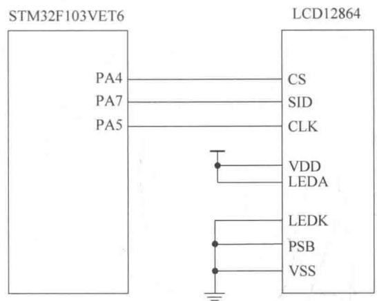

**这张图怎么读（先看哪里 → 有什么 → 箭头代表什么）：**

1. **先看左边那个大框**：写着 STM32F103VET6，里面列着用到的引脚 **PA4、PA5、PA7**，还有 VCC 和 GND。
2. **再看右边那个大框**：写着 LCD12864，里面列着 **CS、SID、CLK、PSB、VSS、VDD、LEDA、LEDK**。
3. **看中间的连线**（这是关键）：
   - `PA4 ──── CS`（STM32 用普通 GPIO 控制 LCD 的片选）
   - `PA5 ──── CLK`（STM32 的 SPI 时钟 → LCD 的时钟）
   - `PA7 ──── SID`（STM32 的 SPI 数据输出 → LCD 的数据输入）
   - `PSB ──── GND`（**选择串行模式**）
   - `VDD ──── VCC`、`VSS ──── GND`（供电）
   - `LEDA ──── VCC`、`LEDK ──── GND`（背光供电）
4. **注意只有一根数据线（PA7→SID）**，没有 MISO 回来的线。**因为 LCD12864 是"只接收"的设备，它不需要回话。** 所以这里虽然用的是 SPI1 外设，但只用了"发"这一半。
5. **这张图想让你理解什么？** 用 SPI 驱动一个外设时，**"时钟 + 数据 + 片选"三根线就够**（如果对方不需要回话）。

> **⚠️ 待核验：** 教材原文说"LCD12864 的 CS、SID 和 CLK 分别接到 SPI1 接口的引脚 **PA4、PA7 和 PA5**"，而代码里 `SendByte` 用的是 `SPI_I2S_SendData(SPI1, ...)`（走 SPI 硬件）。**但 PA4 在这里是当普通 GPIO 用的（`GPIO_Mode_Out_PP`），不是 SPI1_NSS。** 所以"CS 接 PA4"实际上是"用软件 GPIO 手动片选"，而不是 SPI 硬件的 NSS。这一点教材表述容易让人误解。已记入【待核验】。

#### 【补充解释】LCD12864 的串行协议（为什么每字节要发 3 次？）

这是理解例 9-2 代码的关键，教材没有明说，我们补上。

**LCD12864（ST7920 控制器）的串行协议规定：传一个字节要分 3 次发送：**

```
第 1 次：同步字节（告诉 LCD 这是一个"命令"还是"数据"）
第 2 次：这个字节的高 4 位
第 3 次：这个字节的低 4 位
```

**同步字节的含义（看低 4 位的两个标志）：**

```
0xF8 = 1111 1000  →  同步头 + RS=0 + RW=0  →  后面跟的是"命令"
0xFA = 1111 1010  →  同步头 + RS=1 + RW=0  →  后面跟的是"数据"
```

**高 4 位和低 4 位怎么发？**

按这个模块的惯例：**有效的 4 个 bit 放在字节的高 4 位（bit7~bit4）**。

举例：要发命令 `0x30`

```
高 4 位 = 0x3  →  放在高 4 位 → 0x30
低 4 位 = 0x0  →  放在高 4 位 → 0x00

所以发三次：0xF8, 0x30, 0x00
```

举例：要发命令 `0x0C`

```
高 4 位 = 0x0  →  0x00
低 4 位 = 0xC  →  0xC0

所以发三次：0xF8, 0x00, 0xC0
```

**现在再看教材的代码：**

```c
void WriteCommand(u8 Cbyte)    // 写命令子函数
{
    GPIO_SetBits(LCD_CS);
    SendByte(0xf8);              // 同步字节：这是"命令"
    SendByte(0xf0 & Cbyte);      // 高 4 位
    SendByte(0xf0 & Cbyte << 4); // 低 4 位
    GPIO_ResetBits(LCD_CS);
}
```

**⚠️ 第三个 `SendByte` 的写法很有意思，必须讲清楚：**

C 语言里，**移位运算符 `<<` 的优先级高于按位与 `&`**。所以：

```c
0xf0 & Cbyte << 4
```

编译器实际理解成：

```c
0xf0 & (Cbyte << 4)
```

**代入 `Cbyte = 0x0C` 算一遍（不跳步）：**

```
第一步：Cbyte << 4
  0x0C        = 0000 0000 0000 1100
  << 4        = 0000 0000 1100 0000 = 0x0C0

第二步：0xf0 & 0x0C0
  0xf0        = 0000 0000 1111 0000
  0x0C0       = 0000 0000 1100 0000
                ───────────────────── AND
  = 0x0C0     = 0000 0000 1100 0000 = 0xC0
```

**得到 0xC0——正是我们想要的"低 4 位 0xC 放到高 4 位"！**

**再代入 `Cbyte = 0x30`：**

```
第一步：0x30 << 4 = 0x300 = 0011 0000 0000
第二步：0xf0 & 0x300
  0x0f0 = 0000 1111 0000
  0x300 = 0011 0000 0000
          ─────────────── AND
  = 0x000 = 0x00
```

**得到 0x00——也正是我们想要的！**

**所以这行代码虽然写法"偷懒"（依赖了运算符优先级），结果却是正确的。** 它等价于：

```c
(0x0f & Cbyte) << 4      // 更清晰的写法
```

**【补充解释】这一段为什么值得单独讲？**

因为它同时训练了两件事：

1. **C 语言运算符优先级**：`<<` 比 `&` 高，所以 `a & b << c` = `a & (b << c)`；
2. **位掩码 + 移位**：`& 0x0f` 取低 4 位，`<< 4` 搬到高 4 位。

**考试如果出"请写出这行代码的等效写法"，答案就是 `(0x0f & Cbyte) << 4`。**

#### 完整代码（教材原文）

```c
#include "stm32f10x.h"
#define LCD_CS GPIOA, GPIO_Pin_4

void GPIO_init(void);        // 相关 GPIO 初始化子函数
void SPI_init(void);         // SPI 接口初始化函数
void SendByte(u8 Dbyte);     // 发送一个字节子函数
void WriteCommand(u8 Cbyte); // 写命令子函数
void WriteData(u8 Dbyte);    // 写数据子函数
void ClearScreen(void);      // 清屏子函数
void DispStr(u8 row, u8 col, char * puts); // 显示字符串子函数

u8 TABLE[] =    // 坐标地址
{
    0x80, 0x81, 0x82, 0x83, 0x84, 0x85, 0x86, 0x87,
    0x90, 0x91, 0x92, 0x93, 0x94, 0x95, 0x96, 0x97,
    0x88, 0x89, 0x8a, 0x8b, 0x8c, 0x8d, 0x8e, 0x8f,
    0x98, 0x99, 0x9a, 0x9b, 0x9c, 0x9d, 0x9e, 0x9f,
};

int main(void)
{
    u32 delaytime;
    // 使能 PA 口和 SPI1 的时钟
    RCC_APB2PeriphClockCmd(RCC_APB2Periph_GPIOA|RCC_APB2Periph_SPI1, ENABLE);
    GPIO_init();
    SPI_init();
    WriteCommand(0x30);
    WriteCommand(0x0C);
    WriteCommand(0x01);
    WriteCommand(0x06);
    WriteCommand(0x02);
    WriteCommand(0x80);
    ClearScreen();
    for(delaytime = 0; delaytime < 5000; delaytime++); // 适当延时
    DispStr(0, 0, "欢迎使用 STM32!");
    while(1);
}

void GPIO_init(void) // 相关 GPIO 初始化
{
    GPIO_InitTypeDef GPIO_InitStructure;
    // CLK
    GPIO_InitStructure.GPIO_Pin = GPIO_Pin_5;
    GPIO_InitStructure.GPIO_Mode = GPIO_Mode_AF_PP;   // 复用推挽输出
    GPIO_InitStructure.GPIO_Speed = GPIO_Speed_50MHz;
    GPIO_Init(GPIOA, &GPIO_InitStructure);
    // SID
    GPIO_InitStructure.GPIO_Pin = GPIO_Pin_7;
    GPIO_InitStructure.GPIO_Mode = GPIO_Mode_AF_PP;   // 复用推挽输出
    GPIO_InitStructure.GPIO_Speed = GPIO_Speed_50MHz;
    GPIO_Init(GPIOA, &GPIO_InitStructure);
    // CS
    GPIO_InitStructure.GPIO_Pin = GPIO_Pin_4;
    GPIO_InitStructure.GPIO_Mode = GPIO_Mode_Out_PP;  // 推挽输出
    GPIO_InitStructure.GPIO_Speed = GPIO_Speed_50MHz;
    GPIO_Init(GPIOA, &GPIO_InitStructure);
}

void SPI_init(void) // SPI 接口初始化函数
{
    SPI_InitTypeDef SPI_InitStructure;
    // 设置 SPI 单向或者双向的数据模式：SPI 设置为双线双向全双工
    SPI_InitStructure.SPI_Direction = SPI_Direction_2Lines_FullDuplex;
    SPI_InitStructure.SPI_Mode = SPI_Mode_Master;     // 设置 SPI 工作模式：主 SPI
    // 设置 SPI 的数据大小：SPI 发送接收 8 位帧结构
    SPI_InitStructure.SPI_DataSize = SPI_DataSize_8b;
    // 选择了串行时钟的稳态：时钟悬空高
    SPI_InitStructure.SPI_CPOL = SPI_CPOL_High;
    SPI_InitStructure.SPI_CPHA = SPI_CPHA_2Edge;      // 数据捕获于第二个时钟沿
    SPI_InitStructure.SPI_NSS = SPI_NSS_Soft;
    // NSS 信号由硬件（NSS 引脚）还是软件（使用 SSI 位）管理：内部 NSS 信号有 SSI 位控制
    SPI_InitStructure.SPI_BaudRatePrescaler = SPI_BaudRatePrescaler_256;
    // 定义波特率预分频的值：波特率预分频值为 256
    SPI_InitStructure.SPI_FirstBit = SPI_FirstBit_MSB; // 数据传输从 MSB 位开始
    SPI_InitStructure.SPI_CRCPolynomial = 7;           // CRC 值计算的多项式
    SPI_Init(SPI1, &SPI_InitStructure);
    // 根据 SPI_InitStructure 中指定的参数初始化外设 SPIx 寄存器
    SPI_Cmd(SPI1, ENABLE);    // 使能 SPI 外设
}

void SendByte(u8 Dbyte) // 发送一个字节子函数
{
    while (SPI_I2S_GetFlagStatus(SPI1, SPI_I2S_FLAG_TXE) == RESET);
    SPI_I2S_SendData(SPI1, Dbyte);
}

void WriteCommand(u8 Cbyte)    // 写命令子函数
{
    GPIO_SetBits(LCD_CS);
    SendByte(0xf8);
    SendByte(0xf0&Cbyte);
    SendByte(0xf0&Cbyte << 4);
    GPIO_ResetBits(LCD_CS);
}

void WriteData(u8 Dbyte)    // 写数据子函数
{
    GPIO_SetBits(LCD_CS);
    SendByte(0xfa);
    SendByte(0xf0&Dbyte);
    SendByte(0xf0&Dbyte << 4);
    GPIO_ResetBits(LCD_CS);
}

void ClearScreen(void)
{
    WriteCommand(0x0C);
    WriteCommand(0x01);
}

void DispStr(u8 row, u8 col, char * puts)
{
    WriteCommand(0x30);
    WriteCommand(TABLE[8 * row + col]);
    while (*puts != '\0')
    {
        if (col == 8)
        {
            col = 0;
            row++;
        }
        if (row == 4) row = 0;
        WriteCommand(TABLE[8 * row + col]);
        WriteData(*puts);
        puts++;
        WriteData(*puts);
        puts++;
        col++;
    }
}
```

#### 逐块讲解

##### 【第一块】开时钟

```c
RCC_APB2PeriphClockCmd(RCC_APB2Periph_GPIOA|RCC_APB2Periph_SPI1, ENABLE);
```

**这一段想完成什么？** 给 GPIOA 和 SPI1 开时钟。

**为什么是 APB2？** 因为 **GPIOA 和 SPI1 都挂在 APB2 总线上**（前面算过：`SPI1_BASE = APB2PERIPH_BASE + 0x3000`）。

**⚠️ 常见错误：** 很多人会写成 `RCC_APB1PeriphClockCmd`。**SPI1 在 APB2，SPI2/SPI3 才在 APB1。** 写错了 SPI1 就不工作。

##### 【第二块】GPIO 初始化

```c
// CLK（PA5）
GPIO_InitStructure.GPIO_Pin = GPIO_Pin_5;
GPIO_InitStructure.GPIO_Mode = GPIO_Mode_AF_PP;   // 复用推挽输出
GPIO_Init(GPIOA, &GPIO_InitStructure);

// SID（PA7）
GPIO_InitStructure.GPIO_Pin = GPIO_Pin_7;
GPIO_InitStructure.GPIO_Mode = GPIO_Mode_AF_PP;   // 复用推挽输出
GPIO_Init(GPIOA, &GPIO_InitStructure);

// CS（PA4）
GPIO_InitStructure.GPIO_Pin = GPIO_Pin_4;
GPIO_InitStructure.GPIO_Mode = GPIO_Mode_Out_PP;  // 普通推挽输出
GPIO_Init(GPIOA, &GPIO_InitStructure);
```

**为什么 PA5、PA7 用"复用推挽"，而 PA4 用"普通推挽"？**

| 引脚 | 用途 | 谁来控制它 | 所以配成 |
|---|---|---|---|
| PA5 | SPI1_SCK | **SPI1 外设**（硬件自动产生时钟） | `GPIO_Mode_AF_PP`（复用推挽） |
| PA7 | SPI1_MOSI | **SPI1 外设**（硬件自动输出数据） | `GPIO_Mode_AF_PP`（复用推挽） |
| PA4 | 普通片选 | **程序手动控制**（`GPIO_SetBits`/`GPIO_ResetBits`） | `GPIO_Mode_Out_PP`（普通推挽输出） |

**这就是"复用"和"普通"的区别：谁在控制这根引脚。**

##### 【第三块】SPI 初始化

```c
SPI_InitStructure.SPI_Direction = SPI_Direction_2Lines_FullDuplex;  // 双线全双工
SPI_InitStructure.SPI_Mode = SPI_Mode_Master;                       // 主模式
SPI_InitStructure.SPI_DataSize = SPI_DataSize_8b;                   // 8 位帧
SPI_InitStructure.SPI_CPOL = SPI_CPOL_High;                         // 空闲高
SPI_InitStructure.SPI_CPHA = SPI_CPHA_2Edge;                        // 第二个边沿采样
SPI_InitStructure.SPI_NSS = SPI_NSS_Soft;                           // 软件 NSS
SPI_InitStructure.SPI_BaudRatePrescaler = SPI_BaudRatePrescaler_256;// 256 分频
SPI_InitStructure.SPI_FirstBit = SPI_FirstBit_MSB;                  // MSB 先发
SPI_InitStructure.SPI_CRCPolynomial = 7;                            // CRC 多项式
SPI_Init(SPI1, &SPI_InitStructure);
SPI_Cmd(SPI1, ENABLE);
```

**逐项翻译成"寄存器动作 + 硬件效果"：**

| 设置 | 写入 CR1 的哪几位 | 硬件效果 |
|---|---|---|
| `2Lines_FullDuplex` | BIDIMODE=0、RXONLY=0 | 标准 4 线全双工 |
| `Mode_Master` | MSTR=1 | 主模式，SCK 由 STM32 输出 |
| `DataSize_8b` | DFF=0 | 每帧 8 位 |
| `CPOL_High` | CPOL=1 | **空闲时 SCK 为高** |
| `CPHA_2Edge` | CPHA=1 | **第二个边沿采样** |
| `NSS_Soft` | SSM=1、SSI=1 | NSS 不听引脚，内部假装有效 |
| `BaudRatePrescaler_256` | BR[2:0]=111 | **SCK = 72 MHz / 256 = 281.25 kHz** |
| `FirstBit_MSB` | LSBFIRST=0 | 先发最高位 |
| `SPI_Cmd(SPI1, ENABLE)` | SPE=1 | SPI 使能 |

**注意 CPOL=1 + CPHA=1 → 这就是"模式 3"。** LCD12864 的 ST7920 控制器要求的就是模式 3。

**为什么要 256 分频？** 因为 ST7920 的串行时钟不能太快（数据手册一般限制在几百 kHz 以内）。72 MHz / 256 = 281.25 kHz，正好合适。**如果分频太小（比如 2 分频 = 36 MHz），LCD 根本跟不上，会显示乱码或什么都不显示。**

##### 【第四块】发送一个字节

```c
void SendByte(u8 Dbyte)
{
    while (SPI_I2S_GetFlagStatus(SPI1, SPI_I2S_FLAG_TXE) == RESET);
    SPI_I2S_SendData(SPI1, Dbyte);
}
```

**这一段想完成什么？** 等发送缓冲器空了，把一个字节塞进去。

**逐行软硬件联动：**

| 代码 | CPU 做什么 | 寄存器发生什么 | 硬件发生什么 |
|---|---|---|---|
| `SPI_I2S_GetFlagStatus(SPI1, SPI_I2S_FLAG_TXE)` | 读 SPI_SR，看 bit1 | 读操作 | 无 |
| `== RESET` | 如果 TXE=0，说明缓冲器还满着 | —— | —— |
| `while (...)` | **一直循环等**，直到 TXE=1 | 反复读 SR | 等上一轮数据搬进移位寄存器 |
| `SPI_I2S_SendData(SPI1, Dbyte)` | 写 SPI_DR（地址 0x4001300C） | **TXE 位被清零** | 数据进发送缓冲器 → 搬进移位寄存器 → SCK 转 8 圈 → MOSI 输出 8 位 |

**⚠️ 注意：这个函数发完就返回了，没有等"8 个时钟转完"。**

**这会有问题吗？** 在 `WriteCommand` 里，连续调用 3 次 `SendByte`：

- 第 1 次：等 TXE=1（初始就是 1）→ 写 0xF8 → TXE 变 0；
- 第 2 次：等 TXE=1（要等 0xF8 搬进移位寄存器，很快）→ 写 0x30；
- 第 3 次：等 TXE=1 → 写 0x00。

**因为 SPI 移位寄存器"搬入"比"移出 8 位"快得多**，所以第 2、3 次都能及时写入，SCK 可以连续转 24 圈，数据不会丢。

**但如果 CPU 特别慢（比如中间插了别的中断），就可能出现"非连续传输"，SCK 中间停一下。** 对 LCD 来说，SCK 停一下没关系（它只看边沿），所以这个程序能正常工作。

##### 【第五块】写命令和写数据

```c
void WriteCommand(u8 Cbyte)    // 写命令
{
    GPIO_SetBits(LCD_CS);            // ① 片选拉高（LCD 的 CS 高电平有效）
    SendByte(0xf8);                  // ② 同步字节：这是"命令"
    SendByte(0xf0 & Cbyte);          // ③ 高 4 位
    SendByte(0xf0 & Cbyte << 4);     // ④ 低 4 位（等价于 (0x0f & Cbyte) << 4）
    GPIO_ResetBits(LCD_CS);          // ⑤ 片选拉低
}

void WriteData(u8 Dbyte)       // 写数据
{
    GPIO_SetBits(LCD_CS);
    SendByte(0xfa);                  // 同步字节：这是"数据"（注意是 0xFA，不是 0xF8）
    SendByte(0xf0 & Dbyte);
    SendByte(0xf0 & Dbyte << 4);
    GPIO_ResetBits(LCD_CS);
}
```

**⚠️ 注意 LCD 的 CS 是"高电平有效"（`GPIO_SetBits` 选中），和 STM32 的 NSS"低电平有效"相反。** 不同芯片的片选极性可能不一样，**用之前一定要看对方的手册。**

**`WriteCommand` 和 `WriteData` 的唯一区别就是第一个同步字节：0xF8（命令）vs 0xFA（数据）。**

**具体演算：`WriteCommand(0x30)`**

```
GPIO_SetBits(LCD_CS)  →  PA4 = 1  →  LCD 被选中

SendByte(0xF8)        →  MOSI 上依次送出 1 1 1 1 1 0 0 0（MSB 先发）
SendByte(0xf0 & 0x30) = SendByte(0x30)
                      →  MOSI 上依次送出 0 0 1 1 0 0 0 0
SendByte(0xf0 & 0x30 << 4) = SendByte(0xf0 & 0x300) = SendByte(0x00)
                      →  MOSI 上依次送出 0 0 0 0 0 0 0 0

GPIO_ResetBits(LCD_CS) → PA4 = 0  →  LCD 取消选中
```

##### 【第六块】初始化命令序列

```c
WriteCommand(0x30);   // 功能设定：8 位接口、基本指令集
WriteCommand(0x0C);   // 显示控制：开显示、关光标
WriteCommand(0x01);   // 清屏
WriteCommand(0x06);   // 进入设定：光标右移、画面不移动
WriteCommand(0x02);   // 回到原点
WriteCommand(0x80);   // 设置 DDRAM 地址到第一行开头
ClearScreen();
```

**这些命令是 LCD12864 的"开机流程"，每一句在做什么（按 ST7920 的指令表）：**

| 命令 | 含义 |
|---|---|
| 0x30 | 功能设定：8 位数据接口、基本指令集 |
| 0x0C | 显示开关控制：显示开、光标关、反白关 |
| 0x01 | 清除显示，把 DDRAM 全填 0x20（空格），地址归零 |
| 0x06 | 进入点设定：光标右移、画面不移动 |
| 0x02 | 地址归位（回到原点） |
| 0x80 | 设置 DDRAM 地址 = 0x80，即第一行第一个位置 |

##### 【第七块】显示字符串

```c
void DispStr(u8 row, u8 col, char * puts)
{
    WriteCommand(0x30);                  // 先确保是基本指令集
    WriteCommand(TABLE[8 * row + col]);  // 把光标定位到 (row, col)
    while (*puts != '\0')                // 遍历字符串直到遇到结束符
    {
        if (col == 8)                    // 一行只能放 8 个汉字（每字 2 字节 = 16 点宽）
        {
            col = 0;
            row++;                       // 换到下一行
        }
        if (row == 4) row = 0;           // 只有 4 行，回到第 0 行
        WriteCommand(TABLE[8 * row + col]);  // 重新定位光标
        WriteData(*puts);                // 写第一个字节（汉字的高字节）
        puts++;
        WriteData(*puts);                // 写第二个字节（汉字的低字节）
        puts++;
        col++;                           // 列计数 +1（一个汉字占一列）
    }
}
```

**这段代码的关键点：**

1. **`TABLE[]` 是一张"坐标换算表"**。LCD12864 的 DDRAM 地址不是线性的（第一行从 0x80 开始，第二行从 0x90 开始，第三行从 0x88 开始，第四行从 0x98 开始），所以要用查表的方式把 `(行, 列)` 换算成地址。

```
TABLE[0..7]   = 0x80 ~ 0x87   ← 第 0 行，第 0~7 列
TABLE[8..15]  = 0x90 ~ 0x97   ← 第 1 行，第 0~7 列
TABLE[16..23] = 0x88 ~ 0x8F   ← 第 2 行，第 0~7 列
TABLE[24..31] = 0x98 ~ 0x9F   ← 第 3 行，第 0~7 列
```

**注意：第 1 行（0x90）在表里排在第 2 组，第 2 行（0x88）排在第 3 组——因为 LCD 的物理行顺序和地址顺序不一样。** 这就是为什么需要这张表。

2. **`while (*puts != '\0')`** —— 指针遍历字符串。`*puts` 是"取指针指向的那个字符"，`puts++` 是"指针往后移一格"。遇到 `'\0'`（字符串结束符）就停。

3. **每写一个汉字要调用两次 `WriteData`** —— 因为汉字在 GB2312 编码里占 **2 个字节**。

4. **`if (col == 8) { col = 0; row++; }`** —— 一行 128 个点，一个汉字 16 个点宽，所以一行最多放 8 个汉字。

5. **`if (row == 4) row = 0;`** —— 屏幕只有 4 行，写满了就绕回第一行。

**【补充解释】`char * puts` 这个参数名要小心。**

`puts` 是 C 标准库里的一个函数名（输出字符串）。这里把它当成变量名用，**在当前作用域内会屏蔽掉标准库的 `puts` 函数**。虽然这个程序里没用到标准库的 `puts`，所以不会出错，但这是**很不好的编程习惯**。改成 `str` 或 `p` 会好很多。

**【重要提醒】这段代码藏着一个"奇数长度字符串"的坑（讲义补充，教材没有提醒）**

例 9-2 传给 `DispStr` 的字符串是 `"欢迎使用 STM32!"`。数一数它到底有几个字节：

```
欢 迎 使 用            4 个汉字 × 2 字节 = 8 字节
（空格）                                  = 1 字节
S T M 3 2                                = 5 字节
!                                        = 1 字节
─────────────────────────────────────────────────
字符串本体 = 15 字节（奇数！）
再加末尾的结束符 '\0'                     = 16 字节
```

> 说明：按 Keil 里中文程序常用的 **GB2312/GBK** 编码算是 15 字节；即使源文件按 UTF-8 保存，也是 4×3 + 1 + 5 + 1 = **19 字节**。**两种编码下都是奇数**，所以这个坑跟编码无关。

**而 `while` 循环每一轮固定写 2 个字节、指针前进 2 格：**

```
第 1 轮：写 bytes[0]、bytes[1]
第 2 轮：写 bytes[2]、bytes[3]
...
第 8 轮：写 bytes[14]（就是 '!'）、bytes[15]（就是 '\0'）
         ↑ 这一轮把"字符串结束符"也当成数据发给 LCD 了！
         这一轮结束后 puts 指向 bytes[16]，已经越过字符串末尾
第 9 轮：while 判断 *puts 时读的是越界的内存 → 结果不确定（未定义行为）
```

**三个后果：**

1. **LCD 会多收到一个 0x00 字节**——它被当成"半个汉字"写进显存，可能显示出一个乱点或半截字；
2. **指针越界读**——C 语言里这属于未定义行为，程序只是"碰巧"还能跑；
3. **`col` 计数会多算一格**，屏幕上后续内容的定位可能偏。

**为什么会出现这个问题？** 这段代码默认"字符串长度一定是偶数"（作者想的是"汉字都是 2 字节"）。但例子里夹了 `" STM32!"`：4 个汉字是 8 字节（偶数），后面跟着的 **7 个 ASCII 字符**（空格 + S + T + M + 3 + 2 + !）是奇数，8 + 7 = 15，总长度就变成奇数了。

**怎么改？** 至少要在写第二个字节前再检查一次：

```c
while (*puts != '\0')
{
    if (col == 8) { col = 0; row++; }
    if (row == 4) row = 0;
    WriteCommand(TABLE[8 * row + col]);
    WriteData(*puts);
    puts++;
    if (*puts == '\0') break;   // 先看下一个是不是结束符，是就不写、也不越界
    WriteData(*puts);
    puts++;
    col++;
}
```

> **一句话记住：** 凡是"成对处理"的循环（每轮固定处理 2 个字节、2 个半字……），**都要单独考虑"总长度是奇数"的情况**，否则最后一轮一定会把结束符或填充字节也当成有效数据，并且把指针推过界。

#### 例 9-2 的完整数据流图

```
① 程序调用 WriteCommand(0x30)
        │
        ▼
② GPIO_SetBits(PA4) → LCD 的 CS 变高 → LCD 被选中
        │
        ▼
③ SendByte(0xF8)：
     等 TXE=1 → 写 SPI1->DR = 0xF8
        │
        ▼
④ SPI1 硬件：把 0xF8 搬进移位寄存器
     SCK 转 8 圈（模式 3：空闲高，上升沿采样）
     MOSI(PA7) 上依次输出 1 1 1 1 1 0 0 0
        │
        ▼
⑤ LCD 的 SID 收到 8 位，识别出"这是命令同步头"
        │
        ▼
⑥ SendByte(0x30)、SendByte(0x00) 同样发出 → LCD 收到命令的高 4 位和低 4 位
        │
        ▼
⑦ GPIO_ResetBits(PA4) → LCD 的 CS 变低 → 一次命令传输结束
        │
        ▼
⑧ LCD12864 内部执行命令 0x30（功能设定）
        │
        ▼
⑨ 重复上面的流程，把初始化命令一条条发完
        │
        ▼
⑩ DispStr(0, 0, "欢迎使用 STM32!")：
     先把光标定位到第一行第一列（命令 0x80）
     然后把每个汉字拆成 2 个字节，各调用一次 WriteData
        │
        ▼
⑪ LCD12864 的屏幕上显示出"欢迎使用 STM32!"
```

#### 【补充解释】这个例子和"标准 SPI"有什么不同？

**教材的例 9-2 用的其实是"SPI 硬件 + 自定义协议"：**

| 项目 | 标准 SPI | LCD12864 的用法 |
|---|---|---|
| 片选 | SPI 硬件的 NSS（自动拉低） | 用普通 GPIO（PA4）手动控制 |
| 数据方向 | 全双工（MOSI + MISO） | **只有 MOSI**（LCD 不回话） |
| 数据内容 | 直接是你要传的字节 | **每个字节要发 3 次**（同步头 + 高 4 位 + 低 4 位） |
| 时钟模式 | 由从设备手册规定 | 模式 3（CPOL=1, CPHA=1） |

**这说明一件很重要的事：**

> **SPI 只规定了"怎么在线上一位一位地传"，没规定"传的内容是什么意思"。**
> "第一字节是命令还是数据""高 4 位还是低 4 位在前"这些，都是**具体设备自己的协议**，必须查那个设备的数据手册。
>
> **SPI 是"邮递规则"，设备协议是"信封上的格式"。两回事。**

---

---

## 9.4 本章小结

### 一张图记住整章

```
                     串行通信
                        │
        ┌───────────────┴───────────────┐
        │                               │
     异步（USART）                   同步（SPI）
   "各用各的时钟"                  "主机打拍子"
        │                               │
  起始位 + 数据 + 校验 + 停止位     NSS + SCK + MOSI + MISO
        │                               │
   波特率 = f_CK/(16×USARTDIV)      波特率 = f_PCLK/分频系数
        │                               │
   寄存器：SR DR BRR CR1 CR2 CR3 GTPR  寄存器：CR1 CR2 SR DR CRCPR RXCRCR TXCRCR
```

### 两个外设的对比表（考试爱考）

| 对比项 | USART（异步） | SPI |
|---|---|---|
| 同步方式 | 异步（也可同步） | 同步 |
| 时钟线 | 无（异步时） | 有（SCK，主机产生） |
| 数据线 | TX、RX 各一根 | MOSI、MISO 各一根 |
| 片选 | 无（点对点） | NSS（低电平有效） |
| 位序 | **固定低位在前** | 可选 MSB/LSB 在前 |
| 数据位宽 | 8 位或 9 位 | 8 位或 16 位 |
| 每字节开销 | 起始位 + 停止位（效率约 80%） | 无（效率约 100%） |
| 速度 | 一般 | 更快 |
| 典型用途 | 与电脑/模块通信（远一点） | 与板上芯片通信（近、快） |
| 从设备能否主动发 | —— | **不能**，必须主机发起 |
| 通信模式选择 | 波特率 + 数据格式 | CPOL/CPHA 四种模式 |

### 必背的 5 个数字/公式

1. **波特率公式（USART）**：`波特率 = f_CK / (16 × USARTDIV)`
2. **USART_BRR 拆分**：`BRR = (整数部分 << 4) | 小数部分`，小数部分 = 小数 × 16
3. **USART 帧结构**：起始位 + 8/9 位数据 + [校验位] + 停止位
4. **SPI 波特率**：`SCK 频率 = f_PCLK / 分频系数`（分频系数 = 2、4、8、16、32、64、128、256）
5. **SPI 四种模式**：CPOL 管空闲电平，CPHA 管在第几个边沿采样

### 必须记住的地址

| 外设 | 基地址 | 总线 |
|---|---|---|
| USART1 | 0x40013800 | APB2 |
| USART2 | 0x40004400 | APB1 |
| USART3 | 0x40004800 | APB1 |
| UART4 | 0x40004C00 | APB1 |
| UART5 | 0x40005000 | APB1 |
| SPI1 | 0x40013000 | APB2 |
| SPI2 | 0x40003800 | APB1 |
| SPI3 | 0x40003C00 | APB1 |

### 必须记住的寄存器偏移

**USART：** SR=0x00，DR=0x04，BRR=0x08，CR1=0x0C，CR2=0x10，CR3=0x14，GTPR=0x18

**SPI：** CR1=0x00，CR2=0x04，SR=0x08，DR=0x0C，CRCPR=0x10，RXCRCR=0x14，TXCRCR=0x18

---

## 9.5 容易搞混的地方（专门列出来）

### 易混点 1：USART 的"低位在前" vs SPI 的"可选位序"

- **USART**：**强制**低位（LSB）在前，没得选。
- **SPI**：由 `LSBFIRST` 位决定，可以 MSB 在前，也可以 LSB 在前。

**为什么容易错？** 因为大多数人脑子里的"二进制"是从左到右读的（MSB 在前），所以看 USART 波形时很容易读反。

### 易混点 2：TXE 和 TC 的区别

| 标志 | 含义 | 什么时候用 |
|---|---|---|
| **TXE** | 发送缓冲器**空**（数据已搬进移位寄存器，但可能还在往外发） | 连续发送时，判断"能不能写下一个" |
| **TC** | 发送**完成**（整帧，包括停止位，都发完了） | 关串口/进低功耗前，判断"真的发完了吗" |

**一句话：TXE 是"缓冲区空了"，TC 是"这一帧彻底发完了"。**

### 易混点 3：RXNE 和 ORE 的关系

- **RXNE = 1**：收到一个字节，等 CPU 来读。
- **ORE = 1**：CPU 还没把上一个读走，下一个又来了，**数据丢了**。

**ORE 不是"线的问题"，是"软件太慢"的问题。**

### 易混点 4：USART 的 M 位到底管几位？

- **M=0**：数据字段宽 8 位（含校验位）。
- **M=1**：数据字段宽 9 位（含校验位）。

**开了校验（PCE=1）之后，最高位会被校验位顶掉**，所以：

- M=0 + PCE=1 → 真正的数据只有 **7 位**；
- M=1 + PCE=1 → 真正的数据只有 **8 位**。

### 易混点 5：SPI 的"发送"就是"接收"

在 SPI 里，**你写一个字节进 DR，就必然要收一个字节回来**（因为时钟要转 8 圈）。所以：

- 想"只发"？写完不用读 DR（但 OVR 会置位，正常）。
- 想"只收"？也得先写一个"废字节"（比如 0xFF）去推动时钟。

### 易混点 6：CPOL/CPHA 的"第一个边沿/第二个边沿"

- **CPOL=0（空闲低）**：第一个边沿是**上升沿**，第二个边沿是**下降沿**。
- **CPOL=1（空闲高）**：第一个边沿是**下降沿**，第二个边沿是**上升沿**。

**"第一个边沿"是相对于"从空闲电平出发后遇到的第一个跳变"而言的。**

### 易混点 7：NSS 的极性

- **STM32 的 NSS**：**低电平有效**（拉低 = 选中）。
- **但不同外设的片选极性可能相反**（例 9-2 的 LCD12864 的 CS 就是**高电平有效**）。

**用之前一定要查对方的手册。**

### 易混点 8：SPI1 在 APB2，SPI2/SPI3 在 APB1

**开时钟时最容易搞错的一个点：**

```c
RCC_APB2PeriphClockCmd(RCC_APB2Periph_SPI1, ENABLE);   // ✓ 对
RCC_APB1PeriphClockCmd(RCC_APB1Periph_SPI1, ENABLE);   // ✗ 错，SPI1 不在 APB1
```

**记住这条规律：**

- **APB2**：GPIOA~GPIOE、AFIO、USART1、SPI1、ADC1/2、TIM1
- **APB1**：USART2/3、UART4/5、SPI2/3、TIM2~TIM7、I2C、CAN、PWR、BKP

### 易混点 9：`GetFlagStatus` 和 `GetITStatus` 该用哪个

- **查询方式（while 等）**：用 `GetFlagStatus`（只看标志位）。
- **中断服务程序里**：用 `GetITStatus`（同时检查标志位和中断使能位）。

---

## 9.6 习题

### 教材原习题（p119）

**9-1** STM32F103VET6 的 USART 有哪些特点？

**9-2** 使用 STM32F103VET6 与计算机进行通信，编程实现计算机发送 `GetID` 作为命令，STM32F103VET6 收到命令后，返回 STM32 的 CPUID。

**9-3** 将例 9-2 的程序代码，修改为使用中断方式实现。

### 我补充的练习题（帮助真正学懂）

**9-补-1** 用 `0x5A` 作为数据，画出 9600、n、8、1 格式下的完整串行波形（标出每一位的值）。

**9-补-2** 已知 PCLK1 = 36 MHz，要配置 19200 bps，求 USARTDIV、DIV_Mantissa、DIV_Fraction 和 USART_BRR 的值，并验算实际波特率和误差。

**9-补-3** 写出 `USART1->CR1` 要写入什么值，才能做到：使能 USART、8 位数据、偶校验、使能发送和接收、打开接收中断。

**9-补-4** 为什么 SPI 全双工通信时，"读一个字节"必须先"写一个字节"？

**9-补-5** 画出 SPI 模式 1（CPOL=0, CPHA=1）下发送 `0xC3` 的时序波形（标出采样点）。

**9-补-6** 如果 SPI 主设备的 CPOL=1、CPHA=1，从设备配成了 CPOL=0、CPHA=0，通信结果会怎样？为什么？

**9-补-7** 解释 `0xf0 & Dbyte << 4` 这行代码实际做了什么，并写出更清晰的等价写法。

---

## 9.7 本章知识清单（自检用）

### 9.1 数据通信基础

- [x] 并行通信 vs 串行通信（定义、优缺点、适用场合）
- [x] 单工 / 半双工 / 全双工
- [x] 点-点通信 / 主从多终端通信
- [x] 异步通信（起始位、数据位、校验位、停止位、帧）
- [x] 同步通信（面向字符型：单同步/双同步/外同步；面向比特型：SDLC）
- [x] 波特率 / 比特率 / 码元
- [x] 奇偶校验（偶校验、奇校验，含具体演算）
- [x] 串行接口的 4 个组成部分
- [x] 并↔串转换、移位寄存器
- [x] UART / USART 的区别
- [x] 三种错误：奇偶错误、帧错误、溢出错误
- [x] 并行接口的组成和工作过程

### 9.2 STM32 的 USART

- [x] USART1~3 + UART4/5 的分布和总线归属
- [x] USART 主要特性
- [x] USART 支持的模式（表 9-1）
- [x] 引脚重映射（表 9-2/9-3/9-4）
- [x] USART 结构（发送器、接收器、波特率发生器）
- [x] RX / TX / CK / nCTS / nRTS 引脚
- [x] 数据格式（M 位、PCE 位，表 9-6）
- [x] 发送器（字符发送、停止位配置、8 步配置流程）
- [x] TXE / TC 的区别和时序
- [x] 断开符号、空闲符号
- [x] 接收器（16 倍过采样、起始位侦测、三点表决）
- [x] 接收配置步骤、RXNE 清除、溢出错误
- [x] 分数波特率公式（公式 9-1）和演算
- [x] 表 9-5 常见波特率设置
- [x] 多处理器通信（静默模式、两种唤醒方式）
- [x] 校验控制（PCE、PS、最高位被替换）
- [x] USART 中断请求（表 9-7）
- [x] 7 个寄存器：SR / DR / BRR / CR1 / CR2 / CR3 / GTPR（逐位）
- [x] 地址链：PERIPH_BASE → APB1/APB2 → USARTx_BASE → 寄存器地址
- [x] 固件库函数：USART_Init / ITConfig / Cmd / SendData / ReceiveData / GetFlagStatus / ClearFlag / GetITStatus / ClearITPendingBit
- [x] 例 9-1 完整讲解

### 9.3 STM32 的 SPI

- [x] SPI 简介和特点
- [x] 四根引脚（MISO / MOSI / SCK / NSS）
- [x] 单主机单从机互连
- [x] NSS 管理（软件 / 硬件）
- [x] CPOL / CPHA 四种模式（含波形）
- [x] 数据帧格式（DFF、LSBFIRST）
- [x] 从模式配置（5 步）
- [x] 主模式配置（6 步）
- [x] 单工通信（BIDIMODE、RXONLY、BIDIOE）
- [x] 数据收发过程（主/从 × 全双工/只收/双向）
- [x] TXE / RXNE / BSY 三大标志
- [x] 连续和非连续传输
- [x] CRC 计算
- [x] 关闭 SPI 的步骤
- [x] SPI 中断请求（表 9-8）
- [x] 7 个寄存器：CR1 / CR2 / SR / DR / CRCPR / RXCRCR / TXCRCR（逐位）
- [x] 地址链：SPI1/2/3 基地址和寄存器地址
- [x] 固件库函数（17 个）
- [x] 例 9-2 完整讲解（含 LCD12864 协议和运算符优先级）

---

## 待核验

> 以下各项是本次编写过程中发现的**素材可疑点**。按 AGENTS.md 的要求，**不猜测、不擅自修改**，统一列在这里，等待用原始 PDF 或图像工具核验。

### 一、OCR / 文字明显错误（高度可疑，但影响不大）

| 编号 | 页码 | 疑点 | 我的处理 |
|---|---|---|---|
| N1 | p60 | UART 的英文全称写成 "Universal Asynchronous Receiver and Transmitter, **USRT**"，缩写与后文（UART）不一致 | 按 UART 处理，正文已注明 |
| N2 | p84 | 函数名印成 `USART_USART_ClearFlag(...)`，重复了一次 | 按 `USART_ClearFlag` 处理 |
| N3 | p107 | `SPI_CR2` 的 bit5 说明里印成 "ERRIR" | 按 `ERRIE` 处理 |
| N4 | p108 | `SPI_SR` 复位值印成 **0x0001**（RXNE=1）。按 STM32F10x 参考手册应为 **0x0002**（TXE=1） | 正文已标注疑问，按 0x0002 讲解 |
| N5 | p110 | `SPI_FisrtBit_MSB` / `SPI_FisrtBit_LSB` 拼写错误 | 按 `SPI_FirstBit_MSB` / `SPI_FirstBit_LSB` 处理 |
| N6 | p112 | 代码里 `SPI_DatSize` / `SPI_DatSize_16b` 少字母 a | 按 `SPI_DataSize` / `SPI_DataSize_16b` 处理 |
| N7 | p106 | `SPI_CR1` 位表中 bit2（MSTR）的"位 2："标题丢失，正文那句"0：配置为从设备；1：配置为主设备"孤零零地跟在 BR[2:0] 说明后面 | 按 MSTR=bit2 讲解 |
| N8 | p108 | `SPI_SR` 位表表头印成 "R定义E"（应为"定义"） | 按正常位表处理 |
| N9 | p114 | 函数说明排版错位：`SPI_GetCRC` 的示例代码被插到 `SPI_SSOutputCmd` 示例位置；`SPI_GetCRCPolynomial` 的说明和 `SPI_GetCRC` 的说明错位 | 按库函数手册的正常结构重新整理 |
| N10 | p116 | `SPI_I2S_ClearFlag` 说明中插入了 `SPI_I2S_IT_OVR` 这一条（属于中断源，不属于标志位） | 按正常结构整理 |

### 二、内容前后不一致（需要核对原 PDF）

| 编号 | 页码 | 疑点 |
|---|---|---|
| N11 | p63 / p66 | USART 特性列表说"支持 **1 或 2 个**停止位"，但 p66 正文说"支持 **0.5、1、1.5 和 2 个**停止位"，p78 的 CR2.STOP[1:0] 编码表又是 `00=1、01=0.5、10=2、11=1.5`。**三处说法不完全一致。** 正文已按 CR2 的编码表讲解。 |
| N12 | p64 | 表 9-4 中 `USART3_REMAP[1:0]` 只列出 `00/01/11`，**没有列 `10`**（按参考手册 `10` 是保留值）。 |
| N13 | p64 | 表 9-4 中"部分重映射"列的 USART3_CTS/RTS 用了合并单元格，跨列显示为 PB13/PB14。需要确认合并单元格的原意。 |
| N14 | p110 | 正文说"STM32F103VET6 集成了 **3 个** SPI 接口"，但同一节又说"**2 个** SPI 外设在文件 stm32f10x.h 中声明"（只列了 SPI1、SPI2）。**两个说法矛盾**，很可能是教材引用了中容量器件的头文件。 |
| N15 | p86 | 例 9-1 说"USB 转串口的电路，如**图 3-11** 所示"，但 figures.md 中"图 3-11"是"独立按键电路"，"图 3-10"才是"USB 转 TTL 串口电路"。**教材图号引用可能有误。** |
| N16 | p86 | 例 9-1 同时使能了 **TXEIE**（`USART_ITConfig(USART1, USART_IT_TXE, ENABLE)`），但中断服务程序 `USART1_IRQHandler` 里**没有处理 TXE**（只处理 RXNE 和 TC）。因为空闲时 TXE 恒为 1，这会导致**反复进入中断**。疑为教材示例的简化或笔误。 |
| N17 | p88 | 例 9-2 说"LCD12864 的 CS、SID 和 CLK 分别接到 SPI1 接口的引脚 PA4、PA7 和 PA5"，但代码里 PA4 被配成**普通推挽输出**（`GPIO_Mode_Out_PP`），即**软件片选**，并非 SPI1 硬件的 NSS。教材表述容易引起误解。 |
| N25 | p93 / p98 | **RXONLY 到底在哪个寄存器？** 教材正文两处（9.3.6"配置 SPI 为单工通信"、9.3.7"只接收过程"）都写"设置 **SPI_CR2** 寄存器的 RXONLY 位"，但同一章 9.3.12 的 **SPI_CR1 位表**把 RXONLY 画在 **bit10**。同一个位不可能既属于 CR1 又属于 CR2。讲义在寄存器讲解（9.3.12）处按 **SPI_CR1 bit10** 处理，并在 9.3.6 / 9.3.7 引用原文处加了提示。 |
| N26 | p91 | **教材 CPHA 说明的括号注写反了。** 教材原文（ch09_source.md:1551）："如果 CPHA 位被清 0，SCK 时钟的第一边沿（CPOL 位为 0 时就是**下降沿**，CPOL 位为 1 时就是**上升沿**）进行数据位采样"。按定义，CPOL=0（空闲低）时从空闲出发遇到的第一个边沿是**上升沿**，CPOL=1 时才是下降沿，教材把两者写反了。讲义 9.3.4 保留教材原文并加了更正说明，正文其余部分按正确说法讲解。 |

### 三、图表解析问题（需要用图像工具核验原 PDF）

| 编号 | 页码 | 疑点 | 建议 |
|---|---|---|---|
| N18 | p96 | **图 9-22（主模式全双工时 TXE/RXNE/BSY 变化示意图）的 MinerU 解析完全失败**——被识别成了一个有 100 多列、内容全是 `0xF1`、`0xF2`…… 的垃圾表格（见 ch09_source.md 第 1794 行）。**这张图的内容无法从 Markdown 可靠读出。** | 用 gemini-3.8-flash-tiered 查看原 PDF p96，核对 TXE/RXNE/BSY 的时序关系 |
| N19 | p59 | 图 9-6（主从多终端）和图 9-7（CPU 与串行接口连接）的题注在 MinerU 输出中被合并到同一个条目，**两张图只提供了一个图片文件 `b2756e08…jpg`**，图片与题注的对应关系无法确定。讲义已改为**只在 9.1.2 节的图 9-6 处引用该文件一次**，9.1.6 节不再重复贴同一张图（改用文字 + 结构示意说明）。 | 核对原 PDF p59 的三张图，并单独提取图 9-7 的图片补入 9.1.6 节 |
| N20 | p57 | 图 9-3（面向字符型同步通信数据格式）在 MinerU 输出中只提取到 (c) 外同步字符帧结构一张，**单同步和双同步两张图没有出现在解析结果中** | 核对原 PDF p57 |
| N21 | p70 | 图 9-14（起始位侦测时序图）的文字说明 OCR 质量差，同一句话重复三次且措辞互相矛盾（"在第 3、5、7 位的第一次采样，和在第 8、9、10 的第二次采样"vs"两次 3 个采样点"vs"一次 3 个采样点"） | 用 gemini-3.8-flash-tiered 查看原 PDF p70，核对 16 倍采样点的编号和表决规则 |
| N22 | p67 | 图 9-11 的两张子图 (a)(b) 的题注在 MinerU 输出中被打乱（"(a) 9位字长(M=1)，1个停止位"和"(b) 8位字长(M=0)，1个停止位"分别挂在两张图上，另有一张"无题注"图） | 核对原 PDF p67 |
| N23 | p91 | 图 9-21（数据时钟时序图，CPHA 和 CPOL 位组合）只提取到 (a)(b) 两张，**四种模式的完整波形可能没有完整提取** | 核对原 PDF p91 |
| N24 | p99~p103 | 图 9-24 / 9-25 / 9-26 / 9-27 的题注在 MinerU 输出中与图片文件的对应关系混乱（"从模式的例子 CPOL=1，CPHA=1" 这个题注出现了两次，分别对应 p97 和 p100 的不同文件） | 核对原 PDF p99~p103 |

### 四、我做的补充解释（教材未明说，供参考）

以下内容是我为了让初学者看懂而补充的，**不是教材原文**，已尽量标注为【补充解释】：

| 编号 | 位置 | 补充内容 |
|---|---|---|
| S1 | 9.1.4 | 波特率与比特率的区别（一个码元携带多位时的关系） |
| S2 | 9.1.6 | 移位寄存器的具体工作过程（"每拍挪一格"的逐步演示） |
| S3 | 9.2.2 | 重映射的固件库用法和"必须先开 AFIO 时钟" |
| S4 | 9.2.6 | 16 倍过采样和"三点表决"的具体机制 |
| S5 | 9.2.12 | `RESERVED` 成员存在的原因（16 位寄存器占 4 字节地址） |
| S6 | 9.2.13 | TX 用复用推挽、RX 用浮空输入的原因 |
| S7 | 9.2.13 | `~recdata` 的整型提升和截断问题 |
| S8 | 9.3.2 | SPI 全双工"环形移位寄存器"原理 |
| S9 | 9.3.4 | "为什么数据变化边沿和采样边沿必须分开"（稳定时间） |
| S10 | 9.3.7 | "只发送模式下 OVR 为什么会置位" |
| S11 | 9.3.14 | LCD12864（ST7920）的 3 字节串行协议 |
| S12 | 9.3.14 | `0xf0 & Dbyte << 4` 的运算符优先级完整演算 |
| S13 | 9.2.13 / 9.3.14 | RCC 使能位号（APB2ENR bit14=USART1EN、bit12=SPI1EN 等）取自 STM32F10x 参考手册，**教材本章未列出**，请与第 3 章/参考手册核对 |

---

## 附：本章引用到的教材原图清单

| 图号 | 题注 | 页码 |
|---|---|---|
| 图 9-1 | 并行通信和串行通信的连接示意图 | p55 |
| 图 9-2(a) | 数据字为 7 位 ASCII 码时的通信格式 | p56 |
| 图 9-2(b) | 有空闲位时的通信格式 | p56 |
| 图 9-3(c) | 外同步字符帧结构 | p57 |
| 图 9-4 | 面向比特型同步通信数据格式 | p58 |
| 图 9-5 | 点-点串行通信方式 | p58 |
| 图 9-6 | 主从多终端通信方式 | p59 |
| 图 9-7 | CPU 与串行接口的连接 | p59 |
| （注） | **图 9-6 与图 9-7 在 MinerU 输出中共用同一个图片文件（`b2756e08…jpg`）**，对应关系待核验；正文只在 9.1.2 节引用该文件一次，9.1.6 节的图 9-7 暂未贴图。详见【待核验】N19。 | p59 |
| 图 9-8 | 硬件 UART 的结构 | p60 |
| 图 9-9 | 典型并行接口电路图 | p62 |
| 图 9-10 | USART 的结构 | p65 |
| 图 9-11(a)(b) | USART 的数据格式 | p67 |
| 图 9-12 | 8 位字长时不同位数停止位的波形 | p68 |
| 图 9-13 | 发送时 TC/TXE 的变化情况 | p69 |
| 图 9-14 | 起始位侦测时序图 | p70 |
| 图 9-15 | 利用空闲总线检测来唤醒和进入静默模式的示例 | p73 |
| 图 9-16 | 利用地址标记检测来唤醒和进入静默模式的示例 | p73 |
| 图 9-17 | USART 中断映像图 | p74 |
| 图 9-18 | SPI 接口结构框图 | p89 |
| 图 9-19 | 单主机和单从机互连的示例 | p89 |
| 图 9-20 | 硬件/软件的从选择管理 | p90 |
| 图 9-21(a)(b) | 数据时钟时序图（CPHA 和 CPOL 位组合） | p91 |
| 图 9-22 | 主模式、全双工连续传输时 TXE/RXNE/BSY 变化示意图 | p96 |
| 图 9-23 | 从模式、全双工连续传输时 TXE/RXNE/BSY 变化示意图 | p97 |
| 图 9-24 | 主设备只发送模式下连续传输时 TXE/BSY 变化示意图 | p99 |
| 图 9-25 | 从设备只发送模式下连续传输时 TXE/BSY 变化示意图 | p100 |
| 图 9-26 | 只接收模式下连续传输时 RXNE 变化示意图 | p101 |
| 图 9-27 | 非连续传输发送时 TXE/BSY 变化示意图 | p103 |
| 图 9-28 | STM32F103VET6 的 SPI1 接口与 LCD12864 的电路连接示意图 | p117 |
| 图 3-10 | USB 转 TTL 串口电路（第 3 章，例 9-1 引用） | p90 |

---

## 附：本章需要生成的辅助理解图清单

（详细绘图说明见 `notes/images/jobs/ch09.json`，共 **17 张**；实际 PNG 由 `tools/run_jobs.py` 调用 gemini-3.8-flash-tiered 生成后写入 `notes/images/generated/`。若某张图尚未生成，正文中的图片链接会暂时失效。）

| 文件名 | 正文图号 | 标题 |
|---|---|---|
| `ch09_parallel_vs_serial.png` | 图 9-1A | 并行通信与串行通信对比 |
| `ch09_simplex_duplex.png` | 图 9-5A | 单工 / 半双工 / 全双工对比 |
| `ch09_async_frame.png` | 图 9-2A | 异步串行数据帧时序波形 |
| `ch09_baud_calc.png` | 图 9-4A | 波特率与位时间的关系 |
| `ch09_uart_block.png` | 图 9-8A | 串行接口/UART 内部结构与并串转换 |
| `ch09_usart_block.png` | 图 9-10A | STM32 USART 内部结构与数据流 |
| `ch09_usart_frame.png` | 图 9-11A | USART 8 位数据帧波形与各字段 |
| `ch09_usart_txe_tc.png` | 图 9-13A | 发送一个字节时 TXE/TC 的时序 |
| `ch09_usart_rx_oversample.png` | 图 9-14A | 起始位侦测：16 倍过采样与三点表决 |
| `ch09_usart_int_map.png` | 图 9-17A | USART 中断映像 |
| `ch09_usart_example_flow.png` | 图 9-10C | 例 9-1 硬件连接与数据流 |
| `ch09_spi_bus.png` | 图 9-18A | SPI 四线主从连接 |
| `ch09_spi_simplex_modes.png` | 图 9-18B | SPI 的全双工 / 只发送 / 只接收 / 单线双向四种配置 |
| `ch09_spi_shift.png` | 图 9-19A | SPI 全双工交换：环形移位寄存器 |
| `ch09_spi_modes.png` | 图 9-21A | SPI 四种模式（CPOL/CPHA）时序波形 |
| `ch09_spi_fullduplex_timeline.png` | 图 9-22A | SPI 全双工连续传输 TXE/RXNE/BSY 时间轴 |
| `ch09_addr_chain.png` | 图 9-10B | USART/SPI 寄存器地址链（基地址+偏移） |

