# 第 10 章 模拟量模块（ADC 与 DAC）

> 本章对应原教材《基于ARM的微机原理与接口技术——STM32嵌入式系统架构、编程与应用》（陈桂友）
> 第 10 章"模拟量模块"，原书分卷为 `微机原理2`（素材页码 p121～p168）。

---

## 本章在整张知识地图上的位置

翻回《00_全书知识地图.md》，我们说过整门课分六层：

```
第六层  怎么搬得更快、接得更多      → DMA（第11章）、FSMC（第12章）
────────────────────────────────────────────────────────
第五层  模拟世界怎么进出数字系统    → ADC / DAC（第10章）  ← 你现在在这里
────────────────────────────────────────────────────────
第四层  CPU 怎么跟外界交互          → GPIO、中断、定时器、串口
第三层  STM32 把 CPU 和各种硬件组合起来
第二层  Cortex-M3 这个 CPU 怎么工作
第一层  计算机最基础的工作方式
```

前面第 6～9 章我们打交道的东西，全都是**数字量**：

- GPIO 读到的引脚，只有"高电平"和"低电平"两种状态；
- 串口一个 bit 一个 bit 传的，也只有 0 和 1；
- 定时器数的数，还是 0、1、2、3……

可现实世界不是这样工作的。

- 温度是**连续**变化的：25.1℃、25.13℃、25.137℃……
- 光照是**连续**变化的：亮一点、再亮一点……
- 声音、压力、电池电压，全是**连续**变化的。

这个"连续变化"的世界，我们叫**模拟世界**；而 CPU 只认识"0 和 1"的世界，我们叫**数字世界**。

**这一章讲的就是：怎么在这两个世界之间搭一座桥。**

- 从模拟世界到数字世界：用 **ADC**（把电压变成数字）；
- 从数字世界到模拟世界：用 **DAC**（把数字变成电压）。

一句话概括：

> **ADC 是数字系统的"耳朵"（听外面的电压），DAC 是数字系统的"嘴"（向外吐出电压）。**

---

## 先别急着看教材：这一章到底要干什么？

你打开原教材第 10 章，会看到：

- 10.1 模数转换器的工作原理及性能指标
- 10.2 STM32F103VET6 集成的 ADC 模块
- 10.3 数模转换器的工作原理及性能指标
- 10.4 STM32F103VET6 集成的 DAC 模块
- 10.5 习题

看起来名词很多。其实整章只回答三个问题：

| 问题 | 用大白话说 | 对应小节 |
|---|---|---|
| 电压怎么变成数字？ | 拿一把"刻好格子的尺子"去量电压，量到第几格就记几 | 10.1、10.2 |
| 数字怎么变成电压？ | 按数字的大小，把电压"摆"到对应的高度 | 10.3、10.4 |
| STM32 芯片里这两个模块具体怎么用？ | 配哪几个寄存器、写什么代码、数据放哪 | 10.2、10.4 |

所以这一章不要一上来就背寄存器。先建立一个直觉：

```
  现实世界                        STM32 芯片内部                   现实世界
 ┌────────┐   电压      ┌──────────────┐   数字    ┌────────┐   电压   ┌────────┐
 │ 温度   │ ─────────→ │     ADC      │ ───────→ │  CPU   │ ──────→ │  DAC   │ ─────→ 扬声器
 │ 光敏   │  0~3.3V    │ 模拟→数字    │  0~4095  │ 程序   │ 0~4095  │数字→模拟│        /电机
 │ 电池   │            └──────────────┘          └────────┘         └────────┘
 └────────┘                 ▲                                          ▲
                       "耳朵"                                       "嘴"
```

【教材内容】原教材第 10 章开头配了一张图（图 10-1），画的就是这样一个"具有模拟量输入/输出的单片机系统"。

【辅助理解图】在进入细节之前，先看一张"本章全景图"：

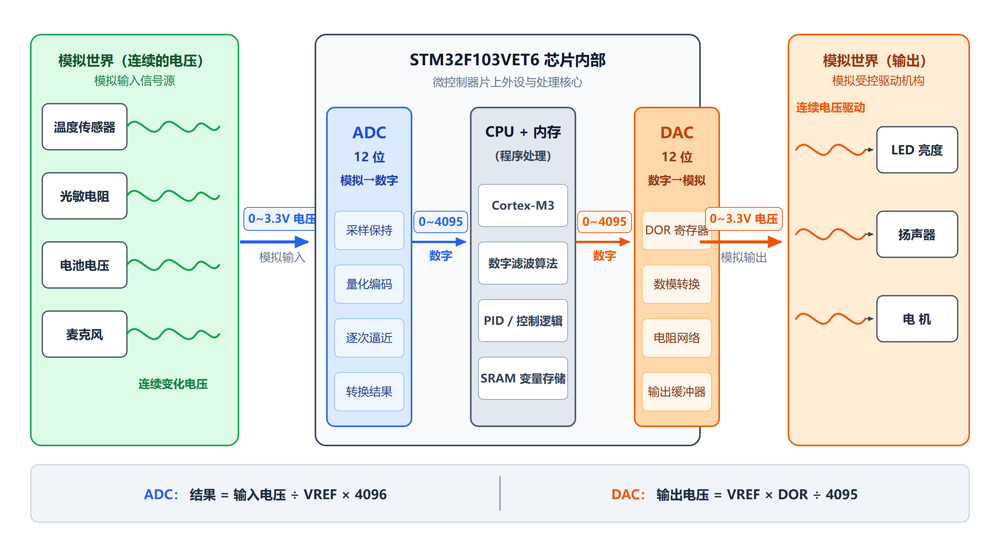

**看图方法**：图分左、中、右三块。

- **左边是模拟世界**：温度、光照、电池电压、声音，全是连续变化的量（画成平滑的曲线）；
- **中间是 STM32 芯片**：ADC 在左、DAC 在右，中间是 CPU 和内存；
- **右边是模拟世界（输出侧）**：LED、扬声器、电机，需要连续的电压来驱动。

箭头说明数据流：模拟量 → **ADC**（数字量）→ CPU 处理 → **DAC**（模拟量）→ 执行器。图下方标注两条关键公式：`ADC：结果 = 输入 ÷ VREF × 4096`、`DAC：输出 = VREF × DOR ÷ 4095`。

**这张图要我理解什么**：整章的内容就是"这两座桥怎么搭、怎么用"。后面所有的小节，都是在给这张图加细节。

---

## 你需要先知道的东西（前置知识补全）

这一章会反复用到下面几个概念。**如果你已经会了，可以快速扫一眼就跳过；如果有任何一个你不确定，请认真读完，不然后面会突然看不懂。**

### 【先补一个前置知识：什么叫"模拟量"和"数字量"？】

**模拟量（Analog）**：连续变化的量。

> 大白话：像水龙头的开关，你可以把它拧到"任何"角度——开一点点、开一半、开 3/4。中间有无限多种状态。

电压、电流、温度、光照强度、声音，都是模拟量。

**数字量（Digital）**：只能取有限几个值的量。

> 大白话：像电灯的开关，要么开、要么关，没有"开一半"。

计算机里的数字量，最终就是一堆 0 和 1。用 12 个 bit 表示，一共只有 2¹² = 4096 种取值（0～4095）。

**两者最本质的区别**：

```
模拟量：  0V ────────────────────────────────────── 3.3V
          中间任何一个值都可能出现（无限精细）

数字量：  0    1    2    3    4  ...... 4094  4095
          只有 4096 个"台阶"，一步一个台阶（有限、离散）
```

所以 ADC 做的事情，本质上是：**把一根平滑的斜线，切成一段一段的台阶**。切得越细（位数越多），就越接近原来的斜线。

### 【先补一个前置知识：什么叫"参考电压 VREF"？】

ADC 要量电压，必须有一把"尺子"。尺子上刻着"最高能量到多少伏"，这个"最高刻度"就是**参考电压（VREF+）**。

> 【类比】你拿一把 20cm 的直尺去量桌子，能读出的最大值是 20cm。如果换一把 30cm 的尺子，同样的桌子读出的数字就不一样了。
>
> ADC 也一样：**同一个电压，参考电压不同，转换出来的数字完全不同。**

【补充解释】STM32F103VET6 开发板上通常把 VREF+ 接到 3.3V。所以：

- 输入 0V → 转换结果 ≈ 0
- 输入 3.3V → 转换结果 ≈ 4095
- 输入 1.65V → 转换结果 ≈ 2047（约一半）

**记住这个公式（后面反复用）：**

```
转换结果 = 输入电压 ÷ 参考电压 × 4096      （结果取整）
反过来：  输入电压 ≈ 转换结果 × 参考电压 ÷ 4096
```

> ⚠️ 注意：这个 4096 是"12 位"带来的。如果是 8 位 ADC，就要除以 256；如果是 10 位，就除以 1024。位数越多，除数越大，分得越细。

### 【先补一个前置知识：什么叫"位（bit）"和"12 位 ADC"？】

第 1 章讲过：**1 个 bit 就是一个只能存 0 或 1 的小格子。**

- 1 个 bit 能表示 2 种情况：0、1
- 2 个 bit 能表示 4 种情况：00、01、10、11
- 3 个 bit 能表示 8 种情况
- …
- n 个 bit 能表示 2ⁿ 种情况

所以：

| 位数 | 能表示的状态数 | 取值范围 | 满量程被切成几份 |
|---|---|---|---|
| 8 位 | 2⁸ = 256 | 0～255 | 256 份 |
| 10 位 | 2¹⁰ = 1024 | 0～1023 | 1024 份 |
| **12 位** | **2¹² = 4096** | **0～4095** | **4096 份** |
| 16 位 | 2¹⁶ = 65536 | 0～65535 | 65536 份 |

"STM32 的 ADC 是 12 位的"，意思就是：**它把参考电压这根尺子，平均切成了 4096 格，量出来的结果是一个 0～4095 之间的整数。**

### 【先补一个前置知识：什么叫"时钟周期"和"时钟频率"？】

**时钟（Clock）**：整块芯片的"心跳"。

> 【类比】想象一个乐队，所有人跟着指挥的手打拍子。指挥手一挥，大家动一下。芯片里的"指挥"就是时钟：每来一个时钟脉冲，电路就往前走一步。

- **时钟频率**：一秒钟打多少拍。单位 Hz（赫兹）。1MHz = 100 万次/秒。
- **时钟周期**：打一拍需要多长时间。周期 = 1 ÷ 频率。

【补充解释】STM32F103 里，ADC 用的时钟叫 **ADCCLK**，它不能超过 **14MHz**（这是芯片规定的上限，超了转换结果不准）。

如果 ADCCLK = 14MHz，那么一个时钟周期 = 1 ÷ 14 000 000 ≈ 71.4 纳秒（ns）。

**ADC 的一次转换要花固定多少个时钟周期**——这件事后面会精确计算，是本章的重点之一。

### 【先补一个前置知识：再复习一遍"寄存器"】

第 1、2、6 章都讲过。这里用一句话快速复习：

> **寄存器就是芯片内部一排带门牌号的小开关。**一个 32 位寄存器 = 32 个小开关，每个开关叫一个 bit。程序往寄存器里写一个数，就是把这一排开关按某个图案拨一遍；硬件看到开关的状态，就改变自己的工作方式。

```
    bit31 ........................ bit1  bit0
   ┌───┬───┬───┬─────────────┬───┬───┬───┐
   │ 0 │ 0 │ 0 │     ...     │ 0 │ 1 │ 0 │
   └───┴───┴───┴─────────────┴───┴───┴───┘
                                    ↑
                              这一个开关叫 ADON
```

本章会看到很多寄存器（ADC_SR、ADC_CR1、ADC_CR2……）。**不要被数量吓到**：它们的地址是连续的，用法还是"开门→配参数→使能→用"这套老套路（见《00_全书知识地图.md》的"外设使用四步曲"）。

### 【先补一个前置知识：0x 是什么意思？一个十六进制位等于几个 bit？】

`0x` 是"后面这个数是十六进制"的标记。

- 十六进制用 0～9 和 A～F 共 16 个符号；
- **1 个十六进制位 = 4 个 bit**（因为 2⁴ = 16）；
- 所以 8 位十六进制数 = 32 个 bit，正好是一个 32 位寄存器。

```
0x0000 0000
 ↑↑↑↑ ↑↑↑↑
 这 8 个十六进制位，每位 4 个 bit，一共 32 个 bit
```

【补充解释】本章会大量出现"地址偏移 0x04""复位值 0x0000 0000"这种说法。看到它们不要慌：

- **地址偏移**：这个寄存器离它所属外设的"大门"（基地址）有多远；
- **复位值**：芯片刚上电时，这个寄存器里所有开关都是 0。

### 【先补一个前置知识：什么叫"采样"和"采样保持"？】

**采样（Sampling）**：把某一瞬间的电压"取一个样"，记下来。

> 【类比】拍照。现实是连续流动的，相机"咔嚓"一下，把某一瞬间定格成一张照片。ADC 的采样就是"给电压拍快照"。

**采样保持（Sample and Hold，S/H，也叫跟踪/保持 Track/Hold）**：拍完照之后，把这个电压"按住不动"，让后面的电路慢慢去量。

为什么要"按住"？因为 ADC 转换需要时间（STM32 要十几个时钟周期）。如果这期间输入电压还在变，量出来的到底算哪一刻的值就说不清了。

```
输入电压（一直变化）      ┌───────┐
    ╱╲    ╱╲            │ 按住  │
   ╱  ╲  ╱  ╲    →      │ 不动  │   →  后面的电路从容地量它
  ╱    ╲╱    ╲          └───────┘
```

【补充解释】STM32 的 ADC 内部**已经集成了采样保持电路**，所以外部不需要再接采样保持芯片。这一点原教材在讲性能指标时提到："原则上采集直流和变化非常缓慢的模拟信号时可不用采样保持器"——STM32 属于内部自带的情况。

### 【先补一个前置知识：运算放大器、反相放大器和积分器】

本章有三处会出现"运算放大器""积分器"，以及一个"来路不明的负号"：图 10-3 的双积分式 ADC、图 10-23 的权电阻 DAC、式(10-3)～(10-5)。零基础的同学先把下面三件事看懂，后面就不会卡住。

#### 1）运算放大器（Operational Amplifier，缩写 op-amp，中文也叫"运放"）

> 大白话：一个"放大能力极强的放大器"，画成一个三角形，有**两个输入端**和**一个输出端**。

```
            ┌───────┐
   − 输入 ──┤       │
            │   A   ├──→ 输出
   + 输入 ──┤       │
            └───────┘
```

- 标 `+` 的是"**同相输入端**"，标 `−` 的是"**反相输入端**"；
- 它放大的不是两个输入各自的电压，而是**两者之差**：输出 ≈ A ×（V+ − V−），其中 A 极大（几十万倍）；
- 因为 A 极大，只要在输出和输入之间接上**反馈**元件，输出就会自动"调"到两个输入几乎相等。分析运放电路时记住两条近似就够用了：
  - **虚短**：两个输入端的电压几乎相等；
  - **虚断**：两个输入端几乎不吸电流（所以流进某个电阻的电流只能从反馈支路流出去）。

#### 2）反相放大器（Inverting Amplifier）——那个负号就是从这里来的

```
       R_in           R_f
   ──[=====]──┬───[=====]──┐
              │            │
              │        ┌───┴───┐
              ├────────┤ −     │
              │        │   A   ├──→ V_out
    0V ───────┴────────┤ +     │
                       └───────┘

    V_out = −(R_f / R_in) × V_in
```

输入电压经过一个电阻 `R_in` 接到 `−` 端，`+` 端接地，输出经过反馈电阻 `R_f` 接回 `−` 端。为什么带负号？用上面两条近似推一下：

```
① 虚短：− 端电压 ≈ + 端电压 = 0V（这叫"虚地"）
② 流过 R_in 的电流：I = (V_in − 0) / R_in = V_in / R_in
③ 虚断：− 端不吸电流，所以这股 I 只能从 R_f 流走
④ 输出：V_out = 0 − I × R_f = −(R_f / R_in) × V_in
```

**结论：这种接法的输出和输入符号相反——这就是 10.3.1 权电阻 DAC 公式里那个负号的来源。**

#### 3）积分器（Integrator）与电容充放电

把反相放大器里的反馈电阻 `R_f` 换成**电容 C**，就得到积分器：

```
       R_in          C
   ──[=====]──┬───( || )──┐
              │            │
              │        ┌───┴───┐
              ├────────┤ −     │
              │        │   A   ├──→ V_out
    0V ───────┴────────┤ +     │
                       └───────┘
```

电容的特点是"**充进去的电荷会攒起来**"：

- 有恒定电流 I 流过电容时，电容上的电压按 `dV/dt = I / C` **线性上升**（电流越大、电容越小，升得越快）；
- 没有电流时，电容上的电压**保持不动**。

所以积分器的输出正比于"输入电压随时间的累积"：输入恒定时，输出是一条**斜线**；输入反号时，输出就往**反方向**斜。

**双积分式 ADC 就是利用这两点**：先用输入电压 VX 给电容充电**固定一段时间**，再用已知的基准电压反向放电并**计时**——两段时间的比值就等于两个电压的比值。

> 【类比】用水桶接水：水龙头开得大（电流大），水位上升快；把水龙头关掉，水位就停在原处。电容就是那个水桶，"充电/放电计时"就是看水位升到某个刻度用了多久。

**类比的边界**：真实运放电路的"虚短/虚断"是很好的近似而不是严格成立（运放增益有限、有输入偏置电流），对本课程的理解来说够用了；真正设计模拟电路时还要考虑更多非理想因素。

【辅助理解图】把这三件事画在一起：

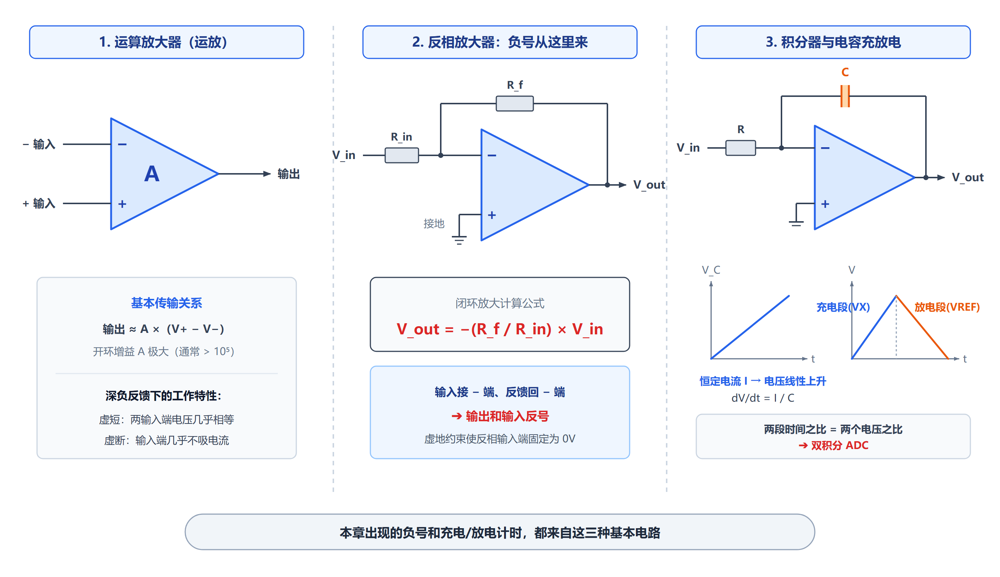

**看图方法**：左边是运放符号（两个输入、一个输出，标出虚短/虚断）；中间是反相放大器（R_in 进、R_f 回，标出 V_out = −(R_f/R_in)·V_in 和"负号从哪来"）；右边是积分器（反馈换成电容 C），下方画一条"恒定电流 → 电容电压线性上升"的斜坡，并用两段不同斜率的线段标出双积分 ADC 的"充电段"和"放电段"。**这张图要你理解：负号不是魔法，是反相接法带来的；积分器的"线性斜坡"就是双积分 ADC 的计时基础。**

---

## 10.1 模数转换器的工作原理及性能指标

### 10.1.1 模数转换器（ADC）的工作原理

#### 先记住三个名字

**ADC**
= **A**nalog-to-**D**igital **C**onverter
= 模数转换器（也叫 A/D 转换器）
= 把"连续的电压"翻译成"0/1 组成的数字"的电路。

**DAC**
= **D**igital-to-**A**nalog **C**onverter
= 数模转换器（也叫 D/A 转换器）
= 把"数字"翻译成"对应的电压"的电路。

**SAR**
= **S**uccessive **A**pproximation **R**egister
= 逐次逼近寄存器
= 一种 ADC 内部用来"猜数字"的寄存器（下面马上详细讲）。

---

【教材内容】原教材说：根据转换的工作原理不同，模数转换器可以分为**计数比较式**、**逐次逼近式**和**双斜率积分式**三种。

这三者的区别，可以用一个生活场景全部讲清楚。

#### 【类比】三个人猜一个数

假设我心里想了一个 0～100 之间的整数，你们来猜，每猜一次我只会告诉你"大了"或"小了"。看三个人怎么猜：

**第一个人（计数比较式）**：从 0 开始，1、2、3、4……一个一个往上试。

- 优点：脑子最简单（电路最简单），便宜。
- 缺点：如果答案是 97，他要猜 98 次。**慢。**

**第二个人（逐次逼近式）**：先猜 50。

- 我说"小了" → 答案在 51～100，再猜 75；
- 我说"大了" → 答案在 51～74，再猜 62；
- ……
- 每次把范围砍一半，7 次左右就猜到了。

- 优点：**又快又准**，速度与精度的平衡最好。
- 缺点：电路比第一种复杂一点。

**第三个人（双斜率积分式）**：他不直接猜数字，而是用两个"计时"来算。

- 优点：**抗干扰能力特别强**，精度可以做得非常高。
- 缺点：**很慢**（因为它要靠"充电、放电计时"，这本身就要花时间）。

【补充解释】这就是为什么：

- 要便宜、要求不高 → 计数比较式；
- 要"速度与精度兼顾"（16 位以下绝大多数场合）→ **逐次逼近式**；
- 要"极其精确、不怕干扰"（比如电子秤、万用表）→ 双斜率积分式。

> 原教材原话：**"逐次逼近式模数转换技术能很好地兼顾速度和精度，故在 16 位以下的模数转换器中逐次逼近式模数转换器使用得更多。"**
>
> STM32F103VET6 里的 ADC，就是**逐次逼近型**的。所以这一种必须彻底搞懂。

下面这张【辅助理解图】把三种 ADC 的"猜数策略"放在一起对比：

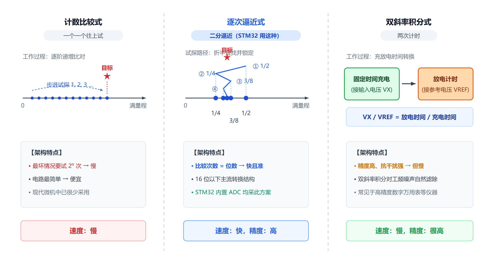

**看图方法**：从左到右看三栏。每栏都画了"从 0 到满量程的一条轴"和"试探的落点"。

- 左栏（计数比较式）：落点从最左边一个挨一个往右挪，挪了很多次才到目标——**次数多、慢**。
- 中栏（逐次逼近式）：落点先是正中间，然后一半、一半地逼近，只用了很少几次——**次数少、快**。
- 右栏（双斜率积分式）：不是"落点逼近"，而是"两次计时"（先固定时间充电，再放电计时），所以它不在同一条轴上比较——**原理不同，很准但慢**。

---

#### 1. 逐次逼近式 ADC 的工作原理（重点）

##### 先看教材原图

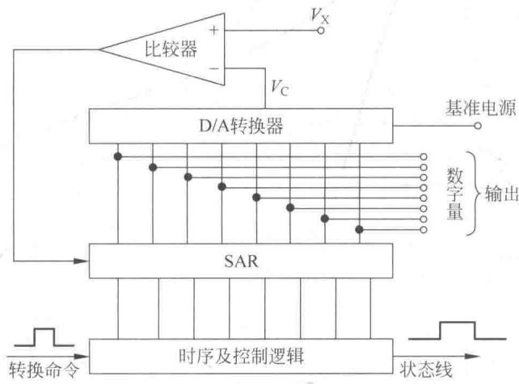

**这张图怎么看**（不要一上来就盯着所有线，按"从上到下"的顺序找元件）：

1. **图最上面是一个三角形，写着"比较器"**：它有两个输入端（一个标 `+`、一个标 `−`）、一个输出端，作用是"比大小"。
2. **`VX` 在图的右上角**（画成一个小圆圈）：这是"要被转换的模拟电压"，也就是我们要量的那个电压，接到比较器的 `+` 端。
3. **`VC` 在图的中间偏上**（在比较器正下方那条线上）：这是"ADC 自己造出来的、用来比较的电压"，接到比较器的 `−` 端。
4. **`VC` 下面那一行长条是"D/A 转换器"**（数字/电压转换器）：它的右边连着"**基准电源**"；再往下是一排电阻网络和右边的"**数字量 输出**"。
5. **再往下那个长条是 `SAR`（逐次逼近寄存器）**：它里面存着"当前猜的数字"。**注意方向：SAR 在 D/A 转换器的下面，SAR 把数字往"上"送给 D/A，D/A 才造出电压 VC**（不要把箭头方向理解反）。
6. **图的最底下一行是"时序及控制逻辑"**：它负责发号施令——"先试最高位""保留还是清除""下一位继续"。它的左边是输入"**转换命令**"，右边是输出"**状态线**"（转换完成时改变状态）。
7. **反馈回路是关键**：SAR →（向上）D/A 转换器 → 造出 VC → 比较器比较 VC 和 VX → 比较结果送回下面的时序及控制逻辑 → 控制逻辑回头去改 SAR 的位。这是一个"猜→比→改→再猜"的循环。

**这张图要我理解什么**：ADC 并不是"一眼看出电压是多少"，而是**自己造一个电压，一次次和输入电压比，一点点把数字猜出来**。

【补充解释】这里有一个非常容易搞混、但必须想通的地方：

> **ADC 里面居然有一个 DAC！**

为什么？因为 ADC 内部没有"直接把电压读成数字"的魔法。它只能用最笨但可靠的办法：

```
我要猜一个数字  →  把这个数字用 DAC 变成电压  →  和输入电压比大小  →  根据结果调整数字
```

> 【类比】你想称出一袋米的重量，但手上没有秤，只有一堆砝码。你可以先放一个 500g 的砝码：如果比米轻，就再加；如果比米重，就换小的。ADC 里的 DAC 就是"造砝码"的装置，SAR 就是"决定放哪些砝码"的人。

**类比的边界**：真实硬件里，SAR 和 DAC 都是电路，速度极快（微秒级），而且 DAC 造电压用的是"内部电容组"（后面讲校准时会提到），不是真的搬砝码。类比的"逐次试探、由大到小"这个思路是对的，"砝码"这个形象只是帮助你理解。

##### 教材原文的工作过程（一步一步拆开）

【教材内容】原教材说，ADC 收到"转换命令"并清除 SAR 后，按下面的过程工作：

**第 1 步：先试最高位。**

把 SAR 的最高位置 1，其余位全清 0。

比如是 8 位 ADC，就先让 SAR = `1000 0000`。

**第 2 步：把 SAR 的数字送给 DAC，变成电压 VC。**

**第 3 步：比较 VC 和输入电压 VX。**

- 如果 **VX ≥ VC**：说明"这一位放 1 还嫌小（或者刚好）"，这一位**应该保留 1**；
- 如果 **VX < VC**：说明"这一位放 1 太大了"，这一位**应该清 0**。

**第 4 步：对下一位重复上面的过程**（次高位、再下一位……），一直到最低位（LSB）为止。

**第 5 步：全部位都确定后，状态线改变状态**（表示"转换完成"），此时 **SAR 里的内容就是与输入模拟电压对应的二进制数字代码**。

##### 用一个小例子把整件事演算一遍

为了好算，我们先用一个"4 位 ADC"做例子（4 位只有 16 格，容易心算）。

**设定**：

- 参考电压（满量程）VREF = 4.0V；
- 输入电压 VX = 2.6V；
- 4 位 → 把 4.0V 切成 16 格 → 每格 = 4.0 ÷ 16 = 0.25V；
- DAC 的换算规则：数字 n 对应的电压 = n ÷ 16 × 4.0V。

**过程表**：

| 步骤 | SAR 试探值（二进制） | 十进制 | DAC 造出的 VC | 比较（VX=2.6V） | 判断 | 操作后 SAR |
|---|---|---|---|---|---|---|
| 1 | `1000` | 8 | 8/16×4.0 = **2.00V** | 2.6 ≥ 2.0 | 这一位留 1 | `1000` |
| 2 | `1100` | 12 | 12/16×4.0 = **3.00V** | 2.6 < 3.0 | 太大，清 0 | `1000` |
| 3 | `1010` | 10 | 10/16×4.0 = **2.50V** | 2.6 ≥ 2.50 | 这一位留 1 | `1010` |
| 4 | `1011` | 11 | 11/16×4.0 = **2.75V** | 2.6 < 2.75 | 太大，清 0 | `1010` |

**最终结果：`1010` = 10。**

换算回电压：10 ÷ 16 × 4.0V = **2.5V**。

真实输入是 2.6V，量出来是 2.5V，差 0.1V。这个 0.1V 小于"一格"（0.25V）——**在 4 位 ADC 的精度下，这已经是最接近的答案了**。

> 【类比】这就像用一把只有"0、25cm、50cm……"刻度的尺子量 26cm 的东西，你只能报"25cm"。不是量错了，而是尺子就这么粗。

**4 位只用了 4 次比较。位数越多，比较次数越多（8 位 8 次、12 位 12 次），但次数永远等于"位数"，所以速度依然很快。**

##### 换成真正的 12 位：STM32 内部就是这样猜的

现在把例子换成 STM32 的真实情况：

- 12 位 → 4096 格；
- 参考电压 VREF+ = 3.3V；
- 每格 = 3.3 ÷ 4096 ≈ **0.000806V = 0.806mV**；
- 输入电压 VX = **2.000V**。

**先说明这张表怎么读**：每一行的"试探值"= 在**上一行确定下来的 SAR 值**基础上，把**当前要试的那一位**置 1 得到的值。如果判断是"大了"，这一位要**清回 0**，SAR 就回到上一行的值；如果判断是"小了"，这一位**保留 1**，这个值就成为新的 SAR 值。**位号只能从左往右一位一位往下走，试过的位绝不会回头再动。**

| 步骤 | 试探的二进制（SAR） | 十进制 | 对应电压（n/4096×3.3V） | 与 2.000V 比 | 决定 |
|---|---|---|---|---|---|
| 1 | `1000 0000 0000` | 2048 | 1.6500V | 小了 | 留 1 |
| 2 | `1100 0000 0000` | 3072 | 2.4750V | 大了 | 清 0 |
| 3 | `1010 0000 0000` | 2560 | 2.0625V | 大了 | 清 0 |
| 4 | `1001 0000 0000` | 2304 | 1.8563V | 小了 | 留 1 |
| 5 | `1001 1000 0000` | 2432 | 1.9594V | 小了 | 留 1 |
| 6 | `1001 1100 0000` | 2496 | 2.0110V | 大了 | 清 0 |
| 7 | `1001 1010 0000` | 2464 | 1.9852V | 小了 | 留 1 |
| 8 | `1001 1011 0000` | 2480 | 1.9980V | 小了 | 留 1 |
| 9 | `1001 1011 1000` | 2488 | 2.0045V | 大了 | 清 0（bit3 回到 0，SAR 仍是 2480） |
| 10 | `1001 1011 0100` | 2484 | 2.0013V | 大了 | 清 0（bit2 回到 0，SAR 仍是 2480） |
| 11 | `1001 1011 0010` | 2482 | 1.9997V | 小了 | 留 1 |
| 12 | `1001 1011 0011` | **2483** | **2.0005V** | 大了 | 清 0（最低位，结束） |

**最终结果：`1001 1011 0010`（二进制）= 2482（十进制）。**

**验算**：2482 ÷ 4096 × 3.3V = 1.999658V ≈ **1.9997V**，和真实值 2.000V 只差 **0.342mV ≈ 0.34mV**——**小于半个 LSB（0.403mV）**，属于正常量化误差范围（10.1.2 会讲"最大量化误差 = ±1/2 LSB"）。

**这个过程图**（把上面表格画成一条"逐位逼近"的曲线）：

```
电压
3.3V ┤━━━━━━━━━━━━━━━━━━━━━━━━━━━━━━━━━━  满量程
     │
2.48V┤ ─ ─ ─ ─ ─ ─ ─ ─ ─ ─ ─ ─ ─ ─ ─ ─   第2步试探点(3072) 太大 ↓
2.06V┤ ─ ─ ─ ─ ─ ─ ─ ─ ─ ─ ─ ─ ─ ─ ─ ─   第3步试探点(2560) 太大 ↓
2.00V┤ ━━━━━━━━━━━━━━━━━━━━━━━━━━━━━━━━━  ← 真实输入电压 VX（目标）
1.96V┤ ─ ─ ─ ─ ─ ─ ─ ─ ─ ─ ─ ─ ─ ─ ─ ─   第5步试探点(2432) 太小 ↑
1.65V┤ ─ ─ ─ ─ ─ ─ ─ ─ ─ ─ ─ ─ ─ ─ ─ ─   第1步试探点(2048) 太小 ↑
     │
  0V ┤━━━━━━━━━━━━━━━━━━━━━━━━━━━━━━━━━━
     └──┬────┬────┬────┬────┬────┬────┬──→ 第几步
        1    2    3    4    5    6   ...  12

每次"太大"就往下折返，"太小"就往上折返，像锯齿一样一步步夹住目标电压。
最后两步的落点是 2482（1.9997V，"小了"）和 2483（2.0005V，"大了"）——目标 2.000V 正好被夹在这两点之间。
12 步之后，SAR 里的 1001 1011 0010（2482）就是答案。
```

【辅助理解图】把上面这张"锯齿逼近"画得更直观：

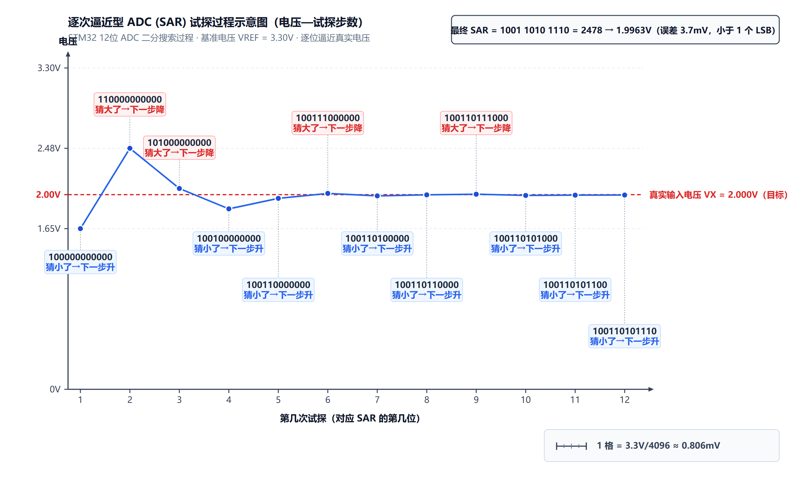

**看图方法**：横轴是"第几次试探"（1～12），纵轴是电压。中间那条水平虚线是真实输入电压 2.000V。每个蓝点是一次试探的电压：点在虚线**下方**说明"猜小了"（下一步往上抬），点在虚线**上方**说明"猜大了"（下一步往下降）。你会发现点很快就贴到虚线上，最后停在 1.9997V——这就是 12 位 ADC 的"最接近答案"（误差 0.34mV，小于半格）。

##### 逐次逼近式的特点（考试要点）

【教材内容】

- 逐次逼近模数转换器是**采样速率低于 5Msps** 的中高分辨率 ADC 应用的常见结构；
- SAR 式 ADC 的分辨率一般为 **8～16 位**；
- 具有**低功耗、小尺寸**等特点。

【补充解释】"5Msps"里的 **sps** = **s**amples **p**er **s**econd，即"每秒采样次数"。5Msps = 每秒 500 万次采样。也就是说，在"每秒不超过 500 万次"这个速度范围内，逐次逼近式是主流选择。

---

#### 2. 双积分式 ADC 的工作原理和特点

【教材内容】原教材说：双积分式转换方法的**抗干扰能力比逐次逼近式强**。这个方法的基础是**测量两个时间**：

1. 一个是**模拟输入电压向电容充电的固定时间**；
2. 另一个是**在已知参考电压下放电所需的时间**。

**模拟输入电压与参考电压的比值，就等于上述两个时间值之比。**

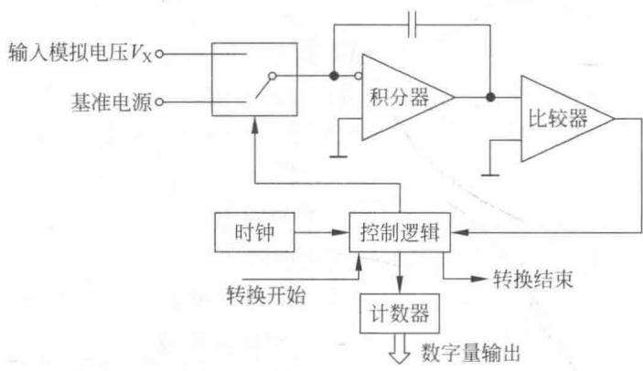

**这张图怎么看**（图分上下两半：上半是模拟电路，下半是控制与计数）：

1. **左上角**是两路输入：**输入模拟电压 VX** 和 **基准电源**，它们接到一个"**模拟开关**"方块（方块里画着开关符号）——这个开关决定"现在让积分器接 VX，还是接基准电源"。
2. **中间那个三角形是积分器**：它的上边跨接了一个**电容**，这就是"充电/放电"发生的地方。（"积分器"和"电容充放电"是什么，见前面【先补一个前置知识：运算放大器、反相放大器和积分器】。）
3. **积分器右边那个三角形是比较器**：它判断积分器的输出有没有越过零点（极性变了没有），输出送给下面的控制逻辑。
4. **下半部分是控制与计时部分**：**控制逻辑**在中间偏下，它左边接**时钟**和"**转换开始**"信号，右上方接比较器的输出，右边输出"**转换结束**"，下方接**计数器**，计数器的输出就是"**数字量输出**"。
5. **注意方位**：时钟在最下面一行的**左边**，控制逻辑在**中间偏下**，计数器在控制逻辑的**正下方**——不要把它们和上面那排模拟电路混在一起。

**这张图要我理解什么**：双积分 ADC 不靠"猜数字"，而是靠"**两次计时**"来算结果。所以它天生就"慢"，但也天生就"稳"。

【补充解释】为什么它抗干扰强？因为它测量的是"**一段时间内的平均值**"，而不是某一瞬间的电压。如果电源线上有 50Hz 的工频干扰，只要把充电时间取成 20ms（正好一个工频周期），干扰的正半周和负半周就互相抵消了。逐次逼近式做不到这一点，因为它是"某一瞬间比大小"。

**教材结论**：

> 双积分式具有**精度高、抗干扰能力强**的特点，在实际工程中得到使用；而逐次逼近式**能很好地兼顾速度和精度**，所以在 16 位以下的 ADC 中**使用得更多**。

#### 3. 计数比较式 ADC（简单提一句）

【教材内容】计数比较式模数转换器**结构简单，价格便宜，转换速度慢，较少采用**。

【补充解释】它就是我们前面"第一个人猜数"的模型：从 0 开始一个数一个数往上加，直到 DAC 造出的电压超过输入电压为止。慢是因为最坏情况下要数 2ⁿ 次。所以现在基本见不到它单独作为 ADC 使用。

---

### 10.1.2 模数转换器的性能指标

【教材内容】原教材列了 13 项指标。**第一次看会觉得又多又杂，其实真正必须掌握的核心只有 4 个**：分辨率、转换时间（转换速率）、量程、通道。其余的了解即可。

先看一张"挑 ADC 时到底在挑什么"的总结表，再逐项展开：

| 指标 | 一句话大白话 | 重要性 |
|---|---|---|
| **分辨率** | 尺子的刻度有多细 | ★★★ 核心 |
| **转换速率 / 转换时间** | 量一次要多快 | ★★★ 核心 |
| **量程** | 能量的电压范围 | ★★★ 核心 |
| **通道** | 能同时（或分时）接几路信号 | ★★★ 核心 |
| 基准电压 | 尺子的"最高刻度"从哪来（内部还是外部） | ★★ |
| 采样/保持器 | 拍照之后有没有"按住不动"的电路 | ★★ |
| 满刻度误差 | 量到最大值时准不准 | ★ |
| 线性度 | 整条尺子的刻度是不是均匀 | ★ |
| 数字接口方式 | 数据是"并排一次给出"还是"一位一位串出去" | ★ |
| 模拟信号类型 | 电压有没有可能为负（单极性/双极性） | ★ |
| 电源电压 | 要几伏供电 | ★ |
| 功耗 | 费不费电（电池设备关心） | ★ |
| 封装 | 芯片长什么样（DIP 直插 / SO 贴片） | ★ |

---

#### 1. 分辨率（Resolution）——最重要的一项

##### 第一层：先说人话

> **分辨率就是"这把尺子最小能读出多少"。**刻度越细，能分辨的变化就越小。

##### 第二层：例子 + 图

【教材内容】原教材举的例子：

> 8 位 A/D 转换器能够分辨出满刻度的 **1/256**。若满刻度输入电压为 **5V**，则 8 位 A/D 转换器能够分辨出输入电压变化的最小值为 **19.53125mV**。

**这个 19.53125mV 是怎么算出来的？不要跳步，我们一步一步算：**

```
第 1 步：8 位 → 2⁸ = 256 格
第 2 步：满刻度 5V 平均分给 256 格
        5V ÷ 256 = 0.01953125V
第 3 步：换成毫伏（1V = 1000mV）
        0.01953125V × 1000 = 19.53125mV
```

也就是说：**输入电压只要变化 19.53125mV 以上，8 位 ADC 的输出数字就会变 1；变化不到这个数，输出数字不变（还是同一个台阶）。**

##### 现在回答题目里那个问题：12 位 ADC 为什么能分辨 3.3V/4096？

这是本章最该记住的一个计算。**一步一步来：**

```
第 1 步：STM32 的 ADC 是 12 位
        12 位 → 2¹² = 4096 格

第 2 步：参考电压（满量程）VREF+ = 3.3V
        把这 3.3V 平均分成 4096 份

第 3 步：每一份 = 3.3V ÷ 4096
                = 0.0008056640625 V
                ≈ 0.000806 V
                = 0.806 mV

第 4 步：换句话说
        输入电压每变化 0.806mV，转换结果的数字就变化 1
```

**所以"12 位 ADC 能分辨 3.3V/4096"的意思是：**

> 它把 0～3.3V 这根尺子切成 4096 格，**最小能分辨出约 0.806mV 的电压变化**。

**这个 0.806mV 有个正式名字：1 个 LSB 对应的电压（1 LSB = Least Significant Bit，最低有效位）。**

- 数字结果加 1（或减 1）→ 电压变化约 0.806mV；
- 这就是这台 ADC 的"最小刻度"。

【辅助理解图】下面这张图把"3.3V 被切成 4096 格"画成一把放大的尺子：

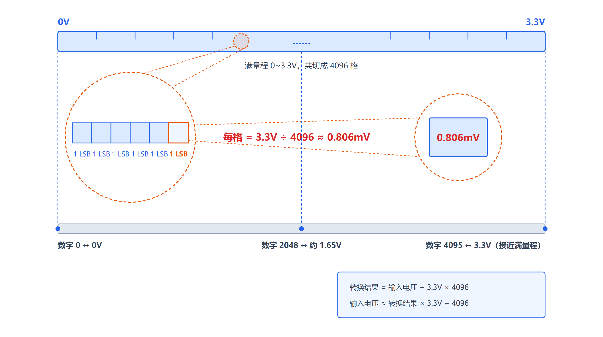

**看图方法**：最上面一条是完整的 0～3.3V 量程。中间把它局部放大，画出一小段刻度，每一小格代表 1 个 LSB（0.806mV）。最下面标出三个典型点：数字 0 对应 0V，数字 2048 对应约 1.65V，数字 4095 对应 3.3V（接近满量程）。**这张图要你记住：位数决定"切多少格"，参考电压决定"每格多高"。**

##### 第三层：正式定义

【教材内容】

> 分辨率是 A/D 转换器能够分辨最小信号的能力，表示**数字量变化一个相邻数码对应的输入模拟电压变化量**。分辨率越高，转换时对输入模拟信号变化的反应就越灵敏。

**分辨率常用 A/D 转换器输出的二进制位数表示。**

按位数划分档次（教材原文）：

| 位数 | 档次 |
|---|---|
| 8 位以下 | 低分辨率 ADC |
| 9～12 位 | 中分辨率 ADC |
| 13 位以上 | 高分辨率 ADC |

教材还指出：**10 位以下的 ADC 器件误差较大，因此目前 ADC 器件的精度基本上都是 10 位或以上。**常见的 A/D 转换器有 **8 位、10 位、12 位、14 位和 16 位**等。

##### 顺便说清"量化误差"（教材提到了但没展开，这里补上）

【补充解释】ADC 把连续的电压切成台阶，就一定会"四舍五入"。这个"因为切台阶而丢掉的精度"叫**量化误差（Quantization Error）**。

```
真实电压 2.0000V
   ↓ 它落在第 2482 格和第 2483 格之间
第 2482 格代表 1.99966V ≈ 1.9997V   ← 最后报出这个（就是 10.1.1 演算的结果）
误差 = 2.0000 − 1.99966 = 0.00034V = 0.34mV
```

**最大量化误差是 ±1/2 LSB**（也就是 ±0.403mV，对 12 位 3.3V 而言）。为什么是半个？因为"四舍五入"最坏情况就是落在两格正中间，误差半格。上面这个 0.34mV 正好在 ±0.403mV 之内，所以是正常的量化误差，**不是**转换出错。

【教材内容】教材还强调：**总的误差是由测量误差和量化误差共同构成的**，A/D 转换器的精度应与测量装置的精度相匹配——一方面要求量化误差在总误差中所占比重小，另一方面要根据测量装置的精度水平对 ADC 位数提出恰当要求。

> 大白话：如果传感器本身就有 ±1% 的误差，你就算用 24 位 ADC 也没意义——**别用金尺子去量一把橡皮做的尺子。**

---

#### 2. 通道（Channel）

【教材内容】

> 有的单芯片内部含有多个 ADC 模块，可同时实现多路信号的转换；常见的多路 ADC 器件只有一个公共的 ADC 模块，由一个**多路转换开关**实现**分时转换**。

【补充解释】"分时转换"是什么意思？

> 【类比】一个老师（ADC）面对 16 个学生（16 路输入）。老师一次只能回答一个问题，所以就轮流来：先回答 1 号，再 2 号……16 号，然后再回到 1 号。这就是"分时"。

```
  通道0 ─┐
  通道1 ─┤
  通道2 ─┼──→ [ 多路开关 ] ──→ [ 一个 ADC 核心 ] ──→ 数字结果
   ...   ┤       ▲
  通道15 ─┘      │
            同一时刻只接通一路
```

【补充解释】STM32F103VET6 是"1 个 ADC 模块 + 16 个外部通道 + 2 个内部通道"，属于"分时转换"。但它有 **ADC1、ADC2、ADC3** 三个独立模块（大容量产品才有 ADC3），所以最多可以三个同时工作。

---

#### 3. 基准电压（Reference Voltage）

【教材内容】基准电压有**内、外基准**和**单、双基准**之分。

【补充解释】

- **内部基准**：芯片自己产生一个标准电压（比如 2.5V），不用外接；
- **外部基准**：由芯片外面的电路提供（比如把 VREF+ 接到 3.3V）；
- **单基准**：只有一个参考点（比如 0～VREF）；
- **双基准**：有 VREF+ 和 VREF− 两个参考点，量程是 VREF− ～ VREF+。

STM32 是**外部基准**（VREF+ 由引脚提供），而且是**双基准**（VREF− 必须等于 VSSA，通常接地）。

---

#### 4. 转换速率 / 转换时间（Conversion Rate / Time）

【教材内容】

> A/D 转换器从**启动转换**到**转换结束、输出稳定的数字量**，需要一定的转换时间，这个时间称为**转换时间**。**转换时间的倒数**就是每秒能完成的转换次数，称为**转换速率**。

```
转换速率 = 1 ÷ 转换时间
```

【教材内容】逐次逼近式单片 A/D 转换器转换时间的典型值为 **1.0～200μs**。

【教材内容】教材还举了一个很实用的例子，我们展开算一遍：

> 如果用转换时间为 **100μs** 的 A/D 转换器，则其**转换速率为 10kHz**。

```
转换速率 = 1 ÷ 100μs
        = 1 ÷ 0.0001s
        = 10000 次/秒
        = 10kHz
```

> 根据采样定理和实际需要，一个周期的波形需对 **10 个点**采样，那么这样的 A/D 转换器最高也只能处理频率为 **1kHz** 的模拟信号。

```
能被处理的最高信号频率 = 转换速率 ÷ 每个周期采样点数
                     = 10kHz ÷ 10
                     = 1kHz
```

【补充解释】什么叫"一个周期采样 10 个点"？想象你要用数码相机拍一个快速转动的风扇，如果只拍 2 张，根本看不出它在转；拍 10 张就能大概还原转动过程。ADC 采样波形也是这个道理：**一个波形周期至少要采若干个点，才能还原出它的形状。**

> ⚠️ **教材这里说的是"实际需要 10 个点"，不是"采样定理"。**严格的采样定理（奈奎斯特）要求采样频率大于信号最高频率的 2 倍；但工程上为了看清楚波形形状，往往要采 10 倍甚至更多。这是两回事，不要混。

【教材内容】教材还提醒：对一般的单片机而言，在如此高的采样频率下，要在采样时间内完成 A/D 转换以外的工作（如读取数据、再启动、保存数据、循环计数等）已经比较困难了。

【补充解释】这句话解释了为什么后面要学 **DMA**（第 11 章）——如果每采一个点都要 CPU 亲自去取、去存，CPU 会被拖垮。ADC + DMA 是天生一对，本章 10.2.4 会讲到。

---

#### 5. 采样/保持器（Sample/Hold）

【教材内容】

> 采样/保持也称为**跟踪/保持（Track/Hold，缩写 T/H）**。原则上采集**直流和变化非常缓慢**的模拟信号时可不用采样保持器；对于其他模拟信号一般都要加采样保持器。如果信号频率不高、A/D 转换器的转换时间短（即使用高速 A/D 转换器时），也可不用采样/保持器。

【补充解释】判断标准其实很简单：

```
转换时间里，输入电压会变化多少？
  → 变化量远小于 1 个 LSB  →  不用采样保持器也没关系
  → 变化量能和 1 个 LSB 相比 →  必须"按住不动"，否则量不准
```

---

#### 6. 量程（Range）

【教材内容】量程即所能转换的电压范围，如 **0～2.5V、0～5V 和 0～10V**。

【补充解释】**输入电压绝对不能超过量程**。超过 VREF+ 会转换出全 1（或损坏芯片），低于 VREF− 会转换出全 0。所以实际电路里常常要先用电阻分压，把大电压"缩小"到 0～3.3V 再送进 ADC。本章例 10-1 的光敏电阻分压电路就是这个思路。

---

#### 7. 满刻度误差（Full Scale Error）

【教材内容】满刻度输出时对应的输入信号与理想输入信号值之差称为**满刻度误差**。

【补充解释】大白话：**"量到最大值时准不准。"**理想情况下输入 3.3V 应该输出 4095，如果实际输出 4090，那就有偏差。

---

#### 8. 线性度（Linearity）

【教材内容】实际转换器的转移函数与理想直线的最大偏移称为**线性度**。

【补充解释】大白话：**"这把尺子的刻度是不是均匀的。"**

> 【类比】一把质量差的塑料尺，开头几厘米间隔正常，中间几厘米间隔偏大——这就是"线性度不好"。

**补充两个现代手册里常见的相关指标**（原教材没有展开，但看 STM32 数据手册一定会遇到，这里先建立印象）：

- **INL（Integral Non-Linearity，积分非线性）**：实际转换曲线偏离理想直线的最大距离，单位是 LSB。它描述"整条线弯不弯"。
- **DNL（Differential Non-Linearity，微分非线性）**：实际"每一格"的宽度和理想 1 LSB 的最大偏差，单位也是 LSB。它描述"格子宽窄是否均匀"。

```
理想：  每一格宽度都 = 1 LSB
实际：  ┌──┐ ┌────┐ ┌─┐ ┌──────┐
        │  │ │    │ │ │ │      │    ← 有的格宽、有的格窄
        └──┘ └────┘ └─┘ └──────┘
                ↑ 这就是 DNL
```

> ⚠️ 严格说，DNL 若小于 −1 LSB，会出现"**丢码**"（某个数字永远输出不出来）。这一点教材没讲，属于【补充解释】，考试按教材口径答"线性度"即可。

---

#### 9. 数字接口方式

【教材内容】

> 根据转换的数据输出接口方式，A/D 转换器可以分为**并行接口**和**串行接口**两种方式。
>
> - **并行方式**一般在转换后可直接输出，具有明显的转换速度优势，但芯片的数据引脚比较多，适用于转换速度要求较高的情况；
> - **串行方式**所用芯片引脚少，封装小，但需要软件处理才能得到所需要的数据。在单片机 I/O 引脚不多的情况下，使用串行器件可以节省 I/O 资源。

【补充解释】数值编码通常是**二进制**，也有 **BCD 码、双极性补码、偏移码**等。

- **BCD 码**：用 4 个 bit 表示一个十进制数字（比如 25 → `0010 0101`）；
- **双极性补码**：能表示正负电压时用的编码；
- **偏移码**：把 0V 对应到量程正中间的一种编码。

【补充解释】STM32 的 ADC 是**芯片内部集成**的，它和 CPU 之间靠内部总线直接交换数据（不是外部的串行/并行引脚），所以你不需要在 STM32 上纠结"选并行还是串行接口"——那是"选一颗独立的 ADC 芯片"时才要考虑的问题。

---

#### 10～13. 其余指标（快速过一遍）

【教材内容】

| 指标 | 教材说法 | 大白话 |
|---|---|---|
| **模拟信号类型** | 通常都是电压信号；根据信号是否过 0，分成**单极性（unipolar）**和**双极性（bipolar）** | 单极性：0～3.3V；双极性：−5V～+5V |
| **电源电压** | 有单电源、双电源和不同电压范围之分；早期有 +15V/−15V，若选单 +5V 芯片则可使用单片机系统电源 | 供电要几伏 |
| **功耗** | 一般 CMOS 工艺的芯片功耗较低；电池供电的手持系统要特别注意功耗 | 费不费电 |
| **封装** | 常见有**双列直插封装（DIP）**和**表贴型（SO）封装** | 芯片长什么样、怎么焊 |

【补充解释】STM32 的 ADC 属于**单极性**（输入范围 VREF− ～ VREF+，VREF− 接 0V），供电要求 **2.4～3.6V**（教材 10.2 节原话）。

---

### 10.1 节真正要记住什么

1. **三种 ADC**：计数比较式（简单、慢、少用）、**逐次逼近式**（快 + 准，16 位以下主流，STM32 用的就是它）、双积分式（准、抗干扰强、慢）。
2. **逐次逼近的核心**：SAR 从最高位开始，每位"先假设 1 → 用 DAC 变成电压 → 和输入比 → 决定留 1 还是清 0"，逐位逼近，位数等于比较次数。
3. **分辨率**：位数决定"把量程切成几格"。**12 位 = 4096 格**；3.3V 参考时，**1 LSB ≈ 0.806mV**。
4. **转换时间与转换速率**：互为倒数；转换速率 = 1 ÷ 转换时间。
5. **量化误差**：因为"切台阶"必然产生，最大 ±1/2 LSB。

---

## 10.2 STM32F103VET6 集成的 ADC 模块

### 先别急着看教材：这一节到底要干什么？

前面 10.1 讲的是"ADC 这个东西一般是怎么工作的"。现在要落到具体芯片上：

> **STM32F103VET6 里面那颗 ADC，我怎么配置它、怎么启动它、怎么把结果读出来？**

【教材内容】原教材开篇一句话概括：

> STM32F103VET6 微控制器集成有 **18 路 12 位高速逐次逼近型模数转换器（ADC）**，可测量 **16 个外部和 2 个内部信号源**。各通道的 A/D 转换可以**单次、连续、扫描或间断模式**执行。ADC 的结果可以**左对齐或右对齐**方式存储在 **16 位数据寄存器**中。
>
> **模拟看门狗**特性允许应用程序检测输入电压是否超出用户定义的高/低阈值。
>
> ADC 的**输入时钟不得超过 14MHz**，由 **PCLK2 经分频**产生。

先把这段话里的每一个词翻译成大白话：

| 原教材说法 | 大白话 |
|---|---|
| 18 路 | 有 18 个"输入口"可以接信号 |
| 12 位 | 每个口量出来的结果是 0～4095 的整数 |
| 高速逐次逼近型 | 用的是 10.1 讲的那种"二分猜数"方式，速度不慢 |
| 16 个外部 + 2 个内部信号源 | 16 路接芯片外面的引脚，2 路接芯片内部的温度传感器和基准电压 |
| 单次 / 连续 / 扫描 / 间断 | 四种"干活节奏"（下面逐个讲） |
| 左对齐 / 右对齐 | 12 位的结果放在 16 位格子里，靠左还是靠右放 |
| 模拟看门狗 | 一个"自动报警器"：电压超出你设定的范围就报警 |
| 输入时钟 ≤ 14MHz | ADC 的"心跳"不能太快，太快量不准 |
| 由 PCLK2 分频产生 | ADC 的时钟是从 APB2 总线时钟"降速"得到的 |

**这一节的任务**：把上面这张表里的每一项都搞懂，并且知道**对应哪个寄存器的哪一位**。

---

### 10.2.1 STM32 的 ADC 概述

【教材内容】原教材列出了 STM32 ADC 的主要特性：

- 12 位分辨率。
- 转换结束、注入转换结束和发生模拟看门狗事件时产生中断。
- 单次和连续转换模式。
- 从通道 0 到通道 n 的自动扫描模式。
- 自校准功能。
- 带内嵌数据一致性的数据对齐。
- 采样间隔可以按通道分别编程。
- 规则转换和注入转换均有外部触发选项。
- 间断模式。
- 双重模式（带 2 个或以上 ADC 的器件）。
- ADC 转换时间：时钟为 56MHz 时为 1μs（时钟为 72MHz 为 1.17μs）。
- ADC 供电要求：2.4～3.6V。
- ADC 输入范围：VREF− ≤ VIN ≤ VREF+。
- 规则通道转换期间有 DMA 请求产生。

【补充解释】"时钟为 56MHz 时为 1μs（时钟为 72MHz 为 1.17μs）"这句话，原教材写得容易让人误解，我们算一遍就清楚了：

```
ADC 的时钟来自 PCLK2（APB2 总线时钟），但要先"分频"降速。

情形一：PCLK2 = 56MHz，分频系数 = 4
        ADCCLK = 56 ÷ 4 = 14MHz   ← 正好是上限
        一次转换 = 14 个 ADC 时钟周期（1.5 采样 + 12.5 转换）
        时间 = 14 ÷ 14MHz = 1μs  ✓ 对上了

情形二：PCLK2 = 72MHz，分频系数 = 6
        ADCCLK = 72 ÷ 6 = 12MHz
        时间 = 14 ÷ 12MHz ≈ 1.17μs  ✓ 也对上了
```

**结论**：这里的 56MHz / 72MHz 说的是 **PCLK2**，不是 ADC 时钟。ADC 自己的时钟 ADCCLK 永远不超过 14MHz。这个"14 个周期"的来历，下面 10.2.3 第 6 小节会详细讲。

---

### 10.2.2 STM32 的 ADC 模块结构

#### 先看教材原图

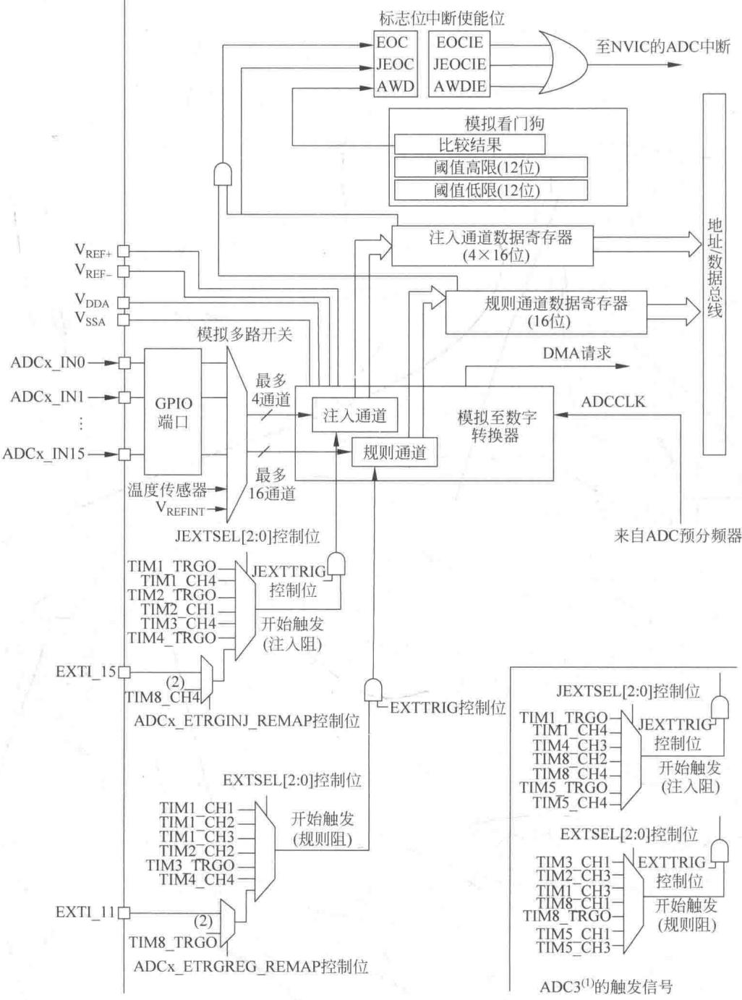

【教材内容】原教材配文：**"STM32 的 ADC 模块结构如图 10-4 所示。ADC3 只存在于大容量产品中。"**

##### 这张图信息量很大，我们"逐层搭积木"地看

**第一层：只看三个核心区域（先不要管其它缩写）**

```
① 左边：一堆模拟输入引脚（ADCx_IN0 ~ ADCx_IN15）
        ↓
② 中间：多路开关 + 采样保持 + 逐次逼近核心（ADC 的"心脏"）
        ↓
③ 右边：数据寄存器（ADC_DR）和中断/DMA 请求（把结果送出去）
```

**第二层：加入"控制"这一路**

图里还有一条从右边回到左边的控制通路：**ADC_CR1 / ADC_CR2 寄存器**。程序就是往这里写数，来命令 ADC"用哪个通道""采多久""采一次还是连续采"。

**第三层：加入"触发"和"参考电压"**

- 图上有 **EXTSEL / JEXTSEL** 相关部分：这是"外部触发源选择"，意思是"ADC 可以由定时器或外部引脚来'喊开始'，不一定非要软件启动"。
- 图上有 **VREF+ / VREF− / VDDA / VSSA**：这是 ADC 的"尺子"和"电源"。
- 图上有 **温度传感器** 和 **VREFINT**：这是芯片内部的 2 个特殊通道（后面讲）。

**这张图要我理解什么**：

> 一个 ADC 模块 = **16 个输入门 + 1 个多路开关 + 1 个采样保持 + 1 个逐次逼近核心 + 1 组数据寄存器 + 1 套控制/触发逻辑**。

【辅助理解图】把上面这层结构画成一条更清楚的"数据流水线"：

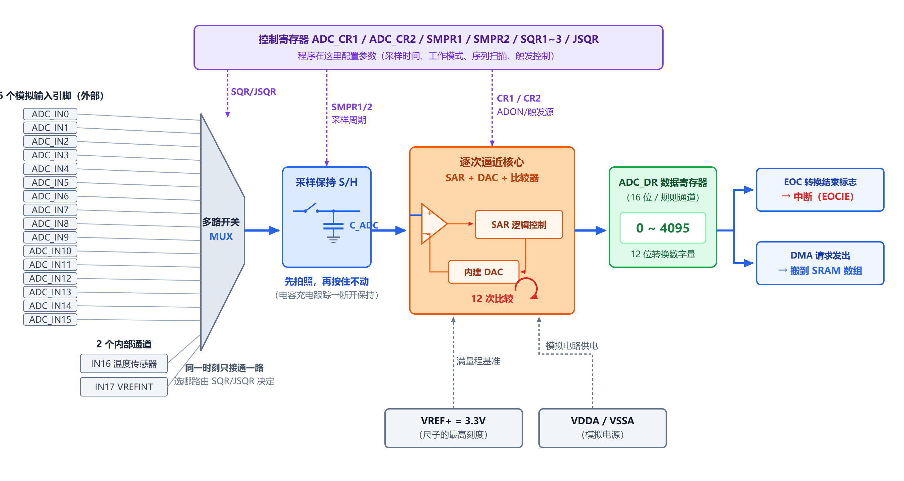

**看图方法**：从左往右看数据怎么流——

1. 最左边 16 个引脚（ADCx_IN0～IN15），每个引脚外面接一路模拟信号；
2. 中间的**多路开关**每次只接通其中一路（选哪一路由 SQR/JSQR 寄存器决定）；
3. 接通的信号进入**采样保持电路**，先"拍照"再"按住"；
4. **逐次逼近核心（SAR + DAC + 比较器）** 开始二分猜数；
5. 猜完的结果放进 **ADC_DR 数据寄存器**；
6. 同时置起 **EOC 标志**，可以触发**中断**或 **DMA** 把数据取走。

#### ADC 相关引脚（教材原文）

【教材内容】

| 引脚 | 全称/含义 | 教材说法 |
|---|---|---|
| **VDDA** | 模拟电源 | 等效于 VDD 的模拟电源，且 2.4V ≤ VDDA ≤ VDD（3.6V） |
| **VSSA** | 模拟电源地 | 等效于 VSS 的模拟电源地 |
| **VREF+** | 模拟参考正极 | ADC 使用的高端/正极参考电压，2.4V ≤ VREF+ ≤ VDDA |
| **VREF−** | 模拟参考负极 | ADC 使用的低端/负极参考电压，**VREF− = VSSA** |
| **ADCx_IN[15:0]** | 模拟信号输入端 | 16 个模拟输入通道 |

【补充解释】**为什么 ADC 要单独的电源引脚（VDDA/VSSA）？**

因为数字电路工作时，电流"哗哗"地开关，电源上会有很多毛刺噪声。如果 ADC 和数字电路共用一路电源，这些噪声会混进测量结果里，让读数跳动。所以芯片专门给模拟部分一套"干净"的电源和地。

> 【类比】就像音响的功放要单独拉一条电源线，避免和冰箱、空调共用一路，否则一开冰箱音箱就"砰"一声。

【补充解释】开发板上通常这样接：

```
VDDA ── 3.3V
VSSA ── 0V（地）
VREF+ ── 3.3V   ← 这就是我们前面一直用的"参考电压 3.3V"
VREF− ── 0V
```

> ⚠️ 例 10-1 里有一句关键提醒：**"进行 ADC 实验之前，AD SWITCH 拨到 ON，REF+ 引脚接到 3.3V 引脚以提供参考电压。"** 如果 VREF+ 没接，ADC 就没有"尺子"，转换结果没有意义。

---

### 10.2.3 STM32 的 ADC 配置

这一节是本章的核心。**我们按"从开机到采到一个数"的顺序来讲**，一共 13 个小问题（和下面的 13 个编号小节一一对应）：

1. 怎么给 ADC 上电？（ADC 开关控制）→ 第 1 小节
2. ADC 的心跳从哪来？（ADC 时钟）→ 第 2 小节
3. 采哪一路？（通道选择：规则组 / 注入组）→ 第 3 小节
4. 采一次就停？（单次转换模式）→ 第 4 小节
5. 还是不停采？（连续转换模式）→ 第 5 小节
6. 一次转换要多久？（时序图）→ 第 6 小节
7. 电压超出范围怎么办？（模拟看门狗）→ 第 7 小节
8. 一次采好几路怎么排队？（扫描模式）→ 第 8 小节
9. 想"插队"怎么办？（注入通道管理）→ 第 9 小节
10. 想分几次慢慢采？（间断模式）→ 第 10 小节
11. 谁来喊"开始"？（外部触发）→ 第 11 小节
12. 采到的数据谁来搬走？（DMA 请求）→ 第 12 小节
13. 多个 ADC 怎么配合？（双 ADC 模式）→ 第 13 小节

---

#### 1. ADC 开关控制（ADON 位）

【教材内容】

> 通过设置 **ADC_CR2 寄存器的 ADON 位**可给 ADC 上电。当第一次设置 ADON 位时，它将 ADC 从**断电状态**下唤醒。ADC 上电延迟一段时间后（**t_STAB**），**再次设置 ADON 位时开始进行转换**。
>
> 通过清除 ADON 位可以停止转换，并将 ADC 置于断电模式。在这个模式中，ADC 耗电仅几 μA。

【补充解释】**这里有一个非常容易搞错的地方：ADON 这同一个位，写两次，干的是两件事！**

```
第 1 次写 ADON = 1   →  ADC 上电（从"睡着"变成"醒着"），但还不转换
                        ↓ 等一段时间 t_STAB（稳定时间）
第 2 次写 ADON = 1   →  ADC 开始转换
```

> 【类比】像开一台老式电视机：先按电源（第 1 次），屏幕亮起来但要等一会儿才出画面（t_STAB）；等画面稳定了，你再按"开始播放"（第 2 次）。

**为什么要有 t_STAB？** 因为模拟电路刚上电时，内部的电容、基准电压都还没稳定，这时候转换出来的数是不准的。等一会儿，让它们"站住"，再开始转换。

【教材内容】补充一句：**"如果在这个寄存器中与 ADON 一起还有其他位被改变，则转换不被触发。这是为了防止触发错误的转换。"**

【补充解释】大白话：**"要么专门为了启动转换去写 ADON，要么专门去改别的配置，不要混在一次写操作里。"** 这是一条很贴心的硬件保护设计。

---

#### 2. ADC 时钟

【教材内容】

> 由时钟控制器提供的 **ADCCLK** 时钟和 **PCLK2（APB2 时钟）**同步。RCC 控制器为 ADC 时钟提供一个**专用的可编程预分频器**。

【补充解释】先把这条链画出来（回忆第 3 章的时钟树）：

```
晶振（8MHz）
   ↓  PLL 倍频
SYSCLK = 72MHz（系统时钟）
   ↓  AHB 分频（不分频）
HCLK = 72MHz
   ↓  APB2 分频（不分频）
PCLK2 = 72MHz          ← ADC 挂在这条总线上（APB2）
   ↓  ADC 专用预分频器（RCC_CFGR 里的 ADCPRE[1:0]）
ADCCLK = PCLK2 ÷ 分频系数     ← 必须 ≤ 14MHz
```

**可选的分频系数**：2、4、6、8。

**算一算**（PCLK2 = 72MHz 时）：

| 分频系数 | ADCCLK | 是否合法（≤14MHz） |
|---|---|---|
| 2 | 36MHz | ❌ 超了 |
| 4 | 18MHz | ❌ 超了 |
| **6** | **12MHz** | ✅ 合法 |
| 8 | 9MHz | ✅ 合法 |

所以例 10-1 里写的是 `RCC_ADCCLKConfig(RCC_PCLK2_Div6);`，注释也说了"72/6 = 12，最大不超过 14MHz"。

> ⚠️ **这是考试和实际编程都常考的坑：分频系数选小了，ADCCLK 超过 14MHz，转换结果会不准。** 记住：**ADCCLK 是"分频之后"的时钟，不是 PCLK2。**

---

#### 3. 通道选择：规则组与注入组

##### 先用大白话理解"为什么要分两组"

ADC 只有一套转换核心（SAR），但可能有 16 路信号要量。如果所有通道都排一条队，遇到"紧急信号"就只能干等。

所以 STM32 把通道分成两组：

> 【类比】去医院看病：
>
> - **规则组（Regular Group）** = **普通门诊排队**。你按挂号的顺序一个个看，看完了从头再来。
> - **注入组（Injected Group）** = **急诊插队**。有急事的人可以直接打断普通门诊，先看急诊；急诊看完了，医生再回去继续看普通门诊。

##### 正式定义

【教材内容】

**规则组**：

> 由多达 **16 个转换通道**组成。对一组指定的通道，按照指定的顺序，逐个转换这组通道，转换结束后，再从头循环；这些指定的通道组就称为**规则组**。
>
> 例如，可以如下顺序完成转换：**通道 3、通道 8、通道 2、通道 2、通道 0、通道 2、通道 2、通道 15**。
>
> 规则通道和它们的转换顺序在 **ADC_SQRx 寄存器**中选择。规则组中转换的总数应写入 **ADC_SQR1 寄存器的 L[3:0] 位**中。

**注入组**：

> 由多达 **4 个转换通道**组成。在实际应用中，有可能需要临时中断规则组的转换，对某些通道进行转换，这些需要中断规则组而进行转换的通道组，就称为**注入通道组**，简称**注入组**。
>
> 注入通道和它们的转换顺序在 **ADC_JSQR 寄存器**中选择。注入组里的转换总数目应写入 **ADC_JSQR 寄存器的 L[1:0] 位**中。

##### 【补充解释】注意规则组例子里那个"通道 2 出现了 4 次"

原教材给的顺序是 `3、8、2、2、0、2、2、15`——**同一个通道 2 被排了 4 次**。这不是笔误，而是规则组的正常能力：**同一个通道可以在序列里重复出现**（比如你想对同一个信号多采几次做平均）。这一点和"扫描模式"配合时要特别注意。

##### 两组的关键区别（必背）

| 对比项 | 规则组（Regular） | 注入组（Injected） |
|---|---|---|
| 最多几个通道 | **16 个** | **4 个** |
| 谁配置顺序 | ADC_SQR1 / SQR2 / SQR3 | ADC_JSQR |
| 谁定义"有几个" | SQR1 的 L[3:0] | JSQR 的 JL[1:0] |
| 结果放在哪 | **ADC_DR**（只有一个！） | **ADC_JDR1～JDR4**（每个通道一个） |
| 能否打断别人 | 不能 | **能打断规则组** |
| 能否产生 DMA 请求 | **能**（每次 EOC 后） | 不能（数据总存在 JDRx 里） |
| 有没有数据偏移 | 没有 | **有**（ADC_JOFRx，可减偏移） |

> 【补充解释】**"结果放在哪"这一行是理解后面 DMA 的关键**：
>
> - 注入组有 4 个独立的结果寄存器 JDR1～JDR4，**每个通道各有各的抽屉**，采完各自放好，不会互相覆盖。
> - 规则组只有**一个** ADC_DR。16 个通道轮流往里写，**后采的会把先采的覆盖掉**。所以如果规则组要采多个通道，**必须用 DMA 及时把数据搬走**（教材原话："因为规则通道转换的值存储在一个相同的数据寄存器 ADC_DR 中，所以当转换多个规则通道时需要使用 DMA，这可以避免丢失已经存储在 ADC_DR 寄存器中的数据。"）。

【辅助理解图】把"规则组排队 + 注入组插队"和"结果存到哪"画在一起：

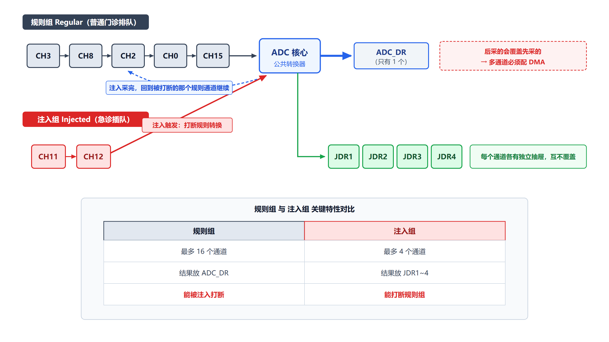

**看图方法**：

- 上半部分是一条**普通队列**（规则组）：CH3 → CH8 → CH2 → CH0 → CH15，一个个进 ADC 核心；右边只有一个结果框 ADC_DR，数据一个接一个写进去。
- 中间是一条**红色插队通道**（注入组）：CH11、CH12 从侧面插入，打断正在进行的规则转换；右边有 4 个独立结果框 JDR1～JDR4。
- 图下方标出"插队结束后，回到原来被打断的那个规则通道继续转换"。

##### 内部通道：温度传感器和 VREFINT

【教材内容】

> 温度传感器和通道 **ADC1_IN16** 相连接，内部参照电压 **VREFINT** 和 **ADC1_IN17** 相连接。可以按注入或规则通道对这两个内部通道进行转换。（温度传感器和 VREFINT **只能出现在 ADC1 中**。）

【补充解释】也就是说：ADC1 的"通道 16"和"通道 17"不是引脚，而是芯片内部连好的两个信号：

- **通道 16**：温度传感器输出的电压（反映芯片温度）；
- **通道 17**：内部参考电压 VREFINT（一个已知的稳定电压，可以用来"自查"ADC 准不准）。

【教材内容】还要注意三条补充说明：

> - ADC1 的模拟输入通道 16 和通道 17 在芯片内部分别连到了温度传感器和 VREFINT。
> - **ADC2** 的模拟输入通道 16 和通道 17 在芯片内部连到了 **VSS**。
> - **ADC3** 模拟输入通道 9、14、15、16、17 与 **VSS** 相连。

【补充解释】"连到 VSS"就是"接地"。所以如果你在 ADC2 上选通道 16，采到的永远是 0V——它没有实际的信号源。这是一条很实用的"避坑"信息。

---

#### 4. 单次转换模式

【教材内容】

> 在单次转换模式下，ADC 只执行一次转换。该模式既可通过设置 **ADC_CR2 寄存器的 ADON 位**（只适用于规则通道）启动，也可通过**外部触发**启动（适用于规则通道或注入通道），这时 **CONT 位为 0**。

**一旦选择通道的转换完成：**

> （1）如果一个**规则通道**转换完成，则转换数据储存在 16 位 **ADC_DR 寄存器**中；**EOC（转换结束）标志置位**；如果设置了 **EOCIE**，则产生**中断**。
>
> （2）如果一个**注入通道**转换完成，则转换数据储存在 16 位的 **ADC_JDR1 寄存器**中；**JEOC（注入转换结束）标志置位**；如果设置了 **JEOCIE 位**，则产生中断。
>
> 然后 ADC 停止。

【补充解释】注意这里的因果关系，考试常考：

```
硬件把结果写进 DR / JDRx
        ↓ 同时
硬件把 EOC / JEOC 标志位置 1
        ↓ 如果
软件事先把 EOCIE / JEOCIE 使能位设为 1
        ↓ 那么
产生中断，CPU 跳去执行中断服务程序
```

**"标志位"和"使能位"是两回事**：标志位是硬件"报告情况"，使能位是软件"允许不允许打断我"。这一点和前面第 7 章中断讲过的完全一致。

---

#### 5. 连续转换模式

【教材内容】

> 在连续转换模式中，**当前面 ADC 转换一结束马上就启动另一次转换**。此模式可通过外部触发启动或通过设置 ADC_CR2 寄存器上的 **ADON 位**启动，此时 **CONT 位是 1**。

每次转换后的行为，和单次模式**完全一样**（规则通道 → DR + EOC；注入通道 → JDR1 + JEOC），区别只是：**单次模式采完就停，连续模式采完立刻再来一次，不停。**

```
单次模式（CONT = 0）：
   启动 → [转换1] → 停
   └── 只出一个数

连续模式（CONT = 1）：
   启动 → [转换1] → [转换2] → [转换3] → …… （不停）
   └── 一直在出数，直到你把 CONT 清 0 或关掉 ADC
```

> 【类比】单次模式像"按一下快门拍一张"；连续模式像"按住快门连拍"。

---

#### 6. 时序图（本节最该看懂的图）

【教材内容】

> ADC 转换时序图如图 10-5 所示，ADC 在开始精确转换前需要一个**稳定时间 t_STAB**。在开始 ADC 转换 **14 个时钟周期**后，**EOC 标志被设置**，16 位 ADC 数据寄存器包含转换的结果。

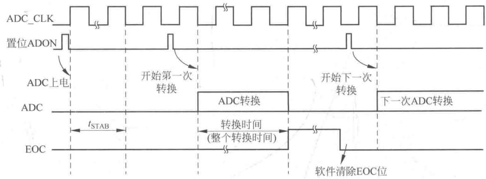

##### 这张图怎么看

1. **横轴是时间**（从左到右），从上到下一共**四行波形**，依次是：`ADC_CLK`、`置位ADON`、`ADC`、`EOC`。**第一行是时钟，第二行才是 ADON**，不要按"ADON 在最上面"去找。
2. **第一行 `ADC_CLK`**：ADC 的时钟方波，一格一格的，数格子就知道过了几个周期。
3. **第二行 `置位ADON`**：会看到**两个窄脉冲**——第 1 个脉冲下面标着"ADC 上电"，之后隔一段 `t_STAB`；第 2 个脉冲下面标着"开始第一次转换"。
4. **第三行 `ADC`**：这是一条"状态条"。第 2 个 ADON 脉冲之后就拉高，里面写着"ADC 转换"；图上用箭头标出这段宽度就是"**转换时间（整个转换时间）**"。后面还会出现"下一次 ADC 转换"。
5. **第四行 `EOC`**：转换完成时它跳变，并标注"**软件清除 EOC 位**"——表示"结果已经写进 ADC_DR，可以读了"。

> 注意：这张图里**没有单独画出"采样段"和"转换段"的分界线**。第三行那段"ADC 转换"的总宽度，就是"采样时间 + 12.5 个周期"（下面马上算）。

##### 关键数字：14 个时钟周期是怎么来的？

【教材内容】原教材给出了公式（式 10-1）：

```
T_conv = 采样时间 + 12.5 个周期
```

【补充解释】这个 12.5 是怎么来的？

- STM32 的 SAR 是 12 位，需要 **12 次比较** → 12 个周期；
- 再加上 **0.5 个周期**用于"把结果写进数据寄存器"等收尾工作；
- 所以是 **12 + 0.5 = 12.5 个周期**。

而"采样时间"是可编程的（由 SMPR 寄存器设置），最短是 **1.5 个周期**。

**所以最短的一次转换 = 1.5 + 12.5 = 14 个 ADC 时钟周期。** 这就是教材那句话"开始 ADC 转换 14 个时钟周期后 EOC 被设置"的来历（指的是采样时间取最短 1.5 周期的情况）。

**教材的例子（我们展开算）**：

```
已知：ADCCLK = 14MHz，采样时间 = 1.5 周期

T_conv = 1.5 + 12.5 = 14 个周期
       = 14 ÷ 14 000 000 Hz
       = 0.000001 s
       = 1 μs   ✓ 和教材一致
```

**如果采样时间取长一点呢？** 比如取 239.5 周期（例 10-1 用的就是它）：

```
T_conv = 239.5 + 12.5 = 252 个周期
ADCCLK = 12MHz（72MHz ÷ 6）
T_conv = 252 ÷ 12 000 000 = 21 μs
```

【补充解释】**为什么例 10-1 要用这么长的采样时间？** 因为采样电容充电需要时间：采样时间越长，ADC 内部采样电容越有把握"充到"和输入一样的电压；如果采样时间太短，电容还没充够就转换，读数会偏小。不过要注意：图 10-22 里的分压源（R12 = 10k、R13 = 5～10k）并不算高阻，**原教材并没有解释为什么例 10-1 取最长档 239.5 周期**。把它理解成"留足余量、宁慢勿错"的保守做法即可（详见 10.2.8 对图 10-22 的说明）。

> 【类比】用一根很细的水管给水桶放水，桶越大、水管越细，就要等越久才能装满。采样电容就是那个桶，信号源内阻就是那根水管。

【辅助理解图】把整条时间轴画清楚：

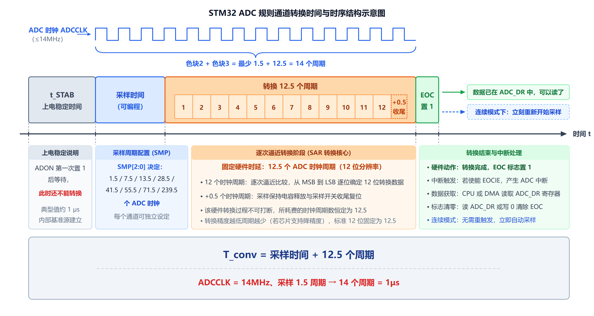

**看图方法**：从左往右数时间。

1. **t_STAB 段**（灰色）：ADON 第一次置 1 后，等 ADC 内部稳定；
2. **采样段**（蓝色）：多路开关接通某一路，采样电容"充电"，时长 = SMPR 里设的采样周期数；
3. **转换段**（橙色）：SAR 逐位比较 12 次，固定 12.5 个周期；
4. **EOC 时刻**：标志置 1，数据已在 DR 中；
5. 如果是连续模式，紧接着又从"采样段"重新开始。

---

#### 7. 模拟看门狗（Analog Watchdog，AWD）

##### 先理解它要解决什么问题

ADC 一直在采某个电压，但 CPU 不可能每时每刻都去检查"这个值正常吗"。如果电压突然超出安全范围（比如电池过压、温度过高），需要**自动报警**。

**模拟看门狗就是干这个的**：你给它设一个"下限"和一个"上限"，它每次转换完就自动比一下；一旦超出范围，就把标志位置 1，还可以产生中断。

> 【类比】像家里的**烟雾报警器**：平时没人盯着，一旦烟大了，它自己就叫起来。

##### 教材原文

【教材内容】

> 如果被 ADC 转换的模拟电压**低于低阈值**或**高于高阈值**，模拟看门狗 **AWD 的状态位**将被置位，如图 10-6 所示。
>
> 阈值位于 **ADC_HTR 和 ADC_LTR 寄存器的最低 12 个有效位**中。通过设置 **ADC_CR1 寄存器的 AWDIE 位**以允许产生相应中断。
>
> 阈值的数据对齐模式与 ADC_CR2 寄存器中的 ALIGN 位选择无关。**比较是在对齐之前完成的。**

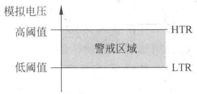

**这张图怎么看**：图上画了一根纵轴表示电压（或转换结果 0～4095），中间有一段被两条水平虚线夹住的区域——这就是**"安全区"**。

- 两条虚线：上面那条是 **HT（高阈值）**，下面那条是 **LT（低阈值）**；
- 安全区（LT ～ HT 之间）：一切正常，看门狗不动；
- **高于 HT 或低于 LT**：AWD 标志置位 → 如果 AWDIE = 1，产生中断。

```
结果值
4095 ┤
     │  ← 超出上限：AWD 报警
 HT  ├─────────────────────────  ← 高阈值（写在 ADC_HTR 的低 12 位）
     │
     │  ← 安全区：正常，不报警
     │
 LT  ├─────────────────────────  ← 低阈值（写在 ADC_LTR 的低 12 位）
     │  ← 超出下限：AWD 报警
   0 ┤
```

【辅助理解图】把"警戒区 + 三个控制位 + 报警后去哪"画成一张图：

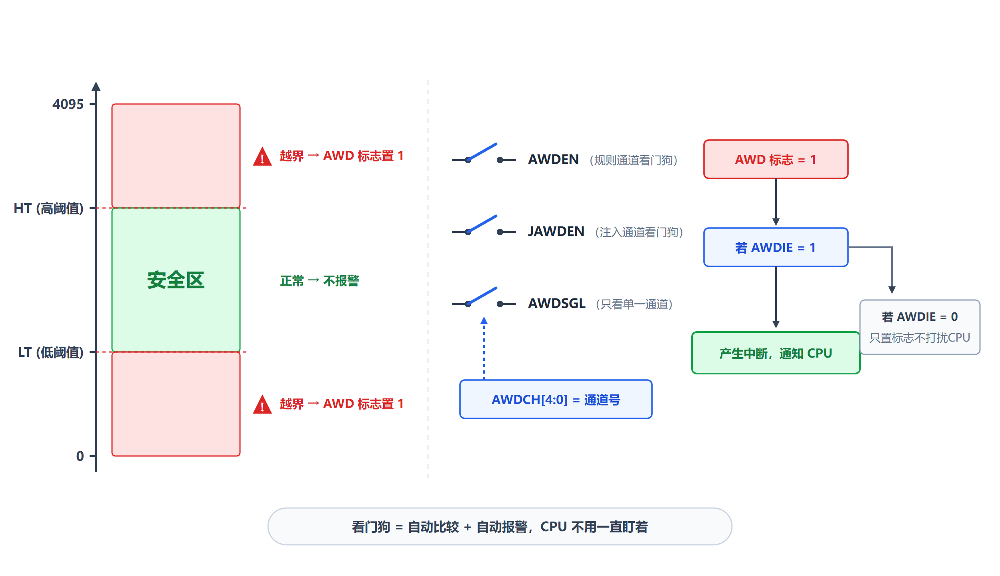

**看图方法**：左边是一根 0～4095 的结果轴，中间用绿色标出安全区（LT～HT 之间），上下两块红色表示"越界"。右边画三个开关 AWDEN / JAWDEN / AWDSGL 和通道号 AWDCH，说明"监视哪些通道"由它们决定。最右边画报警的去向：AWD 标志置 1 → 若 AWDIE = 1 则产生中断。**这张图要你理解：看门狗是"自动比较 + 自动报警"，CPU 不用一直盯着。**

【教材内容】通过配置 ADC_CR1 寄存器，模拟看门狗可以作用于一个或多个通道，如表 10-1 所示：

| 模拟看门狗警戒的通道 | AWDSGL 位 | AWDEN 位 | JAWDEN 位 |
|---|---|---|---|
| 无 | 任意值 | 0 | 0 |
| 所有注入通道 | 0 | 0 | 1 |
| 所有规则通道 | 0 | 1 | 0 |
| 所有注入和规则通道 | 0 | 1 | 1 |
| 单一的注入通道 ⁽¹⁾ | 1 | 0 | 1 |
| 单一的规则通道 ⁽¹⁾ | 1 | 1 | 0 |
| 单一的注入或规则通道 ⁽¹⁾ | 1 | 1 | 1 |

> ⁽¹⁾ 教材原注：单一通道由 **AWDCH[4:0]** 位指定（选哪一路通道）。

【补充解释】这张表怎么记？

- **AWDEN**：给"规则通道"开看门狗；
- **JAWDEN**：给"注入通道"开看门狗；
- **AWDSGL**：0 = 看**所有**通道；1 = 只看 **AWDCH 指定的那一个**通道。

所以：

```
AWDEN=1, JAWDEN=0, AWDSGL=0  → 监视所有规则通道
AWDEN=0, JAWDEN=1, AWDSGL=0  → 监视所有注入通道
AWDSGL=1, AWDCH=00101       → 只监视通道 5
```

【补充解释】**"比较是在对齐之前完成的"是什么意思？** 意思是：数据左对齐/右对齐只是"结果往 16 位寄存器里怎么摆"的问题，看门狗比较时用的是**真正的 12 位数值**，不受摆放方式影响。所以你设阈值时，直接按 0～4095 来设就行，不用管 ALIGN。

---

#### 8. 扫描模式（Scan Mode）

【教材内容】

> 此模式用来**扫描一组模拟通道**。扫描模式可通过设置 **ADC_CR1 寄存器的 SCAN 位**来选择。
>
> 一旦这个位被设置，ADC 就扫描所有被 **ADC_SQRx 寄存器（对规则通道）**或 **ADC_JSQR（对注入通道）**选中的所有通道。**在每个组的每个通道上执行单次转换。在每个转换结束时，同一组的下一个通道被自动转换。**
>
> 如果设置了 **CONT 位**，转换不会在选择组的最后一个通道停止，而是**再次从选择组的第一个通道继续转换**。
>
> 如果设置了 **DMA 位**，在每次 EOC 后，DMA 控制器把规则组通道的转换数据传输到 SRAM 中。而注入通道转换的数据总是存储在 ADC_JDRx 寄存器中。

【补充解释】把"扫描"和"连续"这两个概念分清楚——**它们经常被搞混**：

| 概念 | 控制位 | 解决的问题 | 大白话 |
|---|---|---|---|
| **扫描模式** | SCAN | **一组里有多路**，要不要依次都采？ | "我要把 3 个通道都量一遍" |
| **连续模式** | CONT | 采完这一轮，**要不要再来一轮**？ | "量完一遍再来一遍，别停" |

**四种组合**：

```
SCAN=0, CONT=0：只采 1 路，采 1 次          （最省事，例 10-1 用的就是这个）
SCAN=0, CONT=1：只采 1 路，但一直重复采      （盯着一个信号连续监控）
SCAN=1, CONT=0：把多路依次采一轮，然后停     （扫描一遍）
SCAN=1, CONT=1：把多路依次采，采完一轮再来一轮（循环扫描，最常用）
```

【教材内容】还有一句关于中断的细节：

> 如果分别设置了 EOCIE 或 JEOCIE 位，**只在最后一个通道转换完毕后**才会产生 EOC 或 JEOC 中断。

【补充解释】意思是：扫描模式下，中间每采完一个通道**不会**单独打断 CPU，只有整组都采完才报一次。这很合理——否则 CPU 会被频繁打断。

---

#### 9. 注入通道管理

注入组有两种用法："触发注入"和"自动注入"。

##### 1）触发注入（被外部事件触发才插队）

【教材内容】清除 **JAUTO 位**、设置 **SCAN 位**，即可使用触发注入功能。过程如下：

> （1）利用外部触发或通过设置 ADC_CR2 寄存器的 ADON 位，启动一组**规则通道**的转换。
>
> （2）如果在规则通道转换期间产生一个**外部注入触发**，**当前转换被复位**，注入通道序列被以单次扫描方式进行转换。
>
> （3）然后，**恢复上次被中断的规则组通道转换**。如果在注入转换期间产生一个规则事件，则注入转换**不会被中断**，但是规则序列将在注入序列结束后被执行。

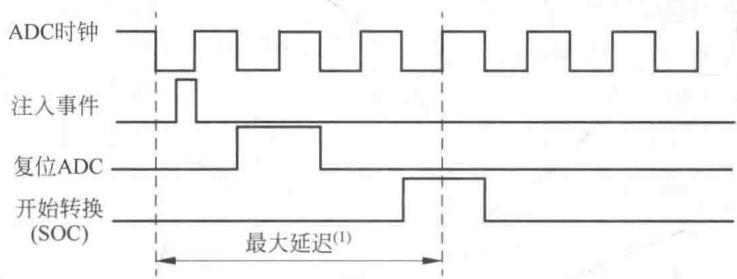

**这张图怎么看**：

1. 时间轴从左到右；
2. 先看到规则通道在转换（标着 R 的方块）；
3. 中间突然出现一个"注入触发"箭头（外部事件），**正在进行的规则转换被打断**；
4. 接着是一串注入通道的转换（标着 I 的方块，通常 1～4 个）；
5. 注入序列结束后，**回到原来那个规则通道，把它重新转换完**；
6. 图下方通常会标出"注入序列的长度"和"两次触发之间必须间隔多久"。

【教材内容】教材给了一个数量约束，我们展开算：

> 当使用触发注入转换时，必须保证**触发事件的间隔长于注入序列**。例如，序列长度为 **28 个 ADC 时钟周期**（即 2 个具有 1.5 个时钟间隔采样时间的转换），触发之间最小的间隔必须是 **29 个 ADC 时钟周期**。

```
验算：每个转换 = 采样 1.5 + 转换 12.5 = 14 个周期
      2 个转换 = 14 × 2 = 28 个周期   ✓ 和教材一致
      最小触发间隔 = 28 + 1 = 29 个周期
```

【补充解释】为什么要 "+1"？因为注入序列结束之后，硬件还需要一个时钟周期来"收尾/切换状态"，这期间不能马上接受新的触发。

##### 2）自动注入

【教材内容】

> 如果设置了 **JAUTO 位**，在规则组通道之后，**注入组通道被自动转换**。这种方式可以用来转换在 ADC_SQRx 和 ADC_JSQR 寄存器中设置的多至 **20 个转换序列**。在该模式中，**必须禁止注入通道的外部触发**。
>
> 如果除 JAUTO 位外还设置了 **CONT 位**，规则通道至注入通道的转换序列被**连续执行**。
>
> 对于 ADC 时钟预分频系数为 4～8 时，当从规则转换切换到注入序列或从注入转换切换到规则序列时，会**自动插入 1 个 ADC 时钟间隔**；当 ADC 时钟预分频系数为 2 时，则有 **2 个 ADC 时钟间隔的延迟**。
>
> **不可能同时使用自动注入和间断模式。**

【补充解释】"20 个转换序列"怎么来的？

```
规则组最多 16 个通道  +  注入组最多 4 个通道  =  20 个
```

"自动注入"和"触发注入"的区别：

- **触发注入**：要**外部事件**来触发，才插队（平时不插队）；
- **自动注入**：**不需要触发**，规则组一采完，自动接着采注入组（像"套餐"一样连着来）。

---

#### 10. 间断模式（Discontinuous Mode）

【教材内容】间断模式是"**把一长串转换切成几小段，每次触发只做一小段**"。

##### 1）规则组的间断模式

> 此模式通过设置 **ADC_CR1 寄存器上的 DISCEN 位**激活，可以用来执行一个**短序列的 n 次转换（n ≤ 8）**，此转换是 ADC_SQRx 寄存器所选择的转换序列的一部分。数值 n 由 **ADC_CR1 寄存器的 DISCNUM[2:0] 位**给出。
>
> 一个外部触发信号可以启动 ADC_SQRx 寄存器中描述的下一轮 n 次转换，直到此序列所有的转换完成为止。总的序列长度由 ADC_SQR1 寄存器的 L[3:0] 定义。

**教材的例子（我们照抄并解释）**：

> 若 n = 3，被转换的通道 = 0, 1, 2, 3, 6, 7, 9, 10，则
>
> - 第一次触发：转换的序列为 0、1、2。
> - 第二次触发：转换的序列为 3、6、7。
> - 第三次触发：转换的序列为 9、10，并产生 EOC 事件。
> - 第四次触发：转换的序列 0、1、2。

【补充解释】数一数：8 个通道，每段 3 个 → 3 段（3+3+2）。第三次触发采完剩下的 9、10 后，整轮结束，产生 EOC；第四次触发又从第一段（0、1、2）开始。

> 当以间断模式转换一个规则组时，**转换序列结束后并不自动从头开始**。当所有子组被转换完成，下一次触发启动第一个子组的转换。

##### 2）注入组的间断模式

> 此模式通过设置 **ADC_CR1 寄存器的 JDISCEN 位**激活。在一个外部触发事件后，该模式按通道顺序**逐个**转换 ADC_JSQR 寄存器中选择的序列。
>
> 总的序列长度由 ADC_JSQR 寄存器的 **JL[1:0]** 位定义。

**教材的例子**：

> 若 n = 1，被转换的通道 = 1, 2, 3，则
>
> - 第一次触发：通道 1 被转换。
> - 第二次触发：通道 2 被转换。
> - 第三次触发：通道 3 被转换，并且产生 EOC 和 JEOC 事件。
> - 第四次触发：通道 1 被转换。

【教材内容】三条注意事项：

> ① 当完成所有注入通道转换，下个触发启动第一个注入通道的转换。
>
> ② **不能同时使用自动注入和间断模式。**
>
> ③ **必须避免同时为规则和注入组设置间断模式。间断模式只能作用于一组转换。**

【辅助理解图】把"扫描 + 连续 + 间断"三种节奏放在一条时间轴上对比：

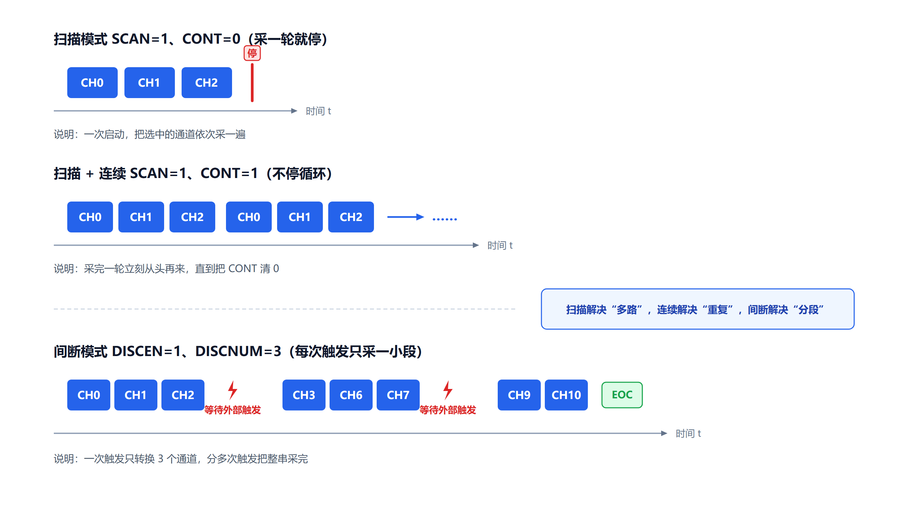

**看图方法**：

- 第一行（扫描，SCAN=1，CONT=0）：一次触发，依次采 CH0→CH1→CH2，采完就停；
- 第二行（扫描 + 连续，SCAN=1，CONT=1）：不停重复 CH0→CH1→CH2→CH0→…；
- 第三行（间断，DISCEN=1，DISCNUM=3）：每次触发只采 3 个，然后**等下一次触发**再采下一组 3 个。

---

#### 11. 外部触发转换

【教材内容】

> 转换可以由**外部事件**触发（例如定时器捕获、EXTI 线）。如果设置了 **EXTTRIG 控制位**，则外部事件就能够触发转换。**EXTSEL[2:0] 和 JEXTSEL[2:0] 控制位**允许应用程序选择 8 个可能事件中的某一个，可以触发规则组和注入组的采样。

【补充解释】**为什么需要外部触发？** 因为很多场合要求"**精确地每隔固定时间采一次**"。如果用软件循环去启动，时间会飘（CPU 还要干别的）。而定时器可以产生**极其精确**的周期信号，用它来触发 ADC 最合适。

```
定时器 TIMx 每 1ms 产生一次 TRGO 事件
        ↓ 触发
ADC 自动采一次
        ↓
EOC → DMA 把数据搬走
        ↓
一秒钟后，SRAM 里整整齐齐躺着 1000 个采样点
```

**教材给出的触发源表**（表 10-2～10-5）：

**表 10-2 ADC1 和 ADC2 用于规则通道的外部触发源**

| 触发源 | 类型 | EXTSEL[2:0] |
|---|---|---|
| TIM1_CC1 事件 | 来自片上定时器的内部信号 | 000 |
| TIM1_CC2 事件 | 来自片上定时器的内部信号 | 001 |
| TIM1_CC3 事件 | 来自片上定时器的内部信号 | 010 |
| TIM2_CC2 事件 | 来自片上定时器的内部信号 | 011 |
| TIM3_TRGO 事件 | 来自片上定时器的内部信号 | 100 |
| TIM4_CC4 事件 | 来自片上定时器的内部信号 | 101 |
| EXTI_11 / TIM8_TRGO 事件 ⁽¹⁾⁽²⁾ | 外部引脚 / 来自片上定时器的内部信号 | 110 |
| **SWSTART** | **软件控制位** | **111** |

**表 10-3 ADC1 和 ADC2 用于注入通道的外部触发源**

| 触发源 | 类型 | JEXTSEL[2:0] |
|---|---|---|
| TIM1_TRGO 事件 | 来自片上定时器的内部信号 | 000 |
| TIM1_CC4 事件 | 来自片上定时器的内部信号 | 001 |
| TIM2_TRGO 事件 | 来自片上定时器的内部信号 | 010 |
| TIM2_CC1 事件 | 来自片上定时器的内部信号 | 011 |
| TIM3_CC4 事件 | 来自片上定时器的内部信号 | 100 |
| TIM4_TRGO 事件 | 来自片上定时器的内部信号 | 101 |
| EXTI_15 / TIM8_CC4 事件 ⁽¹⁾⁽²⁾ | 外部引脚 / 来自片上定时器的内部信号 | 110 |
| **JSWSTART** | **软件控制位** | **111** |

**表 10-4 ADC3 用于规则通道的外部触发源**

| 触发源 | EXTSEL[2:0] |
|---|---|
| TIM3_CC1 事件 | 000 |
| TIM2_CC3 事件 | 001 |
| TIM1_CC3 事件 | 010 |
| TIM8_CC1 事件 | 011 |
| TIM8_TRGO 事件 | 100 |
| TIM5_CC1 事件 | 101 |
| TIM5_CC3 事件 | 110 |
| **SWSTART** | **111** |

> ⚠️ **【待核验】教材两处对 ADC3 规则触发源的编码说法相反**：
>
> - **本表（表 10-4，p131）**写：100 = TIM8_TRGO、101 = TIM5_CC1、110 = TIM5_CC3；
> - 而 ADC_CR2 位定义那一节的正文（p141）写：100 = 定时器 3 的 TRGO、101 = 定时器 4 的 CC4、110 = EXTI 线 11 / TIM8_TRGO。
>
> 正文那组数值几乎就是把 ADC1/ADC2 的触发源抄了一遍，**本讲义采用表 10-4**（与 STM32F103 数据手册一致）。请核验原书 p141 与 p131。

**表 10-5 ADC3 用于注入通道的外部触发源**

| 触发源 | JEXTSEL[2:0] |
|---|---|
| TIM1_TRGO 事件 | 000 |
| TIM1_CC4 事件 | 001 |
| TIM4_CC3 事件 | 010 |
| TIM8_CC2 事件 | 011 |
| TIM8_CC4 事件 | 100 |
| TIM5_TRGO 事件 | 101 |
| TIM5_CC4 事件 | 110 |
| **JSWSTART** | **111** |

【教材内容】教材的几点补充：

> （2）对于规则通道，选中 EXTI_11 或 TIM8_TRGO 作为外部触发事件，可以分别通过设置 ADC1 和 ADC2 的 ADC1_ETRGREG_REMAP 位和 ADC2_ETRGREG_REMAP 位实现。
>
> 当外部触发信号被选为 ADC 规则或注入转换时，**只有上升沿可以启动转换**。
>
> 软件触发事件可以通过对寄存器 ADC_CR2 的 **SWSTART 或 JSWSTART 位置 1** 产生。**规则组的转换可以被注入触发打断。**

【补充解释】三条要记住的：

1. **只有上升沿触发**——信号从低变高的那一瞬间才开始，下降沿不管；
2. **软件触发也是一种"触发源"**，编码是 111（SWSTART / JSWSTART）；
3. 规则组能被注入组打断，反之不行。

> ⚠️ **【容易搞混】** 表 10-5 的表头在原书里也印成了 `EXTSEL[2:0]`，但它讲的是**注入通道**，正确的位名应该是 **JEXTSEL[2:0]**。这是一个明显的印刷/解析问题，已记入文末"待核验"。

---

#### 12. DMA 请求

【教材内容】

> 因为规则通道转换的值存储在**一个相同的数据寄存器 ADC_DR** 中，所以当转换多个规则通道时需要使用 **DMA**，这可以避免丢失已经存储在 ADC_DR 寄存器中的数据。
>
> 只有在**规则通道的转换结束时**才产生 DMA 请求，并将转换的数据从 ADC_DR 寄存器传输到用户指定的目的地址。
>
> **注：只有 ADC1 和 ADC3 拥有 DMA 功能。**由 ADC2 转换的数据可以通过双 ADC 模式，利用 ADC1 的 DMA 功能传输。

【补充解释】回忆一下第 11 章要讲的 **DMA**：

**DMA**
= **D**irect **M**emory **A**ccess
= 直接存储器访问
= 一个"搬运工"，能在**不打扰 CPU** 的情况下，把数据从一个地址搬到另一个地址。

```
没有 DMA：
   ADC 采完 → 置 EOC → 中断 CPU → CPU 停下手里的活 → 读 DR → 存到数组 → 回去干活
   （每采一个点就打断一次，CPU 累死）

有 DMA：
   ADC 采完 → 置 EOC → DMA 自动把 DR 的值搬到数组里 → 继续
   （CPU 完全不用管，只等最后一批数据都到齐了再统一处理）
```

【辅助理解图】把"ADC + DMA"的数据流画出来：

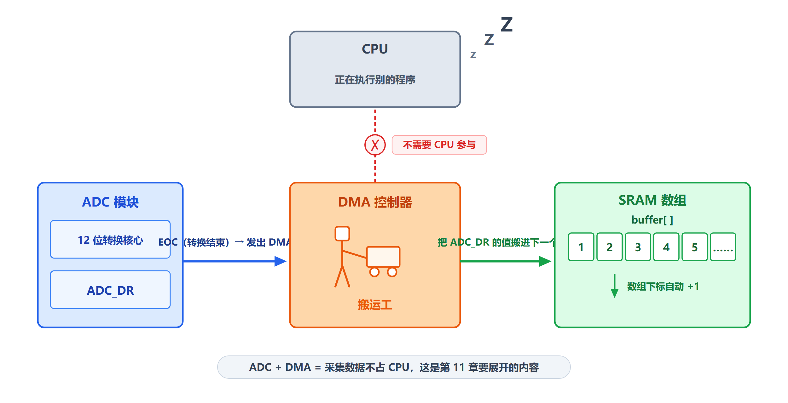

**看图方法**：左边是 ADC 模块，中间是 DMA 控制器，右边是 SRAM 里的一块数组。ADC 每采完一个通道就把 EOC 送给 DMA，DMA 立刻把 ADC_DR 里的值搬进数组的下一个格子，然后数组下标自动 +1。CPU 在右边画成"正在做别的事"，完全没有被打扰。

---

#### 13. 双 ADC 模式（了解为主）

【教材内容】

> 在有 2 个或以上 ADC 模块的产品中，可以使用双 ADC 模式。在双 ADC 模式下，根据 **ADC1_CR1 寄存器中 DUALMOD[2:0] 位**所选的模式，转换的启动可以是 **ADC1 主和 ADC2 从**的交替触发或同步触发。

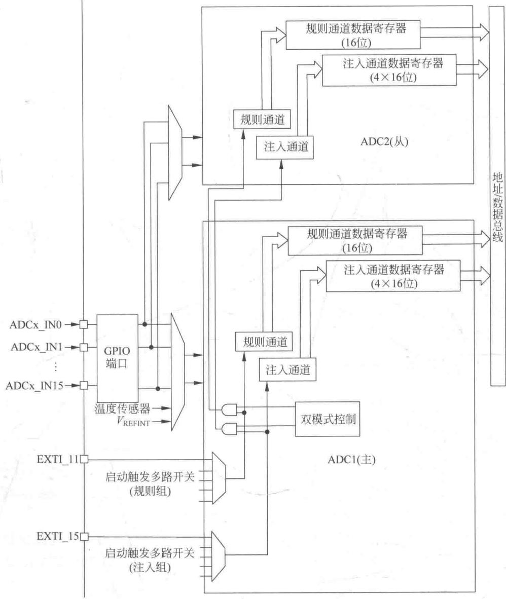

**这张图怎么看**（只抓三样东西）：

1. **左边是"输入侧"**：16 个外部引脚 **ADCx_IN0～IN15** 先经过"**GPIO 端口**"，再经过多路开关送进两个 ADC；此外还有芯片内部的"**温度传感器**"和 **VREFINT** 两路信号。
2. **中间上下两块分别是 ADC2（从）和 ADC1（主）**：每一块里都有"**规则通道**""**注入通道**"两条支路，各自带自己的寄存器——**规则通道数据寄存器（16 位）**和**注入通道数据寄存器（4×16 位）**。
3. **ADC1 里多了一个"双模式控制"方块**：它就是"指挥两个 ADC 配合工作"的部分，从它引出控制线去触发 ADC1 和 ADC2（图上画成小的门电路）。下方是触发源：**EXTI_11** 接"启动触发多路开关（规则组）"，**EXTI_15** 接"启动触发多路开关（注入组）"；最右边那条粗竖线是"**地址数据总线**"，所有数据寄存器最后都接到它上面。

**这张图要我理解什么**：双 ADC 模式不是"两个 ADC 各干各的"，而是**由 ADC1（主）里的"双模式控制"统一发令，让两个 ADC 按同一个节奏采样**，再分别把结果存进各自的寄存器。

【补充解释】STM32F103VET6 有 ADC1、ADC2、ADC3 三个 ADC。让它们**配合**工作，可以：

- **同步**：两个 ADC 同时采两路信号（比如同时采电压和电流，算瞬时功率）；
- **交叉**：两个 ADC 轮流采同一路信号，把采样率**翻倍**。

**共有 6 种可能的模式**：同步注入模式、同步规则模式、快速交叉模式、慢速交叉模式、交替触发模式和独立模式。

**可以用下列方式组合使用**：

> （1）同步注入模式 + 同步规则模式；
> （2）同步规则模式 + 交替触发模式；
> （3）同步注入模式 + 交叉模式。

**六种模式速览**（对照 DUALMOD 编码）：

| DUALMOD[3:0] | 模式 |
|---|---|
| 0000 | 独立模式 |
| 0001 | 混合的同步规则 + 注入同步模式 |
| 0010 | 混合的同步规则 + 交替触发模式 |
| 0011 | 混合同步注入 + 快速交叉模式 |
| 0100 | 混合同步注入 + 慢速交叉模式 |
| 0101 | 注入同步模式 |
| 0110 | 规则同步模式 |
| 0111 | 快速交叉模式 |
| 1000 | 慢速交叉模式 |
| 1001 | 交替触发模式 |

> ⚠️ **【待核验】位宽写法不一致**：教材正文（p132）写的是 **DUALMOD[2:0]**，但 ADC_CR1 的寄存器定义（p142）写的是 **DUALMOD[3:0]**。这里一共有 10 种码值（0000～1001），**用 3 位装不下**，所以本讲义按寄存器定义的 **DUALMOD[3:0]** 表述。这一矛盾已记入文末"待核验"。

**几个关键细节**（教材原文）：

> - 在双 ADC 模式下，当转换配置成由外部事件触发时，用户必须将其设置成**仅触发主 ADC**，从 ADC 设置成**软件触发**，这样可以防止意外触发从转换。但是，主和从 ADC 的外部触发**必须同时被激活**。
> - 在双 ADC 模式下，为了在主数据寄存器上读取从转换数据，**必须使能 DMA 位**，即使不使用 DMA 传输规则通道数据。

**同步规则模式**（教材原文）：

> 外部触发来自 ADC1 的规则组多路开关（由 ADC1_CR2 寄存器的 EXTSEL[2:0] 选择），它同时给 ADC2 提供同步触发。在 ADC1 或 ADC2 的转换结束时，产生一个 **32 位 DMA 传输请求**（如果设置了 DMA 位），32 位的 ADC1_DR 寄存器内容传输到 SRAM 中，**它上半个字包含 ADC2 的转换数据，低半个字包含 ADC1 的转换数据**。

【补充解释】"上半个字/低半个字"是什么意思？

```
ADC1_DR（32 位）在双 ADC 规则同步模式下：
┌───────────────────────────┬───────────────────────────┐
│  bit31 ~ bit16            │  bit15 ~ bit0             │
│  ADC2 的转换数据           │  ADC1 的转换数据           │
└───────────────────────────┴───────────────────────────┘
        高 16 位（高半个字）          低 16 位（低半个字）
```

**交叉模式的时间差**（教材原文）：

> - **快速交叉模式**：外部触发产生后，**ADC2 立即启动**，并且 **ADC1 在延迟 7 个 ADC 时钟周期后启动**。
> - **慢速交叉模式**：外部触发产生后，ADC2 立即启动，ADC1 在延迟 **14 个 ADC 时钟周期**后启动；在延迟第二次 14 个 ADC 周期后 ADC2 再次启动，如此循环。（在 28 个 ADC 时钟周期后自动启动新的 ADC2 转换。）

【补充解释】为什么要"错开"？因为两个 ADC 同时启动会抢资源。错开 7 个周期，正好让 ADC1 在 ADC2 的采样阶段去转换，两个 ADC 就能"你采我转、我采你转"，把整体采样率提高一倍。

【教材内容】另外还有：

> - **交替触发模式**：只适用于注入通道组。第 1 次触发转换 ADC1 的全部注入通道，第 2 次触发转换 ADC2 的全部注入通道，如此循环。
> - **独立模式**：双 ADC 同步不工作，每个 ADC 接口独立工作。
> - **混合的规则/注入同步模式**（教材第 7 种）：规则组同步转换可以被中断，以启动注入组的同步转换。

##### 两种"组合模式"（教材的第 8、9 种情况）

它们是把前面的基本模式"叠"起来用，原教材放在双 ADC 模式的最后两个小节。

**8）混合的同步规则 + 交替触发模式**

【教材内容】

> 规则组同步转换可以被中断，以启动注入组交替触发转换。一个规则同步转换被交替触发所中断的实例如图 10-18 所示。
>
> 注入交替转换在注入事件到达后立即启动。如果规则转换已经在运行，为了在注入转换后确保同步，所有的 ADC（主和从）的规则转换被停止，并在注入转换结束时同步恢复。
>
> 如果触发事件发生在一个中断了规则转换的注入转换期间，这个触发事件将被忽略。这种情况的操作实例如图 10-19 所示。其中，第 2 次触发被忽略。

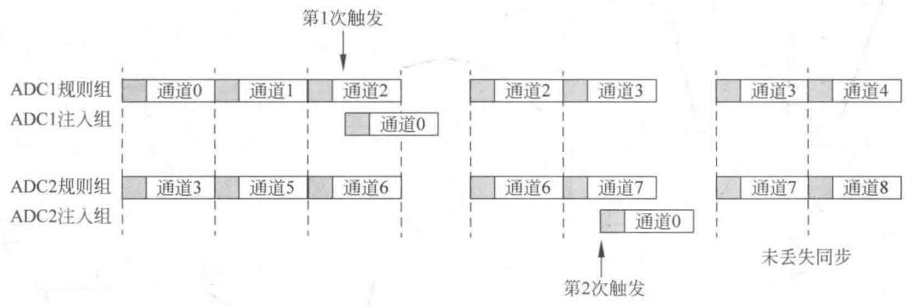

**图 10-18 怎么看**：图分上下两半——上半是 **ADC1** 的规则组/注入组，下半是 **ADC2** 的规则组/注入组。正常时两个规则组是**同步**往前走的（ADC1 采通道 0、1、2…，ADC2 同时采通道 3、5、6…）。第 1 次触发到来时，ADC1 的注入组插进来转换"通道 0"，两个规则组都被**暂停**；注入结束后，两个规则组**同步恢复**——所以图右下角写着"**未丢失同步**"。

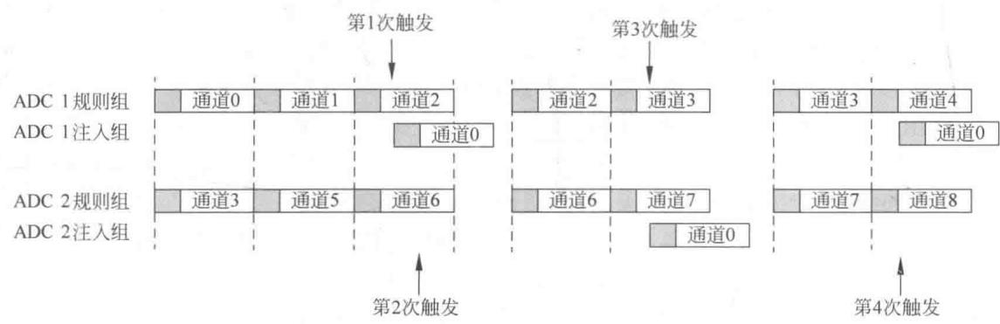

**图 10-19 怎么看**：这张图专门画"倒霉情况"——**第 2 次触发正好落在第 1 次注入转换还没做完的时候**，于是这次触发被**忽略**（"第 2 次触发"的箭头就指在 ADC1 注入组正在转换的那一段上）。忽略它，是为了保证"注入不会把规则组的同步关系搞乱"。

> 【类比】急诊还没看完，下一个急诊先别来——否则普通门诊被一次次打断，两个诊室的进度就对不齐了。

**9）混合同步注入 + 交叉模式**

【教材内容】

> 一个注入事件可以中断一个交叉转换。这种情况下，交叉转换被中断，注入转换被启动，在注入序列转换结束时，交叉转换被恢复。混合同步注入 + 交叉模式的实例如图 10-20 所示。

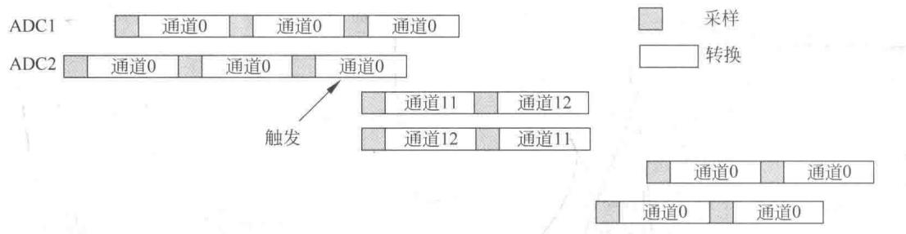

**这张图怎么看**：

1. 图上有两行：上面一行是 **ADC1**，下面一行是 **ADC2**。每一小段里，**浅灰小格表示"采样"、白色小格表示"转换"**（看图右上角的图例）。
2. 前一段是**交叉模式**：两个 ADC 轮流对同一个**通道 0** 采样转换（这就是"交叉"把采样率翻倍的原理）。
3. 中间来了一个"**触发**"（有箭头标出），于是插进来两组注入转换：ADC1 转 **通道 11、通道 12**，ADC2 转 **通道 12、通道 11**。
4. 注入序列结束后，**交叉转换被恢复**，两个 ADC 又轮流对通道 0 采样转换。

【补充解释】这一种对应前面列的组合"（3）同步注入模式 + 交叉模式"：**平时用交叉模式提高采样率，一旦有紧急信号就插队转换，插完队再回到交叉模式。**

【补充解释】双 ADC 模式内容很多，但**本章的重点是"单个 ADC 怎么用"**。这一部分考试一般只考"有哪些模式""同步规则模式下 32 位数据怎么拼"这类概念题。上面已经把教材列出的模式（含第 8、9 种组合模式）都做了介绍；教材里其余的时序实例图（图 10-12～10-17：同步注入、同步规则、快/慢速交叉、交替触发、间断模式下的交替触发）可以用同样的思路去看：**先分清是"谁的"规则组/注入组，再看触发从哪来，最后看被打断的转换有没有恢复。** 真正要用双 ADC 时再回来细看这些图。

---

### 10.2.4 STM32 的 ADC 应用特征

#### 1. 校准（Calibration）

##### 先说为什么需要校准

【教材内容】

> ADC 有一个内置自校准模式。校准可**大幅度减小因内部电容器组的变化而造成的精度误差**。在校准期间，在每个电容器上都会计算出一个**误差修正码（数字值）**，这个码用于消除在随后的转换中每个电容器上产生的误差。

【补充解释】回顾 10.1：逐次逼近式 ADC 内部有一个 DAC，而这个 DAC 是用**一组电容**（电容组）来"造电压"的。芯片制造时，电容不可能做得完全一样（有的偏大 1%，有的偏小 2%），这就会让 DAC 造出的电压有偏差，转换结果自然不准。

**校准就是"自己量一下自己每个电容偏了多少，记下修正值，以后每次转换都把这个偏差扣掉"。**

> 【类比】像一把电子秤的"去皮/校准"功能：放上标准砝码，秤自己算出差多少，以后称东西就自动修正。

##### 操作步骤（教材原文）

> 通过设置 **ADC_CR2 寄存器的 CAL 位**启动校准。一旦校准结束，**CAL 位被硬件复位**，可以开始正常转换。**建议在每次上电后执行一次 ADC 校准**。启动校准前，ADC 必须处于**关电状态（ADON=0）至少两个 ADC 时钟周期**。校准阶段结束后，**校准码储存在 ADC_DR 中**。

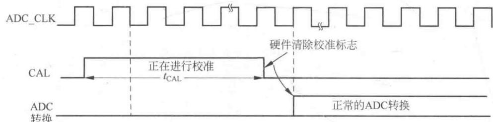

**这张图怎么看**（原图只有**三行波形**，不要去找第四行）：

1. **第一行是 `ADC_CLK`**：ADC 的时钟方波，横轴是时间。校准过程就是由这个时钟一步一步推动的。
2. **第二行是 `CAL` 信号**：它由软件置 1，然后保持一整段（图中标注 `t_CAL`，旁边写着"正在进行校准"），校准结束时**由硬件自动清 0**（图上标"硬件清除校准标志"）。
3. **第三行是 `ADC 转换`**：在 CAL 被清 0 之前它是空的（这段时间不能做正常转换）；CAL 被清 0 之后，才出现图中最后那段"**正常的 ADC 转换**"。

> ⚠️ 注意：**图 10-8 里并没有画 ADON 位，也没有画 RSTCAL 阶段**——这两件事只出现在教材正文和例 10-1 的代码里。看图时不要拿着文字去图上找不存在的波形。

【补充解释】**校准的顺序不能颠倒，这是初学者最容易漏的一步**：

```
① 确保 ADON = 0（ADC 关电），至少保持 2 个 ADC 时钟
        ↓
② 置 RSTCAL = 1（复位校准寄存器），等它被硬件清 0
        ↓
③ 置 CAL = 1（开始校准），等它被硬件清 0
        ↓
④ 校准完成，现在可以正常转换了
```

【教材内容】教材原话还有一句重要提醒：**"如果正在进行转换时设置 RSTCAL，清除校准寄存器需要额外的周期。"** 所以最好老老实实按上面顺序来。

---

#### 2. 数据对齐（Data Alignment）

【教材内容】

> ADC_CR2 寄存器中的 **ALIGN 位**选择转换后数据储存的对齐方式。数据可以**左对齐或右对齐**。

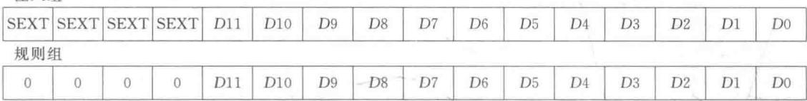

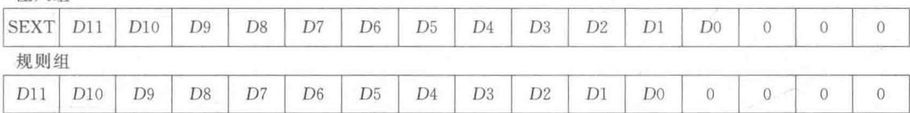

**这两张图怎么看**：图 10-9 和图 10-10 都是 16 个小格子（bit15～bit0），里面写着 D11～D0。

**图 10-9（右对齐）**：D11～D0 靠在**最右边**，左边 4 个格子空着（规则组补 0，注入组是 SEXT 符号扩展位）。

**图 10-10（左对齐）**：D11～D0 靠在**最左边**，右边 4 个格子补 0。

```
右对齐（ALIGN = 0）：          左对齐（ALIGN = 1）：
┌────┬────┬────┬────┬───┬───┬───┬───┐      ┌───┬───┬───┬───┬────┬────┬────┬────┐
│ 0  │ 0  │ 0  │ 0  │D11│D10│D9 │D8 │ ...  │D11│D10│D9 │D8 │ D7 │ D6 │ D5 │ D4 │ ...
└────┴────┴────┴────┴───┴───┴───┴───┘      └───┴───┴───┴───┴────┴────┴────┴────┘
 bit15 bit14 bit13 bit12  ↑                    ↑
                        D0 在最右           D11 在最左
```

【辅助理解图】把"同一个 12 位数据，两种摆放方式，读出来的数差 16 倍"画清楚：

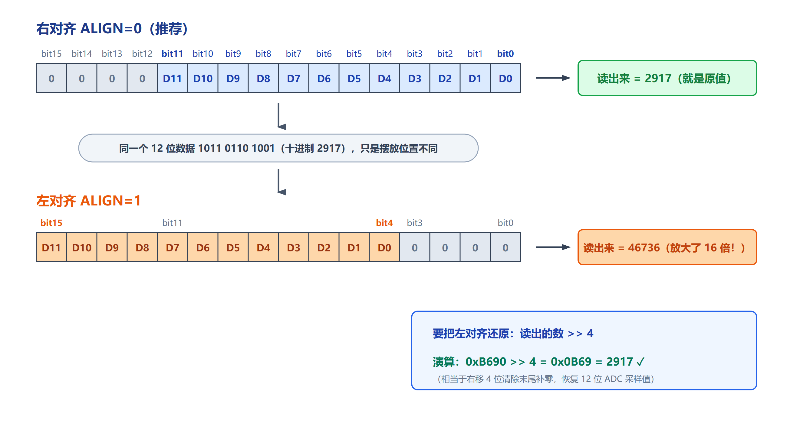

**看图方法**：图分上下两栏。上栏是右对齐：12 位数据贴着右边放，左边补 4 个 0，读出来就是 2917。下栏是左对齐：同样的 12 位数据贴着左边放，右边补 4 个 0，读出来变成 46736（正好是 16 倍）。中间用一个大箭头标出"左对齐 = 右对齐的值 × 16"。**这张图要你记住：左对齐读出的数不是 0～4095，要 `>> 4` 才能还原。**

【补充解释】**用哪个？怎么选？**

| 对齐方式 | 读出来的数 | 什么时候用 |
|---|---|---|
| **右对齐** | 直接就是 0～4095，**不用做任何处理** | 最常用，最省事 |
| **左对齐** | 数值被放大了 16 倍（左移 4 位） | 想直接取"高 8 位"当 8 位精度用；或和某些算法对接 |

**举个数值例子（不要跳步）**：

假设转换结果是 12 位数据 `1011 0110 1001`（十进制 2917）。

**右对齐**时，ADC_DR 里的 16 位内容是：

```
0000 1011 0110 1001   = 0x0B69 = 2917   ← 直接读就是原值 ✓
```

**左对齐**时：

```
1011 0110 1001 0000   = 0xB690 = 46736   ← 数值变了！
```

如果你想把左对齐的数据还原成真实值，要**右移 4 位**：

```
0xB690 >> 4 = 0x0B69 = 2917  ✓ 还原成功
```

> ⚠️ **【容易搞混】** 左对齐时读出的数**不是** 0～4095，千万不要直接拿去算电压！要么用右对齐，要么记得 `>> 4`。

【教材内容】关于注入组的对齐，教材补充：

> 注入组通道转换的数据值已经减去了 **ADC_JOFRx 寄存器**中定义的偏移量，因此结果**可以是一个负值**。**SEXT 位是扩展的符号值。**
>
> 对于规则组通道，不需要减去偏移值，因此只有 12 个位有效。

【补充解释】

- **规则组**：结果只有 12 位有效（0～4095），左边 4 位补 0；
- **注入组**：结果先减去你在 JOFRx 里设的偏移量，可能是负数，所以要用**符号扩展**（左边 4 位补的是符号位，全 0 或全 1）。这就是图 10-9 里注入组那行写 SEXT 的原因。

---

#### 3. 可编程的通道采样时间

【教材内容】

> ADC 使用若干个 **ADC_CLK 周期**对输入电压采样，采样周期数目可以通过 **ADC_SMPR1 和 ADC_SMPR2 寄存器中的 SMP[2:0] 位**更改。**每个通道可以分别用不同的时间采样。**
>
> 总转换时间按式(10-1)计算：
>
> **T_conv = 采样时间 + 12.5 个周期**

【教材内容】教材的例子：当 ADCCLK = 14MHz，采样时间为 1.5 周期时，T_conv = 1.5 + 12.5 = 14 个周期 = 1μs。

**SMP[2:0] 的 8 种取值**：

| SMP[2:0] | 采样周期数 | ADCCLK=12MHz 时采样时间 | 加上 12.5 后的总转换时间 |
|---|---|---|---|
| 000 | 1.5 | 0.125μs | 14 周期 ≈ 1.167μs |
| 001 | 7.5 | 0.625μs | 20 周期 ≈ 1.667μs |
| 010 | 13.5 | 1.125μs | 26 周期 ≈ 2.167μs |
| 011 | 28.5 | 2.375μs | 41 周期 ≈ 3.417μs |
| 100 | 41.5 | 3.458μs | 54 周期 ≈ 4.5μs |
| 101 | 55.5 | 4.625μs | 68 周期 ≈ 5.667μs |
| 110 | 71.5 | 5.958μs | 84 周期 ≈ 7μs |
| 111 | 239.5 | 19.958μs | 252 周期 = 21μs |

【补充解释】**怎么选采样时间？** 一句话原则：

> **信号源内阻越大，采样时间就要越长。**

因为采样电容充电需要时间，内阻大 = 充电慢。经验上，如果信号源内阻在几 kΩ 以内，用 7.5 或 13.5 周期通常够了；如果信号源内阻达到几十 kΩ 以上（比如用大阻值电阻分压出来的信号），就要用更长的档位（如 239.5 周期）。

【教材内容】还有一句注意事项：

> **在采样周期中通道选择位必须保持不变。**

【补充解释】也就是说，**不能在采样的过程中去改 SQR/JSQR 寄存器**，否则采到的数据不可靠。教材在通道选择那节也说过："如果 ADC_SQRx 或 ADC_JSQR 寄存器在转换期间被更改，当前的转换被清除，一个新的启动脉冲将发送到 ADC 以转换新选择的组。"

---

#### 4. 外部触发转换（已在 10.2.3 第 11 小节讲过）

这里只补一句【教材内容】的总结：

> 转换可以由外部事件触发（例如定时器捕获、EXTI 线）。如果设置了 EXTTRIG 控制位，则外部事件就能够触发转换。EXTSEL[2:0] 和 JEXTSEL[2:0] 控制位允许应用程序选择 8 个可能事件中的某一个。

---

#### 5. DMA 请求（已在 10.2.3 第 12 小节讲过）

---

#### 6. 双 ADC 模式（已在 10.2.3 第 13 小节讲过）

---

#### 7. 温度传感器

【教材内容】

> 温度传感器可以用来测量器件周围的温度（TA）。
>
> 温度传感器在内部和 **ADC1_IN16** 输入通道相连接，此通道把传感器输出的电压转换成数字值。温度传感器模拟输入**推荐采样时间是 17.1μs**。
>
> 如果不使用温度传感器，那么可以将传感器置于关电模式。
>
> 温度传感器输出的电压随温度线性变化，由于生产过程的变化，不同芯片的温度变化曲线的偏移会有不同。**内部温度传感器更适合于检测温度的变化，而不是测量绝对的温度。**如果需要测量精确的温度，应该使用一个外置的温度传感器。

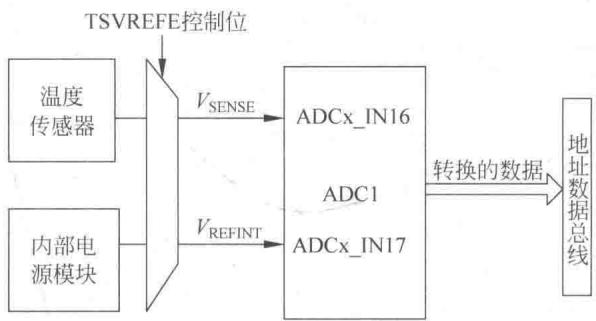

**这张图怎么看**：

1. 左边有一个"温度传感器"方块，它的输出是一路**模拟电压**；
2. 这个电压**在芯片内部**直接连到 ADC1 的 **通道 16**（所以不需要外部引脚）；
3. 下面还有一个 **VREFINT**（内部参考电压）方块，连到 **通道 17**；
4. 这两个方块都有一个"使能开关"，由 **ADC_CR2 的 TSVREFE 位**控制；
5. 右边是 ADC 的转换核心。

**这张图要我理解什么**：通道 16 和通道 17 是"**芯片内部的虚拟引脚**"，用法和外部通道一模一样——选通道、设采样时间、启动转换、读结果。

【教材内容】**使用传感器读取温度的步骤如下**：

> （1）选择 **ADC1_IN16** 输入通道；
> （2）选择采样时间为 **17.1μs**；
> （3）设置 ADC 控制寄存器 2（ADC_CR2）的 **TSVREFE 位**，以唤醒关电模式下的温度传感器；
> （4）设置 **ADON 位**启动 ADC 转换（或用外部触发）；
> （5）读 ADC 数据寄存器中的数据结果 **VSENSE**；
> （6）利用公式(10-2)得出温度。

【教材内容】温度计算公式（式 10-2）：

```
温度(℃) = {(V25 − VSENSE) / Avg_Slope} + 25
```

其中：

- **V25** = VSENSE 在 25℃ 时的数值；
- **Avg_Slope** = 温度与 VSENSE 曲线的平均斜率（单位为 mV/℃ 或 μV/℃）；
- 参考数据手册的电气特性获得 V25 和 Avg_Slope 的实际值。

【补充解释】**这个公式为什么长这样？** 因为温度传感器输出电压是**随温度升高而下降**的：

```
VSENSE
  ↑
  │╲
  │ ╲   ← 这条曲线"往下走"：温度越高，VSENSE 越小
  │  ╲     曲线的斜率是 −4.3mV/℃
  │   ╲
  └────╲────────→ 温度
       25℃ 处 = V25
```

所以：

- 当前测到 VSENSE，比 25℃ 时少了多少 → (V25 − VSENSE)；
- 每升高 1℃，VSENSE 就下降 4.3mV → 用"少了多少"除以 4.3mV/℃，就得到"比 25℃ 高了几度"；
- 再加上基准 25℃。

【补充解释】**符号约定要说清楚**：数据手册里给出的 **Avg_Slope 是一个正值 4.3mV/℃**，配套的公式就是上面那个 `(V25 − VSENSE) / Avg_Slope`。曲线本身是下降的，但在公式里，这个"下降"是通过 **V25 − VSENSE 为正**来体现的，不需要再把斜率写成负数。**同一个事实的两种写法（分子、分母的符号必须配套改变）不能只改一半。**

**举个数值例子**（数值仅用于演示计算方法，实际值必须查数据手册）：

```
假设 V25 = 1.43V，Avg_Slope = 4.3mV/℃（数据手册给的是正值）
实测 VSENSE = 1.30V

第 1 步：算分子
        V25 − VSENSE = 1.43V − 1.30V = +0.13V = 130mV
        含义：现在测到的电压比 25℃ 时低了 130mV
              → 说明温度比 25℃ 高（不是低）

第 2 步：除以斜率
        130mV ÷ 4.3mV/℃ = 30.2℃
        含义：比 25℃ 高了 30.2℃

第 3 步：加上基准 25℃
        温度 = 30.2 + 25 = 55.2℃
```

**结论：VSENSE 比 V25 小 → 温度高于 25℃。** 这个方向千万不要搞反——电压低说明"热"（正温度系数传感器是反过来的），这正是数据手册反复强调"内部温度传感器更适合检测温度的变化，而不是测绝对温度"的原因之一。

> ⚠️ 这里也再次印证教材那句话：**"内部温度传感器更适合于检测温度的变化，而不是测量绝对的温度。"** 因为每颗芯片的 V25 和斜率都有偏差。

---

### 10.2.5 STM32 的 ADC 中断请求

【教材内容】

> 规则和注入组转换结束时能产生中断，当模拟看门狗状态位被置位时也能产生中断。它们都有**独立的中断使能位**。
>
> ADC_SR 寄存器中有两个标志：**JSTRT**（注入组通道转换的启动）和 **STRT**（规则组通道转换的启动），但是**它们没有相关联的中断**。

**ADC 中断请求表（表 10-6）**：

| 中断事件 | 事件标志 | 使能控制位 |
|---|---|---|
| 规则组转换结束 | **EOC** | **EOCIE** |
| 注入组转换结束 | **JEOC** | **JEOCIE** |
| 设置了模拟看门狗状态位 | **AWD** | **AWDIE** |

【补充解释】**这张表要这样记**：

```
"出了什么事"（标志位）        "要不要通知 CPU"（使能位）
      EOC          ←──── 配成一对 ────→      EOCIE
     JEOC          ←──── 配成一对 ────→     JEOCIE
      AWD          ←──── 配成一对 ────→      AWDIE
```

**标志位由硬件置 1，由软件清 0**（或者读 ADC_DR 时自动清）。使能位由软件设置。

【补充解释】为什么 STRT / JSTRT 没有中断？因为它们只是"转换开始了"的通知，实际编程中用处不大（真正关心的是"转换**结束**了"）。

---

### 10.2.6 STM32 的 ADC 寄存器

#### 先建立"地址 → 地址空间 → 外设基地址 → 寄存器偏移 → 最终地址"这条链

【教材内容】原教材直接给出：

> ADC1 寄存器的起始地址是 **0x4001 2400**，ADC2 寄存器的起始地址是 **0x4001 2800**，ADC3 寄存器的起始地址是 **0x4001 3C00**。

**不要死记这三个地址。要顺着链条推一遍，推一次就再也不会忘。**

```
第 1 步：CPU 的地址空间里，外设都住在 0x40000000 开始的那一大片
        PERIPH_BASE = 0x40000000

第 2 步：外设又按"挂在哪条总线上"分区
        APB1 外设从 0x40000000 开始（低速外设：定时器2~7、USART2/3、DAC…）
        APB2 外设从 0x40000000 + 0x10000 = 0x40010000 开始（高速外设：GPIO、ADC、USART1…）

第 3 步：ADC 挂在 APB2 上，再往后排
        ADC1 = APB2 基地址 + 0x2400 = 0x40010000 + 0x2400 = 0x40012400
        ADC2 = APB2 基地址 + 0x2800 = 0x40010000 + 0x2800 = 0x40012800
        ADC3 = APB2 基地址 + 0x3C00 = 0x40010000 + 0x3C00 = 0x40013C00

第 4 步：每个寄存器 = 基地址 + 自己的偏移
        例如 ADC1 的状态寄存器 SR，偏移 0x00
             地址 = 0x40012400 + 0x00 = 0x40012400
        例如 ADC1 的控制寄存器 2 CR2，偏移 0x08
             地址 = 0x40012400 + 0x08 = 0x40012408
        例如 ADC1 的规则数据寄存器 DR，偏移 0x4C
             地址 = 0x40012400 + 0x4C = 0x4001244C
```

【辅助理解图】把这条链画成一张"门牌号地图"：

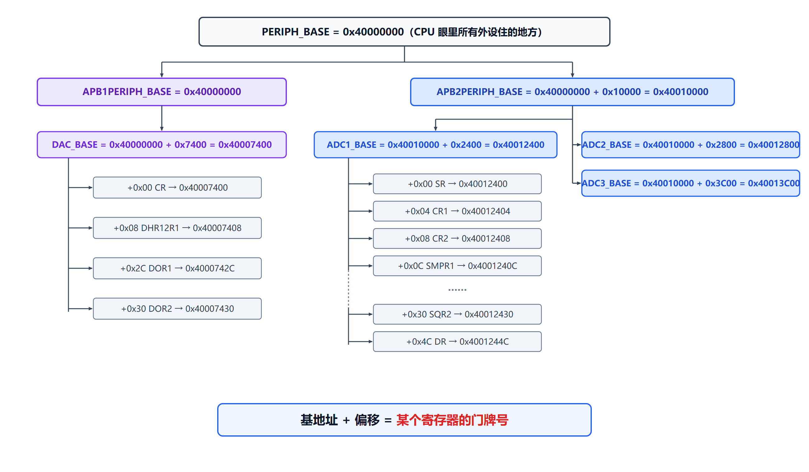

**看图方法**：最上面是 0x40000000 这片"外设小区"；往下分成 APB1 和 APB2 两条街；ADC 住在 APB2 街的 0x2400 号；再往下是 ADC1 内部一排房间（SR、CR1、CR2…），每个房间有自己的偏移号。**基地址 + 偏移 = 房间的门牌号。**

#### ADC 全部寄存器一览表（含最终地址）

| 偏移 | 名称 | 中文名 | ADC1 最终地址 |
|---|---|---|---|
| 0x00 | ADC_SR | 状态寄存器 | 0x40012400 |
| 0x04 | ADC_CR1 | 控制寄存器 1 | 0x40012404 |
| 0x08 | ADC_CR2 | 控制寄存器 2 | 0x40012408 |
| 0x0C | ADC_SMPR1 | 采样时间寄存器 1 | 0x4001240C |
| 0x10 | ADC_SMPR2 | 采样时间寄存器 2 | 0x40012410 |
| 0x14 | ADC_JOFR1 | 注入通道数据偏移寄存器 1 | 0x40012414 |
| 0x18 | ADC_JOFR2 | 注入通道数据偏移寄存器 2 | 0x40012418 |
| 0x1C | ADC_JOFR3 | 注入通道数据偏移寄存器 3 | 0x4001241C |
| 0x20 | ADC_JOFR4 | 注入通道数据偏移寄存器 4 | 0x40012420 |
| 0x24 | ADC_HTR | 看门狗高阈值寄存器 | 0x40012424 |
| 0x28 | ADC_LTR | 看门狗低阈值寄存器 | 0x40012428 |
| 0x2C | ADC_SQR1 | 规则序列寄存器 1 | 0x4001242C |
| 0x30 | ADC_SQR2 | 规则序列寄存器 2 | 0x40012430 |
| 0x34 | ADC_SQR3 | 规则序列寄存器 3 | 0x40012434 |
| 0x38 | ADC_JSQR | 注入序列寄存器 | 0x40012438 |
| 0x3C | ADC_JDR1 | 注入数据寄存器 1 | 0x4001243C |
| 0x40 | ADC_JDR2 | 注入数据寄存器 2 | 0x40012440 |
| 0x44 | ADC_JDR3 | 注入数据寄存器 3 | 0x40012444 |
| 0x48 | ADC_JDR4 | 注入数据寄存器 4 | 0x40012448 |
| 0x4C | ADC_DR | 规则数据寄存器 | 0x4001244C |

【补充解释】**规律**：偏移量从 0x00 开始，每个寄存器占 **4 个字节**（32 位），所以相邻偏移差 0x04。数一数：0x00、0x04、0x08、0x0C、0x10……正好 20 个寄存器，最后一个是 0x4C。

> 这一排地址**不需要背**。写代码时用固件库的 `ADC1->CR2` 这种写法，编译器会自动算地址。你只要理解"它们是一排连续的格子"就够了。

---

#### 1. 状态寄存器（ADC_SR）

**它属于谁**：ADC1 / ADC2 / ADC3 各自一个。

**它控制什么 / 为什么需要它**：它是 ADC 的"**报告栏**"。ADC 干完活或者发现异常，就在这里挂个"小旗子"（标志位置 1），程序来读它就知道发生了什么。

**地址偏移：0x00，复位值：0x0000 0000。**

```
  31                                5   4     3     2     1     0
┌───────────────────────────────────┬─────┬─────┬─────┬─────┬─────┐
│              保留                  │STRT │JSTRT│JEOC │ EOC │ AWD │
└───────────────────────────────────┴─────┴─────┴─────┴─────┴─────┘
                                      ↑
                                  当前重点：这 5 个标志位
  读写属性：rc_w0 = 读可以得到当前值；写 0 可以清除它；写 1 无效
```

| 位 | 名称 | 全称 | 大白话 | 0 表示 | 1 表示 |
|---|---|---|---|---|---|
| 4 | **STRT** | Regular channel **Start** flag | 规则通道**开始**了吗 | 规则通道转换未开始 | 规则通道转换已开始 |
| 3 | **JSTRT** | **J**njected channel **Start** flag | 注入通道**开始**了吗 | 注入通道组转换未开始 | 注入通道组转换已开始 |
| 2 | **JEOC** | **J**njected channel **E**nd **o**f **C**onversion | 注入通道**采完了** | 转换未完成 | 转换完成 |
| 1 | **EOC** | **E**nd **o**f **C**onversion | 规则通道**采完了** | 转换未完成 | 转换完成 |
| 0 | **AWD** | **A**nalog **W**atch**d**og flag | 看门狗报警了 | 没有发生看门狗事件 | 发生看门狗事件 |

【教材内容】

> 位 4：STRT，规则通道开始位。该位由硬件在规则通道转换开始时设置，由软件清除。
>
> 位 3：JSTRT，注入通道开始位。该位由硬件在注入通道组转换开始时设置，由软件清除。
>
> 位 2：JEOC，注入通道转换结束位。该位由硬件在所有注入通道组转换结束时设置，由软件清除。
>
> 位 1：EOC，转换结束位。该位由硬件在（规则或注入）通道组转换结束时设置，**由软件清除或由读取 ADC_DR 时清除**。
>
> 位 0：AWD，模拟看门狗标志位。该位由硬件在转换的电压值超出了 ADC_LTR 和 ADC_HTR 寄存器定义的范围时设置，由软件清除。

【补充解释】**"rc_w0"是什么意思？**

这是 STM32 手册里的一种读写属性记号：

```
r  = read，可以读
c  = clear，写 0 会清除这一位
w0 = write 0，只有写 0 有效；写 1 什么都不做
```

所以 `rc_w0` 的意思是：**读它可以知道状态；想清掉它，要写 0；写 1 反而没用。**

【补充解释】**EOC 有两种清除方式，这一点很实用**：

```
方式一：软件写 0 清除      ADC1->SR = 0;  （或 &= ~(1<<1)）
方式二：读取 ADC_DR 时自动清除
```

方式二意味着：**你只要读了转换结果，EOC 就自动清掉了**，不用额外写代码。所以例 10-1 里 `ADC_GetConversionValue()` 之后不需要再手动清标志。

---

#### 2. ADC 控制寄存器 1（ADC_CR1）

**它属于谁**：ADC1 / ADC2 / ADC3 各自一个。

**它控制什么**：ADC 的"**总配置面板**"——工作模式（扫描/间断/双 ADC）、中断使能、模拟看门狗的开关和通道选择。

**为什么需要它**：这些设置是"一次配好、长期有效"的工作方式，不需要每采一次就改。

**地址偏移：0x04，复位值：0x0000 0000。**

这个寄存器有 32 个开关，一屏画不下，我们**分成上下两行**看（STM32 手册里也是这样排的）。

**高 16 位（bit31～bit16）：**

```
  31                              24 23    22 21  20 19          16
┌──────────────────────────────────┬───────┬──────┬─────┬───────────────┐
│              保留                 │AWDEN  │JAWDEN│保留 │ DUALMOD[3:0]  │
└──────────────────────────────────┴───────┴──────┴─────┴───────────────┘
                                    ↑       ↑              ↑
                              规则通道看门狗 注入通道看门狗  双ADC模式
```

**低 16 位（bit15～bit0）：**

```
  15 14 13   12      11      10     9      8     7      6      5     4        0
┌─────────┬───────┬───────┬──────┬───────┬─────┬───────┬──────┬─────┬──────────────┐
│  DISCNUM│JDISCEN│DISCEN │JAUTO │AWDSGL │SCAN │JEOCIE │AWDIE │EOCIE│  AWDCH[4:0]  │
│  [2:0]  │       │       │      │       │     │       │      │     │              │
└─────────┴───────┴───────┴──────┴───────┴─────┴───────┴──────┴─────┴──────────────┘
     ↑         ↑       ↑      ↑      ↑      ↑       ↑      ↑     ↑
  间断通道数 注入间断 规则间断 自动注入 单通道看门狗 扫描  JEOC中断 AWD中断 EOC中断  看门狗通道号
```

> 【补充解释】**注意 DISCNUM[2:0] 位于 bit15～bit13。**教材表格把它和 bit31～bit16 印在了同一行，容易让人以为它属于高 16 位；实际上它是低 16 位的最上面 3 位（bit15 是低半区的最高位）。

**逐位说明（教材原文）：**

| 位 | 名称 | 0 时 | 1 时 |
|---|---|---|---|
| 23 | **AWDEN** | 在规则通道上**禁用**模拟看门狗 | 在规则通道上**使用**模拟看门狗 |
| 22 | **JAWDEN** | 在注入通道上**禁用**模拟看门狗 | 在注入通道上**使用**模拟看门狗 |
| 21:20 | 保留 | **必须保持为 0** | — |
| 19:16 | **DUALMOD[3:0]** | 选择双 ADC 模式（0000=独立模式，详见前面表格） | |
| 15:13 | **DISCNUM[2:0]** | 间断模式下，收到外部触发后转换的规则通道数目：000=1 个、001=2 个、010=3 个、011=4 个、100=5 个、101=6 个、110=7 个、111=8 个 | |
| 12 | **JDISCEN** | 注入通道组上**禁用**间断模式 | 注入通道组上**使用**间断模式 |
| 11 | **DISCEN** | 规则通道组上**禁用**间断模式 | 规则通道组上**使用**间断模式 |
| 10 | **JAUTO** | 关闭自动的注入通道组转换 | 开启自动的注入通道组转换 |
| 9 | **AWDSGL** | 在**所有的通道**上使用模拟看门狗 | 在**单一通道**上使用模拟看门狗（由 AWDCH 指定） |
| 8 | **SCAN** | 关闭扫描模式 | 使用扫描模式 |
| 7 | **JEOCIE** | 禁止 JEOC 中断 | 允许 JEOC 中断 |
| 6 | **AWDIE** | 禁止模拟看门狗中断 | 允许模拟看门狗中断 |
| 5 | **EOCIE** | 禁止 EOC 中断 | 允许 EOC 中断 |
| 4:0 | **AWDCH[4:0]** | 模拟看门狗保护的输入通道号：00000=通道0、00001=通道1、…、01111=通道15、10000=通道16、10001=通道17；**保留所有其他数值** | |

【补充解释】**"位[21:20] 保留，必须保持为 0"是什么意思？**

"保留（Reserved）"表示这几位现在**没有定义用途**，手册要求你**必须写 0**。不要觉得"我随便写个 1 试试"——保留位的行为是未定义的，可能导致奇怪的问题。

**操作演示：假设我们要"打开 EOC 中断，同时启用扫描模式"，代码怎么写？**

```
第 1 步：想清楚要动哪两位
        EOCIE 在 bit5
        SCAN  在 bit8

第 2 步：造一个掩码（mask）
        1 << 5  = 0x0000 0020    （二进制 0000 0000 0000 0000 0000 0000 0010 0000）
        1 << 8  = 0x0000 0100    （二进制 0000 0000 0000 0000 0000 0001 0000 0000）
        两个或起来 = 0x0000 0120

第 3 步：用"或运算"把这两位置 1（不影响其它位）
        运算前：ADC1->CR1 = 0x0000 0000
        掩  码：            0x0000 0120
        ─────────────────────────────────
        运算后：ADC1->CR1 = 0x0000 0120
```

```
        ADC1->CR1 |= (1 << 5) | (1 << 8);
                      ↑          ↑
                   EOCIE=1    SCAN=1
```

**操作之后硬件发生什么**：

1. EOCIE = 1 → 以后每次规则组转换结束、EOC 置 1 时，ADC 会向 NVIC 发出中断请求；
2. SCAN = 1 → 以后一次启动会把 SQR 里选的多个通道依次采一遍。

---

#### 3. ADC 控制寄存器 2（ADC_CR2）

**它属于谁**：ADC1 / ADC2 / ADC3 各自一个。

**它控制什么**：ADC 的"**启动台**"——上电、启动转换、连续模式、数据对齐、DMA、校准、触发选择、温度传感器使能。

**为什么需要它**：前面 CR1 管"长期工作方式"，CR2 管"启动和结果格式"，分工不同。

**地址偏移：0x08，复位值：0x0000 0000。**

```
  31                              24 23     22      21      20     19      17 16
┌──────────────────────────────────┬────────┬───────┬───────┬───────┬──────────┬─────┐
│              保留                 │TSVREFE │SWSTART│JSWSTART│EXTTRIG│EXTSEL[2:0]│保留 │
└──────────────────────────────────┴────────┴───────┴───────┴───────┴──────────┴─────┘
                                      ↑        ↑        ↑        ↑         ↑
                                  温度传感器 软件启动 软件启动 规则外部  规则触发源
                                  使能       规则组   注入组   触发使能   选择
```

```
  15      14      12 11    10  9  8  7      4  3      2    1     0
┌───────┬──────────┬─────┬──────┬─────┬────────┬───────┬──────┬─────┬──────┐
│JEXTTRIG│JEXTSEL[2:0]│ALIGN│ 保留 │ DMA │  保留   │RSTCAL │ CAL  │ CONT │ ADON │
└───────┴──────────┴─────┴──────┴─────┴────────┴───────┴──────┴─────┴──────┘
     ↑        ↑        ↑            ↑               ↑      ↑      ↑     ↑
 注入外部  注入触发  数据对齐      DMA使能        复位校准 校准  连续  开关/
 触发使能  源选择                                                           启动
```

**逐位说明（教材原文）：**

| 位 | 名称 | 说明 |
|---|---|---|
| 23 | **TSVREFE** | 温度传感器和 VREFINT 使能。0=禁止；1=启用。（多于 1 个 ADC 的器件中，该位仅出现在 ADC1 中） |
| 22 | **SWSTART** | 开始转换**规则通道**。由软件设置以启动转换，软件可清除或在转换开始后由硬件马上清除 |
| 21 | **JSWSTART** | 开始转换**注入通道**。0=复位状态；1=开始转换注入通道 |
| 20 | **EXTTRIG** | 规则通道的外部触发转换模式。0=不用外部事件启动转换；1=使用外部事件启动转换 |
| 19:17 | **EXTSEL[2:0]** | 选择启动**规则通道组**转换的外部事件（ADC1/ADC2：000=TIM1_CC1、001=TIM1_CC2、010=TIM1_CC3、011=TIM2_CC2、100=TIM3_TRGO、101=TIM4_CC4、110=EXTI11/TIM8_TRGO、111=SWSTART；ADC3 不同，见前表） |
| 16 | 保留 | **必须保持为 0** |
| 15 | **JEXTTRIG** | 注入通道的外部触发转换模式。0=不用外部事件；1=使用外部事件 |
| 14:12 | **JEXTSEL[2:0]** | 选择启动**注入通道组**转换的外部事件（ADC1/ADC2：000=TIM1_TRGO、001=TIM1_CC4、010=TIM2_TRGO、011=TIM2_CC1、100=TIM3_CC4、101=TIM4_TRGO、110=EXTI15/TIM8_CC4、111=JSWSTART） |
| 11 | **ALIGN** | 数据对齐。**0=右对齐；1=左对齐** |
| 10:9 | 保留 | **必须保持为 0** |
| 8 | **DMA** | 直接存储器访问模式。0=不使用 DMA；1=使用 DMA。（只有 ADC1 和 ADC3 能产生 DMA 请求） |
| 7:4 | 保留 | **必须保持为 0** |
| 3 | **RSTCAL** | 复位校准。0=校准寄存器已初始化；1=初始化校准寄存器 |
| 2 | **CAL** | A/D 校准。0=校准完成；1=开始校准。由软件设置以开始校准，在校准结束时由硬件清除 |
| 1 | **CONT** | 连续转换。**0=单次转换模式；1=连续转换模式** |
| 0 | **ADON** | 开/关 A/D 转换器。**0=关闭 ADC 转换/校准，并进入断电模式；1=开启 ADC 并启动转换** |

【教材内容】关于 ADON，教材有一句特别重要的解释：

> 当该位为 0 时，写入 1 将把 ADC 从断电模式下唤醒。当该位为 1 时，写入 1 将启动转换。应用程序需注意，在转换器上电至转换开始有一个延迟 t_STAB，参见图 10-5。
>
> **如果在这个寄存器中与 ADON 一起还有其他位被改变，则转换不被触发。**这是为了防止触发错误的转换。

【补充解释】**"写 1 才能置位，写 0 无效"的位**（SWSTART / JSWSTART / RSTCAL / CAL）说明一下：

这几个位属于"**启动命令**"类。程序写 1 表示"执行这个动作"，动作完成后由硬件自动清 0。**你写 0 什么都不会发生**（不会"取消"，也不会"复位"）。这跟普通配置位（写 0 有效）不一样，别搞混。

**操作演示：软件启动一次 ADC 转换（假设其它配置都已完成）**

```
        ADC1->CR2 |= (1 << 0);   // 把 ADON 置 1
                    ↑
                 bit0 = ADON
```

**运算前后**：

```
运算前：CR2 = 0x0000 0000
掩  码：       0x0000 0001
──────────────────────────
运算后：CR2 = 0x0000 0001   ← ADON = 1
```

**硬件发生什么**：第一次写 ADON=1 → ADC 从断电模式唤醒，开始 t_STAB 稳定等待；第二次写 ADON=1（或在单次模式下由软件触发）→ 真正开始转换。

> 【补充解释】固件库把这套动作包成了函数，实际写代码时通常用 `ADC_Cmd(ADC1, ENABLE)` 和 `ADC_SoftwareStartConvCmd(ADC1, ENABLE)`，不需要自己写位操作。但**你必须知道库函数背后动的是哪一位**——这就是"软硬件联动"。

---

#### 4. ADC 采样时间寄存器 1（ADC_SMPR1）

**它属于谁**：每个 ADC 一个。

**它控制什么**：**通道 10～17 各自采多久**。

**为什么需要它**：不同信号源内阻不同，需要的充电时间不同；分开设置才能既保证精度又不浪费时间。

**地址偏移：0x0C，复位值：0x0000 0000。**

```
  31              24 23      21 20      18 17      15 14      12 11      9  8      6  5      3  2      0
┌──────────────────┬──────────┬──────────┬──────────┬──────────┬──────────┬──────────┬──────────┬──────────┐
│       保留        │SMP17[2:0]│SMP16[2:0]│SMP15[2:0]│SMP14[2:0]│SMP13[2:0]│SMP12[2:0]│SMP11[2:0]│SMP10[2:0]│
└──────────────────┴──────────┴──────────┴──────────┴──────────┴──────────┴──────────┴──────────┴──────────┘
                                                                                    ↑
                                                                        当前重点：每个通道 3 个 bit
```

**SMPx[2:0] 的 8 种取值**（SMPR1 和 SMPR2 共用同一套编码）：

| SMP[2:0] | 采样周期 | SMP[2:0] | 采样周期 |
|---|---|---|---|
| 000 | 1.5 | 100 | 41.5 |
| 001 | 7.5 | 101 | 55.5 |
| 010 | 13.5 | 110 | 71.5 |
| 011 | 28.5 | 111 | 239.5 |

【教材内容】位[23:0]：SMPx[2:0]，选择通道 x 的采样时间。这些位用于**独立地**选择每个通道的采样时间。**在采样周期中通道选择位必须保持不变。**

【补充解释】**为什么通道 16、17 也在 SMPR1 里？** 因为它们是内部通道（温度传感器、VREFINT），也需要设置采样时间。前面讲过，温度传感器推荐 17.1μs，对应很长的采样周期。

---

#### 5. ADC 采样时间寄存器 2（ADC_SMPR2）

**它控制什么**：**通道 0～9 各自采多久**。

**地址偏移：0x10，复位值：0x0000 0000。**

```
  31   30 29      27 26      24 23      21 20      18 17      15 14      12 11      9  8      6  5      3  2      0
┌───────┬──────────┬──────────┬──────────┬──────────┬──────────┬──────────┬──────────┬──────────┬──────────┬──────────┐
│ 保留  │ SMP9[2:0]│ SMP8[2:0]│ SMP7[2:0]│ SMP6[2:0]│ SMP5[2:0]│ SMP4[2:0]│ SMP3[2:0]│ SMP2[2:0]│ SMP1[2:0]│ SMP0[2:0]│
└───────┴──────────┴──────────┴──────────┴──────────┴──────────┴──────────┴──────────┴──────────┴──────────┴──────────┘
                                                                                                        ↑
                                                                                          当前重点：通道 1 的采样时间
```

【补充解释】位[29:0]：SMPx[2:0]，选择通道 x 的采样时间。取值编码与 SMPR1 完全相同。

> 【补充解释】**STM32F103 的 ADC 只有 SMPR1 和 SMPR2 两个采样时间寄存器，没有 SMPR3。**（SMPR1 管通道 10～17，SMPR2 管通道 0～9，一共 18 个通道正好装完。）有些资料会提到"SMPR3"，那是更新型号（如 STM32F4 系列）才有的寄存器，不要和本章混在一起。

**操作演示：把通道 1 的采样时间设为 239.5 周期**

```
第 1 步：通道 1 对应 SMP1[2:0]，位于 bit5～bit3
第 2 步：239.5 周期的编码是 111
第 3 步：把这个 111 放到 bit5~bit3 的位置
        111 << 3 = 0b111000 = 0x0000 0038

运算前：SMPR2 = 0x0000 0000
掩  码：        0x0000 0038
──────────────────────────────
运算后：SMPR2 = 0x0000 0038
```

```
        ADC1->SMPR2 |= (7 << 3);   // 7 = 0b111，左移 3 位到 SMP1 的位置
```

**硬件发生什么**：以后只要采通道 1，采样阶段就持续 239.5 个 ADC 时钟周期，采样电容有充足时间充满。

【补充解释】固件库把这个操作包成了 `ADC_RegularChannelConfig(ADC1, 1, 1, ADC_SampleTime_239Cycles5);`，一眼就能看懂"通道 1、排第 1 位、采 239.5 周期"。

---

#### 6. ADC 注入通道数据偏移寄存器 x（ADC_JOFRx，x=1～4）

**它属于谁**：每个 ADC 有 4 个（对应注入组的 4 个通道）。

**它控制什么**：注入通道转换结果要**减去**的一个偏移量。

**为什么需要它**：可以把"某个基准值"当成 0。比如你想测量的是"相对于 1.5V 的变化量"，就设偏移为 1.5V 对应的数字，结果就直接是"偏差多少"。

**地址偏移：0x14～0x20，复位值：0x0000 0000。**

```
  31                            12 11                          0
┌───────────────────────────────┬───────────────────────────────┐
│            保留                │       JOFFSETx[11:0]          │
└───────────────────────────────┴───────────────────────────────┘
                                                 ↑
                                    当前重点：12 位偏移量
```

【教材内容】

> 位[31:12]：保留。必须保持为 0。
>
> 位[11:0]：JOFFSETx[11:0]，注入通道 x 的数据偏移。当转换注入通道时，这些位定义了用于**从原始转换数据中减去的数值**。转换的结果可以在 ADC_JDRx 寄存器中读出。

**操作演示**：设注入通道 1 的偏移为 0x080（十进制 128）

```
        ADC1->JOFR1 = 0x0000 0080;
```

**硬件发生什么**：以后注入通道 1 每采一次，结果 = 原始值 − 128，然后存进 JDR1。因为可能减出负数，所以 JDRx 要用符号扩展（这就是图 10-9 里 SEXT 的由来）。

---

#### 7. ADC 看门狗高阈值寄存器（ADC_HTR）

**地址偏移：0x24，复位值：0x0000 0000。**

```
  31                            12 11                          0
┌───────────────────────────────┬───────────────────────────────┐
│            保留                │         HT[11:0]              │
└───────────────────────────────┴───────────────────────────────┘
                                                 ↑
                                    当前重点：看门狗上限
```

【教材内容】位[11:0]：HT[11:0]，模拟看门狗**高阈值**。这些位定义了模拟看门狗的阈值高限。

**操作演示：把上限设为 3000**

```
3000 的十六进制 = 0x0BB8

        ADC1->HTR = 0x0000 0BB8;
```

**硬件发生什么**：以后每次转换结果 > 3000 时，ADC_SR 的 AWD 位置 1（若 AWDIE=1 还会产生中断）。

---

#### 8. ADC 看门狗低阈值寄存器（ADC_LTR）

**地址偏移：0x28，复位值：0x0000 0000。**

```
  31                            12 11                          0
┌───────────────────────────────┬───────────────────────────────┐
│            保留                │         LT[11:0]              │
└───────────────────────────────┴───────────────────────────────┘
                                                 ↑
                                    当前重点：看门狗下限
```

【教材内容】位[11:0]：LT[11:0]，模拟看门狗**低阈值**。这些位定义了模拟看门狗的阈值低限。

**操作演示：把下限设为 1000**

```
1000 的十六进制 = 0x03E8

        ADC1->LTR = 0x0000 03E8;
```

**硬件发生什么**：以后每次转换结果 < 1000 时，AWD 位置 1。

> 【补充解释】**HTR/LTR 只要 12 位就够**，因为转换结果是 0～4095，12 位正好装得下。多出来的高 20 位没用，必须写 0。

---

#### 9. ADC 规则序列寄存器 1（ADC_SQR1）

**它属于谁**：每个 ADC 一个。

**它控制什么**：**规则组一共几个通道（L[3:0]）**，以及**第 13～16 个转换是哪个通道**。

**为什么需要它**：16 个通道的编号需要 4 位（0～17 需要 5 位），一个 32 位寄存器装不下 16 组，所以分成 SQR1/SQR2/SQR3 三个。

**地址偏移：0x2C，复位值：0x0000 0000。**

```
  31              24 23      20 19          15 14          10 9        5 4          0
┌──────────────────┬──────────┬──────────────┬──────────────┬───────────┬────────────┐
│       保留        │  L[3:0]  │   SQ16[4:0]  │   SQ15[4:0]  │ SQ14[4:0] │  SQ13[4:0] │
└──────────────────┴──────────┴──────────────┴──────────────┴───────────┴────────────┘
                      ↑             ↑
              一共几个转换   第16个转换是哪个通道
```

【教材内容】

> 位[23:20]：L[3:0]，规则通道序列长度。0000=1 个转换；0001=2 个转换；……1111=16 个转换。
>
> 位[19:15]：SQ16[4:0]，规则序列中的第 16 个转换。定义转换序列中的第 16 个转换通道的编号（0～17）。
>
> 位[14:10]：SQ15[4:0]，规则序列中的第 15 个转换。
>
> 位[9:5]：SQ14[4:0]，规则序列中的第 14 个转换。
>
> 位[4:0]：SQ13[4:0]，规则序列中的第 13 个转换。

【补充解释】**L[3:0] 的编码和"个数"差 1**，这是个容易记错的点：

```
L[3:0] = 0000  →  1 个转换
L[3:0] = 0001  →  2 个转换
L[3:0] = 0010  →  3 个转换
   ...
L[3:0] = 1111  →  16 个转换

规律：个数 = L 的值 + 1
```

**为什么？** 因为"0 个转换"没有意义，所以硬件把 0000 定义成"最少也要有 1 个"。

**操作演示：只采 1 个通道（通道 1）**

```
L[3:0] 要写 0000（表示 1 个转换）
        ADC1->SQR1 = 0x0000 0000;   // L = 0000，其它位默认 0
```

**操作演示：采 3 个通道（通道 1、通道 2、通道 3）**

```
第 1 个转换 = 通道 1  → 写在 SQR3 的 SQ1[4:0]（bit4:0）
第 2 个转换 = 通道 2  → 写在 SQR3 的 SQ2[4:0]（bit9:5）
第 3 个转换 = 通道 3  → 写在 SQR3 的 SQ3[4:0]（bit14:10）

一共 3 个 → L[3:0] = 0010
注意：L[3:0] 在 SQR1 的 bit23~bit20，所以要左移 20 位：
        0010 << 20 = 0x0020 0000
                              ↑ 这个 2 落在 bit21 上

        ADC1->SQR1 = 0x0020 0000;   // L = 0b0010 → 3 个转换
        ADC1->SQR3 = (3 << 10) | (2 << 5) | (1 << 0);
                     ↑         ↑        ↑
                   SQ3=3     SQ2=2    SQ1=1
```

> ⚠️ **【最容易写错的地方】** L[3:0] 位于 **bit23～bit20**，**不是**低 16 位。如果写成 `0x0000 0020`，那个 2 实际落在 bit5 上（属于保留区/无关位），**L 仍然是 0000**——ADC 只会采 1 个通道，达不到"采 3 个通道"的目的。

**验算 SQR3 的值**：

```
3 << 10 = 0b0000 0000 0000 1100 0000 0000 = 0x00000C00
2 << 5  = 0b0000 0000 0000 0000 0000 0100 0000 = 0x00000040
1 << 0  = 0x00000001
────────────────────────────────────────────────
或起来  = 0x00000C41
```

**硬件发生什么**：一次启动后，ADC 依次采通道 1 → 通道 2 → 通道 3，每采完一个把结果写进 ADC_DR（会互相覆盖！所以要配 DMA 或每次及时读走）。

---

#### 10. ADC 规则序列寄存器 2（ADC_SQR2）

**它控制什么**：**第 7～12 个转换是哪个通道**。

**地址偏移：0x30，复位值：0x0000 0000。**

```
  31   30 29          25 24          20 19          15 14          10 9        5 4          0
┌───────┬──────────────┬──────────────┬──────────────┬──────────────┬───────────┬────────────┐
│ 保留  │   SQ12[4:0]  │   SQ11[4:0]  │   SQ10[4:0]  │   SQ9[4:0]   │  SQ8[4:0] │  SQ7[4:0]  │
└───────┴──────────────┴──────────────┴──────────────┴──────────────┴───────────┴────────────┘
```

【教材内容】

> 位[31:30]：保留。必须保持为 0。
>
> 位[29:25]：SQ12[4:0]，规则序列中的第 12 个转换。
>
> 位[24:20]：SQ11[4:0]，规则序列中的第 11 个转换。
>
> 位[19:15]：SQ10[4:0]，规则序列中的第 10 个转换。
>
> 位[14:10]：SQ9[4:0]，规则序列中的第 9 个转换。
>
> 位[9:5]：SQ8[4:0]，规则序列中的第 8 个转换。
>
> 位[4:0]：SQ7[4:0]，规则序列中的第 7 个转换。

---

#### 11. ADC 规则序列寄存器 3（ADC_SQR3）

**它控制什么**：**第 1～6 个转换是哪个通道**（最常用！因为大多数人只采 1～3 个通道）。

**地址偏移：0x34，复位值：0x0000 0000。**

```
  31   30 29          25 24          20 19          15 14          10 9        5 4          0
┌───────┬──────────────┬──────────────┬──────────────┬──────────────┬───────────┬────────────┐
│ 保留  │   SQ6[4:0]   │   SQ5[4:0]   │   SQ4[4:0]   │   SQ3[4:0]   │  SQ2[4:0] │  SQ1[4:0]  │
└───────┴──────────────┴──────────────┴──────────────┴──────────────┴───────────┴────────────┘
                                                                          ↑           ↑
                                                                    第2个转换     第1个转换
```

【教材内容】

> 位[29:25]：SQ6[4:0]，规则序列中的第 6 个转换。
>
> 位[24:20]：SQ5[4:0]，规则序列中的第 5 个转换。
>
> 位[19:15]：SQ4[4:0]，规则序列中的第 4 个转换。
>
> 位[14:10]：SQ3[4:0]，规则序列中的第 3 个转换。
>
> 位[9:5]：SQ2[4:0]，规则序列中的第 2 个转换。
>
> 位[4:0]：SQ1[4:0]，规则序列中的第 1 个转换。

【补充解释】**记住这个对应关系（很重要）**：

```
SQ1 → 第 1 个被转换的通道
SQ2 → 第 2 个被转换的通道
SQ3 → 第 3 个被转换的通道
...
SQ16 → 第 16 个被转换的通道
```

**"SQ 的下标 = 转换顺序"，不是"通道号"。** 这是初学者最容易搞混的地方。

---

#### 12. ADC 注入序列寄存器（ADC_JSQR）

**它控制什么**：**注入组的通道顺序和个数**。

**地址偏移：0x38，复位值：0x0000 0000。**

```
  31                        22 21    20 19          15 14          10 9        5 4          0
┌───────────────────────────┬────────┬──────────────┬──────────────┬───────────┬────────────┐
│           保留             │ JL[1:0]│  JSQ4[4:0]   │  JSQ3[4:0]   │  JSQ2[4:0]│  JSQ1[4:0] │
└───────────────────────────┴────────┴──────────────┴──────────────┴───────────┴────────────┘
                                ↑            ↑
                        注入组几个转换   第4个转换是哪个通道
```

【教材内容】

> 位[31:22]：保留。必须保持为 0。
>
> 位[21:20]：JL[1:0]，注入通道序列长度。00=1 个转换；01=2 个转换；10=3 个转换；11=4 个转换。
>
> 位[19:15]：JSQ4[4:0]，注入序列中的第 4 个转换。
>
> 位[14:10]：JSQ3[4:0]，注入序列中的第 3 个转换。
>
> 位[9:5]：JSQ2[4:0]，注入序列中的第 2 个转换。
>
> 位[4:0]：JSQ1[4:0]，注入序列中的第 1 个转换。

【教材内容】**这里有一个和规则组完全不同的坑，教材专门举例说明了**：

> 不同于规则转换序列，**如果 JL[1:0] 的长度小于 4，则转换的序列顺序是从 (4−JL) 开始**。例如：
>
> ADC_JSQR[21:0] = `10 00011 00011 00111 00010`，意味着扫描转换将按下列通道顺序转换：**7、3、3**，而不是 2、7、3。

**我们把教材这个例子一步一步拆开（这一段很重要，考试容易考）：**

先把 22 位二进制按字段切开：

```
ADC_JSQR[21:0] = 10 00011 00011 00111 00010
                 │  │     │     │     │
                 │  JSQ4  JSQ3  JSQ2  JSQ1
                 JL

JL = 10  → 二进制 10 = 十进制 2 → 注入组有 2 个转换

JSQ1 = 00010 = 2
JSQ2 = 00111 = 7
JSQ3 = 00011 = 3
JSQ4 = 00011 = 3
```

**如果按"从 JSQ1 开始"理解**，顺序应该是：2、7、3、3。但正确答案是 **7、3、3**！

**为什么？** 因为注入组的规则是：**从 (4 − JL) 号槽位开始数**。

```
JL = 2  →  4 − JL = 2  →  从 JSQ2 开始！
                          所以顺序是：JSQ2 → JSQ3 → JSQ4
                                    = 7 → 3 → 3  ✓
```

【补充解释】**这个"反直觉"的设计怎么记？**

```
注入组的 4 个槽位是"固定位置"的：
  JSQ1  JSQ2  JSQ3  JSQ4
   ↑
   如果你只填 2 个（JL=2），那么硬件认为你填的是"最后 2 个槽位"，
   也就是从 JSQ(4−2)=JSQ2 开始读。

什么时候不影响？JL = 4 时，4−JL = 0，从头开始读，和直觉一致。
```

**实际编程怎么办？** 用固件库的 `ADC_InjectedSequencerLengthConfig()` 和 `ADC_InjectedChannelConfig()` 就行，库函数会帮你处理这个偏移。但**考试问你"JL=2 时从哪个槽位开始读"，你要答 JSQ2**。

---

#### 13. ADC 注入数据寄存器 x（ADC_JDRx，x=1～4）

**它属于谁**：每个 ADC 有 4 个，对应注入组的 4 个通道。

**它控制什么**：**保存注入通道的转换结果**（只读）。

**为什么需要它**：注入组有 4 个独立的结果寄存器，每个通道互不覆盖——这是注入组相对于规则组的一大优势。

**地址偏移：0x3C～0x48，复位值：0x0000 0000。**

```
  31                            16 15                          0
┌───────────────────────────────┬───────────────────────────────┐
│            保留                │        JDATA[15:0]            │
└───────────────────────────────┴───────────────────────────────┘
                                                 ↑
                                     当前重点：只读，放着转换结果
```

【教材内容】位[15:0]：JDATA[15:0]，注入转换的数据。这些位的**读写属性为只读**，包含了注入通道的转换结果。

【补充解释】注意：注入组的结果已经**减去了 JOFRx 里的偏移量**，所以可能是负数，需要用符号扩展的方式看。

**读注入结果的代码**（固件库）：

```c
u16 jval;
jval = ADC_GetInjectedConversionValue(ADC1, ADC_InjectedChannel_1);
```

---

#### 14. ADC 规则数据寄存器（ADC_DR）

**这是本章最重要的一个寄存器**——因为你每次采完都要读它。

**它属于谁**：每个 ADC 一个。

**它控制什么**：**保存规则通道的转换结果**（只读）。

**为什么需要它**：规则组的所有通道共用这一个"出口"，所以要么每次及时读走，要么用 DMA 自动搬走。

**地址偏移：0x4C，复位值：0x0000 0000。**

```
  31                            16 15                          0
┌───────────────────────────────┬───────────────────────────────┐
│        ADC2DATA[15:0]         │         DATA[15:0]            │
└───────────────────────────────┴───────────────────────────────┘
            ↑                                  ↑
  双 ADC 模式下 ADC2 的数据          当前重点：ADC1 规则通道的转换结果
  （在 ADC2、ADC3 中不使用这些位）
```

【教材内容】

> 位[31:16]：ADC2DATA[15:0]，ADC2 转换的数据。**在 ADC1 中的双模式下**，这些位包含了 ADC2 转换的规则通道数据。在 ADC2 和 ADC3 中不使用这些位。
>
> 位[15:0]：DATA[15:0]，规则转换的数据。这些位的读写属性为**只读**，包含了规则通道的转换结果。

【补充解释】**右对齐时，DATA[15:0] 里到底是 12 位还是 16 位？**

- 数据本身是 **12 位**（0～4095）；
- 右对齐时，放在 bit11～bit0，bit15～bit12 补 0；
- 所以读出来是一个 0～4095 的值，**高位自动是 0**，可以直接用。

```
右对齐时 DATA[15:0] 的典型内容：
┌──┬──┬──┬──┬────┬────┬────┬────┬────┬────┬────┬────┬────┬────┬────┬────┐
│0 │0 │0 │0 │D11 │D10 │D9  │D8  │D7  │D6  │D5  │D4  │D3  │D2  │D1  │D0  │
└──┴──┴──┴──┴────┴────┴────┴────┴────┴────┴────┴────┴────┴────┴────┴────┘
 bit15                   ↑                                      ↑
                     12 位数据的最高位                    最低位
```

**读结果的代码**（固件库）：

```c
u16 dat;
dat = ADC_GetConversionValue(ADC1);   // 读的就是 ADC_DR 的低 16 位
```

【补充解释】这个函数背后做的事，就是把 `ADC1->DR` 读出来。**而且读 ADC_DR 会顺便把 EOC 标志清掉**（前面 SR 那节讲过）。

---

### 10.2.7 STM32 的 ADC 固件库函数

#### 1. ADC 寄存器结构（ADC_TypeDef）

【教材内容】原教材给出，ADC 寄存器结构 `ADC_TypeDef` 在文件 `stm32f10x.h` 中定义如下：

```c
typedef struct
{
    vu32 SR;      // ADC 状态寄存器
    vu32 CR1;     // ADC 控制寄存器 1
    vu32 CR2;     // ADC 控制寄存器 2
    vu32 SMPR1;   // ADC 采样时间寄存器 1
    vu32 SMPR2;   // ADC 采样时间寄存器 2
    vu32 JOFR1;   // ADC 注入通道偏移寄存器 1
    vu32 JOFR2;   // ADC 注入通道偏移寄存器 2
    vu32 JOFR3;   // ADC 注入通道偏移寄存器 3
    vu32 JOFR4;   // ADC 注入通道偏移寄存器 4
    vu32 HTR;     // ADC 看门狗高阈值寄存器
    vu32 LTR;     // ADC 看门狗低阈值寄存器
    vu32 SQR1;    // ADC 规则序列寄存器 1
    vu32 SQR2;    // ADC 规则序列寄存器 2
    vu32 SQR3;    // ADC 规则序列寄存器 3
    vu32 JSQR;    // ADC 注入序列寄存器
    vu32 JDR1;    // ADC 注入数据寄存器 1
    vu32 JDR2;    // ADC 注入数据寄存器 2
    vu32 JDR3;    // ADC 注入数据寄存器 3
    vu32 JDR4;    // ADC 注入数据寄存器 4
    vu32 DR;      // ADC 规则数据寄存器
} ADC_TypeDef;
```

【补充解释】**这个结构体为什么和"寄存器地址表"长得一模一样？**

```
结构体成员的顺序  =  寄存器偏移的顺序
SR(0x00) → CR1(0x04) → CR2(0x08) → ... → DR(0x4C)
```

C 语言里，结构体成员是**按顺序连续排列**的，每个 `vu32` 占 4 字节。所以：

```
&ADC1->CR2 的地址 = ADC1 基地址 + 4×2 = 0x40012400 + 0x08 = 0x40012408  ✓
```

**这就是"结构体映射寄存器"的魔法**：你不用自己算偏移，编译器帮你算。

【补充解释】`vu32` 是什么？

```
v = volatile  → 告诉编译器"这个值随时可能被硬件改变，不要优化掉"
u = unsigned  → 无符号
32 = 32 位
```

**`volatile` 非常关键**：如果忘了它，编译器可能觉得"这个变量读了一次没变化，就不用再读了"，结果你永远读不到新的转换结果。

【教材内容】ADC 外设在文件 `stm32f10x.h` 中声明如下：

```c
#define PERIPH_BASE       ((u32)0x40000000)
#define APB1PERIPH_BASE   PERIPH_BASE
#define APB2PERIPH_BASE   (PERIPH_BASE + 0x10000)
#define AHBPERIPH_BASE    (PERIPH_BASE + 0x20000)
#define ADC1_BASE         (APB2PERIPH_BASE + 0x2400)
#define ADC2_BASE         (APB2PERIPH_BASE + 0x2800)
#define ADC1              ((ADC_TypeDef *) ADC1_BASE)
#define ADC2              ((ADC_TypeDef *) ADC2_BASE)
```

【补充解释】**最后两行是最关键的**：

```c
#define ADC1  ((ADC_TypeDef *) ADC1_BASE)
```

它的意思是：**"把 0x40012400 这个数字，强行解释成一个 ADC_TypeDef 结构体的指针"**。

于是：

```c
ADC1->CR2 = 0x00000001;
```

翻译成大白话就是：

```
找到 0x40012400 这个门牌号（ADC1 的大门）
   ↓ 往后数 0x08 个字节（CR2 的房间）
   ↓ 往这个房间里写 0x00000001（把 ADON 这个开关拨到 1）
   ↓ 硬件检测到 ADON = 1 → ADC 上电
```

**这就是"程序 → 地址 → 寄存器 → 硬件"这条链最直观的例子。**

---

#### 2. 常用的固件库函数

##### 1）函数 ADC_Init

**函数原型**：

```c
void ADC_Init(ADC_TypeDef* ADCx, ADC_InitTypeDef* ADC_InitStruct);
```

**函数功能**：根据 ADC_InitStructure 中指定的参数，初始化外设 ADCx 的寄存器。

**输入参数 1**：`ADCx`，x 可以是 1、2 或者 3，用来选择 ADC 外设 ADC1、ADC2 或 ADC3。

**输入参数 2**：`ADC_InitStructure`，指向结构 `ADC_InitTypeDef` 的指针，包含了指定 ADC 的配置信息。

【教材内容】`ADC_InitTypeDef` 在文件 `stm32f10x_adc.h` 中定义：

```c
typedef struct
{
    u32 ADC_Mode;                  // 工作模式
    FunctionalState ADC_ScanConvMode;      // 是否扫描模式
    FunctionalState ADC_ContinuousConvMode;// 是否连续转换
    u32 ADC_ExternalTrigConv;      // 外部触发源
    u32 ADC_DataAlign;             // 数据对齐
    u8  ADC_NbrOfChannel;          // 规则转换的通道数目
} ADC_InitTypeDef;
```

**逐项说明**：

**（1）ADC_Mode —— 设置 ADC 的工作模式**

| 取值 | 描述 |
|---|---|
| `ADC_Mode_Independent` | ADC1 和 ADC2 工作在独立模式 |
| `ADC_Mode_RegInjecSimult` | 同步规则和同步注入模式 |
| `ADC_Mode_RegSimult_AlterTrig` | 同步规则模式和交替触发模式 |
| `ADC_Mode_InjecSimult_FastInterl` | 同步规则模式和快速交替模式 |
| `ADC_Mode_InjecSimult_SlowInterl` | 同步注入模式和慢速交替模式 |
| `ADC_Mode_InjecSimult` | 同步注入模式 |
| `ADC_Mode_RegSimult` | 同步规则模式 |
| `ADC_Mode_FastInterl` | 快速交替模式 |
| `ADC_Mode_SlowInterl` | 慢速交替模式 |
| `ADC_Mode_AlterTrig` | 交替触发模式 |

> 只用单个 ADC 时，选 `ADC_Mode_Independent` 就行。

**（2）ADC_ScanConvMode —— 扫描模式（多通道）还是单次（单通道）**

可以设置为 `ENABLE` 或者 `DISABLE`。

**（3）ADC_ContinuousConvMode —— 连续还是单次模式**

可以设置为 `ENABLE` 或者 `DISABLE`。

**（4）ADC_ExternalTrigConv —— 规则通道的外部触发源**

| 取值 | 描述 |
|---|---|
| `ADC_ExternalTrigConv_T1_CC1` | 定时器 1 的捕获比较 1 |
| `ADC_ExternalTrigConv_T1_CC2` | 定时器 1 的捕获比较 2 |
| `ADC_ExternalTrigConv_T1_CC3` | 定时器 1 的捕获比较 3 |
| `ADC_ExternalTrigConv_T2_CC2` | 定时器 2 的捕获比较 2 |
| `ADC_ExternalTrigConv_T3_TRGO` | 定时器 3 的 TRGO |
| `ADC_ExternalTrigConv_T4_CC4` | 定时器 4 的捕获比较 4 |
| `ADC_ExternalTrigConv_Ext_IT11_TIM8_TRGO` | 外部中断线 11 事件或定时器 8 的 TRGO |
| **`ADC_ExternalTrigConv_None`** | **转换由软件而不是外部触发启动** |
| `ADC_ExternalTrigConv_T3_CC1` | 定时器 3 的捕获比较 1（ADC3） |
| `ADC_ExternalTrigConv_T2_CC3` | 定时器 2 的捕获比较 3（ADC3） |
| `ADC_ExternalTrigConv_T8_CC1` | 定时器 8 的捕获比较 1（ADC3） |
| `ADC_ExternalTrigConv_T8_TRGO` | 定时器 8 的 TRGO（ADC3） |
| `ADC_ExternalTrigConv_T5_CC1` | 定时器 5 的捕获比较 1（ADC3） |
| `ADC_ExternalTrigConv_T5_CC3` | 定时器 5 的捕获比较 3（ADC3） |

**（5）ADC_DataAlign —— 数据对齐**

| 取值 | 描述 |
|---|---|
| `ADC_DataAlign_Right` | ADC 数据右对齐 |
| `ADC_DataAlign_Left` | ADC 数据左对齐 |

**（6）ADC_NbrOfChannel —— 规则转换的 ADC 通道数目**

取值范围是 **1～16**。

##### 2）函数 ADC_ITConfig

**函数原型**：

```c
void ADC_ITConfig(ADC_TypeDef* ADCx, u16 ADC_IT, FunctionalState NewState);
```

**函数功能**：使能或者除能指定的 ADC 中断。

- 参数 1 `ADCx`：选择 ADC1、ADC2 或 ADC3；
- 参数 2 `ADC_IT`：指定将要被使能或者除能的 ADC 中断源（如 `ADC_IT_EOC`、`ADC_IT_JEOC`、`ADC_IT_AWD`）；
- 参数 3 `NewState`：可以取 `ENABLE` 或者 `DISABLE`。

##### 3）函数 ADC_SoftwareStartConvCmd

**函数原型**：

```c
void ADC_SoftwareStartConvCmd(ADC_TypeDef* ADCx, FunctionalState NewState);
```

**函数功能**：使能或者除能指定 ADC 的**软件转换启动**功能。

- 参数 2 `NewState`：`ENABLE` 或 `DISABLE`。

【补充解释】这个函数背后做的事：

```
ENABLE  → 把 ADC_CR2 的 EXTTRIG 和 SWSTART 位置 1（选择软件触发并启动）
DISABLE → 把它们清 0
```

##### 4）函数 ADC_RegularChannelConfig

**函数原型**：

```c
void ADC_RegularChannelConfig(ADC_TypeDef* ADCx, uint8_t ADC_Channel,
                              uint8_t Rank, uint8_t ADC_SampleTime);
```

**函数功能**：设置指定 ADC 的规则组通道，设置它们的**转换顺序和采样时间**。

- 参数 2 `ADC_Channel`：指定被设置的 ADC 通道；
- 参数 3 `Rank`：规则组采样顺序，取值范围 **1 到 16**；
- 参数 4 `ADC_SampleTime`：指定 ADC 通道的采样时间。

【补充解释】**这个函数一次干了三件事**（这是理解它的关键）：

```
ADC_RegularChannelConfig(ADC1, 1, 1, ADC_SampleTime_239Cycles5);
                         ↑  ↑  ↑        ↑
                    ADC1  │  排第 1 位  │
                       通道 1         采样 239.5 周期
```

1. 把"第 1 个转换"的通道号写进 **SQR3 的 SQ1**；
2. 把规则组长度写进 **SQR1 的 L[3:0]**；
3. 把采样时间写进 **SMPR2 的 SMP1**。

**一个函数 = 三个寄存器的一堆 bit。** 这就是库函数的价值：你不用记住每个字段在哪一位。

##### 5）函数 ADC_GetConversionValue

**函数原型**：

```c
u16 ADC_GetConversionValue(ADC_TypeDef* ADCx);
```

**函数功能**：返回最近一次 ADCx **规则组**的转换结果。

【补充解释】它读的就是 `ADCx->DR` 的低 16 位。而且——**读它会顺便把 EOC 标志清掉**。

> 【教材内容】其他函数的介绍，请参考《STM32F10x StdPeriph Driver 3.5.0 手册》。

**常用 ADC 固件库函数速查**：

| 函数 | 作用 |
|---|---|
| `ADC_DeInit(ADCx)` | 把 ADC 寄存器恢复成复位值 |
| `ADC_Init(ADCx, &结构体)` | 初始化工作模式、扫描、连续、触发、对齐、通道数 |
| `ADC_Cmd(ADCx, ENABLE)` | 使能 ADC（置 ADON） |
| `ADC_RegularChannelConfig(...)` | 配置规则通道的顺序和采样时间 |
| `ADC_InjectedChannelConfig(...)` | 配置注入通道的顺序和采样时间 |
| `ADC_InjectedSequencerLengthConfig(...)` | 配置注入序列长度（JL） |
| `ADC_SoftwareStartConvCmd(...)` | 软件启动规则转换 |
| `ADC_SoftwareStartInjectedConvCmd(...)` | 软件启动注入转换 |
| `ADC_ResetCalibration(ADCx)` | 复位校准（置 RSTCAL） |
| `ADC_GetResetCalibrationStatus(ADCx)` | 查询复位校准是否结束 |
| `ADC_StartCalibration(ADCx)` | 开始校准（置 CAL） |
| `ADC_GetCalibrationStatus(ADCx)` | 查询校准是否结束 |
| `ADC_GetFlagStatus(ADCx, ADC_FLAG_EOC)` | 查询标志位 |
| `ADC_GetConversionValue(ADCx)` | 读规则转换结果（读 DR） |
| `ADC_ITConfig(ADCx, ADC_IT_EOC, ENABLE)` | 使能 EOC 中断 |
| `ADC_DMACmd(ADCx, ENABLE)` | 使能 ADC 的 DMA 请求 |

---

### 10.2.8 STM32 的 ADC 使用举例

#### 先记住"使用 ADC 的 11 个步骤"

【教材内容】原教材总结了在工程应用中使用 ADC 模块的步骤：

> （1）ADC 时钟使能，对应的 GPIO 时钟使能。
> （2）GPIO 端口模式设置，引脚设置为 **GPIO_Mode_AIN**。
> （3）调用 `RCC_ADCCLKConfig` 设置 ADC 时钟分频因子。
> （4）调用 `ADC_DeInit()` 函数复位 ADC 模块。
> （5）调用 `ADC_Init()` 函数进行 ADC 参数初始化，包括 ADC 模式、是否开启扫描模式、是否开启连续转换、数据对齐和转换通道数等。
> （6）调用 `ADC_RegularChannelConfig()` 配置规则通道。
> （7）调用 `ADC_CMD()` 使能 ADC。
> （8）调用 `ADC_ResetCalibration()` 复位校准，调用 `ADC_GetResetCalibrationStatus()` 函数检查复位校准寄存器状态，若为 1 则等待；否则调用 `ADC_StartCalibration()` 校准。调用 `ADC_GetCalibrationStatus()` 函数检查校准状态，等待校准完成。
> （9）调用 `ADC_SoftwareStartConvCmd()` 函数软件启动 ADC。
> （10）可以调用 `ADC_GetFlagStatus()` 函数检查 `ADC_FLAG_EOC` 标志等待转换结束，或者使用中断方式进行 ADC 的使用。
> （11）调用 `ADC_GetConversionValue()` 读取 ADC 转换结果数据，处理转换结果数据。

【补充解释】**这 11 步和《00_全书知识地图.md》里的"外设使用四步曲"完全对得上**：

```
四步曲              对应这 11 步
① 开时钟      ←   步骤 1、3（开 GPIO/ADC 时钟 + 设 ADC 分频）
② 配置寄存器  ←   步骤 2、4、5、6（GPIO 模式、复位、初始化、规则通道）
③ 使能        ←   步骤 7、8（使能 ADC、校准）
④ 使用        ←   步骤 9、10、11（启动、等 EOC、读数据）
```

**只要记住"四步曲"，11 个步骤就不会乱。**

---

#### 【例 10-1】利用 STM32 最小系统板实现 STM32F103VET6 ADC 通道 1 的 AD 采集

**题目**：通过将通道 1 对应的 **PA1** 引脚连接到光敏电阻分压电路中采集电压变化，将结果写到板载 LED 进行结果显示。

**解**：在 STM32 最小系统板上已经设计了光敏电阻分压电路，如图 10-22 所示。

【教材内容】注意：**进行 ADC 实验之前，AD SWITCH 拨到 ON，REF+ 引脚接到 3.3V 引脚以提供参考电压。**

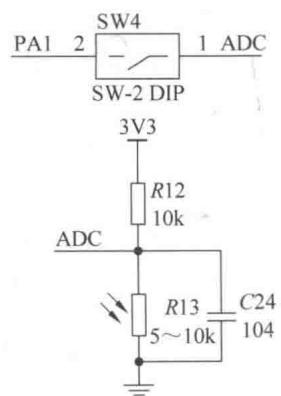

##### 先看懂这个电路（这是理解例 10-1 的前提）

**这张图怎么看**（按"从上到下"看）：

1. 图最上面是一个**开关 SW4**（标注 `SW-2 DIP`，即一个两位的拨码开关）：一端标 **PA1**（引脚 2），另一端标 **ADC**（引脚 1）。它把下面的分压点"接上"或"断开"PA1——所以教材提醒实验前要把它拨到 ON。
2. 下面是**分压电路本体**：最上面接 **3V3（3.3V）**，先经过一个**固定电阻 `R12` = 10k**；
3. `R12` 下面是一个**节点**（图上在旁边标了 `ADC`），再往下是 **`R13` = 5～10k**——注意这个电阻符号旁边画了两个**斜向箭头**，这是**光敏电阻**的记号（电阻值随光照变化），它的下端接地；
4. **`C24`（标注 `104`，即 0.1μF）**接在节点和地之间，**与 R13 并联**：它是一个滤波电容，用来把节点电压上的高频干扰"抹平"。
5. 节点（图上标 `ADC` 的地方）就是要送进 ADC 的电压点。

**分压原理（用大白话讲）**：

```
              3.3V
               │
            ┌──┴──┐
            │ R12 │  固定电阻 10k
            └──┬──┘
               │
   节点(标注 ADC)●───────● 经开关 SW4 接 PA1
               │
        ┌──────┴──────┐
        │             │
     ┌──┴──┐        ┌─┴─┐
     │ R13 │        │C24│  104 = 0.1μF（滤波电容）
     │光敏 │        │   │
     │电阻 │        └─┬─┘
     └──┬──┘          │
        │             │
       ─┴─────────────┴─  0V（地）
```

节点电压遵循分压公式：

```
节点电压 = 3.3V × R13 ÷ (R12 + R13)
```

- **光照强** → 光敏电阻 `R13` 阻值**变小** → 它在分压里占的比例变小 → **节点电压变低** → PA1 上的电压**低**；
- **光照弱** → `R13` 阻值**变大** → 节点电压**变高** → PA1 上的电压**高**。

> ⚠️ **这里的方向容易记反，务必记住**：**光敏电阻在下面（接地那一侧）**，所以"光越强 → 电压越低"。图上 `R13` 旁边那两个斜箭头就是"有光照到它"的意思。

【辅助理解图】把"光照 → 阻值 → 电压 → 数字 → LED"这条链完整画一遍：

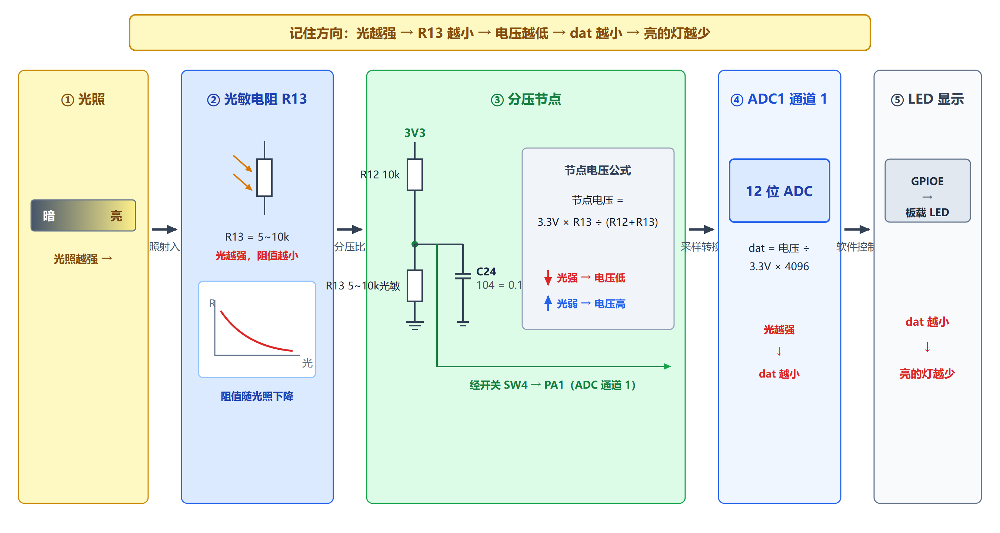

**看图方法**：从左到右依次是——光照强度（从暗到亮）、光敏电阻 R13 的阻值（光越强值越小）、分压节点的电压（R13 变小 → 电压变低）、PA1 上的电压、ADC 转换出的 dat（变小）、GPIOE 上点亮的 LED（变少）。**这张图要你记住方向：光越强 → 电压越低 → dat 越小 → 亮的灯越少。**

【补充解释】**为什么要分压？** 因为 ADC 只能测 0～3.3V。分压电路的作用就是把"电阻的变化"变成"0～3.3V 之间的电压变化"，正好落在 ADC 的量程里。

> ⚠️ **教材正文里要接的 `REF+` 并不在这张图上**：图 10-22 画的是分压电路和 AD SWITCH（SW4），"AD SWITCH 拨到 ON、REF+ 引脚接到 3.3V"是这块最小系统板上另外的电源/参考跳线，属于实验前的外围准备，不是本图里的元件。

【补充解释】**关于采样时间**：图上 `R13` 标的是 5～10k，`R12` 是 10k，信号源内阻（R12∥R13）大约只有 3～5k，并不算特别大的内阻，还有 C24 这个 0.1μF 电容帮着稳住电压。而例 10-1 仍然用了最长的采样时间 239.5 周期——**原教材没有解释原因**，这属于"留足余量、宁慢勿错"的保守做法：采样时间取长一点只会稍微慢些，不会把结果变差。这里不必强行解释成"光敏电阻阻值有几十 kΩ 到几 MΩ"（那是别的光敏器件，与图 10-22 标的值不符）。

##### 完整代码（教材原文）

```c
#include "stm32f10x.h"
void NVIC_Config(void);

void delay(u32 cnt)
{
    while(cnt --);
}

int main()
{
    ADC_InitTypeDef ADC_InitStructure;
    GPIO_InitTypeDef GPIO_InitStructure;
    u16 dat;

    // 使能 ADC 通道 1 时钟
    RCC_APB2PeriphClockCmd(RCC_APB2Periph_GPIOA|RCC_APB2Periph_ADC1, ENABLE);
    RCC_APB2PeriphClockCmd(RCC_APB2Periph_GPIOE, ENABLE);   // 使能 LED 端口时钟

    // 初始化 LED
    GPIO_InitStructure.GPIO_Pin = GPIO_Pin_All;
    GPIO_InitStructure.GPIO_Mode = GPIO_Mode_Out_PP;
    GPIO_InitStructure.GPIO_Speed = GPIO_Speed_50MHz;
    GPIO_Init(GPIOE, &GPIO_InitStructure);

    // 初始化 ADC
    RCC_ADCCLKConfig(RCC_PCLK2_Div6);   // 设置分频因子，72/6 = 12，最大不超过 14MHz

    GPIO_InitStructure.GPIO_Pin = GPIO_Pin_1;
    GPIO_InitStructure.GPIO_Mode = GPIO_Mode_AIN;
    GPIO_Init(GPIOA, &GPIO_InitStructure);   // PA1 模拟输入模式

    ADC_DeInit(ADC1);   // 复位 ADC1

    // AD 工作模式 独立模式
    ADC_InitStructure.ADC_Mode = ADC_Mode_Independent;          // 单通道模式
    ADC_InitStructure.ADC_ScanConvMode = DISABLE;               // 单次转换模式
    ADC_InitStructure.ADC_ContinuousConvMode = DISABLE;         // 软件触发
    ADC_InitStructure.ADC_ExternalTrigConv = ADC_ExternalTrigConv_None;
    ADC_InitStructure.ADC_DataAlign = ADC_DataAlign_Right;      // 数据右对齐
    ADC_InitStructure.ADC_NbrOfChannel = 1;                     // 顺序进行规则转换的 ADC 通道的数目
    ADC_Init(ADC1, &ADC_InitStructure);                         // 初始化

    // ADC1，采样周期 239.5 周期
    ADC_RegularChannelConfig(ADC1, 1, 1, ADC_SampleTime_239Cycles5);

    ADC_Cmd(ADC1, ENABLE);   // 使能 ADC1

    ADC_ResetCalibration(ADC1);                    // 使能复位校准
    while(ADC_GetResetCalibrationStatus(ADC1));    // 等待复位校准结束
    ADC_StartCalibration(ADC1);                    // 开启 AD 校准
    while(ADC_GetCalibrationStatus(ADC1));         // 等待校准结束

    while (1)
    {
        ADC_SoftwareStartConvCmd(ADC1, ENABLE);              // 启动 ADC 转换
        while (!ADC_GetFlagStatus(ADC1, ADC_FLAG_EOC));      // 等待转换结束
        dat = ADC_GetConversionValue(ADC1);                  // 读取 ADC 转换结果
        GPIO_Write(GPIOE, dat);                              // 将读取到的 AD 值显示到 LED 上
        delay(1000000);
    }
}
```

##### 逐块解释：代码 → CPU 做什么 → 寄存器发生什么 → 硬件发生什么

**第 1 块：开时钟**

```c
RCC_APB2PeriphClockCmd(RCC_APB2Periph_GPIOA|RCC_APB2Periph_ADC1, ENABLE);
RCC_APB2PeriphClockCmd(RCC_APB2Periph_GPIOE, ENABLE);
```

| 层次 | 发生了什么 |
|---|---|
| 代码 | 打开 GPIOA、ADC1、GPIOE 的时钟 |
| CPU 做什么 | 向 RCC_APB2ENR 寄存器写值，把对应位置 1 |
| 寄存器发生什么 | RCC_APB2ENR 的 bit2（GPIOA）、bit9（ADC1）、bit6（GPIOE）变成 1 |
| 硬件发生什么 | 这三个外设开始得到时钟，可以工作了 |

> 【补充解释】**为什么一定要先开时钟？** 因为 STM32 为了省电，外设默认是"断电"的，不给时钟就不工作，你怎么配寄存器都没用。这是全书写代码的第一条铁律。

**第 2 块：初始化 LED（GPIOE 推挽输出）**

```c
GPIO_InitStructure.GPIO_Pin = GPIO_Pin_All;
GPIO_InitStructure.GPIO_Mode = GPIO_Mode_Out_PP;
GPIO_InitStructure.GPIO_Speed = GPIO_Speed_50MHz;
GPIO_Init(GPIOE, &GPIO_InitStructure);
```

| 层次 | 发生了什么 |
|---|---|
| 代码 | 把 GPIOE 的所有引脚配成推挽输出 |
| CPU 做什么 | 向 GPIOE 的 CRL/CRH 寄存器写配置字 |
| 寄存器发生什么 | CRL/CRH 的每个 4 位字段变成"输出、推挽、50MHz"的编码 |
| 硬件发生什么 | GPIOE 的引脚可以驱动 LED 了 |

**第 3 块：设置 ADC 时钟分频**

```c
RCC_ADCCLKConfig(RCC_PCLK2_Div6);   // 72/6 = 12，最大不超过 14MHz
```

| 层次 | 发生了什么 |
|---|---|
| 代码 | 把 ADC 时钟设成 PCLK2 的 1/6 |
| CPU 做什么 | 向 RCC_CFGR 的 ADCPRE[1:0] 位写 `10` |
| 寄存器发生什么 | ADCPRE = 10 |
| 硬件发生什么 | ADCCLK = 72MHz ÷ 6 = 12MHz，符合 ≤14MHz 的要求 |

**第 4 块：把 PA1 配成模拟输入**

```c
GPIO_InitStructure.GPIO_Pin = GPIO_Pin_1;
GPIO_InitStructure.GPIO_Mode = GPIO_Mode_AIN;
GPIO_Init(GPIOA, &GPIO_InitStructure);
```

| 层次 | 发生了什么 |
|---|---|
| 代码 | 把 PA1 配成"模拟输入"模式 |
| CPU 做什么 | 向 GPIOA->CRL 的 bit7:4（PA1 对应的字段）写 `0000` |
| 寄存器发生什么 | PA1 字段 = 0000（模拟输入） |
| 硬件发生什么 | PA1 的**数字输入输出电路被断开**，引脚直接连到 ADC 的模拟通道 1 |

> 【补充解释】**为什么模拟输入要专门一个模式（GPIO_Mode_AIN）？**
>
> 因为普通的数字输入引脚内部有施密特触发器（把电压"整形成 0 或 1"），如果 ADC 信号经过它，波形就被"压方"了，测不准。模拟输入模式（Analog IN）就是把数字电路**关掉**，让引脚上的电压"原汁原味"地送到 ADC。
>
> 回忆第 6 章讲的 GPIO 高阻抗模拟输入配置——就是它。

**第 5 块：复位 ADC + 配置工作模式**

```c
ADC_DeInit(ADC1);                                    // 复位 ADC1

ADC_InitStructure.ADC_Mode = ADC_Mode_Independent;   // 独立模式
ADC_InitStructure.ADC_ScanConvMode = DISABLE;        // 不扫描
ADC_InitStructure.ADC_ContinuousConvMode = DISABLE;  // 单次转换
ADC_InitStructure.ADC_ExternalTrigConv = ADC_ExternalTrigConv_None;
ADC_InitStructure.ADC_DataAlign = ADC_DataAlign_Right;
ADC_InitStructure.ADC_NbrOfChannel = 1;
ADC_Init(ADC1, &ADC_InitStructure);
```

| 配置项 | 值 | 含义 | 动的是哪个寄存器 |
|---|---|---|---|
| ADC_Mode | Independent | 只用 ADC1，独立工作 | CR1 的 DUALMOD = 0000 |
| ScanConvMode | DISABLE | 不扫描（只 1 个通道） | CR1 的 SCAN = 0 |
| ContinuousConvMode | DISABLE | 单次转换 | CR2 的 CONT = 0 |
| ExternalTrigConv | None | 由软件启动 | CR2 的 EXTSEL = 111（SWSTART） |
| DataAlign | Right | 右对齐，读数就是 0～4095 | CR2 的 ALIGN = 0 |
| NbrOfChannel | 1 | 规则组只有 1 个通道 | SQR1 的 L[3:0] = 0000 |

> ⚠️ **【补充解释】原教材代码里的注释有一点错位，请注意**：
>
> ```c
> ADC_InitStructure.ADC_Mode = ADC_Mode_Independent;   //单通道模式  ← 注释不对
> ADC_InitStructure.ADC_ScanConvMode = DISABLE;        //单次转换模式 ← 注释不对
> ADC_InitStructure.ADC_ContinuousConvMode = DISABLE;  //软件触发    ← 注释不对
> ```
>
> 这三行注释显然是被错位粘贴了。正确的对应关系是：
>
> - `ADC_Mode_Independent` = **独立模式**（不是"单通道"）；
> - `ADC_ScanConvMode = DISABLE` = **不扫描**（不是"单次转换"）；
> - `ADC_ContinuousConvMode = DISABLE` = **单次转换**（不是"软件触发"）；
> - "软件触发"对应的是下一行 `ADC_ExternalTrigConv = ADC_ExternalTrigConv_None`。
>
> 这段注释问题已记入文末"待核验"。

**第 6 块：配置规则通道**

```c
ADC_RegularChannelConfig(ADC1, 1, 1, ADC_SampleTime_239Cycles5);
```

| 层次 | 发生了什么 |
|---|---|
| 代码 | 规则组第 1 个转换 = 通道 1；采样时间 239.5 周期 |
| CPU 做什么 | 向 SQR3 的 SQ1 写 1；向 SQR1 的 L 写 0；向 SMPR2 的 SMP1 写 111 |
| 寄存器发生什么 | SQR3[4:0] = 1，SQR1[23:20] = 0，SMPR2[5:3] = 111 |
| 硬件发生什么 | 以后每次启动转换，先接通通道 1（PA1），采样 239.5 个 ADC 周期 |

**第 7 块：使能 ADC + 校准**

```c
ADC_Cmd(ADC1, ENABLE);

ADC_ResetCalibration(ADC1);
while(ADC_GetResetCalibrationStatus(ADC1));   // 等复位校准结束
ADC_StartCalibration(ADC1);
while(ADC_GetCalibrationStatus(ADC1));        // 等校准结束
```

| 层次 | 发生了什么 |
|---|---|
| 代码 | 先使能 ADC，再做"复位校准 + 校准"两步 |
| CPU 做什么 | 置 CR2 的 ADON = 1；置 RSTCAL = 1 并等待；置 CAL = 1 并等待 |
| 寄存器发生什么 | ADON → 1；RSTCAL 由硬件清 0；CAL 由硬件清 0 |
| 硬件发生什么 | ADC 上电稳定；内部电容组测出误差修正码并记住 |

【补充解释】**两个 `while` 循环为什么不能省？**

```c
while(ADC_GetResetCalibrationStatus(ADC1));
```

这句话的意思是：**"只要复位校准还没结束，就在这里一直转圈等。"**

- 函数返回 1（还没结束）→ `while(1)` → 继续等；
- 函数返回 0（结束了）→ `while(0)` → 跳出循环，往下走。

校准需要花若干个时钟周期，CPU 跑得比它快得多，所以必须**等硬件干完**。

**第 8 块：主循环——启动、等待、读取、显示**

```c
while (1)
{
    ADC_SoftwareStartConvCmd(ADC1, ENABLE);           // ① 启动转换
    while (!ADC_GetFlagStatus(ADC1, ADC_FLAG_EOC));   // ② 等转换结束
    dat = ADC_GetConversionValue(ADC1);               // ③ 读结果
    GPIO_Write(GPIOE, dat);                           // ④ 显示到 LED
    delay(1000000);                                   // ⑤ 延时
}
```

**① 启动转换**

| 层次 | 发生了什么 |
|---|---|
| 代码 | 软件启动一次规则转换 |
| CPU 做什么 | 置 CR2 的 SWSTART 位 |
| 寄存器发生什么 | SWSTART = 1（硬件随后自动清 0） |
| 硬件发生什么 | ADC 开始对通道 1 采样 239.5 个周期，然后 SAR 转换 12.5 个周期 |

**② 等待 EOC**

```c
while (!ADC_GetFlagStatus(ADC1, ADC_FLAG_EOC));
```

逐字拆解：

```
ADC_GetFlagStatus(ADC1, ADC_FLAG_EOC)
   → 读 ADC1->SR，看 bit1（EOC）是 0 还是 1
   → 返回 SET（1）或 RESET（0）

!  → 取反
   → EOC = 0（还没转换完）时，!0 = 1 → while 继续循环
   → EOC = 1（转换完了）时，!1 = 0 → 跳出循环
```

**这就是"轮询（查询）方式"**：CPU 什么都不干，就在这里死等。简单，但浪费 CPU。

**③ 读结果**

| 层次 | 发生了什么 |
|---|---|
| 代码 | 读 ADC1 的转换结果 |
| CPU 做什么 | 读 ADC1->DR 的低 16 位 |
| 寄存器发生什么 | EOC 标志被自动清 0 |
| 硬件发生什么 | —（纯粹是读操作） |

**④ 显示到 LED**

```c
GPIO_Write(GPIOE, dat);
```

| 层次 | 发生了什么 |
|---|---|
| 代码 | 把 dat 的值写到 GPIOE 的 16 个引脚上 |
| CPU 做什么 | 向 GPIOE->ODR 写 dat |
| 寄存器发生什么 | ODR 的 16 位 = dat 的低 16 位 |
| 硬件发生什么 | 亮灯的组合随 dat 变化。**方向别记反**：光照越强 → R13 越小 → PA1 电压越低 → dat 越小 → 亮的灯越少 |

**⑤ 延时**

```c
delay(1000000);
```

软件空转延时，让人眼能看清 LED 的变化（否则每秒变几万次，看起来就是全亮）。

##### 这个例子的局限：轮询方式的问题

【补充解释】例 10-1 用的是**轮询（查询）方式**：

```
启动 → 死等 → 读 → 显示 → 延时 → 启动 → 死等 → ……
        ↑
   这段时间 CPU 什么也干不了
```

**在"只采一路、慢慢采"的场合没问题。但如果是高速采集，就必须改用中断或 DMA 方式。**

##### 扩展：用"中断方式"改写（教材提到但未给代码，这里补上思路）

【补充解释】教材在步骤（10）里说："可以调用 `ADC_GetFlagStatus()` 函数检查 `ADC_FLAG_EOC` 标志等待转换结束，**或者使用中断方式进行 ADC 的使用**。"

**中断方式的思路**：

```c
// 初始化部分增加：
ADC_ITConfig(ADC1, ADC_IT_EOC, ENABLE);   // 允许 EOC 中断
NVIC_Config();                             // 配置 NVIC，使能 ADC1_2_IRQn

// 主循环变成：只启动，不管结果
while (1)
{
    ADC_SoftwareStartConvCmd(ADC1, ENABLE);
    // CPU 可以去做别的事了
    delay(1000000);
}

// 中断服务程序：
void ADC1_2_IRQHandler(void)
{
    if (ADC_GetITStatus(ADC1, ADC_IT_EOC) != RESET)
    {
        dat = ADC_GetConversionValue(ADC1);   // 读结果（顺便清 EOC）
        GPIO_Write(GPIOE, dat);
        ADC_ClearITPendingBit(ADC1, ADC_IT_EOC);
    }
}
```

**三者的对比**：

| 方式 | 数据怎么取 | CPU 占用 | 适合场合 |
|---|---|---|---|
| **轮询** | 主循环里死等 EOC | 高（一直等） | 单通道、低速、简单场合 |
| **中断** | EOC 触发中断，在 ISR 里读 | 中（每次采完打断一次） | 单通道、中低速 |
| **DMA** | DMA 自动搬到内存 | 低（几乎不打扰 CPU） | 多通道、高速、批量采集 |

【辅助理解图】把三种方式的数据流放在一起对比：

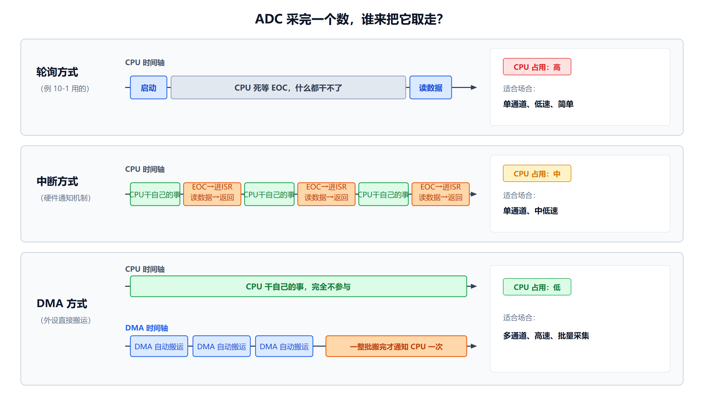

**看图方法**：三行分别是轮询、中断、DMA。

- 第一行：CPU 的时间轴被"等 EOC"占满（灰色大块）；
- 第二行：CPU 平时干自己的事，只在 EOC 时短暂跳进 ISR（小绿块）；
- 第三行：CPU 完全不参与，DMA 控制器自己把 ADC_DR 搬进数组，只在"一整批搬完"时才通知 CPU 一次。

---

## 10.3 数模转换器的工作原理及性能指标

### 先别急着看教材：这一节到底要干什么？

前面 ADC 是"**把电压读成数字**"（输入模拟、输出数字）。现在反过来：

> **DAC 是"把数字变成电压"**（输入数字、输出模拟）。

它在实际中有什么用？举几个例子：

- 让 STM32 输出一个**正弦波**（做信号发生器）；
- 让 STM32 输出一个**可变电压**去控制电机转速；
- 让 STM32 输出一个**音频波形**；
- 让 STM32 输出一个**基准电压**给别的电路用。

一句话：

> **ADC 是"读"，DAC 是"写"；ADC 是"耳朵"，DAC 是"嘴"。**

---

### 10.3.1 数模转换器的工作原理

#### 1. 数模转换器的分类

【教材内容】

> 数模转换器的种类很多，分类方法也不同：
>
> - 根据**译码网络结构**的不同，D/A 转换器可以分为 **T 形、倒 T 形、权电阻和权电流**等类型。
> - 根据**模拟电子开关**的种类不同，D/A 转换器可以分为 **CMOS 型和双极型**。双极型又分为**电流开关型**和 **ECL 电流开关型**。
>
> 在速度要求不高的情况下，可选用 CMOS 开关型 D/A 转换器；如对转换速度要求较高，则应选用双极型电流开关 D/A 转换器或转换速度更高的 ECL 电流开关型 D/A 转换器。

【补充解释】这些名词先混个脸熟就行，**本章只需要掌握"权电阻型"的原理**（教材也只展开讲这一种）：

| 分类角度 | 类型 | 特点 |
|---|---|---|
| 译码网络 | T 形、倒 T 形 | 只用两种阻值的电阻，容易做集成 |
| 译码网络 | **权电阻** | 电阻值按 1:2:4:8… 排列，原理最直观（本章重点） |
| 译码网络 | 权电流 | 用电流源加权，速度快 |
| 电子开关 | CMOS | 速度一般、省电、便宜 |
| 电子开关 | 双极型 / ECL | 速度快，用于高速场合 |

#### 2. D/A 转换器的工作原理（权电阻型）

【教材内容】

> 根据分类不同，D/A 转换器的工作原理也不尽相同。下面只介绍**权电阻型**数模转换器的工作原理。
>
> 权电阻 D/A 转换器就是**将某一数字量的二进制代码各位按它的"权"的数值转换成相应的电流，然后再把代表各位数值的电流加起来**。

##### 【先补一个前置知识：什么叫"权"？】

"权"就是"**这一位代表多大的分量**"。

回忆第 1 章讲二进制：

```
二进制数  1 0 1 1
          │ │ │ └── 最低位，权 = 2⁰ = 1
          │ │ └──── 权 = 2¹ = 2
          │ └────── 权 = 2² = 4
          └──────── 最高位，权 = 2³ = 8

1 0 1 1 = 1×8 + 0×4 + 1×2 + 1×1 = 11
```

**每一位的"权"不一样**：最高位一个人顶 8 个，最低位只顶 1 个。

> 【类比】发奖金：组长拿 800 元，组员各拿 100 元。同样是"一个人"，组长这一票的"权"是组员的 8 倍。

**权电阻 DAC 的思路就是**：

```
数字位 = 1  →  让这一位的"电流源"打开，贡献它那一份电流
数字位 = 0  →  这一位的电流源关掉，贡献 0
最后把所有打开的电流加起来 → 变成电压输出
```

##### 看教材原图

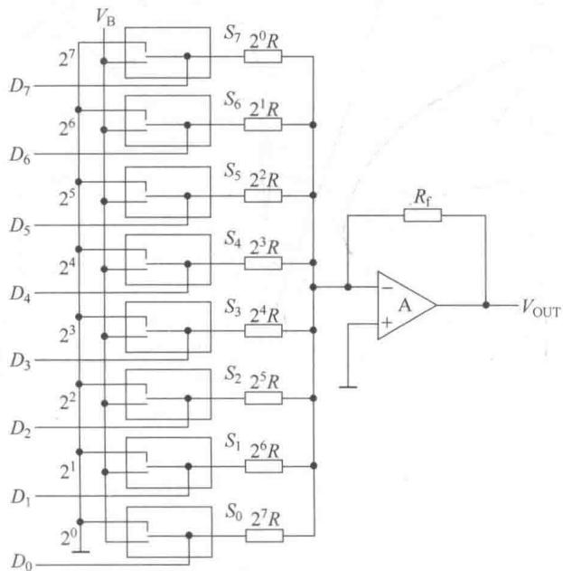

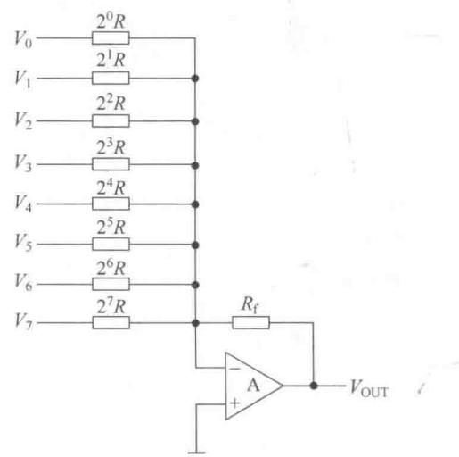

**图 10-23 怎么看**（按"从左到右"看）：

1. **最左边**是一列数字输入线 **D7～D0**（自上而下排列），每条线旁边标着它对应的"权"：**2⁷、2⁶、…、2⁰**；
2. **中间偏左**是一列 **8 个开关 S7～S0**（图中间竖着排的那一排方块），每个开关由一条数字线 D_i 控制：**开关打到上面就接 VB，打到下面就接地**；
3. **开关的右边**才是一排电阻，阻值自上而下依次是 **2⁰R、2¹R、2²R、…、2⁷R**（越往下阻值越大）；
4. 这 8 个电阻的另一端**汇到一个点**（求和点），再接进右边三角形**运算放大器**的"−"输入端；运放的"+"输入端接地，反馈电阻 `Rf` 跨接在输出 `VOUT` 和"−"输入端之间。（如果不认识"运算放大器""反相放大"，先看前面【先补一个前置知识：运算放大器、反相放大器和积分器】。）
5. **最上面**是标准电压 **VB**（接到每个开关的上触点），**最下面**是一条地线（接到每个开关的下触点）。

【教材内容】

> D_i = 0 时，S_i 接地。
> D_i = 1 时，S_i 接 VB（i = 0,1,…,7）。

**图 10-24 怎么看**（简化电路）：

图 10-24 把图 10-23 抽象成了 8 个"电压源" V0～V7，每个等于 a_i · VB（a_i 就是那一位的 0 或 1）：

> 在图 10-24 中，V0 = a7·VB，V1 = a6·VB，V2 = a5·VB，V3 = a4·VB，V4 = a3·VB，V5 = a2·VB，V6 = a1·VB，V7 = a0·VB。

**教材的推导公式（式 10-3）**：

```
VOUT = −( Rf/(2⁰R) · V0 + Rf/(2¹R) · V1 + … + Rf/(2⁷R) · V7 )
```

**当 R = 2Rf 时**，代入式(10-3)得（式 10-4）：

```
VOUT = −(VB / 2⁸) · Σ(a_i · 2^i)     （i 从 0 到 7）
```

其中 a0, a1, …, a7 = 0 或 1。由此得到（式 10-5）：

```
VOUT = −(VB / 2⁸) · D
```

【补充解释】**这三个公式不要怕，它的意思非常朴素：**

```
VOUT = −(VB / 256) × D

  VB   = 标准电压（"满量程"）
  256  = 2⁸（因为是 8 位）
  D    = 输入的数字量（0～255）
  −    = 因为用了反相放大器，所以有个负号
```

**这个负号到底从哪来？** 回忆前面的【先补一个前置知识：运算放大器、反相放大器和积分器】：图 10-23 里 8 个权电阻把电流**灌进运放的反相输入端（−）**，输出又经过 `Rf` 反馈回这个"−"端——这正是**反相放大器**的标准接法（"+"端接地、输入接"−"端、反馈电阻跨在输出和"−"端之间），所以输出电压与输入电流**符号相反**。这不是教材凭空加的，而是电路的接线方式决定的。

**举个例子**：

```
设 VB = 5V，8 位 DAC

输入 D = 0    → VOUT = −(5/256)×0   = 0V
输入 D = 128  → VOUT = −(5/256)×128 = −2.5V
输入 D = 255  → VOUT = −(5/256)×255 = −4.98V
```

**看出来了吗？** D 每加 1，VOUT 就变化 5/256 = 19.53mV——这和 ADC 的"分辨率"是一模一样的道理，只是方向反过来。

> 【类比】权电阻 DAC 像**发工资**：每个人（每一位）根据自己的"级别"（权）领不同份额，最后把所有人的钱加起来就是总支出。级别高的（高位）领得多，级别低的（低位）领得少。

**类比的边界**：真实硬件里，"发工资"是电流在电阻网络里叠加，"级别"体现在电阻值上（阻值越小贡献越大）。类比的"按权相加"这个核心思想是对的，但别以为芯片里真的有"8 个人"。

---

### 10.3.2 数模转换器的性能指标

【教材内容】原教材列了 5 项指标：

#### 1. 分辨率

> 分辨率是 D/A 转换器对输入量变化敏感程度的描述，**与输入数字量的位数有关**。

【补充解释】和 ADC 一样：位数越多，分辨率越高。

```
8 位 DAC  →  把满量程分成 256 份
12 位 DAC →  把满量程分成 4096 份  ← STM32 的 DAC 是 12 位
```

**STM32 的 DAC 分辨率**：12 位 → 参考电压 3.3V 时，最小可分辨

```
3.3V ÷ 4095 ≈ 0.806mV
```

> ⚠️ **【容易搞混】ADC 用 4096 做除数，DAC 的公式用 4095。**
>
> - ADC：把量程切成 4096 **格**，所以每格 = VREF/4096；
> - DAC：数字 0 对应 0V，数字 4095 对应满量程 VREF，所以每级 = VREF/4095。
>
> 这不是矛盾，是两种不同的"数格子"方式。教材式(10-6)给的就是 **DOR/4095**。

#### 2. 稳定时间（Settling Time）

【教材内容】

> 指 D/A 转换器中代码有**满度值的变化**时，其输出达到稳定（一般稳定到与 **±1/2 最低位值**相当的模拟量范围内）所需的时间。一般为**几十毫秒到几微秒**。

【补充解释】

```
输入数字突然从 0 跳到 4095（满度跳变）
        ↓
输出电压开始往上爬
        ↓
爬进"目标值 ± 半个最小格"的范围 → 认为"稳定了"
        ↓
从跳到稳所用的时间 = 稳定时间
```

**为什么关心它？** 因为稳定时间决定了 **DAC 最高能输出多快的波形**。如果稳定时间是 1μs，那你输出波形的两个点之间至少要隔 1μs，否则后一个点还没稳，前一个点就被改了。

#### 3. 输出电平

【教材内容】

> 不同型号的 D/A 转换器的输出电平相差较大，一般为 **5～10V**，也有一些高压输出型的为 **24～30V**。还有一些**电流输出型**，低的为 **20mA**，高的可达 **3A**。

【补充解释】注意两种输出形式：

- **电压输出型**：输出就是电压（比如 0～5V）；
- **电流输出型**：输出是电流，需要外面接一个电阻才变成电压。

**STM32 的 DAC 是电压输出型**，输出范围 0～VREF+。

#### 4. 转换精度

【教材内容】

> 转换精度是转换后所得的**实际值对于理想值的接近程度**。

【补充解释】大白话：**"我说要输出 2.000V，实际输出是不是 2.000V？"**

注意区分两个概念：

| 概念 | 关注点 | 大白话 |
|---|---|---|
| **分辨率** | 能"分"到多细 | 尺子最小刻度是多少 |
| **精度** | 能"准"到什么程度 | 尺子本身准不准 |

**分辨率高 ≠ 精度高。** 一把刻度很细但整体偏长的尺子，分辨率高、精度差。

#### 5. 输入编码

【教材内容】

> 如**二进制、BCD 码、双极性时的符号数值码、补码、偏移二进制码**等。必要时可在 D/A 转换前用计算机进行代码转换。

【补充解释】这和 ADC 那节讲的"数值编码"是一回事。STM32 的 DAC 用的是**二进制**（0～4095）。

---

### 10.3 节真正要记住什么

1. **DAC 就是"数字 → 电压"**，和 ADC 方向相反。
2. **权电阻型 DAC**：每一位按"权"贡献一份电流，全部加起来变成输出电压。8 位时 **VOUT = −(VB/256)·D**。
3. **分辨率**由位数决定（STM32 是 12 位）。
4. **稳定时间**决定 DAC 能输出多快的波形。
5. **ADC 除以 4096，DAC 除以 4095**——别搞混。

---

## 10.4 STM32F103VET6 集成的 DAC 模块

### 先看一段总述

【教材内容】

> STM32F103VET6 微控制器集成的数字/模拟转换模块（DAC）是 **12 位数字输入、电压输出**的数字/模拟转换器。可以配置为 **8 位或 12 位模式**，也可以与 **DMA 控制器**配合使用。DAC 工作在 12 位模式时，数据可以设置成**左对齐或右对齐**。
>
> DAC 模块有 **2 个输出通道**，每个通道都有**单独的转换器**。在双 DAC 模式下，2 个通道可以**独立地**进行转换，也可以**同时**进行转换并**同步地更新** 2 个通道的输出。DAC 可以通过引脚输入参考电压 **VREF+** 以获得更精确的转换结果。

**把这段话翻译成大白话：**

| 原教材说法 | 大白话 |
|---|---|
| 12 位数字输入、电压输出 | 你给它一个 0～4095 的数，它就吐出一个对应的电压 |
| 可配置为 8 位或 12 位模式 | 想省事可以用 8 位（0～255），想精细就用 12 位 |
| 可与 DMA 配合 | 可以让"搬运工"自动喂数据，CPU 不用管 |
| 左对齐 / 右对齐 | 12 位数往 16 位格子里怎么摆 |
| 2 个输出通道 | 有两路独立的 DAC，可以同时输出两个电压 |
| 单独的转换器 | 两个通道不是"分时复用"一个核心，而是各有一套 |
| 同步更新 | 两个通道可以"一起换值"，同时变化 |
| VREF+ | 输出的"满量程"由这个引脚决定 |

**STM32F103VET6 的 DAC 输出引脚**：

- **DAC_OUT1 → PA4**
- **DAC_OUT2 → PA5**

【补充解释】这一点很重要：**DAC 的引脚是固定的，不能随便换。** 例 10-2 用的就是 PA4。

---

### 10.4.1 STM32 的 DAC 主要特征

【教材内容】

- 2 个 DAC 转换器，每个转换器对应 1 个输出通道。
- 8 位或者 12 位单调输出。
- 12 位模式下数据左对齐或者右对齐。
- 同步更新功能。
- 噪声波形生成。
- 三角波形生成。
- 双 DAC 通道同时或者分别转换。
- 每个通道都有 DMA 功能。
- 外部触发转换。
- 输入参考电压 VREF+。

【补充解释】**"单调输出"是什么意思？**

> 单调 = 输入数字变大，输出电压**不会反而变小**。

这是 DAC 的一个基本要求。如果输入 2000 时输出 1.5V，输入 2001 时输出 1.4V，那就叫"非单调"，是严重缺陷。

【补充解释】**"噪声波形生成"和"三角波形生成"是 STM32 DAC 的硬件特色功能**：

- 你只要给一个"基准值"和一个"幅度"，**硬件自己**就会在基准值上叠加噪声或三角波；
- 不需要 CPU 一个个算点、一个个写数据；
- 这大大方便了做信号发生器和某些测试场合。

---

### 10.4.2 STM32 的 DAC 接口结构

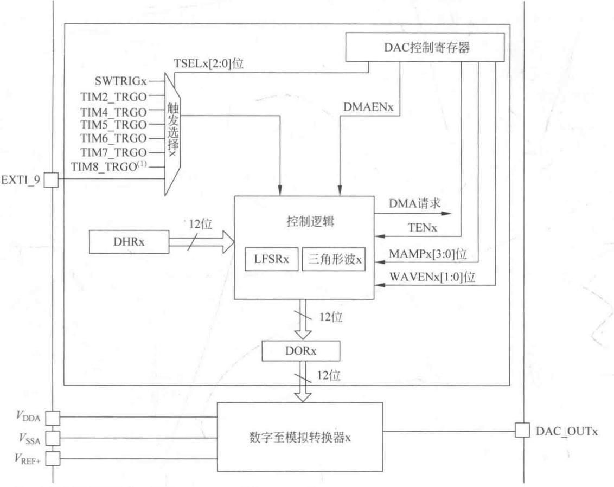

【教材内容】

> DAC 的结构如图 10-25 所示。
>
> DAC 相关引脚有模拟电源（VDDA）和模拟电源地（VSSA），DAC 使用的高端/模拟参考正极（VREF+）和 DAC 通道 x 的模拟信号输出端（**DAC_OUTx**）。

#### 这张图怎么看

**第一层：只看数据流**

```
   数字数据（0~4095）
        ↓
   ┌─────────────┐
   │  DHRx 寄存器 │  ← 你写进来的数据先放这里（Data Holding Register）
   └──────┬──────┘
          ↓ 12 位（自动或触发后搬运，途中要经过"控制逻辑"）
   ┌─────────────┐
   │  DORx 寄存器 │  ← 真正"正在转换"的数据（Data Output Register）
   └──────┬──────┘
          ↓ 12 位
   ┌──────────────────┐
   │ 数字至模拟转换器x  │  ← 数字转模拟（DAC 核心）
   └──────┬───────────┘
          ↓
      DAC_OUTx 引脚（PA4 / PA5）
```

（对照原图：**DHRx 在左边**，数据向右经过 **"控制逻辑"**这一大块，再到 **DORx**，然后向下进 **"数字至模拟转换器x"**，最后从右边出去到 **DAC_OUTx**。）

**第二层：加入"控制"和"触发"**

- 图**右上角**是 **DAC控制寄存器**（就是 DAC_CR），它向"控制逻辑"引出好几条控制线：**TSELx[2:0]位**、**DMAENx**、**TENx**、**MAMPx[3:0]位**、**WAVENx[1:0]位**。
- 图**左侧**是"**触发选择x**"多路开关，它的输入有 SWTRIGx、TIM2_TRGO、TIM4_TRGO、TIM5_TRGO、TIM6_TRGO、TIM7_TRGO、TIM8_TRGO 和 EXTI_9，由 TSELx[2:0] 选中其中一个——意思是："要不要由外部事件（比如定时器）来触发数据从 DHRx 搬到 DORx"。
- "控制逻辑"还向右边发出 **DMA请求**。

**第三层：加入"波形发生器"**

"控制逻辑"方块**里面**有 **LFSRx** 和 **三角形波x** 两块，它们可以在你给的数据上"叠加"波形。

**这张图要我理解什么**：

> **DAC 内部有"两级寄存器"：DHRx 是"待用数据"，DORx 是"正在用的数据"。**数据先写进 DHRx，然后在合适的时机（自动或触发）搬到 DORx，DORx 才真正驱动输出。

另外两个容易对不上图的点，先在这里说清：

- 图**下半部分**还画了 **VDDA、VSSA、VREF+** 三个电源/参考引脚，它们从**左边**接进"数字至模拟转换器x"——这提醒你：**DAC 输出的满量程由 VREF+ 决定**。
- ⚠️ **教材图 10-25 里并没有单独画"输出缓存"方块**（就是 DAC_CR 里 BOFFx 位控制的那块电路）。它属于 DAC 内部电路，原图没有把它展开画出来。本讲义后面那张简化辅助图，为了讲清 BOFFx 的作用才把它单独列成一格，**不要拿着简化图回教材原图里找这个方块**。

【补充解释】**为什么要分两级？**

> 【类比】像舞台换景：演员在**后台**（DHRx）准备好，等导演喊"换"（触发），才走到**台前**（DORx）。这样切换是"瞬间完成"的，不会让观众看到"半新半旧"的画面。

**这个设计的意义**：多个 DAC 通道可以**同时换值**（同步更新），保证两个通道的输出严格对齐。

---

### 10.4.3 STM32 的 DAC 配置

【辅助理解图】把上面这条通路画成一张更干净的简化图：

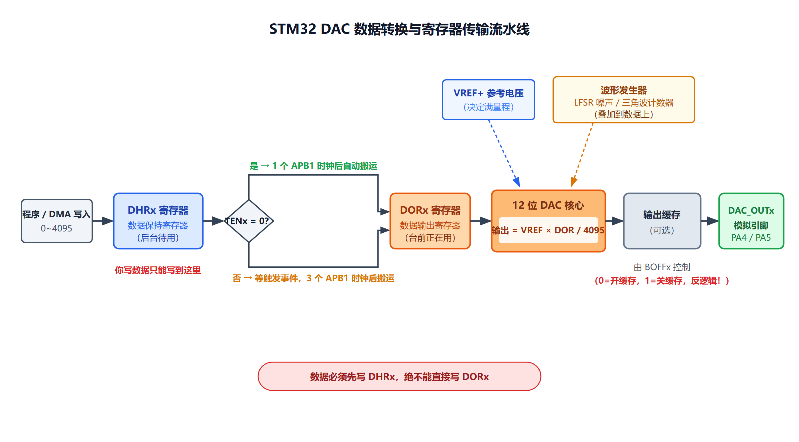

**看图方法**：从左往右看数据怎么走——

1. 最左边是**程序**（或 DMA）写进来的数字量，先进入 **DHRx 数据保持寄存器**（后台待用）；
2. 经过"触发/自动搬运"这一步（由 TENx、TSELx 控制），数据进入 **DORx 数据输出寄存器**（台前正在用）；
3. DORx 的值送进 **12 位 DAC 核心**，按 `VREF × DOR/4095` 变成电压；
4. 可选经过**输出缓存**（由 BOFFx 控制），增强驱动能力；
5. 最后从 **DAC_OUTx 引脚**（PA4 / PA5）输出；
6. 图右上角另画**波形发生器**（LFSR 噪声 / 三角波计数器）和**参考电压 VREF+**，说明它们分别"叠加波形"和"决定满量程"。

**这张图要我理解什么**：DAC 是"**两级寄存器 + 一个转换核心 + 一个可选缓存**"，数据必须先写 DHRx，绝不能直接写 DORx。

#### 1. 使能 DAC 通道（ENx 位）

【教材内容】

> 将 **DAC_CR 寄存器的 ENx 位置 1** 即可打开对 DAC 通道 x 的供电。经过一段启动时间 **t_WAKEUP**，DAC 通道 x 即被使能。**ENx 位只会使能 DAC 通道 x 的模拟部分，即便该位被置 0，DAC 通道 x 的数字部分仍然工作。**

【补充解释】最后一句很重要：**关掉 ENx 只是把"模拟输出部分"断电，寄存器和数字逻辑还在跑。** 所以你可以"关掉输出省电，但保留配置"。

#### 2. 使能 DAC 输出缓存（BOFFx 位）

【教材内容】

> DAC 集成了 2 个输出缓存，可以用来**减少输出阻抗**，**无需外部运放即可直接驱动外部适当负载**。每个 DAC 通道输出缓存可以通过设置 DAC_CR 寄存器的 **BOFFx 位**来使能或者关闭。

【补充解释】**输出缓存是干什么的？**

> 【类比】DAC 内部产生的电压"很弱"，像一根很细的水管，直接接一个大负载（比如 LED）就会被"拖垮"，电压掉下来。输出缓存像一个"缓冲水箱 + 增压泵"，让 DAC 能带动更大的负载。

**注意 BOFF 是"关闭"的意思**（**B**uffer **Off**）：

```
BOFFx = 0  →  使能输出缓存（默认）
BOFFx = 1  →  关闭输出缓存
```

> ⚠️ **【容易搞混】** 这个位是"**反逻辑**"：写 0 才是"打开缓存"，写 1 是"关闭缓存"。很多人第一次都会搞反。

**什么时候要关闭输出缓存？** 当你想输出接近 0V 的电压时（缓存电路在接近电源轨时可能不准），关掉缓存反而能输出更接近 0V。

#### 3. DAC 数据格式

【教材内容】根据选择的配置模式，数据按照下面所述情况写入指定的寄存器：

**（1）单 DAC 通道 x，有 3 种情况：**

> ① **8 位数据右对齐**：将数据写入寄存器 **DAC_DHR8Rx[7:0]**（实际是存入寄存器 DHRx[11:4]）。
> ② **12 位数据左对齐**：将数据写入寄存器 **DAC_DHR12Lx[15:4]**（实际是存入寄存器 DHRx[11:0]）。
> ③ **12 位数据右对齐**：将数据写入寄存器 **DAC_DHR12Rx[11:0]**（实际是存入寄存器 DHRx[11:0]）。

**（2）双 DAC 通道，有 3 种情况：**

> ① **8 位数据右对齐**：DAC 通道 1 数据写入 **DAC_DHR8RD[7:0]**（存入 DHR1[11:4]），DAC 通道 2 数据写入 **DAC_DHR8RD[15:8]**（存入 DHR2[11:4]）。
> ② **12 位数据左对齐**：通道 1 数据写入 **DAC_DHR12LD[15:4]**，通道 2 数据写入 **DAC_DHR12LD[31:20]**。
> ③ **12 位数据右对齐**：通道 1 数据写入 **DAC_DHR12RD[11:0]**，通道 2 数据写入 **DAC_DHR12RD[27:16]**。

【教材内容】补充：

> 根据对 DAC_DHRyyyx 寄存器的操作，经过相应的移位后，写入的数据被转存到 DHRx 寄存器中（DHRx 是内部的数据保存寄存器 x）。随后，DHRx 寄存器的内容或者被自动地传送到 DORx 寄存器，或者通过软件触发或外部事件触发被传送到 DORx 寄存器。

【补充解释】**为什么要有这么多"数据保持寄存器"？**

因为**对齐方式和通道不同，写入的位置就不同**。硬件为了方便你，准备了 **6 类"入口"**——教材把它们写成 `DAC_DHR8Rx`、`DAC_DHR12Lx`、`DAC_DHR12Rx`、`DAC_DHR8RD`、`DAC_DHR12LD`、`DAC_DHR12RD`，其中 **x 代表通道 1 或 2**。把 x 展开成具体通道后，**一共是 9 个寄存器**：

```
单通道 1（3 个）：DHR8R1（8位右对齐）、DHR12L1（12位左对齐）、DHR12R1（12位右对齐）
单通道 2（3 个）：DHR8R2、DHR12L2、DHR12R2
双通道  （3 个）：DHR8RD、DHR12LD、DHR12RD
──────────────────────────────────────────
6 类名字  →  展开成具体寄存器后共 9 个
```

**你选一种入口写进去，硬件自动帮你移位、拼装到内部真正的 DHRx。** 这样你就不用自己做移位运算了。

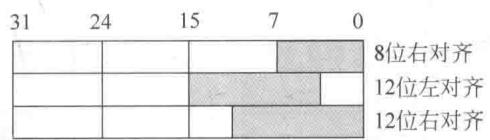

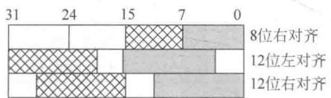

**图 10-26 怎么看**（单通道的三种入口）：

图上画了三行 32 位格子，分别对应三种写法。你只要看**数据被放在哪些 bit 位置**：

```
DHR12R1（12位右对齐）：
bit31                         12 11                    0
┌───────────────────────────────┬───────────────────────┐
│            保留                │   DACC1DHR[11:0]      │
└───────────────────────────────┴───────────────────────┘
                                     ↑ 数据就在最右边 12 位

DHR12L1（12位左对齐）：
bit31            16 15                    4 3        0
┌──────────────────┬───────────────────────┬──────────┐
│       保留        │   DACC1DHR[11:0]      │   保留    │
└──────────────────┴───────────────────────┴──────────┘
                        ↑ 数据靠左 12 位，右边空 4 位

DHR8R1（8位右对齐）：
bit31                     8 7          0
┌───────────────────────────┬───────────┐
│           保留             │DACC1DHR[7:0]│
└───────────────────────────┴───────────┘
                                ↑ 只有 8 位
```

**图 10-27 怎么看**（双通道）：

图上把 32 位分给两个通道：**低 16 位装通道 1，高 16 位装通道 2**。一次写操作就能同时更新两个通道的数据。

#### 4. DAC 转换

【教材内容】

> **不能直接对寄存器 DAC_DORx 写入数据**，任何输出到 DAC 通道 x 的数据都必须写入 DAC_DHRx 寄存器（数据实际写入 DAC_DHR8Rx、DAC_DHR12Lx、DAC_DHR12Rx、DAC_DHR8RD、DAC_DHR12LD 或者 DAC_DHR12RD 寄存器）。
>
> 如果**没有选中硬件触发**（寄存器 DAC_CR1 的 TENx 位清 0），存入寄存器 DAC_DHRx 的数据会在**一个 APB1 时钟周期后自动传至寄存器 DAC_DORx**。
>
> 如果**选中硬件触发**（寄存器 DAC_CR1 的 TENx 位置 1），数据传输在**触发发生以后 3 个 APB1 时钟周期后**完成。
>
> 一旦数据从 DAC_DHRx 寄存器装入 DAC_DORx 寄存器，在经过时间 **t_SETTLING** 之后，输出即有效。t_SETTLING 的长短会因电源电压和模拟输出负载的不同有所变化。

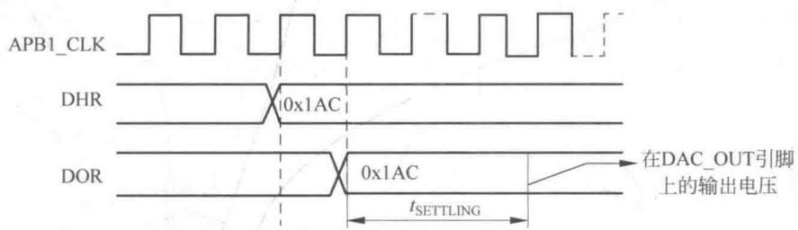

**这张图怎么看**（TEN=0，即不使用触发；图上一共**三行**波形）：

1. 时间轴从左到右；
2. **第一行 `APB1_CLK`**：APB1 总线的时钟方波——DAC 挂在这条总线上，所有"搬运"都踩着这个时钟走；
3. **第二行 `DHR`**：写入动作发生时，这一行的数据跳变成新值（图里写的是 `0x1AC`，左边的 × 表示跳变）；
4. **第三行 `DOR`**：比 DHR 晚 **1 个 APB1 时钟周期**更新成同样的值；紧接着图上画了一段上升的斜坡，用双向箭头标出 **t_SETTLING**，右端写"**在 DAC_OUT 引脚上的输出电压**"——意思是：DOR 更新之后还要再等 t_SETTLING，引脚上的电压才真正稳定到新值。

```
写 DHRx ──┐
          └─────────────────────────────
                ↓ 1 个 APB1 时钟
DORx   ─────────┌──────────────────────
                └──────────────────────
                     ↓ t_SETTLING（建立时间）
DAC_OUT ────────────┐
                    └──────  稳定在新电压
```

【补充解释】**t_SETTLING 和"稳定时间"是一回事**，就是前面 10.3.2 讲的那个指标。

**教材式(10-6)：DAC 输出电压**

```
DAC 输出 = VREF × (DOR / 4095)
```

**举个例子（不要跳步）**：

```
设 VREF+ = 3.3V

DOR = 0     → 输出 = 3.3 × (0/4095)    = 0V
DOR = 2048  → 输出 = 3.3 × (2048/4095) ≈ 1.6502V
DOR = 4095  → 输出 = 3.3 × (4095/4095) = 3.3V
```

**注意分母是 4095，不是 4096。** 因为 DOR 能取到的最大值就是 4095，要让它对应满量程 3.3V。

#### 5. 选择 DAC 触发

【教材内容】

> 如果 **TENx 位被置 1**，DAC 转换可以由某外部事件触发（定时器计数器、外部中断线）。配置控制位 **TSELx[2:0]** 可以选择 8 个触发事件之一触发 DAC 转换。

**表 10-10 外部触发**：

| 触发源 | 类型 | TSELx[2:0] |
|---|---|---|
| 定时器 6 TRGO 事件 | 来自片上定时器的内部信号 | 000 |
| 互联型产品为定时器 3 TRGO 事件 / 大容量产品为定时器 8 TRGO 事件 | 来自片上定时器的内部信号 | 001 |
| 定时器 7 TRGO 事件 | 来自片上定时器的内部信号 | 010 |
| 定时器 5 TRGO 事件 | 来自片上定时器的内部信号 | 011 |
| 定时器 2 TRGO 事件 | 来自片上定时器的内部信号 | 100 |
| 定时器 4 TRGO 事件 | 来自片上定时器的内部信号 | 101 |
| **EXTI 线路 9** | 外部引脚 | 110 |
| **SWTRIG（软件触发）** | 软件控制位 | 111 |

【教材内容】

> 每次 DAC 接口侦测到来自选中的定时器 TRGO 输出，或者外部中断线 9 的**上升沿**，最近存放在寄存器 DAC_DHRx 中的数据会被传送到寄存器 DAC_DORx 中。在 **3 个 APB1 时钟周期**后，寄存器 DAC_DORx 更新为新值。
>
> 如果选择软件触发，一旦 **SWTRIG 位置 1**，转换即开始。在数据从 DAC_DHRx 寄存器传送到 DAC_DORx 寄存器后，**SWTRIG 位由硬件自动清零**。

【补充解释】**为什么 DAC 需要触发？** 和 ADC 一样，为了"**精确地按固定时间间隔更新输出**"。

```
用定时器 TIM6 每 10μs 触发一次
        ↓
DAC 每 10μs 更新一个输出点
        ↓
如果这些点按正弦规律排列 → 输出就是一个正弦波！
```

**这就是"用 DAC 产生波形"的核心思路**（后面例 10-2 的扩展会详细讲）。

#### 6. DMA 请求

【教材内容】

> 任一 DAC 通道都具有 DMA 功能。2 个 DMA 通道可分别用于 2 个 DAC 通道的 DMA 请求。如果 **DMAENx 位置 1**，一旦有外部触发（**而不是软件触发**）发生，则产生一个 DMA 请求，然后 DAC_DHRx 寄存器的数据被传送到 DAC_DORx 寄存器。
>
> 在双 DAC 模式下，如果 2 个通道的 DMAENx 位都为 1，则会产生 2 个 DMA 请求。如果实际只需要一个 DMA 传输，则应只选择其中一个 DMAENx 位置 1。
>
> **DAC 的 DMA 请求不会累计**，因此如果第 2 个外部触发发生在响应第 1 个外部触发之前，则不能处理第 2 个 DMA 请求，也不会报告错误。

【补充解释】**最后一句是个坑，要理解**：

```
触发1 来了 → DMA 开始搬一个数
    ↓（搬运需要时间）
触发2 来了 → 但 DMA 还没搬完 → 触发2 被丢弃，且不报错！
```

所以用 DMA 喂 DAC 时，**触发频率不能超过 DMA 的搬运能力**。

#### 7. 噪声生成（教材编号：第 8 小节）

> 📌 **编号说明（讲义号和教材号差 1，别按教材号找错节）**：教材 10.4.3 的顺序是"1 使能 DAC 通道、2 使能 DAC 输出缓存、3 DAC 数据格式、4 DAC 转换、**5 DAC 输出电压**、6 选择 DAC 触发、7 DMA 请求、8 噪声生成、9 三角波生成"。本讲义把教材的"5. DAC 输出电压"并进了自己的第 4 小节"DAC 转换"（内容一句没少），所以**从讲义的"5. 选择 DAC 触发"起，讲义小节号 = 教材小节号 − 1**：
>
> - 讲义 §5「选择 DAC 触发」= 教材 10.4.3 第 6 小节；
> - 讲义 §6「DMA 请求」= 教材 10.4.3 第 7 小节；
> - 讲义 §7「噪声生成」= 教材 10.4.3 第 **8** 小节；
> - 讲义 §8「三角波生成」= 教材 10.4.3 第 **9** 小节。
>
> 后面凡引用教材的小节号，都会同时标出来。

【教材内容】

> 可以利用**线性反馈移位寄存器（Linear Feedback Shift Register，LFSR）**产生幅度变化的伪噪声。设置 **WAVE[1:0] 位为 01** 选择 DAC 噪声生成功能。寄存器 LFSR 的**预装入值为 0xAAA**。按照特定算法，在每次触发事件后 **3 个 APB1 时钟周期**之后更新该寄存器的值。
>
> 设置 DAC_CR 寄存器的 **MAMPx[3:0] 位**可以屏蔽部分或者全部 LFSR 的数据，这样得到的 LFSR 值与 DAC_DHRx 的数值**相加**，去掉溢出位之后被写入 DAC_DORx 寄存器。如果寄存器 LFSR 值为 0x0000，则会**注入 1**（防锁定机制）。将 WAVEx[1:0] 位清零可以复位 LFSR 波形的生成算法。

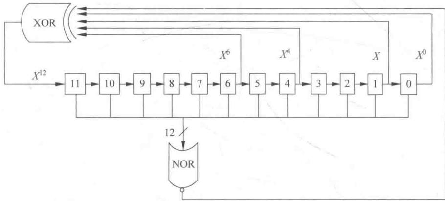

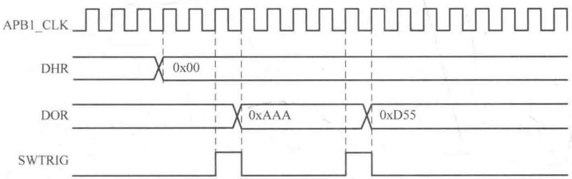

**图 10-29 怎么看**：图上画的是 LFSR 的"移位 + 反馈"结构——一串 bit 每次整体移位，其中几个特定位置"异或"后反馈回最低位。这样产生的 bit 序列看起来是随机的（其实是"伪随机"）。

**图 10-30 怎么看**：横轴是时间（或触发次数），纵轴是 DAC 输出。你会看到输出在某个基准值上下**随机跳动**，跳动的幅度由 MAMP 决定。

【补充解释】**LFSR 是什么？**

**LFSR**
= **L**inear **F**eedback **S**hift **R**egister
= 线性反馈移位寄存器
= 一种"每次移位、把几个特定位异或后填回最低位"的电路，能产生看起来随机的 0/1 序列。

> 【类比】像一个"抽奖机"：每次摇出来的号码看似随机，但因为规则固定，实际上是可预测的——所以叫"**伪**随机"。

**MAMPx[3:0] 怎么决定噪声幅度？**

| MAMPx[3:0] | 屏蔽掉的 LFSR 位 | 噪声幅度 |
|---|---|---|
| 0000 | 不屏蔽 LFSR 位 0 | 1 |
| 0001 | 不屏蔽 LFSR 位[1:0] | 3 |
| 0010 | 不屏蔽 LFSR 位[2:0] | 7 |
| 0011 | 不屏蔽 LFSR 位[3:0] | 15 |
| 0100 | 不屏蔽 LFSR 位[4:0] | 31 |
| 0101 | 不屏蔽 LFSR 位[5:0] | 63 |
| 0110 | 不屏蔽 LFSR 位[6:0] | 127 |
| 0111 | 不屏蔽 LFSR 位[7:0] | 255 |
| 1000 | 不屏蔽 LFSR 位[8:0] | 511 |
| 1001 | 不屏蔽 LFSR 位[9:0] | 1023 |
| 1010 | 不屏蔽 LFSR 位[10:0] | 2047 |
| ≥1011 | 不屏蔽 LFSR 位[11:0] | 4095 |

【补充解释】规律很简单：

```
幅度 = 2^(n+1) − 1     （n 是 MAMP 的十进制值）
例如 MAMP = 0011 = 3  →  幅度 = 2⁴ − 1 = 15  ✓
     MAMP = 0111 = 7  →  幅度 = 2⁸ − 1 = 255 ✓
```

#### 8. 三角波生成（教材编号：第 9 小节）

【教材内容】

> 可以在 DC 或者缓慢变化的信号上加上一个小幅度的三角波。设置 **WAVEx[1:0] 位为 10** 选择 DAC 的三角波生成功能。设置 DAC_CR 寄存器的 **MAMPx[3:0] 位选择三角波的幅度**。内部三角波计数器每次触发事件 **3 个 APB1 时钟周期后累加 1**。计数器的值与 DAC_DHRx 寄存器的数值相加并丢弃溢出位后写入 DAC_DORx 寄存器。在传入 DAC_DORx 寄存器的数值小于 MAMP[3:0] 位定义的最大幅度时，三角波计数器逐步累加。一旦达到设置的最大幅度，则计数器开始**递减**，达到 0 后再开始累加，周而复始。将 WAVEx[1:0] 位置 00 可以复位三角波的生成。

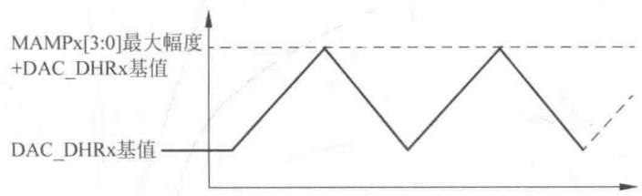

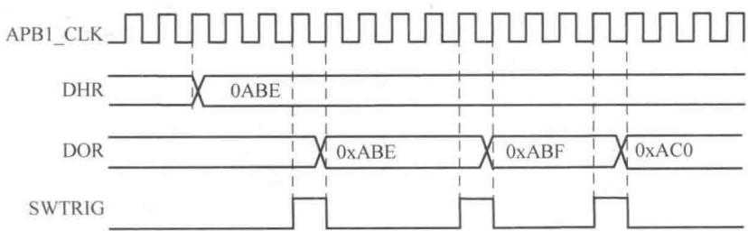

**图 10-31 怎么看**：图上画的是一条**三角波**——先线性上升，到达顶点后线性下降，到底后再上升，周而复始。

**图 10-32 怎么看**：横轴是触发次数，纵轴是 DAC 输出。每次触发，输出就往上（或往下）走一小步，走成一条阶梯状的三角波。

```
输出
  ↑
  │        ╱╲          ╱╲
  │      ╱    ╲      ╱    ╲
  │    ╱        ╲  ╱        ╲
  │  ╱            ╲╱            ╲
  └──────────────────────────────→ 时间
    ↑
  每次触发走一小步，步数由 MAMP 决定（幅度越大，爬得越久）
```

> ⚠️ **【待核验】原书在"寄存器位定义"处与"波形生成"两小节的说法不一致。**
>
> - 本讲义 §8「三角波生成」（= 教材 10.4.3 第 9 小节）说：**"设置 WAVEx[1:0] 位为 10 选择 DAC 的三角波生成功能"**；
> - 本讲义 §7「噪声生成」（= 教材 10.4.3 第 8 小节）说：**"设置 WAVE[1:0] 位为 01 选择 DAC 噪声生成功能"**；
> - 但 DAC_CR 寄存器的位定义里写的是：**"00：关闭波形发生器；10：使能噪声波形发生器；1x：使能三角波发生器"**。
>
> 后者的"10 = 噪声"与前者的"01 = 噪声"**互相矛盾**。本讲义按前后文更一致的口径表述为：**00 = 关闭，01 = 噪声，1x = 三角波**（即"三角波 = 10 或 11"）。这一矛盾已记入文末"待核验"，请以原始 PDF p158 与 p159～p160 为准。

---

### 10.4.4 STM32 的 DAC 寄存器

#### 地址链

【教材内容】DAC 寄存器的起始地址是 **0x4000 7400**。

**推一遍（不要死记）：**

```
第 1 步：PERIPH_BASE = 0x40000000
第 2 步：DAC 挂在 APB1 上，APB1PERIPH_BASE = PERIPH_BASE = 0x40000000
第 3 步：DAC_BASE = APB1PERIPH_BASE + 0x7400 = 0x40000000 + 0x7400 = 0x40007400
第 4 步：每个寄存器 = 0x40007400 + 偏移
        例如 DAC_CR  偏移 0x00 → 0x40007400
             DAC_DOR1 偏移 0x2C → 0x4000742C
```

> 【补充解释】**为什么 ADC 在 APB2 而 DAC 在 APB1？**
>
> 这是芯片设计时的安排：APB2 是"高速外设总线"（GPIO、ADC、USART1…），APB1 是"低速外设总线"（定时器 2～7、USART2/3、DAC…）。DAC 对速度要求不如 ADC 高，所以放在 APB1。
>
> ⚠️ 这也带来一个实际后果：**APB1 的时钟通常是 PCLK1 = 36MHz**（72MHz 二分频），所以 DAC 的"1 个 APB1 时钟周期"和 ADC 的"1 个 ADC 时钟周期"不是一回事。

#### DAC 全部寄存器一览表

| 偏移 | 名称 | 中文名 | 最终地址 |
|---|---|---|---|
| 0x00 | DAC_CR | 控制寄存器 | 0x40007400 |
| 0x04 | DAC_SWTRIGR | 软件触发寄存器 | 0x40007404 |
| 0x08 | DAC_DHR12R1 | 通道 1 的 12 位右对齐数据保持寄存器 | 0x40007408 |
| 0x0C | DAC_DHR12L1 | 通道 1 的 12 位左对齐数据保持寄存器 | 0x4000740C |
| 0x10 | DAC_DHR8R1 | 通道 1 的 8 位右对齐数据保持寄存器 | 0x40007410 |
| 0x14 | DAC_DHR12R2 | 通道 2 的 12 位右对齐数据保持寄存器 | 0x40007414 |
| 0x18 | DAC_DHR12L2 | 通道 2 的 12 位左对齐数据保持寄存器 | 0x40007418 |
| 0x1C | DAC_DHR8R2 | 通道 2 的 8 位右对齐数据保持寄存器 | 0x4000741C |
| 0x20 | DAC_DHR12RD | 双 DAC 的 12 位右对齐数据保持寄存器 | 0x40007420 |
| 0x24 | DAC_DHR12LD | 双 DAC 的 12 位左对齐数据保持寄存器 | 0x40007424 |
| 0x28 | DAC_DHR8RD | 双 DAC 的 8 位右对齐数据保持寄存器 | 0x40007428 |
| 0x2C | DAC_DOR1 | DAC 通道 1 数据输出寄存器 | 0x4000742C |
| 0x30 | DAC_DOR2 | DAC 通道 2 数据输出寄存器 | 0x40007430 |

> 【补充解释】**教材在控制寄存器的名称上前后不统一**：讲解"DAC 转换"时写的是 **`DAC_CR1`**（"寄存器 DAC_CR1 的 TENx 位"），而寄存器定义小节写的是 **`DAC_CR`**。**STM32F103 的 DAC 只有一个控制寄存器 `DAC_CR`**（`DAC_CR1`/`DAC_CR2` 这类写法是别处或更新型号的说法）。本讲义统一按 `DAC_CR` 表述，这一点已记入文末"待核验"。

---

#### 1. 控制寄存器（DAC_CR）

**它属于谁**：整个 DAC 模块共用一个（两个通道共用这一个寄存器，左右两半分别管通道 1 和通道 2）。

**它控制什么**：两个通道的**全部工作方式**——使能、输出缓存、触发、波形、DMA。

**为什么需要它**：DAC 的所有"一次性配置"都集中在这里。

**地址偏移：0x00，复位值：0x0000 0000。**

```
  31      29 28     27    24 23    22 21      19 18   17    16 15   13 12     11    8 7   6 5    3 2   1   0
┌──────────┬───────┬──────────┬────────┬──────────┬─────┬─────┬─────┬───────┬──────┬────────┬──────┬────┬───┬───┐
│   保留    │DMAEN2 │MAMP2[3:0]│WAVE2[1:0]│TSEL2[2:0]│TEN2 │BOFF2│ EN2 │ 保留  │DMAEN1│MAMP1[3:0]│WAVE1[1:0]│TSEL1[2:0]│TEN1│BOFF1│EN1│
└──────────┴───────┴──────────┴────────┴──────────┴─────┴─────┴─────┴───────┴──────┴────────┴──────┴────┴───┴───┘
             ↑                    ↑          ↑       ↑     ↑    ↑                 ↑                   ↑
        通道2 DMA            通道2波形   通道2触发 触发使能 缓存 使能        通道1 DMA           通道1波形
```

**这个寄存器分左右两半，结构完全对称：**

```
高 16 位（bit31～bit16）= 通道 2 的设置
低 16 位（bit15～bit0） = 通道 1 的设置
```

**通道 x 的 8 个控制位（教材原文）：**

| 位（通道1 / 通道2） | 名称 | 含义 | 0 时 | 1 时 |
|---|---|---|---|---|
| 12 / 28 | **DMAENx** | DMA 使能 | 关闭通道 x 的 DMA 模式 | 使能通道 x 的 DMA 模式 |
| 11:8 / 27:24 | **MAMPx[3:0]** | 屏蔽/幅值选择器 | 噪声模式下选择屏蔽位；三角波模式下选择幅值（0000=幅值1 … ≥1011=幅值4095） | |
| 7:6 / 23:22 | **WAVEx[1:0]** | 噪声/三角波生成使能 | 00=关闭波形发生器；01=噪声；1x=三角波（**注：原书此处与前后文矛盾，见"待核验"**） | |
| 5:3 / 21:19 | **TSELx[2:0]** | 触发选择 | 000=TIM6_TRGO；001=TIM3(互联型)/TIM8(大容量)_TRGO；010=TIM7_TRGO；011=TIM5_TRGO；100=TIM2_TRGO；101=TIM4_TRGO；110=外部中断线9；111=软件触发。**只能在 TENx=1 时设置** | |
| 2 / 18 | **TENx** | 触发使能 | 关闭触发，写入 DHRx 的数据在 **1 个 APB1 时钟周期**后传入 DORx | 使能触发，写入 DHRx 的数据在 **3 个 APB1 时钟周期**后传入 DORx |
| 1 / 17 | **BOFFx** | 关闭输出缓存 | **使能**输出缓存 | **关闭**输出缓存（注意反逻辑） |
| 0 / 16 | **ENx** | 通道使能 | 关闭通道 x | 使能通道 x |

【补充解释】**通道 1 和通道 2 的位位置对照**（记一半就行）：

```
通道 1：DMAEN1(12) MAMP1(11:8) WAVE1(7:6) TSEL1(5:3) TEN1(2) BOFF1(1) EN1(0)
通道 2：DMAEN2(28) MAMP2(27:24) WAVE2(23:22) TSEL2(21:19) TEN2(18) BOFF2(17) EN2(16)
                  ↑
        通道 2 的每组都比通道 1 高 16 位
```

**操作演示：使能 DAC 通道 1，不用触发、不用波形、不用 DMA**

```
需要设置：
  EN1  = 1   （bit0）
  BOFF1 = 0  （bit1，使能输出缓存）
  TEN1 = 0   （bit2，不用触发）
  WAVE1 = 00 （bit7:6，不用波形）
  MAMP1 = 0000
  DMAEN1 = 0
  TSEL1 = 000

结果：DAC_CR = 0x0000 0001

        DAC->CR |= (1 << 0);   // 只把 EN1 置 1
```

**运算前后**：

```
运算前：DAC->CR = 0x0000 0000
掩  码：          0x0000 0001
────────────────────────────────
运算后：DAC->CR = 0x0000 0001   ← EN1 = 1
```

**硬件发生什么**：DAC 通道 1 的模拟部分上电，经过 t_WAKEUP 后，PA4 引脚开始按 DOR1 的值输出电压。

---

#### 2. 软件触发寄存器（DAC_SWTRIGR）

**它控制什么**：用软件命令"手动触发一次"DAC 数据从 DHRx 搬到 DORx。

**地址偏移：0x04，复位值：0x0000 0000。**

```
  31                        2  1        0
┌────────────────────────────┬──────────┬──────────┐
│            保留             │ SWTRIG2  │ SWTRIG1  │
└────────────────────────────┴──────────┴──────────┘
                                   ↑          ↑
                            通道2软件触发  通道1软件触发
   读写属性：w（只写）
```

【教材内容】

> 位 1：SWTRIG2，DAC 通道 2 软件触发。该位由软件设置和清除，用来使能/关闭软件触发。一旦寄存器 DAC_DHR2 的数据传入寄存器 DAC_DOR2（1 个 APB1 时钟周期后），**该位由硬件清零**。
>
> 位 0：SWTRIG1，DAC 通道 1 软件触发。同上。

【补充解释】**"只写（w）"是什么意思？**

这个寄存器**读不出有用的信息**（读回来总是 0），你只管往里写 1。写完硬件自动清 0。

**操作演示：软件触发一次通道 1 的输出更新**

```
        DAC->SWTRIGR |= (1 << 0);   // 把 SWTRIG1 置 1
```

**硬件发生什么**：DHR1 里的数据被搬到 DOR1，1 个 APB1 时钟后完成；随后 SWTRIG1 自动清 0。

---

#### 3. 通道 1 的 12 位右对齐数据保持寄存器（DAC_DHR12R1）

**地址偏移：0x08，复位值：0x0000 0000。**

```
  31                            12 11                          0
┌───────────────────────────────┬───────────────────────────────┐
│            保留                │      DACC1DHR[11:0]           │
└───────────────────────────────┴───────────────────────────────┘
                                                 ↑
                                  当前重点：直接写 0~4095 的 12 位数
```

【教材内容】位[11:0]：DACC1DHR[11:0]，DAC 通道 1 的 12 位右对齐数据，由软件写入。

**操作演示：输出满量程的一半**

```
        DAC->DHR12R1 = 2048;   // 输出 ≈ 3.3 × 2048/4095 ≈ 1.65V
```

---

#### 4. 通道 1 的 12 位左对齐数据保持寄存器（DAC_DHR12L1）

**地址偏移：0x0C，复位值：0x0000 0000。**

```
  31                    16 15                    4 3            0
┌───────────────────────┬───────────────────────┬──────────────┐
│         保留           │    DACC1DHR[11:0]     │     保留      │
└───────────────────────┴───────────────────────┴──────────────┘
                                 ↑
                    数据靠左 12 位，右边空 4 位
```

【教材内容】位[15:4]：DACC1DHR[11:0]，DAC 通道 1 的 12 位左对齐数据，由软件写入。位[31:16] 和位[3:0] 保留。

**操作演示：用左对齐写同一个值 2048**

```
2048 = 0b1000 0000 0000
左对齐 = 把 12 位放到 bit15~bit4
       = 0b1000 0000 0000 0000 = 0x8000

        DAC->DHR12L1 = 0x8000;   // 和上面 DHR12R1 = 2048 效果完全一样
```

【补充解释】**左对齐有什么用？** 当你只想用 8 位精度时，左对齐可以让高 8 位直接可用，不用移位。不过对大多数应用，**右对齐更直观**。

---

#### 5. 通道 1 的 8 位右对齐数据保持寄存器（DAC_DHR8R1）

**地址偏移：0x10，复位值：0x0000 0000。**

```
  31                            8 7          0
┌───────────────────────────────┬───────────┐
│            保留                │DACC1DHR[7:0]│
└───────────────────────────────┴───────────┘
                                     ↑
                            只写 8 位，硬件自动放到 12 位的 [11:4]
```

【教材内容】位[7:0]：DACC1DHR[7:0]，DAC 通道 1 的 8 位右对齐数据，由软件写入。

【补充解释】**8 位数据怎么写进 12 位的 DAC？**

```
你写 8 位数据 → 硬件自动左移 4 位 → 变成 12 位
例如写 0x80（128）→ 实际 DHR1 = 128 << 4 = 2048
```

这样 8 位模式的 0～255 就均匀映射到 12 位模式的 0～4080，输出范围基本不变。

---

#### 6～8. 通道 2 的三个数据保持寄存器

**DAC_DHR12R2**（地址偏移 0x14）、**DAC_DHR12L2**（0x18）、**DAC_DHR8R2**（0x1C）

结构和通道 1 的三个寄存器**完全一样**，只是数据换成 `DACC2DHR`。位图不再重复画。

```
DAC_DHR12R2：bit31~12 保留 | bit11~0 DACC2DHR[11:0]
DAC_DHR12L2：bit31~16 保留 | bit15~4 DACC2DHR[11:0] | bit3~0 保留
DAC_DHR8R2 ：bit31~8 保留  | bit7~0  DACC2DHR[7:0]
```

---

#### 9. 双 DAC 的 12 位右对齐数据保持寄存器（DAC_DHR12RD）

**它控制什么**：**一次写操作同时设置两个通道**的数据。

**地址偏移：0x20，复位值：0x0000 0000。**

```
  31        28 27                    16 15        12 11                    0
┌────────────┬───────────────────────┬────────────┬───────────────────────┐
│    保留     │    DACC2DHR[11:0]     │    保留     │    DACC1DHR[11:0]     │
└────────────┴───────────────────────┴────────────┴───────────────────────┘
                    ↑                                   ↑
              通道2的数据（高16位）                 通道1的数据（低16位）
```

【教材内容】

> 位[27:16]：DACC2DHR[11:0]，DAC 通道 2 的 12 位右对齐数据。
>
> 位[11:0]：DACC1DHR[11:0]，DAC 通道 1 的 12 位右对齐数据。

**操作演示：同时给两个通道赋值**

```
通道 1 输出 1000，通道 2 输出 3000

        DAC->DHR12RD = (3000 << 16) | 1000;

计算：
  3000 << 16 = 0x0BB80000
  1000       = 0x000003E8
  ─────────────────────────
  或起来      = 0x0BB803E8
```

**硬件发生什么**：DHR1 = 1000，DHR2 = 3000。如果两个通道的触发设置一致，它们会**同时**更新输出（这就是"同步更新"）。

---

#### 10. 双 DAC 的 12 位左对齐数据保持寄存器（DAC_DHR12LD）

**地址偏移：0x24，复位值：0x0000 0000。**

```
  31                    20 19    16 15                    4 3        0
┌───────────────────────┬───────┬───────────────────────┬──────────┐
│    DACC2DHR[11:0]     │ 保留   │    DACC1DHR[11:0]     │   保留    │
└───────────────────────┴───────┴───────────────────────┴──────────┘
         ↑                                 ↑
    通道2（靠左上角）                  通道1（中间）
```

【教材内容】

> 位[31:20]：DACC2DHR[11:0]，DAC 通道 2 的 12 位左对齐数据。
>
> 位[15:4]：DACC1DHR[11:0]，DAC 通道 1 的 12 位左对齐数据。

> ⚠️ 原书表格里把通道 1 的保留位写成了"4~0"，应该是"3~0"（因为数据占 15:4，剩下 3:0 共 4 位）。这是明显的笔误，已记入"待核验"。

---

#### 11. 双 DAC 的 8 位右对齐数据保持寄存器（DAC_DHR8RD）

**地址偏移：0x28，复位值：0x0000 0000。**

```
  31                    16 15        8 7          0
┌───────────────────────┬───────────┬───────────┐
│         保留           │DACC2DHR[7:0]│DACC1DHR[7:0]│
└───────────────────────┴───────────┴───────────┘
                             ↑            ↑
                          通道2        通道1
```

【教材内容】

> 位[15:8]：DACC2DHR[7:0]，DAC 通道 2 的 8 位右对齐数据。
>
> 位[7:0]：DACC1DHR[7:0]，DAC 通道 1 的 8 位右对齐数据。

---

#### 12. DAC 通道 1 数据输出寄存器（DAC_DOR1）

**它属于谁**：通道 1。

**它控制什么**：**真正送去转换的数据**（就是"台前"的那个值）。

**地址偏移：0x2C，复位值：0x0000 0000。**

```
  31                            12 11                          0
┌───────────────────────────────┬───────────────────────────────┐
│            保留                │      DACC1DOR[11:0]           │
└───────────────────────────────┴───────────────────────────────┘
                                                 ↑
                                    当前重点：这个值决定输出电压
```

【教材内容】位[11:0]：DACC1DOR[11:0]，DAC 通道 1 输出数据。

【补充解释】**虽然手册说这一位"rw"，但实际使用中不要直接写它**——教材明确说"不能直接对寄存器 DAC_DORx 写入数据"。你写 DHRx，硬件自动搬到 DORx。

**输出电压公式再写一遍（式 10-6）**：

```
DAC 输出 = VREF × (DOR / 4095)
```

---

#### 13. DAC 通道 2 数据输出寄存器（DAC_DOR2）

**地址偏移：0x30，复位值：0x0000 0000。**

```
  31                            12 11                          0
┌───────────────────────────────┬───────────────────────────────┐
│            保留                │      DACC2DOR[11:0]           │
└───────────────────────────────┴───────────────────────────────┘
```

【教材内容】位[11:0]：DACC2DOR[11:0]，DAC 通道 2 输出数据。

---

### 10.4.5 STM32 的 DAC 固件库函数

#### 1. DAC 寄存器结构（DAC_TypeDef）

【教材内容】DAC 寄存器结构 `DAC_TypeDef` 在文件 `stm32f10x.h` 中定义如下：

```c
typedef struct
{
    _IO uint32_t CR;        // DAC 控制寄存器
    _IO uint32_t SWTRIGR;   // DAC 软件触发寄存器
    _IO uint32_t DHR12R1;   // DAC 通道 1 的 12 位右对齐数据保持寄存器
    _IO uint32_t DHR12L1;   // DAC 通道 1 的 12 位左对齐数据保持寄存器
    _IO uint32_t DHR8R1;    // DAC 通道 1 的 8 位右对齐数据保持寄存器
    _IO uint32_t DHR12R2;   // DAC 通道 2 的 12 位右对齐数据保持寄存器
    _IO uint32_t DHR12L2;   // DAC 通道 2 的 12 位左对齐数据保持寄存器
    _IO uint32_t DHR8R2;    // DAC 通道 2 的 8 位右对齐数据保持寄存器
    _IO uint32_t DHR12RD;   // 双 DAC 的 12 位右对齐数据保持寄存器
    _IO uint32_t DHR12LD;   // 双 DAC 的 12 位左对齐数据保持寄存器
    _IO uint32_t DHR8RD;    // 双 DAC 的 8 位右对齐数据保持寄存器
    _IO uint32_t DOR1;      // DAC 通道 1 数据输出寄存器
    _IO uint32_t DOR2;      // DAC 通道 2 数据输出寄存器

#if defined (STM32F10X_LD_VL) || defined (STM32F10X_MD_VL) || defined (STM32F10X_HD_VL)
    _IO uint32_t SR;        // DAC 状态寄存器
#endif
} DAC_TypeDef;
```

【补充解释】最后那个 `#if` 的意思是：**DAC 状态寄存器 SR 只在某些"低功耗/超值型"型号上才有**，普通型号（如 STM32F103VET6）没有。所以本章不讨论 DAC_SR。

【教材内容】在文件 `stm32f10x_map.h` 中，一个 DAC 的外设声明示例如下：

```c
#define PERIPH_BASE       ((u32)0x40000000)
#define APB1PERIPH_BASE   PERIPH_BASE
#define APB2PERIPH_BASE   (PERIPH_BASE + 0x10000)
#define AHBPERIPH_BASE    (PERIPH_BASE + 0x20000)
...
#define DAC_BASE          (APB1PERIPH_BASE + 0x7400)
...
#define DAC               ((DAC_TypeDef *) DAC_BASE)
...
```

【补充解释】和 ADC 完全一样的套路：

```c
#define DAC  ((DAC_TypeDef *) DAC_BASE)
```

→ 把 0x40007400 解释成 `DAC_TypeDef` 指针 → 于是可以写 `DAC->CR`、`DAC->DHR12R1`。

---

#### 2. 常用的固件库函数

##### 1）函数 DAC_Init

**函数原型**：

```c
void DAC_Init(uint32_t DAC_Channel, DAC_InitTypeDef* DAC_InitStruct);
```

**函数功能**：根据 DAC_InitStructure 中指定的参数，初始化外设 DAC 的寄存器。

**输入参数 1**：`DAC_Channel`，用于指定 DAC 输出通道：

- `DAC_Channel_1` —— DAC 通道 1；
- `DAC_Channel_2` —— DAC 通道 2。

**输入参数 2**：`DAC_InitStructure`，指向结构 `DAC_InitTypeDef` 的指针。

【教材内容】`DAC_InitTypeDef` 在文件 `stm32f10x_dac.h` 中定义：

```c
typedef struct
{
    uint32_t DAC_Trigger;                        // 是否使用触发
    uint32_t DAC_WaveGeneration;                 // 是否使用波形发生
    uint32_t DAC_LFSRUmask_TriangleAmplitude;    // 屏蔽/幅值选择器
    uint32_t DAC_OutputBuffer;                   // 输出缓存控制
} DAC_InitTypeDef;
```

**（1）DAC_Trigger —— 设置是否使用触发功能**

| 取值 | 含义 |
|---|---|
| `DAC_Trigger_None` | 无触发 |
| `DAC_Trigger_T6_TRGO` | 定时器 6 触发 |
| `DAC_Trigger_T8_TRGO` | 定时器 8 触发 |
| `DAC_Trigger_T3_TRGO` | 定时器 3 触发 |
| `DAC_Trigger_T7_TRGO` | 定时器 7 触发 |
| `DAC_Trigger_T5_TRGO` | 定时器 5 触发 |
| `DAC_Trigger_T15_TRGO` | 定时器 15 触发 |
| `DAC_Trigger_T2_TRGO` | 定时器 2 触发 |
| `DAC_Trigger_T4_TRGO` | 定时器 4 触发 |
| `DAC_Trigger_Ext_IT9` | 外部中断线 9 触发 |
| `DAC_Trigger_Software` | 软件触发 |

**（2）DAC_WaveGeneration —— 设置是否使用波形发生**

| 取值 | 含义 |
|---|---|
| `DAC_WaveGeneration_None` | 无波形发生 |
| `DAC_WaveGeneration_Noise` | 噪声波形发生 |
| `DAC_WaveGeneration_Triangle` | 三角波波形发生 |

**（3）DAC_LFSRUmask_TriangleAmplitude —— 设置屏蔽/幅值选择器**

| 取值 | 含义 |
|---|---|
| `DAC_LFSRUnmask_Bit0` | 不屏蔽 LFSR 位 0 |
| `DAC_LFSRUmask_Bitsm_0` | 不屏蔽 LFSR 位[m:0]，m 可取 1,2,3,4,5,6,7,8,9,10,11 |
| `DAC_TriangleAmplitude_n` | 三角波幅值等于 n，n 可取 1, 3, 7, 15, 31, 63, 127, 255, 511, 1023, 2047, 4095 |

**（4）DAC_OutputBuffer —— 设置输出缓存控制位**

| 取值 | 含义 |
|---|---|
| `DAC_OutputBuffer_Enable` | 使能 DAC 输出缓存 |
| `DAC_OutputBuffer_Disable` | 关闭 DAC 输出缓存 |

##### 2）函数 DAC_Cmd

**函数原型**：

```c
void DAC_Cmd(uint32_t DAC_Channel, FunctionalState NewState);
```

**函数功能**：使能或者关闭指定的 DAC 通道。

- 参数 1：`DAC_Channel_1` 或 `DAC_Channel_2`；
- 参数 2：`ENABLE` 或 `DISABLE`。

【补充解释】这个函数背后就是把 `DAC_CR` 的 **ENx** 位置 1 或清 0。

##### 3）函数 DAC_SetChannel1Data

**函数原型**：

```c
void DAC_SetChannel1Data(uint32_t DAC_Align, uint16_t Data);
```

**函数功能**：设置 DAC1 数据保持寄存器的值。

**输入参数 1**：`DAC_Align`，设置对齐方式：

| 取值 | 含义 |
|---|---|
| `DAC_Align_8b_R` | 8 位数据右对齐 |
| `DAC_Align_12b_L` | 12 位数据左对齐 |
| `DAC_Align_12b_R` | 12 位数据右对齐 |

**输入参数 2**：`Data`，装载到数据保持寄存器的值。

【教材内容】与 `DAC_SetChannel1Data` 函数对应的函数是 **`DAC_SetChannel2Data`**，用于设定 DAC2 数据保持寄存器的值。

【补充解释】**这个函数一次干了三件事**：

```
DAC_SetChannel1Data(DAC_Align_12b_R, 2048);
                     ↑                ↑
              选择对齐方式        要输出的数值
```

1. 根据对齐方式决定写哪个寄存器（DHR12R1 / DHR12L1 / DHR8R1）；
2. 把 Data 写进去；
3. 硬件随后把它搬到 DOR1。

##### 4）函数 DAC_GetDataOutputValue

**函数原型**：

```c
uint16_t DAC_GetDataOutputValue(uint32_t DAC_Channel);
```

**函数功能**：读出 DAC 的数值。

**输入参数**：`DAC_Channel`，可以取 `DAC_Channel_1` 或 `DAC_Channel_2`。

【补充解释】它读的是 **DORx**（正在输出的那个值），不是 DHRx。

**DAC 常用固件库函数速查**：

| 函数 | 作用 |
|---|---|
| `DAC_Init(DAC_Channel_x, &结构体)` | 初始化触发、波形、幅值、输出缓存 |
| `DAC_Cmd(DAC_Channel_x, ENABLE)` | 使能通道（置 ENx） |
| `DAC_SetChannel1Data(对齐, 数据)` | 设置通道 1 的输出数据 |
| `DAC_SetChannel2Data(对齐, 数据)` | 设置通道 2 的输出数据 |
| `DAC_SetDualChannelData(对齐, 数据2, 数据1)` | 同时设置两个通道 |
| `DAC_GetDataOutputValue(DAC_Channel_x)` | 读当前输出值 |
| `DAC_SoftwareTriggerCmd(DAC_Channel_x, ENABLE)` | 软件触发一次 |
| `DAC_DMACmd(DAC_Channel_x, ENABLE)` | 使能 DAC 的 DMA 请求 |
| `DAC_ITConfig(...)` | 使能 DMA 下溢中断（部分型号） |

---

### 10.4.6 STM32 的 DAC 使用举例

#### 先记住"开启 DAC 转换的 5 个步骤"

【教材内容】

> （1）DAC 时钟使能，对应的 GPIO 时钟使能。
> （2）GPIO 端口模式设置，引脚设置为 **GPIO_Mode_AIN**。
> （3）调用 `DAC_Init()` 函数进行 DAC 参数初始化，包括是否使用触发功能、是否使用波形发生、设置屏蔽/幅值选择器、设置输出缓存控制位。
> （4）调用 `DAC_Cmd()` 使能 DAC。
> （5）调用 `DAC_SetChannel1Data()` 设置输出值，DAC 通道 1 输出电压会随着输出值的设置变化。

【补充解释】**注意一个反直觉的地方**：DAC 的输出引脚，GPIO 模式要设成 **`GPIO_Mode_AIN`（模拟输入）**，而不是"模拟输出"。

**为什么？** 因为 STM32 的 GPIO 没有"模拟输出"这个模式。当引脚被配置为模拟输入时，数字部分被断开，引脚**直接连到 DAC 的模拟输出端**。所以虽然名字叫"输入"，实际是在做输出。

> 【类比】像把一根水管的两头都打开：虽然这个口叫"进水口"，但只要你从另一头灌水，它就变成"出水口"了。

---

#### 【例 10-2】利用 STM32 最小系统板实现 STM32F103VET6 DAC 电压输出功能

**题目**：通过将 DAC 通道 1 对应的 **PA4** 引脚连接到实验箱 LED 端口查看 LED 亮度变化，或直接用 ADC 模块采集回 STM32。

**解**：利用固件库函数实现题目要求。

##### 完整代码（教材原文）

```c
#include "stm32f10x.h"
void NVIC_Config(void);

void delay(u32 cnt)
{
    while(cnt--);          // 注：原书此处缺分号，见"待核验"
}

int main()
{
    u16 vol = 0;
    GPIO_InitTypeDef GPIO_InitStructure;
    DAC_InitTypeDef DAC_InitType;

    RCC_APB2PeriphClockCmd(RCC_APB2Periph_GPIOA, ENABLE);   // 使能 PA 口时钟
    RCC_APB1PeriphClockCmd(RCC_APB1Periph_DAC, ENABLE);     // 使能 DAC 通道时钟

    // 端口配置
    GPIO_InitStructure.GPIO_Pin = GPIO_Pin_4;
    GPIO_InitStructure.GPIO_Mode = GPIO_Mode_AIN;    // 模拟输入
    GPIO_InitStructure.GPIO_Speed = GPIO_Speed_50MHz;
    GPIO_Init(GPIOA, &GPIO_InitStructure);
    GPIO_SetBits(GPIOA, GPIO_Pin_4);

    DAC_InitType.DAC_Trigger = DAC_Trigger_None;                  // 不使用触发功能
    DAC_InitType.DAC_WaveGeneration = DAC_WaveGeneration_None;    // 不使用波形发生
    // 屏蔽、幅值设置
    DAC_InitType.DAC_LFSRUmask_TriangleAmplitude = DAC_LFSRUmask_Bit0;
    DAC_InitType.DAC_OutputBuffer = DAC_OutputBuffer_Disable;     // 输出缓存关闭
    DAC_Init(DAC_Channel_1, &DAC_InitType);                       // 初始化 DAC 通道 1
    DAC_Cmd(DAC_Channel_1, ENABLE);                               // 使能 DAC1
    DAC_SetChannel1Data(DAC_Align_12b_R, 0);                      // 12 位右对齐数据格式设置 DAC 值

    while(1)
    {
        vol += 100;
        if(vol > 4000)
        {
            vol = 0;
        }
        DAC_SetChannel1Data(DAC_Align_12b_R, vol);
        delay(1000000);
    }
}
```

##### 逐块解释：代码 → CPU 做什么 → 寄存器发生什么 → 硬件发生什么

**第 1 块：开时钟**

```c
RCC_APB2PeriphClockCmd(RCC_APB2Periph_GPIOA, ENABLE);   // PA 口
RCC_APB1PeriphClockCmd(RCC_APB1Periph_DAC, ENABLE);     // DAC
```

| 层次 | 发生了什么 |
|---|---|
| 代码 | 打开 GPIOA 和 DAC 的时钟 |
| CPU 做什么 | 向 RCC_APB2ENR 的 bit2 写 1；向 RCC_APB1ENR 的 bit29 写 1 |
| 寄存器发生什么 | APB2ENR[2] = 1；APB1ENR[29] = 1 |
| 硬件发生什么 | GPIOA 和 DAC 模块开始得到时钟 |

> ⚠️ **注意 DAC 在 APB1 上**，所以用的是 `RCC_APB1PeriphClockCmd`，不是 APB2。这是和 ADC（APB2）的一个区别，很容易写错。

**第 2 块：把 PA4 配成模拟输入**

```c
GPIO_InitStructure.GPIO_Pin = GPIO_Pin_4;
GPIO_InitStructure.GPIO_Mode = GPIO_Mode_AIN;
GPIO_InitStructure.GPIO_Speed = GPIO_Speed_50MHz;
GPIO_Init(GPIOA, &GPIO_InitStructure);
GPIO_SetBits(GPIOA, GPIO_Pin_4);
```

| 层次 | 发生了什么 |
|---|---|
| 代码 | 把 PA4 配成模拟输入；然后把 PA4 的 ODR 位置 1 |
| CPU 做什么 | 向 GPIOA->CRL 的 PA4 字段写 0000；向 GPIOA->ODR 写 bit4=1 |
| 寄存器发生什么 | CRL 中 PA4 字段 = 0000；ODR[4] = 1 |
| 硬件发生什么 | PA4 的数字电路断开，直接连到 DAC_OUT1 |

【补充解释】**`GPIO_SetBits(GPIOA, GPIO_Pin_4)` 这一句有什么用？**

在模拟输入模式下，ODR 的值其实**不影响输出**（数字输出电路已经断开了）。教材这一句可能是"沿用某些例程的习惯写法"，或者是为了确保引脚内部状态确定。**它不会改变 DAC 的输出电压**，DAC 的电压完全由 DOR1 决定。

> 这一点已记入"待核验"，因为原书没有解释这一句的用意。

**第 3 块：初始化 DAC**

```c
DAC_InitType.DAC_Trigger = DAC_Trigger_None;                // 不用触发
DAC_InitType.DAC_WaveGeneration = DAC_WaveGeneration_None;  // 不用波形发生
DAC_InitType.DAC_LFSRUmask_TriangleAmplitude = DAC_LFSRUmask_Bit0;
DAC_InitType.DAC_OutputBuffer = DAC_OutputBuffer_Disable;   // 关闭输出缓存
DAC_Init(DAC_Channel_1, &DAC_InitType);
```

| 配置项 | 值 | 动的是哪个位 |
|---|---|---|
| DAC_Trigger | None | CR 的 TEN1 = 0，TSEL1 不用管 |
| DAC_WaveGeneration | None | CR 的 WAVE1[1:0] = 00 |
| LFSRUmask/TriangleAmplitude | Bit0 | CR 的 MAMP1[3:0] = 0000 |
| DAC_OutputBuffer | Disable | CR 的 BOFF1 = 1（关闭缓存） |

**硬件发生什么**：DAC 通道 1 被配置成"不用触发、不产生波形、关闭输出缓存"的模式。

> 【补充解释】**为什么这里要关闭输出缓存？** 因为例 10-2 想把电压从 0V 开始往上加（vol 从 0 开始）。**输出缓存电路在接近 0V 时会"够不着"**，输出会失真。关掉缓存后，DAC 能输出更接近 0V 的电压。这也是教材例子里特意写 `DAC_OutputBuffer_Disable` 的原因。

**第 4 块：使能 + 设初值**

```c
DAC_Cmd(DAC_Channel_1, ENABLE);                  // 使能 DAC1
DAC_SetChannel1Data(DAC_Align_12b_R, 0);         // 12 位右对齐，先输出 0
```

| 层次 | 发生了什么 |
|---|---|
| 代码 | 置 EN1 = 1；写 DHR12R1 = 0 |
| CPU 做什么 | 写 DAC->CR 的 bit0；写 DAC->DHR12R1 = 0 |
| 寄存器发生什么 | CR[0] = 1；DHR12R1[11:0] = 0 → 硬件搬到 DOR1 = 0 |
| 硬件发生什么 | PA4 输出 0V |

**第 5 块：主循环——电压一档一档往上爬**

```c
while(1)
{
    vol += 100;
    if(vol > 4000) vol = 0;
    DAC_SetChannel1Data(DAC_Align_12b_R, vol);
    delay(1000000);
}
```

**执行过程（列个表就清楚了）**：

| 循环次数 | vol 的值 | 输出电压（VREF=3.3V） | LED 表现 |
|---|---|---|---|
| 1 | 100 | 3.3 × 100/4095 ≈ 0.081V | 很暗 |
| 2 | 200 | 3.3 × 200/4095 ≈ 0.161V | 稍亮 |
| 3 | 300 | 3.3 × 300/4095 ≈ 0.242V | 更亮 |
| … | … | … | … |
| 40 | 4000 | 3.3 × 4000/4095 ≈ 3.223V | 最亮 |
| 41 | 0（因为 >4000 归零） | 0V | 熄灭 |

**这就是一个"阶梯式上升然后复位"的电压波形**：

```
输出
3.3V ┤                                    ╱│
     │                                 ╱   │
     │                              ╱      │
     │                           ╱         │
     │                        ╱            │
   0 ┤─────────────────────╱               └──────
     └──────────────────────────────────────────→ 时间
      每一小步 100/4095 ≈ 0.081V，走 40 步到顶，然后归零重来
```

> 【类比】像给一个水桶慢慢注水，水满了就倒掉重新注。**LED 的亮度会一路变亮，然后突然熄灭，再变亮**——这就是"呼吸灯"的雏形。

【辅助理解图】把 DAC 的数据通路和输出电压画在一起：

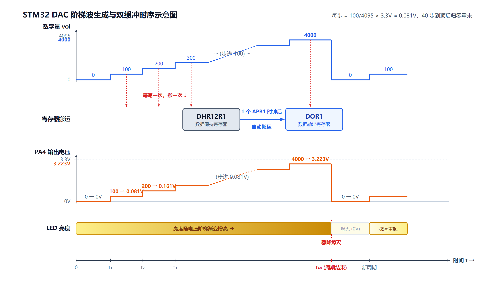

**看图方法**：

- 上面是数字量的阶梯（0→100→200→…→4000→0）；
- 中间经过 DHR12R1 → DOR1；
- 下面是对应的输出电压阶梯；
- 最下面是同一时间轴上 LED 亮度的变化。

---

#### 扩展 1：用 DAC 硬件功能输出三角波

【教材内容】前面 10.4.3 的「三角波生成」小节（讲义 §8；= 教材 10.4.3 第 9 小节）讲过：设置 `WAVE1[1:0] = 10`（三角波），再用 `MAMP1` 选幅度，**硬件自动**产生三角波。

【补充解释】用固件库只需要改两行：

```c
DAC_InitType.DAC_WaveGeneration = DAC_WaveGeneration_Triangle;  // 三角波
DAC_InitType.DAC_LFSRUmask_TriangleAmplitude = DAC_TriangleAmplitude_1023;  // 幅度 1023
```

然后**每次触发**，硬件就把三角波计数器加 1（或减 1），叠加到 DHR1 上。

**触发从哪来？** 用定时器：

```c
DAC_InitType.DAC_Trigger = DAC_Trigger_T6_TRGO;   // 用定时器 6 触发
```

**硬件发生什么**：

```
定时器 6 每 10μs 产生一次 TRGO
        ↓
DAC 三角波计数器 +1
        ↓
DOR1 = DHR1 + 三角波计数值
        ↓
输出往上走一小步
        ↓（到达 MAMP 设定的最大幅度后转为递减）
输出往下走一小步
        ↓
周而复始 → 得到三角波
```

**这个例子的好处**：**CPU 完全不用参与**，只要配好定时器和 DAC，波形就一直输出。

---

#### 扩展 2：输出正弦波（习题 10-4 的要求）

【教材内容】原教材习题 10-4：

> **编程实现使用 STM32F103VET6 的 DAC 输出正弦波。**

教材没有给出正弦波的完整代码，这里【补充解释】给出思路和关键代码。

##### 为什么正弦波不能靠硬件自动生成？

因为 STM32 的 DAC 硬件只提供**噪声**和**三角波**两种自动波形，**没有正弦波**。所以正弦波必须**由程序算出每个点的值，再一个点一个点地送给 DAC**。

##### 核心思路：查表法 + 定时器触发 + DMA

```
第 1 步：事先算好一个正弦波周期的 N 个采样点，存成一个数组（"查表"）
        例如 N = 100 个点，每点 = 2048 + 2047×sin(2πi/100)

第 2 步：用定时器（如 TIM6）产生固定频率的触发信号
        触发频率 = 采样点数 N × 想要的波形频率 f
        例如想要 1kHz 正弦波、N=100 → 触发频率 = 100kHz

第 3 步：每次定时器触发，DMA 自动把数组里的下一个点搬到 DAC_DHR12R1

第 4 步：DAC 输出电压 → PA4 上出现阶梯状的正弦波
        经过后面的低通滤波器（RC 电路），阶梯被"抹平"成平滑的正弦波
```

【辅助理解图】把"查表 + 定时器 + DMA"这条流水线画出来：

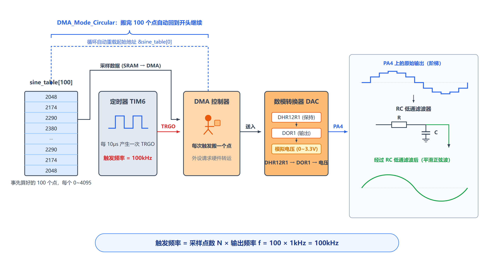

**看图方法**：

1. 左边是**正弦波采样表**（一个数组，里面存着 100 个 0～4095 的数，按正弦规律排列）；
2. 中间是**定时器 TIM6**，每隔固定时间发一次触发；
3. 触发同时驱动 **DMA** 和 **DAC**：DMA 从数组取下一个数送进 DHR12R1，DAC 把它变成电压；
4. 右边是 PA4 上的输出波形：先是阶梯状，经过 RC 低通滤波后变成平滑正弦波；
5. 图下方标出频率关系：**触发频率 = 采样点数 × 输出频率**。

##### 关键代码（补充解释）

```c
#include "stm32f10x.h"
#include <math.h>

#define N 100                        // 一个正弦波周期用 100 个点
u16 sine_table[N];                   // 正弦波数据表

// 生成正弦波表
void SineTable_Init(void)
{
    u16 i;
    for(i = 0; i < N; i++)
    {
        // 2048 是直流偏置（把正弦搬到 0~4095 的正区间）
        // 2047 是幅度（留 1 的余量，避免超出 4095）
        sine_table[i] = 2048 + (u16)(2047 * sin(2 * 3.1415926 * i / N));
    }
}

int main(void)
{
    GPIO_InitTypeDef GPIO_InitStructure;
    DAC_InitTypeDef  DAC_InitStructure;
    DMA_InitTypeDef  DMA_InitStructure;
    TIM_TimeBaseInitTypeDef TIM_TimeBaseStructure;

    // ① 开时钟：GPIOA、DAC、DMA1、TIM6
    RCC_APB2PeriphClockCmd(RCC_APB2Periph_GPIOA, ENABLE);
    RCC_APB1PeriphClockCmd(RCC_APB1Periph_DAC | RCC_APB1Periph_TIM6, ENABLE);
    RCC_AHBPeriphClockCmd(RCC_AHBPeriph_DMA1, ENABLE);

    // ② PA4 配置为模拟输入
    GPIO_InitStructure.GPIO_Pin  = GPIO_Pin_4;
    GPIO_InitStructure.GPIO_Mode = GPIO_Mode_AIN;
    GPIO_Init(GPIOA, &GPIO_InitStructure);

    // ③ 生成正弦表
    SineTable_Init();

    // ④ 配置 DMA：从 sine_table 搬到 DAC 的 DHR12R1
    DMA_InitStructure.DMA_PeripheralBaseAddr = (u32)&DAC->DHR12R1;  // 目的地（外设）
    DMA_InitStructure.DMA_MemoryBaseAddr     = (u32)sine_table;     // 源头（内存）
    DMA_InitStructure.DMA_DIR                = DMA_DIR_PeripheralDST;// 内存→外设
    DMA_InitStructure.DMA_BufferSize         = N;                    // 搬 N 个
    DMA_InitStructure.DMA_PeripheralInc      = DMA_PeripheralInc_Disable; // 外设地址不变
    DMA_InitStructure.DMA_MemoryInc          = DMA_MemoryInc_Enable;      // 内存地址递增
    DMA_InitStructure.DMA_PeripheralDataSize = DMA_PeripheralDataSize_HalfWord;
    DMA_InitStructure.DMA_MemoryDataSize     = DMA_MemoryDataSize_HalfWord;
    DMA_InitStructure.DMA_Mode               = DMA_Mode_Circular;    // 循环模式
    DMA_InitStructure.DMA_Priority           = DMA_Priority_High;
    DMA_Init(DMA1_Channel3, &DMA_InitStructure);   // DAC 通道 1 对应 DMA1 通道 3
    DMA_Cmd(DMA1_Channel3, ENABLE);

    // ⑤ 配置 DAC：用 TIM6_TRGO 触发，使能 DMA
    DAC_InitStructure.DAC_Trigger = DAC_Trigger_T6_TRGO;
    DAC_InitStructure.DAC_WaveGeneration = DAC_WaveGeneration_None;
    DAC_InitStructure.DAC_LFSRUmask_TriangleAmplitude = DAC_LFSRUmask_Bit0;
    DAC_InitStructure.DAC_OutputBuffer = DAC_OutputBuffer_Enable;
    DAC_Init(DAC_Channel_1, &DAC_InitStructure);

    DAC_Cmd(DAC_Channel_1, ENABLE);
    DAC_DMACmd(DAC_Channel_1, ENABLE);   // 让 DAC 在触发时发出 DMA 请求

    // ⑥ 配置 TIM6：产生 100kHz 触发（对应 1kHz 正弦波，100 点/周期）
    TIM_TimeBaseStructure.TIM_Period = 720 - 1;       // 72MHz/720 = 100kHz
    TIM_TimeBaseStructure.TIM_Prescaler = 0;
    TIM_TimeBaseStructure.TIM_ClockDivision = 0;
    TIM_TimeBaseStructure.TIM_CounterMode = TIM_CounterMode_Up;
    TIM_TimeBaseInit(TIM6, &TIM_TimeBaseStructure);
    TIM_SelectOutputTrigger(TIM6, TIM_TRGOSource_Update);  // 更新事件作为 TRGO
    TIM_Cmd(TIM6, ENABLE);

    while(1)
    {
        // 什么都不用做，DMA + 定时器 + DAC 自动产生正弦波
    }
}
```

##### 逐块解释关键点

**① 频率关系怎么算？**

```
想要输出频率 f = 1kHz
一个周期用 N = 100 个点
→ 每秒要输出 1000 × 100 = 100000 个点
→ 触发频率必须是 100kHz
→ TIM6 定时 10μs 触发一次

TIM6 时钟 = 72MHz（APB1 定时器时钟，APB1 分频后定时器时钟会倍频回 72MHz）
Period = 72MHz / 100kHz = 720
所以 TIM_Period = 720 − 1 = 719
```

**② 为什么用 DMA_Mode_Circular（循环模式）？**

因为正弦波要**一直重复**输出。循环模式下，DMA 搬完 100 个点后自动回到数组开头继续搬，不需要 CPU 干预。

**③ 为什么 DMA 目的地是 `&DAC->DHR12R1`？**

因为 DAC 只认"写 DHR12R1"这个动作。DMA 每次触发就往这个地址写一个数，硬件自动把它搬到 DOR1。

**④ 输出波形长什么样？**

```
理想正弦：      ╱‾‾╲
              ╱      ╲
            ╱          ╲
          ╱              ╲

DAC 实际输出（100 点阶梯）：
          ┌─┐
        ┌─┘ └─┐
      ┌─┘     └─┐
    ┌─┘         └─┐
  ┌─┘             └─┐
──┘                 └──
   （点数越多，越接近平滑正弦）
```

**⑤ 为什么还要"低通滤波"？**

因为 DAC 输出的是**阶梯**，含有大量高频分量。用一个简单的 RC 低通滤波器（电阻 + 电容）就能把阶梯"抹平"，得到比较平滑的正弦波。

```
PA4 ──[ R ]──┬──── 输出（平滑正弦波）
             │
            === C
             │
            GND

R 和 C 的取值：截止频率要高于正弦波频率，但低于采样频率
              一般取 f_cutoff ≈ 采样频率的 1/2 ~ 1/10
```

【补充解释】**为什么正弦波要用"查表"而不是"实时算 sin"？**

因为 `sin()` 函数计算很慢（几十到几百个时钟周期）。如果要在 100kHz 的触发频率下实时计算，CPU 根本来不及。**事先算好存成表**，运行时只做"取值 + 搬运"，速度就够快了。

> 【类比】考试时现推公式很慢，所以老师允许你带"公式表"——查表比现算快得多。

---

### 10.4 节真正要记住什么

1. **STM32 的 DAC 是 12 位、双通道**，输出引脚固定为 **PA4（通道 1）和 PA5（通道 2）**。
2. **DHRx 是"待用数据"，DORx 是"正在输出的数据"**；数据先写 DHRx，再（自动或触发）搬到 DORx。
3. **输出公式：DAC 输出 = VREF × (DOR / 4095)**。
4. **三个关键控制位**：ENx（使能）、TENx（触发使能）、BOFFx（关闭输出缓存，**反逻辑**）。
5. **波形生成**：WAVE=00 关闭、01 噪声、1x 三角波（原书此处有矛盾，见"待核验"）。
6. **正弦波**要用"查表 + 定时器触发 + DMA"，因为硬件不提供正弦波。
7. **使用 DAC 的 5 步**：开时钟 → 配 GPIO 为模拟输入 → DAC_Init → DAC_Cmd → 设数据。

---

## 10.5 习题（教材原题）

【教材内容】

> **10-1** 简述 STM32F103VET6 的 ADC 模块的特点。
>
> **10-2** 注入通道和规则通道有什么本质区别？
>
> **10-3** 编程实现使用 STM32F103VET6 的 ADC 通道 2 测量电源电压。
>
> **10-4** 编程实现使用 STM32F103VET6 的 DAC 输出正弦波。

### 习题提示（不是标准答案，是思路）

**10-1 提示**：按 10.2.1 的 14 条特性答，重点写：12 位分辨率、18 路（16 外部 + 2 内部）、单次/连续/扫描/间断模式、左右对齐、模拟看门狗、自校准、外部触发、DMA、双 ADC 模式、ADCCLK ≤ 14MHz。

**10-2 提示**：从五个角度对比——通道数（16 vs 4）、结果存放（DR 一个 vs JDR1~4 四个）、能否打断（不能 vs 能）、有无偏移（无 vs 有 JOFRx）、能否产生 DMA（能 vs 不能）。

**10-3 提示**：

- ADC 通道 2 对应引脚 **PA2**；
- "测量电源电压"通常需要分压（电源可能高于 3.3V），所以要先用电阻分压把电压降到 0～3.3V；
- 代码骨架和例 10-1 一样，只要把 `GPIO_Pin_1` 改成 `GPIO_Pin_2`、通道号从 1 改成 2；
- 读出的数字要换算：`电压 = dat × 3.3 / 4096`（如果做了分压，还要乘以分压比）。

**10-4 提示**：见 10.4.6 的"扩展 2"，核心是"查表 + 定时器触发 + DMA + 循环模式"。

---

## 本章总结：一张图看懂 ADC 和 DAC

```
                  ┌─────────────────────────────────────────┐
                  │              STM32F103VET6              │
                  │                                         │
   现实世界的      │   ┌─────────┐         ┌─────────┐        │      现实世界的
   模拟信号        │   │   ADC   │         │   DAC   │        │      模拟信号
    (电压)         │   │ 12 位   │         │ 12 位   │        │       (电压)
      │           │   │ 逐次逼近│         │ 权电阻型│        │         │
      │  0~3.3V   │   └────┬────┘         └────┬────┘        │         │
      ▼           │        │                   │             │         ▼
  ┌────────┐      │   16 个外部通道        2 个输出通道       │    ┌────────┐
  │ 传感器 │──────┼──→PA0~PA7,          PA4(DAC_OUT1) ───────┼───→│ 执行器 │
  │ 光敏   │      │   PB0~PB1,          PA5(DAC_OUT2)         │    │ LED    │
  │ 温度   │      │   PC0~PC5                              │    │ 扬声器 │
  └────────┘      │        │                   ▲            │    └────────┘
                  │        ▼                   │            │
                  │   ┌─────────┐         ┌─────────┐        │
                  │   │ ADC_DR  │         │ DHRx    │        │
                  │   │ 0~4095  │         │ 0~4095  │        │
                  │   └────┬────┘         └────┬────┘        │
                  │        │                   │             │
                  │        ▼                   │             │
                  │   ┌─────────────────────────────┐        │
                  │   │      CPU / 程序 / DMA       │        │
                  │   └─────────────────────────────┘        │
                  └─────────────────────────────────────────┘

  ADC：模拟 → 数字    （"读"电压，0~3.3V 变成 0~4095）
  DAC：数字 → 模拟    （"写"电压，0~4095 变成 0~3.3V）
```

**两条公式（本章最该记住的）：**

```
ADC：  转换结果 = 输入电压 ÷ VREF × 4096
       例：3.3V 参考时，1 LSB ≈ 0.806mV

DAC：  输出电压 = VREF × DOR ÷ 4095
       例：3.3V 参考、DOR=2048 时，输出 ≈ 1.65V
```

**三个最该记住的"坑"：**

1. **ADCCLK 必须 ≤ 14MHz**（PCLK2 分频之后）；
2. **规则组只有一个 ADC_DR，多通道必须配 DMA**；注入组有 4 个独立 JDRx；
3. **DAC 的 BOFFx 是反逻辑**（0 = 开缓存，1 = 关缓存）。

---

## 待核验

以下各项是本次重构过程中发现的、**素材（MinerU 解析结果）本身可能存在 OCR 错误、前后矛盾或信息缺失**的地方。**本讲义没有擅自猜测，而是如实列出，请对照原始 PDF 核验后再定稿。**

| 序号 | 位置 | 疑点 | 处理方式 |
|---|---|---|---|
| 1 | p141 ADC_CR2 位定义 | 位 22 **SWSTART** 在表格中列出，但正文逐位说明里**缺少对 bit22 的描述**（从 TSVREFE 直接跳到 JSWSTART） | 本讲义依据"软件触发事件可以通过对 ADC_CR2 的 SWSTART 或 JSWSTART 位置 1 产生"补出"SWSTART = 开始转换规则通道"，**请核验原书 p141 是否有该位说明** |
| 2 | p143 ADC_SMPR1 表格 | 表格中"8~6 位"一栏写成 `SMP12[2:1]`（应为 `SMP12[2:0]`），且位宽标注与其它通道不一致 | 本讲义统一按 `SMP12[2:0]` 表述 |
| 3 | p146 ADC_JSQR 表格 | 表格标注 `JL[3:0]` 占"位 21~20"（只有 2 位），正文写 `JL[1:0]`，两者不一致 | 本讲义按正文 `JL[1:0]` 表述 |
| 4 | p132 表 10-5 | ADC3 注入通道触发源表的表头印成 `EXTSEL[2:0]`，应为 `JEXTSEL[2:0]` | 已在本讲义中标注 |
| 5 | p158 / p159~160 DAC 波形选择 | **前后矛盾**：教材 10.4.3 第 8 小节（噪声生成）说"WAVE=01 选择噪声"，第 9 小节（三角波生成）说"WAVE=10 选择三角波"；但 DAC_CR 位定义写"00 关闭；10 噪声；1x 三角波"（本讲义对应的小节是 §7、§8，见正文"编号说明"） | 本讲义按"00 关闭 / 01 噪声 / 1x 三角波"表述（与前后文一致），**请核验 p158 与 p159 原书原文** |
| 6 | p159 DAC_CR 表格 | 表格中 `WAVE2[2:0]` 占"位 23~22"（只有 2 位），正文写 `WAVE2[1:0]`；同理低 16 位表格里 `MAMP[13:0]` 应为 `MAMP1[3:0]` | 本讲义按 `WAVE2[1:0]`、`MAMP1[3:0]` 表述 |
| 7 | p163 DAC_DHR12LD 表格 | 表格最后一行标注"位 4~0 保留"，但数据占 15~4，保留应为"3~0" | 本讲义按"3~0"表述 |
| 8 | p156 / p159 DAC 控制寄存器名 | 教材在"4. DAC 转换"（p156）里把控制寄存器写成 **`DAC_CR1`**（"寄存器 DAC_CR1 的 TENx 位"），在寄存器定义小节（p159）又写成 **`DAC_CR`**。**在 `tools/index/ch10_source.md` 中检索不到"DAC_CR2"**，此前若按"DAC_CR2"理解属于误记；STM32F103 的 DAC 只有一个控制寄存器 `DAC_CR` | 本讲义统一按 `DAC_CR` 表述，**请核验原书 p159 小标题原文** |
| 9 | p151 例 10-1 代码注释 | 三行注释明显错位：`ADC_Mode_Independent` 注释成"单通道模式"、`ADC_ScanConvMode = DISABLE` 注释成"单次转换模式"、`ADC_ContinuousConvMode = DISABLE` 注释成"软件触发" | 本讲义已在正文指出并给出正确对应关系 |
| 10 | p167 例 10-2 代码 | `void delay(u32 cnt) { while(cnt--) }` **缺少分号**，编译不能通过 | 本讲义按 `while(cnt--);` 引用并标注 |
| 11 | p168 例 10-2 代码 | `GPIO_SetBits(GPIOA, GPIO_Pin_4);` 在 PA4 已配置为模拟输入后设置 ODR，教材未解释其用意；在模拟输入模式下该操作对输出无实际影响 | 本讲义如实说明并标注 |
| 12 | p124 ADC 概述 | "ADC 转换时间：时钟为 56MHz 时为 1μs（时钟为 72MHz 为 1.17μs）"——这里的"时钟"指 PCLK2 而非 ADCCLK，教材表述容易误解 | 本讲义已展开推算说明，**建议核验原书 p124 原文是否有"PCLK2"字样** |
| 13 | p128 图 10-7 题注 | figures.md 中该图被标为"注(1)：最大延迟数值请参考数据手册…"，实际应为"图 10-7 触发注入转换时序图"的题注错位 | 本讲义按"图 10-7 触发注入转换时序图"引用 |
| 14 | p120 图 10-1 | figures.md 把"图 10-1 具有模拟量输入/输出的单片机系统"归到**第 9 章**（p120），实际应为第 10 章的开篇图 | 本讲义按第 10 章开篇图使用 |
| 15 | p130 式(10-1) | 教材写作 `T_conv = 采样时间 + 12.5 个周期`；而 ADC 概述等处提到"14 个时钟周期"，二者一致（1.5+12.5=14），但教材未点明这层关系 | 本讲义已补出推导 |
| 16 | p143 采样时间表 | SMPR1 的注里写"ADC3 模拟输入通道 9 与 VSS 相连"，而 ADC_CR1 的注里写"ADC3 模拟输入通道 9、14、15、16、17 与 VSS 相连"，两处列举范围不一致 | 本讲义按较全的一处（9、14、15、16、17）表述，**请核验** |
| 17 | p124 / p138 | ADC 寄存器起始地址写作"0x4001 2400"（中间有空格分隔），实际为 0x40012400 | 本讲义统一写作 0x40012400 |
| 18 | p159 | DAC 寄存器起始地址写作"0x4000 7400"，实际为 0x40007400 | 本讲义统一写作 0x40007400 |
| **19** | p141 ADC_CR2 位定义 vs p131 表 10-4 | **同一件事两处说法相反**：ADC3 规则通道触发源，正文（`ch10_source.md:842-845`）写"100 = 定时器 3 的 TRGO、101 = 定时器 4 的 CC4、110 = EXTI 线 11/TIM8_TRGO"；表 10-4（`ch10_source.md:446`）写"100 = TIM8_TRGO、101 = TIM5_CC1、110 = TIM5_CC3"。正文那组数值与 ADC1/ADC2 的触发源几乎相同，疑似串行 | 本讲义采用**表 10-4**（与 STM32F103 数据手册一致），ADC_CR2 的 EXTSEL 说明处已标注"ADC3 不同，见前表"，**请核验原书 p141 与 p131** |
| **20** | p132 正文 vs p142 ADC_CR1 位定义 | **位宽不一致**：双 ADC 模式处写 `DUALMOD[2:0]`（`ch10_source.md:471`），ADC_CR1 寄存器定义写 `DUALMOD[3:0]`（`ch10_source.md:721`）。模式码值有 10 种（0000～1001），3 位装不下 | 本讲义按 `DUALMOD[3:0]` 表述，并在正文加注，**请核验** |
| **21** | p159 小节标题 | 标题印成"**1. 状态寄存器（DAC\_SR）**"（`ch10_source.md:1621`），但该节内容实际是**控制寄存器 DAC_CR 的位定义**（DMAEN/MAMP/WAVE/TSEL/TEN/BOFF/EN），标题与内容不符 | 本讲义把该节按"**1. 控制寄存器（DAC_CR）**"讲解，**请核验原书 p159 标题原文** |

---
## 本章自检（对照 TASK.md 第二十二节）

### 内容

- [x] 核心知识有没有遗漏？—— 三种 ADC 原理、性能指标（含分辨率/量化误差/转换时间/采样率/INL/DNL/量程/通道等）、STM32 ADC 概述/结构/配置/应用特征/中断/全部寄存器/固件库/例 10-1；DAC 原理（权电阻）/性能指标、STM32 DAC 特征/接口/配置/全部寄存器/固件库/例 10-2 与正弦波三角波扩展，均已覆盖。
- [x] 有没有错误删掉考试可能需要的内容？—— 保留了教材全部 14 条 ADC 特性、13 项 ADC 指标、5 项 DAC 指标、表 10-1～10-10、全部寄存器位定义、4 道习题。
- [x] 有没有模型自行加入教材不支持的结论？—— 凡教材未展开的内容（量化误差、INL/DNL、正弦波查表法、中断/DMA 改写、ADCCLK 推算）均标注【补充解释】，并在"待核验"中列出与原书矛盾处。

### 可理解性

- [x] 一个前置知识薄弱的人能否读懂？—— 开头补了 9 个前置知识（模拟/数字量、参考电压、bit、时钟周期、寄存器复习、0x、采样保持、**运算放大器/反相放大器/积分器**、权）。
- [x] 有没有术语突然出现？—— 首次出现的 ADC / DAC / SAR / LFSR / DMA / sps / T/H / INL / DNL 等均给出英文全称、中文名、缩写、大白话、用途。
- [x] 有没有连续三段以上都是教材式语言？—— 每段教材原文后都跟【补充解释】或大白话翻译。
- [x] 有没有可以用例子却没有例子？—— 逐次逼近用了 4 位和 12 位两个完整演算表；分辨率用了 8 位/12 位两个计算；对齐用了具体十六进制演算；DAC 输出用了 0/2048/4095 三个点。

### 图像

- [x] 本章是否图太少？—— 引用教材原图 **25 张**（去重后，含双 ADC 的图 10-11、10-18～10-20），另申请生成辅助图 **18 张**（新增"运放/反相放大器/积分器"前置知识图与"光敏分压电路"重绘图）。
- [x] 有没有应该画结构图的地方？—— ADC 模块结构、DAC 结构、地址链均有图。
- [x] 有没有应该画数据流的地方？—— ADC 取数三方式（轮询/中断/DMA）、DAC 数据通路、正弦波生成流水线均有图。
- [x] 有没有应该画时序图的地方？—— ADC 转换时间轴、校准时序（引用教材图 10-8）、DAC TEN=0 时序（引用教材图 10-28）、逐次逼近 12 步过程均有图。
- [x] 教材原图是否需要简化版？—— 图 10-2、10-4、10-25 均配了简化辅助图，并做了"逐层搭积木"拆解。

### 代码

- [x] 是否解释了代码目的？—— 每段代码前先说"这一段要完成什么"。
- [x] 是否解释了寄存器变化？—— 例 10-1、例 10-2 均按"代码 → CPU → 寄存器 → 硬件"四层逐块说明。
- [x] 是否解释了硬件发生什么？—— 每一块都有"硬件发生什么"一行。

### 前置知识

- [x] 有没有隐藏前提没有讲？—— 已补：模拟/数字量、VREF、bit、时钟周期、寄存器复习、0x 与十六进制、采样保持、权、volatile、模拟输入模式为何要单独设置、DHR/DOR 两级寄存器为何存在、输出缓存为何要关。


