# 第 11 章 DMA 控制器

> 本章对应教材《基于ARM的微机原理与接口技术——STM32嵌入式系统架构、编程与应用》（陈桂友）第 11 章（原书 p169～p191）。
> 素材来源：MinerU 解析结果 `tools/index/ch11_source.md`，教材原图 3 张（图 11-1、图 11-2、图 11-3），另有跨章引用第 3 章图 3-12（例 11-1 的光敏电阻采集电路）和第 10 章图 10-22。
>
> **本章在全书地图上的位置**：第六层——"怎么提高数据搬运和外部扩展能力"。
> 前面第 10 章学的是"模拟世界怎么进出数字系统"（ADC / DAC）。你可能已经感觉到一个问题：
> **ADC 每转换出一个数据，就要让 CPU 跑去把它搬走一次。** 如果 ADC 每秒转换 100 万次呢？CPU 什么都不用干了，光搬数据就累死了。
> 本章的 DMA，就是来解决这个"搬运太累"的问题的。

---

## 11.0 先别急着看教材：这一章到底在干什么？

### 一句话版本

> **DMA 就是给芯片专门请了一个"搬运工"，让它替 CPU 把数据从一头搬到另一头。CPU 只要告诉它"从哪搬到哪、搬多少"，然后就可以去干别的事了。**

### 一个具体的场景（先建立直觉）

假设你要用 STM32 做一个"录音"的功能：

- ADC（模数转换器）每隔一小段时间就把电压变成一个数字，比如 `2048`；
- 这个数字必须马上被存进内存的数组里，否则下一次转换一来就把它覆盖了；
- 你想存 10000 个点。

如果**没有 DMA**，CPU 必须这样做：

```
while (还没存够 10000 个点) {
    等 ADC 说"我转换完了"；      ← CPU 在这里空转等
    把 ADC 数据寄存器里的数读出来；  ← CPU 亲自搬
    存进数组；                     ← CPU 亲自搬
}
```

这就像**一个大学教授被安排去当快递员**：他的时间很贵，但他在干"把箱子从 A 搬到 B"这种不需要脑子的活。而且他搬箱子的时候，就没法去讲课、没法去做数学题。

如果**有 DMA**，CPU 只要说一句话：

```
DMA 啊，你把 ADC 数据寄存器里的东西，一个一个搬到我这个数组里，搬 10000 个。
搬完了叫我一声。
```

然后 CPU 就跑去干别的事了。**搬箱子这件事由 DMA 这个"专职搬运工"完成，CPU 完全不用管。**

### 【类比】搬运工类比

| 生活里的东西 | 对应到 STM32 里是什么 |
|---|---|
| 正在做正事的教授 / 员工 | CPU（Cortex-M3 核心） |
| 教授桌上的一摞文件 | 存储器（RAM）里的数据 |
| 隔壁房间的打印机 | 外设（比如 ADC、串口） |
| 教授自己一趟趟跑着搬文件 | CPU 逐字节读写数据（占用 CPU 时间） |
| 专门雇来的搬运工 | **DMA 控制器** |
| 给搬运工的委托单："从打印机搬到桌上第 3 摞，搬 100 张" | DMA 的三个配置寄存器（从哪搬、搬到哪、搬多少） |
| 搬运工搬完了敲一下门告诉你 | DMA 的"传输完成中断" |
| 走廊只有一条，教授和搬运工要错开走 | **总线争用**：CPU 和 DMA 抢同一条总线 |

#### 【类比的边界】真实硬件并不是完全如此

必须说清楚几点，否则类比会把你带偏：

1. **"搬运工"不是一个真的独立的人。** DMA 控制器是 STM32 芯片内部的一小块硬件电路，它没有"思想"，只会严格按照你写进寄存器里的规则重复做三件事：**读一个数据 → 写一个数据 → 计数减 1**。
2. **"教授完全不用管"也不对。** CPU 还是要做三件事：(a) 一开始用程序把 DMA 配置好；(b) 中途 DMA 会和 CPU 抢总线，CPU 会被短暂地"挡一下"；(c) 搬完之后 CPU 要知道结果（靠中断或查标志位）。
3. **搬运工不是"想搬谁就搬谁"。** 在 STM32 里，哪个外设能走哪条 DMA 通道是**硬件焊死的**（见 11.2.6 的通道映射表）。你不能让 ADC1 随便走哪条通道，它只能走 DMA1 的通道 1。

### 本章要学什么（学习路线）

```
11.1  DMA 是什么？它长什么样？（结构 + 10 条主要特征）
        ↓
11.2  DMA 是怎么工作的？（处理流程 / 仲裁 / 通道 / 宽度对齐 / 中断 / 请求映像）
        ↓
11.3  DMA 的 6 个寄存器分别是什么？（ISR / IFCR / CCR / CNDTR / CPAR / CMAR）
        ↓
11.4  固件库帮我们把这些寄存器包装成了什么函数？
        ↓
11.5  一个完整例子：ADC + DMA + 串口（逐行讲解）
```

---

## 【先补一个前置知识】本章要用到的 6 个基础概念

这一章会反复用到下面这些词。如果你对其中任何一个还有一点模糊，请先花几分钟看完这一节。
（如果你已经比较熟，可以跳过，但建议至少扫一眼，确认自己没有误解。）

---

### 【先补一个前置知识 1：什么叫"外设"？】

**外设** = 英文 **Peripheral**，中文也叫"外围设备"。

大白话说：

> **CPU 是芯片里的"大脑"，大脑自己不会看、不会听、不会发信号。所以芯片里除了 CPU 之外，还配了一堆"小助手"，每个小助手专门干一件事。这些小助手就叫外设。**

在 STM32 里，外设有：

| 外设 | 它专门干什么 |
|---|---|
| GPIO | 读引脚上的高低电平 / 让引脚输出高低电平 |
| ADC | 把电压变成数字 |
| DAC | 把数字变成电压 |
| USART（串口） | 一位一位地发数据 / 收数据 |
| SPI | 和别的芯片高速通信 |
| 定时器 TIM | 数数、计时、产生波形 |

**外设和 CPU 是怎么连的？** 靠**总线**（见下一条）。

**外设里的"数据寄存器"是什么？**

每个外设内部都有若干"小格子"（寄存器）。其中专门用来"放数据"的那个格子，叫**数据寄存器**（Data Register，缩写 DR）。

比如：

- ADC 转换完一次，结果就放在 `ADC1->DR` 里；
- 串口要发一个字节，就把这个字节写进 `USART1->DR`；
- 串口收到一个字节，也是从 `USART1->DR` 里读出来。

> **本章的关键**：DMA 搬来搬去的"两头"，往往一头是**外设的数据寄存器**（比如 `ADC1->DR`），另一头是**内存**（比如一个数组）。所以 DMA 必须先知道"那个数据寄存器的地址是多少"。

---

### 【先补一个前置知识 2：什么叫"总线"和"总线争用"？】

**总线** = 英文 **Bus**。

大白话说：

> **芯片里所有部件（CPU、内存、外设）之间传数据，不是两两之间各拉一套线（那样线会多到爆炸），而是大家共用一套"公共道路"。这套公共道路就叫总线。**

用类比说：总线就像**一条走廊**。

现在关键来了：

> **走廊只有一条。CPU 要走，DMA 也要走。两个人不能同时走，必须排队。**

这就是**总线争用**（Bus Contention）。

STM32 里的处理办法是：

- CPU 和 DMA **共享**系统数据总线；
- 当两边同时想访问同一个目标（RAM 或外设）时，**DMA 会让 CPU 暂停访问总线若干个周期**；
- 但不会让 CPU 一直等——**总线仲裁器会做"循环调度"，保证 CPU 至少能拿到一半的总线使用时间**。

（这一段是教材 11.2 的原文意思，我在 11.2.1 会用时间轴画给你看。）

---

### 【先补一个前置知识 3：复习——什么叫"寄存器"？】

（这个在第 1、2、6 章都讲过，这里用一句话快速复习。）

> **寄存器 = 芯片内部的一排"小开关"，一个寄存器通常是 32 个开关，每个开关叫一个 bit（位），每个开关只有两种状态：0 或 1。**
>
> 往寄存器里写一个 32 位数，本质上就是"把 32 个开关按某个图案拨一遍"。硬件看到这个图案，就知道你要它干什么。

本章的 DMA 一共就 6 个寄存器，但它们非常关键，所以 11.3 会一个一个拆开讲。

---

### 【先补一个前置知识 4：复习——`0x` 是什么意思？每个十六进制位对应几个 bit？】

（第 1 章讲过，这里快速复习，因为本章全是十六进制。）

- 前缀 `0x` 表示"**后面这个数是十六进制**"（hexadecimal）。`0x` 只是一个记号，不是数值的一部分。
- **1 个十六进制位 = 4 个 bit**（因为 2⁴ = 16，十六进制正好有 16 个符号 0~9、A~F）。
- **8 个十六进制位 = 32 个 bit = 4 个字节**。所以 STM32 的 32 位寄存器，习惯写成 8 位十六进制，例如 `0x40020000`。

举个例子，`0x00000004` 为什么代表 bit2？

```
十六进制:   0    0    0    0    0    0    0    4
每个展开成4位:
二进制:   0000 0000 0000 0000 0000 0000 0000 0100
                                             ↑
                                        这一位是 1
                                        从右边数第 0 位开始：
                                        bit0=0, bit1=0, bit2=1
所以 0x00000004 = bit2 置 1
```

再记住一个换算表，本章会反复用：

| 十六进制 | 二进制 | 相当于 |
|---|---|---|
| 0x1 | 0001 | bit0 |
| 0x2 | 0010 | bit1 |
| 0x4 | 0100 | bit2 |
| 0x8 | 1000 | bit3 |
| 0x10 | 0001 0000 | bit4 |
| 0x100 | 0001 0000 0000 | bit8 |
| 0x1000 | 0001 0000 0000 0000 | bit12 |
| 0x10000 | （bit16） | bit16 |

**规律：`0x1` 后面跟几个 `0`，那个 `1` 就在 bit 几。** 比如 `0x1000` 里 `1` 后面有 3 个 0，所以是 bit12。

---

### 【先补一个前置知识 5：什么叫"数据宽度"——字节 / 半字 / 全字？】

在 STM32（ARM）的世界里，"一次搬多大的数据"有三个标准档位：

| 中文名 | 英文名 | 位数 | 字节数 | 记法 |
|---|---|---|---|---|
| 字节 | **Byte** | 8 位 | 1 字节 | B |
| 半字 | **Half-Word** | 16 位 | 2 字节 | H |
| 全字 / 字 | **Word** | 32 位 | 4 字节 | W |

⚠️ **特别提醒**：在 ARM 的术语里，"**字（Word）= 32 位**"，不是 16 位。这一点和某些其他体系（比如 x86 里字是 16 位）不一样，考试时不要搞混。

**为什么 DMA 要关心数据宽度？**

因为 DMA 是"一次搬一个数据项"。这个"一项"到底是 1 字节、2 字节还是 4 字节，必须提前告诉它。这个设置就在 `DMA_CCRx` 寄存器里的 **PSIZE**（外设数据宽度）和 **MSIZE**（存储器数据宽度）两个字段里。

---

### 【先补一个前置知识 6：什么叫"地址对齐"？什么叫"大小端"？】

#### （1）地址对齐（Alignment）

大白话：

> **一个 2 字节的东西，必须放在偶数地址上；一个 4 字节的东西，必须放在 4 的倍数地址上。这叫作"对齐"。**

为什么？可以用"停车位"来类比（**注意：这只是类比**）：

想象停车场里画好了格子：

- 每个格子长 1 米（= 1 字节）；
- 小汽车（2 字节）必须停在**两个格子一组的车位**上，不能骑在车位分界线上；
- 大卡车（4 字节）必须停在**四个格子一组的车位**上。

如果一辆大卡车停在 1 米处（骑在两组车位之间），停车场系统就没法正确管理它了。硬件也是一样。

具体的规则（本章会用到）：

- 当 `PSIZE = 01`（16 位）时，**不使用 `DMA_CPARx` 的 bit0**（也就是外设地址的最低位被忽略），操作自动按半字地址对齐；
- 当 `PSIZE = 10`（32 位）时，**不使用 `DMA_CPARx` 的 bit1、bit0**，操作自动按字地址对齐；
- `DMA_CMARx`（存储器地址）的规则完全一样。

举个数：

```
假设 CPAR 写的是 0x4001244C
bit0 = 0，所以它本来就是 2 的倍数，按半字对齐没问题。

假设 CPAR 写的是 0x4001244D（奇数）
如果 PSIZE=16 位，硬件会忽略最低位，实际按 0x4001244C 用。
```

#### （2）大小端（Endianness）

大白话：

> **一个 32 位数比如 `0x12345678`，在内存里要占 4 个连续的格子。问题是："哪个格子放哪一段？"**
> **小端（Little-Endian）：低字节放在低地址。**
> **大端（Big-Endian）：高字节放在低地址。**

STM32（Cortex-M3）是**小端**的。我们看一个具体例子：

```
32 位数 0x12345678 存在地址 0x20000000 开始的 4 个格子里：

小端（STM32 的做法）：
   地址 0x20000000 : 0x78   ← 最低字节放在最低地址
   地址 0x20000001 : 0x56
   地址 0x20000002 : 0x34
   地址 0x20000003 : 0x12   ← 最高字节放在最高地址

（对比）大端：
   地址 0x20000000 : 0x12
   地址 0x20000001 : 0x34
   地址 0x20000002 : 0x56
   地址 0x20000003 : 0x78
```

**为什么本章要讲这个？** 因为当 DMA 在"窄变宽"或"宽变窄"时，它到底保留哪几个字节、补哪几个 0，都和大小端有关。11.2.4 会详细演算。

---

## 11.1 DMA 的结构和主要特征

### 先看教材开头的一段话（原文大意）

【教材内容】

> DMA（Direct Memory Access，直接存储器存取）用来提供在**外设和存储器之间**或者**存储器和存储器之间**的高速数据传输，**无须 CPU 干预**，是所有现代计算机的重要特色。在 DMA 模式下，CPU 只需向 DMA 控制器下达指令，让 DMA 控制器来处理数据的传送，数据传送完毕再把信息反馈给 CPU，这样在很大程度上减轻了 CPU 资源占有率，可以大大节省系统资源。DMA 主要用于**快速设备和主存储器成批交换数据**的场合。在这种应用中，处理问题的出发点集中到两点：一是不能丢失快速设备提供出来的数据，二是进一步减少快速设备输入/输出操作过程中对 CPU 的打扰。……当完成一批数据传输之后，快速设备还是要向 CPU 发一次中断请求，报告本次传输结束的同时，"请示"下一步的操作要求。

这段话里有 3 个关键信息，我帮你翻译成人话：

#### 关键信息 1：DMA 的英文全称和中文名（首次出现的术语，按规则给全）

**DMA**
= **D**irect **M**emory **A**ccess
= **直接存储器存取**（也有人译作"直接内存访问"）
= 缩写 **DMA**

大白话意思：

> **让数据在"存储器"和"外设"之间（或"存储器"和"存储器"之间）自己流动，不需要 CPU 一个字节一个字节地去搬。这个"负责搬运的硬件模块"就叫 DMA 控制器（DMA Controller）。**

它是干什么的：

> **专门用来"成批搬运数据"的。适合"快设备"和"内存"之间大批量交换数据的场合。**

#### 关键信息 2：为什么用 DMA？—— "不能丢数据"和"不能老打扰 CPU"

教材说出发点有两个，其实很好理解：

**出发点一：不能丢失快速设备提供出来的数据。**

还是用录音的例子。ADC 转换是**按固定节奏**来的：每 1 微秒转换出一个新值。如果你在 1 微秒内没有把旧值读走，新值一来就把旧值顶掉了 —— **数据丢了**。

CPU 一边要跑主程序（比如算滤波、刷屏幕），一边还要"准时"去读 ADC。只要有一次没赶上，数据就丢了。这种"必须准时"的活，交给专门的硬件去做才可靠。

**出发点二：进一步减少快速设备 I/O 过程中对 CPU 的打扰。**

"打扰"这个词很关键。回忆第 7 章学的中断：

> **中断 = 你正在写作业，突然有人敲门。**

如果 ADC 每转换一次就中断 CPU 一次，那 CPU 就要：

```
写作业 → 敲门 → 放下笔，保存进度，去开门，回来，恢复进度，继续写作业
       → 敲门 → 放下笔，保存进度，去开门，回来，恢复进度，继续写作业
       → ……（每秒一百万次）
```

CPU 光"开门"就累死了。**中断确实比"CPU 死等轮询"好，但中断太频繁一样会把 CPU 拖垮。**

DMA 的做法是：**把"一批数据"整个交给 DMA，CPU 一次都不用被打扰。等整批搬完了，才中断 CPU 一次。**

#### 关键信息 3：DMA 并没有让中断消失

教材最后说：

> 当完成一批数据传输之后，快速设备还是要向 CPU 发一次中断请求，报告本次传输结束的同时，"请示"下一步的操作要求。

也就是说：

> **中断的频率从"每个数据一次"降到了"每一批数据一次"。**
> 这就是 DMA 最大的价值。

---

### 【类比】DMA 是"把搬货任务外包出去"

| 场景 | 没有 DMA | 有 DMA |
|---|---|---|
| 老板（CPU）要收 10000 箱货 | 老板每收到一箱，就自己搬到仓库 | 老板雇一个搬运工（DMA），跟他说"从门口搬到 3 号仓库，10000 箱" |
| 老板被打断几次 | 10000 次 | 1 次（搬完来汇报） |
| 老板能不能干别的 | 基本不能 | 能（只是偶尔要和搬运工抢走廊） |

**边界**：老板（CPU）还是要"下指令"和"听汇报"，不是彻底不管。

---

### DMA 的功能框图（教材图 11-1）

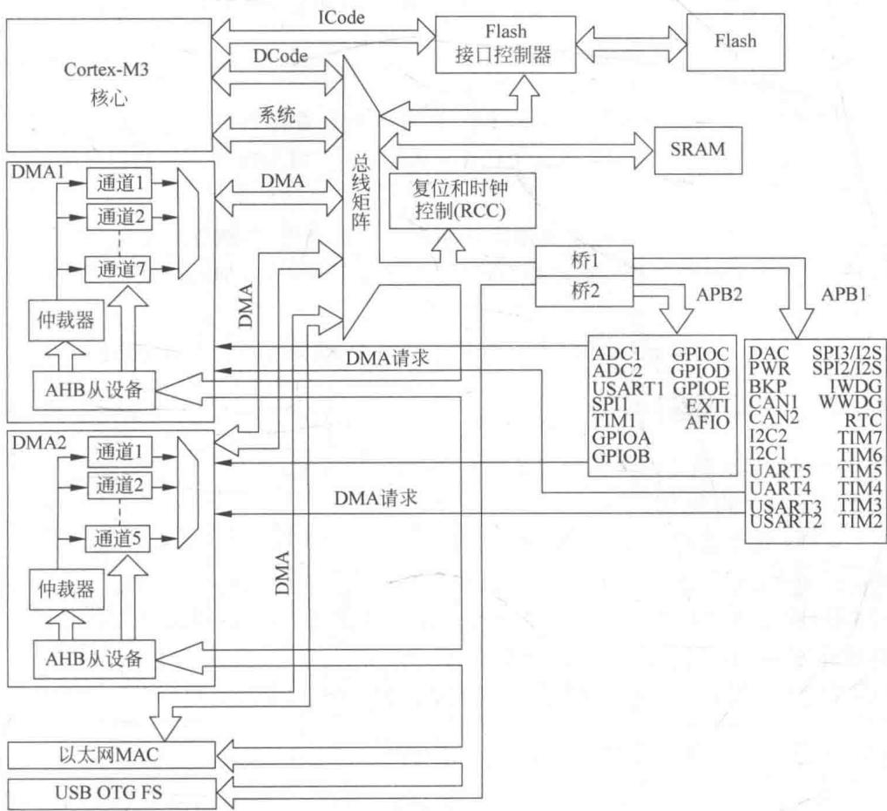

这张图信息量很大。**千万不要一上来就想看懂全部。** 我们用"逐层搭积木"的方式，分三层来看。

#### 第一层：只看 3 个核心区域（先建立大图景）

先用手挡住其他部分，只看这三块：

```
┌─────────────────────┐        ┌──────────────┐        ┌────────────────┐
│  Cortex-M3 核心      │◄──────►│   总线矩阵    │◄──────►│ Flash / SRAM   │
│  （CPU，干活的大脑）  │        │ （公共道路的  │        │ （存数据的地方）│
└─────────────────────┘        │   十字路口）  │        └────────────────┘
                               │              │
┌─────────────────────┐        │              │        ┌────────────────┐
│  DMA1 / DMA2        │◄──────►│              │◄──────►│ 各种外设        │
│  （搬运工）          │        └──────────────┘        │ ADC/SPI/USART… │
└─────────────────────┘                                └────────────────┘
```

**这一层只要理解一句话：**

> **CPU、DMA、存储器、外设，全部挂到同一套"总线矩阵"上。总线矩阵就像一个十字路口，负责把"谁要和谁说话"接通。DMA 和 CPU 一样，都是这个路口上的"正式用户"，都能主动发起读写。**

#### 第二层：加上细节 —— DMA 内部长什么样

现在看图的**左侧**，那里有两块几乎一样的结构：

```
┌──────────────────────────────┐
│ DMA1                         │
│  ┌────────┐ ┌────────┐       │
│  │ 通道1  │ │ 通道2  │ ...   │  ← 7 个通道（通道1~通道7）
│  └────────┘ └────────┘       │
│  ┌────────┐                  │
│  │ 仲裁器 │                   │  ← 决定"同一时刻先服务谁"
│  └────────┘                  │
│  ┌──────────┐                │
│  │ AHB 从设备│                │  ← 让 CPU 能读写 DMA 自己的寄存器
│  └──────────┘                │
└──────────────────────────────┘

┌──────────────────────────────┐
│ DMA2                         │
│   通道1 ~ 通道5（只有 5 个）  │
│   仲裁器                      │
│   AHB 从设备                  │
└──────────────────────────────┘
```

**这里有一个非常重要的细节，很多初学者会看漏：**

图中每个 DMA 控制器里都有一个方块叫 **"AHB 从设备"**。为什么搬运工自己还要有个"从设备"接口？

因为：

- **DMA 要搬数据时**，它是总线的"**主设备**"（Master）—— 它主动发起读/写，别人听它的；
- **CPU 要配置 DMA 时**（比如设置"从哪搬到哪"），CPU 需要能读写 DMA 的那 6 个寄存器。这时候 DMA 就是总线的"**从设备**"（Slave）—— 它听 CPU 的。

> 【术语补充】**主设备 / 从设备**：
> **主设备（Master）** = 能主动发起一次总线访问（"我要读地址 X"）的部件。CPU 是主设备，DMA 也是主设备。
> **从设备（Slave）**：只能被动响应（"你问我地址 X，我告诉你值"）的部件。Flash、SRAM、外设的寄存器、DMA 自己的寄存器，都是从设备。
> 一个部件可以**同时**有主设备身份和从设备身份，DMA 就是这样。

#### 第三层：看箭头 —— 请求线和数据线是分开的

这是这张图最容易被忽略、但最重要的一点。图中可以看到**两类箭头**：

**第 1 类：从外设指向 DMA 的细箭头，标注 "DMA请求"。**

看图的右下角，APB1 / APB2 上的外设（ADC1、SPI1、USART1、TIM1…）都有一根细线指回左边的 DMA。这就是 **DMA 请求信号**。

> **这根线不搬数据，它只负责"打招呼"。**
> 意思是：外设对 DMA 说："我这边有一个数据准备好了，你可以来搬了。"

**第 2 类：DMA 和总线矩阵之间的粗箭头，标注 "DMA"。**

这才是**真正搬数据**的通路。

**为什么要把"打招呼"和"搬东西"分成两条线？**

用快递类比（**只是类比**）：

- 快递员先给你**打个电话**："你有包裹到了"（请求线）；
- 你**开门，让他把包裹搬进来**（数据线）。

打电话和搬包裹是两件事，没必要混在一起。硬件上分开，可以让"请求"信号线做得简单（只需要一根线表示"有/没有"），而数据通路则做得又宽又快。

**再看图的上方**：Cortex-M3 核心有三组总线接口，分别叫 **ICode**、**DCode**、**系统**：

- **ICode**：取指令（Instruction）用的总线，连到 Flash 接口控制器；
- **DCode**：取数据（Data）用的总线，也连到 Flash 接口控制器；
- **系统**：访问 SRAM、外设等其他东西用的总线。

（这属于第 2、3 章的内容，这里只要知道"CPU 有好几条总线出口"就够了。）

**再看图右侧**：`桥1`、`桥2` 把 AHB 总线"翻译"成 APB2 / APB1 总线，因为 APB 上的外设（ADC、USART、TIM…）速度比较慢，需要一座"桥"来降速对接。

> ⚠️ **图 11-1 的疑点**：图中最下方画了 `以太网MAC` 和 `USB OTG FS`。但本章教材的芯片是 **STM32F103VET6**，它**没有以太网 MAC**（带以太网的是 STM32F107 互联型）。这张图更像是一张"STM32F1 系列通用框图"。已记入文末"待核验"，但不影响本章 DMA 知识的学习。

#### 【辅助理解图】DMA 在 STM32 系统中的位置

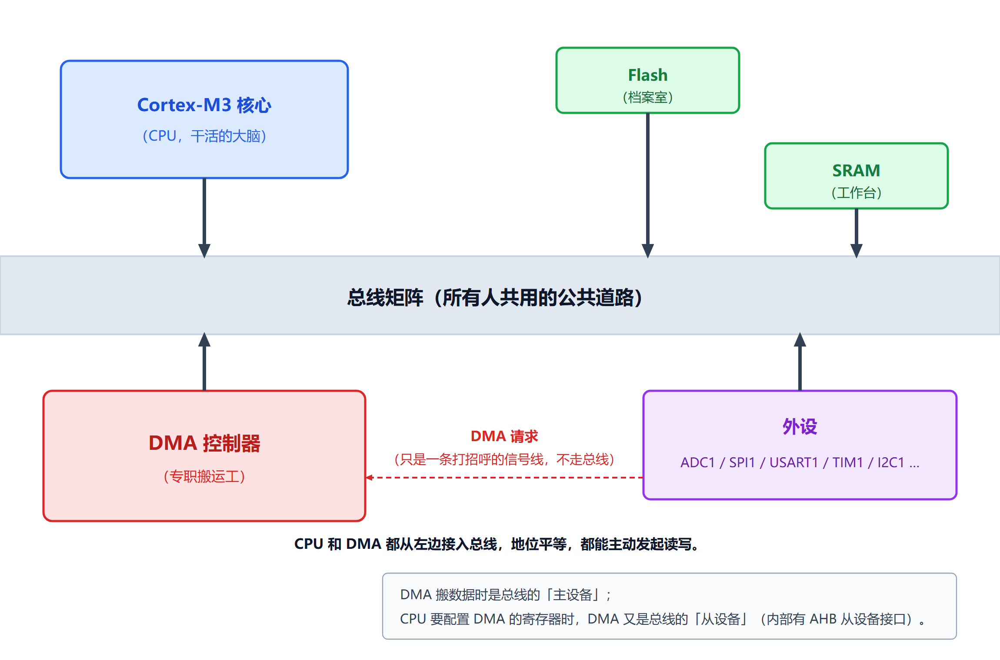

这张图把图 11-1 简化成"一眼就能看懂"的版本。看图时按这个顺序：

1. **先看中间那条横着的粗带子**，写着"总线矩阵"。这是所有人共用的"公共道路"。
2. **再看左上方和左下方**：`Cortex-M3 核心` 和 `DMA 控制器` 都从**左边**接上这条公共道路。它们俩地位是**平等的**，都是"能主动发起访问的主设备"。
3. **再看右边**：`Flash`、`SRAM` 从右上接进来，各种外设（ADC、SPI、USART、TIM）从右下接进来。它们都是"被访问的一方"。
4. **最后看那根从外设绕回 DMA 的细箭头**，标着"DMA 请求"。它代表"外设举手说：我有数据了"。**注意它不走总线，是一条单独的信号线。**
5. **这张图要你记住的一句话**：**CPU 和 DMA 共走一条路，但 DMA 专门替 CPU 搬货；外设先"举手"（请求），DMA 才动手搬。**

---

### DMA 的 10 条主要特征（教材 11.1）

【教材内容】STM32F103VET6 的 DMA 模块具有如下特征：

下面我逐条翻译，并补充"为什么"。

---

#### 特征（1）：12 个独立的可配置的通道（请求）：DMA1 有 7 个通道，DMA2 有 5 个通道

**大白话**：

> **STM32F103VET6 里有 2 个 DMA 控制器（DMA1 和 DMA2），它们一共有 12 条"搬运线路"，叫通道（Channel）。**
> **DMA1 有 7 条（通道 1~7），DMA2 有 5 条（通道 1~5）。**

**为什么需要多个通道？**

因为芯片上有很多外设都想要 DMA 服务：ADC1、SPI1、USART1、USART2、TIM1、TIM2……如果只有一条通道，那大家就得排队抢，效率太低。

所以设计成 12 条通道，每条通道**固定**服务一组外设（映射关系见 11.2.6）。

**类比**：DMA 控制器像一个"搬运公司"，DMA1 有 7 个搬运工（编号 1~7），DMA2 有 5 个（编号 1~5）。每个搬运工负责固定的几个客户。

**⚠️ 注意**：12 是"通道总数"，不是"能同时搬 12 份数据"。后面会讲，同一个 DMA 控制器里，某一时刻实际上是由**仲裁器**决定先服务哪一个通道。

---

#### 特征（2）：每个通道都直接连接专用的硬件 DMA 请求，每个通道都支持软件触发

**大白话**：

> **每个通道的"触发方式"有两种：**
> **① 硬件触发：某个外设真的产生了数据（比如 ADC 转换完成），它自动给通道发一个请求信号。**
> **② 软件触发：程序自己写寄存器（把 `MEM2MEM` 位置 1）来"手动按一下按钮"，让 DMA 开始搬。**

**为什么两种都要有？**

- 硬件触发用于"外设 ⇄ 存储器"的搬运（比如 ADC 采到一个值就搬一个）；
- 软件触发用于"存储器 → 存储器"的搬运（内存之间搬数据，根本没有外设来发请求，只能靠软件触发）。

这些功能都通过软件来配置（写 `DMA_CCRx` 寄存器）。

---

#### 特征（3）：同一个 DMA 模块上，多个请求间的优先权可以软件编程设置（共 4 级），优先权相同时由硬件决定

**大白话**：

> **如果同一时刻有好几个通道都请求搬数据，先服务谁？**
> **① 先看"软件优先级"：程序给每个通道设了一个等级，共 4 级：很高、高、中等、低。等级高的先搬。**
> **② 如果两个通道的软件等级一样，那就看"通道编号"：编号小的先搬（请求 0 优先于请求 1，以此类推）。**
> **③ 还有一条：DMA1 整体优先于 DMA2。**

详细内容见 11.2.2 仲裁器。

---

#### 特征（4）：源和目标的数据传输宽度是独立的（字节、半字、全字），模拟打包和拆包的过程。源和目的地址必须按数据传输宽度对齐

**大白话**：

> **搬东西的两头，"一口"的大小可以不一样。**
> 比如：源那边每次拿 1 个字节（8 位），目标那边每次放 1 个半字（16 位）。
> 这时候 DMA 就自动做"打包"：把 1 个字节补成 2 个字节再放过去。

**这就是 11.2.4 要讲的核心内容。**

**注意后半句**：源和目的地址**必须按各自的宽度对齐**（对齐规则见前置知识 6）。

---

#### 特征（5）：支持循环的缓冲器管理

**大白话**：

> **"循环模式"：搬完一轮后，自动从头再来一轮，不用程序重新配置。**
> **特别适合 ADC 连续采样**：ADC 不停地转换，DMA 就不停地往数组里填，填满了自动回到数组开头继续填。

详细内容见 11.2.3 第 4 小节。

---

#### 特征（6）：每个通道都有 3 个事件标志（半传输、传输完成、传输出错），这 3 个标志通过逻辑"或"运算成为一个单独的中断请求

**大白话**：

> **每个通道都有 3 种"出事报告"：**
> - **半传输**：搬完一半了（比如要搬 100 个，搬到第 50 个）；
> - **传输完成**：全搬完了；
> - **传输出错**：搬的过程中出错了。
>
> **这 3 个报告"或"在一起，共同产生一个中断请求送给 CPU。**

【补充解释：什么叫逻辑"或"？】

"或"是一种位运算，符号是 `|`。规则是：**只要有一个是 1，结果就是 1**。

```
  0 或 0 = 0
  0 或 1 = 1
  1 或 0 = 1
  1 或 1 = 1
```

所以"三个标志或在一起"的意思是：**三个标志里任何一个变成 1，中断请求就发出去了。**

**为什么要"或"在一起，而不是分开三个中断？**

因为这样 CPU 只需要处理**一个**中断入口，进来之后再看 `DMA_ISR` 寄存器里到底是哪个标志被置了 1，就知道发生了什么。

---

#### 特征（7）：支持存储器和存储器间的传输

**大白话**：

> **DMA 不只会在"外设 ⇄ 内存"之间搬，还能在"内存 → 内存"之间搬。**

这种模式叫 **MEM2MEM**（Memory to Memory）。见 11.2.3 第 5 小节。

---

#### 特征（8）：支持外设和存储器、存储器和外设之间的传输

**大白话**：

> **两个方向都行：**
> - **外设 → 存储器**（比如 ADC 采样结果存到数组）；
> - **存储器 → 外设**（比如把数组里的字符串从串口发出去）。

方向由 `DMA_CCRx` 的 **DIR** 位决定：`0` = 从外设读（外设是源），`1` = 从存储器读（存储器是源）。

---

#### 特征（9）：闪存（Flash）、SRAM、外设的 SRAM、APB1、APB2 和 AHB 外设均可作为访问的源和目标

**大白话**：

> **搬东西的两头，可以是芯片里几乎任何一种存储/外设资源。**

| 名字 | 是什么 | 大致地址范围（第 3 章学过） |
|---|---|---|
| Flash（闪存） | 掉电不丢的"档案室"，程序就存在这里 | 0x0800 0000 起 |
| SRAM | 掉电就丢的"工作台"，变量存在这里 | 0x2000 0000 起 |
| 外设的 SRAM | 某些外设自带的小缓冲区 | — |
| APB1 / APB2 外设 | 挂在 APB 总线上的慢速外设（USART2/3、I2C、TIM2~7、SPI2… / GPIO、ADC1、SPI1、USART1、TIM1…） | 0x4000 0000 区 |
| AHB 外设 | 挂在 AHB 总线上的高速外设（DMA、SDIO、FSMC…） | 0x4002 0000 区等 |

---

#### 特征（10）：可编程的数据传输最大数目为 65535

**大白话**：

> **一次 DMA 传输最多能搬 65535 个"数据项"。**

**为什么是 65535？** 因为 `DMA_CNDTRx` 里用来记数的字段 `NDT[15:0]` 只有 16 个 bit。

```
16 个 bit 最大能表示：1111 1111 1111 1111 (二进制) = 0xFFFF = 65535 (十进制)
```

**注意**："65535 个数据项"不等于"65535 个字节"。一个数据项多大，取决于数据宽度：

| 数据宽度 | 最多搬多少字节 |
|---|---|
| 8 位（字节） | 65535 × 1 = 65535 字节 |
| 16 位（半字） | 65535 × 2 = 131070 字节 |
| 32 位（全字） | 65535 × 4 = 262140 字节 |

**如果一批数据超过 65535 项怎么办？** 两个办法：

1. **循环模式**：搬完一轮自动重装，一轮一轮搬（但每一轮还是最多 65535 项）；
2. **分多次**：在中断里重新配置 `CNDTR`，接着搬下一批。

---

### 本节真正要记住什么（11.1）

1. **DMA = Direct Memory Access = 直接存储器存取**，是芯片里一个专门替 CPU"搬数据"的硬件模块。
2. **它解决的问题**：CPU 亲自搬数据太浪费，而且中断太频繁会把 CPU 拖垮。DMA 把"一批数据"整个包下来，只在整批搬完后中断 CPU 一次。
3. **STM32F103VET6 有 2 个 DMA 控制器、共 12 个通道**（DMA1 七个，DMA2 五个）。
4. **DMA 的 10 条特征**里，最常考的是：(1) 12 通道、(3) 4 级优先级 + 编号小优先、(4) 宽度可编程且必须对齐、(6) 3 个标志或成一个中断、(7)(8) 三种传输方向、(10) 最多 65535 项。
5. **DMA 是总线的主设备**（能主动读写），同时它内部有一个"AHB 从设备"接口，供 CPU 配置它。

### 考试怎么答（11.1 常考题型）

**题目：简述 STM32F103VET6 的 DMA 模块的特点。**（这就是习题 11-1）

**标准答法（背这 6 条就够）**：

1. 有 12 个独立的可配置通道，DMA1 有 7 个，DMA2 有 5 个；
2. 每个通道都连接专用的硬件 DMA 请求，也支持软件触发；
3. 同一 DMA 模块内多个请求的优先级可用软件编程设置，共 4 级（很高、高、中等、低）；优先级相同时由硬件按通道编号决定，编号小的优先；
4. 源和目标的数据传输宽度（字节、半字、全字）可独立编程，支持打包/拆包，源和目的地址必须按传输宽度对齐；
5. 支持循环缓冲器管理；
6. 每个通道有 3 个事件标志（半传输 HTIF、传输完成 TCIF、传输出错 TEIF），三者逻辑或后产生一个中断请求；支持存储器到存储器、外设到存储器、存储器到外设三种传输；可编程传输最大数目为 65535。

---

## 11.2 DMA 的功能描述

### 先看教材的第一段话（原文大意）

【教材内容】

> DMA 控制器和 Cortex-M3 核心**共享系统数据总线**，执行直接存储器数据传输。当 CPU 和 DMA 同时访问相同的目标（RAM 或外设）时，DMA 请求会**暂停 CPU 访问系统总线若干个周期**，总线仲裁器执行**循环调度**，以保证 **CPU 至少可以得到一半的系统总线（存储器或外设）使用时间**。

这段话里有两个关键点，我先讲清楚，后面才好理解。

#### 关键点 1：DMA 会"暂停 CPU 访问总线"—— 但只是一小会儿

**大白话**：走廊只有一条。搬运工（DMA）要过去搬货，教授（CPU）就得让一让。

**但不会让 CPU 饿死**：硬件做了"循环调度"（Round-Robin），保证两边轮流走，**CPU 至少能拿到一半的时间**。

**类比**：就像一条单车道，两个方向轮流放行，谁也不能一直霸占。

#### 关键点 2：DMA 和 CPU "共享"总线，但不是"抢"总线

注意措辞："共享系统数据总线"。意思是它们**用的是同一套物理线路**，只是分时使用。

**这就解释了为什么 DMA 不能无限制地搬**：如果 DMA 霸占总线不放，CPU 就没法取指令了，整个程序都会卡住。所以硬件必须保证"轮流来"。

#### 【辅助理解图】CPU 和 DMA 争用总线的时间轴

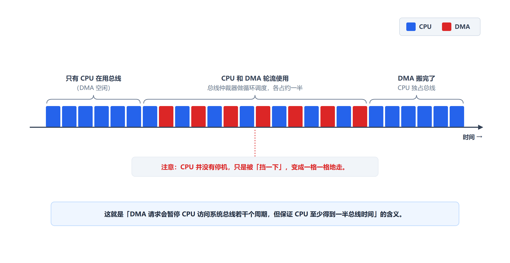

看图时按这个顺序：

1. **最上面一条横轴是时间**，从左到右。
2. **中间分成三段**：
   - 左段：只有 CPU 在用总线（画成蓝色方块，标"CPU 访问总线"）；
   - 中段：DMA 也来抢了，于是总线变成**蓝红交替**（CPU 一格、DMA 一格），标上"循环调度，各占约一半"；
   - 右段：DMA 搬完了，总线又回到 CPU 独占。
3. **注意中段里 CPU 并没有完全停**，它只是"一格一格地走"——这正是"CPU 至少得到一半总线时间"的意思。
4. **这张图要你记住**：DMA 搬数据时，CPU 不是"停机"，而是"变慢一点"。这就是为什么 DMA 能"减轻 CPU 负担"而不是"让 CPU 瘫痪"。

---

### 11.2.1 DMA 处理（一次传输是怎么走完的）

#### 【教材内容】原文流程

> 发生一个事件后，外设向 DMA 控制器发送一个请求信号。DMA 控制器根据通道的优先权处理请求。当 DMA 控制器开始访问发出请求的外设时，DMA 控制器立即发送给外设一个应答信号。当从 DMA 控制器得到应答信号时，外设立即释放请求。一旦外设释放了请求，DMA 控制器同时撤销应答信号。如果有更多的请求，外设可以在下一个周期启动请求。

#### 【教材内容】每次 DMA 传送由 3 个操作组成

> （1）从外设数据寄存器或者从当前外设/存储器地址寄存器指示的存储器地址**读取数据**，第一次传输时的开始地址是 `DMA_CPARx` 或 `DMA_CMARx` 寄存器指定的外设基地址或存储器单元。
> （2）将读取的数据**保存到**外设数据寄存器或者当前外设/存储器地址寄存器指示的存储器地址。
> （3）执行一次 `DMA_CNDTRx` 寄存器的**递减操作**，该寄存器包含未完成的操作数目。

#### 用大白话讲："一次传输"其实就是一个固定的小循环

**搬运工的每一次搬运，永远只做这 3 件事：**

```
第 1 步：从"源"那里读一个数据项
第 2 步：把这个数据项写到"目标"那里
第 3 步：计数器减 1（还剩多少项要搬）
```

然后**重复**，直到计数器变成 0。

#### 【辅助理解图】DMA 传输流程图

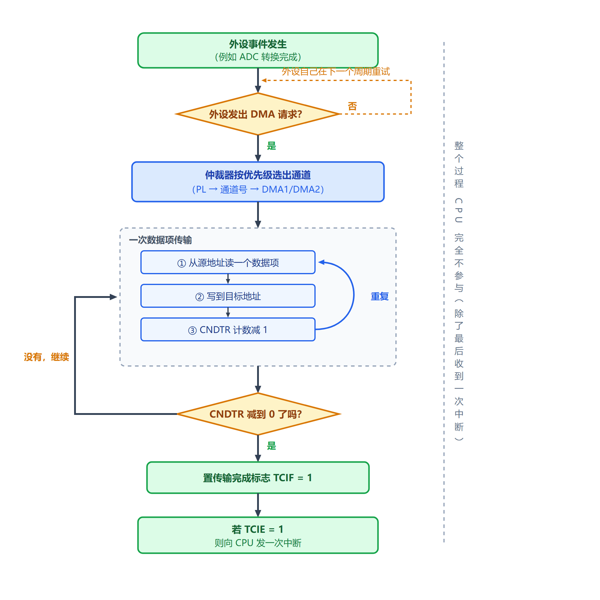

看图时按这个顺序：

1. **最上面是一个圆角框**，写"外设事件发生（如 ADC 转换完成）"。这是整条链的起点。
2. **往下第一个菱形**，写"外设发出 DMA 请求？"。有一条虚线回路，写"外设自己在下一周期重试"。
3. **第二个框**，写"仲裁器按优先级选出要服务的通道"。
4. **第三个框（虚线框，里面是循环体）**，标"一次数据项传输"，里面从上到下三个小框：
   - ① 从源地址读一个数据项；
   - ② 写到目标地址；
   - ③ 计数 CNDTR 减 1。
5. **第四个菱形**，写"CNDTR 减到 0 了吗？"。**没有**就画一条箭头回到第 4 步（形成循环）；**到了**就往下走。
6. **最下面两个框**：一个写"置传输完成标志 TCIF=1"，另一个写"若 TCIE=1，则向 CPU 发中断"。
7. **右侧再画一条竖直的注释线**，写"整个过程 CPU 完全不参与（除了最后收到一次中断）"。
8. **配色**：起点和终点用绿色，循环体用浅蓝，判断菱形用黄色，注释用灰色小字。

#### 【辅助理解图】请求 / 应答握手时序图

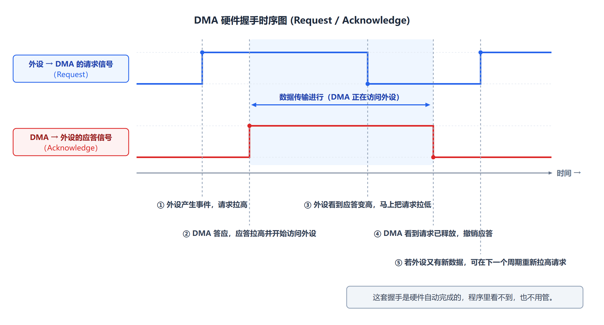

这张图画的是"外设和 DMA 之间怎么打招呼"，是一条**时间轴**。请按时间顺序读：

```
时间 →→→→→→→→→→→→→→→→→→→→→→→→→→→→→→→→→→→→→→→→→→

        ①        ②         ③        ④        ⑤
      ┌─────┐                              ┌─────┐
请求  │     │                              │     │
──────┘     └──────────────────────────────┘     └────
             ┌──────────────────┐
应答         │                  │
─────────────┘                  └─────────────────────
             │←── 数据传输进行 ──→│

① 外设产生了一个事件（比如 ADC 转换完成），把"请求"信号拉高
② DMA 控制器答应了，把"应答"信号拉高，并开始访问这个外设
③ 外设看到"应答"变高，马上把"请求"拉低（释放请求）
④ DMA 看到"请求"已经释放，就把"应答"也撤销（拉低）
⑤ 如果外设又有了新数据，它可以在下一个周期重新把"请求"拉高
```

**为什么要有这套"请求—应答"的握手？**

因为外设和 DMA 是两个独立的硬件模块，各自按自己的节奏跑。如果没有握手：

- 外设可能以为 DMA 还没拿走数据，又把新数据覆盖上去（丢数据）；
- DMA 可能以为外设的数据还没准备好，反复来读（读到脏数据）。

握手协议保证：**"我说有数据了" → "我来了" → "好，我撤" → "好，我也撤"**，一步一步，不会乱。

**注意**：这个"应答"信号**不用程序去管**，是硬件自动完成的。你在程序里看不到它。

#### 一步一步走一遍（用一个具体例子）

假设：ADC1 连续转换，DMA1 通道 1 把结果搬到数组 `buf[0..99]`，一共 100 个。

配置好的初始状态：

```
DMA_CPAR1 = 0x4001244C   （ADC1->DR 的地址，外设端，地址不变）
DMA_CMAR1 = 0x20000000   （数组 buf 的首地址，存储器端，每次 +2）
DMA_CNDTR1 = 100         （要搬 100 项）
PSIZE = 16 位，MSIZE = 16 位
DIR = 0（外设是源）
```

开始工作：

```
第 1 次传输：
  ① 从 0x4001244C 读 2 字节  → 假设读到 0x0800
  ② 写到 0x20000000
  ③ CNDTR 从 100 减到 99

第 2 次传输：
  ① 从 0x4001244C 读 2 字节  → 假设读到 0x0810
  ② 写到 0x20000002   ← 注意：地址自己 +2 了（因为 MSIZE=16 位）
  ③ CNDTR 从 99 减到 98

第 3 次传输：
  ① 从 0x4001244C 读 2 字节
  ② 写到 0x20000004
  ③ CNDTR 从 98 减到 97

  ……

第 100 次传输：
  ① 从 0x4001244C 读 2 字节
  ② 写到 0x200000C6   （0x20000000 + 99×2 = 0x20000000 + 198 = 0x200000C6）
  ③ CNDTR 从 1 减到 0  → 传输完成！
```

**验算一下地址**：99 × 2 = 198（十进制）= 0xC6（十六进制）。0x20000000 + 0xC6 = 0x200000C6。✓

**注意外设地址始终是 0x4001244C 没变**（因为 PINC=0，外设地址不增量），而**存储器地址每次都 +2**（因为 MINC=1）。

**为什么外设地址不变？** 因为 ADC 的数据永远放在同一个寄存器 `ADC1->DR` 里。你不能让它"下一个 ADC 数据放在别的寄存器"——它只有那一个格子。

**为什么存储器地址要变？** 因为你要把 100 个数据**依次存进 100 个不同的数组元素**，不能都塞在同一个格子里（那样只会剩下最后一个值）。

#### 这张图/这个例子要你记住什么

1. **一次传输 = 读 + 写 + 计数减 1**，三步，永远不变。
2. **"地址自己走"是靠 PINC / MINC 两个开关控制的**：外设端通常不动，存储器端通常要动。
3. **CNDTR 就是"还剩多少项没搬"**，减到 0 就结束。

---

### 11.2.2 仲裁器

#### 【教材内容】原文

> 仲裁器根据通道请求的优先级启动外设/存储器的访问。
> 优先权管理分两个阶段：
> （1）**软件**：每个通道的优先权可以在 `DMA_CCRx` 寄存器中的 `PL[1:0]` 设置，有 4 个等级：最高优先级、高优先级、中等优先级、低优先级。
> （2）**硬件**：如果两个请求有相同的软件优先级，则较低编号的通道比较高编号的通道有较高的优先权。例如，通道 2 优先于通道 4。
> DMA1 控制器的优先级高于 DMA2 控制器的优先级。

#### 大白话：仲裁器就是"排队叫号系统"

**类比**：银行大厅里，有 12 个客户（通道）同时想办业务，但柜台只有一个（总线只有一条）。大堂经理（仲裁器）要决定先叫谁。

**他的判断顺序是三步：**

```
第 1 步（软件优先级）：先看谁的"VIP 等级"高
   很高(VeryHigh) > 高(High) > 中等(Medium) > 低(Low)
   ↓ 如果等级一样，进第 2 步
第 2 步（硬件通道号）：编号小的先
   通道1 > 通道2 > 通道3 > …… > 通道7
   ↓ 如果是两个不同的 DMA 控制器在抢，进第 3 步
第 3 步（控制器编号）：DMA1 > DMA2
```

#### 【补充解释】为什么要有"软件优先级"？

因为**不同的数据，急迫程度不一样**。

举个真实场景：

- 你在用 USART1 高速收数据（比如 GPS 模块每秒吐几百字节）。如果不及时搬走，串口的数据寄存器会被新数据覆盖，**丢包**。这个"很急"。
- 你在用 DMA 往内存里搬一些不太急的东西（比如后台日志）。晚一点搬没关系。这个"不急"。

于是你可以把串口那个通道设成"很高"，把日志那个设成"低"。

#### 软件优先级怎么设置？—— `PL[1:0]` 两位的取值

`PL[1:0]` 是 `DMA_CCRx` 寄存器里的**第 13、12 位**，共 2 个 bit，能表示 4 种组合：

| `PL[1:0]` 的值 | 优先级 | 库函数里的宏 | 宏的数值 |
|---|---|---|---|
| `00` | 低 | `DMA_Priority_Low` | 0x00000000 |
| `01` | 中等 | `DMA_Priority_Medium` | 0x00001000 |
| `10` | 高 | `DMA_Priority_High` | 0x00002000 |
| `11` | 最高 | `DMA_Priority_VeryHigh` | 0x00003000 |

**⚠️ 容易搞混**：这里的"高优先级"对应的是 `10`（二进制），"最高"对应 `11`。**不是**"数字越大优先级越高"那么简单——`01` 是"中等"，`10` 才是"高"。请记牢这张表。

（数值怎么来的：`PL[1:0]` 占 bit13、bit12。值 `10` 表示 bit13=1、bit12=0，所以是 `0x2000`。值 `11` 是 bit13=1、bit12=1，所以是 `0x3000`。**1 个十六进制位 = 4 个 bit，所以 bit12 对应 `0x1000` 那一位的"1"，bit13 对应 `0x2000`。**）

#### 【辅助理解图】仲裁器决策示意

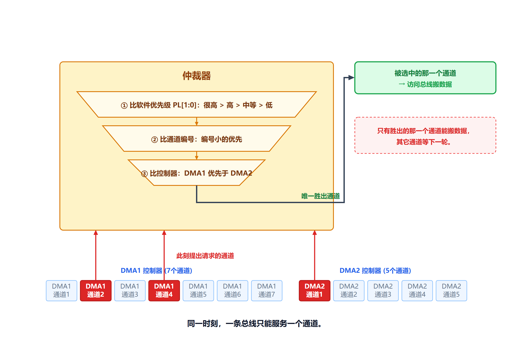

看图时按这个顺序：

1. **最下面一排是 12 个通道的小方块**，分成两组：左边 7 个标"DMA1 通道 1~7"，右边 5 个标"DMA2 通道 1~5"。其中 3 个通道被涂成红色，表示"此刻有请求"。
2. **每个请求通道上方连一条竖线**，进到中间一个大方框，写"仲裁器"。
3. **仲裁器内部画一个三层的漏斗**（从上到下）：
   - 第一层写"比软件优先级 PL[1:0]（很高>高>中>低）"；
   - 第二层写"比通道编号（小号优先）"；
   - 第三层写"比控制器（DMA1 > DMA2）"；
   - 漏斗最底下只漏出一根箭头。
4. **漏斗的出口箭头指向右上角一个绿色方块**，写"被选中的通道 → 访问总线"。
5. **右侧加一个小注释框**，用红字写："只有胜出的那一个通道能搬数据，其他通道等下一轮。"
6. **配色**：请求通道红色 #DC2626，仲裁器浅黄 #FEF3C7，胜出通道绿色 #16A34A，箭头 #334155。

#### 这个例子要你记住什么

**假设某一时刻，通道 2、通道 4、通道 6 同时有请求：**

- 如果它们的软件优先级分别是 中等、很高、低 → **通道 4 赢**（等级最高）；
- 如果它们的软件优先级都是 中等 → **通道 2 赢**（编号最小）；
- 如果通道 2 在 DMA1、通道 4 在 DMA2，且等级相同、编号 2 < 4 → 其实还是通道 2 赢（因为编号规则先起作用）；只有当"编号也相同"（比如 DMA1 通道 1 和 DMA2 通道 1）时，才轮到"**DMA1 优先于 DMA2**"这条规则。

**⚠️ 注意一个细节**：教材说"DMA1 控制器的优先级高于 DMA2 控制器的优先级"，但它没有明确说这条规则的**精确触发条件**（是"通道编号相同时才比"还是"任何时候都比"）。按 STM32 参考手册的常见描述，是**先比软件优先级，再比通道编号，最后比控制器**。这里按这个顺序讲；如果你在别处看到不同说法，以你手上的参考手册为准。已记入"待核验"。

---

### 11.2.3 DMA 通道

#### 【教材内容】原文

> 每个通道都可以在有固定地址的外设寄存器和存储器之间执行 DMA 传输。DMA 传输的数据量是可编程的，最大为 65535。数据项数量寄存器包含要传输的数据项数量，在每次传输后递减。

#### 1. 可编程的数据量

【教材内容】

> 外设和存储器的传输数据量可以通过 `DMA_CCRx` 寄存器中的 `PSIZE` 和 `MSIZE` 位编程设置。

**大白话**：搬东西的时候，"一口"吃多大，两头可以分别设。

- `PSIZE`（Peripheral Size，外设数据宽度）：外设那一头每次搬几字节；
- `MSIZE`（Memory Size，存储器数据宽度）：存储器那一头每次搬几字节。

取值表：

| `PSIZE[1:0]` 或 `MSIZE[1:0]` | 数据宽度 | 库函数宏 |
|---|---|---|
| `00` | 8 位（字节 Byte） | `..._Byte` |
| `01` | 16 位（半字 HalfWord） | `..._HalfWord` |
| `10` | 32 位（全字 Word） | `..._Word` |
| `11` | 保留（不要用） | — |

（`PSIZE` 占 bit9、bit8；`MSIZE` 占 bit11、bit10。所以"16 位"= `01` = `0x100`（PSIZE）或 `0x400`（MSIZE）。）

#### 2. 指针增量

【教材内容】

> 通过设置 `DMA_CCRx` 寄存器中的 `PINC` 和 `MINC` 标志位，外设和存储器的指针在每次传输后可以有选择地完成自动增量。当设置为增量模式时，下一个要传输的地址将是前一个地址加上增量值，**增量值取决于所选的数据宽度**，为 1、2 或 4。第一个传输的地址存放在 `DMA_CPARx` / `DMA_CMARx` 寄存器中。在传输过程中，这些寄存器保持它们初始的数值，软件不能改变和读出当前正在传输的地址（它在内部的当前外设/存储器地址寄存器中）。

**大白话**：

> **搬完一个数据项后，地址要不要"往前走一格"？由 PINC（外设端）和 MINC（存储器端）两个开关决定。**
> **走多远？不是固定 1，而是"走一个数据宽度那么多"**：8 位宽走 1，16 位宽走 2，32 位宽走 4。

**为什么是"走一个宽度"？** 因为你搬走的是一个完整的 16 位数据，它占了 2 个字节的格子，所以下一个数据自然从 "+2" 的位置开始。

**一个非常重要的细节（很多人会踩坑）**：

> **传输过程中，`DMA_CPARx` 和 `DMA_CMARx` 里存的永远是"最初设定的地址"，不是"当前搬到哪了"。**
> 真正在走的那个"当前地址"藏在 DMA 内部的一个寄存器里，**软件读不到**。

**类比**：委托单上写的是"从 3 号仓库出发"，搬运工在仓库里自己往前走，但委托单上的字**不会跟着改**。

**那怎么知道搬了多少了？** 读 `DMA_CNDTRx`，它读出来的是"**还剩多少项没搬**"。

【教材内容】

> 当通道配置为**非循环模式**时，传输结束后（即传输计数变为 0）将不再产生 DMA 操作。要开始新的 DMA 传输，需要在关闭 DMA 通道的情况下，在 `DMA_CNDTRx` 寄存器中重新写入传输数目。
> 在**循环模式**下，最后一次传输结束时，`DMA_CNDTRx` 寄存器的内容会自动地被重新加载为其初始数值，内部的当前外设/存储器地址寄存器也被重新加载为 `DMA_CPARx` / `DMA_CMARx` 寄存器设定的初始基地址。

**大白话**：

| 模式 | 搬完之后 |
|---|---|
| **正常模式（Normal）** | 停下，不动了。想再搬？**先关掉通道（EN=0），重写 CNDTR，再打开**。 |
| **循环模式（Circular）** | **自动重来**：CNDTR 自动变回初始值，地址也自动回到起点，接着搬。 |

#### 【辅助理解图】正常模式 vs 循环模式

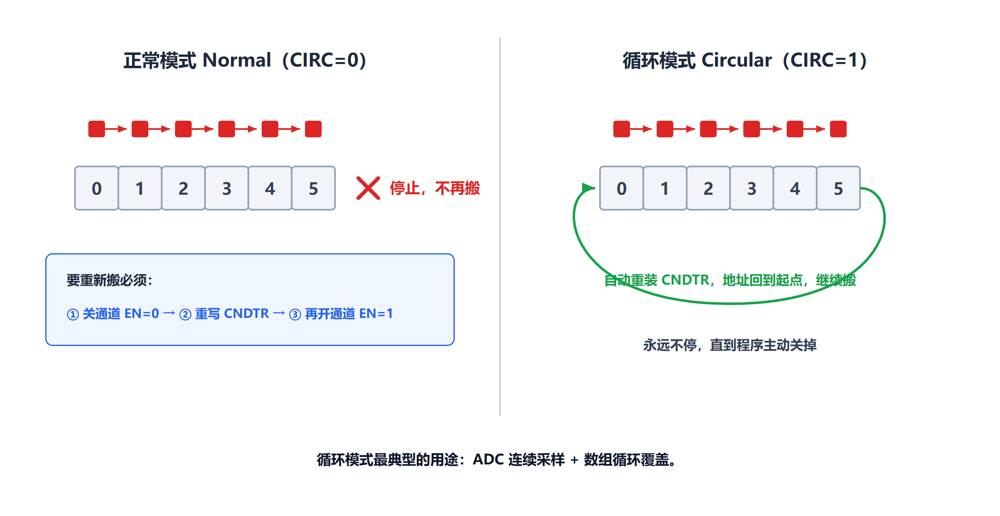

看图时按这个顺序：

1. **图分左右两半**，左边标题"正常模式 Normal"，右边标题"循环模式 Circular"。
2. **每一半都画一个横向的数组条**，共 6 格，格子下面标 0~5，上面画一个红色小方块代表"当前写到这里"。
3. **左半边**：红色小方块从 0 走到 5，然后画一个大大的红色叉和一行字"停止，不再搬。要重新搬必须：关通道 → 重写 CNDTR → 开通道"。
4. **右半边**：红色小方块从 0 走到 5，然后画一个**弧形箭头**绕回格子 0，并写"自动重装 CNDTR，地址回到起点，继续搬"。弧线旁标"永远不停，直到程序主动关掉"。
5. **最下面一行小字**："循环模式最典型的用途：ADC 连续采样 + 数组循环覆盖。"
6. **配色**：数组条浅灰 #F1F5F9，格子边框 #94A3B8，当前指针红 #DC2626，重装弧线绿 #16A34A。

#### 3. 通道配置过程（这是本章最实用的 6 步）

【教材内容】下面是配置 DMA 通道 x 的过程（x 代表通道号）：

| 步骤 | 做什么 | 写哪个寄存器 |
|---|---|---|
| （1） | 设置**外设寄存器**的地址（源或目标） | `DMA_CPARx` |
| （2） | 设置**数据存储器**的地址（源或目标） | `DMA_CMARx` |
| （3） | 设置**要传输的数据量**（每传输一次递减） | `DMA_CNDTRx` |
| （4） | 设置**通道优先级** | `DMA_CCRx` 的 `PL[1:0]` |
| （5） | 设置**方向、循环模式、两端增量模式、两端数据宽度、半传输中断、传输完成中断** | `DMA_CCRx` |
| （6） | 设置 `ENABLE` 位，**启动通道** | `DMA_CCRx` 的 `EN`（bit0） |

【教材内容】一旦启动了 DMA 通道，即可响应连到该通道上的外设的 DMA 请求。

> 当传输一半的数据后，半传输标志（`HTIF`）被置 1，当设置了允许半传输中断位（`HTIE`）时，将产生中断请求。在数据传输结束后，传输完成标志（`TCIF`）被置 1，如果设置了允许传输完成中断位（`TCIE`），则将产生中断请求。

**这 6 步请务必背下来**，它是所有 DMA 程序的骨架。11.5 的例子里你会看到，库函数 `DMA_Init()` 一次就把 (1)~(5) 全做了，`DMA_Cmd()` 做第 (6) 步。

**⚠️ 顺序很重要**：**一定要先配置好所有参数，最后才置 `EN=1`。** 因为一旦 `EN=1`，`CPAR`、`CMAR`、`CNDTR` 都变成**只读**，改不了了。

#### 4. 循环模式

【教材内容】

> 循环模式用于处理循环缓冲区和连续的数据传输（如 ADC 的扫描模式）。`DMA_CCRx` 寄存器中的 `CIRC` 位用于开启这一功能。当循环模式启动时，要被传输的数据数目会自动地被重新装载成配置通道时设置的初值，DMA 操作将会继续进行。

**大白话**：见上面"正常模式 vs 循环模式"的对比图。

**"循环缓冲区"是什么意思？** 用一个具体场景：

```
你要用一个 100 个格子的数组，持续接收 ADC 的数据。
用循环模式后：
  第 1 轮：填 buf[0] ～ buf[99]
  第 2 轮：又回到 buf[0] 开始，覆盖掉旧数据
  第 3 轮：再回到 buf[0] ……

这样数组就像一个"圆环"，永远不会溢出。
你的程序可以随时从 buf 里读最近的数据，读慢一点也没关系。
```

（严格说，如果程序读得比 DMA 写得慢，旧数据还是会被覆盖。但在很多"实时采样 + 显示"的场合，只要"读的速度 ≥ 写的速度"，循环模式就够用了。如果你需要绝对不丢数据，就要用"双缓冲"等更复杂的方法，那超出本章范围。）

#### 5. 存储器到存储器模式（MEM2MEM）

【教材内容】

> DMA 通道的操作可以在没有外设请求的情况下进行，这种操作就是存储器到存储器模式。
> 如果设置了 `DMA_CCRx` 寄存器中的 `MEM2MEM` 位，在软件设置了 `DMA_CCRx` 寄存器中的 `EN` 位启动 DMA 通道时，DMA 传输将马上开始。当 `DMA_CNDTRx` 寄存器变为 0 时，DMA 传输结束。**存储器到存储器模式不能与循环模式同时使用。**

**大白话**：

> **"内存 → 内存"搬运时，没有外设会来发请求。所以只要把 `MEM2MEM` 位设成 1，然后一开 `EN`，DMA 就马上开始搬，不需要等任何人的招呼。**

**⚠️ 最重要的一条限制**：**MEM2MEM 和循环模式不能同时用**。（为什么？因为循环模式的"重装"依赖外设请求的节奏，而 M2M 没有外设，两者机制冲突。教材直接给了这个结论，记住即可。）

**注意 DIR 位和 M2M 模式的关系**（这是最容易把人绕晕的一点，请慢看）：

先复习 `DIR` 位在**正常模式**（外设 ⇄ 存储器）下的含义（教材 11.3 的 `CCR` 寄存器说明里写的）：

| 写 | 教材原话 | 谁是源 | 谁是目标 |
|---|---|---|---|
| `DIR = 0` | 从外设读 | 外设那一头（`CPAR`） | 存储器那一头（`CMAR`） |
| `DIR = 1` | 从存储器读 | 存储器那一头（`CMAR`） | 外设那一头（`CPAR`） |

（库函数里的名字对应关系是：`DMA_DIR_PeripheralSRC` = 0，外设当源；`DMA_DIR_PeripheralDST` = 1，外设当目标。）

**但 M2M 模式下一头外设都没有**，两端都是内存地址，"外设 / 存储器"这套说法在这里失去了意义。硬件在这个模式下按一条更简单的规则走：

> **`CPAR` 那一头当源（读的一端），`CMAR` 那一头当目标（写的一端）。**

也就是说：**M2M 模式下，把源数组地址填进 `CPAR`、目标数组地址填进 `CMAR`，搬运方向就是"源 → 目标"**。这就是 ST 官方 M2M 例程的标准写法（`DMA_DIR_PeripheralDST` + `CPAR` 填源 + `CMAR` 填目标），11.5 的补充例 1 就是照它写的。

> ⚠️ 教材没有展开讲 M2M 模式下 `DIR` 位的精确语义（教材 11.2.3 第 5 小节只讲了 `MEM2MEM` 位本身）。上面这条"`CPAR` 是读端、`CMAR` 是写端"是按 ST 官方例程给出的**实用规则**：
> **判断方向的依据是两个地址寄存器里填了什么，而不是 `DIR` 的 0/1。** 如果你发现搬出来是反的，应该去检查 `CPAR`/`CMAR` 里填的地址有没有弄反，**不要靠改 `DIR` 来试方向**。已记入文末"待核验"。

---

### 11.2.4 可编程的数据传输宽度、对齐方式和数据大小端

【教材内容】

> 当 `PSIZE` 和 `MSIZE` 不相同时，DMA 模块按照表 11-1 的规则进行数据对齐。

#### 表 11-1 到底在说什么？（教材原表，p172）

教材表 11-1 一共 **3 × 3 = 9 组**（源宽度有 8 / 16 / 32 三种，目标宽度也有 8 / 16 / 32 三种，两两组合就是 9 组），每组又有 4 次传输，所以整张表一共 36 行小行。表头是"**当 PINC = MINC = 1 时**"，也就是**两边地址都会自动往前走**。

原表内容（我把 OCR 结果整理成表格）：

| 源宽度 | 目标宽度 | 传输数目 | 源地址/数据 | 传输操作 | 目标地址/数据 |
|---|---|---|---|---|---|
| 8 | 8 | 4 | 0x0/B0 | 1: 在 0x0 读 B0[7:0]，在 0x0 写 B0[7:0] | 0x0/B0 |
| 8 | 8 | 4 | 0x1/B1 | 2: 在 0x1 读 B1[7:0]，在 0x1 写 B1[7:0] | 0x1/B1 |
| 8 | 8 | 4 | 0x2/B2 | 3: 在 0x2 读 B2[7:0]，在 0x2 写 B2[7:0] | 0x2/B2 |
| 8 | 8 | 4 | 0x3/B3 | 4: 在 0x3 读 B3[7:0]，在 0x3 写 B3[7:0] | 0x3/B3 |
| 8 | 16 | 4 | 0x0/B0 | 1: 在 0x0 读 B0[7:0]，在 0x0 写 00B0[15:0] | 0x0/00B0 |
| 8 | 16 | 4 | 0x1/B1 | 2: 在 0x1 读 B1[7:0]，在 0x2 写 00B1[15:0] | 0x2/00B1 |
| 8 | 16 | 4 | 0x2/B2 | 3: 在 0x2 读 B2[7:0]，在 0x4 写 00B2[15:0] | 0x4/00B2 |
| 8 | 16 | 4 | 0x3/B3 | 4: 在 0x3 读 B3[7:0]，在 0x6 写 00B3[15:0] | 0x6/00B3 |
| 8 | 32 | 4 | 0x0/B0 | 1: 在 0x0 读 B0[7:0]，在 0x0 写 000000B0[31:0] | 0x0/000000B0 |
| 8 | 32 | 4 | 0x1/B1 | 2: 在 0x1 读 B1[7:0]，在 0x4 写 000000B1[31:0] | 0x4/000000B1 |
| 8 | 32 | 4 | 0x2/B2 | 3: 在 0x2 读 B2[7:0]，在 0x8 写 000000B2[31:0] | 0x8/000000B2 |
| 8 | 32 | 4 | 0x3/B3 | 4: 在 0x3 读 B3[7:0]，在 0xC 写 000000B3[31:0] | 0xC/000000B3 |
| 16 | 8 | 4 | 0x0/B1B0 | 1: 在 0x0 读 B1B0[15:0]，在 0x0 写 B0[7:0] | 0x0/B0 |
| 16 | 8 | 4 | 0x2/B3B2 | 2: 在 0x2 读 B3B2[15:0]，在 0x1 写 B2[7:0] | 0x1/B2 |
| 16 | 8 | 4 | 0x4/B5B4 | 3: 在 0x4 读 B5B4[15:0]，在 0x2 写 B4[7:0] | 0x2/B4 |
| 16 | 8 | 4 | 0x6/B7B6 | 4: 在 0x6 读 B7B6[15:0]，在 0x3 写 B6[7:0] | 0x3/B6 |
| 16 | 16 | 4 | 0x0/B1B0 | 1: 在 0x0 读 B1B0[15:0]，在 0x0 写 B1B0[15:0] | 0x0/B1B0 |
| 16 | 16 | 4 | 0x2/B3B2 | 2: 在 0x2 读 B3B2[15:0]，在 0x2 写 B3B2[15:0] | 0x2/B3B2 |
| 16 | 16 | 4 | 0x4/B5B4 | 3: 在 0x4 读 B5B4[15:0]，在 0x4 写 B5B4[15:0] | 0x4/B5B4 |
| 16 | 16 | 4 | 0x6/B7B6 | 4: 在 0x6 读 B7B6[15:0]，在 0x6 写 B7B6[15:0] | 0x6/B7B6 |
| 16 | 32 | 4 | 0x0/B1B0 | 1: 在 0x0 读 B1B0[15:0]，在 0x0 写 0000B1B0[31:0] | 0x0/0000B1B0 |
| 16 | 32 | 4 | 0x2/B3B2 | 2: 在 0x2 读 B3B2[15:0]，在 0x4 写 0000B3B2[31:0] | 0x4/0000B3B2 |
| 16 | 32 | 4 | 0x4/B5B4 | 3: 在 0x4 读 B5B4[15:0]，在 0x8 写 0000B5B4[31:0] | 0x8/0000B5B4 |
| 16 | 32 | 4 | 0x6/B7B6 | 4: 在 0x6 读 B7B6[15:0]，在 0xC 写 0000B7B6[31:0] | 0xC/0000B7B6 |
| 32 | 8 | 4 | 0x0/B3B2B1B0 | 1: 在 0x0 读 B3B2B1B0[31:0]，在 0x0 写 B0[7:0] | 0x0/B0 |
| 32 | 8 | 4 | 0x4/B7B6B5B4 | 2: 在 0x4 读 B7B6B5B4[31:0]，在 0x1 写 B4[7:0] | 0x1/B4 |
| 32 | 8 | 4 | 0x8/BBBAB9B8 | 3: 在 0x8 读 BBBAB9B8[31:0]，在 0x2 写 B8[7:0] | 0x2/B8 |
| 32 | 8 | 4 | 0xC/BFBEBDBC | 4: 在 0xC 读 BFBEBDBC[31:0]，在 0x3 写 BC[7:0] | 0x3/BC |
| 32 | 16 | 4 | 0x0/B3B2B1B0 | 1: 在 0x0 读 B3B2B1B0[31:0]，在 0x0 写 B1B0[15:0] | 0x0/B1B0 |
| 32 | 16 | 4 | 0x4/B7B6B5B4 | 2: 在 0x4 读 B7B6B5B4[31:0]，在 0x2 写 B5B4[15:0] | 0x2/B5B4 |
| 32 | 16 | 4 | 0x8/BBBAB9B8 | 3: 在 0x8 读 BBBAB9B8[31:0]，在 0x4 写 B9B8[15:0] | 0x4/B9B8 |
| 32 | 16 | 4 | 0xC/BFBEBDBC | 4: 在 0xC 读 BFBEBDBC[31:0]，在 0x6 写 BDBC[15:0] | 0x6/BDBC |
| 32 | 32 | 4 | 0x0/B3B2B1B0 | 1: 在 0x0 读 B3B2B1B0[31:0]，在 0x0 写 B3B2B1B0[31:0] | 0x0/B3B2B1B0 |
| 32 | 32 | 4 | 0x4/B7B6B5B4 | 2: 在 0x4 读 B7B6B5B4[31:0]，在 0x4 写 B7B6B5B4[31:0] | 0x4/B7B6B5B4 |
| 32 | 32 | 4 | 0x8/BBBAB9B8 | 3: 在 0x8 读 BBBAB9B8[31:0]，在 0x8 写 BBBAB9B8[31:0] | 0x8/BBBAB9B8 |
| 32 | 32 | 4 | 0xC/BFBEBDBC | 4: 在 0xC 读 BFBEBDBC[31:0]，在 0xC 写 BFBEBDBC[31:0] | 0xC/BFBEBDBC |

> ⚠️ **OCR 疑点**：表中"32→32"这 4 行的"传输操作"栏，教材原意应当是"在 0x0 读 ……，在 0x0 **写** ……"，但 MinerU 解析出来第二个动作写成了"**读**"。按上下文（其它行都是"读+写"）可以确定是 OCR 错误。已记入"待核验"。

#### 表 11-1 的读法（先别被 9 组吓到，规律只有一条）

**这张表其实只有一个规律：**

> **源那一头的地址，按"源宽度"往前走；目标那一头的地址，按"目标宽度"往前走。**
> **宽变窄时，只保留低位（把高位丢掉）；窄变宽时，高位补 0。**

把这条规律套到每一行，全都能推出来。不信？我们验证两个。

---

#### 逐行演算一：8 位 → 16 位（打包 / 变宽）

**设定**：源是 4 个字节 B0、B1、B2、B3，存在地址 0x0、0x1、0x2、0x3；目标是 4 个半字。

**按规律推演**：

```
第 1 次传输：
  读：地址 0x0，读 1 个字节 → B0
  写：把 B0 放到半字的高 8 位补 0  → 0x00B0
      写到地址 0x0（2 字节：0x0 和 0x1）
  源地址 +1 → 0x1；目标地址 +2 → 0x2

第 2 次传输：
  读：地址 0x1，读 1 个字节 → B1
  写：0x00B1，写到地址 0x2
  源地址 +1 → 0x2；目标地址 +2 → 0x4

第 3 次传输：
  读：地址 0x2 → B2，写 0x00B2 到地址 0x4

第 4 次传输：
  读：地址 0x3 → B3，写 0x00B3 到地址 0x6
```

**和教材表对照**：完全一致（目标地址 0x0、0x2、0x4、0x6）。✓

**用二进制看清"补 0"这件事**（假设 B0 = 0xAB）：

```
读到的 1 个字节：              1010 1011        (0xAB)
放到 16 位目标里，高位补 0：  0000 0000 1010 1011   (0x00AB)
                              ↑↑↑↑↑↑↑↑
                              这 8 个 bit 补 0
```

**为什么高位补 0 而不是补别的？** 因为"变宽"时不能让数据变值。补 0 相当于"把 0xAB 写成 0x00AB"，数值不变（都是 171）。如果补 1 变成 0xFFAB，数值就变了。

---

#### 逐行演算二：16 位 → 8 位（拆包 / 变窄）

**设定**：源是 4 个半字 B1B0、B3B2、B5B4、B7B6，存在地址 0x0、0x2、0x4、0x6；目标是 4 个字节。

**注意这里要用到"小端"知识**：半字 `0xB1B0` 存在地址 0x0 时，**低字节 B0 在 0x0，高字节 B1 在 0x1**。

**按规律推演**：

```
第 1 次传输：
  读：地址 0x0，读 2 个字节 → 得到半字 0xB1B0
       （内存里：0x0 放 B0，0x1 放 B1）
  写：只取低 8 位 → B0，写到地址 0x0
  源地址 +2 → 0x2；目标地址 +1 → 0x1

第 2 次传输：
  读：地址 0x2，读到 0xB3B2，取低字节 B2
  写：B2 到地址 0x1
  源地址 +2 → 0x4；目标地址 +1 → 0x2

第 3 次传输：读地址 0x4 → 0xB5B4，写 B4 到地址 0x2
第 4 次传输：读地址 0x6 → 0xB7B6，写 B6 到地址 0x3
```

**和教材表对照**：目标地址 0x0、0x1、0x2、0x3，写入的数据分别是 B0、B2、B4、B6。✓ 完全一致。

**为什么保留的是 B0、B2、B4、B6（低字节），而不是 B1、B3、B5、B7（高字节）？**

因为"变窄"时硬件**只保留低位，把高位丢掉**（相当于截断）。

```
读到的半字 0xB1B0：
  二进制： 1011 0001 1011 0000
           └─B1──┘ └─B0──┘
  只保留低 8 位：       1011 0000  = B0
  高 8 位 B1 被丢掉。
```

**⚠️ 这就带来一个"坑"**：如果你不小心把 16 位的数据搬到 8 位的地方，**高位会无声无息地丢掉**，程序不会报错，但结果不对。这是初学者很容易犯的错误。

---

#### 【辅助理解图】数据宽度对齐（打包与拆包）

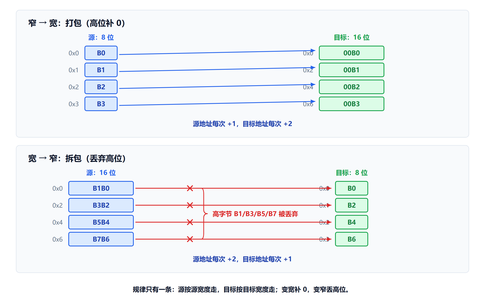

看图时按这个顺序：

1. **图分成上下两栏**。上栏标题"窄 → 宽：打包（高位补 0）"，下栏标题"宽 → 窄：拆包（丢弃高位）"。
2. **上栏**：左边画一列 4 个小格（标"源：8 位"，格里写 B0、B1、B2、B3，地址标 0x0~0x3），右边画一列 4 个大格（标"目标：16 位"，格里写 00B0、00B1、00B2、00B3，地址标 0x0、0x2、0x4、0x6）。用 4 条箭头把左格连到右格，**箭头都往上偏**（表示数据被放到高格里）。
3. **下栏**：左边 4 个大格（源：16 位，写 B1B0、B3B2、B5B4、B7B6，地址 0x0、0x2、0x4、0x6），右边 4 个小格（目标：8 位，写 B0、B2、B4、B6，地址 0x0~0x3）。箭头从大格连到小格，并在箭头上画一个小红叉，旁边写"高字节被丢弃"。
4. **每栏底部标一行公式**：上栏写"源地址 +1，目标地址 +2"；下栏写"源地址 +2，目标地址 +1"。
5. **配色**：源用蓝色系 #DBEAFE / #2563EB，目标用绿色系 #DCFCE7 / #16A34A，丢弃部分用红色虚线框 #DC2626。

#### 【辅助理解图】小端字节序在内存中的排布

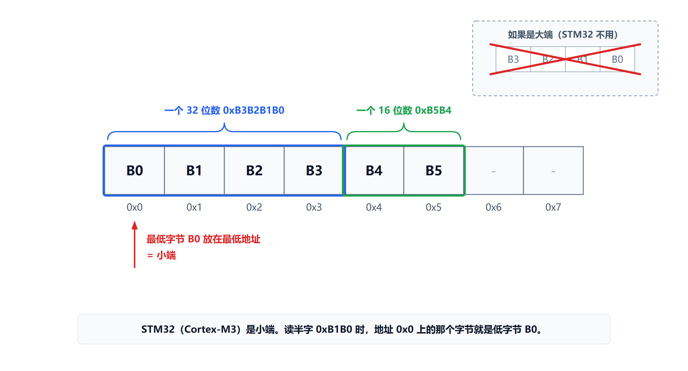

看图时按这个顺序：

1. **画面中间画一条横向的"内存条"**，分成 8 个小格，地址从左到右标 0x0、0x1、0x2、0x3、0x4、0x5、0x6、0x7。
2. **格子 0x0~0x3 组成一组**，用蓝色外框圈起来，上方标"一个 32 位数 0xB3B2B1B0"；格内从 0x0 到 0x3 依次写 B0、B1、B2、B3。
3. **格子 0x4~0x5 组成一组**，用绿色外框圈起来，上方标"一个 16 位数 0xB5B4"；格内依次写 B4、B5。
4. **在 0x0 那格下面画一个向上箭头**，写"最低字节放最低地址 = 小端"。
5. **右上角画一个对比小框**，标题"如果是大端（STM32 不用）"，里面同样 4 格但写 B3、B2、B1、B0，并打一个红色叉。
6. **底部一行字**："STM32（Cortex-M3）是小端。读半字 0xB1B0 时，地址 0x0 上的那个字节就是低字节 B0。"
7. **配色**：内存格浅灰 #F8FAFC，边框 #64748B，蓝色框 #2563EB，绿色框 #16A34A，红色叉 #DC2626。

---

#### 关于"不支持字节或半字写的 AHB 设备"

【教材内容】

> 当 DMA 模块开始一个 AHB 的字节或半字写操作时，数据将在 `HWDATA[31:0]` 总线中未使用的部分重复。因此，如果 DMA 以字节或半字写入不支持字节或半字写操作的 AHB 设备时（即 HSIZE 不适于该模块），不会发生错误，DMA 将按照下面两个例子的方法写入 32 位 `HWDATA` 数据：
> - 当 HSIZE = 半字时，写入半字 0xABCD，DMA 将设置 `HWDATA` 总线为 0xABCDABCD。
> - 当 HSIZE = 字节时，写入字节 0xAB，DMA 将设置 `HWDATA` 总线为 0xABABABABAB。
>
> 假定 AHB/APB 桥是一个 AHB 的 32 位从设备，它不考虑 HSIZE 参数，将按照下述方式把任意 AHB 上的字节或半字按 32 位传送到 APB 上：
> - AHB 上对地址 0x0（或 0x1、0x2 或 0x3）的写字节数据 0xB0 操作，将转换到 APB 上对地址 0x0 的写字数据 0xB0B0B0B0 操作。
> - AHB 上对地址 0x0（或 0x2）的写半字数据 0xB1B0 操作，将转换到 APB 上对地址 0x0 的写字数据 0xB1B0B1B0 操作。
>
> 例如，如果要写入 APB 后备寄存器（与 32 位地址对齐的 16 位寄存器），需要配置存储器数据源宽度（`MSIZE`）为 16 位，外设目标数据宽度（`PSIZE`）为 32 位。

**这一段在讲什么？用大白话翻译：**

> **有些总线上的设备只会"整 4 字节地收"，不会"只收 1 个字节"或"只收 2 个字节"。**
> **DMA 碰到这种设备时，不会报错，而是把那个字节"复制 4 份"凑成 4 字节，整块发过去。对方取它需要的那一份就行。**

看具体数字（**注意：十六进制每一位 = 4 个 bit**）：

```
只写 1 个字节 0xAB（8 位）：
   0xAB 重复 4 次 = 0xABABABAB   （32 位）
   二进制： 1010 1011  1010 1011  1010 1011  1010 1011
            └─第1份─┘ └─第2份─┘ └─第3份─┘ └─第4份─┘

只写 1 个半字 0xABCD（16 位）：
   0xABCD 重复 2 次 = 0xABCDABCD （32 位）
   二进制： 1010 1011 1100 1101  1010 1011 1100 1101
            └────第1份────┘ └────第2份────┘
```

**为什么要这样"重复"？**

因为 AHB 的数据总线是 **32 位宽**的。当你要写的量不到 32 位时，总线上剩下的位空着，接收方不知道该怎么处理。干脆"把这一份数据铺满整条总线"，接收方总能从里面挑出自己要的那一份。

**⚠️ OCR 疑点**：教材原文说"当 HSIZE = 字节时，写入字节 0xAB，DMA 将设置 `HWDATA` 总线为 **0xABABABABAB**"。这个数有 **5 个字节（40 位）**，而 `HWDATA` 只有 32 位，不可能是 40 位。按上下文规律（半字是 `0xABCDABCD`，即重复 2 次凑成 32 位），字节应当是 **0xABABABAB**（重复 4 次，共 32 位）。已记入"待核验"。

**最后那个例子**（APB 后备寄存器）要表达的是：

> 如果目标外设只会接收 32 位数据（比如经过那个"不理会 HSIZE"的 AHB/APB 桥），但你手上要写的是一个 16 位寄存器，那就应该：
> - 让**存储器端（源）**按 16 位读（`MSIZE = 16 位`）；
> - 让**外设端（目标）**按 32 位写（`PSIZE = 32 位`）。

这样 DMA 就会把 16 位打包成 32 位再写出去。

---

### 11.2.5 DMA 中断

#### 【教材内容】原文

> 每个 DMA 通道都可以在 DMA **传输过半**、**传输完成**和**传输错误**时产生中断。为应用的灵活性考虑，通过设置寄存器的不同位来打开这些中断。相关的中断事件标志位及对应的使能控制位分别为：
> - "传输过半"的中断事件标志位是 `HTIF`，中断使能控制位是 `HTIE`；
> - "传输完成"的中断事件标志位是 `TCIF`，中断使能控制位是 `TCIE`；
> - "传输错误"的中断事件标志位是 `TEIF`，中断使能控制位是 `TEIE`。
>
> 读写一个保留的地址区域，将会产生 DMA 传输错误。在 DMA 读写操作期间发生 DMA 传输错误时，硬件会自动清除发生错误的通道所对应的通道配置寄存器（`DMA_CCRx`）的 `EN` 位，该通道操作被停止。此时，在 `DMA_ISR` 寄存器中对应该通道的传输错误中断标志位（`TEIF`）将被置位，如果在 `DMA_CCRx` 寄存器中设置了传输错误中断允许位，则将产生中断。

#### 先搞清楚"标志位"和"使能位"的区别（这是关键！）

这是初学者最容易搞混的一对概念，我们用"门铃"来类比（**只是类比**）：

| 概念 | 类比 | 说明 |
|---|---|---|
| **标志位**（HTIF/TCIF/TEIF） | **门铃响了没有** | 由**硬件**自动置 1，表示"这件事真的发生了"。软件只能读它，或者"擦掉"它 |
| **使能位**（HTIE/TCIE/TEIE） | **门铃有没有插上电** | 由**软件**设置，决定"这件事发生时，要不要真的发中断给 CPU" |

**为什么要分成两个？**

因为有时候你只想知道"搬完了没有"，但**不想被中断打断**（比如你在主循环里轮询）。这时候你可以：

- 让标志位正常工作（`TCIF` 会置 1，你随时能读）；
- 但把使能位关掉（`TCIE = 0`），这样就不会产生中断。

**所以有 4 种组合：**

| 标志位 | 使能位 | 结果 |
|---|---|---|
| 1（事件发生了） | 1（允许中断） | **产生中断**，CPU 跳去执行中断服务程序 |
| 1（事件发生了） | 0（禁止中断） | 不产生中断，但 CPU 查标志位能查到"已发生" |
| 0（事件没发生） | 1 | 什么也不发生 |
| 0 | 0 | 什么也不发生 |

#### 三个标志的含义

| 标志位 | 全称 | 中文 | 什么时候置 1 |
|---|---|---|---|
| `HTIF` | **H**alf **T**ransfer **I**nterrupt **F**lag | 半传输标志 | 搬完**一半**的时候 |
| `TCIF` | **T**ransfer **C**omplete **I**nterrupt **F**lag | 传输完成标志 | **全部**搬完的时候 |
| `TEIF` | **T**ransfer **E**rror **I**nterrupt **F**lag | 传输错误标志 | 搬的过程中**出错**的时候 |

对应的使能位就是把最后的 `F` 换成 `E`（Enable）：

| 使能位 | 全称 | 中文 |
|---|---|---|
| `HTIE` | Half Transfer Interrupt **Enable** | 允许半传输中断 |
| `TCIE` | Transfer Complete Interrupt **Enable** | 允许传输完成中断 |
| `TEIE` | Transfer Error Interrupt **Enable** | 允许传输错误中断 |

**⚠️ 记法**：三个标志和三个使能位，字母顺序完全一样，只是最后一个字母不同：`F`（Flag，标志）vs `E`（Enable，使能）。

#### "半传输中断"有什么用？

**用途：双缓冲 / 边收边处理。**

举个例子：你要采集 1000 个点，边采边画图。

- 如果等全部 1000 个点采完再处理，那么"处理"期间 DMA 还在写，可能造成数据不一致；
- 更好的办法：**搬到第 500 个点时中断一次**。这时 CPU 可以放心地去处理前 500 个点（因为 DMA 正在写后 500 个，不会碰前 500 个）。等全部搬完（第 1000 个）再中断一次，CPU 再处理后面 500 个。

这就是"半传输中断"的典型用法。

#### 传输错误是怎么回事？

【教材内容】

> 读写一个**保留的地址区域**，将会产生 DMA 传输错误。

**大白话**：STM32 的地址空间里，并不是每个地址都真的有东西。有些地址是"保留的"（Reserved），意思是"这里没接任何设备"。

如果你配置 DMA 去读/写一个不存在设备的地址，硬件就会报告"传输错误"。

**出错之后硬件会做什么？**

1. **自动把 `DMA_CCRx` 的 `EN` 位清零** → 这个通道被停掉了（保护机制，防止它一直乱撞）；
2. **把 `DMA_ISR` 里对应通道的 `TEIF` 置 1**；
3. 如果 `TEIE = 1`，就产生中断。

#### 【辅助理解图】DMA 中断是怎么产生的

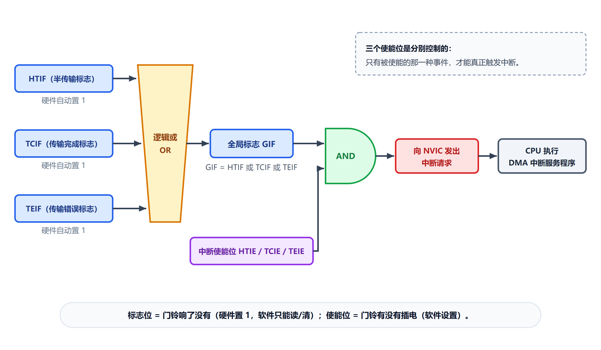

看图时按这个顺序：

1. **左边一列三个小方框**，从上到下写：`HTIF（半传输标志）`、`TCIF（传输完成标志）`、`TEIF（传输错误标志）`。每个框下面注一行小字："硬件自动置 1"。
2. **中间一个梯形方块**，写"逻辑或（OR）"。三个标志各画一条箭头指向它。
3. **梯形右边第一个框**，写"全局标志 GIF"。旁边小字："GIF = HTIF 或 TCIF 或 TEIF"。
4. **再往右一个"与门"（画成 D 形）**，有两个输入：一个是上面那三个标志的或结果，另一个从下方来，标"中断使能位 HTIE / TCIE / TEIE"。
5. **与门右边一个框**，写"向 NVIC 发出中断请求"，再往右箭头指向"CPU 执行中断服务程序"。
6. **右上角加一个小注释**："三个使能位是分别控制的：只有被使能的那一种事件才能真的触发中断。"
7. **配色**：标志框浅蓝 #DBEAFE，或门浅黄 #FEF3C7，与门浅绿 #DCFCE7，中断请求红框 #FEE2E2 / 边框 #DC2626。

#### 这个图要你记住什么

1. **三个事件标志：HTIF（半）、TCIF（完）、TEIF（错）**，都由硬件置 1。
2. **三个使能位：HTIE、TCIE、TEIE**，都由软件设置，决定要不要发中断。
3. **全局标志 GIF = 三个标志的或**。所以 GIF=1 只说明"发生了三件事中的某一件"，具体是哪件，还要去看 HTIF/TCIF/TEIF。
4. **`DMA_ISR` 是只读的（读标志），`DMA_IFCR` 是用来清标志的**（写 1 清）。

---

### 11.2.6 DMA 请求映像

这一小节回答一个非常实际的问题：

> **我想用 DMA 搬 ADC1 的数据，我该用哪个通道？**
> **我想用 DMA 从内存往 USART1 发数据，又该用哪个通道？**

答案是：**这不是你能随便选的，是硬件定死的。** 每个通道固定连接一组外设的请求。这张"对应关系表"就叫**请求映像**（Request Mapping）。

#### 1. DMA1 控制器

【教材内容】

> 从外设（TIMx[x=1、2、3、4]、ADC1、SPI1、SPI/I2S2、I2Cx[x=1、2] 和 USARTx[x=1、2、3]）产生的请求，通过**逻辑或**输入到 DMA1 控制器，同时只能有一个请求有效。DMA1 请求映像如图 11-2 所示。
> 可以通过设置相应外设寄存器中的控制位，独立地开启或关闭外设的 DMA 请求。

##### 先解释"逻辑或输入"是什么意思

看图中每个通道的左边，都有一个**或门**（画成 D 字形的符号）。它的多个输入来自不同的外设。

```
外设 ADC1 请求  ──┐
外设 TIM2_CH3   ──┤  或门  ──► 硬件请求1  ──► 通道1
外设 TIM4_CH1   ──┘
```

**意思是**：只要这三个外设里**有任何一个**发出请求，通道 1 就会收到"硬件请求 1"。

**⚠️ 教材特别强调："同时只能有一个请求有效"。** 意思是：

> **虽然多个外设的请求"或"到了一起，但你在程序里应该只开启其中一个外设的 DMA 请求，否则你分不清这次是谁的数据。**

比如你想用通道 1 搬 ADC1 的数据，就不要再去使能 TIM2_CH3 和 TIM4_CH1 的 DMA 请求。

（每个外设内部都有单独的 DMA 使能位，比如 `ADC_DMACmd()` 就是开启 ADC 的 DMA 请求。这些位互相独立。）

##### 教材表 11-2：各个通道的 DMA1 请求

| 外设 | 通道 1 | 通道 2 | 通道 3 | 通道 4 | 通道 5 | 通道 6 | 通道 7 |
|---|---|---|---|---|---|---|---|
| **ADC1** | ADC1 | | | | | | |
| **SPI/I2S** | | SPI1_RX | SPI1_TX | SPI/I2S2_RX | SPI/I2S2_TX | | |
| **USART** | | USART3_TX | USART3_RX | USART1_TX | USART1_RX | USART2_RX | USART2_TX |
| **I2C** | | | | I2C2_TX | I2C2_RX | I2C1_TX | I2C1_RX |
| **TIM1** | | TIM1_CH1 | TIM1_CH2 | TIM1_CH4 / TIM1_TRIG / TIM1_COM | TIM1_UP | TIM1_CH3 | |
| **TIM2** | TIM2_CH3 | TIM2_UP | | | TIM2_CH1 | | TIM2_CH2 / TIM2_CH4 |
| **TIM3** | | TIM3_CH3 | TIM3_CH4 / TIM3_UP | | | TIM3_CH1 / TIM3_TRIG | |
| **TIM4** | TIM4_CH1 | | | TIM4_CH2 | TIM4_CH3 | | TIM4_UP |

> ⚠️ **OCR 疑点**：教材表 11-2 中"TIM1 / 通道 4"这一格，MinerU 解析成 `TIM1_TX4TIM1_TRIGTIM1_COM`（三个请求名挤在一起）。按 STM32F103 的 DMA 请求列表，TIM1 通道 4 对应的是 `TIM1_CH4`、`TIM1_TRIG`、`TIM1_COM` 三个请求——其中的 "**TX4**" 是 "**CH4**" 的 OCR 误读，正确写法是 `TIM1_CH4 / TIM1_TRIG / TIM1_COM`。
> **本讲义的表格里已经直接写成 `TIM1_CH4`**（见上表；正文 11.2.6 后面"看教材图 11-2"的通道 4 输入列表里用的也是 `TIM1_CH4`），对照图 11-2 通道 4 的输入也能看到 `TIM1_CH4`。这一格**没有"漏项"问题**，只是 OCR 把 `CH4` 认成了 `TX4`。已记入文末"待核验"。

#### 看教材图 11-2：DMA1 请求映像

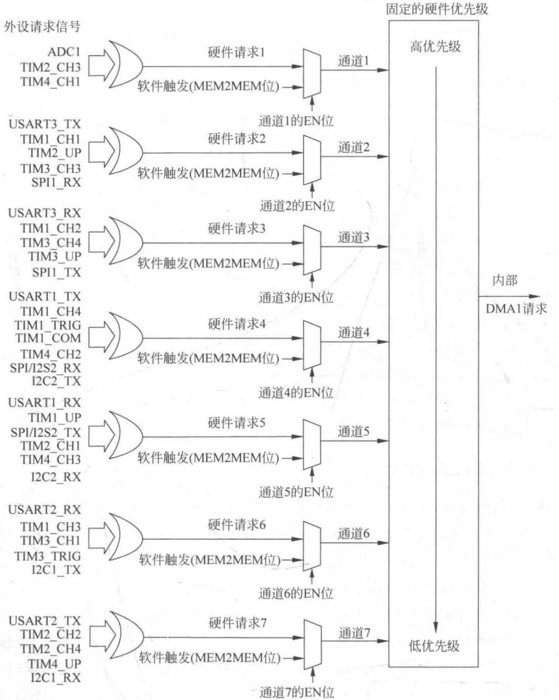

这张图是"通道映射表"的图形版。**建议按"从左往右、从上往下"读。** 我拆成三层：

##### 第一层：只看最左边一列（"谁在举手"）

最左边一列写着外设请求信号的名字，按通道分组：

```
通道1: ADC1 / TIM2_CH3 / TIM4_CH1
通道2: USART3_TX / TIM1_CH1 / TIM2_UP / TIM3_CH3 / SPI1_RX
通道3: USART3_RX / TIM1_CH2 / TIM3_CH4 / TIM3_UP / SPI1_TX
通道4: USART1_TX / TIM1_CH4 / TIM1_TRIG / TIM1_COM / TIM4_CH2 / SPI/I2S2_RX / I2C2_TX
通道5: USART1_RX / TIM1_UP / SPI/I2S2_TX / TIM2_CH1 / TIM4_CH3 / I2C2_RX
通道6: USART2_RX / TIM1_CH3 / TIM3_CH1 / TIM3_TRIG / I2C1_TX
通道7: USART2_TX / TIM2_CH2 / TIM2_CH4 / TIM4_UP / I2C1_RX
```

**这一层要你记住的**：**每个通道服务的外设是固定的**。比如"ADC1 只能用通道 1"，"USART1_TX 只能用通道 4"。

##### 第二层：看中间那一列（或门 → 多路选择器）

每一行中间画着：

```
    ┌─────┐
    │ 或门 │──► 硬件请求x ──►┌──────┐
    └─────┘                 │ 梯形 │──► 通道x
    ┌──────────────┐        │ 选择 │
    │ 软件触发      │───────►│ 开关 │
    │ (MEM2MEM位)   │        └──────┘
    └──────────────┘            ▲
                                │
                          通道x的EN位
```

三个符号分别代表：

| 符号 | 是什么 | 作用 |
|---|---|---|
| **或门**（D 形） | 逻辑或 | 把该通道映射的多个外设请求合并成一条"硬件请求 x" |
| **梯形方块** | 多路选择器 / 开关 | 决定这次用"硬件请求"还是"软件触发" |
| **向上的箭头（EN位）** | 通道使能 | 闸门。`EN=0` 时通道关闭，任何请求都进不来 |

**这一层要你记住的**：**通道的 `EN` 位是总闸门**。`EN=0`，这个通道就是死的。

##### 第三层：看最右边的竖长条（仲裁器）

最右边是一个从"高优先级"到"低优先级"的竖条，所有通道都接进去，输出一条线叫"内部 DMA1 请求"。

**这一层要你记住的**：**所有通道最终要排队进入同一个仲裁器**，仲裁器按 11.2.2 讲的规则决定谁先走。

#### 2. DMA2 控制器

【教材内容】

> 从外设（TIMx[5、6、7、8]、ADC3、SPI/I2S3、UART4、DAC 通道 1、2 和 SDIO）产生的请求，经逻辑或电路输入到 DMA2 控制器，同时只能有一个请求有效。DMA2 请求映像如图 11-3 所示。

##### 教材表 11-3：各个通道的 DMA2 请求

| 外设 | 通道 1 | 通道 2 | 通道 3 | 通道 4 | 通道 5 |
|---|---|---|---|---|---|
| **ADC3** | | | | | ADC3 |
| **SPI/I2S3** | SPI/I2S3_RX | SPI/I2S3_TX | | | |
| **UART4 / SDIO** | | | UART4_RX | SDIO | UART4_TX |
| **TIM5** | TIM5_CH4 / TIM5_TRIG | TIM5_CH3 / TIM5_UP | | TIM5_CH2 | TIM5_CH1 |
| **TIM6 / DAC 通道 1** | | | TIM6_UP / DAC 通道 1 | | |
| **TIM7 / DAC 通道 2** | | | | TIM7_UP / DAC 通道 2 | |
| **TIM8** | TIM8_CH3 / TIM8_UP | TIM8_CH4 / TIM8_TRIG / TIM8_COM | TIM8_CH1 | | TIM8_CH2 |

> ⚠️ **OCR 疑点**：教材表 11-3 中"UART4 / SDIO"一格，MinerU 解析为 `UART4 SDIO`（两个词挤在一个单元格里），但同一行下方又列出了 `UART4_RX`、`SDIO`、`UART4_TX` 三个值，分属通道 3、4、5。已按图 11-3 校正。已记入"待核验"。

#### 看教材图 11-3：DMA2 请求映像

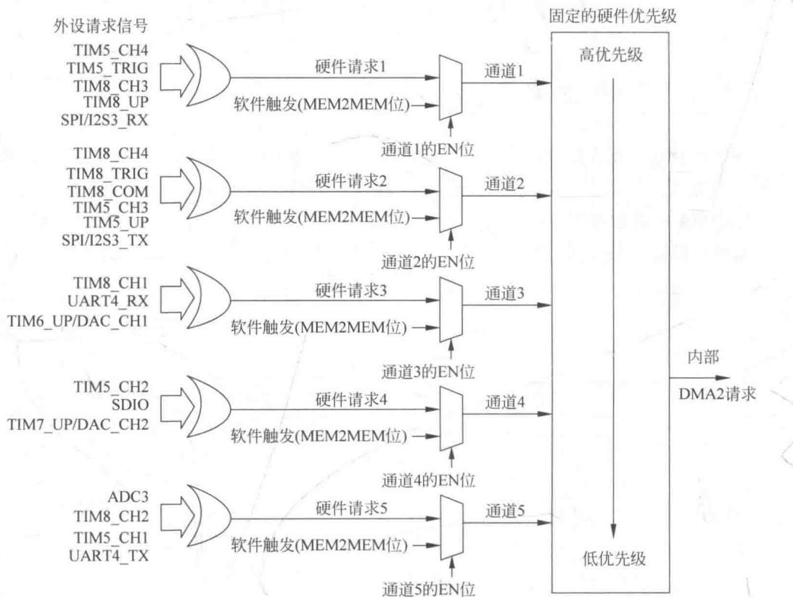

这张图的结构和图 11-2 **完全一样**，只是：

1. **通道数从 7 个变成 5 个**（DMA2 只有 5 个通道）；
2. **外设换了一批**：换成 TIM5~TIM8、ADC3、SPI/I2S3、UART4、DAC 通道 1/2、SDIO。

**所以看图的方法也完全一样**：左边看"谁在举手"，中间看"或门 + 选择开关 + EN 闸门"，右边看"仲裁器排队"。

**图 11-3 里最值得注意的两点：**

1. **DAC 通道 1 和 DAC 通道 2 出现了**（分别挂在 DMA2 通道 3 和通道 4）。
   → 这解释了为什么"用 DMA 输出正弦波"（习题 11-4）要用 DMA2。
2. **ADC3 在 DMA2 通道 5**，而 **ADC1 在 DMA1 通道 1**。所以"用哪个 ADC"直接决定了"用哪个 DMA 控制器的哪个通道"。

#### 【辅助理解图】外设请求 → 通道 → 仲裁器 的映射关系

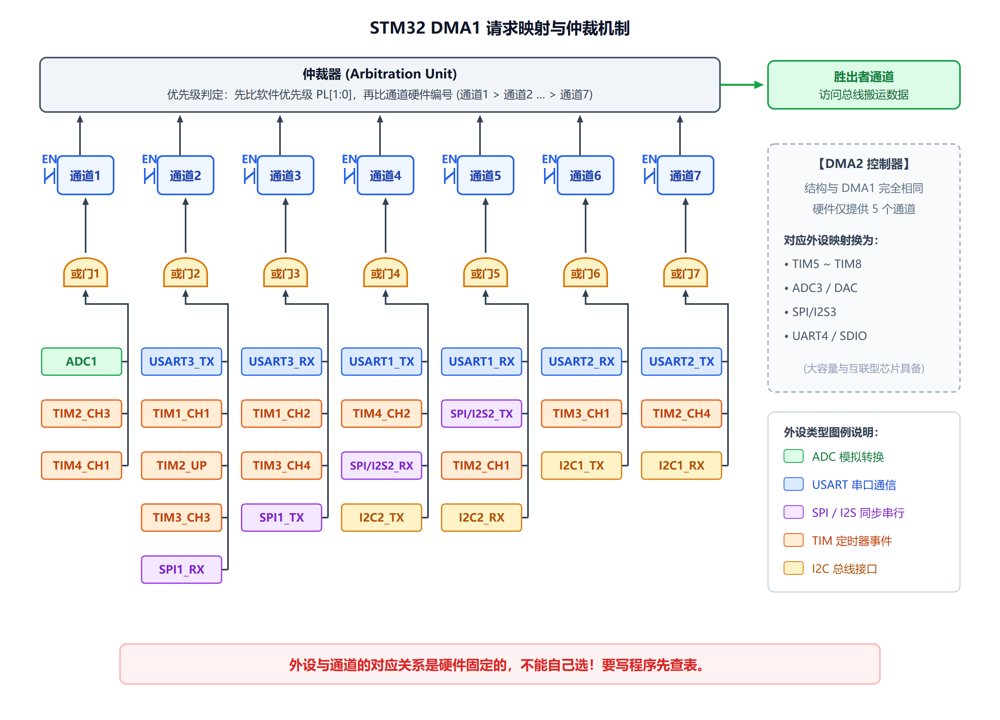

看图时按这个顺序：

1. **图从下往上看**。最下面一排是**外设小方块**，按"外设类别"分色：ADC 类（绿）、USART 类（蓝）、SPI 类（紫）、TIM 类（橙）、I2C/DAC 类（棕）。
2. **往上画若干条细箭头**，从每个外设指向中间的一排"或门"符号，或门共 7 个（对应 DMA1 通道 1~7）。**每个或门只接收固定的几个外设的箭头**，箭头旁标出请求名（如 `ADC1`、`TIM2_CH3`）。
3. **或门再往上连到 7 个"通道"方块**，通道方块里写"通道 1"…"通道 7"，每个通道方块左侧画一个**闸门符号**，标注"EN 位"。
4. **7 个通道方块再往上汇入一个大方框**，写"仲裁器：先比 PL[1:0]，再比通道编号"。
5. **最上面一个绿色方块**，写"胜出者 → 访问总线搬数据"。
6. **右侧用虚线圈出一块**，写"DMA2 结构相同，只有 5 个通道"，并列一小张缩略图。
7. **图的最下方用一行醒目的红字写**："外设与通道的对应关系是硬件固定的，不能自己选！"
8. **配色**：外设方块用浅色底 + 深色边框，或门浅黄，通道浅蓝，仲裁器浅灰，胜出绿色；线条统一 #334155。

#### 这张图要你记住什么

> **要写 DMA 程序，第一步永远是"查表"：**
> **1. 我要搬的是哪个外设的什么数据？（比如 ADC1 的转换结果）**
> **2. 查表，找到它固定对应的通道。（ADC1 → DMA1 通道 1）**
> **3. 以后所有配置都针对这个通道。**

**这就是为什么例 11-1 里写的是 `DMA1_Channel1`，而不是别的通道** —— 因为 ADC1 只能用通道 1。

---

### 本节真正要记住什么（11.2）

1. **一次 DMA 传输 = 读源 + 写目标 + CNDTR 减 1**，重复到 CNDTR=0。
2. **外设和 DMA 之间用"请求—应答"握手**，不用程序干预。
3. **仲裁规则**：软件优先级（4 级）> 通道编号（小号优先）> DMA1 优先于 DMA2。
4. **通道配置 6 步**：CPAR → CMAR → CNDTR → PL → 其它 CCR 位 → EN=1。**EN=1 之后 CPAR/CMAR/CNDTR 就不能改了。**
5. **宽度和对齐**：源按源宽度走，目标按目标宽度走；变宽补 0，变窄丢高位；地址必须按宽度对齐。
6. **三种标志 HTIF/TCIF/TEIF，三个使能 HTIE/TCIE/TEIE**，GIF = 三者之或。
7. **外设与通道的映射是硬件固定的**，必须查表（表 11-2 / 11-3 或图 11-2 / 11-3）。

### 考试怎么答（11.2 常考题型）

**题目：DMA 技术和中断技术有什么本质区别？**（这就是习题 11-2）

**答题思路（建议分 4 点写）：**

1. **解决的问题不同**：
   - 中断技术解决的是"CPU 怎么知道外设发生了什么"，本质是**通知机制**，数据传输仍然要 CPU 参与（CPU 在中断服务程序里执行读/写指令）；
   - DMA 技术解决的是"**数据怎么搬**"，本质是**数据搬运机制**，搬运过程完全由 DMA 硬件完成，CPU 不参与。
2. **对 CPU 的占用不同**：
   - 中断方式下，每传一个数据都要打断一次 CPU，CPU 要保存现场、执行 ISR、恢复现场，开销大；
   - DMA 方式下，CPU 只在"配置"和"整批传完"这两个时刻介入，中间完全不占用 CPU 的时间（只共用总线）。
3. **数据传输的控制者不同**：
   - 中断方式：CPU 是搬运的执行者；
   - DMA 方式：DMA 控制器是搬运的执行者，CPU 只是"下命令的人"。
4. **两者不是互相取代，而是配合使用**：
   - DMA 传输完成（或半传输、出错）之后，**仍然用中断通知 CPU**。所以 DMA 系统里往往"既有 DMA 又有中断"，只是中断次数大大减少了。

（可以用一句话总结：**中断是"通知"，DMA 是"代劳"；DMA 减少了中断的次数，但没有取消中断。**）

---

## 11.3 DMA 的寄存器

### 先建立一条"找门牌号"的思维链（这一节的地图）

AGENTS 规则要求：凡是涉及地址，必须可视化，并且把这条链走完：

> **地址 → 地址空间 → 外设基地址 → 寄存器偏移 → 最终寄存器地址**

我们先把这条链走一遍，后面讲每个寄存器时就不会迷路。

#### 第 1 步：地址空间 —— CPU 眼里的世界是一排"有编号的格子"

**大白话**：

> **CPU 不认识"内存"和"外设"的区别。在它眼里，整个 4GB（2³² 字节）的空间就是一大排格子，每个格子有一个 32 位的编号（地址）。**
> **CPU 想拿哪个格子里的东西，就把那个编号发到地址总线上。至于这个编号背后接的是 RAM 还是某个外设的寄存器，CPU 不关心——是硬件（总线矩阵）负责"转接"的。**

STM32F103 把这片地址空间做了分区（第 3 章讲过），和本章相关的有两块：

```
地址空间总览（只画和本章有关的）

0xFFFFFFFF ┌──────────────────────────────┐
           │  ……其它区域……                │
0xE0000000 ├──────────────────────────────┤
           │  内核外设区（NVIC、SysTick…） │
0x60000000 ├──────────────────────────────┤
           │  外部 RAM / 设备区            │
0x40000000 ├──────────────────────────────┤  ★ 本章重点
           │  片上外设区（Peripheral）      │
           │    ├ 0x40000000 APB1 外设     │  ← USART2/3、I2C、TIM2~7、SPI2…
           │    ├ 0x40010000 APB2 外设     │  ← GPIO、ADC1、SPI1、USART1、TIM1…
           │    └ 0x40020000 AHB 外设      │  ← ★ DMA1、DMA2 就在这里！
0x20000000 ├──────────────────────────────┤
           │  SRAM（变量住这里）           │  ← 例 11-1 的数组在这里
0x08000000 ├──────────────────────────────┤
           │  Flash（程序住这里）          │
0x00000000 └──────────────────────────────┘
```

**这一层要记住的**：**DMA 的寄存器住在 0x40020000 开始的"AHB 外设区"里。而 DMA 要搬的"内存"通常在 0x20000000 开始的 SRAM 区。**

#### 第 2 步：外设基地址 —— DMA1 和 DMA2 的门牌号

【教材内容】

> DMA1 的基地址为 **0x4002 0000**，DMA2 的基地址为 **0x4002 0400**。

我们把这两个数展开看（**1 个十六进制位 = 4 个 bit，8 个十六进制位 = 32 个 bit**）：

```
0x40020000 = 0100 0000 0000 0010 0000 0000 0000 0000
             └─0x4─┘
             
0x40020400 = 0100 0000 0000 0010 0000 0100 0000 0000
                                     └─0x0400─┘
                                     比 DMA1 多了 0x400
```

**"基地址"是什么意思？** 就是"这个外设所占的那一片格子的**起始编号**"。

**为什么 DMA2 是 0x40020400 而不是别的？** 因为要给它俩各留一块空间，不能重叠：

```
0x40020000 ┌────────────────────┐ ← DMA1 基地址
           │  DMA1 的寄存器区    │   大小 0x400（1024 字节）
0x40020400 ├────────────────────┤ ← DMA2 基地址
           │  DMA2 的寄存器区    │
           └────────────────────┘
```

（DMA1 一共有 **6 种**寄存器：`ISR`、`IFCR` 各 1 个；`CCR`/`CNDTR`/`CPAR`/`CMAR` 每通道 1 个、共 4 × 7 = 28 个，合计 2 + 28 = **30 个寄存器**。如果把它们紧挨着排，需要 30 × 4 = **120 字节 = 0x78**；不过通道之间还留了空隙（每个通道占 0x14 = 20 字节，实际只用 16 字节），所以整片 DMA1 寄存器区从偏移 0x00 一直排到 **0x90**：最后一个寄存器 `CMAR7` 在 0x4002008C，占满 4 个字节后正好结束于 0x40020090。既然实际只用到 0x90 字节，那么给 DMA2 留出的 0x400 空间当然是绰绰有余的。）

#### 第 3 步：寄存器偏移 —— "从基地址往里走多少步"

**"偏移"（Offset）** 这个词很重要。大白话：

> **偏移 = 相对于"起点"往前数多少个字节。**

比如"`DMA_ISR` 的偏移地址是 0x00"，意思是：

> **`DMA_ISR` 就在 DMA1 基地址这个位置上，不用往里走。**

"`DMA_IFCR` 的偏移地址是 0x04"，意思是：

> **`DMA_IFCR` 在基地址往后 4 个字节的位置。**

#### 第 4 步：算出最终地址 —— 一条完整的演算

**公式**：

```
最终寄存器地址 = 外设基地址 + 通道基地址偏移 + 寄存器在通道内的偏移
```

教材给的偏移（**教材原文在这里混用了十进制和十六进制，见下方说明**）：

| 寄存器 | 教材原文写的偏移 | 换算成十六进制 | 含义 |
|---|---|---|---|
| `DMA_ISR` | 0x00 | 0x00 | 从 DMA 基地址偏移 0x00 |
| `DMA_IFCR` | 0x04 | 0x04 | 从 DMA 基地址偏移 0x04 |
| `DMA_CCRx` | 0x08 + 20 × (x−1) | 0x08 + 0x14 × (x−1) | 从 DMA 基地址算 |
| `DMA_CNDTRx` | 0x0C + 20 × (x−1) | 0x0C + 0x14 × (x−1) | 从 DMA 基地址算 |
| `DMA_CPARx` | 0x10 + 20 × (x−1) | 0x10 + 0x14 × (x−1) | 从 DMA 基地址算 |
| `DMA_CMARx` | 0x14 + 20 × (x−1) | 0x14 + 0x14 × (x−1) | 从 DMA 基地址算 |

> 【补充解释】**教材这个公式没有写错，只是那个"20"用的是十进制。**
>
> 教材原文写的是"偏移地址：`0x08+20x（通道编号-1）`"。这里的 `20` 是**十进制 20**，而十进制 20 = 十六进制 **0x14**。所以它和本讲义后面统一写的"`0x08 + 0x14 × (x−1)`"是**同一个公式**。
>
> **为什么能确定"20"是十进制？** 用教材自己给出的地址宏验算，全部对得上：
>
> | 通道 | 教材公式（20 按十进制算） | 得到的十进制数 | 得到的十六进制 | 教材 11.4.1 的地址宏 |
> |---|---|---|---|---|
> | 通道 1 | 0x08 + 20 × 0 = 0x08 | 8 | 0x08 | `DMA1_Channel1_BASE = +0x0008` ✓ |
> | 通道 2 | 0x08 + 20 × 1 | 8 + 20 = 28 | 0x1C | `DMA1_Channel2_BASE = +0x001C` ✓ |
> | 通道 3 | 0x08 + 20 × 2 | 8 + 40 = 48 | 0x30 | `DMA1_Channel3_BASE = +0x0030` ✓ |
>
> 反过来，如果把 `20` 当成十六进制 0x20，通道 2 会算成 0x08 + 0x20 = **0x28**，跟教材自己给的 0x1C 对不上——所以"20"只能是十进制。
>
> **⚠️ 为什么容易看错**：教材在同一个公式里，一边写十六进制的 `0x08`，一边写十进制的 `20`，中间没有任何说明。以后你看到教材或手册里的数字，**先看有没有 `0x` 前缀**：带 `0x` 的是十六进制，不带的一般是十进制。（本讲义后面统一写成 `0x08 + 0x14 × (x−1)`，两边都是十六进制，不容易混。已记入文末"待核验"第 6、7 条。）

**演算一：求 DMA1 通道 1 的 `CCR1` 地址**

```
DMA1 基地址        = 0x40020000
通道 1 的偏移      = 0x08 + 0x14 × (1−1) = 0x08 + 0 = 0x08
CCR 在通道内的偏移 = 0x00

CCR1 地址 = 0x40020000 + 0x08 + 0x00 = 0x40020008
```

**演算二：求 DMA1 通道 1 的 `CNDTR1` 地址**

```
DMA1 基地址        = 0x40020000
通道 1 的偏移      = 0x08
CNDTR 在通道内的偏移 = 0x04   （CCR 占 4 字节，CNDTR 紧跟在后面）

CNDTR1 地址 = 0x40020000 + 0x08 + 0x04 = 0x4002000C
```

**演算三：求 DMA1 通道 4 的 `CMAR4` 地址（多步，请看仔细）**

```
第 1 步：DMA1 基地址 = 0x40020000

第 2 步：通道 4 的基地址偏移
        0x08 + 0x14 × (4 − 1)
      = 0x08 + 0x14 × 3
      = 0x08 + 0x3C          ← 0x14 × 3 = 0x3C
      = 0x44

第 3 步：加上 DMA1 基地址
        0x40020000 + 0x44 = 0x40020044

第 4 步：加上 CMAR 在通道内的偏移 0x0C
        0x40020044 + 0x0C = 0x40020050

所以 DMA1 通道 4 的 CMAR4 地址 = 0x40020050
```

**验算**：教材 11.4.1 的宏 `DMA1_Channel4_BASE = AHBPERIPH_BASE + 0x0044 = 0x40020044` ✓。而 CMAR 是通道内第 4 个寄存器（CCR、CNDTR、CPAR、CMAR），偏移 0x0C。所以 0x40020044 + 0x0C = 0x40020050 ✓。

**演算四：求 DMA2 通道 5 的 `CCR5` 地址**

```
DMA2 基地址   = 0x40020400
通道 5 偏移   = 0x08 + 0x14 × (5−1) = 0x08 + 0x50 = 0x58
CCR 偏移      = 0x00

CCR5 地址 = 0x40020400 + 0x58 = 0x40020458
```

**验算**：教材宏 `DMA2_Channel5_BASE = AHBPERIPH_BASE + 0x0458 = 0x40020458` ✓。

#### 【辅助理解图】DMA 的地址链

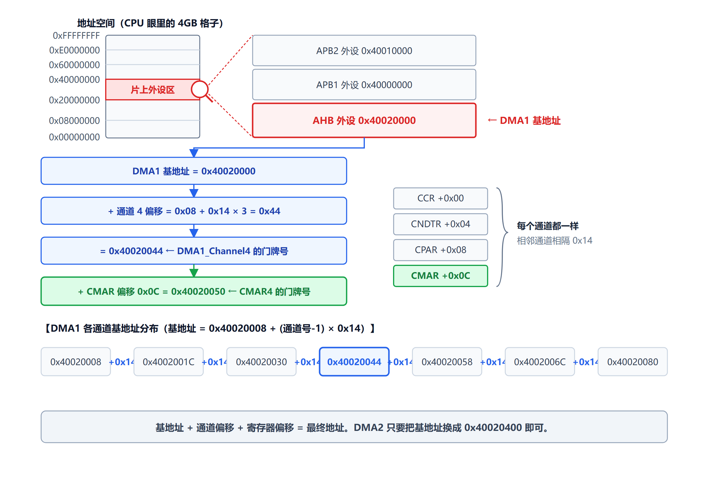

看图时按这个顺序：

1. **最上面一个大方框**，写"地址空间（CPU 眼里的 4GB 格子）"，方框内从上到下画几条横线，标出 `0xFFFFFFFF`、`0xE0000000`、`0x40000000`、`0x20000000`、`0x08000000`、`0x00000000`。
2. **在 `0x40000000` 那条线下方画一个放大的"放大镜"区域**，把"片上外设区"放大，里面分三格：APB1 外设、APB2 外设、AHB 外设。在"AHB 外设"这一格上用红色标出 `0x40020000`，旁边写"DMA1 基地址"。
3. **从 DMA1 基地址往下画一条竖直的"计算流水线"**，分成 4 个台阶：
   - 台阶 1：`DMA1 基地址 = 0x40020000`
   - 台阶 2：`+ 通道 4 偏移 = 0x08 + 0x14×3 = 0x44`
   - 台阶 3：`= 0x40020044`（这就是 DMA1_Channel4 的门牌号）
   - 台阶 4：`+ CMAR 偏移 0x0C` = `0x40020050`（CMAR4 的门牌号，用绿色高亮框）
4. **台阶右侧画一个纵向的小方框列**，列出通道内 4 个寄存器的偏移：`CCR +0x00`、`CNDTR +0x04`、`CPAR +0x08`、`CMAR +0x0C`，用一个大括号括起来，标"每个通道都一样，通道之间相隔 0x14"。
5. **图底部一行小字**："基地址 + 通道偏移 + 寄存器偏移 = 最终地址。DMA2 只要把基地址换成 0x40020400 即可。"
6. **配色**：地址空间灰白，DMA 相关用蓝色 #2563EB，最终地址用绿色 #16A34A，公式文字用深灰 #334155。

#### 本节要记住的地址（背下来最省事）

| 寄存器 | DMA1 地址 | DMA2 地址 |
|---|---|---|
| `ISR` | 0x40020000 | 0x40020400 |
| `IFCR` | 0x40020004 | 0x40020404 |
| 通道 1 的 `CCR` | 0x40020008 | 0x40020408 |
| 通道 2 的 `CCR` | 0x4002001C | 0x4002041C |
| 通道 3 的 `CCR` | 0x40020030 | 0x40020430 |
| 通道 4 的 `CCR` | 0x40020044 | 0x40020444 |
| 通道 5 的 `CCR` | 0x40020058 | 0x40020458 |
| 通道 6 的 `CCR` | 0x4002006C | （DMA2 没有通道 6） |
| 通道 7 的 `CCR` | 0x40020080 | （DMA2 没有通道 7） |

**看规律**：从通道 1 到通道 7，每往下一个通道就 **+0x14**（十进制 20）。

> 0x08 → 0x1C → 0x30 → 0x44 → 0x58 → 0x6C → 0x80
> 每次都加 0x14 ✓

**⚠️ 重要提醒（教材 11.3 开头）**：

> 在下面介绍的寄存器中，所有与**通道 6 和通道 7 相关的位，对 DMA2 都不适用**，因为 DMA2 只有 5 个通道。

---

### 11.3.1 DMA 中断状态寄存器（DMA_ISR）

#### 基本信息

| 项目 | 内容 |
|---|---|
| 属于谁 | 整个 DMA1（或 DMA2），**不是某个通道私有**，7 个通道的标志都挤在这一个寄存器里 |
| 偏移地址 | 0x00 |
| 复位值 | 0x0000 0000（复位后全 0 = 什么事件都没发生过） |
| 可读可写 | **只读（r）**。软件不能往这里写。想清除标志，要写到 `DMA_IFCR` |
| 干什么用 | **让程序知道"每个通道发生了什么事件"** |

#### 为什么需要它？

DMA 是"自己在后台搬"的。CPU 怎么知道"搬完了没有"、"搬了多少"、"有没有出错"？

**答案就是查这个寄存器。**

**类比**：`DMA_ISR` 像一块**总控室的指示灯面板**。面板上有 7 组灯，每组 4 盏（对应 7 个通道 × 4 种状态）。灯亮不亮是硬件自动控制的，你只能看，不能自己拧。

#### 位图（32 位，完整）

```
      +------+------+------+------+------+------+------+------+------+------+------+------+------+------+------+------+
bit   |  31  |  30  |  29  |  28  |  27  |  26  |  25  |  24  |  23  |  22  |  21  |  20  |  19  |  18  |  17  |  16  |
      +------+------+------+------+------+------+------+------+------+------+------+------+------+------+------+------+
field |          reserved         |TEIF7 |HTIF7 |TCIF7 | GIF7 |TEIF6 |HTIF6 |TCIF6 | GIF6 |TEIF5 |HTIF5 |TCIF5 | GIF5 |
      +------+------+------+------+------+------+------+------+------+------+------+------+------+------+------+------+

      +------+------+------+------+------+------+------+------+------+------+------+------+------+------+------+------+
bit   |  15  |  14  |  13  |  12  |  11  |  10  |  9   |  8   |  7   |  6   |  5   |  4   |  3   |  2   |  1   |  0   |
      +------+------+------+------+------+------+------+------+------+------+------+------+------+------+------+------+
field |TEIF4 |HTIF4 |TCIF4 | GIF4 |TEIF3 |HTIF3 |TCIF3 | GIF3 |TEIF2 |HTIF2 |TCIF2 | GIF2 |TEIF1 |HTIF1 |TCIF1 | GIF1 |
      +------+------+------+------+------+------+------+------+------+------+------+------+------+------+------+------+
```

**看这张图的方法（先别看全部 28 个字段）**：

**第 1 层：先看"每 4 个 bit 一组"这个规律。**

```
位[31:28] 保留
位[27:24] = 通道 7 的 4 个标志：TEIF7 HTIF7 TCIF7 GIF7
位[23:20] = 通道 6 的 4 个标志：TEIF6 HTIF6 TCIF6 GIF6
位[19:16] = 通道 5 的 4 个标志
位[15:12] = 通道 4 的 4 个标志
位[11: 8] = 通道 3 的 4 个标志
位[ 7: 4] = 通道 2 的 4 个标志
位[ 3: 0] = 通道 1 的 4 个标志
```

**第 2 层：每组 4 个 bit 的顺序永远是 TE → HT → TC → G。**

```
TEIFx  = 传输错误标志
HTIFx  = 半传输标志
TCIFx  = 传输完成标志
GIFx   = 全局中断标志
```

**第 3 层：算一下"通道 x 的某个标志在第几位"。**

规律：**通道 x 的 4 个标志占据位[4x−1 : 4x−4]**。

- 通道 1：位[3:0]（4×1−1=3，4×1−4=0）✓
- 通道 4：位[15:12]（4×4−1=15，4×4−4=12）✓
- 通道 7：位[27:24]（4×7−1=27，4×7−4=24）✓

而且每组内：**TEIFx 是这一组的最高位，GIFx 是最低位。**

#### 字段详解（以通道 4 为例，其它通道完全一样）

```
+-----+-----+-----+-----+
| 15  | 14  | 13  | 12  |
+-----+-----+-----+-----+
|TEIF4|HTIF4|TCIF4|GIF4 |
+-----+-----+-----+-----+
 ↑
TEIF4 是 bit15，即通道 4 的传输错误标志
```

| 位 | 名称 | 读出来 = 0 | 读出来 = 1 | 谁来置 1 | 谁来清 0 |
|---|---|---|---|---|---|
| 位 15 | `TEIF4` | 通道 4 没有传输错误 | 通道 4 发生了传输错误 | 硬件 | 软件写 `IFCR` 的对应位 |
| 位 14 | `HTIF4` | 通道 4 没有半传输事件 | 通道 4 产生了半传输事件 | 硬件 | 软件写 `IFCR` 的对应位 |
| 位 13 | `TCIF4` | 通道 4 没有传输完成事件 | 通道 4 产生了传输完成事件 | 硬件 | 软件写 `IFCR` 的对应位 |
| 位 12 | `GIF4` | 通道 4 没有 TE/HT/TC 事件 | 通道 4 产生了 TE、HT 或 TC 事件 | 硬件 | 软件写 `IFCR` 的对应位 |

**注意 `GIFx` 的特殊含义**（教材原文）：

> 0：在通道 x 没有 TE、HT 或 TC 事件。
> 1：在通道 x 产生了 TE、HT 或 TC 事件。

也就是说：

```
GIF4 = TEIF4 或 HTIF4 或 TCIF4
```

**这是一个"汇总灯"**：只要三种事件里任何一种发生，`GIF4` 就会亮。所以：

> **如果你只想知道"通道 4 有没有出事"，看 `GIF4` 一个 bit 就够了。**
> **如果你想知道"到底出了什么事"，就要分别看 `TEIF4`、`HTIF4`、`TCIF4`。**

#### 程序怎么操作它？

**只能读**。比如：

```c
// 判断 DMA1 通道 4 是不是搬完了
if (DMA1->ISR & 0x00002000) {   // 0x00002000 = bit13 = TCIF4
    // 搬完了
}
```

**这个 0x00002000 是怎么来的？** 展开看：

```
0x00002000
= 0000 0000 0000 0000 0010 0000 0000 0000
                        ↑
                    从右数第 13 位 = bit13
                    bit13 正是 TCIF4
```

（库函数里这个数叫 `DMA1_FLAG_TC4`，见 11.4.2 第 7 个函数。）

#### 操作之后硬件发生什么？

读 `DMA_ISR` 是**纯读取**，不会改变任何标志，也不会清除任何标志。所以你可以放心地反复读。

**⚠️ 常见误解**：很多初学者以为"读了标志位，标志就自动清了"（某些芯片确实是这样）。**STM32 的 DMA 不是**。读 `ISR` 只是"看一眼"，**要清必须往 `IFCR` 写 1**（见下一小节）。

---

### 11.3.2 DMA 中断标志清除寄存器（DMA_IFCR）

#### 基本信息

| 项目 | 内容 |
|---|---|
| 属于谁 | 整个 DMA1（或 DMA2） |
| 偏移地址 | 0x04 |
| 复位值 | 0x0000 0000 |
| 可读可写 | **只写（w）**（教材标注为 w）。教材原文说"这些位由软件设置和清除" |
| 干什么用 | **把 `DMA_ISR` 里的标志"擦掉"** |

#### 为什么需要它？

因为 `ISR` 里的标志是硬件置 1 的，**清不掉**。如果不清，程序下次再看这个标志，就会以为"又发生了一次事件"，导致误判。

**类比**：`ISR` 是**指示灯面板**，`IFCR` 是**复位按钮面板**。灯亮了你只能按对应的按钮把它关掉。

#### 位图（和 ISR 完全对称）

```
      +------+------+------+------+------+------+------+------+------+------+------+------+------+------+------+------+
bit   |  31  |  30  |  29  |  28  |  27  |  26  |  25  |  24  |  23  |  22  |  21  |  20  |  19  |  18  |  17  |  16  |
      +------+------+------+------+------+------+------+------+------+------+------+------+------+------+------+------+
field |          reserved         |CTEIF7|CHTIF7|CTCIF7|CGIF7 |CTEIF6|CHTIF6|CTCIF6|CGIF6 |CTEIF5|CHTIF5|CTCIF5|CGIF5 |
      +------+------+------+------+------+------+------+------+------+------+------+------+------+------+------+------+

      +------+------+------+------+------+------+------+------+------+------+------+------+------+------+------+------+
bit   |  15  |  14  |  13  |  12  |  11  |  10  |  9   |  8   |  7   |  6   |  5   |  4   |  3   |  2   |  1   |  0   |
      +------+------+------+------+------+------+------+------+------+------+------+------+------+------+------+------+
field |CTEIF4|CHTIF4|CTCIF4|CGIF4 |CTEIF3|CHTIF3|CTCIF3|CGIF3 |CTEIF2|CHTIF2|CTCIF2|CGIF2 |CTEIF1|CHTIF1|CTCIF1|CGIF1 |
      +------+------+------+------+------+------+------+------+------+------+------+------+------+------+------+------+
```

**⚠️ 注意字段名前面多了一个 `C`**（Clear，清除）：

| `ISR` 里的名字 | `IFCR` 里对应的名字 | 多出来的 C 是什么意思 |
|---|---|---|
| `TEIFx` | `C`**TEIFx** | Clear TEIFx —— 清除"传输错误标志" |
| `HTIFx` | `C`**HTIFx** | Clear HTIFx —— 清除"半传输标志" |
| `TCIFx` | `C`**TCIFx** | Clear TCIFx —— 清除"传输完成标志" |
| `GIFx` | `C`**GIFx** | Clear GIFx —— 清除"全局中断标志" |

**位号完全一样**（通道 4 的 `CTCIF4` 也在 bit13）。**这是故意的设计**：位号相同，方便记忆和编程。

#### 每个字段的含义（**这里是全章最容易搞错的地方！**）

【教材内容】

> 位 27、23、19、15、11、7、3：`CTEIFx`，清除通道 x 的传输错误标志（x=1~7），这些位由软件设置和清除。
> **0：不起作用；1：清除 `DMA_ISR` 寄存器中的对应 `TEIF` 标志。**

**关键点：这是一个"写 1 有效"的寄存器！**

| 你往 `CTCIF4` 写 | 会发生什么 |
|---|---|
| 写 **0** | **什么也不做**（不是"把标志设成 0"！） |
| 写 **1** | **把 `ISR` 里对应的 `TCIF4` 清成 0** |

**为什么是"写 1 清除"，而不是"写 0 清除"？**

这看起来反直觉，但这是硬件设计里非常常见的一种方式。原因是：

> **如果设计成"写 0 清除"，那么"写一个 32 位数"时，那些你不想动的位也会被写成 0，就会误清标志。**
> **设计成"写 1 清除"后，你只要把"想清的位"写成 1、"不想动的位"写成 0，就能精确控制。**

**类比**：`IFCR` 的每一位像一个**"按下就清空"的按钮**。写 1 = "按下这个按钮"；写 0 = "不碰这个按钮"。**它不是"开关"，是"按钮"。**

#### `CGIFx` 的"一清四"效果（特别注意）

【教材内容】

> 位 24、20、16、12、8、4、0：`CGIFx`，清除通道 x 的全局中断标志（x=1~7）。
> 0：不起作用；
> 1：**清除 `DMA_ISR` 寄存器中的对应的 `GIF`、`TEIF`、`HTIF` 和 `TCIF` 标志**。

**注意**：往 `CGIFx` 写 1，不是只清一个 `GIFx`，而是**把通道 x 的 4 个标志全部清掉**！

```
往 CGIF4（bit12）写 1
   ↓
ISR 里通道 4 的 4 个标志全部变 0：
   TEIF4 = 0
   HTIF4 = 0
   TCIF4 = 0
   GIF4  = 0
```

**为什么这样设计？**

因为 `GIF` 本来就是"三个标志的或"。如果你只清 `GIF` 而不清底下的三个标志，那么下一次硬件一算"或"，`GIF` 立刻又变成 1 了，等于没清。所以干脆"一键全清"。

**类比**：`CGIFx` 是**"这个通道全部复位"的总按钮**。按一下，这个通道的 4 盏灯全灭。

#### 具体演算：清除 DMA1 通道 4 的传输完成标志

**需求**：程序处理完通道 4 的传输完成事件后，要把 `TCIF4` 清掉，否则下次还会误判。

**查位号**：`CTCIF4` 在 bit13。

**算出要写的数**：

```
bit13 = 1
     = 0000 0000 0000 0000 0010 0000 0000 0000
     = 0x00002000
```

**写代码**：

```c
DMA1->IFCR = 0x00002000;      // 清除 DMA1 通道 4 的传输完成标志
// 或者用库函数：
DMA_ClearFlag(DMA1_FLAG_TC4);
```

**硬件接着做什么？** `ISR` 里 bit13 从 1 变 0。其它位不受影响。

#### 再演算一个：一次清掉通道 1 的全部标志

**需求**：把 DMA1 通道 1 的 4 个标志全部清掉。

**方法 A：只写 `CGIF1`**（一个 bit 搞定）

```
CGIF1 在 bit0
     = 0000 0000 0000 0000 0000 0000 0000 0001
     = 0x00000001

DMA1->IFCR = 0x00000001;   // 通道1的 TEIF1/HTIF1/TCIF1/GIF1 全部清 0
```

**方法 B：分别写 4 个位**（效果一样，但多写几个 1）

```
CTEIF1 (bit3) = 0x00000008
CHTIF1 (bit2) = 0x00000004
CTCIF1 (bit1) = 0x00000002
CGIF1  (bit0) = 0x00000001
四个相"或"    = 0x0000000F

DMA1->IFCR = 0x0000000F;   // 结果和上面一样
```

**验算**：0x8 + 0x4 + 0x2 + 0x1 = 0xF ✓

（注意：方法 B 的 `CGIF1` 本身就已经会清掉另外三个，所以严格说方法 B 里前三个是多余的。但写上去也不会错。）

---

### 11.3.3 DMA 通道 x 配置寄存器（DMA_CCRx）—— 全章最重要的寄存器

#### 基本信息

| 项目 | 内容 |
|---|---|
| 属于谁 | **每个通道各有一个**（DMA1 有 7 个，DMA2 有 5 个） |
| 偏移地址 | 0x08 + 0x14 × (x−1) |
| 复位值 | 0x0000 0000 |
| 可读可写 | **读写（rw）** |
| 干什么用 | **它是这个通道的"总控制面板"**：方向、宽度、增量、循环、优先级、中断开关、启动开关，全在这里 |

#### 为什么需要它？

因为 DMA 要干的活千变万化：搬 1 个字节还是 4 个字节？地址要不要走？搬完停不停？急不急？出错了要不要中断？

**这些"怎么搬"的问题，全部由 `CCR` 回答。**

#### 位图（32 位）

```
      +-----+-----+-----+-----+-----+-----+-----+-----+-----+-----+-----+-----+-----+-----+-----+-----+
bit   |  31 |  30 |  29 |  28 |  27 |  26 |  25 |  24 |  23 |  22 |  21 |  20 |  19 |  18 |  17 |  16 |
      +-----+-----+-----+-----+-----+-----+-----+-----+-----+-----+-----+-----+-----+-----+-----+-----+
field |                                            reserved                                           |
      +-----+-----+-----+-----+-----+-----+-----+-----+-----+-----+-----+-----+-----+-----+-----+-----+

      +-----+-----+-----+-----+-----+-----+-----+-----+-----+-----+-----+-----+-----+-----+-----+-----+
bit   |  15 |  14 |  13 |  12 |  11 |  10 |  9  |  8  |  7  |  6  |  5  |  4  |  3  |  2  |  1  |  0  |
      +-----+-----+-----+-----+-----+-----+-----+-----+-----+-----+-----+-----+-----+-----+-----+-----+
field | rsv | MEM2|  PL |  PL |MSIZE|MSIZE|PSIZE|PSIZE| MINC| PINC| CIRC| DIR | TEIE| HTIE| TCIE|  EN |
      |     | MEM | [1] | [0] | [1] | [0] | [1] | [0] |     |     |     |     |     |     |     |     |
      +-----+-----+-----+-----+-----+-----+-----+-----+-----+-----+-----+-----+-----+-----+-----+-----+
```

**字段名缩写对照**：

| 缩写 | 英文全称 | 中文 |
|---|---|---|
| `MEM2MEM` | Memory to Memory mode | 存储器到存储器模式 |
| `PL[1:0]` | Channel Priority Level | 通道优先级 |
| `MSIZE[1:0]` | Memory Size | 存储器数据宽度 |
| `PSIZE[1:0]` | Peripheral Size | 外设数据宽度 |
| `MINC` | Memory Increment mode | 存储器地址增量模式 |
| `PINC` | Peripheral Increment mode | 外设地址增量模式 |
| `CIRC` | Circular mode | 循环模式 |
| `DIR` | Data transfer direction | 数据传输方向 |
| `TEIE` | Transfer Error Interrupt Enable | 允许传输错误中断 |
| `HTIE` | Half Transfer Interrupt Enable | 允许半传输中断 |
| `TCIE` | Transfer Complete Interrupt Enable | 允许传输完成中断 |
| `EN` | Channel Enable | 通道开启 |

**注意一个很有意思的规律**：

> **低 8 位（bit7~bit0）的顺序是：`MINC PINC CIRC DIR TEIE HTIE TCIE EN`。**
> 从"地址怎么走" → "模式" → "方向" → "三种中断使能" → "总开关"，**从"参数"到"开关"，一路往下**。

#### 逐个字段详解

下面每一条我都按 AGENTS 第 11 节的 8 个问题来讲：属于谁 / 控制什么 / 为什么 / 取值 / 写 0 写 1 / 程序怎么写 / 硬件发生什么。

---

##### 位 14：`MEM2MEM` —— 存储器到存储器模式

**属于谁**：这个通道。
**控制什么**：这个通道是"外设⇄存储器"模式，还是"存储器⇄存储器"模式。
**为什么需要**：内存之间搬数据时，没有外设会来发请求，需要一个"手动触发"的办法。

| 写 | 含义 |
|---|---|
| **0** | 非存储器到存储器模式（正常的外设⇄存储器模式） |
| **1** | 启动存储器到存储器模式 |

**程序怎么写**：

```c
DMA_InitStructure.DMA_M2M = DMA_M2M_Enable;    // 位14 = 1
```

**硬件发生什么**：置 1 后，只要 `EN` 也置 1，DMA 就**立刻开始搬**，不等任何外设请求。

**⚠️ 限制**：不能和循环模式（`CIRC=1`）同时使用。

---

##### 位[13:12]：`PL[1:0]` —— 通道优先级

**属于谁**：这个通道。
**控制什么**：这个通道在仲裁时的"VIP 等级"。
**为什么需要**：见 11.2.2。

| `PL[1:0]` | 优先级 | 库函数宏 | 宏数值 |
|---|---|---|---|
| `00` | 低 | `DMA_Priority_Low` | 0x00000000 |
| `01` | 中等 | `DMA_Priority_Medium` | 0x00001000 |
| `10` | 高 | `DMA_Priority_High` | 0x00002000 |
| `11` | 最高 | `DMA_Priority_VeryHigh` | 0x00003000 |

**位图定位**：

```
+-----+-----+
| 13  | 12  |
+-----+-----+
|PL[1]|PL[0]|
+-----+-----+
 ↑
PL[1] 是高位（bit13）
```

**为什么 `10` 是"高"、`01` 是"中等"？**

因为这是**二进制数**：`10` 二进制 = 十进制 2；`01` 二进制 = 十进制 1。数值大 = 优先级高。

```
PL[1:0] = 11 → 二进制 11 = 十进制 3 → 最高
PL[1:0] = 10 → 二进制 10 = 十进制 2 → 高
PL[1:0] = 01 → 二进制 01 = 十进制 1 → 中等
PL[1:0] = 00 → 二进制 00 = 十进制 0 → 低
```

---

##### 位[11:10]：`MSIZE[1:0]` —— 存储器数据宽度

**属于谁**：这个通道的**存储器那一头**。
**控制什么**：每次从存储器读/写几个字节。
**为什么需要**：见 11.2.4。

| `MSIZE[1:0]` | 数据宽度 | 库函数宏 | 宏数值 |
|---|---|---|---|
| `00` | 8 位（字节） | `DMA_MemoryDataSize_Byte` | 0x00000000 |
| `01` | 16 位（半字） | `DMA_MemoryDataSize_HalfWord` | 0x00000400 |
| `10` | 32 位（全字） | `DMA_MemoryDataSize_Word` | 0x00000800 |
| `11` | 保留（不要用） | — | — |

**为什么"16 位"是 0x400？** 因为 `MSIZE[0]` 在 bit10，bit10 = 0x400。

```
0x400 = 0000 0000 0000 0000 0000 0100 0000 0000
                                    ↑
                                  bit10
```

---

##### 位[9:8]：`PSIZE[1:0]` —— 外设数据宽度

**属于谁**：这个通道的**外设那一头**。
**控制什么**：每次从外设读/写几个字节。

| `PSIZE[1:0]` | 数据宽度 | 库函数宏 | 宏数值 |
|---|---|---|---|
| `00` | 8 位（字节） | `DMA_PeripheralDataSize_Byte` | 0x00000000 |
| `01` | 16 位（半字） | `DMA_PeripheralDataSize_HalfWord` | 0x00000100 |
| `10` | 32 位（全字） | `DMA_PeripheralDataSize_Word` | 0x00000200 |
| `11` | 保留（不要用） | — | — |

**⚠️ 别搞混 `PSIZE` 和 `MSIZE`**：

> **P 开头的是"外设"（Peripheral），M 开头的是"存储器"（Memory）。**
> `P` 在 `M` 前面（PSIZE 在 bit9:8，MSIZE 在 bit11:10）—— 记住"先 P 后 M"。

---

##### 位 7：`MINC` —— 存储器地址增量模式

**属于谁**：存储器那一头。
**控制什么**：每搬完一项，存储器地址要不要自己往前走。

| 写 | 含义 |
|---|---|
| **0** | 不执行存储器地址增量操作（地址固定不动） |
| **1** | 执行存储器地址增量操作（每搬一次，地址加上数据宽度） |

**程序怎么写**：

```c
DMA_InitStructure.DMA_MemoryInc = DMA_MemoryInc_Enable;   // 位7 = 1，地址会走
```

**硬件发生什么**：`MINC=1` 时，内部地址寄存器每次 `+= MSIZE对应的字节数`（8位+1，16位+2，32位+4）。

**什么时候 `MINC` 该写 0？**

- 你只想把一批数据**都写到同一个地方**（比如把 100 个字节依次写进外设的同一个数据寄存器）；
- 或者例 11-1 那种"只要最新一个值"的场景（`BufferSize = 1`）。

**什么时候该写 1？**

- 存数组（每个数据存到不同的数组元素）—— 这是最常见的情况。

---

##### 位 6：`PINC` —— 外设地址增量模式

**属于谁**：外设那一头。
**控制什么**：每搬完一项，外设地址要不要自己往前走。

| 写 | 含义 |
|---|---|
| **0** | 不执行外设地址增量操作 |
| **1** | 执行外设地址增量操作 |

**什么时候 `PINC` 该写 0？** **绝大多数情况都是 0。**

因为外设的数据寄存器**只有一个地址**。ADC 的结果永远在 `ADC1->DR`，串口的数据永远在 `USART1->DR`。你不能让"下一个 ADC 结果放在别的地址"。

**什么时候该写 1？** 极少数情况，比如用 DMA 配合定时器输出一长串到某个"看起来像数组的外设区域"。

**所以可以记一条经验**：

> **外设端几乎总是 `PINC=0`（地址不动），存储器端几乎总是 `MINC=1`（地址要走）。**

---

##### 位 5：`CIRC` —— 循环模式

**属于谁**：这个通道。
**控制什么**：搬完一轮后，是停下还是自动重来。

| 写 | 含义 |
|---|---|
| **0** | 不执行循环操作（正常模式，搬完就停） |
| **1** | 执行循环操作（搬完自动重装，继续搬） |

**程序怎么写**：

```c
DMA_InitStructure.DMA_Mode = DMA_Mode_Circular;   // 位5 = 1，循环
// 或
DMA_InitStructure.DMA_Mode = DMA_Mode_Normal;     // 位5 = 0，正常
```

**硬件发生什么**：`CIRC=1` 时，`CNDTR` 减到 0 的那一瞬间，硬件自动把 `CNDTR` 重装为初始值，内部地址寄存器也回到 `CPAR`/`CMAR` 的初始值，然后**继续搬**。

---

##### 位 4：`DIR` —— 数据传输方向

**属于谁**：这个通道。
**控制什么**：谁是源、谁是目标。

| 写 | 含义 |
|---|---|
| **0** | 从外设读（外设是**源**，存储器是**目标**） |
| **1** | 从存储器读（存储器是**源**，外设是**目标**） |

**这句"从外设读"该怎么理解？**

教材的原话是"0：从外设读；1：从存储器读"。**"从谁读" = "谁是源"。**

```
DIR = 0：从外设读 → 外设是源 → 数据流向：外设 → 存储器
DIR = 1：从存储器读 → 存储器是源 → 数据流向：存储器 → 外设
```

**记忆口诀**：

> **`DIR=0`：外设 → 内存（收数据，比如 ADC 采样）**
> **`DIR=1`：内存 → 外设（发数据，比如串口发送）**

**库函数里的写法是反过来的命名**，要注意：

| 库函数宏 | 值 | 含义 | 对应 `DIR` |
|---|---|---|---|
| `DMA_DIR_PeripheralDST` | 0x00000010 | 外设作为**目的地**（Destination） | **1** |
| `DMA_DIR_PeripheralSRC` | 0x00000000 | 外设作为**来源**（Source） | **0** |

**⚠️ 这个是最容易搞混的地方**：

- 库函数说 `PeripheralSRC`（外设是源）→ 寄存器 `DIR = 0`；
- 库函数说 `PeripheralDST`（外设是目标）→ 寄存器 `DIR = 1`。

**"SRC" 和 "0" 在一起，"DST" 和 "1" 在一起。**

---

##### 位 3：`TEIE` —— 允许传输错误中断

| 写 | 含义 |
|---|---|
| **0** | 禁止 TE 中断（出错了只置标志，不中断 CPU） |
| **1** | 允许 TE 中断（出错了就中断 CPU） |

---

##### 位 2：`HTIE` —— 允许半传输中断

| 写 | 含义 |
|---|---|
| **0** | 禁止 HT 中断 |
| **1** | 允许 HT 中断 |

---

##### 位 1：`TCIE` —— 允许传输完成中断

| 写 | 含义 |
|---|---|
| **0** | 禁止 TC 中断 |
| **1** | 允许 TC 中断 |

---

##### 位 0：`EN` —— 通道开启（**总开关**）

**属于谁**：这个通道。
**控制什么**：这个通道是活的还是死的。
**为什么需要**：因为 `CPAR`、`CMAR`、`CNDTR` 必须在通道关闭时才能写。所以需要一个"先关掉、配置好、再打开"的开关。

| 写 | 含义 |
|---|---|
| **0** | 通道不工作（关闭） |
| **1** | 通道开启（开始响应请求） |

**程序怎么写**：

```c
DMA_Cmd(DMA1_Channel1, ENABLE);    // 把 EN 位置 1，启动通道
DMA_Cmd(DMA1_Channel1, DISABLE);   // 把 EN 位清 0，关闭通道
```

**硬件发生什么**：`EN` 从 0 变 1 的那一刻，通道"上岗"。之后只要外设发来请求，DMA 就开始搬。

**⚠️ 三条铁律**：

1. **`EN=1` 之后，`CPAR`、`CMAR`、`CNDTR` 都变成只读**，写不进去了。想改必须先 `EN=0`。
2. **传输错误时，硬件会自动把 `EN` 清 0**（见 11.2.5），通道被强制停止。
3. **`EN=1` 是最后一步**。所有参数都配好了，才置 `EN`。

---

#### 用具体例子把 `CCR` 算一遍（把教材代码翻译成寄存器数值）

【补充解释】下面这个演算是**根据教材 11.3.3 给出的位定义，结合 11.5 例 11-1 的库函数代码推导出来的**，教材本身没有直接给出这个数值。它的作用是帮你把"库函数参数"和"寄存器里的 bit"对应起来。

**例 11-1 的 DMA1 通道 1 配置（从代码里读出来的参数）**：

| 库函数参数 | 值 | 对应寄存器位 | 该位取值 | 数值 |
|---|---|---|---|---|
| `DMA_DIR` | `DMA_DIR_PeripheralSRC`（外设是源） | `DIR`（bit4） | 0 | 0x00000000 |
| `DMA_Mode` | `DMA_Mode_Circular`（循环） | `CIRC`（bit5） | 1 | 0x00000020 |
| `DMA_PeripheralInc` | `Disable`（外设地址不动） | `PINC`（bit6） | 0 | 0x00000000 |
| `DMA_MemoryInc` | `Disable`（存储器地址不动） | `MINC`（bit7） | 0 | 0x00000000 |
| `DMA_PeripheralDataSize` | `HalfWord`（16 位） | `PSIZE[1:0]`（bit9:8） | 01 | 0x00000100 |
| `DMA_MemoryDataSize` | `HalfWord`（16 位） | `MSIZE[1:0]`（bit11:10） | 01 | 0x00000400 |
| `DMA_Priority` | `DMA_Priority_High`（高） | `PL[1:0]`（bit13:12） | 10 | 0x00002000 |
| `DMA_M2M` | `Disable` | `MEM2MEM`（bit14） | 0 | 0x00000000 |
| （例 11-1 没开中断） | — | `TEIE`/`HTIE`/`TCIE` | 000 | 0x00000000 |

**把所有为 1 的位加起来**：

```
  0x00000020  (CIRC  bit  5)
+ 0x00000100  (PSIZE bit  8)
+ 0x00000400  (MSIZE bit 10)
+ 0x00002000  (PL    bit 13)
────────────────────────────
= 0x00002520
```

**验算一下加法**：

```
   0x00000020
+  0x00000100
=  0x00000120
+  0x00000400
=  0x00000520
+  0x00002000
=  0x00002520    ✓
```

**所以 `DMA_Init()` 执行完，`CCR1` 的值是 0x00002520。**

**然后 `DMA_Cmd(DMA1_Channel1, ENABLE)` 把 `EN`（bit0）置 1**：

```
0x00002520
+ 0x00000001   (EN bit0)
= 0x00002521
```

**所以通道真正跑起来时，`CCR1 = 0x00002521`。**

**用二进制核对一下**（**每个十六进制位 = 4 个 bit**）：

```
0x00002521
= 0000 0000 0000 0000 0010 0101 0010 0001
                          ↑    ↑ ↑  ↑    ↑
                          |    | |  |    └─ bit0  EN     = 1
                          |    | |  └────── bit5  CIRC   = 1
                          |    | └───────── bit8  PSIZE0 = 1
                          |    └─────────── bit10 MSIZE0 = 1
                          └──────────────── bit13 PL1    = 1
```

**逐个核对**：

- bit0 `EN` = 1 → 通道开启 ✓
- bit5 `CIRC` = 1 → 循环模式 ✓（教材代码里 `DMA_Mode_Circular`）
- bit8 `PSIZE[0]` = 1 → `PSIZE = 01` = 16 位 ✓
- bit10 `MSIZE[0]` = 1 → `MSIZE = 01` = 16 位 ✓
- bit13 `PL[1]` = 1 → `PL = 10` = 高优先级 ✓
- bit4 `DIR` = 0 → 从外设读（ADC 是源）✓
- bit7 `MINC` = 0 → 存储器地址不动 ✓
- bit6 `PINC` = 0 → 外设地址不动 ✓
- bit14 `MEM2MEM` = 0 → 不是内存到内存 ✓

**全部对上！** 这说明"库函数参数"和"寄存器 bit"是完全一一对应的。

**⚠️ 顺带说一个"反常识"的点**：例 11-1 里 `MINC = Disable`（存储器地址不动），而 `BufferSize = 1`。这是**对的**，因为这个例子的目的是"把 ADC 最新的一个值不停地搬到同一个变量里"，而不是"存一个数组"。**地址不动 + 循环模式 = 变量里永远是 ADC 的最新值。**

---

#### 这个寄存器要你记住什么

**背下这两行位序**（考试最爱考）：

```
bit14  MEM2MEM
bit13:12  PL[1:0]      00低 / 01中 / 10高 / 11最高
bit11:10  MSIZE[1:0]   00=8位 / 01=16位 / 10=32位
bit 9: 8  PSIZE[1:0]   00=8位 / 01=16位 / 10=32位
bit 7  MINC            存储器地址增量
bit 6  PINC            外设地址增量
bit 5  CIRC            循环模式
bit 4  DIR             0=从外设读 / 1=从存储器读
bit 3  TEIE            允许传输错误中断
bit 2  HTIE            允许半传输中断
bit 1  TCIE            允许传输完成中断
bit 0  EN              通道开启
```

---

### 11.3.4 DMA 通道 x 传输数量寄存器（DMA_CNDTRx）

#### 基本信息

| 项目 | 内容 |
|---|---|
| 属于谁 | 每个通道各一个 |
| 偏移地址 | 0x0C + 0x14 × (x−1) |
| 复位值 | 0x0000 0000 |
| 可读可写 | 读写（rw），**但有条件**：只能在 `EN=0` 时写；`EN=1` 后变成**只读** |
| 干什么用 | **记录"还要搬多少项"** |

#### 为什么需要它？

这是 DMA 的"**倒计时计数器**"。没有它，DMA 就不知道什么时候该停。

**类比**：像微波炉上的"剩余时间"。你设定 3 分钟，它每分钟往下减；减到 0，"叮"一声结束。

#### 位图

```
      +-----+-----+-----+-----+-----+-----+-----+-----+-----+-----+-----+-----+-----+-----+-----+-----+
bit   |  31 |  30 |  29 |  28 |  27 |  26 |  25 |  24 |  23 |  22 |  21 |  20 |  19 |  18 |  17 |  16 |
      +-----+-----+-----+-----+-----+-----+-----+-----+-----+-----+-----+-----+-----+-----+-----+-----+
field |                                            reserved                                           |
      +-----+-----+-----+-----+-----+-----+-----+-----+-----+-----+-----+-----+-----+-----+-----+-----+

      +-----+-----+-----+-----+-----+-----+-----+-----+-----+-----+-----+-----+-----+-----+-----+-----+
bit   |  15 |  14 |  13 |  12 |  11 |  10 |  9  |  8  |  7  |  6  |  5  |  4  |  3  |  2  |  1  |  0  |
      +-----+-----+-----+-----+-----+-----+-----+-----+-----+-----+-----+-----+-----+-----+-----+-----+
field |                                           NDT[15:0]                                           |
      +-----+-----+-----+-----+-----+-----+-----+-----+-----+-----+-----+-----+-----+-----+-----+-----+
```

#### 字段详解

**位[31:16]：保留，始终读为 0。**

**位[15:0]：`NDT[15:0]`，数据传输数量（Number of Data to Transfer）。**

【教材内容】

> 数据传输数量为 0 至 65535。这个寄存器**只能在通道不工作（`DMA_CCRx` 的 `EN=0`）时写入**。通道开启后该寄存器**变为只读**，指示剩余的待传输字节数目。寄存器内容在每次 DMA 传输后**递减**。
> 数据传输结束后，寄存器的内容变为 0。如果该通道配置为自动重加载模式（即循环模式），寄存器的内容将被自动重新加载为之前配置时的数值。**当寄存器的内容为 0 时，无论通道是否开启，都不会发生任何数据传输。**

**逐条翻译：**

| 教材原话 | 大白话 |
|---|---|
| 数据传输数量为 0 至 65535 | 16 个 bit，能表示 0~65535 |
| 只能在通道不工作（EN=0）时写入 | 配置阶段（EN=0）才能设置 |
| 通道开启后该寄存器变为只读，指示剩余的待传输字节数目 | EN=1 后你只能读，读到的意思是"**还剩多少项**" |
| 寄存器内容在每次 DMA 传输后递减 | 每搬一项，减 1 |
| 传输结束后，内容变为 0 | 搬完了就是 0 |
| 循环模式下会被自动重加载为之前配置时的数值 | 循环模式会自动"重新装满" |
| **当内容为 0 时，无论通道是否开启，都不会发生任何数据传输** | **⚠️ 这是个大坑！** 如果 `CNDTR = 0`，就算 `EN=1`，DMA 也不会搬任何东西 |

**⚠️ 最后一条非常重要，很多人栽在这里**：

> **`CNDTR = 0` 意味着"要搬 0 项"，不是"搬 65536 项"。**

有些芯片的计数器是"减到 0 再借位"（那样 0 表示最大），STM32 的 DMA **不是**。所以：

```c
// ❌ 错误：忘了设置 BufferSize，CNDTR 保持复位值 0
DMA_InitStructure.DMA_BufferSize = 0;    // 结果：DMA 一个字节都不搬！

// ✅ 正确
DMA_InitStructure.DMA_BufferSize = 256;  // 搬 256 项
```

#### 位图里的一个细节：`NDT[15:0]` 是"项数"不是"字节数"

**这是极易搞错的一点**：

> **`CNDTR` 记的是"数据项（item）的个数"，不是"字节数"。**
> **一项多大，由 `PSIZE` 或 `MSIZE` 决定**（方向决定用哪个：谁当源就用谁的宽度，见 11.4.2 中 `DMA_BufferSize` 的说明）。

举例：

```
场景 A：MSIZE = 8 位，CNDTR = 256
  → 搬 256 项 × 1 字节 = 256 字节

场景 B：MSIZE = 16 位，CNDTR = 256
  → 搬 256 项 × 2 字节 = 512 字节

场景 C：MSIZE = 32 位，CNDTR = 256
  → 搬 256 项 × 4 字节 = 1024 字节
```

**所以同样写 `BufferSize = 256`，实际搬的字节数可能差 4 倍！** 这个坑一定要记住。

#### 程序怎么操作它？

**写（配置时）**：

```c
DMA_InitStructure.DMA_BufferSize = 256;    // 由 DMA_Init() 写进 CNDTR
```

**读（运行中查进度）**：

```c
u16 还剩多少;
还剩多少 = DMA_GetCurrDataCounter(DMA1_Channel1);
// 或直接读寄存器：
还剩多少 = DMA1_Channel1->CNDTR;
```

**已经搬了多少？** 用"初始值 − 剩余值"：

```c
搬了多少 = 256 - DMA1_Channel1->CNDTR;
```

**类比**：`CNDTR` 是"**还剩多少张没搬**"。你委托单上写的是 256 张，中途读出来是 100，说明已经搬了 156 张。

#### 硬件发生什么？

每完成一次数据项传输，硬件自动 `CNDTR = CNDTR − 1`。

减到 0 时：

- **正常模式**：置 `TCIF`（传输完成标志），停止（除非重新配置）；
- **循环模式**：自动重装为初始值，地址也回到起点，继续搬。

---

### 11.3.5 DMA 通道 x 外设地址寄存器（DMA_CPARx）

#### 基本信息

| 项目 | 内容 |
|---|---|
| 属于谁 | 每个通道各一个 |
| 偏移地址 | 0x10 + 0x14 × (x−1) |
| 复位值 | 0x0000 0000 |
| 可读可写 | 读写（rw），但**开启通道（EN=1）时不能写** |
| 干什么用 | **告诉 DMA："外设那一头在哪个地址"** |

#### 为什么需要它？

因为 DMA 不知道你的外设数据寄存器在哪。你必须明确告诉它。

**类比**：这是委托单上的"**发货/收货地点 A**"。

#### 位图

```
      +-----+-----+-----+-----+-----+-----+-----+-----+-----+-----+-----+-----+-----+-----+-----+-----+
bit   |  31 |  30 |  29 |  28 |  27 |  26 |  25 |  24 |  23 |  22 |  21 |  20 |  19 |  18 |  17 |  16 |
      +-----+-----+-----+-----+-----+-----+-----+-----+-----+-----+-----+-----+-----+-----+-----+-----+
field |                                           PA[31:16]                                           |
      +-----+-----+-----+-----+-----+-----+-----+-----+-----+-----+-----+-----+-----+-----+-----+-----+

      +-----+-----+-----+-----+-----+-----+-----+-----+-----+-----+-----+-----+-----+-----+-----+-----+
bit   |  15 |  14 |  13 |  12 |  11 |  10 |  9  |  8  |  7  |  6  |  5  |  4  |  3  |  2  |  1  |  0  |
      +-----+-----+-----+-----+-----+-----+-----+-----+-----+-----+-----+-----+-----+-----+-----+-----+
field |                                            PA[15:0]                                           |
      +-----+-----+-----+-----+-----+-----+-----+-----+-----+-----+-----+-----+-----+-----+-----+-----+
```

**这个寄存器就是"32 位全用来放地址"**，没有别的花样。

#### 字段详解

【教材内容】

> 位[31:0]：`PA[31:0]`，外设地址（Peripheral address）。外设数据寄存器的基地址，作为数据传输的源或目标。
> 当 `PSIZE=01`（16 位）时，不使用 `PA[0]` 位。操作自动地与半字地址对齐。
> 当 `PSIZE=10`（32 位）时，不使用 `PA[1:0]` 位。操作自动地与字地址对齐。

**大白话**：

> **`CPAR` 里放的是"外设数据寄存器的地址"。它是源还是目标，由 `DIR` 位决定。**
> **`PSIZE` 会决定地址对齐**：16 位时最低位没用，32 位时最低两位没用。

**"不使用 PA[0]" 是什么意思？**

```
假设你写 CPAR = 0x4001244D（奇数），而 PSIZE = 16 位：
   bit0 = 1（最后一位是 D，二进制 1101，最低位是 1）
   硬件会忽略它，实际按 0x4001244C 使用。
```

**所以写地址时最好自己就写成对齐的**，别依赖硬件帮你忽略。

#### 程序怎么操作它？

**最典型的方式：把外设数据寄存器的地址填进去。**

```c
#define ADC1_DR_Address ((u32)0x4001244C)
DMA_InitStructure.DMA_PeripheralBaseAddr = ADC1_DR_Address;
```

**这个 0x4001244C 是怎么来的？** 我们把地址链走一遍：

```
第 1 步：查存储器映射，ADC1 挂在 APB2 上，基地址 = 0x40012400
第 2 步：查 ADC 的寄存器偏移，数据寄存器 DR 的偏移 = 0x4C
第 3 步：相加
        0x40012400 + 0x4C = 0x4001244C
```

**验算**：0x40012400 的末两位是 00，加 0x4C 得 0x4001244C ✓。而且末位是 C（二进制 1100），最低位是 0，**天然按半字对齐**（因为 ADC 的 DR 是 16 位寄存器）。

**另一个例子：串口发送**

```
USART1 基地址 = 0x40013800（APB2）
USART_DR 偏移 = 0x04
USART1_DR 地址 = 0x40013804
```

（第 9 章讲过 USART 的寄存器：`USART_SR` 偏移 0x00，`USART_DR` 偏移 0x04。）

#### 硬件发生什么？

DMA 每次搬数据时，如果 `PINC=0`，就**一直用这个地址**；如果 `PINC=1`，每次搬完把这个内部地址加上 `PSIZE` 对应的字节数。

**⚠️ 关键**：传输过程中，**这个寄存器本身的值不会变**，一直是初始值。真正在走的地址藏在硬件内部。

---

### 11.3.6 DMA 通道 x 存储器地址寄存器（DMA_CMARx）

#### 基本信息

| 项目 | 内容 |
|---|---|
| 属于谁 | 每个通道各一个 |
| 偏移地址 | 0x14 + 0x14 × (x−1) |
| 复位值 | 0x0000 0000 |
| 可读可写 | 读写（rw），但**开启通道（EN=1）时不能写** |
| 干什么用 | **告诉 DMA："存储器那一头在哪个地址"** |

#### 位图

和 `CPAR` 一模一样：**32 位全部用来放地址**。

```
      +-----+-----+-----+-----+-----+-----+-----+-----+-----+-----+-----+-----+-----+-----+-----+-----+
bit   |  31 |  30 |  29 |  28 |  27 |  26 |  25 |  24 |  23 |  22 |  21 |  20 |  19 |  18 |  17 |  16 |
      +-----+-----+-----+-----+-----+-----+-----+-----+-----+-----+-----+-----+-----+-----+-----+-----+
field |                                           MA[31:16]                                           |
      +-----+-----+-----+-----+-----+-----+-----+-----+-----+-----+-----+-----+-----+-----+-----+-----+

      +-----+-----+-----+-----+-----+-----+-----+-----+-----+-----+-----+-----+-----+-----+-----+-----+
bit   |  15 |  14 |  13 |  12 |  11 |  10 |  9  |  8  |  7  |  6  |  5  |  4  |  3  |  2  |  1  |  0  |
      +-----+-----+-----+-----+-----+-----+-----+-----+-----+-----+-----+-----+-----+-----+-----+-----+
field |                                            MA[15:0]                                           |
      +-----+-----+-----+-----+-----+-----+-----+-----+-----+-----+-----+-----+-----+-----+-----+-----+
```

#### 字段详解

【教材内容】

> 位[31:0]：`MA[31:0]`，存储器地址。存储器地址作为数据传输的源或目标。
> 当 `MSIZE=01`（16 位）时，不使用 `MA[0]` 位。操作自动地与半字地址对齐。
> 当 `MSIZE=10`（32 位）时，不使用 `MA[1:0]` 位。操作自动地与字地址对齐。

**注意**：对齐规则这里用的是 **`MSIZE`**（存储器宽度），而 `CPAR` 那里用的是 `PSIZE`。**各管各的，不要搞混。**

#### 程序怎么操作它？

**最常见的是填一个数组的首地址：**

```c
u16 buf[100];
DMA_InitStructure.DMA_MemoryBaseAddr = (u32)buf;      // 数组首地址
// 或者写成：
DMA_InitStructure.DMA_MemoryBaseAddr = (u32)&ADC_ConvertedValue;   // 单个变量的地址
```

**为什么要写 `(u32)` 或 `(u32)&`？**

- `buf` 是一个数组名，在 C 语言里它本身就代表"数组首元素的地址"（**这就是第 1 章讲的"指针"的概念**）；
- `&ADC_ConvertedValue` 是"取这个变量的地址"；
- 而 `DMA_MemoryBaseAddr` 这个成员的类型是 `u32`（32 位无符号整数）。所以要把地址**强制类型转换**成 `u32`，才能存进去。

**类比**：`CMAR` 是委托单上的"**发货/收货地点 B**"。

#### 硬件发生什么？

和 `CPAR` 完全一样：`MINC=0` 时地址固定，`MINC=1` 时每次搬完加上 `MSIZE` 对应的字节数。寄存器本身的值不变。

---

### 11.3.7 六个寄存器总表（本章的"速查卡"）

| 寄存器 | 偏移 | 读写 | 一句话作用 | 类比 |
|---|---|---|---|---|
| `DMA_ISR` | 0x00 | **只读** | 看每个通道发生了什么事件 | 指示灯面板 |
| `DMA_IFCR` | 0x04 | **只写**（写 1 清除） | 把 `ISR` 里的标志擦掉 | 复位按钮面板 |
| `DMA_CCRx` | 0x08 + 0x14(x−1) | 读写 | 通道的总控制面板 | 委托单上的"要求" |
| `DMA_CNDTRx` | 0x0C + 0x14(x−1) | 读写（EN=1 后只读） | 还剩多少项要搬 | 倒计时器 |
| `DMA_CPARx` | 0x10 + 0x14(x−1) | 读写（EN=1 后不能写） | 外设那一头的地址 | 地点 A |
| `DMA_CMARx` | 0x14 + 0x14(x−1) | 读写（EN=1 后不能写） | 存储器那一头的地址 | 地点 B |

#### 【辅助理解图】DMA1 寄存器地址分布图

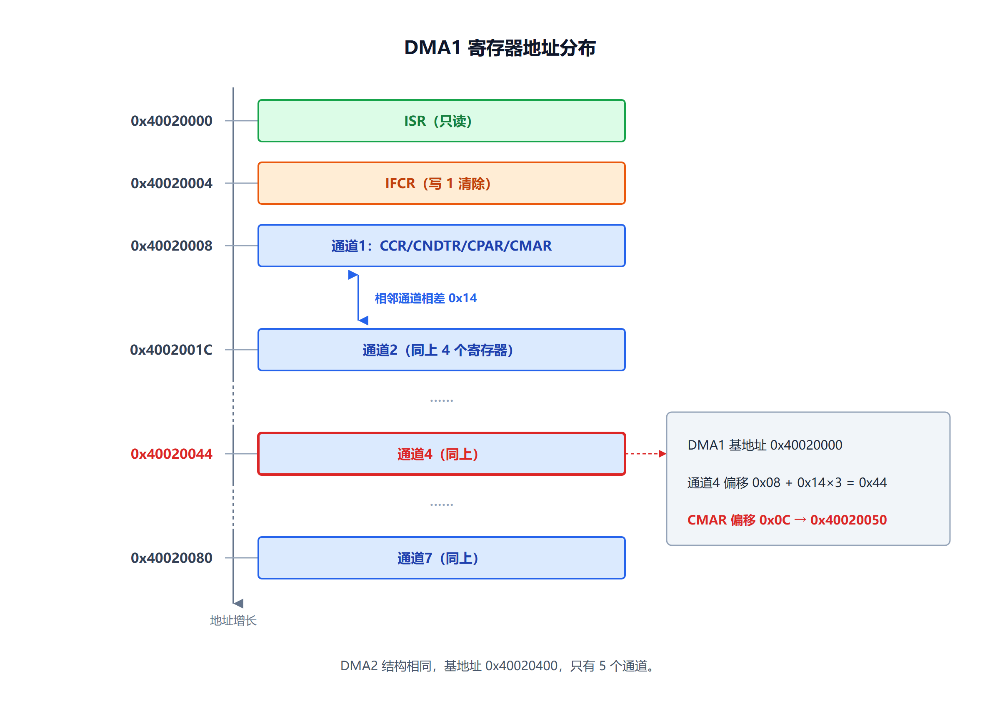

看图时按这个顺序：

1. **画一条竖直的"地址刻度尺"**，从 0x40020000 到 0x40020090，刻度间距标 0x04。
2. **尺子左边贴方块**：
   - 在 0x40020000 位置贴一个绿色方块，写 `ISR（只读）`；
   - 在 0x40020004 位置贴一个橙色方块，写 `IFCR（写 1 清除）`；
   - 从 0x40020008 开始，画 7 个"通道条"，每个通道条占 0x14 宽度，条内从上到下分 4 小格：`CCR / CNDTR / CPAR / CMAR`。
3. **每个通道条左边标**：`通道1 基址 0x40020008`、`通道2 基址 0x4002001C`、`通道3 基址 0x40020030`、`通道4 基址 0x40020044`、`通道5 基址 0x40020058`、`通道6 基址 0x4002006C`、`通道7 基址 0x40020080`。
4. **在通道 4 的 CMAR 格子上用红色高亮**，并画一条引出线到右侧写 `0x40020050`，再画一个"计算过程"小框：
   `0x40020000 + 0x08 + 0x14×3 + 0x0C = 0x40020050`。
5. **尺子右侧画一个大括号**，把 7 个通道条括起来，写"相邻通道相差 0x14"。
6. **最下面一行小字**："DMA2 的结构完全相同，只是基地址换成 0x40020400，且只有 5 个通道。"
7. **配色**：ISR 绿 #16A34A，IFCR 橙 #EA580C，通道条浅蓝 #DBEAFE 边框 #2563EB，高亮红 #DC2626。

#### 【辅助理解图】DMA 传输的三个核心寄存器

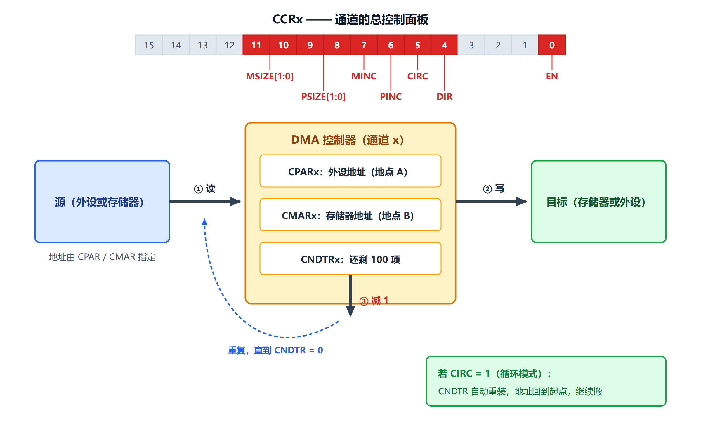

看图时按这个顺序：

1. **画面左侧画一个"源"方框**，写"源（外设或存储器）"，方框下方标一行地址 `CPAR/CMAR`。
2. **画面右侧画一个"目标"方框**，写"目标（存储器或外设）"。
3. **中间画一个大方框**，标题"DMA 控制器（通道 x）"，里面从上到下三个小方框：
   - `CPARx：外设地址（地点A）`；
   - `CMARx：存储器地址（地点B）`；
   - `CNDTRx：还剩 100 项`。
4. **在中间方框的左边画一个"指挥台"小图**：一个 16 格的位条代表 `CCRx`，其中 bit4（DIR）、bit5（CIRC）、bit6（PINC）、bit7（MINC）、bit8-9（PSIZE）、bit10-11（MSIZE）、bit0（EN）用红色高亮，旁边标注这些位名。
5. **用箭头画出一次搬运**：从源 → 中间方框（标"①读"）→ 目标（标"②写"），再从中间方框的 CNDTR 画一个向下的箭头，标"③减 1"。
6. **画一个回环箭头**，从"③减 1"绕回"①读"，旁边写"重复，直到 CNDTR = 0"。
7. **右下角画一个小方框**，写"若 CIRC=1：CNDTR 自动重装，地址回到起点，继续"。
8. **配色**：源蓝 #DBEAFE，目标绿 #DCFCE7，DMA 内部浅黄 #FEF3C7，CCRx 位条灰底红高亮，箭头 #334155。

---

### 本节真正要记住什么（11.3）

1. **地址链**：`DMA1 基地址 0x40020000` + `通道偏移 0x08+0x14×(x−1)` + `寄存器偏移`。
   通道内 4 个寄存器偏移依次是 `CCR 0x00`、`CNDTR 0x04`、`CPAR 0x08`、`CMAR 0x0C`。
2. **`ISR` 只读，`IFCR` 只写且"写 1 清除"**。`GIFx = TEIFx | HTIFx | TCIFx`。写 `CGIFx=1` 会一次清 4 个标志。
3. **`CCR` 是全章核心**，位序必须背：`MEM2MEM / PL / MSIZE / PSIZE / MINC / PINC / CIRC / DIR / TEIE / HTIE / TCIE / EN`。
4. **`CNDTR` 记的是"项数"不是"字节数"**，且 **`CNDTR=0` 时什么也不搬**。
5. **`CPAR` 和 `CMAR` 在 `EN=1` 后不能写**，而且**读出来永远是初始值**（不是当前正在搬的地址）。

---

## 11.4 DMA 的固件库函数

### 先搞清楚：为什么要有"固件库"？

如果你直接用 11.3 讲的寄存器来写程序，会是这样：

```c
DMA1_Channel1->CCR   = 0x00002521;     // 要自己算这个数
DMA1_Channel1->CNDTR = 1;
DMA1_Channel1->CPAR  = 0x4001244C;
DMA1_Channel1->CMAR  = 0x20000000;
```

**问题在哪？**

1. **`0x00002521` 这个数你要自己一位一位算**，算错了很难查；
2. **可读性极差**：半年后你自己看这行代码，根本不知道它是什么意思；
3. **容易写错**：比如把 `PSIZE` 和 `MSIZE` 搞反了，代码照样编译通过，但运行时结果不对。

**固件库（Firmware Library）就是来解决这个问题的。**

> **固件库 = 厂家（ST 公司）预先写好的一堆 C 语言函数。你调用这些函数、填一些有意义的名字（比如 `DMA_Mode_Circular`），库函数内部再帮你把对应的寄存器位算好、写进去。**

**类比**：

| 方式 | 类比 |
|---|---|
| 直接操作寄存器 | 自己动手拧每一颗螺丝 |
| 用固件库 | 用电动螺丝刀，按一下就行 |

**⚠️ 但是要记住**：**固件库只是"帮你算寄存器"的工具，它没有魔法。** 你调用 `DMA_Init()`，它做的事情仍然是往 `CCR`、`CNDTR`、`CPAR`、`CMAR` 里写数。所以**理解寄存器仍然是根本**，库函数只是让你写得快、写得对。

---

### 11.4.1 DMA 寄存器的 C 语言结构定义

【教材内容】

> DMA 控制器提供 7 个数据通道的访问。由于外设实现了存储器的映射，因此对来自或者发向外设的数据传输，也可以像内存之间的数据传输一样管理。

**先解决一个会让人卡住的数字：这里说的"7 个数据通道"，到底是 7 还是 12？**

教材这一句里的"7 个数据通道"，指的是 **DMA1 这一个控制器**（DMA1 有 7 个通道）。而整颗 STM32F103VET6 一共有 **12 个通道 = DMA1 的 7 个 + DMA2 的 5 个**（见 11.1 特征（1））。两个数字都没错，只是**范围不同**：

| 说法 | 范围 | 通道数 |
|---|---|---|
| "7 个数据通道"（本节教材原话） | 只算 DMA1 | 7 |
| "12 个通道"（11.1 讲的） | DMA1 + DMA2 一起 | 7 + 5 = 12 |

**为什么这一节（11.4 固件库函数）只提 7 个？** 因为接下来要看的 C 语言结构体和库函数，命名就是按 DMA1 的 7 个通道来的：`DMA1_Channel1` ~ `DMA1_Channel7`。DMA2 只有 5 个通道，所以 `DMA2_Channel6` / `DMA2_Channel7` 这两个名字**根本不存在**（教材 11.3 开头也说过："所有与通道 6 和通道 7 相关的位，对 DMA2 都不适用"）。用 DMA2 的时候，把 `DMA1_Channelx` 换成 `DMA2_Channel1` ~ `DMA2_Channel5` 就行，函数用法完全一样。

**这句话在说什么？**

> **"外设实现了存储器的映射"** = 外设的寄存器也被安排进了 CPU 的地址空间里，每个寄存器都有一个地址。
> **所以"往外设写数据"和"往内存写数据"，在 DMA 看来是一回事** —— 都是"往某个地址写数据"。

这就是为什么 DMA 只需要两个地址寄存器（`CPAR` 和 `CMAR`）就能同时搞定"内存⇄外设"和"内存⇄内存"：**因为对 DMA 来说，它们都是地址。**

#### 结构定义（教材 p180~p181）

```c
typedef struct
{
    vu32 CCR;      // DMA 设置寄存器
    vu32 CNDTR;    // DMA 待传输数据数目寄存器
    vu32 CPAR;     // DMA 外设地址寄存器
    vu32 CMAR;     // DMA 内存地址寄存器
} DMA_Channel_TypeDef;

typedef struct
{
    vu32 ISR;      // 为 DMA 中断状态寄存器
    vu32 IFCR;     // 为 DMA 中断标志位清除寄存器
} DMA_TypeDef;
```

> ⚠️ **OCR 疑点**：教材 11.4.1 正文写成"DMA 寄存器 `DMA_Cannel_TypeDef` 和 `DMA_TypeDef` 的结构"，其中 `DMA_Cannel_TypeDef` 少了一个字母 `h`，应为 `DMA_Channel_TypeDef`（下面代码块里写的就是正确的）。已记入"待核验"。

#### 【补充解释】这几行 C 语言代码到底在干什么？

这段代码看起来很"技术"，但它的思想其实很简单。我们一层一层剥开。

##### 先看 `vu32` 是什么

**`vu32` 是 ST 公司自己起的一个"外号"**（用 `typedef` 定义的），它的真实身份是：

```
vu32  =  volatile uint32_t
        │           │
        │           └─ 32 位无符号整数（unsigned int 32 bits）
        └─ volatile 关键字（易变的、不可优化的）
```

**为什么要加 `volatile`？**

这是本章（也是整个 STM32 编程）**最重要的一个关键字**。用大白话解释：

> **编译器很聪明，它会"优化"你的代码。比如你连续读同一个变量两次，编译器可能觉得"第二次读的值肯定和第一次一样"，于是直接把第一次的结果拿来用，省掉第二次读。**
> **但是对于硬件寄存器，这个"聪明"是致命的！因为寄存器里的值随时可能被硬件改变。你读两次 `ISR`，两次的结果完全可能不一样。**

`volatile` 的作用就是告诉编译器：

> **"这个变量你别乱优化，每次用到它都必须老老实实去内存/寄存器里重新读一遍。"**

**类比**：`volatile` 就像给变量贴了一张标签："**此处有监控，数值随时会变，请每次实地查看**"。

**没有 `volatile` 会发生什么？** 举个真实的例子：

```c
// ❌ 如果 ISR 没有被声明为 volatile
while (DMA1->ISR == 0) { }    // 想等标志位置 1

// 编译器可能优化成：
if (DMA1->ISR == 0) {         // 只读一次
    while (1) { }             // 然后死循环！因为"它认为"ISR 永远是 0
}
```

**程序就卡死了。** 加上 `volatile` 之后，编译器每次循环都会真的去读一次，就能读到硬件更新后的值。

（第 5 章讲固件库时应该提过 `volatile`，这里是它在 DMA 里的典型用途。**考试如果问"为什么访问寄存器要用 volatile"，答"因为寄存器的值可能被硬件随时改变，需要禁止编译器优化，保证每次访问都真正读写硬件"就对了。**）

##### 再看 `struct`（结构体）是什么

**大白话**：

> **结构体 = 把好几个不同类型的变量"打包"成一个整体，给这个整体起个名字。**

比如：

```c
struct 学生 {
    int   学号;
    char  姓名[20];
    float 成绩;
};
```

一个"学生"里包含学号、姓名、成绩三样东西。

**关键点：结构体在内存里是"按顺序紧挨着排的"。**

```
+--------+--------------------+--------+
|  学号  |        姓名        |  成绩  |
| 4 字节 |      20 字节       | 4 字节 |
+--------+--------------------+--------+
 ↑                    ↑                    ↑
 偏移0                偏移4               偏移24
```

**现在看 `DMA_Channel_TypeDef`：**

```c
typedef struct
{
    vu32 CCR;      // 偏移 0x00
    vu32 CNDTR;    // 偏移 0x04
    vu32 CPAR;     // 偏移 0x08
    vu32 CMAR;     // 偏移 0x0C
} DMA_Channel_TypeDef;
```

**这个顺序不是随便排的！它和 11.3.7 讲的"通道内寄存器偏移"完全一致：**

```
CCR   → 偏移 0x00  ✓
CNDTR → 偏移 0x04  ✓
CPAR  → 偏移 0x08  ✓
CMAR  → 偏移 0x0C  ✓
```

**这就是整个固件库最巧妙的设计**：

> **C 语言结构体的"成员在内存里紧挨着排"这个特性，刚好和"硬件寄存器在地址空间里紧挨着排"对应上了。**
> **所以只要把结构体的首地址设为通道的基地址，那么 `->CCR`、`->CNDTR`、`->CPAR`、`->CMAR` 就自动指向正确的寄存器地址！**

**类比**：结构体就像一个"**表单模板**"。模板上印好了"第一行填 CCR，第二行填 CNDTR……"。你把这张模板"贴"到某个地址上（通道基地址），模板上的每一行就自动对应到那一片地址里的一个寄存器。

`DMA_TypeDef` 也一样：

```c
typedef struct
{
    vu32 ISR;      // 偏移 0x00  ✓
    vu32 IFCR;     // 偏移 0x04  ✓
} DMA_TypeDef;
```

#### DMA 及 7 个通道的地址宏（教材 p181）

```c
#define PERIPH_BASE          ((u32)0x40000000)
#define APB1PERIPH_BASE      PERIPH_BASE
#define APB2PERIPH_BASE      (PERIPH_BASE + 0x10000)
#define AHBPERIPH_BASE       (PERIPH_BASE + 0x20000)

#define DMA1_BASE            (AHBPERIPH_BASE + 0x0000)
#define DMA1_Channel1_BASE   (AHBPERIPH_BASE + 0x0008)
#define DMA1_Channel2_BASE   (AHBPERIPH_BASE + 0x001C)
#define DMA1_Channel3_BASE   (AHBPERIPH_BASE + 0x0030)
#define DMA1_Channel4_BASE   (AHBPERIPH_BASE + 0x0044)
#define DMA1_Channel5_BASE   (AHBPERIPH_BASE + 0x0058)
#define DMA1_Channel6_BASE   (AHBPERIPH_BASE + 0x006C)
#define DMA1_Channel7_BASE   (AHBPERIPH_BASE + 0x0080)
#define DMA2_BASE            (AHBPERIPH_BASE + 0x0400)
#define DMA2_Channel1_BASE   (AHBPERIPH_BASE + 0x0408)
#define DMA2_Channel2_BASE   (AHBPERIPH_BASE + 0x041C)
#define DMA2_Channel3_BASE   (AHBPERIPH_BASE + 0x0430)
#define DMA2_Channel4_BASE   (AHBPERIPH_BASE + 0x0444)
#define DMA2_Channel5_BASE   (AHBPERIPH_BASE + 0x0458)

#define DMA1            ((DMA_TypeDef *) DMA1_BASE)
#define DMA2            ((DMA_TypeDef *) DMA2_BASE)
#define DMA1_Channel1   ((DMA_Channel_TypeDef *) DMA1_Channel1_BASE)
#define DMA1_Channel2   ((DMA_Channel_TypeDef *) DMA1_Channel2_BASE)
#define DMA1_Channel3   ((DMA_Channel_TypeDef *) DMA1_Channel3_BASE)
#define DMA1_Channel4   ((DMA_Channel_TypeDef *) DMA1_Channel4_BASE)
#define DMA1_Channel5   ((DMA_Channel_TypeDef *) DMA1_Channel5_BASE)
#define DMA1_Channel6   ((DMA_Channel_TypeDef *) DMA1_Channel6_BASE)
#define DMA1_Channel7   ((DMA_Channel_TypeDef *) DMA1_Channel7_BASE)
#define DMA2_Channel1   ((DMA_Channel_TypeDef *) DMA2_Channel1_BASE)
#define DMA2_Channel2   ((DMA_Channel_TypeDef *) DMA2_Channel2_BASE)
#define DMA2_Channel3   ((DMA_Channel_TypeDef *) DMA2_Channel3_BASE)
#define DMA2_Channel4   ((DMA_Channel_TypeDef *) DMA2_Channel4_BASE)
#define DMA2_Channel5   ((DMA_Channel_TypeDef *) DMA2_Channel5_BASE)
```

> ⚠️ **OCR 疑点**：教材中 DMA2 的 5 个通道宏写成 `AHBPERIPH + 0x0408` 等，漏掉了 `_BASE`（应写作 `AHBPERIPH_BASE + 0x0408`）。从上下文看显然如此。已记入"待核验"。

#### 把地址宏一层层展开（不要怕，就是加法）

**先看基地址的"三级跳"**：

```
PERIPH_BASE      = 0x40000000          ← 片上外设区的总起点
        │
        ├── APB1PERIPH_BASE = PERIPH_BASE              = 0x40000000
        ├── APB2PERIPH_BASE = PERIPH_BASE + 0x10000    = 0x40010000
        └── AHBPERIPH_BASE  = PERIPH_BASE + 0x20000    = 0x40020000
```

**算一下**：

```
0x40000000 + 0x10000 = 0x40010000   ✓
0x40000000 + 0x20000 = 0x40020000   ✓
```

**再看 DMA1**：

```
DMA1_BASE = AHBPERIPH_BASE + 0x0000 = 0x40020000 + 0x0000 = 0x40020000
```

**和 11.3 讲的"DMA1 基地址 0x40020000"对上了** ✓

**再看 DMA1 通道 4**：

```
DMA1_Channel4_BASE = AHBPERIPH_BASE + 0x0044 = 0x40020000 + 0x0044 = 0x40020044
```

**和 11.3.7 算出来的"通道 4 基址 0x40020044"对上了** ✓

**再看 DMA2**：

```
DMA2_BASE = AHBPERIPH_BASE + 0x0400 = 0x40020000 + 0x0400 = 0x40020400
```

**和 11.3 讲的"DMA2 基地址 0x40020400"对上了** ✓

#### 最后那 13 行 `#define` 是什么？—— 指针强制类型转换

看这一行：

```c
#define DMA1_Channel1   ((DMA_Channel_TypeDef *) DMA1_Channel1_BASE)
```

**这一行在做什么？**

```
(DMA_Channel_TypeDef *) DMA1_Channel1_BASE
        ↑                        ↑
   强制类型转换              一个整数 0x40020008
```

**大白话**：

> **`DMA1_Channel1_BASE` 是一个"整数"（0x40020008）。整数本身只是一个数，不能"点"出成员来。**
> **`(DMA_Channel_TypeDef *)` 是告诉编译器："请把这个整数当成一个结构体指针看待。"**
> **转换之后，`DMA1_Channel1` 就变成了一个"指向 DMA1 通道 1 寄存器区"的指针。**

**所以下面这行代码**：

```c
DMA1_Channel1->CCR = 0x00002520;
```

**编译器实际算的是**：

```
DMA1_Channel1->CCR
= (DMA1_Channel1 指向的地址) + CCR 在结构体里的偏移
= 0x40020008 + 0x00
= 0x40020008          ← 就是 CCR1 的地址！

DMA1_Channel1->CMAR = ...
= 0x40020008 + 0x0C
= 0x40020014          ← 就是 CMAR1 的地址！
```

**和 11.3 算出来的完全一致** ✓

**这就是"结构体 + 指针"的威力**：

> **你只要写 `DMA1_Channel4->CMAR`，编译器就自动帮你算出 0x40020050，不用你自己做加法。**
> **"结构体指针 + 成员名" 就是"基地址 + 偏移"的 C 语言写法。**

**（顺带解释 `->` 符号）**：

- `结构体变量.成员名` —— 用于"变量本身"；
- `结构体指针->成员名` —— 用于"指针"。`p->x` 完全等价于 `(*p).x`。

**类比**：`DMA1_Channel1` 是"**通道 1 的登记表**"，`->CCR` 是"翻到 CCR 那一页"，`->CMAR` 是"翻到 CMAR 那一页"。

---

### 11.4.2 DMA 库函数

教材一共介绍了 **10 个** DMA 库函数。我们按"**配置类 → 控制类 → 查询类**"三组来学，这样更好记。

#### 【辅助理解图】10 个库函数的分类

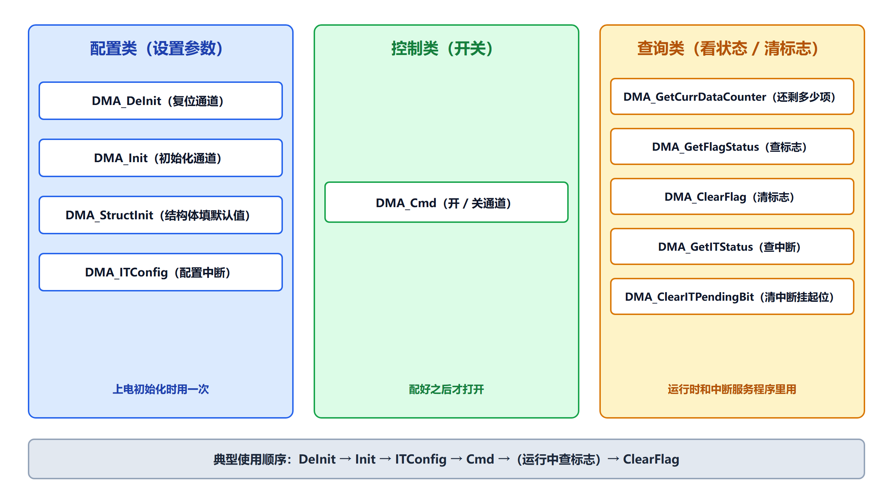

看图时按这个顺序：

1. **画面分三列**，从左到右三张卡片，标题分别是"**配置类（设置参数）**"、"**控制类（开关）**"、"**查询类（看状态/清标志）**"。
2. **左卡片**（浅蓝底）里从上到下四个小框：`DMA_DeInit（复位通道）`、`DMA_Init（初始化通道）`、`DMA_StructInit（结构体填默认值）`、`DMA_ITConfig（配置中断）`。
3. **中卡片**（浅绿底）里一个框：`DMA_Cmd（开/关通道）`。
4. **右卡片**（浅黄底）里从上到下五个小框：`DMA_GetCurrDataCounter（还剩多少项）`、`DMA_GetFlagStatus（查标志）`、`DMA_ClearFlag（清标志）`、`DMA_GetITStatus（查中断）`、`DMA_ClearITPendingBit（清中断挂起位）`。
5. **每张卡片下面写一句用法提示**：左卡片写"上电初始化时用一次"；中卡片写"配好之后才打开"；右卡片写"运行时和中断服务程序里用"。
6. **最下面一条横幅**写："一个典型的 DMA 使用顺序：DeInit → Init → ITConfig → Cmd →（运行中查标志）→ ClearFlag"。
7. **配色**：配置类 #DBEAFE/#2563EB，控制类 #DCFCE7/#16A34A，查询类 #FEF3C7/#D97706。

---

#### 第 1 组：配置类

---

##### 1. 函数 `DMA_DeInit` —— 把通道恢复成"出厂状态"

**函数原型**：

```c
void DMA_DeInit(DMA_Channel_TypeDef* DMAy_Channelx)
```

**功能描述**（教材原文）：将 DMAy 的通道 x 寄存器**重设为默认值**。

**输入参数**：`DMAy_Channelx`，y 可以是 1 或者 2，x 可以是 1,2,…,7，用来选择 DMAy 通道 x。

**大白话**：

> **把某个通道的所有寄存器（`CCR`、`CNDTR`、`CPAR`、`CMAR`）全部清成 0（复位值），让它回到"刚上电时"的状态。**

**为什么要先复位？**

因为你的程序可能不是第一个用这个通道的（比如前面某段代码用过，或者调试时残留了状态）。**先复位，保证从干净的状态开始**，避免"上次的配置"影响这次。

**类比**：用白板之前先擦干净，别让上次的字迹干扰。

**示例**：

```c
DMA_DeInit(DMA1_Channel2);   // 初始化（复位）DMA1 通道 2
```

**硬件发生什么**：`CCR2`、`CNDTR2`、`CPAR2`、`CMAR2` 全部变成 0。通道被关闭（`EN=0`）。

---

##### 2. 函数 `DMA_Init` —— 一次性把通道配置好（**最常用**）

**函数原型**：

```c
void DMA_Init(DMA_Channel_TypeDef* DMAy_Channelx, DMA_InitTypeDef* DMA_InitStruct)
```

**功能描述**：根据 `DMA_InitStruct` 中指定的参数初始化 DMA 的通道 x 寄存器。

**输入参数 1**：`DMAy_Channelx`，选哪个通道。
**输入参数 2**：`DMA_InitStruct`，指向 `DMA_InitTypeDef` 结构的指针，里面装着这个通道的全部配置信息。

**大白话**：

> **你先填好一张"配置表"（结构体），然后把这个表交给 `DMA_Init()`，它帮你把表里的每一项翻译成对应的寄存器位，写进 `CCR`、`CNDTR`、`CPAR`、`CMAR`。**

**⚠️ 注意**：`DMA_Init()` **不会**把 `EN` 置 1。它只配置，不启动。启动要用 `DMA_Cmd()`。

---

###### `DMA_InitTypeDef` 结构体的 11 个成员（教材 p182）

```c
typedef struct
{
    u32 DMA_PeripheralBaseAddr;    // 外设基地址
    u32 DMA_MemoryBaseAddr;        // 存储器基地址
    u32 DMA_DIR;                   // 数据传输方向
    u32 DMA_BufferSize;            // 缓冲区大小（要搬多少项）
    u32 DMA_PeripheralInc;         // 外设地址是否递增
    u32 DMA_MemoryInc;             // 存储器地址是否递增
    u32 DMA_PeripheralDataSize;    // 外设数据宽度
    u32 DMA_MemoryDataSize;        // 存储器数据宽度
    u32 DMA_Mode;                  // 工作模式
    u32 DMA_Priority;              // 优先级
    u32 DMA_M2M;                   // 是否存储器到存储器
} DMA_InitTypeDef;
```

**这 11 个成员和 11.3 的寄存器位是怎么对应的？**（这是理解库函数的关键）

| 结构体成员 | 写进哪个寄存器的哪个字段 | 大白话 |
|---|---|---|
| `DMA_PeripheralBaseAddr` | `CPAR[31:0]` | 外设那一头的地址 |
| `DMA_MemoryBaseAddr` | `CMAR[31:0]` | 存储器那一头的地址 |
| `DMA_DIR` | `CCR` 的 `DIR`（bit4） | 谁是源 |
| `DMA_BufferSize` | `CNDTR[15:0]` | 要搬多少项 |
| `DMA_PeripheralInc` | `CCR` 的 `PINC`（bit6） | 外设地址要不要走 |
| `DMA_MemoryInc` | `CCR` 的 `MINC`（bit7） | 存储器地址要不要走 |
| `DMA_PeripheralDataSize` | `CCR` 的 `PSIZE[1:0]`（bit9:8） | 外设数据宽度 |
| `DMA_MemoryDataSize` | `CCR` 的 `MSIZE[1:0]`（bit11:10） | 存储器数据宽度 |
| `DMA_Mode` | `CCR` 的 `CIRC`（bit5） | 正常还是循环 |
| `DMA_Priority` | `CCR` 的 `PL[1:0]`（bit13:12） | 优先级 |
| `DMA_M2M` | `CCR` 的 `MEM2MEM`（bit14） | 是不是内存到内存 |

**看出来了吗？** `DMA_Init()` 干的就是"**把 11 个成员翻译成寄存器位，然后写进去**"。没有任何魔法。

---

###### 11 个成员的可取值（教材原文整理）

**【教材内容】`DMA_PeripheralBaseAddr`**：定义 DMA 外设基地址。（填一个地址，如 `0x4001244C`）

**【教材内容】`DMA_MemoryBaseAddr`**：定义 DMA 存储器基地址。（填一个地址，如 `0x20000000`）

**【教材内容】`DMA_DIR`**：规定了外设是作为数据传输的目的地还是来源，可取的值为：

| 取值 | 含义 | 对应 `DIR` 位 |
|---|---|---|
| `DMA_DIR_PeripheralDST` | 外设作为数据传输的**目的地** | `DIR = 1` |
| `DMA_DIR_PeripheralSRC` | 外设作为数据传输的**来源** | `DIR = 0` |

**【教材内容】`DMA_BufferSize`**：定义指定 DMA 通道的 DMA 缓存大小，**单位为数据单位**。根据传输方向，数据单位等于结构中参数 `DMA_PeripheralDataSize` 或者参数 `DMA_MemoryDataSize` 的值。

> **这句话非常重要！** 它印证了 11.3.4 讲的"`CNDTR` 记的是项数不是字节数"。
> **到底用哪个宽度来算？答案是"看谁是源"**：如果外设是源（`DIR=0`），那"一项"就是 `PSIZE` 那么大；如果存储器是源（`DIR=1`），那"一项"就是 `MSIZE` 那么大。
> **通俗理解**：一次搬运搬多少字节，取决于"从哪一头读"——读的那一头有多大，这一项就有多大。

**【教材内容】`DMA_PeripheralInc`**：设定外设地址寄存器递增与否：

| 取值 | 含义 | 对应 `PINC` |
|---|---|---|
| `DMA_PeripheralInc_Enable` | 外设地址寄存器**递增** | `PINC = 1` |
| `DMA_PeripheralInc_Disable` | 外设地址寄存器**不变** | `PINC = 0` |

**【教材内容】`DMA_MemoryInc`**：设定内存地址寄存器递增与否：

| 取值 | 含义 | 对应 `MINC` |
|---|---|---|
| `DMA_MemoryInc_Enable` | 内存地址寄存器**递增** | `MINC = 1` |
| `DMA_MemoryInc_Disable` | 内存地址寄存器**不变** | `MINC = 0` |

**【教材内容】`DMA_PeripheralDataSize`**：设定外设数据宽度：

| 取值 | 宽度 | `PSIZE[1:0]` |
|---|---|---|
| `DMA_PeripheralDataSize_Byte` | 8 位 | `00` |
| `DMA_PeripheralDataSize_HalfWord` | 16 位 | `01` |
| `DMA_PeripheralDataSize_Word` | 32 位 | `10` |

**【教材内容】`DMA_MemoryDataSize`**：设定存储器数据宽度：

| 取值 | 宽度 | `MSIZE[1:0]` |
|---|---|---|
| `DMA_MemoryDataSize_Byte` | 8 位 | `00` |
| `DMA_MemoryDataSize_HalfWord` | 16 位 | `01` |
| `DMA_MemoryDataSize_Word` | 32 位 | `10` |

**【教材内容】`DMA_Mode`**：设置 DMA 的工作模式：

| 取值 | 含义 | `CIRC` |
|---|---|---|
| `DMA_Mode_Circular` | 工作在**循环**缓存模式 | `CIRC = 1` |
| `DMA_Mode_Normal` | 工作在**正常**缓存模式 | `CIRC = 0` |

> **【教材内容】注意**：当指定 DMA 通道数据传输配置为**存储器到存储器**时，**不能使用循环缓存模式**。

**【教材内容】`DMA_Priority`**：设定 DMA 通道 x 的软件优先级：

| 取值 | 含义 | `PL[1:0]` |
|---|---|---|
| `DMA_Priority_VeryHigh` | 非常高优先级 | `11` |
| `DMA_Priority_High` | 高优先级 | `10` |
| `DMA_Priority_Medium` | 中优先级 | `01` |
| `DMA_Priority_Low` | 低优先级 | `00` |

**【教材内容】`DMA_M2M`**：使能 DMA 通道的存储器到存储器传输：

| 取值 | 含义 | `MEM2MEM` |
|---|---|---|
| `DMA_M2M_Enable` | 设置为存储器到存储器传输 | `1` |
| `DMA_M2M_Disable` | 没有设置为存储器到存储器传输 | `0` |

---

###### 一个典型的 DMA 初始化实例代码（教材 p183）

```c
DMA_InitTypeDef DMA_InitStructure;
DMA_InitStructure.DMA_PeripheralBaseAddr = 0x40005400;
DMA_InitStructure.DMA_MemoryBaseAddr     = 0x20000100;
DMA_InitStructure.DMA_DIR                = DMA_DIR_PeripheralSRC;
DMA_InitStructure.DMA_BufferSize         = 256;
DMA_InitStructure.DMA_PeripheralInc      = DMA_PeripheralInc_Disable;
DMA_InitStructure.DMA_MemoryInc          = DMA_MemoryInc_Enable;
DMA_InitStructure.DMA_PeripheralDataSize = DMA_PeripheralDataSize_HalfWord;
DMA_InitStructure.DMA_MemoryDataSize     = DMA_MemoryDataSize_HalfWord;
DMA_InitStructure.DMA_Mode               = DMA_Mode_Normal;
DMA_InitStructure.DMA_Priority           = DMA_Priority_Medium;
DMA_InitStructure.DMA_M2M                = DMA_M2M_Disable;
DMA_Init(DMA1_Channel1, &DMA_InitStructure);
```

**逐行解释**：

| 行 | 代码 | 大白话 | 对应寄存器 |
|---|---|---|---|
| 1 | `DMA_InitTypeDef DMA_InitStructure;` | 声明一个"配置表"变量 | — |
| 2 | `...PeripheralBaseAddr = 0x40005400;` | 外设那一头的地址填 0x40005400 | `CPAR = 0x40005400` |
| 3 | `...MemoryBaseAddr = 0x20000100;` | 内存那一头的地址填 0x20000100（在 SRAM 里） | `CMAR = 0x20000100` |
| 4 | `...DIR = DMA_DIR_PeripheralSRC;` | 外设是**源**（数据从外设流到内存） | `DIR = 0` |
| 5 | `...BufferSize = 256;` | 要搬 **256 项** | `CNDTR = 256` |
| 6 | `...PeripheralInc = Disable;` | 外设地址**不动** | `PINC = 0` |
| 7 | `...MemoryInc = Enable;` | 内存地址**要走** | `MINC = 1` |
| 8 | `...PeripheralDataSize = HalfWord;` | 外设那一头每次搬 16 位 | `PSIZE = 01` |
| 9 | `...MemoryDataSize = HalfWord;` | 内存那一头每次搬 16 位 | `MSIZE = 01` |
| 10 | `...Mode = Normal;` | 正常模式（搬完就停） | `CIRC = 0` |
| 11 | `...Priority = Medium;` | 中优先级 | `PL = 01` |
| 12 | `...M2M = Disable;` | 不是内存到内存 | `MEM2MEM = 0` |
| 13 | `DMA_Init(DMA1_Channel1, &DMA_InitStructure);` | **把上面这张表写进通道 1 的寄存器** | 写 `CCR/CNDTR/CPAR/CMAR` |

**注意第 13 行的 `&` 符号**：

> `&DMA_InitStructure` 是"**取这个变量的地址**"，因为 `DMA_Init()` 的第二个参数要的是一个**指针**。
> 这叫"**按地址传递**"：`DMA_Init()` 拿到地址后，就能直接读你填好的那张表了。

**这个例子的实际含义**：从地址 0x40005400 的外设读 256 个 16 位数据，存到 0x20000100 开始的内存里。

> ⚠️ **待核验**：教材没有说明 `0x40005400` 具体是哪个外设。按 STM32F103 的存储器映射，`0x40005400` 是 **I2C1** 的基地址（APB1 上）。但 I2C1 的 DMA 请求在 DMA1 的**通道 6 和通道 7**（见表 11-2），而这段示例代码用的是 `DMA1_Channel1`（服务 ADC1/TIM2_CH3/TIM4_CH1）。所以这段代码应当理解为**"只演示怎么写参数的模板"**，并不是一个可以直接运行的完整例子。已记入"待核验"。

---

##### 3. 函数 `DMA_StructInit` —— 把结构体填成默认值

**函数原型**：

```c
void DMA_StructInit(DMA_InitTypeDef* DMA_InitStruct)
```

**功能描述**：把 `DMA_InitStructure` 中的每一个参数按**默认值**填入。

**输入参数**：`DMA_InitStruct`，指向待初始化的结构 `DMA_InitTypeDef` 的指针。

**大白话**：

> **给你一个"空白表格"，每个格子都填好了默认值。你只需要改你要改的那几项。**

**为什么需要它？**

因为 `DMA_InitTypeDef` 有 11 个成员。如果你只填了 8 个，剩下 3 个就是**内存里的随机值**（C 语言里局部变量不初始化就是垃圾值），那 `DMA_Init()` 就会把垃圾值写进寄存器，后果不可预料。

**用 `DMA_StructInit()` 先把 11 个都填上安全的默认值，再改你要改的**，就不会有这个风险。

**类比**：填表前先拿一张"每格都已印好默认答案"的表格，比拿一张白纸安全得多。

**默认值表**（教材原文）：

| 成员 | 默认值 |
|---|---|
| `DMA_PeripheralBaseAddr` | 0 |
| `DMA_MemoryBaseAddr` | 0 |
| `DMA_DIR` | `DMA_DIR_PeripheralSRC` |
| `DMA_BufferSize` | 0 |
| `DMA_PeripheralInc` | `DMA_PeripheralInc_Disable` |
| `DMA_MemoryInc` | `DMA_MemoryInc_Disable` |
| `DMA_PeripheralDataSize` | `DMA_PeripheralDataSize_Byte` |
| `DMA_MemoryDataSize` | `DMA_MemoryDataSize_Byte` |
| `DMA_Mode` | `DMA_Mode_Normal` |
| `DMA_Priority` | `DMA_Priority_Low` |
| `DMA_M2M` | `DMA_M2M_Disable` |

**⚠️ 注意默认值里的两个"坑"**：

1. `DMA_BufferSize` 默认是 **0** → 按 11.3.4 讲的，**0 项 = 什么也不搬**。所以你必须自己设一个非 0 值。
2. `DMA_MemoryInc` 默认是 `Disable` → 地址不动。如果你想存数组，**必须自己改成 `Enable`**。

**示例**：

```c
DMA_InitTypeDef DMA_InitStructure;
DMA_StructInit(&DMA_InitStructure);    // 先把 11 个成员填上默认值
```

---

##### 4. 函数 `DMA_ITConfig` —— 配置中断

**函数原型**：

```c
void DMA_ITConfig(DMA_Channel_TypeDef* DMAy_Channelx, uint32_t DMA_IT, FunctionalState NewState)
```

**功能描述**：使能或者除能指定的通道 x 中断。

**输入参数 1**：`DMAy_Channelx`，选哪个通道。

**输入参数 2**：`DMA_IT`，待使能或者除能的 DMA 中断源。**使用操作符 `|` 可以同时选中多个 DMA 中断源**，可取值如下：

| 取值 | 含义 | 对应 `CCR` 位 |
|---|---|---|
| `DMA_IT_TC` | 传输完成中断 | `TCIE`（bit1） |
| `DMA_IT_HT` | 传输过半中断 | `HTIE`（bit2） |
| `DMA_IT_TE` | 传输错误中断 | `TEIE`（bit3） |

**输入参数 3**：`NewState`，可以取 `ENABLE` 或者 `DISABLE`。

**大白话**：

> **打开或关闭某个通道的某几种中断。**

**关于 `|` 操作符**：**同时打开多种中断时，用 `|` 把它们连起来**。

```c
// 只开"传输完成"中断
DMA_ITConfig(DMA1_Channel5, DMA_IT_TC, ENABLE);

// 同时开"传输完成"和"传输错误"两种中断
DMA_ITConfig(DMA1_Channel5, DMA_IT_TC | DMA_IT_TE, ENABLE);
```

**⚠️ 别忘了还有"总开关"**：

> `DMA_ITConfig()` 只是打开了 DMA 这一侧的"允许发中断"（即 `CCR` 里的 `TCIE` 等位）。
> **在 NVIC（第 7 章学的中断控制器）那边，还要再打开一次对应的中断通道**（用 `NVIC_Init()`），CPU 才真的会跳去执行中断服务程序。
> **两级开关都开，中断才会来。** 这是初学中断时最常见的"为什么我的中断不响应"的原因。

**示例**：

```c
DMA_ITConfig(DMA1_Channel5, DMA_IT_TC, ENABLE);   // 使能 DMA1 通道 5 的传输完成中断
```

---

#### 第 2 组：控制类

---

##### 5. 函数 `DMA_Cmd` —— 开关通道

**函数原型**：

```c
void DMA_Cmd(DMA_Channel_TypeDef* DMAy_Channelx, FunctionalState NewState)
```

**功能描述**：使能或者除能指定的通道 x。

**输入参数 1**：`DMAy_Channelx`，选哪个通道。
**输入参数 2**：`NewState`，可以取 `ENABLE` 或者 `DISABLE`。

**大白话**：

> **这就是那个"总开关"，直接控制 `CCR` 的 `EN` 位（bit0）。**

| `NewState` | `EN` 位 | 结果 |
|---|---|---|
| `ENABLE` | 1 | 通道启动，开始响应请求 |
| `DISABLE` | 0 | 通道关闭 |

**示例**：

```c
DMA_Cmd(DMA1_Channel7, ENABLE);    // 使能 DMA1 通道 7
```

**⚠️ 顺序提醒**：**`DMA_Cmd(..., ENABLE)` 一定要放在 `DMA_Init()` 之后**。因为 `EN=1` 后 `CPAR`/`CMAR`/`CNDTR` 就写不进去了。

---

#### 第 3 组：查询类

---

##### 6. 函数 `DMA_GetCurrDataCounter` —— 还剩多少项没搬

**函数原型**：

```c
u16 DMA_GetCurrDataCounter(DMA_Channel_TypeDef* DMAy_Channelx)
```

**功能描述**：返回当前 DMAy 通道 x **剩余的待传输数据数目**。

**输入参数**：`DMAy_Channelx`，选哪个通道。
**返回值**：当前剩余的待传输数据数目（一个 16 位数）。

**大白话**：

> **读 `CNDTR` 寄存器，告诉你"还剩几项没搬"。**

**示例**：

```c
u16 CurrDataCount;
CurrDataCount = DMA_GetCurrDataCounter(DMA1_Channel2);
// 获得当前 DMA1 通道 2 剩余的待传输数据数目
```

**⚠️ 返回值是 `u16`（16 位）**，因为 `CNDTR` 里只有低 16 位有用。

**怎么算"已经搬了多少"**：

```c
已经搬的项数 = 初始BufferSize - DMA_GetCurrDataCounter(DMA1_Channel2);
```

---

##### 7. 函数 `DMA_GetFlagStatus` —— 查标志位

**函数原型**：

```c
FlagStatus DMA_GetFlagStatus(uint32_t DMAy_FLAG)
```

**功能描述**：检查指定的 DMAy 通道 x 标志位设置与否。

**输入参数**：`DMAy_FLAG`，y 可以是 1 或者 2，待检查的 DMA 标志位。
**返回值**：`DMA_FLAG` 的新状态（`SET` 或者 `RESET`）。

**大白话**：

> **读 `ISR` 寄存器，看看某个标志是不是 1。**

**返回值只有两种**：

- `SET`：标志是 1（事件发生了）；
- `RESET`：标志是 0（事件没发生）。

**`DMAy_FLAG` 可以取的值**（教材原文，y=1 或 2）：

每个通道有 4 个标志：`GL`（全局）、`TC`（传输完成）、`HT`（传输过半）、`TE`（传输错误）。

| 通道 | 可取值 |
|---|---|
| 通道 1 | `DMAy_FLAG_GL1`、`DMAy_FLAG_TC1`、`DMAy_FLAG_HT1`、`DMAy_FLAG_TE1` |
| 通道 2 | `DMAy_FLAG_GL2`、`DMAy_FLAG_TC2`、`DMAy_FLAG_HT2`、`DMAy_FLAG_TE2` |
| 通道 3 | `DMAy_FLAG_GL3`、`DMAy_FLAG_TC3`、`DMAy_FLAG_HT3`、`DMAy_FLAG_TE3` |
| 通道 4 | `DMAy_FLAG_GL4`、`DMAy_FLAG_TC4`、`DMAy_FLAG_HT4`、`DMAy_FLAG_TE4` |
| 通道 5 | `DMAy_FLAG_GL5`、`DMAy_FLAG_TC5`、`DMAy_FLAG_HT5`、`DMAy_FLAG_TE5` |
| 通道 6 | `DMAy_FLAG_GL6`、`DMAy_FLAG_TC6`、`DMAy_FLAG_HT6`、`DMAy_FLAG_TE6` |
| 通道 7 | `DMAy_FLAG_GL7`、`DMAy_FLAG_TC7`、`DMAy_FLAG_HT7`、`DMAy_FLAG_TE7` |

**命名规律**：`DMAy_FLAG_` + **标志类型（GL/TC/HT/TE）** + **通道号**。

**⚠️ 注意顺序**：是"**类型在前、通道号在后**"，写反了编译不过。

**示例**：

```c
FlagStatus Status;
Status = DMA_GetFlagStatus(DMA1_FLAG_HT6);   // 检查 DMA1 通道 6 的传输过半标志是否置位
if (Status == SET) {
    // 通道 6 已经搬完一半了
}
```

**这些宏的数值是什么？**（用 11.3.1 的位图可以推出来）

| 宏 | 数值 | 对应位 |
|---|---|---|
| `DMA1_FLAG_GL1` | 0x00000001 | bit0 |
| `DMA1_FLAG_TC1` | 0x00000002 | bit1 |
| `DMA1_FLAG_HT1` | 0x00000004 | bit2 |
| `DMA1_FLAG_TE1` | 0x00000008 | bit3 |
| `DMA1_FLAG_GL4` | 0x00001000 | bit12 |
| `DMA1_FLAG_TC4` | 0x00002000 | bit13 |
| `DMA1_FLAG_HT4` | 0x00004000 | bit14 |
| `DMA1_FLAG_TE4` | 0x00008000 | bit15 |

**验证规律**：通道 x 的 `GL` 标志在 bit(4x−4)，`TC` 在 bit(4x−3)，`HT` 在 bit(4x−2)，`TE` 在 bit(4x−1)。

- 通道 1：GL=bit0、TC=bit1、HT=bit2、TE=bit3 ✓
- 通道 4：GL=bit12、TC=bit13、HT=bit14、TE=bit15 ✓

---

##### 8. 函数 `DMA_ClearFlag` —— 清标志位

**函数原型**：

```c
void DMA_ClearFlag(u32 DMAy_FLAG)
```

**功能描述**：清除 DMAy 通道 x 待处理标志位。

**输入参数**：`DMAy_FLAG`，待清除的 DMA 标志位。**使用操作符 `|` 可以同时选中多个 DMA 标志位。** 取值范围与第 7 个函数相同。

**大白话**：

> **往 `IFCR` 里写 1，把 `ISR` 里的标志清掉。**

**示例**：

```c
DMA_ClearFlag(DMA1_FLAG_TC4);   // 清除 DMA1 通道 4 的传输完成标志
```

**⚠️ 记得清标志！** 如果你用了中断，**在中断服务程序里一定要清标志**（或者在主程序里清）。否则：

- 中断会**反复触发**（因为标志一直是 1）；
- 或者你下次判断时会**误判**。

**注意 `DMA_ClearFlag` 和 `DMA_ClearITPendingBit` 的区别**：

| 函数 | 清的是什么 |
|---|---|
| `DMA_ClearFlag` | 清 `ISR` 里的**事件标志**（GL/TC/HT/TE） |
| `DMA_ClearITPendingBit` | 清**中断挂起位**（本质上还是那些标志，只是"以中断的视角"命名） |

**在 STM32F1 的 DMA 里，这两个函数其实操作的是同一批标志位**（因为 DMA 的"事件"和"中断"共用同一组标志）。用哪个都行，但**风格上建议**：中断服务程序里用 `DMA_ClearITPendingBit()`，主程序轮询时用 `DMA_ClearFlag()`。

---

##### 9. 函数 `DMA_GetITStatus` —— 查中断发生与否

**函数原型**：

```c
ITStatus DMA_GetITStatus(u32 DMAy_IT)
```

**功能描述**：检查指定的 DMAy 通道 x 中断发生与否。

**输入参数**：`DMAy_IT`，待检查的 DMAy 中断源。
**返回值**：`DMAy_IT` 的新状态（`SET` 或者 `RESET`）。

**`DMAy_IT` 的取值范围**（教材原文）：和 `DMAy_FLAG` 完全对称，只是把 `FLAG` 换成 `IT`，把 `GL/TC/HT/TE` 的名字放在通道号前面：

| 通道 | 可取值 |
|---|---|
| 通道 1 | `DMAy_IT_GL1`、`DMAy_IT_TC1`、`DMAy_IT_HT1`、`DMAy_IT_TE1` |
| 通道 2 | `DMAy_IT_GL2`、`DMAy_IT_TC2`、`DMAy_IT_HT2`、`DMAy_IT_TE2` |
| 通道 3 | `DMAy_IT_GL3`、`DMAy_IT_TC3`、`DMAy_IT_HT3`、`DMAy_IT_TE3` |
| 通道 4 | `DMAy_IT_GL4`、`DMAy_IT_TC4`、`DMAy_IT_HT4`、`DMAy_IT_TE4` |
| 通道 5 | `DMAy_IT_GL5`、`DMAy_IT_TC5`、`DMAy_IT_HT5`、`DMAy_IT_TE5` |
| 通道 6 | `DMAy_IT_GL6`、`DMAy_IT_TC6`、`DMAy_IT_HT6`、`DMAy_IT_TE6` |
| 通道 7 | `DMAy_IT_GL7`、`DMAy_IT_TC7`、`DMAy_IT_HT7`、`DMAy_IT_TE7` |

**示例**：

```c
ITStatus Status;
Status = DMA_GetITStatus(DMA1_IT_TC7);   // 检查 DMA1 通道 7 是否发生了传输完成中断
if (Status == SET) {
    // 通道 7 传输完成
}
```

**⚠️ 一个容易搞混的命名细节**：

| 宏系列 | 命名格式 | 例子 |
|---|---|---|
| `DMAy_FLAG_xxx` | **类型在前，通道号在后** | `DMA1_FLAG_TC4` |
| `DMAy_IT_xxx` | **类型在前，通道号在后** | `DMA1_IT_TC4` |

两个系列格式其实一样，只是 `FLAG` 和 `IT` 这两个词不同。**但要注意别把 `TC` 和 `TE` 写反了**（一个字母之差，意思完全相反）。

---

##### 10. 函数 `DMA_ClearITPendingBit` —— 清中断待处理标志

**函数原型**：

```c
void DMA_ClearITPendingBit(u32 DMAy_IT)
```

**功能描述**：清除 DMAy 通道 x 中断待处理标志位。

**输入参数**：`DMAy_IT`，待清除的 DMAy 中断待处理标志位。取值范围与第 9 个函数相同。

**大白话**：

> **在中断服务程序里，处理完事情之后，把这个中断的"待处理"标志清掉。**

**示例**：

```c
DMA_ClearITPendingBit(DMA1_IT_GL5);   // 清除 DMA1 通道 5 的全局中断挂起位
```

**⚠️ 典型的中断服务程序骨架**：

```c
void DMA1_Channel5_IRQHandler(void)
{
    // ① 先判断是不是"传输完成"中断
    if (DMA_GetITStatus(DMA1_IT_TC5) != RESET) {
        // ② 做你要做的事（比如置一个标志、处理数据）
        g_dma_done = 1;

        // ③ 清标志（一定要做！）
        DMA_ClearITPendingBit(DMA1_IT_TC5);
    }
}
```

**这三步的顺序很重要**：**先判断 → 再处理 → 最后清**。如果你先清标志再处理，万一处理过程中又有新事件，就可能漏掉。

---

### 本节真正要记住什么（11.4）

1. **固件库只是"帮你算寄存器"的工具**，本质还是写 `CCR/CNDTR/CPAR/CMAR`。
2. **结构体成员的顺序 = 寄存器的地址顺序**，所以 `DMA1_Channel1->CMAR` 自动等于地址 `0x40020014`。
3. **`vu32` = `volatile uint32_t`**，`volatile` 是为了防止编译器优化掉"对寄存器的重复读取"。
4. **11 个 `DMA_InitTypeDef` 成员**必须和 `CCR/CNDTR/CPAR/CMAR` 的字段一一对应。
5. **10 个库函数的分类**：配置类（DeInit / Init / StructInit / ITConfig）、控制类（Cmd）、查询类（GetCurrDataCounter / GetFlagStatus / ClearFlag / GetITStatus / ClearITPendingBit）。
6. **`DMA_ITConfig` 只开了 DMA 一侧的开关，NVIC 那边还要开一次**，中断才会真正到来。

### 考试怎么答（11.4 常考题型）

**题目：写出 DMA 初始化的一般步骤。**

**答**：见 11.5 开头的 15 步（那是教材给出的标准答案），或者简化为 6 步：

1. 开启 DMA 时钟（`RCC_AHBPeriphClockCmd(RCC_AHBPeriph_DMA1, ENABLE)`）；
2. `DMA_DeInit()` 复位通道；
3. 填写 `DMA_InitTypeDef` 结构体的各个成员（外设地址、存储器地址、方向、数据量、两端增量模式、两端数据宽度、模式、优先级、M2M）；
4. `DMA_Init()` 初始化通道；
5. 需要中断则调用 `DMA_ITConfig()`，并配置 NVIC；
6. `DMA_Cmd()` 使能通道。

---

## 11.5 DMA 使用举例

### 先记住这个"15 步流程"（教材 p187 给出的标准步骤）

【教材内容】DMA 的使用主要工作是 DMA 的初始化设置，包括以下几个步骤：

| 序号 | 步骤 | 对应库函数 / 寄存器 |
|---|---|---|
| （1） | 开启 DMA 时钟 | `RCC_AHBPeriphClockCmd()` |
| （2） | 定义 DMA 通道**外设基地址** | `DMA_InitStructure.DMA_PeripheralBaseAddr` → `CPAR` |
| （3） | 定义 DMA 通道**存储器地址** | `DMA_InitStructure.DMA_MemoryBaseAddr` → `CMAR` |
| （4） | 指定**源地址（方向）** | `DMA_InitStructure.DMA_DIR` → `CCR.DIR` |
| （5） | 定义 DMA **缓冲区大小** | `DMA_InitStructure.DMA_BufferSize` → `CNDTR` |
| （6） | 设置**外设寄存器地址的变化特性** | `DMA_InitStructure.DMA_PeripheralInc` → `CCR.PINC` |
| （7） | 设置**存储器地址的变化特性** | `DMA_InitStructure.DMA_MemoryInc` → `CCR.MINC` |
| （8） | 定义**外设数据宽度** | `DMA_InitStructure.DMA_PeripheralDataSize` → `CCR.PSIZE` |
| （9） | 定义**存储器数据宽度** | `DMA_InitStructure.DMA_MemoryDataSize` → `CCR.MSIZE` |
| （10） | 设置 DMA 的**通道操作模式** | `DMA_InitStructure.DMA_Mode` → `CCR.CIRC` |
| （11） | 设置 DMA 的**通道优先级** | `DMA_InitStructure.DMA_Priority` → `CCR.PL` |
| （12） | 设置是否允许**存储器到存储器传输** | `DMA_InitStructure.DMA_M2M` → `CCR.MEM2MEM` |
| （13） | **初始化 DMA 通道** | `DMA_Init()` |
| （14） | **使能 DMA 通道** | `DMA_Cmd()` → `CCR.EN` |
| （15） | **中断配置**（如果使用中断的话） | `DMA_ITConfig()` + `NVIC_Init()` |

**⚠️ 特别注意第（1）步：开时钟！**

**这是整个 STM32 编程里最容易被忘、也最容易导致"程序不工作"的一步。**

为什么？因为 STM32 为了省电，**每个外设的时钟默认是关闭的**。时钟不开，外设内部电路根本没有在跑，你写进去的配置寄存器也是"死"的。

**类比**：外设是一台电器，**时钟就是电闸**。不推电闸，你怎么按开关都没反应。

**本章相关的是 AHB 时钟**（因为 DMA 挂在 AHB 总线上）：

```c
RCC_AHBPeriphClockCmd(RCC_AHBPeriph_DMA1, ENABLE);   // 给 DMA1 送电
```

**注意是 `AHBPeriph`，不是 `APB1Periph` 也不是 `APB2Periph`。** 因为 DMA 挂在 AHB 总线上（回忆图 11-1）。

---

### 例 11-1：用 DMA 方式做 ADC 采集，并通过串口上传

#### 题目

【教材内容】

> 利用 STM32 最小系统板的光敏电阻测量当前光照度，ADC 的转换采用 DMA 方式。

**光敏电阻是什么？**

> **一种电阻值会随光照强度变化的元件。光照强，电阻小；光照弱，电阻大。**

**怎么用它测光照？** 把它和一个固定电阻串联，接在 3.3V 和地之间，中间那个点（分压点）的电压就会随光照变化：

```
   3.3V
    │
   ┌┴┐
   │ │ 固定电阻（比如 10kΩ）
   └┬┘
    ├─────────────► 接到 PA1（ADC 通道 1 的输入）
   ┌┴┐
   │ │ 光敏电阻
   └┬┘
    │
   GND
```

**分压原理**（第 10 章讲过）：

```
中间点的电压 = 3.3V × 光敏电阻 / (固定电阻 + 光敏电阻)
```

光照变强 → 光敏电阻变小 → 中间点电压变小。**所以 ADC 读到的数字就反映了光照强度。**

> **关于教材图号"图 3-12"（这里教材没有写错）**：第 3 章 p91 有一节叫"4. ADC 采集电路"，教材原文是：
>
> > "为了实现 ADC 采集功能，在最小系统中集成了一个光敏电阻，通过将 SW4 开关拨到 ON 将 ADC 采集通道接到 PA1，通过 STM32F103VET6 的 ADC 采集功能可以实现对光敏电阻阻值的计算。电路原理图如图 **3-12** 所示。"
>
> 所以**图 3-12 就是"ADC 采集电路"**，教材引用它是对的。为什么你在图索引 `tools/index/figures.md` 里查不到"图 3-12"？因为 MinerU 解析时把第 3 章的**图 3-11（独立按键电路）和图 3-12 合并成了同一条记录、同一个图片文件**，索引里只登记了"图3-11"这一条。**这是解析合并造成的，不是教材的图号笔误。**（本讲义的前一版把这里判成了"图号笔误"，属于误判，已更正。）

**下面这张就是教材图 3-12 的原图**（MinerU 提取出来的文件里，图 3-11 和图 3-12 在同一张图片上——只看有光敏电阻的那部分即可）：

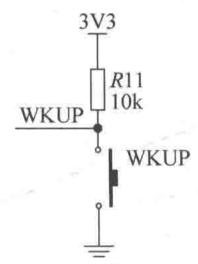

**看图的方法**：

1. **先找光敏电阻**：这部分电路就是最小系统板上光敏电阻的采集电路，回答的问题是"光敏电阻怎么接到 STM32 上去"。
2. **再看它接到了哪个引脚**：按教材原话，光敏电阻这条采集通道经过 **SW4 开关**接到 **PA1**；而 PA1 正好是 ADC1 的通道 1（本例用的就是 ADC1 通道 1）。
3. **注意图片里其实有两张教材图**：MinerU 把图 3-11 和图 3-12 放在了一起，所以图上不止一个电路，**只看带光敏电阻的那部分**。
4. **如果这张图太小看不清**，可以对照第 10 章的图 10-22（光敏电阻分压电路，画法更简洁）：

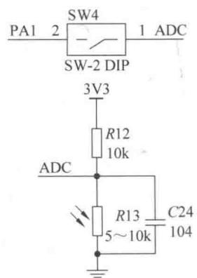

5. **这张图要你理解的一件事**：**光照的变化 → 电阻的变化 → 电压的变化 → ADC 数字的变化**。这一条链走通，你就知道程序里读到的数字为什么能反映光照了。

#### 整体的数据流（先看大图景，再看代码）

【辅助理解图】例 11-1 的数据流

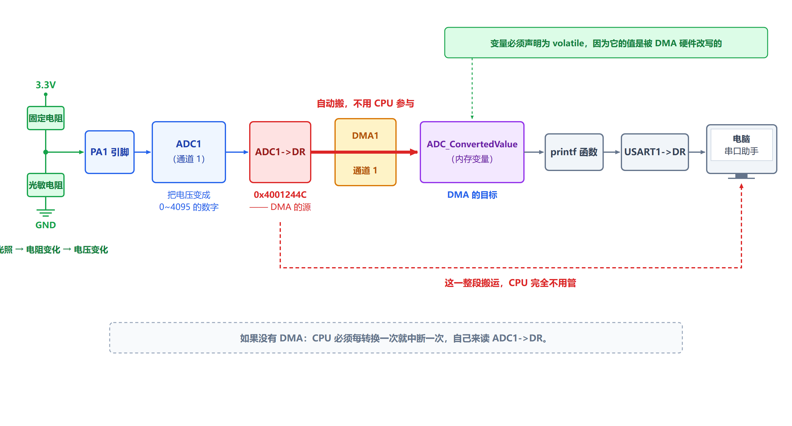

看图时按这个顺序：

1. **最左边画一个光敏电阻分压电路的小图**，标"光照 → 电压"。
2. **往右一个箭头**指向方框"**PA1 引脚**"。
3. **再往右**指向方框"**ADC1（通道 1）**"，方框下面注"把电压变成 0~4095 的数字"。
4. **再往右**指向一个小格子，标"**ADC1->DR（地址 0x4001244C）**"，格子下面用红字标"**DMA 的源**"。
5. **从 ADC1->DR 画一条粗箭头向右**，穿过一个标着"**DMA1 通道 1**"的方框，箭头上写"自动搬，不用 CPU 参与"。
6. **箭头指向右边一个内存格子**，标"**ADC_ConvertedValue（内存变量）**"，格子下面用蓝字标"**DMA 的目标**"。
7. **再往右**画一个方框"**printf 函数**"，再指向"**USART1->DR**"，最后指向最右边一台"**电脑 + 串口助手**"。
8. **图的下方画一条虚线，从"ADC1->DR"一直连到"电脑"，标"这一整段搬运，CPU 完全不用管"**。
9. **在图的最下面另画一条对照线**，写"如果没有 DMA：CPU 必须每转换一次就中断一次，自己来读 ADC1->DR"。
10. **配色**：模拟部分（光敏电阻）用绿色系，ADC 用蓝色系，DMA 通路用红色粗箭头 #DC2626，内存用紫色，串口/电脑用灰色。

#### 主程序（教材 p188）

```c
#include "stm32f10x.h"
#include <stdio.h>

#define ADC1_DR_Address ((u32)0x4001244C)

// 将 printf 函数进行重定向
#ifdef __GNUC__
    /* With GCC/RAISONANCE, small printf (option LD Linker -> Libraries ->
       Small printf set to 'Yes') calls __io_putchar() */
    #define PUTCHAR_PROTOTYPE int __io_putchar(int ch)
#else
    #define PUTCHAR_PROTOTYPE int fputc(int ch, FILE *f)
#endif /* __GNUC__ */

vu16 ADC_ConvertedValue;

void RCC_Config(void);
void GPIO_Config(void);
void USART_Config(void);
void DMA_Config(void);
void ADC_Config(void);
void Delay(vu32 nCount);

int main(void)
{
    RCC_Config();
    GPIO_Config();
    USART_Config();
    DMA_Config();
    ADC_Config();
    while(1)
    {
        Delay(0x8FFFF);
        printf("ADC = %X Volt = %d mv\r\n",
               ADC_ConvertedValue,
               ADC_ConvertedValue * 3300 / 4096);
    }
}
```

> ⚠️ **OCR 疑点**：教材原文写作 `#ifdef __GNUC_`、`# else`、`# endif /* __GNUC__ */`、`__io putchar`、`".../r/n"`。正确的 C 语法应为 `#ifdef __GNUC__`（两个下划线）、`#else`、`#endif`、`__io_putchar`、`"\r\n"`。这些是 MinerU 解析时丢失下划线和反斜杠造成的。已按正确语法修正，并记入"待核验"。

#### 逐行讲解主程序

**这一段代码想完成什么？**

> **初始化 5 样东西（时钟、GPIO、串口、DMA、ADC），然后进入死循环，每隔一段时间把 ADC 采到的值打印到串口。**

##### 第 1~2 行：包含头文件

```c
#include "stm32f10x.h"
#include <stdio.h>
```

| 代码 | CPU/编译阶段做什么 | 为什么需要 |
|---|---|---|
| `#include "stm32f10x.h"` | 编译前，把 STM32 的寄存器定义、结构体定义、宏定义全部"抄"进这个文件 | 没有它，`DMA1_Channel1`、`ADC1`、`RCC_AHBPeriph_DMA1` 这些名字编译器都不认识 |
| `#include <stdio.h>` | 引入标准输入输出库 | 为了用 `printf` |

**注意**：`#include` 是**预处理指令**，在**编译之前**由预处理器完成，**不是**运行时执行的。所以这里没有"CPU 做什么"。

##### 第 4 行：定义一个"地址别名"

```c
#define ADC1_DR_Address ((u32)0x4001244C)
```

**这一行想完成什么？** 给 `0x4001244C` 这个地址起个好记的名字。

| 部分 | 含义 |
|---|---|
| `#define` | 预处理指令："下面这个词，以后都替换成后面那个东西" |
| `ADC1_DR_Address` | 我们起的名字 |
| `((u32)0x4001244C)` | 实际内容：把 0x4001244C 强制转换成 32 位无符号整数 |
| 外面的两层括号 | 防止替换后和别的运算符"打架"（这是宏定义的好习惯） |

**这个地址怎么来的？**（走一遍地址链）

```
ADC1 挂在 APB2 总线上，基地址 = 0x40012400
ADC 的数据寄存器 DR 偏移 = 0x4C
ADC1_DR 地址 = 0x40012400 + 0x4C = 0x4001244C  ✓
```

**⚠️ 注意**：宏定义是"**文本替换**"，不是"变量"。所以程序里写 `ADC1_DR_Address` 的地方，编译时会直接变成 `((u32)0x4001244C)`，**不占内存，不占运行时间**。

##### 第 6~13 行：printf 重定向的宏

```c
#ifdef __GNUC__
    #define PUTCHAR_PROTOTYPE int __io_putchar(int ch)
#else
    #define PUTCHAR_PROTOTYPE int fputc(int ch, FILE *f)
#endif
```

**这几行想完成什么？** 根据"用哪个编译器"，选择不同的函数原型。

| 代码 | 含义 |
|---|---|
| `#ifdef __GNUC__` | "如果定义了 `__GNUC__` 这个宏"（即：如果用的是 GCC 编译器） |
| `#define PUTCHAR_PROTOTYPE int __io_putchar(int ch)` | 如果是 GCC，把 `PUTCHAR_PROTOTYPE` 定义成 GCC 需要的那个函数名 |
| `#else` | 否则（用 Keil MDK 的 ARM 编译器时） |
| `#define PUTCHAR_PROTOTYPE int fputc(int ch, FILE *f)` | 把 `PUTCHAR_PROTOTYPE` 定义成 `fputc` |
| `#endif` | 条件编译结束 |

**为什么要这么麻烦？**

因为 `printf()` 最终要"把字符一个个送出去"。在 PC 上，"送出去"是送到屏幕；在 STM32 上，我们要把它送到串口。

**标准库规定了一个"出口函数"**，`printf()` 每产生一个字符，就会去调用它。这个出口函数在不同编译器里名字不一样：

- GCC 里叫 `__io_putchar`；
- Keil（ARMCC）里叫 `fputc`。

**所以我们用条件编译，给两种编译器各准备一份。**

**⚠️ 在 Keil 里还要额外做一件事**：勾选 `Use MicroLIB`（在工程选项 Target 里）。否则 `printf` 会因为链接不到标准库而报错，或者程序卡住。这是初学者常踩的坑。

##### 第 15 行：全局变量

```c
vu16 ADC_ConvertedValue;
```

**这一行非常重要，我们要仔细讲。**

**`vu16` 是什么？**

```
vu16 = volatile uint16_t
        │         │
        │         └─ 16 位无符号整数（0 ~ 65535）
        └─ volatile（易变的、不可优化的）
```

**为什么这里必须用 `volatile`？**

这是本例**最关键的一个细节**，请务必理解：

> **`ADC_ConvertedValue` 这个变量，程序里从来没有"赋值"给它！**
> **它的值是被 DMA 硬件"偷偷"改写的。**

看代码：`ADC_ConvertedValue` 只出现在 `printf` 的参数里（被读），**从来没有出现在 `=` 的左边**。

**如果没有 `volatile` 会发生什么？**

编译器分析代码后发现："这个变量从来没被赋值过，那它永远是 0。"于是**直接把 `printf` 里的 `ADC_ConvertedValue` 优化成常量 0**。结果：

> **串口助手永远显示 `ADC = 0`。**

**加了 `volatile` 之后**：编译器知道"这个变量的值可能被外部（硬件）改变"，所以每次用到它都**老老实实去内存里读一遍**，就能读到 DMA 写进去的新值。

**所以这里可以总结出一条极其重要的经验**：

> **凡是"会被中断服务程序、或被 DMA 硬件改写"的变量，都必须加 `volatile`。**
> **否则编译器优化后，你的程序会以一种"看起来毫无道理"的方式出错。**

**类比**：`volatile` 就像在变量上贴了一张便利贴：**"这个值会被别人改，别自作聪明地缓存它。"**

**为什么用 `u16` 而不是 `u32`？**

因为 ADC 是 12 位的，转换结果最大 4095，用 16 位足够了。而且 ADC 的数据寄存器 `DR` 是 16 位的（低 12 位有效）。所以 DMA 搬运的宽度也是 16 位。

**这个变量在内存里在哪？**

编译器会把它分配在 SRAM 里（0x20000000 区），比如 0x20000000 附近。DMA 的 `CMAR` 就指向它的地址。

##### 第 17~22 行：函数声明

```c
void RCC_Config(void);
void GPIO_Config(void);
void USART_Config(void);
void DMA_Config(void);
void ADC_Config(void);
void Delay(vu32 nCount);
```

**这几行想完成什么？** 告诉编译器："下面有这几个函数，先别急着报错。"

**为什么需要？** 因为 `main()` 里调用了这些函数，但它们的**定义**写在 `main()` 后面。C 语言是"从上往下"编译的，如果不先声明，编译器在 `main()` 里看到 `RCC_Config()` 就不知道它是什么。

**类比**：像书前面的"目录"，先告诉你后面有哪些章节。

**这些函数的分工**：

| 函数 | 负责什么 |
|---|---|
| `RCC_Config()` | 开时钟（DMA1、ADC1、GPIOA、USART1） |
| `GPIO_Config()` | 配置引脚（PA9 复用推挽输出、PA10 浮空输入、PA1 模拟输入） |
| `USART_Config()` | 配置串口 1（9600、8 位、无校验、1 停止位） |
| `DMA_Config()` | 配置 DMA1 通道 1 |
| `ADC_Config()` | 配置 ADC1 |
| `Delay()` | 软件延时 |

##### `main()` 函数

```c
int main(void)
{
    RCC_Config();        // ① 先开时钟（最重要，必须第一步）
    GPIO_Config();       // ② 配引脚
    USART_Config();      // ③ 配串口
    DMA_Config();        // ④ 配 DMA
    ADC_Config();        // ⑤ 配 ADC（放最后，因为它最后启动转换）
    while(1)             // ⑥ 死循环
    {
        Delay(0x8FFFF);  //    等一会儿
        printf(...);     //    把最新值打印出去
    }
}
```

**⚠️ 这 5 个函数的调用顺序有讲究，不是随便排的：**

```
RCC_Config()   ← 必须最先。所有外设都要有时钟才能工作
    ↓
GPIO_Config()  ← 引脚要先配好，外设才能用这些引脚
    ↓
USART_Config() ← 串口要先能用
    ↓
DMA_Config()   ← DMA 要先配好并启动
    ↓
ADC_Config()   ← ADC 最后配。因为它最后一步会"启动转换"，
                   此时 DMA 必须已经准备好了，否则第一个数据就丢了
```

**这个顺序体现了一个重要的工程思想**：

> **"先搭好下游的接收方，再启动上游的生产方。"**
> 如果先启动 ADC，ADC 马上开始转换，但 DMA 还没配好，那第一个转换结果就可能丢失。

**`while(1)` 是什么？**

> **一个"永远为真"的循环，所以永远不退出。** 单片机程序通常都是这样：初始化一次，然后永远在循环里干活。

**为什么是 `while(1)` 而不是别的？**

因为单片机没有操作系统。如果 `main()` 返回了，程序会跑飞（跑到未知的地方去）。所以必须让程序**永远待在一个循环里**。

**`Delay(0x8FFFF)` 是干什么的？**

**让程序空转一会儿**，不要刷屏刷得太快。

`0x8FFFF` = 589823（十进制），是个挺大的数。`Delay()` 函数就是一个空的 `for` 循环，数到 0 就返回。

**为什么要延时？**

因为如果一秒打印几万次，串口助手会被刷爆，人也看不清。延时之后，大约每秒打印一两次，就能舒服地观察数值变化了。

**`printf(...)` 这一行**

```c
printf("ADC = %X Volt = %d mv\r\n",
       ADC_ConvertedValue,
       ADC_ConvertedValue * 3300 / 4096);
```

**这一行想完成什么？** 通过串口把 ADC 的值（十六进制）和换算出来的电压（毫伏）打印出去。

| 部分 | 含义 |
|---|---|
| `"ADC = %X Volt = %d mv\r\n"` | 格式字符串 |
| `%X` | 用**十六进制大写**打印后面第一个参数（`ADC_ConvertedValue`），不带 `0x` |
| `%d` | 用**十进制**打印后面第二个参数（换算出的毫伏数） |
| `\r\n` | 回车 + 换行（`\r` = 回到行首，`\n` = 换到下一行）。**串口助手需要这两个才能正确换行** |
| `ADC_ConvertedValue` | 第 1 个参数：ADC 的原始值（0~4095） |
| `ADC_ConvertedValue * 3300 / 4096` | 第 2 个参数：换算成毫伏 |

**重点讲这个换算公式：**

```
电压(mV) = ADC值 × 3300 / 4096
```

**这个公式怎么来的？**

```
① ADC 是 12 位的 → 能表示 2¹² = 4096 个刻度（0 ~ 4095）
② 参考电压是 3.3V = 3300 mV
③ 所以每一个刻度代表的电压 = 3300 mV / 4096 ≈ 0.8057 mV
④ 那么 ADC 值 = 1000 时，电压 = 1000 × 0.8057 ≈ 805.7 mV
```

**验算**：

```
ADC 值 = 0     → 0 × 3300 / 4096 = 0 mV      （电压 0V）
ADC 值 = 2048  → 2048 × 3300 / 4096 = 1650 mV（电压约 1.65V，正好是一半）✓
ADC 值 = 4095  → 4095 × 3300 / 4096 = 3299 mV（电压约 3.3V，正好是满量程）✓
```

**⚠️ 注意运算顺序**：`ADC_ConvertedValue * 3300 / 4096` 是**先乘后除**（因为 `*` 和 `/` 优先级相同，从左往右算）。这是**故意**的：

> **如果先除后乘（`ADC_ConvertedValue / 4096 * 3300`），整数除法会把小数部分丢掉，结果永远是 0。**
> **所以必须先乘，把数放大，再除。**

**这是整数运算的一个经典陷阱**，考试和实际编程都会遇到。

**`printf` 最终是怎么把字符送到串口的？**

```
printf("...")
   ↓ 标准库内部逐个字符处理
   ↓ 每产生一个字符，就调用 PUTCHAR_PROTOTYPE 定义的那个函数（fputc 或 __io_putchar）
   ↓
USART_SendData(USART1, (u8)ch);      ← 把字符写进 USART1->DR
   ↓ 串口硬件自动一位一位地发出去
PA9 引脚上的电平波形
   ↓
USB 转 TTL 串口模块
   ↓
电脑上的串口助手显示出来
```

（**这就把 DMA 和前面第 9 章学的串口联系起来了**：串口负责"一位一位发"，DMA 负责"批量把数据搬进串口"。）

---

#### `RCC_Config()` —— 时钟配置函数

```c
void RCC_Config(void)    // 时钟配置函数
{
    RCC_AHBPeriphClockCmd(RCC_AHBPeriph_DMA1, ENABLE);              // 使能 DMA1 时钟
    RCC_APB2PeriphClockCmd(RCC_APB2Periph_ADC1 | RCC_APB2Periph_GPIOA, ENABLE);
    // 使能 ADC1 和 GPIOA 时钟
    RCC_APB2PeriphClockCmd(RCC_APB2Periph_USART1, ENABLE);          // 使能串口 1 时钟
}
```

**这一段想完成什么？** 给 4 个外设"送电"：DMA1、ADC1、GPIOA、USART1。

**逐行解释**：

| 行 | 代码 | CPU 做什么 | 硬件发生什么 |
|---|---|---|---|
| 1 | `RCC_AHBPeriphClockCmd(RCC_AHBPeriph_DMA1, ENABLE);` | 往 RCC 的 `AHBENR` 寄存器写一个数，把 DMA1 对应的时钟使能位置 1 | **DMA1 的时钟开始供应**，DMA1 内部电路开始工作 |
| 2 | `RCC_APB2PeriphClockCmd(RCC_APB2Periph_ADC1 \| RCC_APB2Periph_GPIOA, ENABLE);` | 往 RCC 的 `APB2ENR` 寄存器写数，**同时**把 ADC1 和 GPIOA 的时钟位都置 1 | ADC1 和 GPIOA 的时钟开启 |
| 3 | `RCC_APB2PeriphClockCmd(RCC_APB2Periph_USART1, ENABLE);` | 往 `APB2ENR` 再写一次，把 USART1 的时钟位置 1 | USART1 的时钟开启 |

**注意第 2 行的 `|` 运算符**：

```c
RCC_APB2Periph_ADC1 | RCC_APB2Periph_GPIOA
```

**`|` 是位"或"运算**，这里的作用是"**把两个宏合成一个**"，让一次函数调用就能开两个外设的时钟。

**具体数值演算**（用第 1 章学的位运算）：

```
RCC_APB2Periph_ADC1   = 0x00000200   (bit9)
RCC_APB2Periph_GPIOA  = 0x00000004   (bit2)

  0x00000200  = 0000 0000 0000 0000 0000 0010 0000 0000
  0x00000004  = 0000 0000 0000 0000 0000 0000 0000 0100
     按位"或"  = 0000 0000 0000 0000 0000 0010 0000 0100
                = 0x00000204

结果：bit9 和 bit2 都变成 1，两个外设的时钟同时被打开。
```

**⚠️ 为什么 DMA1 用 `AHBPeriph`，其它三个用 `APB2Periph`？**

因为**它们挂的总线不同**：

```
DMA1  → 挂在 AHB 总线上 → 用 RCC_AHBPeriphClockCmd
ADC1  → 挂在 APB2 总线上 → 用 RCC_APB2PeriphClockCmd
GPIOA → 挂在 APB2 总线上 → 用 RCC_APB2PeriphClockCmd
USART1→ 挂在 APB2 总线上 → 用 RCC_APB2PeriphClockCmd
```

（这个"谁挂在哪条总线上"的对应关系，就是图 11-1 右侧那个 APB1/APB2 列表告诉你的。）

**⚠️ 容易搞混**：如果你把 `RCC_AHBPeriph_DMA1` 错写成 `RCC_APB1Periph_DMA1`，编译会报错（因为这个宏不存在）。如果漏掉这一句，**DMA 完全不工作，而且不会有任何报错**——这是最难查的一类 bug。

---

#### `GPIO_Config()` —— 引脚配置函数

```c
void GPIO_Config(void)    // GPIO 配置函数
{
    GPIO_InitTypeDef GPIO_InitStructure;    // 定义 GPIO 初始化结构体
    // 设置 Tx(PA9) 为推拉输出模式
    GPIO_InitStructure.GPIO_Pin   = GPIO_Pin_9;              // 选择 PIN9
    GPIO_InitStructure.GPIO_Speed = GPIO_Speed_50MHz;        // 引脚频率 50MHz
    GPIO_InitStructure.GPIO_Mode  = GPIO_Mode_AF_PP;         // 引脚设置推拉输出
    GPIO_Init(GPIOA, &GPIO_InitStructure);                   // 初始化 GPIOA
    // 配置 USART1 Rx (PA10) 为浮空输入模式
    GPIO_InitStructure.GPIO_Pin   = GPIO_Pin_10;
    GPIO_InitStructure.GPIO_Mode  = GPIO_Mode_IN_FLOATING;
    GPIO_Init(GPIOA, &GPIO_InitStructure);
    // 配置 PA1 为模拟输入
    GPIO_InitStructure.GPIO_Pin   = GPIO_Pin_1;
    GPIO_InitStructure.GPIO_Mode  = GPIO_Mode_AIN;
    GPIO_Init(GPIOA, &GPIO_InitStructure);
}
```

**这一段想完成什么？** 配置 3 个引脚：

| 引脚 | 用途 | 模式 | 为什么用这个模式 |
|---|---|---|---|
| **PA9** | USART1 的 TX（发送） | `GPIO_Mode_AF_PP`（复用推挽输出） | 串口发送需要引脚能主动输出高低电平，而且这个引脚的功能由"复用"（USART1）控制，不是普通 GPIO |
| **PA10** | USART1 的 RX（接收） | `GPIO_Mode_IN_FLOATING`（浮空输入） | 接收方是被动听，所以配成输入 |
| **PA1** | ADC 通道 1 的模拟输入 | `GPIO_Mode_AIN`（模拟输入） | **⚠️ 这里必须是"模拟输入"！** |

**⚠️ 重点讲 PA1 为什么必须是 `GPIO_Mode_AIN`：**

回忆第 6 章讲的 GPIO 内部结构：GPIO 引脚默认带"施密特触发器"和"上拉/下拉电阻"，它会把引脚上的电压**判断成"高"或"低"**（数字量）。

但我们要测的是**电压的连续大小**（模拟量），比如 1.65V 和 1.66V 的区别。

> **如果引脚还带着数字输入电路，那个电路会干扰模拟信号。**
> **所以必须把引脚切成"模拟模式"，让数字电路完全断开，只把引脚上的原始电压直接送到 ADC。**

**类比**：就像量体重之前，先把身上的背包脱掉。数字电路就是那个背包。

**`GPIO_Mode_AF_PP` 里的 "AF" 是什么？**

= **A**lternate **F**unction（**复用功能**）。

**大白话**：STM32 的引脚是"多面手"。PA9 这个引脚既可以当普通 GPIO 用（软件控制高低电平），也可以"交给" USART1 用（让串口硬件控制它发数据）。**选择"交给 USART1"就叫"复用"。**

**为什么串口发送要复用？**

因为串口发送需要**非常精确的时序**（比如 9600 波特率，每一位持续 104 微秒）。软件用 GPIO 去翻转电平，根本做不到这么准。所以必须交给专门的串口硬件。

**⚠️ 注意这个函数里的"偷懒"写法**：

```c
GPIO_InitStructure.GPIO_Speed = GPIO_Speed_50MHz;   // 只设了一次
```

后面两次配置没有重设 `GPIO_Speed`，所以它保持了 `50MHz`。这是可以的（因为 `GPIO_InitStructure` 是个局部变量，只要没被改，值就还在）。

**但是 `GPIO_Mode` 每次都重设了**，因为三个引脚的模式不同。

**⚠️ 一个隐藏前提**：这个函数里**没有配置 PA9/PA10 之外的其他引脚**。但 `GPIO_Init(GPIOA, ...)` 每次只影响 `GPIO_Pin` 里指定的引脚，其他引脚不受影响。这是库函数的正确用法。

---

#### `DMA_Config()` —— DMA 配置函数（**本章的核心**）

```c
void DMA_Config(void)    // DMA 配置函数
{
    DMA_InitTypeDef DMA_InitStructure;    // 定义 DMA 初始化结构体
    DMA_DeInit(DMA1_Channel1);            // 复位 DMA 通道 1

    // 定义 DMA 通道外设基地址 = ADC1_DR_Address
    DMA_InitStructure.DMA_PeripheralBaseAddr = ADC1_DR_Address;
    // 定义 DMA 通道存储器地址
    DMA_InitStructure.DMA_MemoryBaseAddr = (u32)&ADC_ConvertedValue;
    DMA_InitStructure.DMA_DIR = DMA_DIR_PeripheralSRC;      // 指定外设为源地址
    DMA_InitStructure.DMA_BufferSize = 1;                   // 定义 DMA 缓冲区大小 1
    // 当前外设寄存器地址不变
    DMA_InitStructure.DMA_PeripheralInc = DMA_PeripheralInc_Disable;
    // 当前存储器地址不变
    DMA_InitStructure.DMA_MemoryInc = DMA_MemoryInc_Disable;
    DMA_InitStructure.DMA_PeripheralDataSize = DMA_PeripheralDataSize_HalfWord;
    // 定义外设数据宽度 16 位
    DMA_InitStructure.DMA_MemoryDataSize = DMA_MemoryDataSize_HalfWord;
    // 定义存储器数据宽度 16 位
    // DMA 通道操作模式为环形缓冲模式
    DMA_InitStructure.DMA_Mode = DMA_Mode_Circular;
    DMA_InitStructure.DMA_Priority = DMA_Priority_High;     // DMA 通道优先级高
    // 禁止 DMA 通道存储器到存储器传输
    DMA_InitStructure.DMA_M2M = DMA_M2M_Disable;
    DMA_Init(DMA1_Channel1, &DMA_InitStructure);            // 初始化 DMA 通道 1
    DMA_Cmd(DMA1_Channel1, ENABLE);                         // 使能 DMA 通道 1
}
```

**这一段想完成什么？**

> **把 DMA1 通道 1 配置成："每当 ADC1 转换出一个新值，就自动把它搬到内存变量 `ADC_ConvertedValue` 里；搬完一个后自动重来，永远不停。"**

**这个函数可以对照 11.5 开头那 15 步流程来看**（这里是 15 步里的第 2~14 步，第 1 步"开时钟"在 `RCC_Config()` 里）。

**逐行解释**：

| 行 | 代码 | 大白话 | 寄存器 / 硬件 |
|---|---|---|---|
| 1 | `DMA_InitTypeDef DMA_InitStructure;` | 声明一张配置表 | 在栈上分配 44 字节 |
| 2 | `DMA_DeInit(DMA1_Channel1);` | 把通道 1 擦干净，恢复出厂值 | `CCR1=CNDTR1=CPAR1=CMAR1=0`，通道关闭 |
| 3 | `DMA_PeripheralBaseAddr = ADC1_DR_Address;` | 外设那一头 = `0x4001244C`（ADC 的数据寄存器） | 待会写进 `CPAR1` |
| 4 | `DMA_MemoryBaseAddr = (u32)&ADC_ConvertedValue;` | 内存那一头 = 变量 `ADC_ConvertedValue` 的地址 | 待会写进 `CMAR1` |
| 5 | `DMA_DIR = DMA_DIR_PeripheralSRC;` | 外设是**源**（数据从 ADC 流向内存） | `CCR1.DIR = 0` |
| 6 | `DMA_BufferSize = 1;` | 每次只搬 **1 项** | `CNDTR1 = 1` |
| 7 | `DMA_PeripheralInc = Disable;` | 外设地址**不动**（永远是 `0x4001244C`） | `CCR1.PINC = 0` |
| 8 | `DMA_MemoryInc = Disable;` | 内存地址**不动**（永远是 `&ADC_ConvertedValue`） | `CCR1.MINC = 0` |
| 9 | `DMA_PeripheralDataSize = HalfWord;` | 外设那头每次搬 **16 位** | `CCR1.PSIZE = 01` |
| 10 | `DMA_MemoryDataSize = HalfWord;` | 内存那头每次搬 **16 位** | `CCR1.MSIZE = 01` |
| 11 | `DMA_Mode = DMA_Mode_Circular;` | **循环模式**（搬完自动重来） | `CCR1.CIRC = 1` |
| 12 | `DMA_Priority = DMA_Priority_High;` | **高优先级** | `CCR1.PL = 10` |
| 13 | `DMA_M2M = DMA_M2M_Disable;` | 不是内存到内存模式 | `CCR1.MEM2MEM = 0` |
| 14 | `DMA_Init(DMA1_Channel1, &DMA_InitStructure);` | 把上面 11 项**写进寄存器** | `CCR1 = 0x00002520`（推导见 11.3.3） |
| 15 | `DMA_Cmd(DMA1_Channel1, ENABLE);` | **打开通道总开关** | `CCR1` 的 `EN` 置 1 → `CCR1 = 0x00002521` |

**第 4 行要特别解释：`(u32)&ADC_ConvertedValue`**

```c
(u32) &ADC_ConvertedValue
  │     │
  │     └─ & 是"取地址"运算符，得到变量在内存中的地址
  └─ 把地址强制转换成一个 32 位整数，因为 DMA_MemoryBaseAddr 的类型是 u32
```

**`&` 是什么？**（复习第 1 章的"指针"）

> **`&变量名` = "这个变量住在哪个地址"**。
> 比如 `ADC_ConvertedValue` 被编译器安排在地址 0x20000000，那 `&ADC_ConvertedValue` 就是 `0x20000000`。

**为什么要转换类型？**

因为 `DMA_MemoryBaseAddr` 的类型是 `u32`（一个 32 位整数），而 `&ADC_ConvertedValue` 的类型是"指向 u16 的指针"。**类型不匹配，编译器会警告**，所以要显式转换。

**类比**：地址本身就是一个"门牌号数字"。但 C 语言里"门牌号"和"整数"是两种不同的东西，需要"翻译"一下。

**第 6 行要特别解释：为什么 `BufferSize = 1`？**

这是本例最容易让人困惑的地方。**很多人会想："只搬 1 项？那有什么意义？"**

关键在于**配合第 11 行的循环模式**：

```
循环模式 + BufferSize = 1 的效果：

ADC 转换出第 1 个值 → DMA 搬 1 项 → CNDTR 从 1 减到 0
                                    ↓
                          循环模式触发：CNDTR 自动重装为 1
                                    ↓
ADC 转换出第 2 个值 → DMA 又搬 1 项 → CNDTR 从 1 减到 0
                                    ↓
                          又自动重装为 1
                                    ↓
                        …… 永远重复
```

**所以最终效果是**：`ADC_ConvertedValue` 这个变量里，**永远保存着 ADC 最新一次转换的结果**。

**为什么不用 `BufferSize = 100` 存一个数组？**

因为这个例子的目的是"**实时显示当前光照值**"。它只需要最新的一个值，不需要历史记录。

> **如果 BufferSize 设成 100 且 MINC=Disable**，那么 DMA 会把 100 个数据**都写到同一个地址**，最后剩下的还是第 100 个值，前 99 个白搬了。所以设成 1 是最合理的。

**类比**：这就像温度计，你只关心"现在的温度"，不需要记录过去 100 次的温度。

**第 8 行要特别解释：为什么 `MINC = Disable`？**

**因为"只有一个变量，地址当然不动"。**

如果 `MINC = Enable`，DMA 每搬一次地址就 +2，那第二次就会写到 `ADC_ConvertedValue` 后面的内存里，**把别的变量覆盖掉，程序就乱了**。

> **所以：当"存储器那一头只有一个变量"时，`MINC` 必须设成 `Disable`。**
> **当"存储器那一头是一个数组"时，`MINC` 必须设成 `Enable`。**

**这是判断 `MINC` 该设 0 还是 1 的唯一标准。**

**第 9、10 行：为什么宽度都是 16 位？**

因为 **ADC 的数据寄存器 `DR` 是 16 位的**（低 12 位是转换结果），而变量 `ADC_ConvertedValue` 是 `u16`（16 位）。**两边宽度一致，不用打包拆包，最简单。**

**如果两边宽度不一样会怎样？**

比如 PSIZE=16、MSIZE=8，那 DMA 会把 ADC 的 16 位数据**只保留低 8 位**写进变量，**高 4 位有效数据就丢了**（回忆 11.2.4 的"变窄丢高位"）。那就错了。

**第 14 行之后，硬件发生什么？**

`DMA_Init()` 把 `CCR1 = 0x00002520`（此时 `EN=0`，通道还没启动）。

`DMA_Cmd(..., ENABLE)` 把 `EN` 置 1，`CCR1` 变成 `0x00002521`。

**从这一刻起**：只要 ADC1 发出 DMA 请求（每次转换完成就会发），DMA 通道 1 就会：
1. 从 `0x4001244C` 读 2 字节；
2. 写到 `&ADC_ConvertedValue`；
3. `CNDTR` 从 1 减到 0；
4. 因为 `CIRC=1`，`CNDTR` 自动重装为 1，继续等待下一次请求。

**⚠️ 注意：本例没有使用 DMA 中断。**

因为 `BufferSize=1` + 循环模式，每搬一个数据就"完成"一次，如果开中断会**中断得太频繁**（和不用 DMA 一样糟）。所以这个例子用的是**"不用中断、让 DMA 静静地把最新值放在变量里、主循环自己去读"**的模式。这是**非常聪明**的设计，请体会一下。

---

#### `ADC_Config()` —— ADC 配置函数

```c
void ADC_Config(void)
{
    ADC_InitTypeDef ADC_InitStructure;                          // 定义 ADC 初始化结构体变量
    ADC_InitStructure.ADC_Mode = ADC_Mode_Independent;          // ADC 工作在独立模式
    ADC_InitStructure.ADC_ScanConvMode = ENABLE;                // 使能扫描
    ADC_InitStructure.ADC_ContinuousConvMode = ENABLE;          // ADC 转换工作在连续模式
    // 由软件控制转换
    ADC_InitStructure.ADC_ExternalTrigConv = ADC_ExternalTrigConv_None;
    ADC_InitStructure.ADC_DataAlign = ADC_DataAlign_Right;      // 转换数据右对齐
    ADC_InitStructure.ADC_NbrOfChannel = 1;                     // 转换通道为通道 1
    ADC_Init(ADC1, &ADC_InitStructure);                         // 初始化 ADC

    ADC_RegularChannelConfig(ADC1, ADC_Channel_1, 1, ADC_SampleTime_55Cycles5);
    // ADC1 选择通道 1，采样顺序为 1

    ADC_DMACmd(ADC1, ENABLE);                                   // 使能 ADC1 模块 DMA
    ADC_Cmd(ADC1, ENABLE);                                      // 使能 ADC1

    ADC_ResetCalibration(ADC1);                                 // 重置 ADC1 校准寄存器
    while(ADC_GetResetCalibrationStatus(ADC1));                 // 等待 ADC1 校准重置完成
    ADC_StartCalibration(ADC1);                                 // 开始 ADC1 校准
    while(ADC_GetCalibrationStatus(ADC1));                      // 等待 ADC1 校准完成

    ADC_SoftwareStartConvCmd(ADC1, ENABLE);                     // 使能 ADC1 软件开始转换
}
```

> ⚠️ **OCR / 教材疑点**：教材原文在 `ADC_RegularChannelConfig` 那一行的注释写的是"采样时间 **239.5** 个周期"，但**代码里写的参数是 `ADC_SampleTime_55Cycles5`（55.5 个周期）**。注释和代码矛盾。按代码为准（55.5 个周期）。已记入"待核验"。

**这一段想完成什么？** 把 ADC1 配置成"**连续不断地转换通道 1（PA1），每转换完一个就把结果交给 DMA**"。

**逐行解释**：

| 行 | 代码 | 大白话 |
|---|---|---|
| 1 | `ADC_Mode = ADC_Mode_Independent;` | **独立模式**：只用 ADC1 一个，不和 ADC2 配合 |
| 2 | `ADC_ScanConvMode = ENABLE;` | **使能扫描**：允许按"规则组"里的多个通道依次转换（本例只有 1 个通道，所以影响不大） |
| 3 | `ADC_ContinuousConvMode = ENABLE;` | **连续转换模式**：转换完一个马上开始下一个，**永不停**。这是 DMA 能连续工作的前提 |
| 4 | `ADC_ExternalTrigConv = ADC_ExternalTrigConv_None;` | **不使用外部触发**：由软件启动 |
| 5 | `ADC_DataAlign = ADC_DataAlign_Right;` | **右对齐**：12 位结果放在 `DR` 的低 12 位（bit11~bit0） |
| 6 | `ADC_NbrOfChannel = 1;` | 规则组里只有 **1 个通道** |
| 7 | `ADC_Init(ADC1, &ADC_InitStructure);` | 把上面 6 项写进 ADC1 的 `CR1`/`CR2` 寄存器 |
| 8 | `ADC_RegularChannelConfig(ADC1, ADC_Channel_1, 1, ADC_SampleTime_55Cycles5);` | **指定：通道 1（PA1），在规则组里排第 1 位，采样时间 55.5 个 ADC 时钟周期** |
| 9 | `ADC_DMACmd(ADC1, ENABLE);` | **⚠️ 关键：让 ADC 在每次转换完成后，向 DMA 发出请求** |
| 10 | `ADC_Cmd(ADC1, ENABLE);` | 打开 ADC1 的电源开关 |
| 11 | `ADC_ResetCalibration(ADC1);` | 复位 ADC 的校准寄存器（准备校准） |
| 12 | `while(ADC_GetResetCalibrationStatus(ADC1));` | **死等**，直到复位校准完成 |
| 13 | `ADC_StartCalibration(ADC1);` | 开始校准 |
| 14 | `while(ADC_GetCalibrationStatus(ADC1));` | **死等**，直到校准完成 |
| 15 | `ADC_SoftwareStartConvCmd(ADC1, ENABLE);` | **正式启动转换！** 从此 ADC 就不停地转换 |

**第 9 行是全例的"连接点"，必须重点讲：**

```c
ADC_DMACmd(ADC1, ENABLE);
```

**这一行的作用**：

> **打开 ADC1 内部的"DMA 请求开关"。**
> 打开之后，ADC1 每次转换完成，除了置 `EOC` 标志位之外，**还会额外发出一个 DMA 请求信号**，告诉 DMA："我这儿有新数据了，快来搬！"

**如果不写这一行会怎样？**

ADC 照样转换，但**它不会通知 DMA**。于是 DMA 一直在等请求，永远等不到，`ADC_ConvertedValue` 永远不变。

**这就是"两个开关都要打开"的又一个例子**：

```
开关 1：DMA 通道的 EN 位（DMA_Cmd 打开）  ← DMA 这一侧准备好
开关 2：ADC 的 DMA 请求位（ADC_DMACmd 打开）← 外设这一侧愿意发请求
两个都开，数据才会流起来。
```

**类比**：一个是"快递员在岗"，一个是"商家愿意发货"。缺一个，包裹都到不了。

**第 11~14 行：为什么要校准？**

**ADC 是模拟电路，模拟电路会有误差。** 校准就是为了消除这些内部误差，让转换结果更准。

**注意这两行是"死等"**：

```c
while(ADC_GetResetCalibrationStatus(ADC1));   // 注意：没有循环体！
```

**这个 `while` 后面直接跟分号，表示"循环体是空的"**，意思是：

> **"只要状态还没变成'完成'，就一直在这里原地转圈。"**

**为什么要死等？** 因为校准是**硬件操作**，需要花一些时间（几十个 ADC 时钟周期）。软件必须等它完成才能继续。

**类比**：像等微波炉"叮"一声，没响之前你什么也做不了。

**⚠️ 但如果硬件出了问题（比如时钟没开），这个 `while` 会变成"死循环"，程序永远卡在这里。** 这是调试时常见的一种"卡死"现象。如果发现程序停在校准这一行，首先检查 **ADC 的时钟是否打开**。

**第 15 行：启动转换**

```c
ADC_SoftwareStartConvCmd(ADC1, ENABLE);
```

**这一行之后**，ADC 就进入"连续转换"状态：转完一个立刻转下一个。每转完一个，发一次 DMA 请求，DMA 就把结果搬到 `ADC_ConvertedValue`。

**从这一刻起，整个系统就"活"了：**

```
ADC 不停地转换 → 每转完一个就请求 DMA → DMA 搬到变量 → 主循环读变量并打印
   ↑                                                              │
   └──────────────── 永远循环 ────────────────────────────────────┘
```

---

#### `USART_Config()` —— 串口配置函数

```c
void USART_Config(void)
{
    USART_InitTypeDef USART_InitStructure;                       // 定义串口初始化结构体
    USART_InitStructure.USART_BaudRate = 9600;                   // 波特率 9600
    USART_InitStructure.USART_WordLength = USART_WordLength_8b;  // 8 位数据
    USART_InitStructure.USART_StopBits = USART_StopBits_1;       // 1 个停止位
    USART_InitStructure.USART_Parity = USART_Parity_No;          // 无校验位
    // 禁用 RTSCTS 硬件流控制
    USART_InitStructure.USART_HardwareFlowControl = USART_HardwareFlowControl_None;
    // 使能发送接收
    USART_InitStructure.USART_Mode = USART_Mode_Rx | USART_Mode_Tx;
    USART_Init(USART1, &USART_InitStructure);                    // 初始化串口 1
    USART_Cmd(USART1, ENABLE);                                   // 串口 1 使能
}
```

**这一段想完成什么？** 把串口 1 配置成"**9600 波特率、8 位数据、1 个停止位、无校验**"（这是最常用的配置，俗称 **8-N-1**），然后打开它。

| 参数 | 值 | 大白话 |
|---|---|---|
| `USART_BaudRate` | 9600 | **波特率**：每秒传 9600 个"位"。这是收发双方必须**约定一致**的速度 |
| `USART_WordLength` | `8b` | 每个字符 8 位数据 |
| `USART_StopBits` | `1` | 每个字符后面跟 1 个停止位 |
| `USART_Parity` | `No` | 不做奇偶校验 |
| `USART_HardwareFlowControl` | `None` | 不用 RTS/CTS 硬件流控制（两根额外的握手线，一般不用） |
| `USART_Mode` | `Rx \| Tx` | **同时**使能接收和发送（`\|` 把两个宏合起来） |

**⚠️ 波特率为什么必须一致？**

**波特率 = 每秒传多少个"位"。** 发送方按 9600 的节奏发，接收方必须按 9600 的节奏采。**如果两边不一致（比如一边 9600、一边 115200），收到的就是乱码。**

**类比**：像两个人说话，一个说得飞快、一个听得慢吞吞，那就听不清了。

**注意：本函数只配置了串口本身，没有配置"用 DMA 发送"。**

本例里串口是**用 `printf` 一个字符一个字符发的**（软件发送），**没有用 DMA**。所以本例中 DMA 只负责"ADC → 内存"这一条路。

**⚠️ 一个"没写但必须做"的事**：`PA9`（TX）和 `PA10`（RX）的 GPIO 配置在 `GPIO_Config()` 里做了。**串口的引脚必须先配成复用功能，串口才能用。**

---

#### `Delay()` 和 `PUTCHAR_PROTOTYPE`

```c
// 延时函数
void Delay(vu32 nCount)
{
    for(; nCount != 0; nCount -- );
}

// 重定向 C 库 printf 函数
PUTCHAR_PROTOTYPE
{
    USART_SendData(USART1, (u8) ch);                             // 发送一字节数据
    // 等待发送完成
    while(USART_GetFlagStatus(USART1, USART_FLAG_TXE) == RESET);
    return ch;
}
```

**`Delay()` 想完成什么？** 用"空转"来消耗时间。

```c
for(; nCount != 0; nCount -- );
```

**拆开看这个 `for` 循环**：

- 初始化部分：**空**（`nCount` 是参数，已经赋好值了）；
- 条件：`nCount != 0`（只要不等于 0 就继续）；
- 循环体：**空**（注意最后那个分号）；
- 每轮之后：`nCount--`（减 1）。

**所以它做的就是**：把 `nCount` 从初始值一路减到 0。

**为什么这样就"延时"了？** 因为每次循环 CPU 都要花几个时钟周期（判断、减 1、跳转）。循环 589823 次，就要花不少时间。

**⚠️ 这种延时的缺点**：**不精确**。同样的 `nCount`，在不同主频、不同编译器优化等级下，延时的时长都不一样。**实际项目中不推荐这样写**，应该用第 8 章的定时器。但教材为了简单，用了这种写法。

**`PUTCHAR_PROTOTYPE` 这一大段是什么？**

还记得前面 `#define PUTCHAR_PROTOTYPE int fputc(int ch, FILE *f)` 吗？**预处理之后，这一段展开成**：

```c
int fputc(int ch, FILE *f)
{
    USART_SendData(USART1, (u8) ch);                            // 发送一字节数据
    while(USART_GetFlagStatus(USART1, USART_FLAG_TXE) == RESET); // 等待发送完成
    return ch;
}
```

**所以这就是 `fputc` 函数的定义**（在 GCC 下则是 `__io_putchar`）。

**它想完成什么？**

> **把 `printf` 产生的每一个字符，通过串口 1 发送出去。**

**`printf("ADC = 123\r\n")` 的实际过程**：

```
printf 内部逐个字符处理："A"、"D"、"C"、" "、"="、" "、"1"、"2"、"3"、"\r"、"\n"
   ↓ 每产生一个字符，就调用一次 fputc
fputc('A', f) → USART_SendData(USART1, 'A')  → 写进 USART1->DR
fputc('D', f) → USART_SendData(USART1, 'D')  → 写进 USART1->DR
……
```

**逐行解释 `fputc`**：

| 行 | 代码 | 大白话 | 硬件发生什么 |
|---|---|---|---|
| 1 | `USART_SendData(USART1, (u8) ch);` | 把这个字符写进串口的数据寄存器 | 往 `USART1->DR`（地址 0x40013804）写一个字节；**串口硬件开始把它一位一位地发出去** |
| 2 | `while(USART_GetFlagStatus(USART1, USART_FLAG_TXE) == RESET);` | **死等**，直到"发送寄存器空"标志 `TXE` 变成 1 | `TXE=1` 表示 `DR` 里的数据已经被搬到移位寄存器、可以接受下一个字符了 |
| 3 | `return ch;` | 把字符原样返回（`printf` 的返回值约定） | — |

**`TXE` 是什么？**

= **T**ransmit data register **E**mpty（**发送数据寄存器空**）。

**大白话**：

> **串口发送数据要经过两级：① 数据寄存器 `DR` → ② 移位寄存器（一位一位往外推）。**
> **`TXE=1` 的意思是："`DR` 已经空了，你可以再给我一个字符了。"**

**为什么必须等 `TXE`？**

因为如果你不等，**下一个字符会覆盖掉上一个还没搬走的字符**，发送出去的数据就错了。

**类比**：像往一个"传送带"上放包裹，你得等前一个包裹被传送带接走，才能放下一个。

**⚠️ 注意这里等的是 `TXE`，不是 `TC`**：

| 标志 | 含义 | 什么时候用 |
|---|---|---|
| `TXE`（TX Empty） | 数据寄存器空了 | **发送过程中，判断"能不能放下一个"** |
| `TC`（Transmission Complete） | **整帧发送完毕**（包括移位寄存器也空了） | **发完最后一个字节后，判断"是不是真的发完了"**（比如要关闭串口、或者要控制 RS485 方向时） |

**在本例中，因为后面还要接着发，所以等 `TXE` 就够了。** 但如果这是"最后一个字节"，而且你马上要断电/关串口，就应该等 `TC`。

---

#### 这个例子的完整回顾（用一张"时间轴"串起来）

```
上电
 │
 ├─ RCC_Config()    → 给 DMA1、ADC1、GPIOA、USART1 送电
 ├─ GPIO_Config()   → PA9 复用推挽输出、PA10 浮空输入、PA1 模拟输入
 ├─ USART_Config()  → 串口 1 配成 9600-8-N-1 并打开
 ├─ DMA_Config()    → DMA1 通道 1 配好：源=ADC1->DR，目标=&ADC_ConvertedValue
 │                    搬 1 项、循环模式、高优先级 → 打开 EN
 └─ ADC_Config()    → ADC1 配成连续转换通道 1；打开 ADC 的 DMA 请求；
                      校准；最后软件启动转换
 │
 ↓
【从此进入"自动运转"状态】

     ┌─────────────────────────────────────────────────────┐
     │  ADC1 转换完成                                       │
     │      ↓ 发出 DMA 请求                                 │
     │  DMA1 通道 1 搬 1 项（2 字节）到 ADC_ConvertedValue  │
     │      ↓ CNDTR 1→0，循环模式自动重装为 1                │
     └─────────────────────────────────────────────────────┘
                          （永远重复，CPU 完全不参与）

【同时，CPU 在主循环里】
     Delay(0x8FFFF)  ← 等一会儿
        ↓
     printf("ADC = %X Volt = %d mv\r\n", ADC_ConvertedValue, ...)
        ↓ 逐字符调用 fputc
     USART1->DR → PA9 引脚 → USB转TTL → 电脑串口助手显示
        ↓
     回到 while(1) 开头，再来一遍
```

**注意这里其实有"两条并行的流水线"：**

| 流水线 | 谁在跑 | 干什么 |
|---|---|---|
| **数据采集流水线** | ADC + DMA（硬件） | 不停地转换、搬运，**完全不用 CPU** |
| **数据显示流水线** | CPU（软件） | 每隔一段时间读一次变量、打印一次 |

**两条线通过一个"共享变量" `ADC_ConvertedValue` 交换数据。**

> **⚠️ 这正是 `volatile` 必须存在的原因**：CPU 这条线"读"这个变量，DMA 那条线"写"这个变量。**两条线是独立跑的，编译器不知道另一条线的存在。** `volatile` 就是在提醒编译器这件事。

---

### 补充例 1：存储器到存储器（MEM2MEM）传输

【补充解释】教材 11.2.3 第 5 小节讲了 MEM2MEM 模式，但没有给例子。这里补一个，帮你看清这个模式的特点。

#### 目标

> **把 `src[100]` 这个数组的 100 个 32 位数据，全部复制到 `dst[100]`。**

#### 代码

```c
#include "stm32f10x.h"

#define BUFFER_SIZE  100

u32 src[BUFFER_SIZE];
u32 dst[BUFFER_SIZE];

void DMA_M2M_Config(void)
{
    DMA_InitTypeDef DMA_InitStructure;

    RCC_AHBPeriphClockCmd(RCC_AHBPeriph_DMA1, ENABLE);   // ① 开 DMA1 时钟

    DMA_DeInit(DMA1_Channel6);                            // ② 复位通道 6

    DMA_InitStructure.DMA_PeripheralBaseAddr = (u32)src;  // ③ "外设端" = 源数组
    DMA_InitStructure.DMA_MemoryBaseAddr     = (u32)dst;  // ④ 存储器端 = 目标数组
    DMA_InitStructure.DMA_DIR = DMA_DIR_PeripheralDST;    // ⑤ 照 ST 官方 M2M 例程的写法（CPAR=源、CMAR=目标）
    DMA_InitStructure.DMA_BufferSize = BUFFER_SIZE;       // ⑥ 搬 100 项
    DMA_InitStructure.DMA_PeripheralInc = DMA_PeripheralInc_Enable;  // ⑦ 源地址要走
    DMA_InitStructure.DMA_MemoryInc     = DMA_MemoryInc_Enable;      // ⑧ 目标地址要走
    DMA_InitStructure.DMA_PeripheralDataSize = DMA_PeripheralDataSize_Word;  // ⑨ 32 位
    DMA_InitStructure.DMA_MemoryDataSize     = DMA_MemoryDataSize_Word;      // ⑩ 32 位
    DMA_InitStructure.DMA_Mode = DMA_Mode_Normal;         // ⑪ 正常模式（不能循环！）
    DMA_InitStructure.DMA_Priority = DMA_Priority_VeryHigh;  // ⑫ 最高优先级
    DMA_InitStructure.DMA_M2M = DMA_M2M_Enable;           // ⑬ ★ 打开 M2M 模式

    DMA_Init(DMA1_Channel6, &DMA_InitStructure);          // ⑭ 写进寄存器
    DMA_Cmd(DMA1_Channel6, ENABLE);                       // ⑮ 一开就马上开始搬！
}
```

#### 和例 11-1 的关键差别

| 对比项 | 例 11-1（ADC+DMA） | 本例子（M2M） |
|---|---|---|
| 触发方式 | **硬件触发**（ADC 转换完成发请求） | **软件触发**（`MEM2MEM=1` + `EN=1` 立即开始） |
| `MEM2MEM` | `Disable` | **`Enable`** |
| `DMA_Mode` | `Circular`（循环） | **`Normal`**（正常，**不能循环！**） |
| `DMA_PeripheralInc` | `Disable`（外设地址不动） | **`Enable`**（源地址要走） |
| `DMA_MemoryInc` | `Disable`（存储器地址不动） | **`Enable`**（目标地址要走） |
| 需要外设配合吗 | 需要（`ADC_DMACmd`） | **不需要**，任何外设都不用管 |
| `DIR` | `PeripheralSRC`（外设是源） | `PeripheralDST`（M2M 例程的固定写法，见下文第 ⑤ 行） |

#### 逐行讲几个重点

**第 ③ 行：`DMA_PeripheralBaseAddr = (u32)src;`**

**为什么把数组 `src` 填到"外设基地址"里？**

这是 M2M 模式最容易让人困惑的地方。

> **在 M2M 模式下，根本没有外设。硬件只是"借用"了 `CPAR` 和 `CMAR` 这两个寄存器来存两个内存地址。**
> **所以你把"源数组地址"填到 `CPAR`（外设端），把"目标数组地址"填到 `CMAR`（存储器端）。M2M 模式下方向就由这两个寄存器决定：`CPAR` 那一头是读端（源），`CMAR` 那一头是写端（目标）**——这正是下面第 ⑤ 行要详细解释的内容。

**类比**：委托单上有"地点 A"和"地点 B"两个空格。**M2M 模式下，这两个空格填的都是内存地址**，不再有"外设"了。

**第 ⑤ 行：`DMA_DIR = DMA_DIR_PeripheralDST;`**

先把 `DIR` 位在**正常模式**（外设 ⇄ 存储器）下的含义摆清楚（这是教材 11.3 的 `CCR` 寄存器说明）：

| 写 | 教材原话 | 谁是源 | 谁是目标 |
|---|---|---|---|
| `DIR = 0` | 从外设读 | 外设（`CPAR` 那一头） | 存储器（`CMAR` 那一头） |
| `DIR = 1` | 从存储器读 | 存储器（`CMAR` 那一头） | 外设（`CPAR` 那一头） |

（库函数里 `DMA_DIR_PeripheralSRC` 对应 `DIR=0`，`DMA_DIR_PeripheralDST` 对应 `DIR=1`，见 11.3.3 里"位 4：`DIR`"的讲解。）

**但这份代码是 M2M 模式，一头外设都没有**：两端都是内存地址，"外设 / 存储器"这套说法在这里没有意义。M2M 模式下硬件按一条更简单的规则走：

> **`CPAR` 那一头是源（读的一端），`CMAR` 那一头是目标（写的一端）。**

所以这份代码里三个寄存器的对应关系是：

```
第 ③ 行  CPAR = (u32)src   →  源（从这里读）
第 ④ 行  CMAR = (u32)dst   →  目标（往这里写）
第 ⑤ 行  DIR  = DMA_DIR_PeripheralDST
搬出来的方向就是： src → dst   ✓ 正是我们要的
```

这也正是 ST 官方 M2M 例程的标准配置（`DMA_DIR_PeripheralDST` + 源填 `CPAR` + 目标填 `CMAR`），和 11.2.3 第 5 小节讲的规则完全一致。

**⚠️ 不要把 `DIR=1` 的"从存储器读"几个字直接套到 M2M 上**：`DIR` 的 0/1 是给"外设 ⇄ 存储器"定义的说法；M2M 模式下判断方向的依据是"`CPAR` 里填了谁、`CMAR` 里填了谁"。**如果搬出来的结果是反的（`dst` 里还是旧数据、`src` 反而被改写），先去检查第 ③④ 行是不是把 `src` 和 `dst` 填反了，不要去改 `DIR` 试。**

（教材没有展开 M2M 模式下 `DIR` 的精确语义，这条规则以 ST 官方例程为准。已记入文末"待核验"。）

**第 ⑪ 行：为什么 `DMA_Mode` 必须是 `Normal`？**

因为教材明确说了：

> 【教材内容】存储器到存储器模式**不能与循环模式同时使用**。

**原因（通俗理解）**：循环模式依赖"外设请求"来划分"一轮"。M2M 没有外设，一轮搬完 CNDTR 重装后，"下一轮什么时候开始"就没有依据了，硬件机制上会冲突。**记住这个限制即可。**

**第 ⑮ 行：`DMA_Cmd(..., ENABLE)` 之后立刻发生什么？**

**立刻开始搬！** 不需要等任何请求。

因为 `MEM2MEM=1` 时，`EN` 置 1 这个动作**本身就是触发信号**。

**这是 M2M 模式和普通模式最大的行为差别。**

#### 【辅助理解图】M2M 模式的数据流

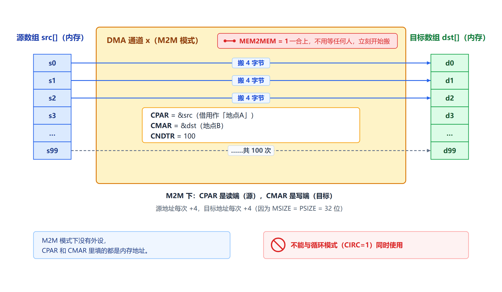

看图时按这个顺序：

1. **左边画一个数组条**，标题"源数组 src[]（内存）"，格子里写 s0、s1、s2……s99。
2. **右边画一个数组条**，标题"目标数组 dst[]（内存）"，格子里写 d0、d1、d2……d99。
3. **中间画一个方框**，标题"DMA 通道 x（M2M 模式）"，框里写三行：`CPAR = &src`（借用作"地点A"）、`CMAR = &dst`（地点B）、`CNDTR = 100`。
4. **框内右上角画一个红色的小开关**，标 `MEM2MEM = 1`，旁边写"这个开关一合上，DMA 不用等任何人，立刻开始搬"。
5. **从 src 画 100 条箭头到 dst**（只画 3 条实线 + 一条省略号表示 100 条），每条箭头旁标"搬 4 字节"。
6. **框下方写一行**："源地址每次 +4，目标地址每次 +4（因为 MSIZE=PSIZE=32 位）"。
7. **右下角画一个禁止符号（红圈斜杠）**，写"不能与循环模式同时使用"。
8. **配色**：源数组蓝 #DBEAFE，目标数组绿 #DCFCE7，DMA 方框浅黄 #FEF3C7，禁止符号红 #DC2626。

---

### 补充例 2：用 DMA 从内存往串口发送数据（习题 11-3 的关键一步）

【补充解释】教材习题 11-3 要求"把 ADC 通道 2 测量的电源电压通过串口 1 传送到计算机"。**如果只用 `printf` 一个字符一个字符发，那就没用上 DMA 的好处。** 真正体现 DMA 价值的做法是"**用 DMA 批量往串口发**"。这里补充讲一下。

#### 目标

> **把 `msg[]` 这个字符串数组，通过 USART1 一次性发出去，CPU 不用管。**

#### 第一步：查表确定通道

从表 11-2 查：**`USART1_TX` 对应 DMA1 的通道 4**。

```
表 11-2 里：
USART 那一行 → 通道 4 那一列 → USART1_TX
```

**所以要用 `DMA1_Channel4`。**（**不能随便选别的通道！**）

#### 第二步：算出 USART1 数据寄存器的地址

```
USART1 基地址 = 0x40013800（APB2 上）
USART_DR 偏移 = 0x04
USART1_DR 地址 = 0x40013800 + 0x04 = 0x40013804
```

#### 第三步：写配置代码

```c
#define USART1_DR_Address  ((u32)0x40013804)

u8 msg[] = "Hello STM32 DMA!\r\n";

void DMA_USART_TX_Config(void)
{
    DMA_InitTypeDef DMA_InitStructure;

    RCC_AHBPeriphClockCmd(RCC_AHBPeriph_DMA1, ENABLE);   // 开 DMA1 时钟

    DMA_DeInit(DMA1_Channel4);                            // 复位通道 4

    DMA_InitStructure.DMA_PeripheralBaseAddr = USART1_DR_Address;  // 外设端 = USART1->DR
    DMA_InitStructure.DMA_MemoryBaseAddr     = (u32)msg;           // 存储器端 = 数组 msg
    DMA_InitStructure.DMA_DIR = DMA_DIR_PeripheralDST;             // ★ 外设是"目标"
    DMA_InitStructure.DMA_BufferSize = sizeof(msg) - 1;            // 要发的字节数
    DMA_InitStructure.DMA_PeripheralInc = DMA_PeripheralInc_Disable; // 外设地址不动
    DMA_InitStructure.DMA_MemoryInc     = DMA_MemoryInc_Enable;      // ★ 内存地址要走
    DMA_InitStructure.DMA_PeripheralDataSize = DMA_PeripheralDataSize_Byte;  // 8 位
    DMA_InitStructure.DMA_MemoryDataSize     = DMA_MemoryDataSize_Byte;      // 8 位
    DMA_InitStructure.DMA_Mode = DMA_Mode_Normal;                  // ★ 正常模式
    DMA_InitStructure.DMA_Priority = DMA_Priority_Medium;
    DMA_InitStructure.DMA_M2M = DMA_M2M_Disable;

    DMA_Init(DMA1_Channel4, &DMA_InitStructure);

    USART_DMACmd(USART1, USART_DMAReq_Tx, ENABLE);   // ★ 打开 USART1 的 DMA 发送请求
    DMA_Cmd(DMA1_Channel4, ENABLE);                  // 启动 DMA 通道
}
```

#### 和例 11-1 的对比（这次是"往外发"）

| 对比项 | 例 11-1（ADC → 内存） | 本例（内存 → 串口） |
|---|---|---|
| 通道 | DMA1 通道 1（ADC1 专用） | **DMA1 通道 4**（USART1_TX 专用） |
| `CPAR`（外设端） | `ADC1->DR` = 0x4001244C | **`USART1->DR` = 0x40013804** |
| `CMAR`（存储器端） | 变量地址 | **数组地址** |
| `DIR` | `PeripheralSRC`（外设是源） | **`PeripheralDST`（外设是目标）** |
| `PINC` | `Disable` | `Disable`（数据寄存器地址只有一个，不动） |
| `MINC` | `Disable`（只有一个变量） | **`Enable`**（数组，地址要走） |
| `Mode` | `Circular`（循环） | **`Normal`**（发完就停） |
| 数据宽度 | 16 位（ADC 的 DR 是 16 位） | **8 位**（串口一个字节一个字节发） |
| 外设侧的开关 | `ADC_DMACmd(ADC1, ENABLE)` | **`USART_DMACmd(USART1, USART_DMAReq_Tx, ENABLE)`** |

**⚠️ 一个必须注意的点：`BufferSize = sizeof(msg) - 1`**

**为什么要减 1？**

因为 C 语言的字符串在末尾会**自动多一个 `'\0'`**（字符串结束标志，值为 0）。

```
msg[] = "Hi"
内存里实际是： 'H'  'i'  '\0'      ← 3 个字节！
sizeof(msg) = 3
```

**但我们不想把那个 `'\0'` 也发到串口去**（串口助手会显示一个奇怪的字符，或者干脆看不见）。所以要**减掉 1**。

**"Hi" 的长度是 2 个字符，`sizeof(msg) - 1 = 2` ✓**

**类比**：`'\0'` 是"这段话说完了"的标记，是给 C 语言看的，不是给串口对面的人看的。

**⚠️ 另一个"坑"：为什么 `USART_DMACmd` 要在 `DMA_Cmd` 之前？**

**严格说，顺序没有硬性要求**，但**推荐"先让外设准备好发请求，再打开 DMA 通道"**，理由是：

> 如果先打开 DMA 通道，`EN=1` 后外设请求一进来就立刻开始搬。而此时 USART 的 DMA 请求开关可能还没开，时序上会有些微妙。
> **稳妥的做法**：先开外设侧的请求开关，最后再 `DMA_Cmd(..., ENABLE)` 打开通道。这样"上游准备好了，下游才开闸"。

**⚠️ 还有一个"发完了怎么知道"的问题**：

因为用了 `Normal` 模式，发完 `BufferSize` 个字节后，DMA 会置 `TCIF4`，然后停止。

**如果你要"发完再发下一段"，就要**：

1. 等 `TCIF4` 置 1（轮询或中断）；
2. **先 `DMA_Cmd(DMA1_Channel4, DISABLE)` 关掉通道**（因为要改 `CNDTR`）；
3. 重新写 `CNDTR`（可以再调用一次 `DMA_Init`，或直接写 `DMA1_Channel4->CNDTR = 新长度;`）；
4. 清标志 `DMA_ClearFlag(DMA1_FLAG_TC4);`
5. 再 `DMA_Cmd(DMA1_Channel4, ENABLE)`。

**这就是"正常模式"的完整使用套路**，请记住这个"关 → 改 → 清 → 开"的四步。

**⚠️ 补充一个实际工程中非常重要的经验（教材没讲）**：

> **用 DMA 发送串口数据时，必须等"这一批真的发完了"才能改 `msg` 的内容或重新启动 DMA。**
> 如果 DMA 还在发，你就把 `msg` 改了，发出去的就是"半新半旧"的乱数据。
> **判断"真的发完"的方法是：`TCIF` 置 1 之后，还要再等 USART 的 `TC` 标志置 1**（因为 DMA 只保证"数据都写进 `USART1->DR` 了"，不保证"最后一位已经从引脚发出去了"）。
> 这是 DMA + 串口发送最容易出的 bug，实际项目中务必注意。

---

### 补充例 3：习题 11-4 的思路（DAC + DMA 输出正弦波）

【补充解释】习题 11-4 要求"用 DMA 方式输出正弦波"。这里给出思路和关键点，不写完整代码。

#### 为什么正弦波要用 DMA？

因为要输出一个**连续变化**的波形，就必须**不停地往 DAC 写新值**：

```
正弦波一个周期要 100 个点 → 每 20 微秒就要写一个新值
如果 CPU 亲自写 → CPU 被绑死了
用 DMA → 把 100 个点的表放在数组里，DMA 循环地往 DAC 搬，CPU 完全自由
```

#### 关键点 1：查表确定通道

从表 11-3 查：

```
DAC 通道 1 → DMA2 的通道 3（表 11-3 里 "TIM6/DAC通道1" 那一行，通道 3 那一列）
DAC 通道 2 → DMA2 的通道 4
```

**所以要用 `DMA2_Channel3`。**

**⚠️ 这是"必须查表"的又一个典型例子**：DAC 只能用 DMA2，不能用 DMA1。

#### 关键点 2：DAC 的数据寄存器地址

```
DAC 基地址 = 0x40007400（APB1 上）
DAC_DHR12R1 偏移 = 0x08   （12 位右对齐、通道 1 的数据保持寄存器）
DAC 通道1 数据寄存器地址 = 0x40007400 + 0x08 = 0x40007408
```

#### 关键点 3：用循环模式 + 半传输中断

```c
DMA_InitStructure.DMA_Mode = DMA_Mode_Circular;   // 循环，波形才会连续
```

**为什么要循环？** 因为正弦波要**周期性地重复**。数组里存一个周期的 100 个点，DMA 循环搬，DAC 就周期性地输出同一个波形。

**为什么要半传输中断？** 可以在搬到一半时更新后一半的数据（比如要改变频率或幅度时），实现"无缝切换"。

#### 关键点 4：谁触发 DMA？

**DAC 自己可以触发**。用 `DAC_DMACmd(DAC_Channel_1, ENABLE)` 打开 DAC 的 DMA 请求。

也可以用**定时器触发**（TIM6 的更新事件），这样**波形的频率由定时器精确控制**：

```
TIM6 每 20 微秒产生一次更新事件 → 触发 DAC 转换 → DAC 发出 DMA 请求 → DMA 搬下一个点
```

**这是"定时器 + DAC + DMA"三件套的经典用法**，能产生频率非常精确的波形。

#### 关键点 5：正弦波表怎么来？

```c
// 在 PC 上用 Excel 或程序算好 100 个点：
// 值 = 2048 + 2047 * sin(2π × i / 100)   （12 位 DAC，中点在 2048）
const u16 sine_table[100] = { 2048, 2176, 2303, ... };
```

**为什么要"中点在 2048"？**

因为 12 位 DAC 的输出范围是 0~4095。**如果直接把正弦波放在 0~4095 里，输出波形会"贴地"（负半周被削掉）。**

**正确做法**：把"零点"抬到中间 2048，让波形在 0~4095 之间摆动：

```
sin 值 +1  → 2048 + 2047 = 4095
sin 值  0  → 2048
sin 值 -1  → 2048 - 2047 = 1
```

**类比**：像给一个只能输出正电压的电源加一个"直流偏置"，让交流信号骑在它上面。

---

## 11.6 习题提示

【教材内容】教材 11.6 的四道习题：

---

### 习题 11-1：简述 STM32F103VET6 的 DMA 模块的特点。

**答题要点**：直接背 11.1 末尾"考试怎么答"里那 6 条。

---

### 习题 11-2：DMA 技术和中断技术有什么本质区别？

**答题要点**：直接背 11.2 末尾"考试怎么答"里的 4 点。

**一句话版**：

> **中断是"通知机制"（告诉 CPU 发生了什么），DMA 是"代劳机制"（替 CPU 搬数据）。中断方式下 CPU 是搬运工，DMA 方式下 DMA 是搬运工。两者不是互相取代，而是配合使用：DMA 减少了中断次数，但没有取消中断。**

---

### 习题 11-3：编程实现使用 DMA 串行通信方式，将 STM32F103VET6 的 ADC 通道 2 测量的电源电压通过串口 1 传送到计算机。

**思路分解**：

**第 1 步：ADC 采集部分（改自例 11-1）**

| 要改的地方 | 例 11-1 的值 | 本题的值 | 为什么 |
|---|---|---|---|
| GPIO 引脚 | PA1（ADC 通道 1） | **PA2（ADC 通道 2）** | 题目要求用通道 2 |
| GPIO 模式 | `GPIO_Pin_1` + `GPIO_Mode_AIN` | **`GPIO_Pin_2` + `GPIO_Mode_AIN`** | 同上 |
| ADC 通道 | `ADC_Channel_1` | **`ADC_Channel_2`** | 同上 |
| DMA 通道 | DMA1 通道 1 | **DMA1 通道 1**（不变） | ADC1 固定用通道 1 |

**⚠️ 注意**：`ADC_Channel_2` 对应的引脚是 **PA2**。如果硬件上电源电压接在别的引脚上，就要改成对应的通道。

**第 2 步：串口发送部分**

**有两种做法，建议用"做法 B"（更符合题目"使用 DMA 串行通信方式"的要求）：**

**做法 A（简单，但没用 DMA 发送）**：像例 11-1 一样，用 `printf` 一个字符一个字符发。

**做法 B（用 DMA 发送）**：

1. 把要发的字符串格式化到**一个全局数组**里（注意不能用 `printf` 直接到串口，因为 `printf` 是逐个字符发的）；
   - 可以用 `sprintf(buf, "Volt = %d mV\r\n", 电压值);`
2. 查表确定 `USART1_TX` 用 **DMA1 通道 4**；
3. 配置 `DMA1_Channel4`：`CPAR = 0x40013804`，`CMAR = (u32)buf`，`DIR = PeripheralDST`，`PSIZE=MSIZE=8 位`，`PINC=Disable`、`MINC=Enable`，`Mode = Normal`；
4. 打开 `USART_DMACmd(USART1, USART_DMAReq_Tx, ENABLE)`；
5. `DMA_Cmd(DMA1_Channel4, ENABLE)`；
6. 主循环里：等 ADC 有新值 → `sprintf` 到缓冲区 → **关通道、改 `CNDTR`、清标志、开通道**（见补充例 2 的四步套路）。

**⚠️ 本题最容易出错的三点**：

1. **忘了开 DMA 的时钟**（`RCC_AHBPeriphClockCmd`）；
2. **忘了 `ADC_DMACmd(ADC1, ENABLE)`**（ADC 不会发 DMA 请求）；
3. **用 DMA 发送时，`BufferSize` 算错**（漏了 `\0`，或者把字节数算成了字符数）。

**第 3 步：电压换算**

如果测的是**电源电压**（可能比 3.3V 高），通常硬件上会有一个**分压电路**（比如 10:1 分压）。那么换算时要乘回分压比：

```
实际电压 = ADC值 × 3300 / 4096 × 分压倍数
```

**⚠️ 注意**：ADC 的输入电压**不能超过 3.3V**（否则可能损坏芯片）。所以测电源电压必须加分压。

---

### 习题 11-4：编程实现使用 STM32F103VET6 的 DAC 的 DMA 方式输出正弦波。

**答题要点**：直接参考前面的"补充例 3"，关键点有 5 个：

1. **DAC 通道 1 对应 DMA2 通道 3**（必须查表 11-3）；
2. **`DMA2` 的时钟要开**：`RCC_AHBPeriphClockCmd(RCC_AHBPeriph_DMA2, ENABLE)`；
3. **必须用循环模式**（`DMA_Mode_Circular`），波形才会连续重复；
4. **正弦表的中点在 2048**，值域 1~4095；
5. **打开 DAC 的 DMA 请求**：`DAC_DMACmd(DAC_Channel_1, ENABLE)`，并且要**使能 DAC 的触发源**（`DAC_Trigger_T6_TRGO` 等）。

---

## 11.7 容易搞混的地方（专治"一看就会，一做就错"）

### 1. DMA 不是"不用 CPU"，而是"不用 CPU 逐字节参与"

**❌ 错误理解**："有了 DMA，CPU 就完全不用管了。"
**✅ 正确理解**：CPU 要做三件事：

- 初始化时**配置** DMA；
- 运行时和 DMA **共享总线**（会被短暂挡一下）；
- 传输结束时**响应中断**（如果用中断的话）。

### 2. `CNDTR` 记的是"项数"，不是"字节数"

**❌ 错误理解**：`BufferSize = 256` 就是搬 256 个字节。
**✅ 正确理解**：`BufferSize = 256` 是搬 **256 项**。每项几字节由数据宽度决定：

| 宽度 | 256 项 = 多少字节 |
|---|---|
| 8 位 | 256 |
| 16 位 | 512 |
| 32 位 | 1024 |

### 3. `CNDTR = 0` 时，什么也不搬（不是"搬 65536 项"）

**❌ 错误理解**：0 表示"借位后变成最大值"。
**✅ 正确理解**：0 就是 0，**一项都不搬**。所以配置时千万别把 `BufferSize` 设成 0。

### 4. `ISR` 只读，清标志要写 `IFCR`，而且是"写 1 清除"

**❌ 错误做法**：`DMA1->ISR = 0;`（想清标志）
**✅ 正确做法**：`DMA1->IFCR = 0x0000000F;`（写 1 到想清的位）

**记住**：`IFCR` 的每一位是"**按钮**"不是"**开关**"。写 1 = 按下去；写 0 = 不碰。

### 5. `CGIFx` 写 1 会一次清 4 个标志

**❌ 错误理解**：写 `CGIF4=1` 只清 `GIF4`。
**✅ 正确理解**：会同时清掉 `TEIF4`、`HTIF4`、`TCIF4`、`GIF4` 四个。

### 6. `EN = 1` 之后，`CPAR` / `CMAR` / `CNDTR` 就改不了了

**❌ 错误做法**：通道开着的时候直接改 `CNDTR` 想"接着搬"。
**✅ 正确做法**：`关通道 → 改 CNDTR → 清标志 → 开通道`。

### 7. `CPAR` / `CMAR` 读出来永远是初始值

**❌ 错误理解**：读到 `CMAR` 就知道"现在搬到哪了"。
**✅ 正确理解**：`CMAR` 永远是初始地址。**想知道进度，读 `CNDTR`。**

### 8. 外设与通道的映射是"硬件焊死的"，不能自己选

**❌ 错误做法**：想用 ADC1，却配了 `DMA1_Channel3`。
**✅ 正确做法**：**先查表 11-2 / 表 11-3（或图 11-2 / 11-3），再决定用哪个通道。**

**常用对应关系（背下来）：**

| 外设 | 通道 |
|---|---|
| **ADC1** | **DMA1 通道 1** |
| **SPI1_RX** | DMA1 通道 2 |
| **SPI1_TX** | DMA1 通道 3 |
| **USART1_TX** | **DMA1 通道 4** |
| **USART1_RX** | DMA1 通道 5 |
| **USART2_RX** | DMA1 通道 6 |
| **USART2_TX** | DMA1 通道 7 |
| **ADC3** | DMA2 通道 5 |
| **DAC 通道 1** | **DMA2 通道 3** |
| **DAC 通道 2** | DMA2 通道 4 |

### 9. `MEM2MEM` 不能和循环模式同时使用

**❌ 错误做法**：M2M + `DMA_Mode_Circular`。
**✅ 正确做法**：M2M 只能用 `DMA_Mode_Normal`。

### 10. 优先级：`10` 是"高"，`01` 是"中等"（不是数字越大越高）

| `PL[1:0]` | 二进制值 | 优先级 |
|---|---|---|
| `00` | 0 | 低 |
| `01` | 1 | **中等** |
| `10` | 2 | **高** |
| `11` | 3 | 最高 |

### 11. `DIR` 位和库函数宏的对应是"反"的

| 库函数宏 | `DIR` 位 | 数据流向 |
|---|---|---|
| `DMA_DIR_PeripheralSRC`（外设是源） | **0** | 外设 → 内存 |
| `DMA_DIR_PeripheralDST`（外设是目标） | **1** | 内存 → 外设 |

**记法**：**"SRC" 配 0，"DST" 配 1。**

（上表说的是**正常模式**（外设 ⇄ 存储器）下的对应关系。**M2M 模式是特例**：两端都是内存，方向由地址寄存器决定——`CPAR` 填源、`CMAR` 填目标，照 ST 官方例程写就行，详见 11.2.3 第 5 小节和 11.5 补充例 1。）

### 12. `DMA_ITConfig()` 打开了，中断还是不来？

**因为 NVIC 那边的开关没开！**

```
DMA 侧的开关：DMA_ITConfig(DMA1_Channel5, DMA_IT_TC, ENABLE);
NVIC 侧的开关：NVIC_Init(...)   ← 别忘了这个！
两个都开，中断才会来。
```

### 13. 忘了开时钟，程序"静默地"不工作

**症状**：程序编译通过、下载成功、也不报错，但 DMA 一点反应都没有。
**原因**：`RCC_AHBPeriphClockCmd(RCC_AHBPeriph_DMA1, ENABLE);` 漏了。

**这是 STM32 编程第一大坑。** 遇到"外设完全不工作"，**第一个要检查的就是时钟。**

### 14. 被 DMA 或中断改写的变量，必须加 `volatile`

**症状**：变量明明被 DMA 写了，但程序读出来永远是初始值（比如 0）。
**原因**：没加 `volatile`，编译器把它优化成常量了。

```c
volatile u16 ADC_ConvertedValue;   // ✅ 必须加 volatile
```

---

## 11.8 本章真正要记住什么（一页纸总结）

### 一、核心概念

| 概念 | 一句话 |
|---|---|
| **DMA** | Direct Memory Access，直接存储器存取。专门替 CPU 搬数据的硬件模块 |
| **为什么需要** | CPU 亲自搬太浪费；中断太频繁会把 CPU 拖垮。DMA 把"一批数据"包下来，只在整批完成后中断一次 |
| **STM32F103VET6 的规模** | 2 个 DMA 控制器，共 12 个通道（DMA1 七个，DMA2 五个） |
| **主设备 / 从设备** | DMA 是总线的主设备（能主动读写）；同时它内部有 AHB 从设备接口供 CPU 配置 |
| **一次传输的 3 步** | 读源 → 写目标 → CNDTR 减 1 |
| **握手** | 外设发请求 → DMA 回应答 → 外设撤请求 → DMA 撤应答 |
| **仲裁** | 软件优先级（4 级）> 通道编号（小号优先）> DMA1 > DMA2 |
| **总线争用** | CPU 和 DMA 共享总线，循环调度保证 CPU 至少得到一半时间 |

### 二、通道配置 6 步

```
① CPAR ← 外设地址
② CMAR ← 存储器地址
③ CNDTR ← 要搬多少项
④ CCR.PL ← 优先级
⑤ CCR 的其它位 ← 方向 / 循环 / 增量 / 宽度 / 中断使能
⑥ CCR.EN ← 1（最后一步！）
```

### 三、六个寄存器

| 寄存器 | 偏移 | 作用 | 关键点 |
|---|---|---|---|
| `ISR` | 0x00 | 看事件标志 | **只读** |
| `IFCR` | 0x04 | 清事件标志 | **只写，写 1 清除** |
| `CCR` | 0x08+0x14(x−1) | 总控制面板 | 位序要背 |
| `CNDTR` | 0x0C+0x14(x−1) | 还剩多少项 | **项数不是字节数；0 = 不搬** |
| `CPAR` | 0x10+0x14(x−1) | 外设地址 | EN=1 后不能写；读出来是初始值 |
| `CMAR` | 0x14+0x14(x−1) | 存储器地址 | 同上 |

### 四、`CCR` 位序（必背）

```
bit14      MEM2MEM
bit13:12   PL[1:0]     00低 01中 10高 11最高
bit11:10   MSIZE[1:0]  00=8位 01=16位 10=32位
bit 9: 8   PSIZE[1:0]  00=8位 01=16位 10=32位
bit 7      MINC        存储器地址增量
bit 6      PINC        外设地址增量
bit 5      CIRC        循环模式
bit 4      DIR         0=从外设读 1=从存储器读
bit 3      TEIE        允许传输错误中断
bit 2      HTIE        允许半传输中断
bit 1      TCIE        允许传输完成中断
bit 0      EN          通道开启
```

### 五、三种事件 / 三个使能

| 事件标志 | 使能位 | 含义 |
|---|---|---|
| `HTIFx` | `HTIE` | 半传输 |
| `TCIFx` | `TCIE` | 传输完成 |
| `TEIFx` | `TEIE` | 传输错误 |

**`GIFx = TEIFx 或 HTIFx 或 TCIFx`**

### 六、10 个库函数

```
配置类：DMA_DeInit / DMA_Init / DMA_StructInit / DMA_ITConfig
控制类：DMA_Cmd
查询类：DMA_GetCurrDataCounter / DMA_GetFlagStatus / DMA_ClearFlag
        / DMA_GetITStatus / DMA_ClearITPendingBit
```

### 七、写 DMA 程序的"标准套路"

```
1. 开时钟（RCC_AHBPeriphClockCmd）        ← 最容易忘！
2. 查表确定通道（表 11-2 / 11-3）           ← 不能自己选！
3. DMA_DeInit()  复位通道
4. 填 DMA_InitTypeDef 的 11 个成员
5. DMA_Init()   写进寄存器
6. （可选）DMA_ITConfig() + NVIC_Init()
7. 打开外设侧的 DMA 请求（ADC_DMACmd / USART_DMACmd / DAC_DMACmd）
8. DMA_Cmd(..., ENABLE)   最后开闸
```

---

## 待核验

以下是本次重构过程中发现的、需要回到原始 PDF 核验的疑点。**按页码排列。**

| 序号 | 页码 | 疑点 | 我的处理 |
|---|---|---|---|
| 1 | p172（表 11-1） | 表格最后 4 行（32 位→32 位）的"传输操作"栏，MinerU 解析为"在 0x0 读 B3B2B1B0[31:0]，在 0x0 **读** B3B2B1B0[31:0]"。第二个动作按上下文应为"**写**" | 已按"读 + 写"理解并在正文中说明 |
| 2 | p174 | "当 HSIZE = 字节时，写入字节 0xAB，DMA 将设置 HWDATA 总线为 **0xABABABABAB**"。这个数有 40 位，超出 32 位总线宽度，应为 **0xABABABAB**（重复 4 次） | 已在正文中指出并给出正确值 |
| 3 | p174 | "如果要写入 APB 后备寄存器（与 32 位地址对齐的 16 位寄存器），需要配置 MSIZE 为 16 位、PSIZE 为 32 位"。这个配置方向（源 16、目标 32）与"写入 16 位寄存器"的直觉关系需要核验原图/原文语境 | 原文照录，未做改写 |
| 4 | p175（表 11-2） | "TIM1 / 通道 4"一格解析为 `TIM1_TX4TIM1_TRIGTIM1_COM`，其中 "TX4" 应为 "**CH4**"（OCR 把 `CH4` 认成了 `TX4`） | 已按 `TIM1_CH4 / TIM1_TRIG / TIM1_COM` 校正，并在正文标注。（原注里多写的"表中漏列 TIM1_CH4"是自相矛盾的说法，已删除） |
| 5 | p176（表 11-3） | "UART4 / SDIO"一格解析为 `UART4 SDIO`，与同行的 `UART4_RX` / `SDIO` / `UART4_TX` 三个值的关系需核验 | 已按图 11-3 校正，并在正文标注 |
| 6 | p177 | 偏移公式原文为"**0x08+20x（通道编号-1）**" | **已核对通过，教材没有错**：公式里的"20"是**十进制**（十进制 20 = 十六进制 0x14），代入后通道 1 / 2 / 3 分别得 0x08 / 0x1C / 0x30，与教材 11.4.1 的地址宏完全一致——教材只是在一个公式里混用了十进制和十六进制。（本讲义上一版把它判成 OCR 错字，属误判，已在正文更正并补上验算） |
| 7 | p178～p180 | `CNDTR` / `CPAR` / `CMAR` 的偏移公式同样写成 "0x0C+20x" / "0x10+20x" / "0x14+20x"，同第 6 条 | **已核对通过，教材没有错**：同上，这里的"20"也是十进制 = 0x14；本讲义正文统一写成 `0x0C + 0x14 × (x−1)` 等，只是换了进制写法 |
| 8 | p180 | 结构体名写作 `DMA_Cannel_TypeDef`（少一个 h），应为 `DMA_Channel_TypeDef` | 已按正确拼写处理 |
| 9 | p181 | DMA2 的 5 个通道宏写成 `AHBPERIPH + 0x0408` 等，缺少 `_BASE` 后缀，应为 `AHBPERIPH_BASE + 0x0408` | 已按正确写法处理 |
| 10 | p183 | "典型 DMA 初始化实例"中 `DMA_PeripheralBaseAddr = 0x40005400`，教材未说明这是哪个外设。按 STM32F103 映射，0x40005400 是 I2C1 基地址，但代码用的是 `DMA1_Channel1`（服务 ADC1/TIM2_CH3/TIM4_CH1），两者不匹配 | 已在正文中说明这只是"参数写法模板"，不能直接运行；建议核验教材是否另有说明 |
| 11 | p188～p190 | 例 11-1 的 `printf(".../r/n")` 中 `/r/n` 应为 `\r\n`；`#ifdef __GNUC_` 应为 `__GNUC__`；`__io putchar` 应为 `__io_putchar`；`# else` / `# endif` 应为 `#else` / `#endif` | 已按正确 C 语法在正文代码中修正，并标注 |
| 12 | p188 | 例 11-1 正文说"光敏电阻电路如图 **3-12** 所示" | **已核对通过，教材的图号没有错**：第 3 章 p91 的图 3-12 就是"ADC 采集电路"（最小系统板上光敏电阻经 SW4 开关接到 PA1 的那张电路图，见 `tools/index/ch03_source.md`）。MinerU 把图 3-11 与图 3-12 合并成了同一条记录／同一个图片文件，所以 `figures.md` 里只登记了"图3-11"、单独查"图3-12"查不到。正文已改为引用教材图 3-12 原图，并保留第 10 章图 10-22 作对照 |
| 13 | p190 | `ADC_RegularChannelConfig` 那一行的**注释**写"采样时间 239.5 个周期"，但**代码参数**是 `ADC_SampleTime_55Cycles5`（55.5 个周期），注释与代码矛盾 | 按代码为准（55.5 周期），并标注矛盾 |
| 14 | p171 / 11.2.2 | "DMA1 控制器的优先级高于 DMA2 控制器的优先级"——教材未说明这条规则的精确触发条件（是"通道编号相同时才比"还是"任何时候都比"） | 正文按"先比软件优先级 → 再比通道编号 → 最后比控制器"讲解，并说明以参考手册为准 |
| 15 | p180（11.4 开头） | 正文说"DMA 控制器提供 **7 个**数据通道的访问"，但 STM32F103VET6 实际有 12 个通道（DMA1 七个 + DMA2 五个） | 已核对：教材这句讲的是 **DMA1**（这一节的 C 结构体和库函数都按 DMA1 的 7 个通道命名）。正文 11.4.1 开头已补上"7 个 与 12 个的区别"专门解释，读者不会再分不清 |
| 16 | p170（图 11-1） | 图中画了"以太网 MAC"和"USB OTG FS"，但 STM32F103VET6 不含以太网 MAC（带以太网的是 STM32F107 互联型） | 已在正文中标注该图疑为 STM32F1 系列通用框图，不影响本章 DMA 知识 |
| 17 | p170 | 教材 11.1 特征（4）原文"独立数据源和目标数据区的传输宽度(字节、半字、全字)是独立的，模拟打包和拆包的过程"——"模拟"疑为"模拟（模仿）"之意，也可能应为"实现"。语义需核验 | 正文按"模仿打包拆包的过程"理解 |
| 18 | p187（11.5 开头） | 教材把"开启 DMA 时钟"列为第（1）步，但例 11-1 的代码里 `RCC_Config()` 确实包含 `RCC_AHBPeriphClockCmd(RCC_AHBPeriph_DMA1, ENABLE)`，与流程一致 ✓（此条已核对通过，无需修改，仅记录） | 已核对通过 |
| 19 | p171～p172（11.2.3 第 5 小节）、p183（`DMA_DIR` 参数） | **M2M 模式下 `DIR` 位的精确语义教材没有展开**（教材只讲了 `MEM2MEM` 位本身）。本讲义按 ST 官方 M2M 例程的写法给出实用规则：`CPAR` 填源（读端）、`CMAR` 填目标（写端）、`DIR = DMA_DIR_PeripheralDST`，搬运方向就是"源 → 目标" | 已按此规则统一修正 11.2.3 第 5 小节与 11.5 补充例 1（这两处原来说法互相矛盾、还建议"改 DIR 试方向"，已改正）；建议有原始 PDF / 参考手册时按 M2M 一节复核 |

**说明**：以上疑点均来自 MinerU 解析文本 `tools/index/ch11_source.md`、教材原图（图 11-1、11-2、11-3）以及跨章素材 `tools/index/ch03_source.md`。**凡是我无法通过现有材料确定的地方，都已在正文中明确标注为"疑点"或"补充解释"，没有把推测当作教材原文。** 本次修订对第 4、6、7、12、15 条重新核对：其中第 6、7、12 条确认教材没有错（原判有误，已更正）；第 4 条删掉了自相矛盾的"漏列"说法；第 15 条已在正文补上解释。

---

### 图片作业索引（本讲义新生成的辅助图）

本讲义共申请生成 **16 张**辅助理解图，作业文件：`notes/images/jobs/ch11.json`（JSON 数组，16 条，每条都写明了输出文件、宽高、标题和详细绘图 spec）。

> **生成状态**：这 16 张图属于项目批量生成任务的一部分（`PROGRESS.md`"正在处理"一节记录：共 167 项图片作业正在批量生成）。**在图片生成出来之前，讲义里这 16 处图片位置会暂时显示为断链**——这是"还没有生成"，不是作业文件有问题。本次修订时执行 `ls notes/images/generated/ | grep -i ch11` 没有任何输出，说明 ch11 的图目前一张都还没有。

| 序号 | 文件 | 讲义中的题注（辅助理解图） |
|---|---|---|
| 1 | `ch11_dma_position.png` | DMA 在 STM32 系统中的位置 |
| 2 | `ch11_bus_contention.png` | CPU 与 DMA 争用总线的时间轴 |
| 3 | `ch11_dma_flow.png` | DMA 一次传输的完整流程 |
| 4 | `ch11_handshake.png` | DMA 请求与应答握手时序 |
| 5 | `ch11_arbiter.png` | 仲裁器如何选出一个通道 |
| 6 | `ch11_normal_vs_circular.png` | 正常模式与循环模式对比 |
| 7 | `ch11_width_align.png` | 数据宽度打包与拆包 |
| 8 | `ch11_endian.png` | 小端字节序在内存中的排布 |
| 9 | `ch11_dma_it.png` | DMA 中断的产生逻辑 |
| 10 | `ch11_channel_mapping.png` | 外设请求 → 通道 → 仲裁器 的映射关系 |
| 11 | `ch11_addr_chain.png` | DMA 的地址链：基地址 + 偏移 = 最终地址 |
| 12 | `ch11_register_map.png` | DMA1 寄存器地址分布 |
| 13 | `ch11_transfer_regs.png` | 三个核心寄存器如何控制一次 DMA 传输 |
| 14 | `ch11_lib_functions.png` | 10 个 DMA 库函数的分类 |
| 15 | `ch11_adc_dma_flow.png` | 例 11-1 的完整数据流：光敏电阻 → ADC → DMA → 串口 → 电脑 |
| 16 | `ch11_m2m.png` | 存储器到存储器（M2M）传输 |

（其中第 16 张为 11.5 补充例 1 配图。作业文件共 16 条。）

> **关于图片编号**：本讲义上一版给辅助图编了"图11-1a""图11-2a"……这样的号。这样容易和教材原图（图 11-1、图 11-2、图 11-3）混淆，也容易让人以为存在对应的教材原图。本次修订已去掉这类编号，辅助图一律使用描述性题注（与第 10 章等其它章节的做法一致）；上表里的"序号"只是本索引的排序号，**不是图号**。

---

### 引用教材原图清单

| 图号 | 教材原图文件 | 所在页 |
|---|---|---|
| 图 11-1 | `mineru/微机原理2/images/7329a2596cca88fe00c126b63b19e7a785c70e3c48efaa40ccb52e77284db4d7.jpg` | p170 |
| 图 11-2 | `mineru/微机原理2/images/c7bea778a76d6b6e0d4a370e060d9014fbd666f84662687b6c07b9033889d83d.jpg` | p175 |
| 图 11-3 | `mineru/微机原理2/images/07ff9a2c0185b1e2e8e72c29016717aa0c7151d57b5b8bc3bfa0228a7361763f.jpg` | p176 |
| 图 3-12（跨章引用，例 11-1 的光敏电阻采集电路） | `mineru/微机原理1/images/5357775a4766e3336c59f7780b49737fedde134f35e774606e99f655720d25f3.jpg` | p91 |
| 图 10-22（跨章引用） | `mineru/微机原理2/images/e59c41161a0645e3ec3d857eebc83b8b2a8cb5c280c46d8bc2685f2125b2e759.jpg` | p150 |

以上 5 个文件均已用 `ls` 确认存在。

（其中图 3-12 那个文件里，MinerU 把教材第 3 章的图 3-11 和图 3-12 放在同一张图片上，所以 `tools/index/figures.md` 里只登记了"图3-11 独立按键电路"这一条——这也是为什么单看图索引会以为"没有图 3-12"。）
