# 第 12 章 FSMC 控制器

> 本章对应教材《基于ARM的微机原理与接口技术——STM32嵌入式系统架构、编程与应用》（陈桂友）第 12 章。
> MinerU 分卷页码：原书 p192～p199 在"微机原理2"，其余（原书 p200～p230 左右）在"微机原理3"p0～p38。
> 素材来源：`tools/index/ch12_source.md`；教材原图 14 张（见文末"引用教材原图清单"）。
>
> **本章在全书知识地图上的位置**：第六层——"怎么提高数据搬运和外部扩展能力"。
> 上一层我们学了两件事：
> - 第 11 章 DMA：让"搬运工"替 CPU 搬**芯片内部**的数据；
> - 第 10 章 ADC/DAC：让**模拟世界**和数字世界互相转换。
>
> 这一章要解决的是另一个完全不同的问题：
> **STM32 芯片自己肚子里的存储器不够用，怎么往芯片外面接存储器？**
> 以及它的一个"副作用"——**怎么用一套存储器接口去驱动一块液晶屏（LCD）？**

---

## 12.0 先别急着看教材：这一章到底在干什么？

### 一句话版本

> **FSMC 就是 STM32 芯片伸到外面的一套"标准化插座"：只要外面的存储器或者屏幕"按这套插座的规矩接线"，STM32 就能像读写自己内部的内存一样，用一个地址就把数据读进来、写出去。**

### 一个具体的场景（先建立直觉）

假设你要做一个"电子相册"：

- STM32F103VET6 内部的 Flash 只有 512KB，RAM 只有 64KB；
- 一张 320×240 的彩色图片，16 位色，就要 320×240×2 = 153600 字节 ≈ 150KB；
- 也就是说，**一张图片就把芯片内部的 RAM 撑爆了**。

怎么办？往芯片外面接一块存储器芯片，比如一块 1MB 的 SRAM，专门放图片。

那么问题来了：

```
问题 1：STM32 怎么"告诉"外面那块芯片"我要第 100 个字节"？
问题 2：STM32 怎么把数据"送出去"？
问题 3：STM32 怎么知道"我现在是在跟外面这块芯片说话，而不是跟别的芯片说话"？
问题 4：外面那块芯片很慢（比如读一次要 55ns），STM32 跑得很快（一个周期 13.9ns），
        怎么保证"我伸手去拿数据的时候，数据已经准备好了"？
```

这 4 个问题，正好对应 FSMC 的 4 件工作：

| 问题 | 谁来解决 | 对应本章内容 |
|---|---|---|
| 1. 告诉外面"我要哪个字节" | **地址总线** | 12.3 地址映像 |
| 2. 把数据送出去/收回来 | **数据总线** | 12.4.1 接口信号 |
| 3. 决定"现在跟谁说话" | **片选信号 NE** | 12.4.1 接口信号 |
| 4. 等慢的存储器准备好 | **可编程时序**（ADDSET/DATAST…） | 12.4.3 时序 |

### 【类比】把 FSMC 想成"公司对外的标准化办事窗口"

想象一家大公司（STM32 芯片）：

- 公司内部有员工（CPU）、有内部文件柜（内部 Flash / RAM）；
- 但是公司业务太多，内部文件柜放不下，于是在公司外面租了一个仓库（外部 SRAM / NOR Flash）；
- 公司还想在大厅挂一块电子大屏（LCD）。

如果每次去仓库都要"现商量怎么交接"，那就乱套了。所以公司规定了一套**标准化流程**：

| 生活里的东西 | 对应到 STM32 里是什么 |
|---|---|
| 公司 | STM32 芯片 |
| 公司内部的员工 | Cortex-M3 内核（CPU） |
| 公司内部的文件柜 | 内部 Flash / SRAM |
| 公司外面的仓库 | 外部存储器（SRAM / NOR Flash / PSRAM） |
| 大厅里的电子大屏 | LCD 模块（在 FSMC 眼里它就是一块 SRAM） |
| **公司对外的标准化办事窗口** | **FSMC 控制器** |
| 窗口上写着"1 号窗口、2 号窗口…" | 4 个片选信号 NE1～NE4 |
| "我要 3 号货架的 5 号箱子" | 地址总线 A[25:0] |
| 真正搬进搬出的箱子 | 数据总线 D[15:0] |
| "现在开始搬" / "搬完了" 的指令 | 控制信号 NOE（读）/ NWE（写） |
| 仓库管理员说"我还没找到，等一下" | NWAIT 信号 |
| 公司规定"1 号窗口对接仓库 A，2 号窗口对接仓库 B" | 每个存储块独立配置寄存器 |

#### 【类比的边界】真实硬件并不是完全如此

必须说清楚几点，否则类比会把你带偏：

1. **FSMC 不是一个"人"，它是一小堆数字电路。** 它没有思想，只会严格按照你写进寄存器里的规则，在正确的时刻把地址、数据、控制信号拉高拉低。
2. **"办事窗口"其实只有一套，是"轮流用"的。** 教材原话是："FSMC 在任一时刻只访问一个外部设备。" 也就是说，同一时刻只有一个片选信号有效，其他外部设备都在旁边听着、但不搭理。
3. **"像读写内部内存一样"这句话要打个折扣。** 用起来是"像"，因为你可以直接写 `*(volatile uint16_t *)0x60000000 = 0x1234;`；但**速度不一样**，外部存储器慢得多，而且时序要你自己配。

### 本章要学什么（学习路线）

```
12.1  FSMC 是什么？它长什么样？（功能 + 4 大模块结构）
        ↓
12.2  FSMC 的"上游"：AHB 接口——32 位请求怎么变成 16 位访问
        ↓
12.3  FSMC 的"门牌号"：外部设备地址映像——为什么外接芯片也像"有地址的格子"
        ↓
12.4  外部存储器接口信号 + 5 种时序模式 + 时序参数怎么算
        ↓
12.5  FSMC 的 3 组寄存器（BCR / BTR / BWTR）逐位讲解
        ↓
12.6  固件库把这些寄存器包装成了什么函数？
        ↓
12.7  一个完整例子：用 FSMC 驱动 2.8 寸 TFT-LCD（逐行讲代码）
        ↓
12.8  习题 12-2 的思路：用 FSMC 外扩一片 SRAM
```

---

## 【先补一个前置知识】本章要用到的 8 个基础概念

这一章会反复用到下面这些词。如果你对其中任何一个还有一点模糊，请先花几分钟看完这一节。
（如果你已经比较熟，可以跳过，但建议至少扫一眼，确认自己没有误解。）

---

### 【先补一个前置知识 1：什么叫"总线"？为什么要有三种总线？】

**总线** = 英文 **Bus**。

大白话说：

> **总线就是"大家一起共用的一套线"。**
> CPU、存储器、外设每天都互相传东西。如果每两个设备之间都单独拉一套线，芯片里很快就会变成一张蜘蛛网。所以大家约定：**共用一套线，谁要用谁说话。**

总线通常分成三组，这就是本章标题里说的"**类似 8086 的三总线接口**"：

| 名字 | 英文 | 大白话 | 本章里对应什么信号 |
|---|---|---|---|
| **地址总线** | Address Bus | "我要找**哪一个格子**"的通道 | `A[25:0]` |
| **数据总线** | Data Bus | "真正搬运的**货物**"的通道 | `D[15:0]` |
| **控制总线** | Control Bus | "红绿灯和指挥信号"：是读还是写？现在开始还是结束？ | `NE`、`NOE`、`NWE`、`NADV` 等 |

**为什么叫"类似 8086 的三总线接口"？**

8086 是 Intel 早期的一款经典 CPU（第 1 章讲过），它把"地址、数据、控制"分成三组线引出来，外面接存储器、接接口芯片。后来这套做法成了事实标准。
FSMC 就是把 STM32 的引脚**按这套老规矩**组织起来——因为外面的存储器芯片（SRAM、NOR Flash）几十年来就是按这个规矩设计的。**你要跟它们打交道，就得按它们的规矩来。**

> **一句话记忆**：FSMC 把 STM32 内部"现代"的 AHB 总线，翻译成外部存储器听得懂的"传统三总线"。

---

### 【先补一个前置知识 2：什么叫"片选"（CS / NE）？】

**片选** = 英文 **Chip Select**，缩写 **CS**。在 STM32 的 FSMC 里它叫 **NE**（**N** 表示低电平有效，**E** 可能是 Enable）。

大白话场景：

> 一间教室里坐了 4 个学生（4 个外部芯片），老师喊："**3 号同学，你来回答**。"
> 只有 3 号同学站起来回答，其他 3 个同学当作没听见。
> 这句"3 号同学"，就是片选。

在电路上：

- FSMC 有 4 个片选输出：`NE1`、`NE2`、`NE3`、`NE4`；
- 每个外部芯片的 CS 引脚接到其中一个（或者由地址译码器决定）；
- **被选中的那个芯片，它的 NE 会被拉低（低电平有效）；没被选中的芯片 NE 保持高电平，它就不理数据总线**。

**为什么需要片选？**

因为地址总线、数据总线、控制总线是**所有外部设备共用**的。如果不加片选，你写一个数据，4 个芯片会同时往数据总线上送东西，那就打架了（术语叫**总线冲突**）。片选就是"点名"。

> **重要提醒**：本章所有以 **N** 开头的信号（NE、NOE、NWE、NADV、NBL、NWAIT）都是**低电平有效**。
> 教材原话："具有前缀'N'的信号表示低有效信号。"
> 也就是说：`NE = 0` 才是"选中"，`NE = 1` 是"没选中"。这一点初学者最容易搞反。

---

### 【先补一个前置知识 3：什么叫"存储器映射"？为什么外接的设备也像"有地址的格子"？】

这是本章**最核心**的一个前置知识，请务必看懂。

#### 第一层：先说人话

CPU 眼里其实没有"内存""Flash""LCD"这些概念。它只会做一件事：

```
"我要读 地址 X 里的数据"  或者  "我要往 地址 Y 写数据 Z"
```

至于"地址 X"背后到底是内存条、还是 Flash、还是液晶屏，**CPU 根本不知道，也不需要知道**。

所以，设计芯片的人就干了一件事：

> **把整个 4GB 的地址空间切成很多块，每一块分给一个东西。**

这就叫**存储器映射**（Memory Mapping，也叫"地址映像"）。

#### 第二层：画个图

STM32 的地址是 32 位的，所以地址范围是 `0x00000000` ~ `0xFFFFFFFF`，一共 4GB。

```
0xFFFFFFFF  +---------------------------+
            |         各种外设           |
0xE0000000  +---------------------------+
            |     Cortex-M3 内部外设      |  ← NVIC、SysTick、调试模块
0xA0000000  +---------------------------+
            |   ★ FSMC 自己的寄存器 ★    |  ← 本章 12.5 要讲的就是这里
0x90000000  +---------------------------+
            |   块4：PC 卡               |
0x80000000  +---------------------------+
            |   块3：NAND Flash          |
0x70000000  +---------------------------+
            |   块2：NAND Flash          |
0x60000000  +---------------------------+
            | ★ 块1：NOR/PSRAM/LCD ★     |  ← 本章 12.3、12.7 的重点
0x40000000  +---------------------------+
            |        片上外设            |  ← GPIO、定时器、串口…
0x20000000  +---------------------------+
            |        SRAM（64KB）        |
0x00000000  +---------------------------+
            |        Flash（512KB）      |
            +---------------------------+
```

（这张图在 `notes/02_Cortex-M3处理器.md` 和 `notes/03_STM32控制器.md` 里都出现过，这里再用一次，因为本章全部建立在它上面。）

**关键点**：`0x60000000` 这一大段地址，**在芯片内部其实没有对应的物理存储器**。它是一段"空的地址"。FSMC 的作用就是：

> **把落在这段地址上的读写操作，"转发"到芯片外部的引脚上去。**

#### 第三层：正式说法

- **存储器映射**：把地址空间按区域分配给不同的存储器、外设，使 CPU 可以用统一的"读/写某个地址"的方式访问它们。
- **FSMC 外部设备地址映像**：FSMC 把 4 段固定的地址区域（0x60000000、0x70000000、0x80000000、0x90000000 开头）分别"绑定"到它外面的引脚上。

#### 【类比】

| 生活里的东西 | 对应到计算机里 |
|---|---|
| 一栋楼里的房间号 | 地址 |
| 整栋楼的房间号范围 | 地址空间 |
| 把 1 楼分给食堂、2 楼分给宿舍 | 存储器映射 |
| 2 楼的房间其实在隔壁另一栋楼里 | 外接存储器：**地址在 STM32 里，但硬件在外面** |
| 传达室大爷负责把"2 楼的快递"送到隔壁楼 | **FSMC** |

#### 【类比的边界】

"传达室大爷"是有脑子的，FSMC 没有。FSMC 只会做一件事：**看到地址落在 0x60000000～0x9FFFFFFF，就把它翻译成外部引脚上的电平变化**。它不会判断"这个地址合不合理"（除非你访问了被禁用的存储块，那时它会报一个 AHB 错误）。

---

### 【先补一个前置知识 4：什么叫"时钟周期"和 HCLK？】

**时钟** = Clock。**时钟周期** = 一个时钟节拍的时间。

大白话：

> 芯片里的一切动作都是"跟着节拍走"的，就像广播体操跟着口令："一、二、三、四"。
> **一个口令的时间，就是一个时钟周期。**

- **HCLK**：AHB 总线的时钟。FSMC 就是挂在 AHB 总线上的，所以 **HCLK 是 FSMC 的参考时钟**（教材原话："AHB 时钟 (HCLK) 是 FSMC 的参考时钟"）。
- STM32F103 最高主频 72MHz，也就是 HCLK 最高 72MHz。

那么一个 HCLK 周期有多长？

```
T = 1 / f = 1 / 72 000 000 秒 ≈ 0.0000000139 秒 = 13.9 ns（纳秒）
```

（1 纳秒 = 十亿分之一秒。1 秒里能塞下 7200 万个 HCLK 周期。）

**为什么这个概念在本章极其重要？**

因为本章所有的时序参数（ADDSET、DATAST、ADDHLD…）**都是用"HCLK 周期"做单位的**。比如教材说"ADDSET 的数值为 1 时，地址建立时间是 2 个 HCLK 周期"，你要能立刻换算成时间：

```
2 个 HCLK 周期 = 2 × 13.9 ns = 27.8 ns
```

然后拿这个 27.8ns 去和外部存储器的数据手册对比，看"够不够慢"。

**容易搞混的地方**：FSMC 里还有一个**另一个时钟 CLK**（外部存储器时钟），它不是 HCLK，它是 HCLK 分频得到的（见 12.4.4）。**两个时钟不要混**。

---

### 【先补一个前置知识 5：SRAM、ROM、NOR Flash、NAND Flash、PSRAM 分别是什么？】

教材里有一句话："请读者自行查阅 NOR 闪存、NAND 闪存和 PSRAM 的相关概念和特点。"
这句话把包袱甩给读者了。我们这里补上，但只补到"够看懂本章"为止。

| 名字 | 英文全称 | 中文名 | 大白话 | 特点 |
|---|---|---|---|---|
| **SRAM** | Static Random Access Memory | 静态随机存储器 | "**一直通电就一直记住**"的存储器 | 快、贵、容量小；掉电就忘（**易失**） |
| **ROM** | Read-Only Memory | 只读存储器 | "**出厂就写好，一般不改**"的存储器 | 只读（老式）；掉电不丢 |
| **NOR Flash** | NOR Flash Memory | NOR 型闪存 | "**可以随机读、读得快**"的闪存 | 掉电不丢（**非易失**）；能按地址随机读，适合**存代码** |
| **NAND Flash** | NAND Flash Memory | NAND 型闪存 | "**便宜、容量大，但必须一页一页读**"的闪存 | 掉电不丢；读要按"页"来，适合**存大文件**（U 盘、SSD） |
| **PSRAM** | Pseudo Static Random Access Memory | 伪静态随机存储器 | "**里面是 DRAM，但装成 SRAM 的样子给你用**" | 容量比 SRAM 大、比 SRAM 便宜，但需要芯片内部自己刷新；也叫 **CRAM**（Cellular RAM，单元随机存储器） |

**为什么名字里有个"伪"？**

真正的 SRAM 每个存储单元要用 6 个晶体管，很占面积。DRAM 只要 1 个晶体管 + 1 个电容，但需要不停地"刷新"（把电重新充一遍），而且接口很复杂。
PSRAM 的做法是：**里面用 DRAM 的存储单元（省面积），但自己内部带一套刷新电路和"看起来像 SRAM"的接口**。所以对使用者来说，它"表现得像 SRAM"，但本质上是 DRAM。这就是"伪静态"的意思。

> **本章重点**：教材明确说"限于篇幅，本书仅介绍 NOR 和 PSRAM 访问的相关内容"。所以 NAND 和 PC 卡我们只提到名字，不展开。

---

### 【先补一个前置知识 6：什么叫"读使能"和"写使能"？】

**读使能** = Output Enable，缩写 **OE**，在 FSMC 里叫 **NOE**。
**写使能** = Write Enable，缩写 **WE**，在 FSMC 里叫 **NWE**。

大白话：

> 存储器和人一样，**不能同时既读又写**（对同一时刻而言）。所以需要两根"指挥棒"：
> - **NOE 拉低** = "现在轮到**读**了：存储器你赶紧把数据放到数据总线上，让 STM32 拿走。"
> - **NWE 拉低** = "现在轮到**写**了：STM32 已经把数据放到数据总线上了，存储器你赶紧存进去。"

它们都是**低电平有效**（前面说过，带 N 前缀的都是低有效）。

**在时序图上看**：NOE 是一条"往下凹的坑"，坑底那段时间就是"读数据"的时间；NWE 也是一条坑，坑底就是"写数据"的时间。**坑有多宽，就是本章要算的 DATAST。**

---

### 【先补一个前置知识 7：什么叫"总线复用"（地址和数据共用一组线）？】

**复用** = Multiplexing。

大白话：

> 芯片的引脚是很宝贵的资源，多一根引脚就多一份成本。
> 所以有些存储器芯片想了个省事的办法：**地址的低 16 位和数据，共用同一组 16 根线**。
> 那怎么区分"这 16 根线现在传的是地址还是数据"呢？——靠一根额外的信号线来切换。这根线就叫 **NADV**（地址有效 / 锁存使能）。

时序上是这样：

```
第一步：先在这 16 根线上放"地址"，同时把 NADV 拉低，意思是"注意，这是地址！"
第二步：存储器把地址"锁存"进去（记在小本本上）。
第三步：NADV 拉高，这 16 根线改放"数据"。
```

**不复用** vs **复用**：

| | 不复用（Non-multiplexed） | 复用（Multiplexed） |
|---|---|---|
| 地址线 | 独立的 `A[25:0]` | 高 16 位 `A[25:16]` 独立，低 16 位和**数据共用** `AD[15:0]` |
| 需要 NADV 吗 | 不需要 | **需要**（用来区分地址还是数据） |
| 引脚数量 | 多 | 少 |
| 速度 | 快 | 略慢（要分两步走） |

FSMC 两种都支持，靠 **MUXEN** 这一位（BCR 的 bit1）来切换。

---

### 【先补一个前置知识 8：快速复习——寄存器、0x、位】

这三样东西前面章节反复讲过，这里只用一句话复习，因为本章会大量出现。

**寄存器**：芯片内部的一排"小开关"，每个开关叫一个 **bit**。程序给寄存器写一个数，就是拨动这些开关。本章的 `FSMC_BCR1`、`FSMC_BTR1`、`FSMC_BWTR1` 就是 FSMC 里控制时序的寄存器。

**0x**：这是 C 语言里表示"**十六进制**"的前缀。`0x1F` 就是十六进制的 1F。**1 个十六进制位 = 4 个 bit**，所以：

```
0x0001FFFE
= 0000 0000 0000 0001 1111 1111 1111 1110
  ↑        ↑        ↑
 bit31   bit16    bit1              bit0
```

一个 32 位的寄存器，写成十六进制就是 **8 位十六进制数**（因为 8 × 4 = 32）。

**位（bit）编号**：从右边开始数，最右边是 bit0。

```
bit:  31 30 ... 3  2  1  0
      ↑              ↑  ↑  ↑
     最高位         bit2 bit1 bit0
```

---

## 12.1 FSMC 的功能和结构

### 先别急着看教材：这一节到底要干什么？

这一节只干两件事：

1. **说清楚 FSMC 到底能干什么**（功能描述）；
2. **说清楚 FSMC 里面由哪几块电路组成**（结构）。

不要在这一节纠结时序参数，那些是 12.4 的事。这里只要建立一张"总图"。

---

### 用大白话理解

FSMC 全称是：

**FSMC**
= **F**lexible **S**tatic **M**emory **C**ontroller
= **灵活静态存储器控制器**

拆开解释：

| 单词 | 中文 | 大白话 |
|---|---|---|
| Flexible | 灵活 | "什么都能接"：SRAM、ROM、NOR Flash、PSRAM、NAND、PC 卡 |
| Static | 静态 | "接的是**静态**存储器"（SRAM 那一类）。注意：NAND Flash 其实不是静态存储器，但 STM32 把它也塞进 FSMC 管了 |
| Memory | 存储器 | "管的是存储器件" |
| Controller | 控制器 | "它是一个控制器"——**不是存储器本身，而是负责跟存储器打交道的那个中间人** |

**它是干什么的？** 教材给了两条主要作用，我们翻译成人话：

> **教材原文（12.1.1）**："FSMC 模块能够与同步或异步存储器或者 16 位 PC 存储器卡接口连接，其主要作用是：
> (1) 将 AHB 传输信号转换到适当的外部设备协议；
> (2) 满足访问外部设备的时序要求。"

翻译：

| 教材原文 | 大白话 |
|---|---|
| "将 AHB 传输信号转换到适当的外部设备协议" | STM32 内部说的是"AHB 语言"（32 位、高速、突发），外部存储器说的是"三总线语言"（8/16 位、慢、要等）。FSMC 就是**翻译官**。 |
| "满足访问外部设备的时序要求" | 外面那块芯片慢，FSMC 帮你在正确的时间点"伸手"和"收手"，保证数据是对的。这就是**可编程时序**。 |

还有一句非常关键的话，教材原文是：

> **"所有的外部存储器共享控制器输出的地址、数据和控制信号，每个外部设备可以通过一个唯一的片选信号加以区分。FSMC 在任一时刻只访问一个外部设备。"**

这句话画成图就是：

```
                    ┌──────────────────────────────┐
   FSMC             │  地址总线 A[25:0]  ──┬──┬──┬──┤  ← 所有设备共用
                    │  数据总线 D[15:0]  ──┼──┼──┼──┤  ← 所有设备共用
                    │  控制信号 NOE/NWE  ──┼──┼──┼──┤  ← 所有设备共用
                    │  片选 NE1 ───────────┘  │  │  │  ← 只有 1 号设备听
                    │  片选 NE2 ──────────────┘  │  │  ← 只有 2 号设备听
                    │  片选 NE3 ─────────────────┘  │
                    │  片选 NE4 ────────────────────┘
                    └──────────────────────────────┘
                        ↓        ↓        ↓        ↓
                     [设备1]  [设备2]  [设备3]  [设备4]
```

**这张图要你理解什么**：地址、数据、控制是"大喇叭"（大家一起听），片选是"点名"（只让一个回答）。

### 【辅助理解图】

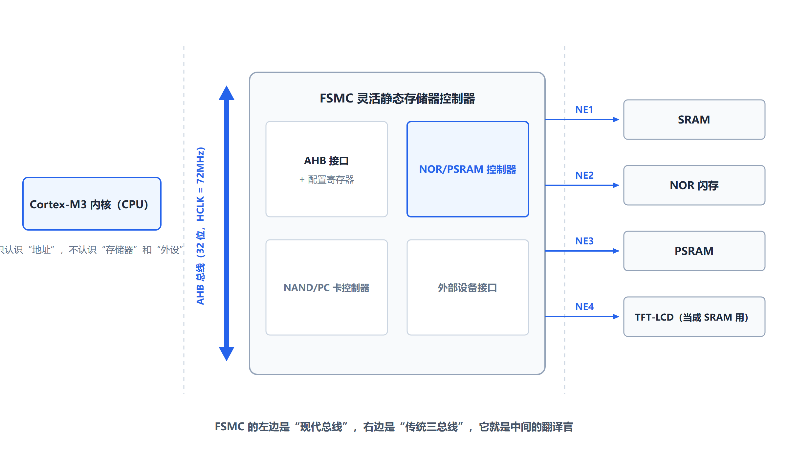

**这张图怎么读**：

1. **先看左边**：CPU（Cortex-M3 内核）通过 **AHB 总线** 连到 FSMC。也就是说，**FSMC 在 STM32 内部是挂在 AHB 总线上的一个"外设"**。
2. **再看中间**：FSMC 这块方框，它左边接 AHB，右边伸出很多引脚。
3. **最后看右边**：右边接的是**芯片外部**的器件——SRAM、NOR Flash、PSRAM、LCD。
4. **这张图要你记住**：**左边是"现代总线"，右边是"传统三总线"，FSMC 就是中间的翻译官。**

---

### 正式知识

#### 【教材内容】12.1.1 FSMC 的功能描述

**FSMC 可以操作的器件**（教材原文）：

- 具有静态存储器接口的器件，比如 **SRAM**（静态随机存储器）、**ROM**（只读存储器）、**NOR 闪存**和 **PSRAM**（伪静态随机存储器）；
- 两个 **NAND 闪存**块，支持硬件 **ECC** 并可检测多达 8KB 数据；
- 16 位的 **PC 卡**兼容设备。

> **术语解释：ECC**
> ECC = Error Correcting Code = 纠错码。
> 大白话：NAND Flash 天生容易出错（有些位会莫名其妙翻转），ECC 就是"**多存几个校验位，读出来发现错了还能改回来**"的技术。这部分本章不展开。

**FSMC 具有的主要功能**（教材原文，7 条）：

| 序号 | 教材原文 | 大白话解释 |
|---|---|---|
| (1) | 支持对同步器件的成组访问模式，如 NOR 闪存和 PSRAM | "成组访问"= burst，一次说地址，连续读好几个数据（见 12.4.4） |
| (2) | 8 或 16 位数据总线 | 外部数据线宽度可以是 8 位或 16 位 |
| (3) | 每一个存储器块都有独立的片选控制，并且都可以独立配置 | 4 个块各有一套寄存器，互不干扰 |
| (4) | 时序可编程以支持各种不同的器件 | 下面单独展开 |
| (5) | PSRAM 和 SRAM 器件使用的写使能和字节选择输出 | 就是 NWE 和 NBL[1:0] |
| (6) | 将 32 位的 AHB 访问请求，转换为对外部 16 位或 8 位器件连续的 16 位或 8 位访问 | 32 位拆成 2 个 16 位（见 12.2） |
| (7) | 具有 16 个字、每个字 32 位宽的写入 FIFO，允许在写入较慢存储器时释放 AHB 总线进行其他操作 | 见下面的"FIFO"小节 |

**第 (4) 条的展开**（教材原文）：

```
- 等待周期可编程（多达 15 个周期）
- 总线恢复周期可编程（多达 15 个周期）
- 输出使能和写使能延迟可编程（多达 15 个周期）
- 独立的读写时序和协议，可支持宽范围的存储器和时序
```

【补充解释】这里的"多达 15 个周期"是指某些 4 位字段能表示 1～16 的范围。但注意，**数据阶段（DATAST）是 8 位字段，最大 256 个周期**，不是 15。教材这句话是把几个参数混在一起说了，读的时候要注意区分（详见 12.5 的寄存器表）。

#### 【补充解释】FIFO 是什么？为什么要有它？

**FIFO** = **F**irst **I**n **F**irst **O**ut = **先进先出**。

大白话：**FIFO 就是一个"排队缓冲区"**。

场景：

```
CPU：我要写 100 个数据到外面那块慢速 SRAM！
慢速 SRAM：我一个数据要 55ns，你 CPU 一个周期才 13.9ns，你跟不上我啊。
```

如果 CPU 每写一个数据都要站在那儿等 55ns，CPU 的时间就全浪费了。
所以 FSMC 说：

> "CPU 你先往我这个 FIFO 里塞，塞满了我慢慢往外送，你就可以回去干别的事了。"

教材原文：**"具有 16 个字，每个字 32 位宽的写入 FIFO，允许在写入较慢存储器时释放 AHB 总线进行其他操作。在开始一次新的 FSMC 操作前，FIFO 要先被清空。"**

翻译：

- FIFO 能存 16 个 32 位的数据（= 64 字节）；
- 存进去之后，FSMC 自己慢慢往外搬，**AHB 总线被释放**，CPU 可以去干别的事；
- 但注意最后一句：**开始新的 FSMC 操作之前，FIFO 必须先清空**——也就是说，如果你写的地址"跳来跳去"，FIFO 就帮不上忙了。

#### 【教材内容】系统复位时的注意事项

教材原文：

> **"通常在系统复位或上电时，应该设置好所有定义外部存储器类型和特性的 FSMC 寄存器，并保持它们的内容不变；当然，也可以在任何时候改变这些设置。"**

翻译：

- 一般在**开机初始化的时候**，把 FSMC 的寄存器一次性配好（配存储器类型、宽度、时序），之后就不要再动了；
- 但如果真的需要（比如运行中换时序），也可以随时改。

#### 【教材内容】12.1.2 FSMC 的结构

FSMC 包含 **4 个主要模块**：

| 序号 | 模块名 | 干什么的 |
|---|---|---|
| (1) | **AHB 接口**（包含 FSMC 配置寄存器） | 对内的"门"：接 AHB 总线，里面放着所有配置寄存器 |
| (2) | **NOR 闪存和 PSRAM 控制器** | 专门伺候 NOR Flash / PSRAM / SRAM 这块 |
| (3) | **NAND 闪存和 PC 卡控制器** | 专门伺候 NAND Flash 和 PC 卡（本章不展开） |
| (4) | **外部设备接口** | 对外的"门"：把所有内部信号变成引脚上的电平 |

#### 【教材原图】图 12-1 FSMC 的结构框图

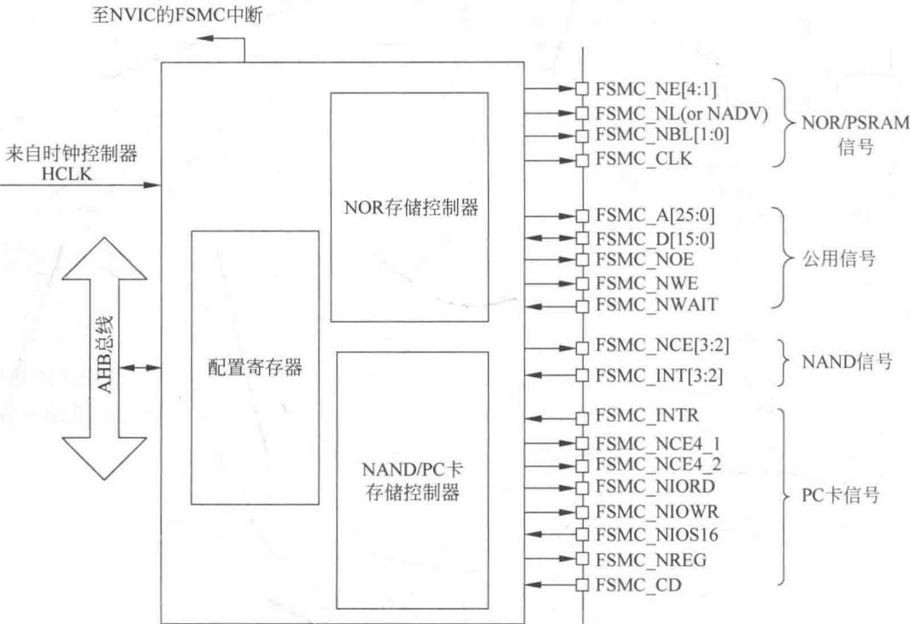

这张图信息量比较大，我们**分三层看**，不要一次看完。

#### 第一层：只看三个核心区域

先只看三个东西：

```
   【左边】            【中间】                 【右边】
   AHB 总线    →    配置寄存器 + 两个控制器   →   一排引脚
```

- **左边**：一个粗的双向箭头，标注 **"AHB 总线"**。这是 FSMC 对内的通道。
- **中间**：三个方框：
  - **配置寄存器**（Configuration registers）；
  - **NOR 存储控制器**（NOR Flash/PSRAM controller）；
  - **NAND/PC 卡存储控制器**（NAND/PC Card controller）。
- **右边**：一排小方块，每个方块是一个引脚，分成 4 组（用大括号标出）：
  - **NOR/PSRAM 信号**；
  - **公用信号**；
  - **NAND 信号**；
  - **PC 卡信号**。

**第一层要你理解什么**：FSMC 的结构就是"**左门（AHB）→ 中间的处理逻辑 → 右门（引脚）**"。

#### 第二层：加上时钟和中断

再看两个箭头：

1. **左上角有一个箭头指向外面，标注"至 NVIC 的 FSMC 中断"**。
   意思是：FSMC 干完活或者出错，可以向 NVIC（中断控制器）报信。
   > 【快速复习】NVIC = Nested Vectored Interrupt Controller = 嵌套向量中断控制器，是 Cortex-M3 里管中断的那个模块（第 7 章讲过）。
2. **左边中间有一个箭头进来，标注"来自时钟控制器 HCLK"**。
   意思是：**FSMC 的工作节拍来自 HCLK**（前面补过的前置知识 4）。

**第二层要你理解什么**：FSMC 不是孤立的，它有**节拍（HCLK）**、能**报信（中断）**。

#### 第三层：看清右边每一组引脚

教材图里右边四组引脚的完整列表如下（我们按组拆开）：

**第 1 组：NOR/PSRAM 信号**（本章重点）

| 引脚 | 方向（图中箭头） | 作用 |
|---|---|---|
| `FSMC_NE[4:1]` | 输出 | 4 个片选 |
| `FSMC_NL`（或 `NADV`） | 输出 | 地址有效 / 锁存使能（复用模式用） |
| `FSMC_NBL[1:0]` | 输出 | 字节选择（高字节/低字节） |
| `FSMC_CLK` | 输出 | 同步模式下的存储器时钟 |

**第 2 组：公用信号**（NOR/PSRAM 和 NAND 都用）

| 引脚 | 方向 | 作用 |
|---|---|---|
| `FSMC_A[25:0]` | 输出 | 地址总线 |
| `FSMC_D[15:0]` | 双向（图上是双向箭头） | 数据总线 |
| `FSMC_NOE` | 输出 | 读使能（输出使能） |
| `FSMC_NWE` | 输出 | 写使能 |
| `FSMC_NWAIT` | **输入**（箭头指向 FSMC） | 存储器告诉 FSMC"等一下" |

> **注意 `NWAIT` 的箭头方向**：图上它是**从右往左**（输入到 FSMC）。
> 这一点很重要：**所有其他信号都是 FSMC 说了算（输出），只有 NWAIT 是外部存储器说了算（输入）。**
> 为什么？因为只有存储器自己知道"我准备好没有"。FSMC 再厉害也猜不到，只能问它。

**第 3 组：NAND 信号**（本章不展开）

`FSMC_NCE[3:2]`、`FSMC_INT[3:2]`（NAND 的中断/就绪信号）。

**第 4 组：PC 卡信号**（本章不展开）

`FSMC_INTR`、`FSMC_NCE4_1`、`FSMC_NCE4_2`、`FSMC_NIORD`、`FSMC_NIOWR`、`FSMC_NIOS16`、`FSMC_NREG`、`FSMC_CD`。

#### 这张图要你最终记住什么

> **FSMC = 左边一个 AHB 门 + 中间一堆配置寄存器和两个控制器 + 右边一大排引脚。**

### 【辅助理解图】把图 12-1 简化

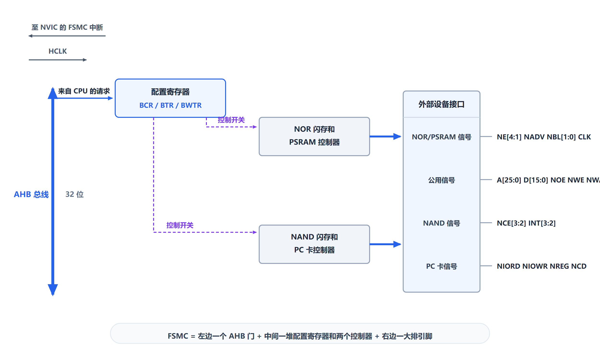

**这张图怎么读**：

1. 左侧画的是 **AHB 总线**（粗双向箭头），它是 FSMC 的"上游"；
2. 中间上方是 **配置寄存器**（就是 12.5 要讲的 BCR/BTR/BWTR），它像一个"控制面板"，用虚线箭头指向下面的两个控制器；
3. 中间下方并排两个控制器：**NOR/PSRAM 控制器** 和 **NAND/PC 卡控制器**；
4. 右侧是 **外部设备接口**，把信号送到 4 组引脚上；
5. **这张图要你理解**：配置寄存器是"大脑"，两个控制器是"两双手"，引脚是"手指"。

---

## 12.2 AHB 接口

### 先别急着看教材：这一节到底要干什么？

这一节讲的是 **FSMC 的"上游"**——也就是"FSMC 怎么接住 CPU 发过来的请求"。

核心矛盾只有一个：

> **CPU 说 32 位（4 个字节）的话，外面的存储器只能听懂 16 位（2 个字节）的话，怎么办？**

### 【先补一个前置知识：AHB 是什么？】

**AHB** = **A**dvanced **H**igh-performance **B**us = **高级高性能总线**。

大白话：

> Cortex-M3 内核内部有几条总线（第 2 章讲过哈佛结构：指令总线和数据总线分开）。
> 内核外面接各种外设的地方，用的是 **AHB**——它是一条"高速主干道"，宽度 32 位。
> 速度慢一点的外设（GPIO、串口）走的是 **APB**（Advanced Peripheral Bus，高级外设总线）。
> **FSMC 走的是 AHB**，因为它要传大量数据，必须快。

**AHB 的宽度是 32 位**，这是本节所有问题的根源。

### 用大白话理解

想象一个翻译场景：

```
CPU（说 32 位的话）："把 4 个字节 0xAABBCCDD 写到那里去！"
外部 16 位 SRAM（只能听懂 16 位）："啊？你说啥？我一次只能拿 2 个字节。"
FSMC（翻译官）："好的，我帮你拆开：
                 先写 0xCCDD（低 16 位），
                 再写 0xAABB（高 16 位）。"
```

如果外部是 8 位的存储器呢？

```
FSMC："那我拆成 4 次：0xDD、0xCC、0xBB、0xAA。"
```

**这就是教材说的"将 32 位的 AHB 访问请求，转换为对外部 16 位或 8 位器件连续的 16 位或 8 位访问"。**

### 正式知识

#### 【教材内容】12.2 AHB 接口

教材原文：

> "AHB 接口为内部 CPU 和其他总线控制设备访问外部静态存储器提供了通道，AHB 操作被转换到外部设备的操作。当外部存储器的数据通道是 16 位或 8 位时，AHB 上的 32 位数据会被分割成连续的 16 位或 8 位的操作。**AHB 时钟 (HCLK) 是 FSMC 的参考时钟**。"

> "请求 AHB 操作的数据宽度可以是 8 位、16 位或 32 位，而外部设备则是固定的数据宽度，此时需要保证实现数据传输的一致性。为此，FSMC 执行下述操作规则："

**规则（1）：AHB 宽度 = 存储器宽度 → 没问题**

> "如果 AHB 操作的数据宽度与存储器数据宽度相同，则无数据传输一致性的问题。"

例子：AHB 要传 16 位，外部也是 16 位 → 一次搞定。

**规则（2）：AHB 宽度 > 存储器宽度 → 拆**

> "如果 AHB 操作的数据宽度大于存储器的数据宽度，FSMC 将 AHB 操作分割成几个连续的较小数据宽度的存储器操作，以适应外部设备的数据宽度。"

举例（这是教材和参考手册里最经典的例子）：

```
CPU 要写 32 位数据 0xAABBCCDD 到外部 16 位存储器

拆分规则（小端序）：
  第 1 次外部访问：写 0xCCDD（低半字，地址 +0）
  第 2 次外部访问：写 0xAABB（高半字，地址 +2）

如果外部是 8 位存储器：
  第 1 次：写 0xDD（地址 +0）
  第 2 次：写 0xCC（地址 +1）
  第 3 次：写 0xBB（地址 +2）
  第 4 次：写 0xAA（地址 +3）
```

【补充解释】为什么是"低半字先"？因为 Cortex-M3 是**小端序**（Little Endian）：低地址放低字节。这个在 `notes/01_基础知识.md` 和 `notes/11_DMA.md` 都讲过。所以 `0xAABBCCDD` 存在内存里，从低地址到高地址依次是 `DD CC BB AA`。

**规则（3）：AHB 宽度 < 存储器宽度 → 看情况**

> "如果 AHB 操作的数据宽度小于存储器的数据宽度，则依据外部设备的类型，异步的数据传输有可能不一致。"

这一条分两种情况，教材写得很清楚：

**① 存储器"有字节选择功能"（SRAM、ROM、PSRAM 等）**

> "与具有字节选择功能的存储器(SRAM、ROM、PSRAM等)进行异步传输时，FSMC 执行读写操作并通过它的字节通道 BL[1:0] 访问正确的数据。"

大白话：这类存储器说"**我虽然一次能给你 16 位，但你可以只给我 8 位，我告诉你我要的是高字节还是低字节**"。
这个"告诉"就是通过 `NBL[1:0]` 这两根线：

```
NBL[1] = 0 且 NBL[0] = 1  →  只要高字节（D[15:8] 有效），低字节不动
NBL[1] = 1 且 NBL[0] = 0  →  只要低字节（D[7:0] 有效），高字节不动
NBL[1] = 0 且 NBL[0] = 0  →  高低字节都要（16 位一起动）
NBL[1] = 1 且 NBL[0] = 1  →  两根都不有效（不允许/无意义）
（0 表示"这一路有效"，因为带 N 前缀的信号低电平有效：
 NBL[1] 管高字节，存储器侧叫 NUB；NBL[0] 管低字节，存储器侧叫 NLB。
 这正是教材表 12-5 的定义，详见 12.4.1）
```

**② 存储器"没有字节选择功能"（NOR 闪存、16 位 NAND 等）**

> "与不具有字节选择功能的存储器(NOR 和 16 位 NAND 等)进行异步传输时，即需要对 16 位宽度的闪存存储器进行字节访问时，显然不能对存储器进行字节模式访问，可以对存储器进行读操作（控制器读出完整的 16 位存储器数据，只使用需要的字节），**但是不允许进行写操作**。"

大白话：

- **读**：可以。FSMC 干脆把 16 位全读回来，然后**只用你要的那 8 位**，另外 8 位扔掉。
- **写**：**不行**。因为存储器不支持"只写 8 位"，你写 8 位它会不知道另外 8 位该怎么办，可能把整 16 位都覆盖掉。

> **考试易错点**：**"对 NOR Flash 做 8 位写"是被禁止的**。这个结论教材写得很明确。

### 【辅助理解图】

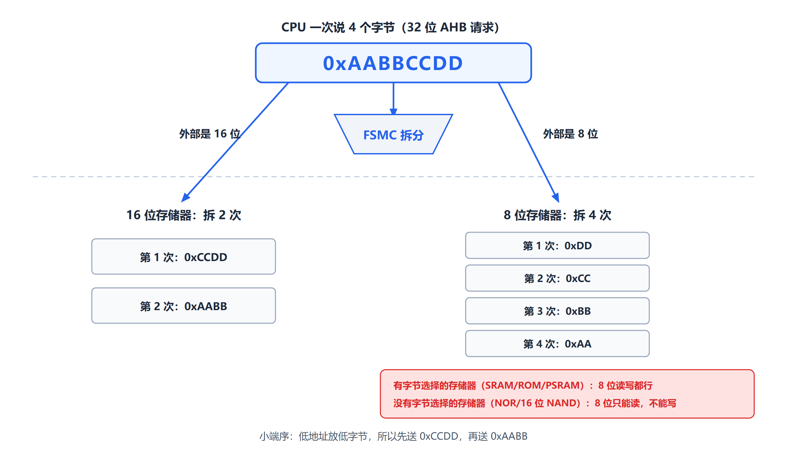

**这张图怎么读**：

1. 上半部分：AHB 侧，一个 32 位的方块 `0xAABBCCDD`，标着"CPU 一次说 4 个字节"；
2. 中间是 FSMC 的"拆分器"（一个梯形/漏斗形状），旁边标"32 位 → 16 位"和"32 位 → 8 位"两条路径；
3. 下半部分左边：两次 16 位访问，依次是 `CCDD`、`AABB`；
4. 下半部分右边：四次 8 位访问，依次是 `DD`、`CC`、`BB`、`AA`；
5. 旁边用红色标注一行：**"AHB 宽度 < 存储器宽度时：有字节选择的可以读写，NOR Flash 只能读不能写"**。

---

## 12.3 FSMC 外部设备地址映像

### 先别急着看教材：这一节到底要干什么？

前面在【先补前置知识 3】里已经埋下伏笔：**FSMC 把 4 段地址区域绑定到外部引脚上**。
这一节就是把这 4 段地址**具体化**：

- 每一段从哪个地址开始？到哪个地址结束？
- 每一段里还能不能再分小区？
- 32 位的内部地址 `HADDR` 怎么变成外面那 26 根地址线上的电平？

**这一节是本章最需要画图的一节**，因为全是地址关系。

### 用大白话理解

想象 STM32 的地址空间是一栋**超大的办公楼**，FSMC 负责管理 **4 层楼**：

```
0x60000000 楼层：叫"1 号楼"，租给"NOR/PSRAM/LCD"这些租户
0x70000000 楼层：叫"2 号楼"，租给"NAND 闪存"
0x80000000 楼层：叫"3 号楼"，租给"NAND 闪存"
0x90000000 楼层：叫"4 号楼"，租给"PC 卡"
```

每一层楼有多大？**256MB**（教材原文："可以把外部存储器划分为固定大小为 256MB 的 4 个存储块"）。

然后"1 号楼"特别大，又被隔成 **4 个小间**，每个小间 64MB，分别对应 4 个片选 NE1～NE4。

### 【教材原图】图 12-2 FSMC 的存储块

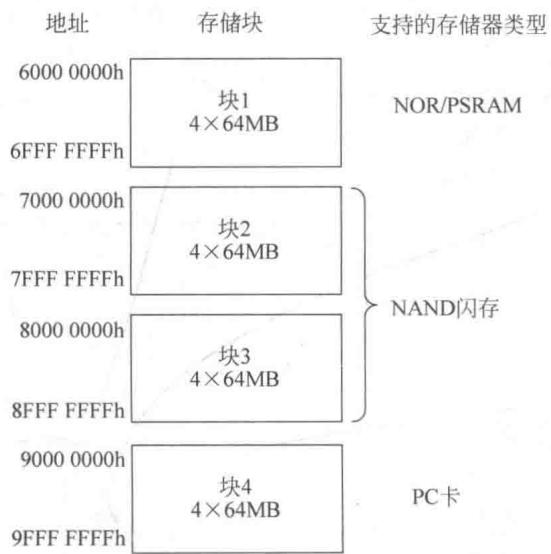

**这张图怎么读**（它其实非常清楚，我们逐列看）：

1. **最左边一列是"地址"**：从上到下依次写着 `6000 0000h`、`6FFF FFFFh`、`7000 0000h`、`7FFF FFFFh`、`8000 0000h`、`8FFF FFFFh`、`9000 0000h`、`9FFF FFFFh`。
   - 注意教材用 `h` 后缀表示十六进制（汇编里常用 `h`，C 语言里用 `0x` 前缀）。`6000 0000h` 就是 C 语言里的 `0x60000000`。
2. **中间一列是"存储块"**：4 个长方形方框，从上到下写着：
   - **块 1**：`4×64MB`，地址 `6000 0000h`～`6FFF FFFFh`
   - **块 2**：`4×64MB`，地址 `7000 0000h`～`7FFF FFFFh`
   - **块 3**：`4×64MB`，地址 `8000 0000h`～`8FFF FFFFh`
   - **块 4**：`4×64MB`，地址 `9000 0000h`～`9FFF FFFFh`
3. **最右边一列是"支持的存储器类型"**：
   - 块 1 → **NOR/PSRAM**
   - 块 2 和块 3 → 用一个大括号连起来，标注 **NAND 闪存**
   - 块 4 → **PC 卡**

**几个数字要会算**：

```
一块的大小 = 0x6FFFFFFF - 0x60000000 + 1 = 0x10000000 = 268 435 456 字节 = 256MB ✓
一个小间的大小 = 256MB / 4 = 64MB ✓
```

（`0x10000000` = 16^7 = 268435456。因为 0x10000000 写成二进制是 1 后面 28 个 0，也就是 2^28 = 268435456。）

#### 这张图要你理解什么

> **STM32 里有一段"虚拟的地址"，它不在芯片内部，而是对应到芯片外部的引脚上。**
> 你在程序里写 `0x6C000000`，STM32 就会把 `NE4` 拉低，并在地址线上输出相应的值。

#### 【补充解释】4 个块和 4 个"小区"的地址对照表

教材正文说："存储块 1 用于访问最多 4 个 NOR 闪存或 PSRAM 存储设备。这个存储区被划分为 4 个 NOR/PSRAM 区并有 4 个专用的片选信号。"

把这 4 个小区具体算出来（【补充解释】按 HADDR[27:26] 的取值推出，见下一小节；这与教材 12.7 例程里的 `0x60000000` 一致）：

| 存储块 | 小区 | 片选 | 地址范围 | 大小 |
|---|---|---|---|---|
| 块 1 | NOR/PSRAM 1 | `NE1` | `0x60000000` ～ `0x63FFFFFF` | 64MB |
| 块 1 | NOR/PSRAM 2 | `NE2` | `0x64000000` ～ `0x67FFFFFF` | 64MB |
| 块 1 | NOR/PSRAM 3 | `NE3` | `0x68000000` ～ `0x6BFFFFFF` | 64MB |
| 块 1 | NOR/PSRAM 4 | `NE4` | `0x6C000000` ～ `0x6FFFFFFF` | 64MB |
| 块 2 | — | `NCE2` | `0x70000000` ～ `0x7FFFFFFF` | 256MB |
| 块 3 | — | `NCE3` | `0x80000000` ～ `0x8FFFFFFF` | 256MB |
| 块 4 | — | `NCE4` | `0x90000000` ～ `0x9FFFFFFF` | 256MB |

**注意**：教材 12.7 的例程里用的是 `FSMC_Bank1_NORSRAM1`，注释写"使用 NE1"，基地址写 `0x60000000`——和上表完全对得上。

### 12.3.1 NOR 和 PSRAM 地址映像

#### 【教材内容】原文

> "HADDR 是需要转换到外部存储器的内部 AHB 地址线。其中，HADDR[27:26] 位用于选择存储块 1 的 4 个 NOR/PSRAM 块之一。
> 00: 选择存储块 1 NOR/PSRAM 1；01: 选择存储块 1 NOR/PSRAM 2；
> 10: 选择存储块 1 NOR/PSRAM 3；11: 选择存储块 1 NOR/PSRAM 4。
> HADDR[25:0] 包含外部存储器地址。"

#### 【补充解释】HADDR 是什么？

**HADDR** = **H**igh-performance bus **ADDR**ess = AHB 地址线的名字。

大白话：**HADDR 就是"CPU 想访问的那个地址"，在 AHB 总线上走的那 32 根线。**

那么"用 HADDR[27:26] 选小区"是怎么选的？我们算一下：

```
HADDR[27:26] = 00  →  地址的 bit27=0, bit26=0  →  地址范围 0x60000000 ~ 0x63FFFFFF
HADDR[27:26] = 01  →  地址的 bit27=0, bit26=1  →  地址范围 0x64000000 ~ 0x67FFFFFF
HADDR[27:26] = 10  →  地址的 bit27=1, bit26=0  →  地址范围 0x68000000 ~ 0x6BFFFFFF
HADDR[27:26] = 11  →  地址的 bit27=1, bit26=1  →  地址范围 0x6C000000 ~ 0x6FFFFFFF
```

**验算一下**：

```
0x60000000 = 0110 0000 0000 0000 0000 0000 0000 0000
                 ↑↑
              bit27=0, bit26=0   ✓ 对应 00

0x64000000 = 0110 0100 0000 0000 0000 0000 0000 0000
                 ↑↑
              bit27=0, bit26=1   ✓ 对应 01

0x6C000000 = 0110 1100 0000 0000 0000 0000 0000 0000
                 ↑↑
              bit27=1, bit26=1   ✓ 对应 11
```

> **考试提示**：为什么是 bit27、bit26？因为 64MB = 2^26，所以"小区号"正好占 bit26 和 bit27 这两位。这不是巧合，是设计者故意这样安排的——**用高位地址直接当"片选编号"**，省掉外部译码器。

#### 【教材内容】表 12-1 外部存储器地址

这是本节**最重要的一张表**，它说的是：**HADDR 和外部存储器的地址线怎么连**。

| 数据宽度 | 连到存储器的地址线 | 最大访问存储器空间（位） |
|---|---|---|
| **8b**（8 位） | `HADDR[25:0]` 与 `FSMC_A[25:0]` 对应相连 | 64MB×8 = 512Mb |
| **16b**（16 位） | `HADDR[25:1]` 与 `FSMC_A[24:0]` 对应相连，`HADDR[0]` **未接** | 64MB/2×16 = 512Mb |

**这张表要你理解什么？**——**16 位存储器时，地址线要"错开一位"。**

**为什么？** 因为：

- `HADDR` 是**字节地址**（byte address）：`0x60000000`、`0x60000001`、`0x60000002`……每一个地址对应**1 个字节**。
- 但 16 位存储器**一次最小只能访问 2 个字节**（一个半字），它内部根本没有"字节地址"这个概念，它只有"第几个半字"的概念。

所以：

```
内部（字节地址）    外部是"第几个半字"   外部地址线上的值（FSMC_A 上）
0x60000000  ←→  第 0 个半字  →  0 = 二进制 000  →  A[2]=0, A[1]=0, A[0]=0
0x60000002  ←→  第 1 个半字  →  1 = 二进制 001  →  A[2]=0, A[1]=0, A[0]=1
0x60000004  ←→  第 2 个半字  →  2 = 二进制 010  →  A[2]=0, A[1]=1, A[0]=0
```

> **注意**：第三列写的是"读第几个半字"，它是一个**多位的号码**，不是某一位的 0/1。
> 所以"第 2 个半字"对应的是 `A[1]=1、A[0]=0`（两位一起看才是 2），**不能写成"A[0] = 2"**——`A[0]` 只是一个 bit，只能装 0 或 1。

也就是说：**内部的 bit1 变成了外部的 bit0**。这就是"错开一位"。

用二进制看最清楚：

```
内部 HADDR 的 bit:   25 24 ... 2  1  0
                     ↓  ↓      ↓  ↓  ↓
                     错开一位（丢弃 bit0）
                     ↓  ↓      ↓  ↓
外部 FSMC_A 的 bit:  24 23 ... 1  0
                     ↑              ↑
                  HADDR[25] → A[24]   HADDR[1] → A[0]
```

**还有一个很容易看漏的细节**，教材紧接着说：

> "对于 16 位宽度的外部存储器，FSMC 将在内部使用 HADDR[25:1] 产生外部存储器的地址 FSMC_A[24:0]。**不论外部存储器的宽度是多少（16 位或 8 位），FSMC_A[0] 始终应该连到外部存储器的地址线 A[0]。**"

这句话的意思是：

- **FSMC 的 `A0` 引脚，永远接到存储器芯片的 `A0` 引脚**（这是接线时的死规矩）；
- 但是对 16 位存储器来说，FSMC 的 `A0` 引脚上**输出的其实不是 HADDR[0]，而是 HADDR[1]**——因为 HADDR[0] 被丢掉了。

> **初学易错点**：很多人以为"16 位存储器时 FSMC_A[0] 不用接"。**错！**
> 正确的是：**HADDR[0] 不接（因为它是字节内的地址，16 位存储器不需要）**，但 `FSMC_A[0]` 这根引脚照样要接到存储器的 `A0` 上。

#### 【补充解释】"最大访问存储器空间"为什么两种宽度都是 512Mb？

```
8 位：  64MB 个字节 × 8 位/字节 = 512Mb（512 兆位 = 64MB）
16 位：  32M 个半字 × 16 位/半字 = 512Mb（同样 = 64MB）
```

因为地址线一共 26 根（`HADDR[25:0]`），能表示 2^26 = 64M 个"最小访问单元"。
- 8 位存储器：最小单元 1 字节 → 64M × 1B = 64MB；
- 16 位存储器：最小单元 2 字节 → 32M × 2B = 64MB。

**结论**：不管接 8 位还是 16 位，**每个小区最多能接 64MB 的存储器**。

#### 【补充解释】把"地址链"完整走一遍

AGENTS.md 第 12 节要求建立这条链，我们走一遍：

```
第 1 步：地址
        程序里写  0x60000002
        ↓
第 2 步：地址空间
        这个地址落在 STM32 的地址空间里，属于 FSMC 管辖的 0x60000000~0x9FFFFFFF 段
        ↓
第 3 步：外设基地址（存储块/小区）
        0x60000002 落在块 1（0x60000000~0x6FFFFFFF）的"NOR/PSRAM 1"小区（0x60000000~0x63FFFFFF）
        → HADDR[27:26] = 00 → 选中 NE1
        ↓
第 4 步：块内偏移
        偏移 = 0x60000002 - 0x60000000 = 0x00000002
        ↓
第 5 步：映射到外部地址线（假设是 16 位存储器）
        HADDR[25:1] → FSMC_A[24:0]
        0x00000002 = ...0010
        bit1 = 1  →  这个 1 被搬到 FSMC_A[0] 上
        → FSMC_A[0] = 1，其他 A 线都是 0
        ↓
第 6 步：外部存储器收到
        NE1 = 0（选中）、A[0] = 1（要第 1 个半字）、NOE = 0（读）
        → 存储器把第 1 个半字放到 D[15:0] 上
```

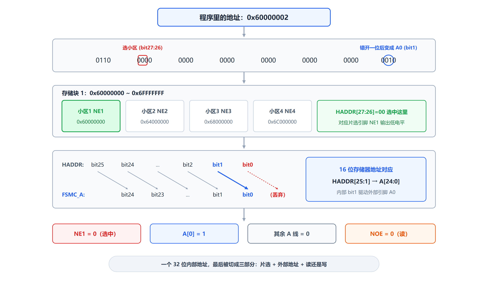

**这张图怎么读**：

1. 最上面一行是一个地址 `0x60000002`，下面用箭头拆出 `bit27 bit26`（→ 片选）和 `bit25..bit1`（→ 外部地址）；
2. 中间一层是"存储块 1 / 小区 1"的方框，旁边标 `NE1`；
3. 再往下一层是"HADDR 错开一位"的示意：一串二进制位 `... 0 1 0`，其中 `1` 被一根箭头从 bit1 位置搬到 `FSMC_A[0]` 位置；
4. 最下面一排是引脚电平：`NE1=0`、`A[0]=1`、`NOE=0`、`D[15:0]=<数据>`；
5. **这张图要你理解**：**一个 32 位的内部地址，最后被"切"成了三部分——片选、外部地址、以及"读还是写"。**

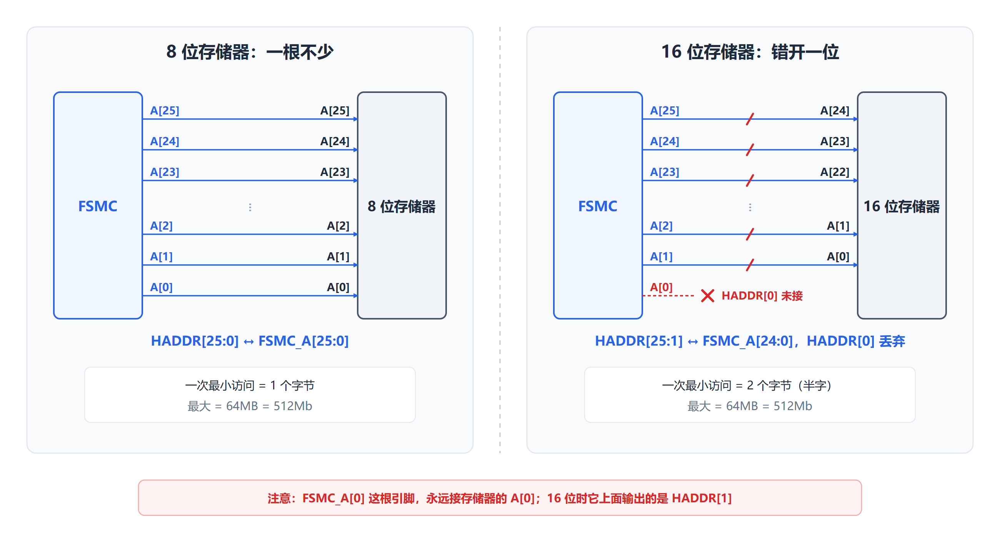

**这张图怎么读**：

1. 左边画 8 位存储器的情况：`HADDR[25:0]` 一根一根水平连到 `FSMC_A[25:0]`，一根不少；
2. 右边画 16 位存储器的情况：`HADDR[0]` 被画成一个"悬空"的虚线段，标注"未接"；其余 `HADDR[25:1]` 连到 `FSMC_A[24:0]`，并且在连线上画一个小小的"错位"（斜线交叉）；
3. 两张图的下方各画一个存储器方框，标注"8 位：一次 1 字节"和"16 位：一次 2 字节"；
4. **这张图要你理解**：**16 位存储器时，地址线整体错开一位，bit0 被丢掉。**

### 12.3.2 NOR 闪存和 PSRAM 的非对齐访问支持

#### 【教材内容】

> "每个 NOR 闪存或 PSRAM 存储器块都可以配置成支持非对齐的数据访问。"

#### 【先补一个前置知识：什么叫"对齐"和"非对齐"？】

**对齐** = Aligned。**非对齐** = Unaligned。

大白话：

- **对齐**：你要访问的数据，正好落在"它大小的整数倍"的地址上。
  - 32 位（4 字节）数据放在 `0x60000000` → **对齐**（0 能被 4 整除）
  - 16 位（2 字节）数据放在 `0x60000002` → **对齐**（2 能被 2 整除）
- **非对齐**：位置"歪"了。
  - 32 位数据放在 `0x60000002` → **非对齐**（2 不能被 4 整除）
  - 这个 4 字节的数据会**横跨两个 4 字节边界**。

```
对齐（好办）：
地址  0x...00 0x...01 0x...02 0x...03
      +------------------------------+
      |      一个 32 位数据           |   ← 全在同一个"格子"里
      +------------------------------+

非对齐（麻烦）：
地址  0x...00 0x...01 0x...02 0x...03 0x...04 0x...05
      +----------------------+----------------------+
      |   一个 32 位数据      |                      |  ← 横跨两个格子！
      +----------------------+----------------------+
```

**为什么麻烦**？因为存储器是"整块整块"访问的（一次 16 位或一次 32 位），你横跨两块，就得读两次再拼起来。

#### 【教材内容】异步和同步两种情况

**（1）异步模式**

> "在这种情况下，只要每次访问都有准确的地址，完全支持非对齐的数据访问。"

大白话：异步模式下，**每次访问 FSMC 都会把地址完整地送出去一遍**。所以哪怕地址"歪"了，存储器也知道该读哪个半字，完全没问题。

**（2）同步模式**

> "在这种情况下，FSMC 只发出一次地址信号，然后成组的数据传输通过时钟 CLK 顺序进行。"

大白话：同步成组（burst）模式下，**地址只发一次**，后面就"一个接一个地拿"。这时候如果第一次拿的位置就是"歪"的，后面全歪。

教材给的解决办法：

> "某些 NOR 存储器支持线性的非对齐成组访问，固定数目的数据字可以从连续的以 N 为模的地址读取（典型的 N 为 8 或 16，可以通过 NOR 闪存的配置寄存器设置）。这种情况下，可以把存储器的非对齐访问模式设置为与 AHB 相同的模式。"
>
> "如果存储器的非对齐访问模式不能设置为与 AHB 相同的模式，应该通过 FSMC 配置寄存器的相应位禁止非对齐访问，并把非对齐的访问请求分开成两个连续的访问操作。"

翻译成两条路：

| 情况 | 怎么办 |
|---|---|
| 存储器**支持**非对齐成组（"以 N 为模"，N 通常是 8 或 16） | 把存储器的配置设成和 AHB 一样，直接用 |
| 存储器**不支持** | ① 在 FSMC 里**禁止**非对齐访问（配置寄存器里对应 `WRAPMOD` 这一位，见 12.5）；② 把一次非对齐请求**拆成两次连续访问** |

> 【快速复习】`WRAPMOD` 在 BCR 的 bit10。教材原文说："该位决定控制器是否支持把非对齐的 AHB 成组操作分割成两次线性操作；该位仅在存储器的成组模式下有效。0：不允许直接的非对齐成组操作（复位后的默认状态）；1：允许直接的非对齐成组操作。"

---

## 12.4 NOR 闪存和 PSRAM 控制器

### 先别急着看教材：这一节到底要干什么？

这一节是**本章最长、最重要**的一节。它要回答三个问题：

1. **FSMC 用什么信号跟外面的芯片说话？**（12.4.1 接口信号）
2. **它能跟哪些芯片说话、怎么说？**（12.4.2 支持的存储器及其操作）
3. **说话时的时间怎么控制？**（12.4.3 时序 + 12.4.4 同步成组读）

**这一节学完，你就能看懂任何一块外部存储器的接线图和初始化代码。**

### 【教材内容】12.4 开头

> "FSMC 可以产生适当的信号时序，驱动下述类型的存储器：
> - 8 位、16 位或 32 位的异步 SRAM 和 ROM；
> - 以异步模式或突发模式访问的 PSRAM(Cellular RAM)；
> - 以异步模式或突发模式访问，或者以复用模式或非复用模式访问的 NOR 闪存。"

> "FSMC 对每个存储块输出一个唯一的片选信号 NE[4:1]，所有其他信号（地址、数据和控制信号）则是共享的。"

> "在同步方式中，FSMC 向选中的外部设备产生时钟（CLK），该时钟的频率是 HCLK 时钟的整除因子。每个存储块的大小固定为 64MB，每个存储块都有专门的寄存器控制。"

**注意最后一句**："每个存储块的大小固定为 64MB"——这里的"存储块"指的是**块 1 里的 4 个小区**（每个 64MB），和前面 12.3 的表对得上。

#### 【教材内容】表 12-2 可编程的 NOR/PSRAM 访问参数

这张表列出**所有可以调的旋钮**：

| 参数 | 功能 | 访问方式 | 单位 | 最小 | 最大 |
|---|---|---|---|---|---|
| 地址建立时间 | 地址建立阶段的时间 | 异步 | AHB 时钟周期(HCLK) | 1 | 16 |
| 地址保持时间 | 地址保持阶段的时间 | 异步，复用 I/O | AHB 时钟周期(HCLK) | 2 | 16 |
| 数据建立时间 | 数据建立阶段的时间 | 异步 | AHB 时钟周期(HCLK) | 2 | 256 |
| 总线恢复时间 | 总线恢复阶段的时间 | 异步或同步读 | AHB 时钟周期(HCLK) | 1 | 16 |
| 时钟分频因子 | 存储器访问的时钟周期(CLK)与 AHB 时钟周期的比例 | 同步 | AHB 时钟周期(HCLK) | 1 | 16 |
| 数据产生时间 | 突发模式下产生第一个数据所需的时钟数目 | 同步 | 存储器时钟周期(CLK) | 2 | 17 |

> **注意最后两个参数的"单位"不一样！**
> 前四个用 **HCLK 周期**做单位；**数据产生时间（DATLAT）用的是"存储器时钟 CLK 周期"**。
> 教材在寄存器那一节专门强调过："这个时间参数不是以 HCLK 表示，而是以闪存时钟（CLK）表示。"
> 这是考试常考的坑。

> **【待核验】表 12-2 与寄存器说明的一个矛盾**：
> 表 12-2 写"地址保持时间最小 2"，但 12.5 的寄存器说明写"ADDHLD = 0000 时，地址保持时间 = **1** 个 HCLK 周期"。两者差 1。
> 本讲义在正文中按寄存器说明（ADDHLD+1）讲解，并把这个矛盾列在文末"待核验"里。

---

### 12.4.1 外部存储器接口信号

#### 【先补一个前置知识：怎么读这类信号表？】

看信号表时，抓住 3 个问题：

1. **方向**：这根线是谁输出给谁？（FSMC → 存储器，还是存储器 → FSMC？）
2. **低有效还是高有效**？（带 N 的 = 低有效）
3. **什么时候它才会动**？（平时不动，还是一直在变？）

#### 【教材内容】表 12-3 非复用信号的 NOR 闪存接口

| FSMC 信号名称 | 信号方向 | 功能 |
|---|---|---|
| `CLK` | 输出 | 时钟（同步突发模式使用） |
| `A[25:0]` | 输出 | 地址总线 |
| `D[15:0]` | 输入/输出 | 双向数据总线 |
| `NE[x]` | 输出 | 片选，x=1～4 |
| `NOE` | 输出 | 输出使能 |
| `NWE` | 输出 | 写使能 |
| `NWAIT` | 输入 | NOR 闪存要求 FSMC 等待的信号 |

#### 【教材内容】表 12-4 复用信号的 NOR 闪存接口

| FSMC 信号名称 | 信号方向 | 功能 |
|---|---|---|
| `CLK` | 输出 | 时钟（同步突发模式使用） |
| `A[25:16]` | 输出 | 地址总线（只剩高 10 位） |
| `AD[15:0]` | 输入/输出 | **16 位复用的双向地址/数据总线** |
| `NE[x]` | 输出 | 片选，x=1～4 |
| `NOE` | 输出 | 输出使能 |
| `NWE` | 输出 | 写使能 |
| `NL`（=`NADV`） | 输出 | 锁存使能（某些 NOR 闪存器件命名该信号为地址有效，NADV） |
| `NWAIT` | 输入 | NOR 闪存要求 FSMC 等待的信号 |

**对比表 12-3 和表 12-4，只有两处不同**：

```
非复用：  A[25:0]   +  D[15:0]         （地址和数据分开，26+16 = 42 根线）
复用：    A[25:16]  +  AD[15:0] + NADV （低 16 位地址和数据共用，10+16+1 = 27 根线）
```

**复用模式省了多少线？** 42 − 27 = **15 根**。这就是"复用"的价值：**用时间换引脚**。

#### 【教材内容】表 12-5 非复用信号的 PSRAM 接口

| FSMC 信号名称 | 信号方向 | 功能 |
|---|---|---|
| `CLK` | 输出 | 时钟（同步突发模式使用） |
| `A[25:0]` | 输出 | 地址总线 |
| `D[15:0]` | 输入/输出 | 双向数据总线 |
| `NE[x]` | 输出 | 片选，x=1～4（PSRAM 称其为 `NCE`，即 Cellular RAM 的 CRAM） |
| `NOE` | 输出 | 输出使能 |
| `NWE` | 输出 | 写使能 |
| `NL`（=`NADV`） | 输出 | 地址有效（存储器信号名称为 `NADV`） |
| `NWAIT` | 输入 | PSRAM 要求 FSMC 等待的信号 |
| `NBL[1]` | 输出 | 高字节使能（存储器信号名称为 `NUB`） |
| `NBL[0]` | 输出 | 低字节使能（存储器信号名称为 `NLB`） |

**PSRAM 比 NOR 多了两根线**：`NBL[1]`、`NBL[0]`（字节选择）。
**为什么？** 因为 PSRAM 是 16 位宽的，但你可能只想写 8 位（高字节或低字节）。`NBL` 就是告诉它"这次只动哪一半"。

> **术语对照（很重要，看芯片手册时会遇到）**：
> | FSMC 的名字 | 存储器厂商的名字 | 意思 |
> |---|---|---|
> | `NE[x]` | `NCE` / `CS` | 片选 |
> | `NADV` / `NL` | `NADV` / `ALE` / `ADV` | 地址有效 / 锁存 |
> | `NBL[1]` | `NUB` | 高字节使能（Upper Byte） |
> | `NBL[0]` | `NLB` | 低字节使能（Lower Byte） |
>
> 同一根线，两家起两个名字，这是初学者看接线图时最容易被卡住的地方。

#### 【补充解释】逐个信号讲透

#### `NE[x]`（x = 1～4）——片选

- **英文全称**：N + Chip Enable（低有效片选）
- **方向**：FSMC 输出
- **大白话**：点名。"1 号存储器，就是你！"
- **什么时候动**：一次访问开始前拉低，访问结束后拉高。
- **写 0/写 1 的含义**：`NE = 0` → 选中（这个芯片开始听数据总线）；`NE = 1` → 不选中（它把数据总线"让出来"）。
- **对应寄存器**：由地址决定（`HADDR[27:26]` 或访问的块），再由 `MBKEN` 位使能整个块。

#### `NOE`——输出使能（读使能）

- **英文全称**：N + Output Enable
- **方向**：FSMC 输出
- **大白话**："现在要**读**，存储器你把数据放上来。"
- **低有效**：`NOE = 0` 时存储器才被允许驱动数据总线。
- **对应寄存器**：它的"坑有多宽"由 `DATAST` 决定。

#### `NWE`——写使能

- **英文全称**：N + Write Enable
- **方向**：FSMC 输出
- **大白话**："现在要**写**，存储器你赶紧把总线上的数据存进去。"
- **低有效**：`NWE = 0` 时存储器在时钟边沿（或下降沿）把数据取走。
- **注意**：**读的时候 NWE 一直是高电平（不动）**，写的时候 NOE 一直是高电平。看时序图时可以靠这一点分辨"这是读还是写"。

#### `NADV`（也叫 `NL`）——地址有效 / 锁存使能

- **英文全称**：N + Address Valid（有的厂商叫 ALE = Address Latch Enable，或 ADV）
- **方向**：FSMC 输出
- **大白话**："注意！这 16 根线上现在放的是**地址**，你赶紧记下来！"
- **什么时候需要它**：**只有复用（MUXEN=1）模式才需要**。
- **低有效**：`NADV = 0` 期间，`AD[15:0]` 上的值是地址；`NADV` 变高之后，`AD[15:0]` 改放数据。

#### `A[25:0]`——地址总线

- **英文全称**：Address
- **方向**：FSMC 输出
- **大白话**："我要第几个格子。"
- **最大 26 根**，对应每个小区 64MB。
- **注意**：16 位存储器时，内部 `HADDR[0]` 被丢掉（见 12.3.1）。

#### `D[15:0]`——数据总线

- **英文全称**：Data
- **方向**：**双向**（这是唯一一根双向的线，图中画的是双向箭头）
- **大白话**："货物本身。"
- **读的时候**：存储器驱动它（FSMC 是"接收方"）。
- **写的时候**：FSMC 驱动它（存储器是"接收方"）。
- **【重要】任何时刻只能有一方驱动它**，否则就"打架"了。这就是为什么需要 `NOE` / `NWE` 来控制方向，以及为什么需要"总线恢复时间 BUSTURN"（见 12.5）。

#### `NBL[1:0]`——字节选择（字节通道）

- **英文全称**：N + Byte Lane（有的叫 Byte Select）
- **方向**：FSMC 输出
- **大白话**："这次只动**高 8 位**，还是只动**低 8 位**，还是 16 位一起动？"
- **编码**：

```
NBL[1] NBL[0]     含义                数据线
   0      0      16 位全都要           D[15:0] 都有效
   0      1      只要高字节           D[15:8] 有效
   1      0      只要低字节           D[7:0] 有效
   1      1      （不允许/无意义）
```

（记住：带 N 的信号 **0 = 有效**。所以 `NBL[1]=0` 表示"高字节这一路打开"，`NBL[0]=0` 表示"低字节这一路打开"。教材表 12-5 里也写了：`NBL[1]` = 高字节使能（存储器侧叫 `NUB`），`NBL[0]` = 低字节使能（存储器侧叫 `NLB`）。）

- **什么时候用**：AHB 访问宽度 < 存储器宽度的时候（见 12.2 规则 3）。
- **注意**：**NOR Flash 没有这根线**（表 12-3 里没有 NBL），所以"对 NOR Flash 做 8 位写"是不允许的（见 12.2）。

#### `CLK`——存储器时钟（同步模式专用）

- **英文全称**：Clock
- **方向**：FSMC 输出
- **大白话**："同步模式下的节拍器。"
- **注意**：**它是 HCLK 分频得到的**（由 `CLKDIV` 决定分几倍），**不是 HCLK 本身**。
- **什么时候用**：只有同步成组（burst）访问时才输出。异步模式下这根线不动（甚至可以不接）。

#### `NWAIT`——等待（唯一一根"输入"）

- **英文全称**：N + Wait
- **方向**：**存储器 → FSMC（输入！）**
- **大白话**："我还没准备好，你等会儿！"
- **低有效还是高有效**：由 `WAITPOL` 位决定（0 = 低有效，1 = 高有效）。
- **为什么要它**：因为有些存储器（比如 PSRAM，因为内部要刷新）**时间不固定**，它自己也不知道多久能好，所以只能"临时喊停"。
- **对应寄存器**：`WAITEN`（使能）、`WAITPOL`（极性）、`WAITCFG`（时机）、`ASYNCWAIT`（异步是否也用它）。

#### 【辅助理解图】外部存储器接口信号连接图

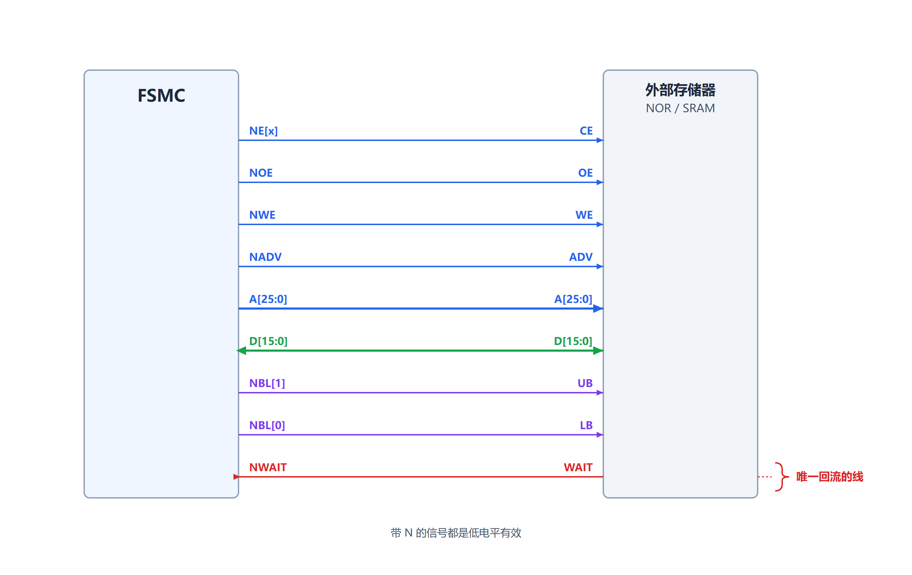

**这张图怎么读**：

1. **左边一大块是 FSMC**，里面从上到下依次画出：`NE[4:1]`、`NOE`、`NWE`、`NADV`、`A[25:0]`、`D[15:0]`、`NBL[1:0]`、`CLK`、`NWAIT` 这些"端口"；
2. **右边是外部存储器芯片**（画成一个方框，引脚标 `CE`、`OE`、`WE`、`A[25:0]`、`D[15:0]`、`LB`、`UB`、`CLK`、`WAIT`）；
3. **中间用带箭头的连线连接**，注意：
   - `NE1 → CE`：**箭头向左（指向存储器）**，表示 FSMC 输出；
   - `NOE → OE`、`NWE → WE`、`NADV → ADV`、`A[25:0] → A[25:0]`：都是 FSMC 输出；
   - `D[15:0] ↔ D[15:0]`：画成**双向箭头**（两头都有箭头）；
   - `NWAIT ← WAIT`：**箭头向右（指向 FSMC）**，这是全图唯一一根"从存储器回到 FSMC"的线，用**红色**画出以示区别；
4. **图的下方用一行小字标注**："所有信号由 FSMC 输出，只有 NWAIT 由存储器输入；所有带 N 的信号低电平有效。"
5. **这张图要你理解**：**FSMC 和外部存储器之间就这十几根线，接线时按名字对应接上就行，唯一容易接反的是 NWAIT 的方向。**

---

### 12.4.2 支持的存储器及其操作

#### 【教材内容】表 12-6 FSMC 支持的 NOR 闪存/PSRAM 存储器和操作方式

| 存储器 | 模式 | 读/写 | AHB 数据宽度 | 存储器数据宽度 | 注释 |
|---|---|---|---|---|---|
| NOR 闪存（总线复用和非总线复用） | 异步 | 读 | 8 | 16 | |
| | 异步 | 读/写 | 16 | 16 | |
| | 异步 | 读/写 | 32 | 16 | 分成 2 次 FSMC 访问 |
| | 同步 | 读 | 16 | 16 | |
| | 同步 | 读 | 32 | 16 | |
| PSRAM（总线复用和非总线复用） | 异步 | 读 | 8 | 16 | |
| | 异步 | 写 | 8 | 16 | 使用字节信号 NBL[1:0] |
| | 异步 | 读/写 | 16 | 16 | |
| | 异步 | 读/写 | 32 | 16 | 分成 2 次 FSMC 访问 |
| | 同步 | 读 | 16 | 16 | |
| | 同步 | 读 | 32 | 16 | |
| | 同步 | 写 | 8 | 16 | 使用字节信号 NBL[1:0] |
| | 同步 | 写 | 16/32 | 16 | |
| SRAM 和 ROM | 异步 | 读 | 8/16/32 | 8/16 | 使用字节信号 NBL[1:0] |
| | 异步 | 写 | 8/16/32 | 8/16 | 使用字节信号 NBL[1:0] |

**这张表怎么读？** 抓住两个对比：

**对比 1：NOR 闪存 vs PSRAM**

| | NOR 闪存 | PSRAM |
|---|---|---|
| 8 位 AHB 宽度 | **只能读** | **能读也能写**（用 NBL） |
| 32 位 AHB 宽度 | 分成 2 次 | 分成 2 次 |

> **这就是 12.2 讲的规则（3）的具体体现**：NOR 闪存没有字节选择信号，所以不能做 8 位写；PSRAM 有 NBL，所以可以。

**对比 2：NOR/PSRAM vs SRAM/ROM**

- NOR/PSRAM 这一列，**存储器数据宽度固定 16**；
- SRAM/ROM 这一列，**存储器数据宽度可以是 8 或 16**。

为什么？因为 SRAM 芯片既有 8 位版本（如 62WV5128）也有 16 位版本（如 IS62WV51216），而 NOR 闪存基本是 16 位（教材 12.4.1 说"NOR 闪存存储器是按 16 位的半字寻址"）。

> **【教材内容】原话**：
> "NOR 闪存存储器是按 16 位的半字寻址，最大容量达 64MB（26 条地址线）。"
> "PSRAM 存储器是按 16 位的半字寻址，最大容量达 64MB（26 条地址线）。"

---

### 12.4.3 NOR 闪存和 PSRAM 控制器时序

**这一小节是整章的核心。** 请慢慢看。

#### 【教材内容】操作时序的规则

> "- 所有的控制器输出信号在内部时钟(HCLK)的**上升沿**变化；
> - 在同步写模式下，输出的数据在存储器时钟(CLK)的**下降沿**变化。"

**翻译**：FSMC 是个"守规矩的人"，它所有的动作都卡在 HCLK 的上升沿上"翻牌"。同步写的时候，数据在 CLK 的下降沿变化（为了给存储器留出建立时间）。

> "- 异步静态存储器(NOR 闪存和 PSRAM)的时序要求是：
> - 所有信号由内部时钟 HCLK 保持同步，但**该时钟不会输出到存储器**；
> - FSMC 始终在片选信号 NE 失效前对数据线采样，这样能够保证符合存储器的数据保持时序；
> - 如果设置了扩展模式，可以在读和写时混合使用模式 A、B、C 和 D（例如，允许以模式 A 进行读，而以模式 B 进行写）。"

**翻译**：

1. 异步模式下，**`CLK` 引脚上没有时钟输出**（因为存储器不需要节拍，它自己会干活）。
2. FSMC 在 `NE` 变高**之前**就把数据"拿"到手了——这样即使 `NE` 一撤、存储器立刻把数据线松掉，数据也已经到手了。**这就是"数据采集"和"数据存储"那 2 个 HCLK 周期的意义**（见下面的时序图）。
3. **扩展模式（EXTMOD=1）下，读和写可以用不同的模式**！比如"读用模式 A、写用模式 B"。这就是为什么有 `BTR`（管读）和 `BWTR`（管写）两个寄存器。

#### 【先补一个前置知识：什么叫"时序模式"？为什么要有好几种？】

**问题**：外面的存储器有几百种，每家厂商的接口"脾气"都不一样：

- 有的存储器要求"地址先稳定，过一会儿你才能拉低读使能"；
- 有的存储器希望"读使能在数据阶段中间就抬起来"；
- 有的存储器地址和数据共用一组线，需要一根 `NADV` 来区分；
- 有的存储器地址要分两次送（先低后高）。

**FSMC 的解决办法**：准备了**几种"预设的动作模板"**，你根据存储器的脾气挑一个最像的，再用参数微调。

这些模板就叫**访问模式**（Access Mode）：

| 模式 | 名字里的含义 | 主要给谁用 |
|---|---|---|
| **模式 1** | 最基本的模式（不用扩展模式时的默认模式） | SRAM / CRAM / 非复用 NOR |
| **模式 A** | "**OE 翻转**"（读使能会中途抬起） | SRAM / PSRAM(CRAM) |
| **模式 2 / B** | "**NADV 变化**"（有地址锁存信号） | NOR 闪存 |
| **模式 C** | "**OE 和 NADV 都翻转**" | NOR 闪存 |
| **模式 D** | "**带地址扩展**"（地址分两段送） | 某些需要较长地址保持的 NOR |
| **复用模式** | "**地址的低 16 位出现在数据总线上**" | 复用接口的 NOR / PSRAM |

**这 6 个模板在寄存器里怎么选？** 看 BCR 的两个位：

```
EXTMOD = 0  →  只能用模式 1（和"模式 2"这种特例）
EXTMOD = 1  →  用 ACCMOD[1:0] 从 A / B / C / D 里挑一个
               ACCMOD = 00 → 模式 A
               ACCMOD = 01 → 模式 B
               ACCMOD = 10 → 模式 C
               ACCMOD = 11 → 模式 D
```

> **注意**：教材把模式编号写成"模式 1、模式 A、模式 2/B、模式 C、模式 D、复用模式"，其中"模式 2/B"是**把模式 2 和模式 B 放在一起讲**，因为它们波形几乎一样，区别只在于"模式 2 读写共用一套时序，模式 B 读写用两套时序"。

---

#### 1）模式 1——SRAM/CRAM 操作

**【教材内容】**
> "模式 1 读操作时序图如图 12-3 所示。"
> "模式 1 写操作时序图如图 12-4 所示。"
> "在写操作的最后一个 HCLK 周期可以保证 NWE 上升沿后地址和数据的保持时间，因为存在这个 HCLK 周期，**DATAST 的数值必须大于 0（DATAST > 0）**。"

#### 【教材原图】图 12-3 模式 1 读操作时序图

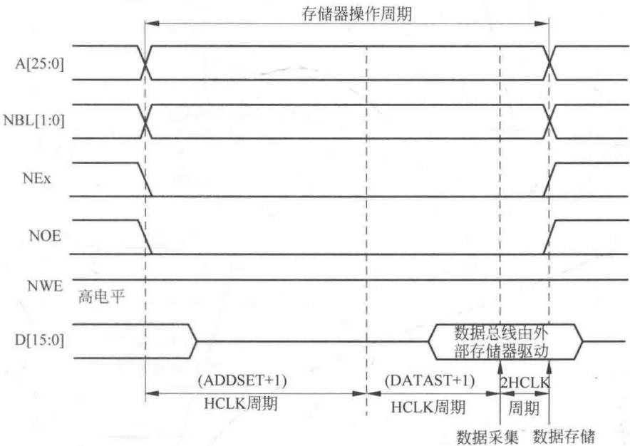

**这张图怎么读（逐行拆）**：

图上真正画出来的**波形有 6 条**，从上到下依次是：`A[25:0]`、`NBL[1:0]`、`NEx`、`NOE`、`NWE`、`D[15:0]`；在这些波形**上面**还有一根横跨整个宽度的大箭头，标着"**存储器操作周期**"——那根箭头是"时间范围"的标注，不是第 7 条波形。

1. **先看最上面的大箭头**：它从"地址变化"那一刻开始，到"下一次地址变化"之前结束。**这就是一次完整的存储器访问。**
2. **看虚线**：图里有 4 条竖直虚线，把整个操作周期切成 3 段。每一段下面都有标注：
   - 第 1 段：`(ADDSET+1) HCLK 周期` → **地址建立阶段**
   - 第 2 段：`(DATAST+1) HCLK 周期` → **数据阶段**
   - 第 3 段：`2 HCLK 周期` → 标注着"**数据采集**"和"**数据存储**"
3. **看 `A[25:0]`**：在操作周期一开始，地址就变成新值，并且**一直保持到周期结束**。
4. **看 `NBL[1:0]`**：和地址一起变化（决定这次操作哪几个字节）。
5. **看 `NEx`（片选）**：在操作周期开始时**拉低**，在整个操作周期内保持低，周期结束时才拉高。
6. **看 `NOE`（读使能）**：它和 `NEx` **是在同一条竖直虚线上一起拉低的**——也就是**操作周期一开始（第 1 段开头）`NOE` 就已经是低电平了**（不是等到第 2 段才拉低！），然后一直保持低，直到周期结束才和 `NEx` 一起回到高电平。**整个访问期间 `NOE` 既不中途抬高、也不中途变化**——这就是模式 1 的特点："NOE 不翻转"。
7. **看 `NWE`**：一直写"高电平"，**完全不动**——因为这是**读**操作。
8. **看 `D[15:0]`**：前两段是"高阻"（画成一个六边形，表示没人驱动），到了第 2 段末尾，标注"**数据总线由外部存储器驱动**"——存储器把数据放上来了。最后的"数据采集 / 数据存储"两个时刻，FSMC 把数据拿走。

**这张图要你理解什么**：

> **一次读操作 = 先给地址（`NOE` 同时也被拉低）→ 等地址建立好 → 存储器把数据放上来 → FSMC 在片选撤销前把数据拿走。**

> **提醒**：上面这句话是**模式 1** 的节奏。到了模式 A（下一小节），`NOE` 不会跟着周期一起拉低，而是**晚到数据阶段才拉低**。

#### 【教材原图】图 12-4 模式 1 写操作时序图

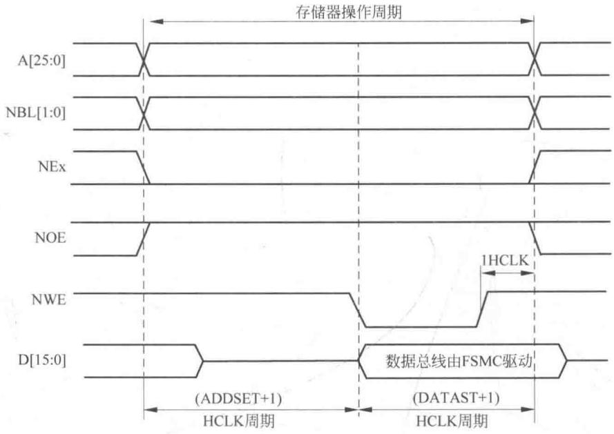

**这张图怎么读**：

1. **同样三段**：`(ADDSET+1) HCLK` 地址建立阶段 → `(DATAST+1) HCLK` 数据阶段 → 最后还有一小段标着 `1HCLK`。
2. **看 `NOE`**：**一直保持高**（不动）——因为这是写。
3. **看 `NWE`**：在第 2 段（数据阶段）**拉低**，在数据阶段结束时拉高。
4. **看 `D[15:0]`**：第 2 段开始时，标注"**数据总线由 FSMC 驱动**"——这次是 STM32 把数据放上去。
5. **看最后那 1 个 HCLK**：`NWE` 已经拉高了，但 `NEx` 还是低的。这 1 个 HCLK 就是"**NWE 上升沿之后，地址和数据的保持时间**"。

**这张图要你理解什么**：

> **写操作 = 先给地址 → 再拉低 NWE，同时把数据放上总线 → 抬高 NWE（存储器已经把数据存好了）→ 再等 1 个周期，才撤销片选。**

**为什么 `DATAST` 必须 > 0？** 因为如果 `DATAST = 0`，那么数据阶段只有 `(DATAST+1) = 1` 个 HCLK，就没有"最后 1 个 HCLK"的保持时间了，存储器可能还没来得及把数据存进去，`NWE` 就抬高了 → **数据丢失**。

#### 模式 1 的参数公式（【教材内容】表 12-8）

| 位编号 | 位名称 | 教材原文说明 |
|---|---|---|
| 31～16 | （保留） | `0x0000` |
| 15～8 | `DATAST` | 操作的第 2 个阶段的长度，**写操作为 (DATAST+1) 个 HCLK 周期，读操作为 (DATAST+3) 个 HCLK 周期**。这个域不能为 0，至少为 1 |
| 7～4 | （保留） | `0x0` |
| 3～0 | `ADDSET` | 操作的第 1 个阶段的长度（**ADDSET+1 个 HCLK 周期**） |

> **【重要】为什么读是 DATAST+3、写是 DATAST+1？**
> 因为从图 12-3 可以看到，读操作的"数据阶段"后面还有 **2 个 HCLK**（数据采集 + 数据存储）。
> 所以：**读数据阶段总长 = (DATAST+1) + 2 = DATAST + 3**。
> 而写操作没有这 2 个 HCLK（图 12-4 里数据阶段后只有 1 个 HCLK 的保持时间，且不计入 DATAST）。
> **这个"+3"和"+1"的差别是本章最容易记混的公式，务必对照两张图记。**

#### 模式 1 的 BCR 位域（【教材内容】表 12-7）

| 位编号 | 位名称 | 设置的数值 |
|---|---|---|
| 31～15 | | `0x0000` |
| 14～10 | | `0x0` |
| 9 | `WAITPOL` | 仅当位 15 为 1 时有意义 |
| 8 | `BURSTEN` | `0x0` |
| 7 | | — |
| 6 | `FACCEN` | — |
| 5～4 | `MWID` | 需要时设置 |
| 3～2 | `MTYP` | 需要时设置，**不包含 10（NOR 闪存）** |
| 1 | `MUXEN` | `0x0` |
| 0 | `MBKEN` | `0x1` |

**注意"不包含 10（NOR 闪存）"这句话**：因为模式 1 是给 SRAM/CRAM 用的，所以 `MTYP` 不能填 `10`（那是 NOR 闪存）。填了 `10` 就该用模式 2/B 了。

---

#### 2）模式 A——SRAM/PSRAM(CRAM) OE 翻转操作

**【教材内容】**
> "模式 A 读操作的时序图如图 12-5 所示。"
> "**模式 A 与模式 1 的区别是 NOE 的变化和相互独立的读写时序。**"

**这一句话就是全部区别**，我们把它拆成两半：

1. **NOE 的变化**：模式 1 里 `NOE` 从操作周期一开始就和 `NEx` 一起拉低，整段访问都是低的；模式 A 里 `NOE` **在"地址建立阶段"里一直保持高电平，直到第 2 段（数据阶段）开始才拉低**，然后一直低到周期结束、和 `NEx` 一起抬高。**差别是"NOE 拉低得更晚、有效时间更短"，不是"提前抬高"**——这就是"OE 翻转"三个字的真实含义（`NOE` 在周期内部"翻"了一次，而不是像模式 1 那样整段都是一条直线）。
2. **读写独立**：模式 A 用 `EXTMOD = 1`，所以**读用 `BTR`、写用 `BWTR`**，可以配两套完全不同的时间。

#### 【教材原图】图 12-5 模式 A 读操作的时序图

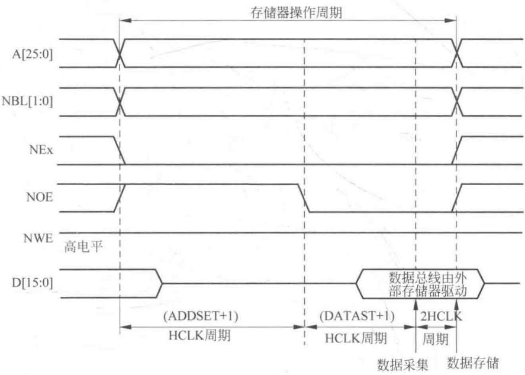

**这张图和图 12-3 并排看**（这就是"对比学习"）：

| 对比项 | 图 12-3（模式 1） | 图 12-5（模式 A） |
|---|---|---|
| `(ADDSET+1) HCLK` 地址建立阶段 | 有 | **一样有** |
| `(DATAST+1) HCLK` 数据阶段 | 有 | **一样有** |
| 最后 `2 HCLK`（数据采集/存储） | 有 | **一样有** |
| `NEx` 片选 | 整段保持低 | **一样** |
| `NOE` | **从周期头低到尾**（`NEx` 一拉低它就跟着低） | **地址建立阶段一直是高**，**第 2 段（数据阶段）开始才拉低**，一直低到周期末 |
| `NWE` | 一直高 | 一样高 |
| `D[15:0]` | 存储器驱动 | 一样 |

**图上具体怎么看**：拿"竖直虚线"当尺子去数。

- 在图 12-5（模式 A）里，`NOE` 的下降沿落在**第 2 条竖直虚线**上（地址建立阶段结束、数据阶段开始的那条线），之后一直是低，直到**最后一条虚线**（周期结束）才和 `NEx` 一起回到高电平。
- 在图 12-3（模式 1）里，`NOE` 的下降沿落在**第 1 条竖直虚线**上（周期开始），和 `NEx` 的下降沿**重合**。

把两根 `NOE` 单独拎出来对比，差别一眼就能看出来：

```
模式 1 的 NOE：  ‾‾‾‾|__________________________|‾‾‾‾
                     ↑ 周期一开始就和 NEx 一起拉低  ↑ 周期结束才抬高

模式 A 的 NOE：  ‾‾‾‾‾‾‾‾‾‾‾‾‾‾‾‾‾‾|______________|‾‾‾‾
                                 ↑ 数据阶段才开始拉低 ↑ 和 NEx 一起抬高
             |← (ADDSET+1) →|←—— (DATAST+1) ——→|←2HCLK→|
```

**这个差别说明什么？**（【补充解释】）

`NOE` 接出去就是存储器芯片的 `OE#` 引脚，它的意思是"**允许你把数据放上总线**"。从图上能直接读出的结论只有一句：

> **模式 1：`NOE` 在整个访问期间都有效（一直低）。模式 A：`NOE` 只在数据阶段有效，有效时间更短。**

教材正文没有展开讲"为什么要有这个模式"，只要求记住那句："**模式 A 与模式 1 的区别是 NOE 的变化和相互独立的读写时序**"。实际选模式时，最终要看**存储器手册里 `OE#` 的时序要求**（低电平最短/最长时间、地址建立时间）和**本讲义后面算出来的 `ADDSET`/`DATAST`** 对不对得上——对得上才选它。

> **【易错点】不要把这里的差别记成"模式 A 提前抬 NOE"。**
> 方向刚好相反：**模式 A 的 `NOE` 是"晚一步拉低"，模式 1 的 `NOE` 才是"从头低到尾"**。这也是本章最容易看错的一处，务必对着图 12-3 和图 12-5 各数一遍竖直线。

#### 【辅助理解图】只看 NOE：模式 1、模式 A、模式 C 的读使能差在哪

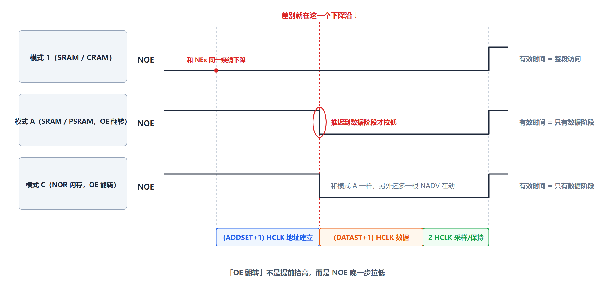

**这张图怎么读**：

1. 画布从上到下排成 **3 行**，每行**只画一条 `NOE` 波形**（把其他信号全部去掉，就是为了不被干扰），三行的时间轴严格对齐，下面共用一条分段条：左边 `(ADDSET+1)`、中间 `(DATAST+1)`、右边 `2 HCLK`；
2. **第 1 行**标题"模式 1（SRAM/CRAM）"：`NOE` 从最左边（周期开始）就已经是低的，一直低到最右边才抬高；在下降沿和上升沿的位置各画一条灰虚线下引到分段条；
3. **第 2 行**标题"模式 A（SRAM/PSRAM，OE 翻转）"：`NOE` 一开始是**高**的，"地址建立阶段"整段都是高，到"数据阶段开始"那条竖虚线才**拉低**，一直低到周期末；用**红色圆圈**圈住这个"晚一步的下降沿"，旁边写红字"`NOE` 推迟到数据阶段才有效"；
4. **第 3 行**标题"模式 C（NOR 闪存，OE 翻转）"：`NOE` 的波形和第 2 行**完全一样**（也是数据阶段才拉低），旁边写灰字"和模式 A 一样；另外还多一根 `NADV` 在动"；
5. **每行右侧**标出"有效时间"：第 1 行写"= 整段访问"，第 2、3 行写"= 只有数据阶段"；
6. **这张图要你理解**：**"OE 翻转"不等于"提前抬 NOE"，而是"NOE 晚一步拉低"**——模式 1 与模式 A/C 的差别，就藏在这一个下降沿的位置上。

> **【教材原图对照】** 用同一把"数竖直线"的尺子去核对：**图 12-3**（模式 1，`NOE` 与 `NEx` 同一条线下降）、**图 12-5**（模式 A，`NOE` 到第 2 条虚线才下降）、**图 12-10**（模式 C 写，写操作时 `NOE` 全程为高，不要拿它看 `NOE` 的翻转）。

#### 【教材内容】模式 A 的参数公式（表 12-10）

| 位编号 | 位名称 | 教材原文说明 |
|---|---|---|
| 31～30 | （保留） | `0x0` |
| 29～28 | `ACCMOD` | `0x0`（= 模式 A） |
| 27～16 | （保留） | `0x000` |
| 15～8 | `DATAST` | 读操作的第 2 个阶段的长度（**DATAST+3 个 HCLK 周期**）。这个域不能为 0（至少为 1） |
| 7～4 | （保留） | 仅当位 15 为 1 时有意义 |
| 3～0 | `ADDSET` | 读操作的第 1 个阶段的长度（**ADDSET+1 个 HCLK 周期**） |

**模式 A 的 BWTR（写时序，表 12-11）** 内容一模一样，只是 `ACCMOD` 也是 `0x0`（因为读和写的模式可以分别设，模式 A 读 + 模式 A 写）。

#### 模式 A 的 BCR 位域（【教材内容】表 12-9）

与模式 1 的表 12-7 相比，**只有 `EXTMOD` 从"（未列出）"变成 `0x1`**：

| 位编号 | 位名称 | 设置的数值 |
|---|---|---|
| 31～16 | | `0x0000` |
| 15 | | `0x0` |
| **14** | **`EXTMOD`** | **`0x1`** ← 关键区别 |
| 13～10 | | `0x0` |
| 9 | `WAITPOL` | 仅当位 15 为 1 时有意义 |
| 8 | `BURSTEN` | `0x0` |
| 7 | | — |
| 6 | `FACCEN` | — |
| 5～4 | `MWID` | 需要时设置 |
| 3～2 | `MTYP` | 需要时设置，不包含 10（NOR 闪存） |
| 1 | `MUXEN` | `0x0` |
| 0 | `MBKEN` | `0x1` |

> **一句话总结**：**模式 A = 模式 1 + EXTMOD 置 1 + `NOE` 晚一步拉低（只在数据阶段有效）+ 读写两套时序。**

---

#### 3）模式 2/B——NOR 闪存操作时

**【教材内容】**
> "模式 2/B 读操作时序图如图 12-6 所示。"
> "模式 2 写操作时序图如图 12-7 所示。模式 B 写操作时序图如图 12-8 所示。"
> "**模式 2/B 与模式 1 相比较，不同的是 NADV 的变化，且在扩展模式下（模式 B）读写时序相互独立。**"

**同样一句话就是全部区别**：

1. **NADV 的变化**：多了一根 `NADV` 在动作（因为 NOR 闪存常用复用接口）；
2. **模式 B 读写独立**（`EXTMOD = 1`），模式 2 读写共用（`EXTMOD = 0`）。

#### 【教材原图】图 12-6 模式 2/B 读操作时序图

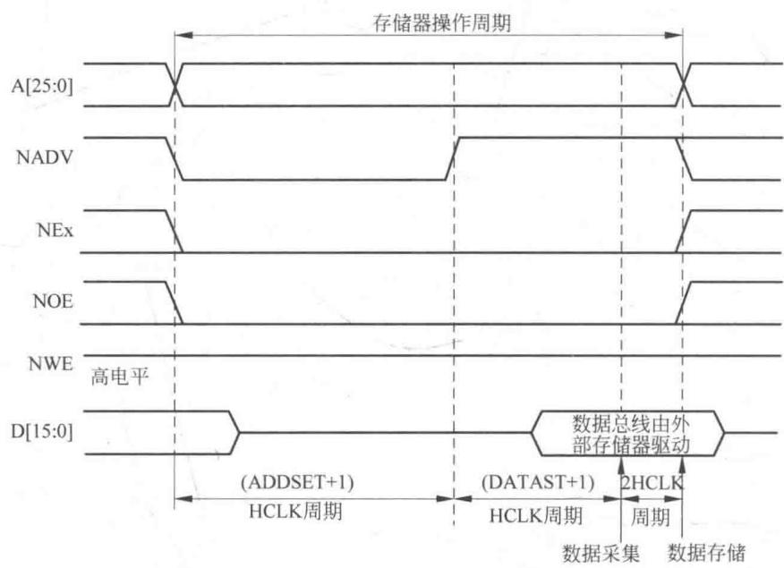

**这张图和图 12-3 并排看**：

| 对比项 | 图 12-3（模式 1） | 图 12-6（模式 2/B） |
|---|---|---|
| 三段结构（地址建立 / 数据 / 2 HCLK） | 有 | **完全一样** |
| `NEx`、`NOE` | 片选整段低，NOE 从头低到尾 | **一样** |
| `NWE` | 一直高 | 一样 |
| `D[15:0]` | 存储器驱动 | 一样 |
| **`NADV`** | **图上没有这条线** | **多了这条线：在地址建立阶段拉低，数据阶段开始时拉高** |

**`NADV` 在这张图上的具体表现**：

```
NADV:  ‾‾‾‾‾\_________________________/‾‾‾‾‾‾‾‾‾‾‾‾
             ↑                        ↑
        操作周期开始             数据阶段开始
        （地址已放好）          （地址已经锁存，线上改放数据）
```

**要理解的关键点**：`NADV` 的低电平期间正好覆盖"地址建立阶段"。也就是说，**存储器在 `NADV` 的下降沿（或低电平期间）把地址锁存进去**，之后就靠内部记住的地址干活，数据线上可以放别的东西了。

> **【易错点】`NADV` 是低有效，不是"高电平有效"。**
> 很多初学者看到"地址有效"就以为要高电平——**错**。名字里的 `N` 就是提醒你它是低有效。

#### 【教材内容】模式 2/B 的 BCR 位域（表 12-12）

| 位编号 | 位名称 | 设置的数值 |
|---|---|---|
| 31～15 | | `0x0000` |
| 14 | `EXTMOD` | **模式 B：`0x1`；模式 2：`0x0`** |
| 13～10 | | `0x0` |
| 9 | `WAITPOL` | 仅当位 15 为 1 时有意义 |
| 8 | `BURSTEN` | `0x0` |
| 7 | | — |
| 6 | `FACCEN` | `0x1` ← **允许访问 NOR 闪存** |
| 5～4 | `MWID` | 需要时设置 |
| 3～2 | `MTYP` | **`10`（NOR 闪存）** ← 关键 |
| 1 | `MUXEN` | `0x0` |
| 0 | `MBKEN` | `0x1` |

**和模式 A 的 BCR 相比，两处不同**：

```
MTYP： 模式 A → "需要时设置，不包含 10"     模式 2/B → 10（NOR 闪存）
FACCEN：模式 A → "—"                        模式 2/B → 0x1（打开 NOR 闪存访问）
```

> 【快速复习】`MTYP` 是"存储器类型"（bit3～2）：`00` = SRAM/ROM，`01` = PSRAM(CRAM)，`10` = NOR 闪存，`11` = 保留。
> `FACCEN` 是"闪存访问使能"（bit6）：`1` = 允许访问 NOR 闪存，`0` = 禁止。

#### 【教材内容】模式 2/B 的参数（表 12-13、表 12-14）

- `BTR`（读）：`ACCMOD = 0x1`（如果用了扩展模式），`DATAST` 读 = **DATAST+3 个 HCLK**，`ADDSET` = **ADDSET+1 个 HCLK**。
- `BWTR`（写）：`ACCMOD = 0x1`，`DATAST` 写 = **DATAST+1 个 HCLK**，`ADDSET` = **ADDSET+1 个 HCLK**。

---

#### 4）模式 C——NOR 闪存 OE 翻转

**【教材内容】**
> "模式 C 读操作时序图如图 12-9 所示。"
> "**模式 C 与模式 1 不同的是，NOE 和 NADV 的翻转变化，以及独立的读写时序。**"

**区别 = 模式 A 的区别 + 模式 2/B 的区别**：

```
模式 C = 模式 1
       + NOE 晚一步拉低（学模式 A：只在数据阶段有效）
       + NADV 动作（学模式 2/B）
       + EXTMOD = 1，读写独立
```

#### 【教材原图】图 12-10 模式 C 写操作时序图

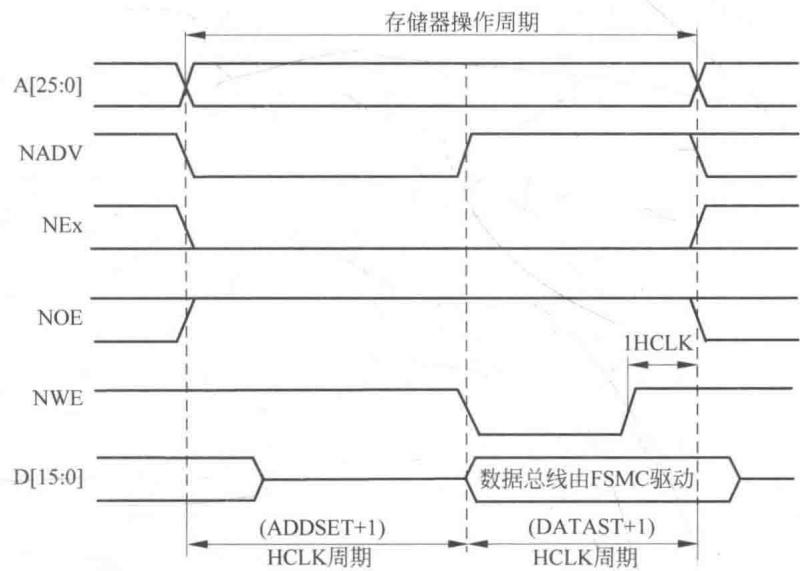

**这张图怎么读**（它是写操作，所以看 `NWE`）：

1. 同样是 `(ADDSET+1) HCLK` 地址建立阶段 + `(DATAST+1) HCLK` 数据阶段；
2. `NADV` 在地址建立阶段拉低，数据阶段开始时抬高；
3. `NWE` 在数据阶段拉低，把 `D[15:0]` 上的数据（由 FSMC 驱动）写进存储器；
4. `NOE` 全程保持高（写操作不读）。

> **【补充说明·已核对教材原图】模式 C 的读操作是什么样？**
> 教材的图 12-9（模式 C 读操作时序图）在 MinerU 解析时**丢了题注**（源文件：`mineru/微机原理3/images/160bbc070a40704313022b4a555fc49db34296d9c5f7cf74f2640ebd2d6ff6fe.jpg`），本讲义没有把它插进来，但它的读数很关键：
> - 它的第二行信号是 `NADV`（不是 `NBL[1:0]`），`NADV` 在地址建立阶段拉低、数据阶段开始抬高；
> - 它的 `NOE` 波形**和模式 A 完全一样**：地址建立阶段一直高，**到数据阶段才拉低**，一直低到周期末、和 `NEx` 一起抬高。
> 所以"模式 C = 模式 A 的 NOE 行为 + 模式 2/B 的 NADV 行为"，这句话在图上站得住。

#### 【教材内容】模式 C 的寄存器设置（表 12-15、12-16、12-17）

| 寄存器 | 位 | 值 |
|---|---|---|
| `BCR` | `EXTMOD`(14) | `0x1` |
| `BCR` | `FACCEN`(6) | `0x1` |
| `BCR` | `MTYP`(3～2) | `0x2`（= 二进制 10，NOR 闪存） |
| `BTR` | `ACCMOD`(29～28) | **`0x2`** ← 模式 C |
| `BWTR` | `ACCMOD`(29～28) | **`0x2`** |

---

#### 5）模式 D——带地址扩展的异步操作

**【教材内容】**
> "模式 D 读操作时序图如图 12-11 所示。模式 D 写操作时序图如图 12-12 所示。"
> "**模式 D 与模式 1 不同的是 NADV 的翻转变化，NOE 的翻转出现在 NADV 翻转之后，并且具有独立的读写时序。**"

**关键区别**："**NOE 的翻转出现在 NADV 翻转之后**"——也就是说，多了一个"**中间阶段**"，这个阶段由 `ADDHLD` 控制。

#### 【教材原图】图 12-12 模式 D 写操作时序图

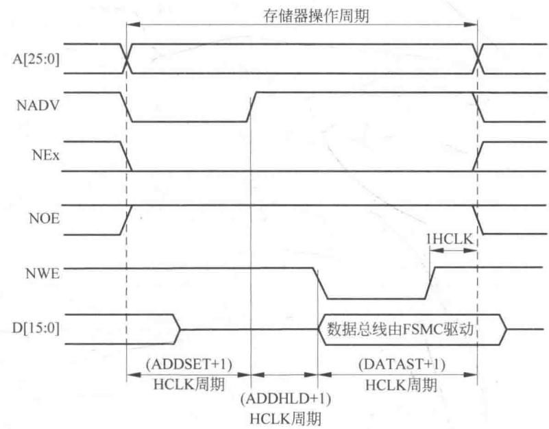

**这张图怎么读**：

1. 和前面几张相比，**多出了一段**。整段变成：

```
|← (ADDSET+1) HCLK →|← (ADDHLD+1) HCLK →|← (DATAST+1) HCLK →|
     地址建立阶段          地址保持阶段          数据阶段
```

2. `NADV` 在地址建立阶段拉低，在**地址保持阶段**开始时抬高；
3. `NOE`（或 `NWE`）的翻转发生在 `NADV` 抬高**之后**——这就是"NOE 的翻转出现在 NADV 翻转之后"的含义；
4. **多出来的"地址保持阶段"（ADDHLD）** 是给那些"地址撤掉之后还需要保持一段时间"的存储器用的。

#### 【教材内容】模式 D 的寄存器设置（表 12-18、12-19、12-20）

| 寄存器 | 位 | 值 | 说明 |
|---|---|---|---|
| `BCR` | `EXTMOD`(14) | `0x1` | |
| `BCR` | `FACCEN`(6) | 根据存储器设置 | |
| `BCR` | `MTYP`(3～2) | 需要时设置 | |
| `BTR` | `ACCMOD`(29～28) | **`0x3`** ← 模式 D | |
| `BTR` | `DATAST`(15～8) | 读操作第 3 阶段，**DATAST+3 个 HCLK** | 不能为 0 |
| `BTR` | **`ADDHLD`(7～4)** | 读操作的**中间阶段**（`ADDHLD+1` 个 HCLK） | 不能为 0 |
| `BTR` | `ADDSET`(3～0) | 第 1 阶段（`ADDSET+1` 个 HCLK） | |
| `BWTR` | `ACCMOD`(29～28) | `0x3` | |
| `BWTR` | `DATAST`(15～8) | 写操作第 3 阶段，**DATAST+1 个 HCLK** | 不能为 0 |
| `BWTR` | `ADDHLD`(7～4) | 写操作中间阶段（`ADDHLD+1` 个 HCLK） | |

> **注意表 12-18 里 `ACCMOD` 写的是 `0x2`**，但教材正文说模式 D 应该是 `ACCMOD = 11`（二进制 3）。
> **这是一个明显的矛盾**（表 12-19 也写 `ACCMOD = 0x2`）。
> 而教材 12.5 寄存器一节里明确写着："`00`：访问模式 A；`01`：访问模式 B；`10`：访问模式 C；`11`：访问模式 D。"
> 本讲义按 **模式 D = ACCMOD 11（即 0x3）** 讲解，并把这个矛盾列入文末"待核验"。

---

#### 6）复用模式——地址/数据复用的 NOR 闪存异步操作

**【教材内容】**
> "复用模式读操作时序图如图 12-13 所示。其中，总线恢复延迟 (BUSTURN+1) 与连续 2 次读操作之间在内部产生的延迟有部分重叠，因此 **BUSTURN ≤ 5 时将不影响输出时序**。"
> "复用模式写操作时序图如图 12-14 所示。"
> "**复用模式与模式 D 不同的是地址的低 16 位出现在数据总线上。**"

**复用模式的三个特征**：

1. **地址的低 16 位出现在数据总线上**（`AD[15:0]` 复用），高 16 位走 `A[25:16]`；
2. 靠 `NADV` 区分"现在线上是地址还是数据"；
3. 需要 `ADDHLD`（地址保持阶段），因为地址锁存之后还要保持一会儿。

**【教材内容】`BUSTURN ≤ 5` 这句话怎么理解？**

`BUSTURN` 是"总线恢复时间"——一次读操作结束后，控制器需要一点时间把数据总线"交还"，才能开始下一次操作。教材说：**当 `BUSTURN` 不超过 5 时，这段时间和内部本来就有的延迟"重叠"了，所以不额外增加时间。** 也就是说，`BUSTURN` 在这个范围内"免费"。

**【教材内容】复用模式的寄存器设置（表 12-21、12-22）**

| 寄存器 | 位 | 值 | 说明 |
|---|---|---|---|
| `BCR` | `EXTMOD`(14) | **`0x0`** | 复用模式**不用**扩展模式 |
| `BCR` | `FACCEN`(6) | `0x1` | |
| `BCR` | `MTYP`(3～2) | `0x2`（NOR 闪存） | |
| `BCR` | **`MUXEN`(1)** | **`0x1`** | ← 关键：地址/数据复用 |
| `BTR` | `ACCMOD`(29～28) | （表 12-22 未列出，`0x0`） | 复用模式用 `BTR` 一套 |
| `BTR` | **`BUSTURN`(19～16)** | 最后阶段长度 = `BUSTURN+1` 个 HCLK | |
| `BTR` | `DATAST`(15～8) | 读 = DATAST+3，写 = DATAST+1 | 不能为 0 |
| `BTR` | **`ADDHLD`(7～4)** | 中间阶段 = `ADDHLD+1` 个 HCLK | **不能为 0** |
| `BTR` | `ADDSET`(3～0) | 第 1 阶段 = `ADDSET+1` 个 HCLK | |

> **复用模式是唯一一个"有 ADDHLD、有 BUSTURN，但 EXTMOD = 0"的模式**，这一点很特别。

---

#### 【汇总】5 种模式的对比总表（建议背下来）

| 模式 | 典型用途 | `EXTMOD` | `ACCMOD` | `MTYP` | `MUXEN` | 与模式 1 的区别 | 用到 `ADDHLD`？ |
|---|---|---|---|---|---|---|---|
| **模式 1** | SRAM / CRAM / 非复用 NOR | 0 | 无所谓 | 不是 10 | 0 | （基准） | 否 |
| **模式 A** | SRAM / PSRAM（OE 翻转） | **1** | `00` | 不是 10 | 0 | **`NOE` 不跟周期一起拉低，而是等到数据阶段才拉低**（有效时间更短）；读写两套时序 | 否 |
| **模式 2** | NOR 闪存 | 0 | 无所谓 | `10` | 0 | 多了 NADV 动作 | 否 |
| **模式 B** | NOR 闪存 | **1** | `01` | `10` | 0 | 多了 NADV；读写两套时序 | 否 |
| **模式 C** | NOR 闪存（OE 翻转） | **1** | `10` | `10` | 0 | **`NOE` 和模式 A 一样只在数据阶段拉低**；另外 `NADV` 会动；读写两套 | 否 |
| **模式 D** | NOR 闪存（带地址扩展） | **1** | `11` | 需要时设 | 0 | NADV 动；NOE 在 NADV 之后翻转；有"地址保持阶段" | **是** |
| **复用模式** | 复用接口的 NOR/PSRAM | **0** | — | `10` | **1** | 地址低 16 位走数据总线 | **是** |

#### 【辅助理解图】一张图看懂模式 1 / A / B 的波形差别

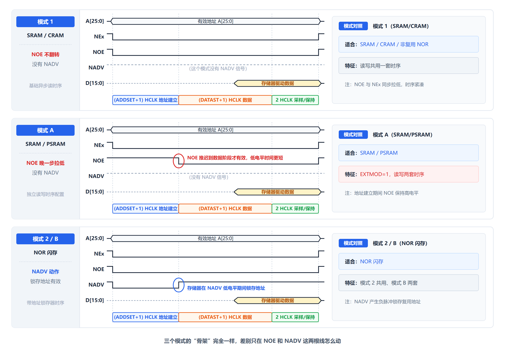

**这张图怎么读**：

1. 画布上下分成 **3 个横向面板**，每个面板画同一套信号（`A[25:0]`、`NEx`、`NOE`、`NADV`、`D[15:0]`），并且**三条时间轴严格对齐**（同一个 `(ADDSET+1)`、`(DATAST+1)`、`2 HCLK` 分段），这样差别一眼就能看出来；
2. **上面板**标题"模式 1（NOE 不翻转、无 NADV）"：`NOE` **从周期最开头（和第 1 条虚线重合）就拉低**，一直低到片选结束才抬高；`NADV` 一栏画成一条直线并标注"（没有这个信号）"；
3. **中面板**标题"模式 A（NOE 翻转）"：`NOE` 在**地址建立阶段整段保持高**，到"数据阶段开始"那条虚线才**拉低**，一直低到周期末才和 `NEx` 一起抬高；用**红色圆圈**圈出这个"晚一步的下降沿"，旁边标注"NOE 推迟到数据阶段才有效，低电平时间更短"；
4. **下面板**标题"模式 2/B（NADV 动作）"：`NADV` 在地址建立阶段拉低、在数据阶段开始抬高，用**蓝色圆圈**圈出这个抬高点，旁边标注"存储器在 NADV 低电平期间锁存地址"；
5. 三个面板右侧各画一个小小的"打勾/打叉"表格，说明该模式适合 SRAM 还是 NOR；
6. **这张图要你理解**：**三个模式的"骨架"（三段式）完全一样，差别只在 `NOE` 和 `NADV` 这两根线怎么动。**

---

#### 【核心】时序参数到底怎么算？（结合 HCLK 具体演算）

这是本章**最实用的技能**。我们把公式整理成一张表，然后做两个完整的演算。

#### 公式总表

设 HCLK 的周期为 `T_HCLK`。

| 参数 | 寄存器位 | 实际时间 | 单位 | 用在哪个阶段 |
|---|---|---|---|---|
| `ADDSET` | 3～0 | `(ADDSET + 1) × T_HCLK` | HCLK 周期 | 第 1 阶段：地址建立 |
| `ADDHLD` | 7～4 | `(ADDHLD + 1) × T_HCLK` | HCLK 周期 | 中间阶段：地址保持（模式 D / 复用模式） |
| `DATAST`（读） | 15～8 | `(DATAST + 3) × T_HCLK` | HCLK 周期 | 第 2/3 阶段：数据（读） |
| `DATAST`（写） | 15～8 | `(DATAST + 1) × T_HCLK` | HCLK 周期 | 第 2/3 阶段：数据（写） |
| `BUSTURN` | 19～16 | `(BUSTURN + 1) × T_HCLK` | HCLK 周期 | 最后阶段：总线恢复 |
| `CLKDIV` | 23～20 | `(CLKDIV + 1) × T_HCLK` | HCLK 周期 | 同步模式：CLK 的周期 |
| `DATLAT` | 27～24 | `(DATLAT + 2) × T_CLK` | **CLK 周期** | 同步模式：第一个数据前的等待 |

**两个"记忆口诀"**：

```
异步读一次的总时间 ≈ (ADDSET+1) + (DATAST+3)  个 HCLK
异步写一次的总时间 ≈ (ADDSET+1) + (DATAST+1)  个 HCLK
```

（如果要严格算，写操作后面还有 1 个 HCLK 的保持时间，读操作已经把那 2 个 HCLK 算进 +3 里了。）

#### 【演算 1】教材 12.7 例程里的时序到底是多少纳秒？

教材 LCD 例程里写的是（**教材原文代码注释**）：

```c
readWriteTiming.FSMC_AddressSetupTime = 0x01; //地址建立时间(ADDSET)为 2 个 HCLK 1/36M = 27ns
readWriteTiming.FSMC_DataSetupTime = 0x0f;    //数据保存时间为 16 个 HCLK
writeTiming.FSMC_AddressSetupTime = 0x00;     //地址建立时间为1个HCLK
writeTiming.FSMC_DataSetupTime = 0x03;        //数据保存时间为4个HCLK
```

**第一步：确定 HCLK。**

STM32F103 最高主频 72MHz，FSMC 挂在 AHB 上，所以 **HCLK = 72MHz**。

```
T_HCLK = 1 / 72 000 000 s = 13.888… ns ≈ 13.9 ns
```

**第二步：解释教材注释里那个"1/36M = 27ns"是什么意思。**

```
2 个 HCLK = 2 × 13.9 ns = 27.8 ns ≈ 27 ns
而 1 / 36 MHz = 27.78 ns

所以：2 × (1/72MHz) = 1/36MHz，两个数完全一样。
教材注释是想说"2 个 HCLK 加起来相当于 1/36MHz 的时间"，并不是说 HCLK 是 36MHz。
```

> **【易错点】** 看到"1/36M"不要以为 HCLK = 36MHz。**HCLK 是 72MHz，2 个周期合起来才等于 1/36MHz。**

**第三步：算读操作。**

```
ADDSET = 0x01 = 1  →  地址建立阶段 = (1+1) = 2 个 HCLK = 2 × 13.9 = 27.8 ns
DATAST = 0x0F = 15 →  读数据阶段   = (15+3) = 18 个 HCLK = 18 × 13.9 = 250.0 ns

一次读操作总共 ≈ 2 + 18 = 20 个 HCLK = 277.8 ns
```

**第四步：算写操作。**

```
ADDSET = 0x00 = 0  →  地址建立阶段 = (0+1) = 1 个 HCLK = 13.9 ns
DATAST = 0x03 = 3  →  写数据阶段   = (3+1) = 4 个 HCLK = 55.6 ns

一次写操作总共 ≈ 1 + 4 = 5 个 HCLK = 69.4 ns
（再加上写操作末尾 1 个 HCLK 的保持时间，实际占用 ≈ 6 个 HCLK = 83.3 ns）
```

**第五步：和 LCD 的要求对比（见 12.7 表 12-28）。**

| LCD 参数 | LCD 要求 | FSMC 实际给的时间 | 够不够 |
|---|---|---|---|
| `t_wc`（写周期） | ≥ 66 ns | 69.4 ns | ✅ 够 |
| `t_rc`（读 ID 周期） | ≥ 160 ns | 277.8 ns | ✅ 够 |
| `t_rcfm`（读显存周期） | ≥ 450 ns | 277.8 ns | ❌ **不够** |

> **【补充解释】** 上表最后一行是本讲义自己算出来的一个观察：**按教材例程的读时序，读"显存"是偏快的**。不过教材例程里只用到"读 ID"和"读寄存器"，没有读显存，所以不影响功能。如果要读显存，应该把 `DATAST` 加大（比如 `DATAST = 0x1D`，则读数据阶段 = 32 个 HCLK = 444ns，仍差一点；`DATAST = 0x1E` → 33 个 HCLK = 458ns ✅）。
> 这一段属于【补充解释】，不是教材结论，供理解"参数怎么选"用。

#### 【演算 2】给一块 55ns 的 SRAM 配时序

【补充解释】假设我们要外扩一片 SRAM，数据手册给出：

```
t_AA  (地址有效到数据有效) = 55 ns   （读）
t_WC  (写周期)            = 55 ns   （写）
t_SA  (地址建立，可忽略)  = 0 ns
```

HCLK = 72MHz，`T_HCLK = 13.9 ns`。

**读**：需要 `(ADDSET+1) + (DATAST+3)` 个 HCLK 的总时间 ≥ 55 ns。

```
取 ADDSET = 0（1 个 HCLK = 13.9ns），DATAST = 1（读数据阶段 = 1+3 = 4 个 HCLK = 55.6ns）
总时间 = 1 + 4 = 5 个 HCLK = 69.4 ns ≥ 55 ns ✅
```

**写**：需要 `(ADDSET+1) + (DATAST+1)` 个 HCLK 的总时间 ≥ 55 ns。

```
取 ADDSET = 0（1 个 HCLK），DATAST = 3（写数据阶段 = 3+1 = 4 个 HCLK = 55.6ns）
总时间 = 1 + 4 = 5 个 HCLK = 69.4 ns ≥ 55 ns ✅
```

**结论**：`ADDSET = 0`，读 `DATAST = 1`，写 `DATAST = 3`。

> **选参数的通用方法（记住这 4 步）**：
> 1. 从存储器数据手册找出"最慢的那一项时间要求"（读找 `t_AA`/`t_RC`，写找 `t_WC`/`t_WP`）；
> 2. 换算成 HCLK 周期数：`需要的周期数 = 向上取整(要求时间 / T_HCLK)`；
> 3. 用公式反推 `ADDSET` 和 `DATAST`（**宁可多给 1～2 个周期，不要抠得太紧**）；
> 4. 实际跑一下，确认数据正确。

#### 【辅助理解图】时序参数计算示意图

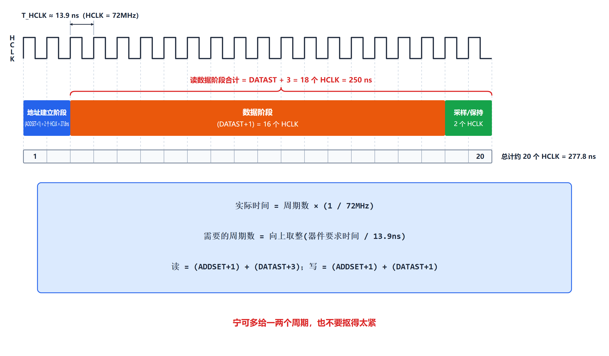

**这张图怎么读**：

1. 画布上方画一条 **HCLK 时钟波形**，标出每一个上升沿，并在两个上升沿之间用双箭头标 `T_HCLK ≈ 13.9ns`；
2. 中间画一条时间轴，用**不同颜色的色块**标出一次读操作的三段：
   - 蓝色块 = 地址建立阶段，宽 `ADDSET+1` 格，块内写"ADDSET+1 = 2 个 HCLK = 27.8ns"；
   - 橙色块 = 数据阶段，宽 `DATAST+1` 格，块内写"DATAST+1 = 16 个 HCLK"；
   - 绿色块 = 采样/保持，宽 2 格，块内写"2 个 HCLK"；
   - 在橙色块和绿色块外面套一个**红色大括号**，标注"读数据阶段合计 = DATAST+3 = 18 个 HCLK = 250ns"；
3. 右侧画一个小的换算公式框：
   ```
   时间 = 周期数 × (1 / 72MHz)
   周期数 = 向上取整(要求时间 / 13.9ns)
   ```
4. 底部写一行小字："**宁可多给一两个周期，也不要抠得太紧**"；
5. **这张图要你理解**：**参数不是"随便填的数"，而是"数时钟格子数出来的"。**

---

### 12.4.4 同步的成组读

#### 【先别急着看教材】这一小节在讲什么？

前面讲的全是"**异步**"——FSMC 给一个地址，等一会儿，拿一个数据；再给一个地址，再等一会儿，再拿一个数据。

如果我要连续读 100 个数据呢？**每次都要重新给地址、重新等**，效率很低。

**"同步成组读"（synchronous burst read）** 就是来解决这个问题的：

> **只给一次地址，然后跟着时钟，"哒哒哒哒"一口气把一串数据全读回来。**

#### 【先补一个前置知识：什么叫"成组传输"（burst）？】

**burst** = 突发 / 成组。

大白话：

```
异步（一个个来）：          同步成组（一串一起）：
给地址 → 等 → 拿 1 个       给地址 → 等 → 拿 1 个
给地址 → 等 → 拿 2 个                  → 拿 2 个
给地址 → 等 → 拿 3 个                  → 拿 3 个
给地址 → 等 → 拿 4 个                  → 拿 4 个
（4 次地址，4 次等待）      （1 次地址，1 次等待）
```

**代价**：需要一根时钟线 `CLK`（因为"哒哒哒"要有节拍），而且存储器和 FSMC 必须"对节拍"——这就是"**同步**"的意思。

#### 【教材内容】12.4.4 原文

> "根据参数 CLKDIV 的不同数值，存储器时钟 CLK 的周期是 HCLK 的整数倍。"

> "NOR 闪存存储器有一个从 NADV 有效至 CLK 变高的最小时间限制，为了满足这个限制，**在同步访问（NADV 有效之前）的第一个内部时钟周期中，FSMC 不会输出时钟到存储器**。这样可以保证存储器时钟的上升沿产生于 NADV 低脉冲的中间。"

**这两句话画成图就是**：

```
HCLK:  ┌─┐ ┌─┐ ┌─┐ ┌─┐ ┌─┐ ┌─┐ ┌─┐ ┌─┐
       ┘ └─┘ └─┘ └─┘ └─┘ └─┘ └─┘ └─┘ └─

CLK:   ──────┌───────┐       ┌───────┐
             │       │       │       │        ← CLK 比 HCLK 慢（分频）
       ──────┘       └───────┘       └──────
             ↑
      第 1 个 HCLK 周期里，FSMC 故意"不出声"（不输出时钟）
      这样 CLK 的第一个上升沿正好落在 NADV 低脉冲的中间
```

**为什么要这样？** 因为 NOR 闪存要求"从 NADV 有效到 CLK 上升沿"至少有一段时间。如果 CLK 从第一个 HCLK 就开始"哒"，可能太快了，存储器来不及锁存地址。所以 FSMC 先"憋一拍"。

#### 【教材内容】1. 数据延时与 NOR 闪存的延时

> "数据延时是指在采样数据之前需等待的周期数目，DATLAT 数值必须与 NOR 闪存配置寄存器中定义的数值相符合。FSMC 不把 NADV 为低时的时钟周期包含在数据延时参数中。"

> "有些 NOR 闪存把 NADV 为低时的时钟周期包含在数据延时参数中，因此 NOR 闪存延时与 FSMC 的 DATLAT 参数的关系可以是：
> **NOR 闪存延时 = DATLAT + 2，或者 NOR 闪存延时 = DATLAT + 3**"

**这段话在说什么？**

"数据延时"（latency）= 从"开始读"到"第一个数据有效"之间要等多少个时钟周期。

问题在于：**"开始读"从哪一刻算起？**

```
FSMC 的算法：从 NADV 抬起那一刻开始算
存储器手册的算法：从 NADV 落下那一刻开始算（或者别的起点）

两者差 1～2 个周期 → 所以出现 "DATLAT+2" 和 "DATLAT+3" 两个公式
```

**怎么用？** 存储器手册说"latency = 5 个 CLK"，那就取 `DATLAT = 3`（因为 3+2 = 5）；如果手册说"latency = 6 个 CLK"，取 `DATLAT = 4`。**总之要让两边对得上。**

> "有些新出的存储器会在数据保持阶段产生一个 NWAIT 信号，这种情况下可以设置 DATLAT 为其最小值。FSMC 会对 NWAIT 信号采样并等待足够长的时间，直到数据有效，在 FSMC 检测到存储器结束了保持阶段后，读取正确的数据。"

**翻译**：如果存储器"会喊停"（输出 NWAIT），那 FSMC 就不需要"猜"要等多久，直接把 `DATLAT` 设成最小，剩下的让存储器自己用 `NWAIT` 控制。

> "另外一些存储器不在数据保持阶段输出 NWAIT 信号，这时 FSMC 和存储器端的数据保持时间必须设置为相同的数值，否则将得不到正确的数据，或在存储器访问的初始阶段有数据丢失。"

**翻译**：如果存储器"不会喊停"，那**两边必须把等待时间配成一样**，否则读出来的是错的数据。

#### 【教材内容】2. 单次成组传输

> "当选中的存储器块配置为同步成组模式，并且仅需要进行一次 AHB 单次成组传输时，如果 AHB 需要传输 16 位数据，则 FSMC 会执行一次长度为 1 的成组传输；如果 AHB 需要传输 32 位数据，则 FSMC 会分成 2 次每次 16 位传输，执行一次长度为 2 的成组传输；最后一个数据传输完毕时撤销片选信号。"

**翻译**：

```
AHB 要 16 位  →  成组长度 = 1（读 1 个半字）
AHB 要 32 位  →  成组长度 = 2（读 2 个半字）
最后一个数据读完 → NE 拉高（撤销片选）
```

> "显然，与异步读相比，从效率上讲这种传输方式不是最有效的，一次随机的异步访问需要重新配置存储器访问模式，这同样需要较长时间。"

**翻译**：如果只读一次（不是连续读一大串），同步成组其实**不划算**——因为配置成组模式本身要花时间。**成组传输的优势在"连续读很多"的时候才体现出来。**

#### 【教材内容】3. 等待管理

> "对于同步的 NOR 闪存成组访问，在预置的保持时间（DATLAT+1 个 CLK 时钟周期）之后，需检测 NWAIT 信号。如果检测到 NWAIT 为有效电平时（当 WAITPOL=0 时有效电平为低，WAITPOL=1 时有效电平为高），FSMC 将插入等待周期直到 NWAIT 变为无效电平（当 WAITPOL=0 时无效电平为高，WAITPOL=1 时无效电平为低）。当 NWAIT 变为无效时，FSMC 认为数据已经有效（WAITCFG=1），或数据将在下一个时钟边沿有效（WAITCFG=0）。"

**翻译成时间轴**：

```
时间 →→→→→→→→→→→→→→→→→→→→→→→→→→→→→→→→→→→→→→→→→→→

          DATLAT+1 个 CLK            等 NWAIT 变无效
     |←──────────────────────→|←────────────────────────→|
                                                        然后采样数据
     CLK: 哒 哒 哒 哒 哒 哒 哒 哒 哒 哒 哒 哒 哒 哒 哒 哒
     NWAIT: ‾‾‾‾‾‾‾‾‾‾‾‾‾‾‾‾‾‾‾\___________________/‾‾‾‾‾‾
                              ↑ 存储器说"等一下"
                              └─ 这段就是"插入的等待状态"
```

> "在 NWAIT 信号控制的等待状态插入期间，控制器会连续向存储器发送时钟脉冲、保持片选信号和输出有效信号，同时忽略无效的数据信号。"

**翻译**：等待期间，FSMC **不慌不忙**：继续"哒哒哒"地送时钟、继续把片选和读使能按住，但是**假装没看见数据线上的东西**（因为那是无效的）。

> "在成组传输模式下，NOR 闪存的 NWAIT 信号有两种时序配置：
> （1）闪存存储器在等待状态之前的一个数据周期插入 NWAIT 信号（复位后的默认设置）；
> （2）闪存存储器在等待状态期间插入 NWAIT 信号。
> 通过配置 FSMC_BCRx 寄存器中的 WAITCFG 位，FSMC 在每个片选上都支持这两种 NOR 闪存的等待状态配置。"

**翻译**：

```
WAITCFG = 0（默认）：存储器"提前一拍"打招呼
     NWAIT: ‾‾‾‾‾‾\__________/‾‾‾‾‾‾
                  ↑ 提前
                  真正的等待状态

WAITCFG = 1：存储器"当拍"打招呼
     NWAIT: ‾‾‾‾‾‾‾‾‾\______/‾‾‾‾‾‾
                     ↑ 和等待状态同时
```

#### 【教材原图】图 12-15 NOR 和 PSRAM(CRAM) 的同步总线复用读模式的时序图

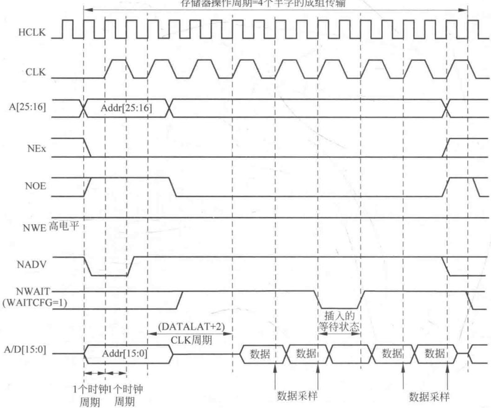

**这张图信息量很大，我们分层看。**

**第一层：先看图上画了哪几条信号线。**

从上到下：`HCLK`、`CLK`、`A[25:16]`、`NEx`、`NOE`、`NWE`（写"高电平"）、`NADV`、`NWAIT`、`A/D[15:0]`。

**第二层：看最上面的大箭头。**

它标注"**存储器操作周期 = 4 个半字的成组传输**"——也就是说，这一次操作一口气读了 **4 个 16 位（半字）** 的数据。这就是"成组"。

**第三层：看 `CLK` 和 `HCLK` 的关系。**

图上 `HCLK` 是一串密集的方波，`CLK` 明显**慢一半**——每一个 `CLK` 周期等于 2 个 `HCLK` 周期。这对应 `CLKDIV = 1`（"1 个 CLK 周期 = 2 个 HCLK 周期"）。

而且注意：**`CLK` 的第一个上升沿并不是在操作一开始就出现的**，而是**晚了一拍**——这就是教材说的"在 NADV 有效之前的第一个内部时钟周期中，FSMC 不会输出时钟到存储器"。

**第四层：看 `NADV` 和 `A/D[15:0]`。**

- `NADV` 在操作开始时拉低，持续 **1 个 CLK 周期**（图下面标注"1 个时钟周期"），然后抬高；
- 在 `NADV` 低电平期间，`A/D[15:0]` 上是 `Addr[15:0]`（地址的低 16 位），`A[25:16]` 上是 `Addr[25:16]`（地址的高 10 位）；
- `NADV` 抬高之后，`A/D[15:0]` 改放数据。

**第五层：看那段 `(DATALAT+2) CLK 周期` 的标注。**

> **先纠正一个名字**：教材**图上的标注**写的是 `DATALAT`，而**寄存器表里的位段名**是 `DATLAT`（`BTR` 的 bit27～24，见 12.5.2）。**两个写法指的是同一个东西**，中间多了一个 `A` 只是图上和表里的叫法不统一——按寄存器名 `DATLAT` 记就行。

从操作开始到第一个数据出现，图上标着 `(DATLAT+2) CLK 周期`（图 12-15 里写作 `DATALAT+2`）。这就是前面讲的"数据延时"公式。

**第六层：看 `NWAIT` 和"插入的等待状态"。**

- `NWAIT` 一开始是高的（无效）；
- 在第一个数据出现之后，`NWAIT` **拉低**（有效），图上标注"**插入的等待状态**"；
- 等 `NWAIT` 抬高之后，才出现下一个有效数据。
- 图下面标着"**数据采样**"的箭头，指向数据被取走的时刻。

**第七层：看 `NOE`。**

`NOE` 在操作开始后不久拉低，中间在"插入的等待状态"期间**抬高了一下**，然后又被拉低继续读剩下的数据。这说明：**等待期间 NOE 也是被"暂停"处理的**。

**这张图要你理解什么**：

> **同步成组读 = 一次给地址（NADV 锁存）→ 跟着 CLK 一拍一拍地读 → 中间存储器可以用 NWAIT 喊停 → 读完最后一个数据才撤销片选。**

#### 【教材内容】同步总线复用读模式的寄存器设置（表 12-23、12-24）

`BCR`（表 12-23）里几个值得注意的位：

| 位 | 名称 | 设置 | 说明 |
|---|---|---|---|
| 19 | `CBURSTRW` | 对同步读模式不起作用 | 它是管"同步写"的 |
| 14 | `EXTMOD` | `0x0` | |
| 13 | `WAITEN` | "该位为高时，不管存储器的等待数值是多少，FSMC 视数据保持阶段结束后的第一个数据有效" | 打开等待功能 |
| 12 | `WREN` | 对同步读模式不起作用 | |
| 11 | `WAITCFG` | 根据存储器特性设置 | 提前一拍还是当拍 |
| 10 | `WRAPMOD` | 不起作用 | |
| 9 | `WAITPOL` | 根据存储器特性设置 | NWAIT 的极性 |
| **8** | **`BURSTEN`** | **`0x1`** | ← **打开成组模式** |
| 7 | `FWPRLVL` | 设置此位防止存储器被意外写 | 写保护 |
| 6 | `FACCEN` | 根据存储器设置 | |
| 5～4 | `MWID` | 根据需要设置 | |
| 3～2 | `MTYP` | `0x1` 或 `0x2` | PSRAM 或 NOR |
| 1 | `MUXEN` | 根据需要设置 | |
| 0 | `MBKEN` | `0x1` | |

`BTR`（表 12-24）里**几乎全是"不起作用"**：

| 位 | 名称 | 设置 |
|---|---|---|
| 27～24 | `DATLAT` | 数据保持时间 ← **只有这个有用** |
| 23～20 | `CLKDIV` | `0x0`——得到 CLK=HCLK（不支持）；`0x1`——得到 CLK=2×HCLK |
| 19～16 | `BUSTURN` | 不起作用 |
| 15～8 | `DATAST` | 不起作用 |
| 7～4 | `ADDHLD` | 不起作用 |
| 3～0 | `ADDSET` | 不起作用 |

**这张表非常重要，它告诉你一件事**：

> **同步模式下，地址建立时间、数据建立时间、地址保持时间统统"不起作用"——因为一切由 `CLK` 的节拍决定，不再靠 HCLK 数格子。**
> 只剩两个参数有用：`DATLAT`（等几个 CLK 才拿第一个数据）和 `CLKDIV`（CLK 比 HCLK 慢几倍）。

#### 【教材内容】同步总线复用写模式

教材还给了图 12-16 和表 12-25、12-26，讲的是**同步写**（主要给 PSRAM/CRAM 用）：

> "有等待状态插入时，PSRAM(CRAM) 的同步总线复用写模式的时序图如图 12-16 所示。"
> "存储器必须提前一个周期产生 NWAIT 信号，同时 WAITCFG 应配置为 0。字节选择 BL 输出没有显示在图中，当 NEx 为有效时它们为低。"

**关键区别**（同步写 vs 同步读）：

| | 同步读 | 同步写 |
|---|---|---|
| `BURSTEN`（bit8） | `0x1` | 对同步写模式不起作用 |
| `CBURSTRW`（bit19） | 对同步读模式不起作用 | **`0x1`**（打开写操作的同步成组） |
| `MTYP` | `0x1` 或 `0x2` | `0x1`（PSRAM/CRAM） |
| `WAITCFG` | 根据存储器特性设置 | **`0x0`**（必须提前一拍） |

> **【教材内容】关于 `BL` 信号**（图 12-15 的说明）：
> "其中，BL 信号没有显示在图中，对于 NOR 闪存，BL 应该为高；对于 PSRAM(CRAM)，BL 应该为低。"
> 【补充解释】这里的 `BL` 是存储器侧的"**成组长度**"（Burst Length）配置引脚，不是 FSMC 的 `NBL`（字节使能）。名字很像，**不要搞混**。

---

## 12.5 NOR 闪存和 PSRAM 控制器寄存器

### 先别急着看教材：这一节到底要干什么？

前面 12.4 讲的所有"时序模式""时序参数"，最终都要**落到寄存器里**。这一节就是告诉你：

- FSMC 的寄存器放在哪个地址？
- 一共有几组？每一组管什么？
- 每个 bit 是什么意思？写 0 和写 1 分别会怎样？

### 【教材内容】开头两句话

> "FSMC 由一组寄存器进行配置。为了能够正确使用 FSMC，下面详细描述 NOR 闪存和 PSRAM 控制器的寄存器。**这些外设寄存器必须以字（32 位）的方式操作。**"
>
> "**FSMC 寄存器的基地址是 0xA0000000。**"

**第一句话非常重要**：

> **必须以 32 位（字）的方式操作！**
> 也就是说，不能写 `*(uint8_t *)0xA0000000 = 0x01;`，也不能写 `*(uint16_t *)0xA0000000 = 0x01;`。
> 只能写 `*(uint32_t *)0xA0000000 = 0x000030DB;`。

**为什么？** 因为 FSMC 的这些寄存器在硬件上就是按 32 位设计的，硬件只认"一整个 32 位的写"。用 8 位或 16 位去写，硬件不知道你另外 24 位想写什么，行为不确定。

### 【先补一个前置知识：怎么算一个寄存器的"最终地址"？】

AGENTS.md 要求建立这条链，我们走一遍：

```
第 1 步：地址（寄存器在地址空间里的位置）
        FSMC 寄存器基地址 = 0xA0000000
        ↓
第 2 步：地址空间（这块地址属于谁）
        0xA0000000 落在 STM32 地址空间的"外设区"，是 FSMC 这个外设的寄存器区
        ↓
第 3 步：外设基地址
        FSMC 的基地址就是 0xA0000000
        ↓
第 4 步：寄存器偏移（第几个寄存器）
        比如 FSMC_BCR2 的偏移 = 8 × (2-1) = 0x08
        ↓
第 5 步：最终地址 = 基地址 + 偏移
        0xA0000000 + 0x08 = 0xA0000008
```

### 【教材内容】三组寄存器的偏移和复位值

| 寄存器组 | 名字 | 偏移公式 | 复位值 | 作用 |
|---|---|---|---|---|
| 片选控制寄存器 | `FSMC_BCR1~4` | `8 × (x − 1)`，x = 1～4 | `0x000030DX` | 存储器类型、宽度、模式开关 |
| 片选时序寄存器（读） | `FSMC_BTR1~4` | `0x04 + 8 × (x − 1)`，x = 1～4 | `0x0FFF FFFF` | 读操作的时序参数 |
| 写时序寄存器 | `FSMC_BWTR1~4` | `0x104 + 8 × (x − 1)`，x = 1～4 | `0x0FFF FFFF` | 写操作的时序参数 |

> **注意 BWTR 的偏移是 `0x104` 开头，不是 `0x04`！** 因为 `0x00~0x1F` 那一段被 4 组 BCR/BTR 占满了（4 × 8 = 32 字节 = 0x20）。所以 BWTR 被放到了 `0x104` 开始的另一段。

#### 把所有 12 个寄存器的最终地址算出来

| 寄存器 | 偏移 | 最终地址（基地址 0xA0000000 + 偏移） |
|---|---|---|
| `FSMC_BCR1` | `0x00` | **`0xA0000000`** |
| `FSMC_BTR1` | `0x04` | **`0xA0000004`** |
| `FSMC_BCR2` | `0x08` | **`0xA0000008`** |
| `FSMC_BTR2` | `0x0C` | **`0xA000000C`** |
| `FSMC_BCR3` | `0x10` | **`0xA0000010`** |
| `FSMC_BTR3` | `0x14` | **`0xA0000014`** |
| `FSMC_BCR4` | `0x18` | **`0xA0000018`** |
| `FSMC_BTR4` | `0x1C` | **`0xA000001C`** |
| `FSMC_BWTR1` | `0x104` | **`0xA0000104`** |
| `FSMC_BWTR2` | `0x10C` | **`0xA000010C`** |
| `FSMC_BWTR3` | `0x114` | **`0xA0000114`** |
| `FSMC_BWTR4` | `0x11C` | **`0xA000011C`** |

#### 【辅助理解图】FSMC 寄存器地址分布图

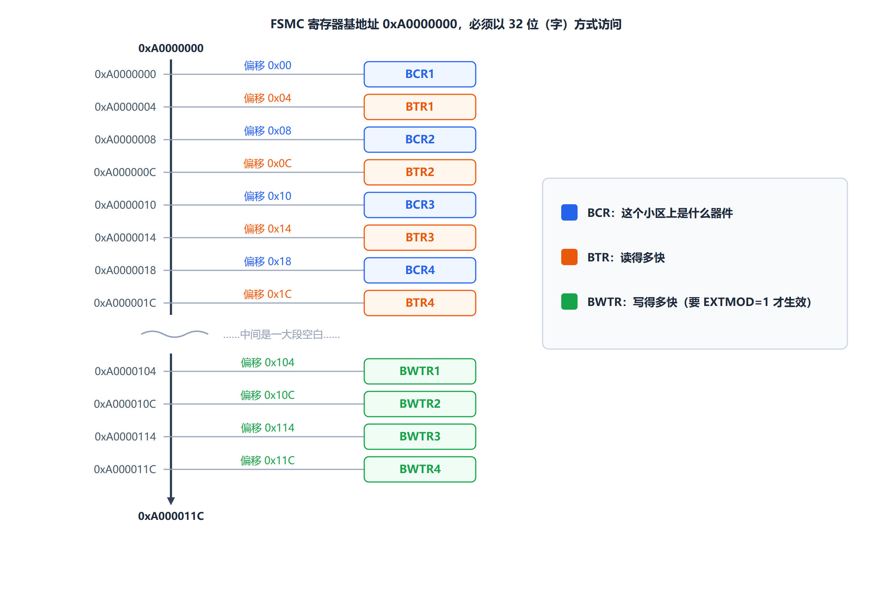

**这张图怎么读**：

1. 画布从上到下是一条**竖直的地址轴**，左边标注地址（从 `0xA0000000` 到 `0xA000011C`）；
2. 轴上画出 12 个**小方块**，每个方块里写寄存器名（`BCR1`、`BTR1`、`BCR2`、`BTR2`、`BCR3`、`BTR3`、`BCR4`、`BTR4`），方块之间留一点空隙表示每个占 4 字节；
3. 中间画一段**明显的断裂**（用波浪线或省略号），表示 `0x1C` 到 `0x104` 之间是一大段空白；
4. 断裂下面画 4 个方块 `BWTR1`~`BWTR4`；
5. 右边用**两种颜色**把寄存器分组：`BCR` 涂蓝色、`BTR` 涂橙色、`BWTR` 涂绿色，并在右侧画一个图例说明"BCR = 控制，BTR = 读时序，BWTR = 写时序"；
6. **这张图要你理解**：**三组寄存器各司其职，BCR 管"是什么器件"，BTR 管"读得多快"，BWTR 管"写得多快"。**

---

### 12.5.1 SRAM/NOR 闪存片选控制寄存器 1～4（FSMC_BCR1~4）

**【教材内容】**
> "地址偏移：`8 × (x − 1)`，x = 1～4，复位值：`0x000030DX`。"
> "这个寄存器包含了每个存储器块的控制信息，可以用于 SRAM、ROM、异步或成组传输的 NOR 闪存存储器。"

#### 【先补一个前置知识：这个寄存器"属于谁"？】

- **属于谁**：FSMC 控制器里，"NOR 闪存和 PSRAM 控制器"这一块（图 12-1 中间的那个方框）。
- **一共有几个**：4 个（`BCR1`~`BCR4`），分别对应存储块 1 的 4 个小区（NE1~NE4）。
- **控制什么**：它决定"**这个小区上挂的是什么器件**"（类型、宽度、要不要复用、要不要成组、能不能写）以及"**用不用扩展模式**"。
- **为什么需要它**：因为同一个 FSMC 要能接各种各样的存储器。如果不能在运行时告诉它"我接的是 16 位 NOR 还是 8 位 SRAM"，它就不知道该发什么信号。
- **怎么用**：**开机初始化时写一次**，之后一般不再改。

#### 位图（上：bit31～bit16；下：bit15～bit0）

```
 【高 16 位】
  31                            20 19 18 17 16
  +-------------------------------+--+--+--+--+
  |            保 留              |CB|  保 留  |
  +-------------------------------+--+--+--+--+
                                   ↑
                            bit19 = CBURSTRW（成组写使能）

 【低 16 位】
  15 14 13 12 11 10  9  8  7  6  5  4  3  2  1  0
  +--+--+--+--+--+--+--+--+--+--+--+--+--+--+--+--+
  |AY|EX|WA|WR|WA|WR|WA|BU|保|FA| MWID | MTYP |MU|MB|
  +--+--+--+--+--+--+--+--+--+--+--+--+--+--+--+--+
   ↑  ↑  ↑  ↑  ↑  ↑  ↑  ↑  ↑  ↑  └──┬──┘└──┬─┘ ↑  ↑
   │  │  │  │  │  │  │  │  │  │   5:4   3:2  1  0
   │  │  │  │  │  │  │  │  │  └ FACCEN
   │  │  │  │  │  │  │  │  └ 保留(bit7)
   │  │  │  │  │  │  │  └ BURSTEN
   │  │  │  │  │  │  └ WAITPOL
   │  │  │  │  │  └ WRAPMOD
   │  │  │  │  └ WAITCFG
   │  │  │  └ WREN
   │  │  └ WAITEN
   │  └ EXTMOD
   └ ASYNCWAIT
```

**当前最关心的位（初学阶段只需要记住这 6 个）**：

```
  15 14 13 12 11 10  9  8  7  6  5  4  3  2  1  0
  +--+--+--+--+--+--+--+--+--+--+--+--+--+--+--+--+
  |  |EX|  |WR|  |  |  |BU|  |FA| MWID | MTYP |MU|MB|
  +--+--+--+--+--+--+--+--+--+--+--+--+--+--+--+--+
      ↑  ↑        ↑        ↑   └─┬──┘ └─┬──┘  ↑  ↑
      │  │        │        │   存储器宽度 类型  复用 使能
      │  │        │        └ 闪存访问使能
      │  │        └ 成组模式使能
      │  └ 扩展模式使能（读写两套时序）
      └ 异步等待
```

#### 逐位讲解

#### 位 19：`CBURSTRW` —— 成组写使能（Write burst enable）

- **属于谁**：`FSMC_BCRx`
- **控制什么**：写操作是"一次一次来"还是"成组来"
- **教材原文**：
  > "对于 Cellular RAM，该位使能写操作的同步成组传输协议。对于处于成组传输模式的闪存存储器，这一位允许/禁止通过 NWAIT 信号插入等待状态。读操作的同步成组传输协议使能位是 FSMC_BCRx 寄存器的 BURSTEN 位。
  > **0：写操作始终处于异步模式。**
  > **1：写操作为同步模式。**"
- **写 0 会怎样**：写操作永远是异步的（一步一步来）
- **写 1 会怎样**：允许写操作用同步成组
- **复位值**：0
- **程序怎么操作**：库函数里对应 `FSMC_WriteBurst`（`FSMC_WriteBurst_Enable` / `_Disable`）

#### 位 15：`ASYNCWAIT` —— 异步等待（教材表格里标为"保留"，但说明中提到"位 15"）

> **【待核验】** 教材的寄存器总表把 bit15 写成"保留"，但 `WAITPOL` 的说明里又写"仅当位 15 为 1 时有意义"。按参考手册，**bit15 = ASYNCWAIT**（异步等待使能），意思是"异步访问时要不要也听 NWAIT 的"。
> 本讲义按 `ASYNCWAIT` 讲解，并把这个矛盾列入文末"待核验"。

- **写 0**：异步访问不理会 NWAIT
- **写 1**：异步访问也允许 NWAIT 插入等待
- **复位值**：0
- **程序怎么操作**：库函数里对应 `FSMC_AynchronousWait`（注意库函数里这个单词拼写少了一个 s，教材代码也是这么写的）

#### 位 14：`EXTMOD` —— 扩展模式使能（Extended mode enable）

- **教材原文**：
  > "该位允许 FSMC 使用 FSMC_BWTR 寄存器，即允许读和写使用不同的时序。
  > **0：不使用 FSMC_BWTR 寄存器，这是复位后的默认状态。**
  > **1：FSMC 使用 FSMC_BWTR 寄存器。**"
- **大白话**：**"读和写，要不要用两套不同的时间表？"**
- **写 0**：读和写共用 `BTR` 一套时序（省事，但不灵活）
- **写 1**：读用 `BTR`、写用 `BWTR`（灵活，能分别优化）
- **为什么需要**：很多存储器的读和写时间要求不一样（比如 SRAM 读 55ns、写 55ns；但 LCD 读 160ns、写 66ns），一套时序没法同时最优
- **复位值**：0
- **程序怎么操作**：库函数 `FSMC_ExtendedMode`

#### 位 13：`WAITEN` —— 等待使能（Wait enable bit）

- **教材原文**：
  > "当闪存存储器处于成组传输模式时，这一位允许/禁止通过 NWAIT 信号插入等待状态。
  > **0：禁用 NWAIT 信号，在设置的闪存保持周期之后不会检测 NWAIT 信号插入等待状态。**
  > **1：使用 NWAIT 信号，在设置的闪存保持周期之后根据 NWAIT 信号插入等待状态，这是复位后的默认状态。**"
- **写 0**：不管存储器喊不喊停，到点就采数据
- **写 1**：听存储器的（推荐）
- **复位值**：**1**
- **程序怎么操作**：库函数 `FSMC_WaitSignal`

#### 位 12：`WREN` —— 写使能（Write enable bit）

- **教材原文**：
  > "该位指示 FSMC 是否允许/禁止对存储器的写操作。
  > **0：禁止 FSMC 对存储器的写操作，否则产生一个 AHB 错误。**
  > **1：允许 FSMC 对存储器的写操作，这是复位后的默认状态。**"
- **大白话**：**"这块存储器，允许我写吗？"**
- **写 0**：**禁止写！** 如果你偏要写，硬件会报一个 AHB 错误（程序可能跑飞）
- **写 1**：允许写
- **复位值**：**1**
- **为什么需要**：有些存储器（比如 ROM、写保护的 Flash）本来就是只读的。把它设成"禁止写"是一种保护——万一程序写错地址，会立刻报错，而不是悄悄把数据写坏
- **程序怎么操作**：库函数 `FSMC_WriteOperation`（`FSMC_WriteOperation_Enable` / `_Disable`）
- **【实际例子】** 教材 12.7 例程里写的是：
  ```c
  FSMC_NORSRAMInitStructure.FSMC_WriteOperation = FSMC_WriteOperation_Enable;
  //存储器写使能
  ```
  因为要给 LCD 写数据，所以必须打开写使能。

#### 位 11：`WAITCFG` —— 配置等待时序（Wait timing configuration）

- **教材原文**：
  > "当闪存存储器处于成组传输模式时，NWAIT 信号指示从闪存存储器出来的数据是否有效或是否需要插入等待周期。该位决定存储器是在等待状态之前的一个时钟周期产生 NWAIT 信号，还是在等待状态期间产生 NWAIT 信号。
  > **0：NWAIT 信号在等待状态前的一个数据周期有效，这是复位后的默认状态。**
  > **1：NWAIT 信号在等待状态期间有效（不适用于 Cellular RAM）。**"
- **写 0**：存储器"提前一拍"打招呼
- **写 1**：存储器"当拍"打招呼
- **复位值**：0
- **程序怎么操作**：库函数 `FSMC_WaitSignalActive`（`FSMC_WaitSignalActive_BeforeWaitState` / `_DuringWaitState`）

#### 位 10：`WRAPMOD` —— 支持非对齐的成组模式（Wrapped burst mode support）

- **教材原文**：
  > "该位决定控制器是否支持把非对齐的 AHB 成组操作分割成两次线性操作；该位仅在存储器的成组模式下有效。
  > **0：不允许直接的非对齐成组操作，这是复位后的默认状态。**
  > **1：允许直接的非对齐成组操作。**"
- **写 0**：遇到非对齐的成组请求，就拆成两次线性操作
- **写 1**：直接用非对齐成组（需要存储器支持）
- **复位值**：0
- **程序怎么操作**：库函数 `FSMC_WrapMode`

#### 位 9：`WAITPOL` —— 等待信号极性（Wait signal polarity bit）

- **教材原文**：
  > "设置存储器产生的等待信号的极性；该位仅在存储器的成组模式下有效。
  > **0：NWAIT 等待信号为低时有效，这是复位后的默认状态。**
  > **1：NWAIT 等待信号为高时有效。**"
- **写 0**：NWAIT **低**电平表示"等一下"
- **写 1**：NWAIT **高**电平表示"等一下"
- **复位值**：0
- **为什么需要**：不同厂商的 NWAIT 极性可能不同（有的用低有效，有的用高有效）
- **程序怎么操作**：库函数 `FSMC_WaitSignalPolarity`

#### 位 8：`BURSTEN` —— 成组模式使能（Burst enable bit）

- **教材原文**：
  > "允许对闪存存储器进行成组模式访问；该位仅在闪存存储器的同步成组模式下有效。
  > **0：禁用成组访问模式，这是复位后的默认状态。**
  > **1：使用成组访问模式。**"
- **大白话**：**"要不要用同步成组读？"**（就是 12.4.4 讲的那个）
- **写 0**：只用异步，一次读一个
- **写 1**：允许同步成组
- **复位值**：0
- **程序怎么操作**：库函数 `FSMC_BurstAccessMode`

#### 位 7：保留

教材表格里标"—"，复位后读到 1。**不要动它。**

#### 位 6：`FACCEN` —— 闪存访问使能（Flash access enable）

- **教材原文**：
  > "允许对 NOR 闪存存储器的访问操作。
  > **0：禁止对 NOR 闪存存储器的访问操作。**
  > **1：允许对 NOR 闪存存储器的访问操作。**"
- **写 0**：这块 NOR 闪存不搭理你
- **写 1**：正常访问
- **为什么需要**：这是一道"总闸"。如果你在这个小区上挂的不是 NOR 闪存，就不需要打开它
- **【注意】** 教材在模式 1 / 模式 A 的表格里把 `FACCEN` 写成"—"（不需要设置），在模式 2/B、模式 C 里写 `0x1`。**这说明 `FACCEN` 是给 NOR 闪存用的。**

#### 位 [5:4]：`MWID` —— 存储器数据总线宽度（Memory databus width）

- **教材原文**：
  > "定义外部存储器总线的宽度，适用于所有类型的存储器。
  > **00：8 位；**
  > **01：16 位（复位后的默认状态）；**
  > **10：保留，不能用；**
  > **11：保留，不能用；**"
- **写 00**：外部是 8 位存储器 → `HADDR[25:0]` ↔ `FSMC_A[25:0]`
- **写 01**：外部是 16 位存储器 → `HADDR[25:1]` ↔ `FSMC_A[24:0]`（见 12.3.1）
- **复位值**：01（16 位）
- **程序怎么操作**：库函数 `FSMC_MemoryDataWidth`（`FSMC_MemoryDataWidth_8b` / `_16b`）
- **【硬件会发生什么】** 这一位直接决定"地址线要不要错开一位"以及"`NBL` 怎么用"。

#### 位 [3:2]：`MTYP` —— 存储器类型（Memory type）

- **教材原文**：
  > "定义外部存储器的类型：
  > **00：SRAM、ROM（存储器块 2~4 在复位后的默认值）；**
  > **01：PSRAM（Cellular RAM，CRAM）；**
  > **10：NOR 闪存（存储器块 1 在复位后的默认值）；**
  > **11：保留。**"
- **程序怎么操作**：库函数 `FSMC_MemoryType`（`FSMC_MemoryType_SRAM` / `FSMC_MemoryType_PSRAM` / `FSMC_MemoryType_NOR`）
- **【硬件会发生什么】** 决定控制器内部走哪套时序逻辑（比如 NOR 会用到 `NADV`、`FACCEN`）。
- **【教材例程的一个"反直觉"之处】** 教材 12.7 例程里，接的是 LCD，但写的是：
  ```c
  FSMC_NORSRAMInitStructure.FSMC_MemoryType = FSMC_MemoryType_SRAM;    //SRAM
  ```
  教材在正文里解释了原因：
  > "使用 STM32F103VET6 的 FSMC 模块操作 TFT-LCD 时，**FSMC 是把 TFT-LCD 当成 SRAM 设备来用的**，其操作时序和 SRAM 的控制完全类似，唯一不同的就是 TFT-LCD 有命令/数据控制信号（即 RS 信号），但是没有地址信号。"
  所以**类型选 SRAM，不是选 NOR**。

#### 位 1：`MUXEN` —— 地址/数据复用使能位（Address/data multiplexing enable bit）

- **教材原文**：
  > "当设置了该位后，地址的低 16 位和数据将共用数据总线，该位仅对 NOR 和 PSRM 存储器有效。
  > **0：地址/数据不复用；**
  > **1：地址/数据复用数据总线，这是复位后的默认状态。**"
- **写 0**：不复用（`A[25:0]` + `D[15:0]`）
- **写 1**：复用（`A[25:16]` + `AD[15:0]` + `NADV`）
- **复位值**：**1**（复用！）
- **【重要易错点】** **复位后默认是"复用"**。所以如果你接的是**非复用**的 SRAM，**必须显式把它关掉**（写 0）！
  教材例程里就写了：
  ```c
  FSMC_NORSRAMInitStructure.FSMC_DataAddressMux = FSMC_DataAddressMux_Disable;
  //不复用数据地址
  ```
- **程序怎么操作**：库函数 `FSMC_DataAddressMux`

#### 位 0：`MBKEN` —— 存储器块使能位（Memory bank enable bit）

- **教材原文**：
  > "开启对应的存储器块。**复位后存储器块 1 是开启的，其他所有存储器块为禁用。访问一个禁用的存储器块将在 AHB 总线上产生一个错误。**
  > **0：禁用对应的存储器块；1：启用对应的存储器块。**"
- **写 0**：这个小区"关门"了。你访问它的地址，硬件会**报 AHB 错误**
- **写 1**：开门
- **复位值**：**BCR1 = 1（块 1 开启），BCR2/3/4 = 0（禁用）**
- **程序怎么操作**：库函数 `FSMC_NORSRAMCmd(FSMC_Bank, ENABLE)`（注意是单独的 `Cmd` 函数，不在 `Init` 结构体里）

#### 【补充解释】把复位值 `0x000030DX` 解出来

教材写的是 `0x000030DX`，那个 `X` 是"随块号不同而不同"的占位符。我们把它解出来：

**以 `BCR1` 为例（块 1 挂 NOR 闪存）**：`0x000030DB`

```
0x000030DB
= 0000 0000 0000 0000 0011 0000 1101 1011
  bit31..16 全是 0                bit15..0

低 16 位 0x30DB = 0011 0000 1101 1011，从右往左看：
  bit0  = 1  → MBKEN   = 1（块 1 使能）✓ 和教材"复位后存储器块 1 是开启的"一致
  bit1  = 1  → MUXEN   = 1（地址/数据复用）✓ 和教材"1 是复位后的默认状态"一致
  bit2  = 0  ┐
  bit3  = 1  ┘ MTYP    = 10（NOR 闪存）✓ 和教材"存储器块 1 的复位默认值是 10"一致
  bit4  = 1  ┐
  bit5  = 0  ┘ MWID    = 01（16 位）✓ 和教材"01 是复位后的默认状态"一致
  bit6  = 1  → FACCEN  = 1（允许访问 NOR 闪存）
  bit7  = 1  → 保留（读到 1）
  bit8  = 0  → BURSTEN = 0
  bit9  = 0  → WAITPOL = 0
  bit10 = 0  → WRAPMOD = 0
  bit11 = 0  → WAITCFG = 0
  bit12 = 1  → WREN    = 1（允许写）✓
  bit13 = 1  → WAITEN  = 1（使用 NWAIT）✓
  bit14 = 0  → EXTMOD  = 0（不用 BWTR）✓
  bit15 = 0  → ASYNCWAIT = 0
```

**以 `BCR2` 为例（块 2 默认给 SRAM/ROM）**：`0x000030D2`

```
低 16 位 0x30D2 = 0011 0000 1101 0010
  bit0  = 0  → MBKEN = 0（块 2 默认禁用）✓ 和教材"其他所有存储器块为禁用"一致
  bit1  = 1  → MUXEN = 1
  bit2  = 0  ┐
  bit3  = 0  ┘ MTYP  = 00（SRAM/ROM）✓ 和教材"存储器块 2~4 的复位默认值是 00"一致
  bit4  = 1  ┐
  bit5  = 0  ┘ MWID  = 01（16 位）
  bit6  = 1  → FACCEN = 1
  bit7  = 1  → 保留
  bit12 = 1  → WREN = 1
  bit13 = 1  → WAITEN = 1
```

**所以**：

```
X = B（对 BCR1）
X = 2（对 BCR2、BCR3、BCR4）
```

> **这个"解复位值"的过程，就是本章要训练的核心能力**：看到一个十六进制数，能立刻拆成 32 个 bit，再对照位定义说出"这个寄存器现在处于什么状态"。

---

### 12.5.2 SRAM/NOR 闪存片选时序寄存器 1～4（FSMC_BTR1~4）

**【教材内容】**
> "地址偏移：`0x04 + 8 × (x − 1)`，x = 1～4；复位值：`0x0FFF FFFF`。"
> "这个寄存器包含了每个存储器块的控制信息，可以用于 SRAM、ROM 和 NOR 闪存存储器。**如果 FSMC_BCRx 寄存器中设置了 EXTMOD 位，则有两个时序寄存器分别对应读（本寄存器）和写操作（FSMC_BWTRx 寄存器）。**"

#### 位图

```
 【高 16 位】
  位号:   31 30  |  29 28  | 27 26 25 24 | 23 22 21 20 | 19 18 17 16
  名称:    保留  | ACCMOD  |   DATLAT    |   CLKDIV    |  BUSTURN
          ───────┴─────────┴─────────────┴─────────────┴────────────
 【低 16 位】
  位号:  15 14 13 12 11 10 09 08 | 07 06 05 04 | 03 02 01 00
  名称:         DATAST            |   ADDHLD    |   ADDSET
```

**用箭头标出"初学阶段最关心的 3 个字段"**：

```
  31 30 | 29 28 | 27 24 | 23 20 | 19 16 | 15          8 | 7     4 | 3     0
  ------|-------|-------|-------|-------|---------------|---------|--------
   保留 | ACCMOD| DATLAT| CLKDIV|BUSTURN|    DATAST     | ADDHLD  | ADDSET
        ↑               ↑       ↑        ↑              ↑         ↑
        │               │       │        │              │         └─ 地址建立时间
        │               │       │        │              └─ 地址保持时间（模式D/复用）
        │               │       │        └─ 数据阶段长度（读 DATAST+3，写 DATAST+1）
        │               │       └─ CLK 分频（同步模式）
        │               └─ 第一个数据前等几个 CLK（同步模式）
        └─ 访问模式 A/B/C/D（仅当 EXTMOD=1）
```

#### 逐字段讲解

#### 位 [29:28]：`ACCMOD` —— 访问模式（Access mode）

- **教材原文**：
  > "定义异步访问模式。**这 2 位只在 FSMC_BCRx 寄存器的 EXTMOD 位为 1 时起作用。**
  > **00：访问模式 A；01：访问模式 B；10：访问模式 C；11：访问模式 D。**"
- **大白话**：**"用哪套动作模板？"**
- **写 00/01/10/11**：分别选模式 A/B/C/D（对应 12.4.3 讲的 4 种）
- **【重要】** 如果 `EXTMOD = 0`，**这 2 位根本没作用**（模式 1 不用它）
- **程序怎么操作**：库函数 `FSMC_AccessMode`（`FSMC_AccessMode_A/B/C/D`）
- **复位值**：00（模式 A）

#### 位 [27:24]：`DATLAT` —— 数据保持时间（同步成组式 NOR 闪存的）

- **教材原文**：
  > "处于同步成组模式的 NOR 闪存，需要定义在读取第一个数据之前等待的存储器周期数目。**这个时间参数不是以 HCLK 表示，而是以闪存时钟（CLK）表示。在访问异步 NOR 闪存、SRAM 或 ROM 时，这个参数不起作用。操作 CRAM 时，这个参数必须为 0。**
  > **0000：第一个数据的保持时间为 2 个 CLK 时钟周期；**
  > ……
  > **1111：第一个数据的保持时间为 17 个 CLK 时钟周期（这是复位后的默认数值）。**"
- **写 0000**：等 2 个 CLK
- **写 1111**：等 17 个 CLK
- **复位值**：1111（= 15，即 17 个 CLK，最慢）
- **【注意单位】** 是 **CLK 周期**，不是 HCLK 周期！
- **程序怎么操作**：库函数 `FSMC_DataLatency`

#### 位 [23:20]：`CLKDIV` —— 对 CLK 信号的时钟分频比

- **教材原文**：
  > "定义 CLK 时钟输出信号的周期，以 HCLK 周期数表示：
  > **0000：保留；**
  > **0001：1 个 CLK 周期 = 2 个 HCLK 周期；**
  > **0010：1 个 CLK 周期 = 3 个 HCLK 周期；**
  > ……
  > **1111：1 个 CLK 周期 = 16 个 HCLK 周期（这是复位后的默认数值）。**
  > 在访问异步 NOR 闪存、SRAM 或 ROM 时，这个参数不起作用。"
- **公式**：`CLK 周期 = (CLKDIV + 1) × HCLK 周期`
- **写 0000**：**保留，不能用**（虽然数学上等于 1 个 HCLK，但硬件不支持）
- **复位值**：1111（CLK 最慢，= 16 个 HCLK）
- **程序怎么操作**：库函数 `FSMC_CLKDivision`

#### 位 [19:16]：`BUSTURN` —— 总线恢复时间（Bus turnaround phase duration）

- **教材原文**：
  > "这些位用于定义一次读操作之后在总线上的延迟（**仅适用于总线复用模式的 NOR 闪存操作**），一次读操作之后控制器需要在数据总线上为下次操作送出地址，这个延迟就是为了防止总线冲突。**如果扩展的存储器系统不包含总线复用模式的存储器，或最慢的存储器可以在 6 个 HCLK 时钟周期内将数据总线恢复到高阻状态，可以设置这个参数为其最小值。**
  > **0000：总线恢复时间 = 1 个 HCLK 时钟周期；**
  > **1111：总线恢复时间 = 16 个 HCLK 时钟周期（这是复位后的默认数值）。**"
- **大白话**：**"读完一个数据之后，给存储器一点时间把数据线'松手'，然后我才能把下一次的地址放上去。"**
- **为什么要它**：复用模式下，地址和数据共用一组线。如果刚读完数据，存储器还没松手，FSMC 就把新地址放上去，两根电路同时驱动一根线 → **总线冲突**（可能烧芯片或读错数据）
- **写 0000**：等 1 个 HCLK
- **复位值**：1111（等 16 个 HCLK，最保守）
- **【教材补充】** 教材在 12.4.3 复用模式那一节说过："总线恢复延迟（BUSTURN+1）与连续 2 次读操作之间在内部产生的延迟有部分重叠，因此 **BUSTURN ≤ 5 时将不影响输出时序**。"
- **程序怎么操作**：库函数 `FSMC_BusTurnAroundDuration`

#### 位 [15:8]：`DATAST` —— 数据保持时间 / 数据阶段长度（Data-phase duration）

- **教材原文**：
  > "这些位定义数据的保持时间（参见相关的时序图），适用于 SRAM、ROM 和异步总线复用模式的 NOR 闪存操作。
  > **0000 0000：保留；**
  > **0000 0001：DATAST 保持时间 = 2 个 HCLK 时钟周期；**
  > **0000 0010：DATAST 保持时间 = 3 个 HCLK 时钟周期；**
  > **1111 1111：DATAST 保持时间 = 256 个 HCLK 时钟周期（这是复位后的默认数值）。**
  > 例如，**模式 1、读操作、DATAST=1：数据保持时间 = DATAST+3 = 4 个 HCLK 时钟周期。**"
- **公式**：`(DATAST + 1) 个 HCLK`（这是"数据阶段"本身的长度）；**读操作总共 `DATAST+3`，写操作总共 `DATAST+1`**
- **写 0**：**保留，不能用**（所以最小只能写 1）
- **复位值**：0xFF（= 255 → 256 个 HCLK，最慢）
- **程序怎么操作**：库函数 `FSMC_DataSetupTime`
- **【这是最常调的一个参数】** 存储器慢就把 `DATAST` 调大。

#### 位 [7:4]：`ADDHLD` —— 地址保持时间（Address-hold phase duration）

- **教材原文**：
  > "这些位定义地址的保持时间（参见相关的时序图），适用于 SRAM、ROM 和异步总线复用模式的 NOR 闪存操作。
  > **0000：ADDHLD 保持时间 = 1 个 HCLK 时钟周期；**
  > **1111：ADDHLD 保持时间 = 16 个 HCLK 时钟周期（这是复位后的默认数值）。**
  > **注：在同步操作中，这个参数不起作用，地址保持时间始终是 1 个存储器时钟周期。**"
- **公式**：`(ADDHLD + 1) 个 HCLK`
- **什么时候有用**：**只有模式 D 和复用模式用得到**（其他模式这个字段写 0 就行，因为"用不到"）
- **复位值**：0xF（= 16 个 HCLK）
- **程序怎么操作**：库函数 `FSMC_AddressHoldTime`
- **【教材例程】** LCD 例程里写的是：
  ```c
  readWriteTiming.FSMC_AddressHoldTime = 0x00; //地址保持时间,模式 A 未用到
  ```
  **注释"模式 A 未用到"是对的**——模式 A 不需要 `ADDHLD`。

#### 位 [3:0]：`ADDSET` —— 地址建立时间（Address setup phase duration）

- **教材原文**：
  > "这些位定义地址的建立时间（参见相关的时序图），适用于 SRAM、ROM 和异步总线复用模式的 NOR 闪存操作。
  > **0000：ADDSET 建立时间 = 1 个 HCLK 时钟周期；**
  > ……
  > **1111：ADDSET 建立时间 = 16 个 HCLK 时钟周期（这是复位后的默认数值）。**
  > 例如，**模式 2、读操作、ADDSET=1：地址建立时间 = ADDSET+1 = 2 个 HCLK 时钟周期。**
  > **注：在同步操作中，这个参数不起作用，地址建立时间始终是 1 个存储器时钟周期。**"
- **公式**：`(ADDSET + 1) 个 HCLK`
- **写 0000**：1 个 HCLK（最小）
- **复位值**：0xF（= 16 个 HCLK，最慢）
- **程序怎么操作**：库函数 `FSMC_AddressSetupTime`
- **【为什么要"地址建立时间"】** 存储器收到新地址后，内部的译码电路需要一点时间才能"找到"那个格子、把对应的数据准备好。所以地址一变，控制器的"整个访问周期"就要留出这段缓冲——地址建立时间（`ADDSET`）就是干这个的：它和数据阶段**加起来**必须覆盖存储器的访问时间（`t_AA` / `t_ACC` 之类）。
  > **对照图 12-3 提醒一句**：模式 1 的 `NOE` 在周期一开始就已经是低的，所以"等存储器"这件事**不是靠 `NOE` 晚拉低来实现的**，而是靠**整个周期足够长**、FSMC 到周期末才去采数据。

#### 【补充解释】为什么复位值都是"最慢"？

`BTR` / `BWTR` 的复位值 `0x0FFFFFFF` 解出来是：

```
0x0FFFFFFF
= 0000 1111 1111 1111 1111 1111 1111 1111
  ↑↑↑↑ ↑↑↑↑ ↑↑↑↑ ↑↑↑↑ ↑↑↑↑ ↑↑↑↑ ↑↑↑↑ ↑↑↑↑
  ACCMOD=00（模式A）
      DATLAT=1111 → 17 个 CLK（最慢）
          CLKDIV=1111 → 16 个 HCLK（最慢）
              BUSTURN=1111 → 16 个 HCLK（最慢）
                  DATAST=1111 1111 → 256 个 HCLK（最慢）
                          ADDHLD=1111 → 16 个 HCLK（最慢）
                              ADDSET=1111 → 16 个 HCLK（最慢）
```

**结论：复位后，所有时间参数都被设成了最大值。**

**为什么这样设计？**

> **因为"慢"最多只是慢，但"快"会出错。**
> 复位时你还不知道外面接的是什么存储器，所以先设成"最慢"——**任何存储器都能正常工作**（虽然效率极低）。等你初始化时再按实际器件把参数调小。

这是一个很典型的设计哲学：**默认值取"最保守"**。类似的例子还有 `WREN = 1`（默认允许写，不锁死）、`WAITEN = 1`（默认听存储器的）。

---

### 12.5.3 SRAM/NOR 闪存写时序寄存器 1～4（FSMC_BWTR1~4）

**【教材内容】**
> "地址偏移：`0x104 + 8 × (x − 1)`，x = 1～4。复位值：`0x0FFF FFFF`。"
> "这个寄存器包含了每个存储器块的控制信息，可以用于 SRAM、ROM 和 NOR 闪存存储器。**如果 FSMC_BCRx 寄存器中设置了 EXTMOD 位，则这个寄存器对应写操作。**"

#### 位图

```
 【高 16 位】
  位号:   31 30  |  29 28  | 27 26 25 24 | 23 22 21 20 | 19 18 17 16
  名称:    保留  | ACCMOD  |   DATLAT    |   CLKDIV    |    保 留
          ───────┴─────────┴─────────────┴─────────────┴────────────
 【低 16 位】
  位号:  15 14 13 12 11 10 09 08 | 07 06 05 04 | 03 02 01 00
  名称:         DATAST            |   ADDHLD    |   ADDSET
```

**和 `BTR` 只有一个区别**：

```
BTR  的 bit[19:16] = BUSTURN（总线恢复时间）
BWTR 的 bit[19:16] = 保留（没有总线恢复时间）
```

**为什么写操作不需要"总线恢复时间"？**

因为总线恢复时间是防止"**读完之后**存储器还没放开数据线，FSMC 就把地址放上去"的冲突。写操作时是 FSMC 自己在驱动数据线，不存在"存储器松手"的问题，所以不需要。

#### 逐字段（和 `BTR` 相同的部分只做一句话复习）

| 位 | 名称 | 说明 | 复位值 |
|---|---|---|---|
| 31～30 | 保留 | | 00 |
| 29～28 | `ACCMOD` | 写操作的访问模式 A/B/C/D（仅当 `EXTMOD=1`） | 00 |
| 27～24 | `DATLAT` | 同步写时的数据保持时间（**以 CLK 为单位**） | 1111 |
| 23～20 | `CLKDIV` | CLK 分频 | 1111 |
| 19～16 | 保留 | **（注意：这里没有 BUSTURN）** | 1111 |
| 15～8 | `DATAST` | **写**操作的第 2 阶段长度（**DATAST+1 个 HCLK**） | 0xFF |
| 7～4 | `ADDHLD` | 写操作的中间阶段（`ADDHLD+1` 个 HCLK） | 0xF |
| 3～0 | `ADDSET` | 写操作的第 1 阶段（`ADDSET+1` 个 HCLK） | 0xF |

> **【教材原文】关于 `BWTR` 的 `ADDHLD`**：
> "**0000 0000：保留；0001：ADDHLD 保持时间 = 2 个 HCLK 时钟周期；0010：ADDHLD 保持时间 = 3 个 HCLK 时钟周期；1111：ADDHLD 保持时间 = 16 个 HCLK 时钟周期（这是复位后的默认数值）。**"
> **【待核验】** 这里教材写"`0000 0000` 保留、`0001` = 2 个 HCLK"，但同一个字段在 `BTR` 里写的是"`0000` = 1 个 HCLK"。同一个字段在两处的描述不一致（一个是 `ADDHLD+1`，一个是 `ADDHLD+2`）。
> 本讲义按 `ADDHLD+1` 讲解，并把这个矛盾列入文末"待核验"。

#### 【易错点】`BTR` 和 `BWTR` 什么时候生效？

```
EXTMOD = 0  →  只用 BTR，读写共用（BWTR 完全不生效，你写进去也没用）
EXTMOD = 1  →  读用 BTR，写用 BWTR（两个都要配！）
```

**最容易犯的错**：`EXTMOD` 忘了置 1，结果 `BWTR` 白配了，写操作还在用 `BTR` 的参数。

教材 LCD 例程里是置 1 的：

```c
FSMC_NORSRAMInitStructure.FSMC_ExtendedMode = FSMC_ExtendedMode_Enable;
//读写使用不同的时序
```

---

## 12.6 FSMC 固件库函数

### 先别急着看教材：这一节到底要干什么？

前面 12.5 我们学了 12 个寄存器、几十个 bit。**如果每个都要你自己去算 bit 位置、拼 32 位数，那太痛苦了。**

所以 ST 公司提供了**固件库**（Standard Peripheral Library，标准外设库）：

> **你把"想配成什么样"填进一个结构体，调用一个函数，它帮你把那些 bit 拼好、写进寄存器。**

这一节就是介绍这几个函数。

### 【教材内容】12.6.1 FSMC 初始化函数

> "根据前面 FSMC 的时序和寄存器的介绍，初始化 FSMC 主要是初始化 3 个寄存器 FSMC_BCRx、FSMC_BTRx 和 FSMC_BWTRx。固件库提供了 3 个 FSMC 初始化函数分别为："

```c
FSMC_NORSRAMInit();
FSMC_NANDInit();
FSMC_PCCARDInit();
```

> "这 3 个函数分别用来初始化 4 种类型存储器，根据名字就很好判断对应关系。用来初始化 NOR 和 SRAM 使用同一个函数 FSMC_NORSRAMInit()。限于篇幅，本书仅介绍 NOR 和 SRAM 的相关内容。"

**翻译一下这 3 个函数的对应关系**：

| 函数 | 管哪些器件 | 对应哪几组寄存器 |
|---|---|---|
| `FSMC_NORSRAMInit()` | **SRAM、ROM、NOR 闪存、PSRAM**（本书重点） | `BCR1~4`、`BTR1~4`、`BWTR1~4` |
| `FSMC_NANDInit()` | NAND 闪存 | NAND 专用寄存器（本章不展开） |
| `FSMC_PCCARDInit()` | PC 卡 | PC 卡专用寄存器（本章不展开） |

**注意**：**SRAM 和 NOR 共用一个初始化函数**，因为它们共用同一套寄存器。

#### 【教材内容】函数原型

```c
void FSMC_NORSRAMInit(FSMC_NORSRAMInitTypeDef * FSMC_NORSRAMInitStruct);
```

> "这个函数只有一个入口参数，也就是 FSMC_NORSRAMInitTypeDef 类型指针变量，这个结构体的成员变量比较多，因为 FSMC 相关的配置项非常多。"

**【快速复习：什么叫"指针变量"？】**
指针就是"一个存着地址的变量"。`FSMC_NORSRAMInitTypeDef * p` 表示 `p` 里存的是"一个 `FSMC_NORSRAMInitTypeDef` 结构体放在哪儿"。
函数拿到这个地址，就能顺着地址找到你填好的那一堆配置，然后照着它去写寄存器。

#### 【教材内容】`FSMC_NORSRAMInitTypeDef` 结构体

```c
typedef struct
{
    uint32_t FSMC_Bank;
    uint32_t FSMC_DataAddressMux;
    uint32_t FSMC_MemoryType;
    uint32_t FSMC_MemoryDataWidth;
    uint32_t FSMC_BurstAccessMode;
    uint32_t FSMC_AynchronousWait;
    uint32_t FSMC_WaitSignalPolarity;
    uint32_t FSMC_WrapMode;
    uint32_t FSMC_WaitSignalActive;
    uint32_t FSMC_WriteOperation;
    uint32_t FSMC_WaitSignal;
    uint32_t FSMC_ExtendedMode;
    uint32_t FSMC_WriteBurst;
    FSMC_NORSRAMTimingInitTypeDef * FSMC_ReadWriteTimingStruct;
    FSMC_NORSRAMTimingInitTypeDef * FSMC_WriteTimingStruct;
} FSMC_NORSRAMInitTypeDef;
```

> **【教材内容】**："前面有 13 个基本类型（uint32_t）的成员变量，这 13 个参数用来配置片选控制寄存器 FSMC_BCRx。最后面还有两个 FSMC_NORSRAMTimingInitTypeDef 指针类型的成员变量，用来设置读时序和写时序的参数，也就是说，这两个参数用来配置寄存器 FSMC_BTRx 和 FSMC_BWTRx。"

**这 15 个成员和寄存器位的对应关系表**（【补充解释】按各成员的库函数说明整理）：

| 序号 | 结构体成员 | 写到哪个寄存器的哪一位 | 大白话 |
|---|---|---|---|
| 1 | `FSMC_Bank` | （决定操作哪个 `BCRx`） | 用哪个小区（NE1~NE4） |
| 2 | `FSMC_DataAddressMux` | `BCR` bit1 `MUXEN` | 地址/数据复不复用 |
| 3 | `FSMC_MemoryType` | `BCR` bit3~2 `MTYP` | 接的是什么器件 |
| 4 | `FSMC_MemoryDataWidth` | `BCR` bit5~4 `MWID` | 8 位还是 16 位 |
| 5 | `FSMC_BurstAccessMode` | `BCR` bit8 `BURSTEN` | 要不要同步成组读 |
| 6 | `FSMC_AynchronousWait` | `BCR` bit15 `ASYNCWAIT` | 异步要不要听 NWAIT |
| 7 | `FSMC_WaitSignalPolarity` | `BCR` bit9 `WAITPOL` | NWAIT 是高有效还是低有效 |
| 8 | `FSMC_WrapMode` | `BCR` bit10 `WRAPMOD` | 非对齐成组怎么处理 |
| 9 | `FSMC_WaitSignalActive` | `BCR` bit11 `WAITCFG` | NWAIT 提前一拍还是当拍 |
| 10 | `FSMC_WriteOperation` | `BCR` bit12 `WREN` | 允许不允许写 |
| 11 | `FSMC_WaitSignal` | `BCR` bit13 `WAITEN` | 用不用 NWAIT |
| 12 | `FSMC_ExtendedMode` | `BCR` bit14 `EXTMOD` | 读写要不要分开配 |
| 13 | `FSMC_WriteBurst` | `BCR` bit19 `CBURSTRW` | 写要不要同步成组 |
| 14 | `FSMC_ReadWriteTimingStruct` | `BTR`（读时序） | 读得多快 |
| 15 | `FSMC_WriteTimingStruct` | `BWTR`（写时序） | 写得多快 |

> **【待核验】** 结构体成员名 `FSMC_AynchronousWait` 里少了一个 `s`（正确拼写应为 `Asynchronous`）。教材代码里也是这么写的，属于 ST 官方库的历史遗留拼写错误。**写代码时必须照抄这个错拼**，否则编译不过。

#### 【教材内容】与模式 A 相关的配置参数

教材特别挑出几个和"模式 A"相关的参数详细讲：

#### `FSMC_Bank` —— 用哪个存储块和小区

> "对于 NOR 和 SRAM 存储器，可取的值有——`FSMC_Bank1_NORSRAM1`、`FSMC_Bank1_NORSRAM2`、`FSMC_Bank1_NORSRAM3`、`FSMC_Bank1_NORSRAM4`。
> 对于 NAND 存储器，可取的值有——`FSMC_Bank2_NAND`、`FSMC_Bank3_NAND`。
> 对于 PC 卡存储器，可取的值为——`FSMC_Bank4_PCCARD`。
> 例如，如果使用存储块 1 区号 4，则选择值为 `FSMC_Bank1_NORSRAM4`。"

**这张对应关系图**：

```
FSMC_Bank1_NORSRAM1  →  块 1 小区 1  →  NE1  →  地址 0x60000000 起
FSMC_Bank1_NORSRAM2  →  块 1 小区 2  →  NE2  →  地址 0x64000000 起
FSMC_Bank1_NORSRAM3  →  块 1 小区 3  →  NE3  →  地址 0x68000000 起
FSMC_Bank1_NORSRAM4  →  块 1 小区 4  →  NE4  →  地址 0x6C000000 起
FSMC_Bank2_NAND      →  块 2         →  NCE2 →  地址 0x70000000 起
FSMC_Bank3_NAND      →  块 3         →  NCE3 →  地址 0x80000000 起
FSMC_Bank4_PCCARD    →  块 4         →  NCE4 →  地址 0x90000000 起
```

#### `FSMC_MemoryType` —— 存储器类型

> "例如，如果使用 SRAM 存储器，则取值为 `FSMC_MemoryType_SRAM`；如果使用 NOR 存储器，则取值为 `FSMC_MemoryType_NOR`。"

#### `FSMC_MemoryDataWidth` —— 数据宽度

> "用来设置数据宽度，可选 8 位（取值为 `FSMC_MemoryDataWidth_8b`）还是 16 位（取值为 `FSMC_MemoryDataWidth_16b`）。"

#### `FSMC_WriteOperation` —— 写使能

> "用来设置写使能。**如果要向 SRAM 存储器或者液晶（TFT LCD）写数据，则要写使能，选择 `FSMC_WriteOperation_Enable`。**"

#### `FSMC_ExtendedMode` —— 扩展模式使能

> "设置扩展模式使能位，即是否允许读写不同的时序，如果采取不同的读写时序，则设置值为 `FSMC_ExtendedMode_Enable`。"

#### 其余几个参数

> "`FSMC_DataAddressMux`——用来设置地址/数据复用使能，若设置为使能，那么地址的低 16 位和数据将共用数据总线，仅对 NOR 和 PSRAM 有效，**如果不复用，则可以设置为 `FSMC_DataAddressMux_Disable`**。"

> "`FSMC_BurstAccessMode`、`FSMC_AsynchronousWait`、`FSMC_WaitSignalPolarity`、`FSMC_WaitSignalActive`、`FSMC_WrapMode`、`FSMC_WaitSignal`、`FSMC_WriteBurst` 和 `FSMC_WaitSignal` **在成组模式同步模式才需要设置**。"

> **【重要结论】** **如果你只用异步模式（本书的例子就是异步），这 8 个参数随便填成 `Disable` 之类就行**，因为它们只在同步成组模式下起作用。这就是为什么教材例程里把它们全填成 `Disable`。

#### 两个时序结构体指针

> "`FSMC_ReadWriteTimingStruct` 和 `FSMC_WriteTimingStruct` 用于设置读写时序的参数，它们都是 `FSMC_NORSRAMTimingInitTypeDef` 结构体指针类型，**这两个参数在初始化的时候分别用来初始化片选控制寄存器 FSMC_BTRx 和写操作时序控制寄存器 FSMC_BWTRx**。"

> **【教材笔误】** 教材原文写"初始化片选控制寄存器 FSMC_BTRx"——`BTR` 是**时序**寄存器，不是"片选控制寄存器"（那是 `BCR`）。这是教材的一个小笔误，读的时候注意区分。

#### 【教材内容】`FSMC_NORSRAMTimingInitTypeDef` 结构体

```c
typedef struct
{
    uint32_t FSMC_AddressSetupTime;       //地址建立时间
    uint32_t FSMC_AddressHoldTime;        //地址保持时间
    uint32_t FSMC_DataSetupTime;          //数据建立时间
    uint32_t FSMC_BusTurnAroundDuration;  //总线恢复时间
    uint32_t FSMC_CLKDivision;            //时钟分频因子
    uint32_t FSMC_DataLatency;            //数据产生时间
    uint32_t FSMC_AccessMode;             //FSMC控制器时序模式
} FSMC_NORSRAMTimingInitTypeDef;
```

> "这个结构体有 7 个参数用来设置 FSMC 读写时序。这些参数主要用于设置地址建立保持时间、数据建立时间等等配置。**如果读写速度要求不一样，读写时序就不一样，参数 FSMC_DataSetupTime 的设置值就不同。**"

**7 个成员和寄存器位的对应**：

| 结构体成员 | 寄存器字段 | 大白话 |
|---|---|---|
| `FSMC_AddressSetupTime` | `ADDSET`（bit3~0） | 地址建立时间 |
| `FSMC_AddressHoldTime` | `ADDHLD`（bit7~4） | 地址保持时间 |
| `FSMC_DataSetupTime` | `DATAST`（bit15~8） | 数据阶段长度 |
| `FSMC_BusTurnAroundDuration` | `BUSTURN`（bit19~16） | 总线恢复时间 |
| `FSMC_CLKDivision` | `CLKDIV`（bit23~20） | CLK 分频 |
| `FSMC_DataLatency` | `DATLAT`（bit27~24） | 数据延时 |
| `FSMC_AccessMode` | `ACCMOD`（bit29~28） | 模式 A/B/C/D |

> **【注意】库函数里的数值和寄存器里的数值是一样的，不是"再减一"。**
> 也就是说：`FSMC_AddressSetupTime = 0x01` 写进 `ADDSET` 就是 `1`，实际时间是 `(1+1) = 2` 个 HCLK。
> **不要把"库函数的值"和"实际周期数"搞混。** 教材例程的注释就是这么写的：
> `FSMC_AddressSetupTime = 0x01; //地址建立时间(ADDSET)为 2 个 HCLK`

### 【教材内容】12.6.2 FSMC 使能函数

> "FSMC 对不同的存储器类型同样提供了不同的使能函数："

```c
void FSMC_NORSRAMCmd(uint32_t FSMC_Bank, FunctionalState NewState);
void FSMC_NANDCmd(uint32_t FSMC_Bank, FunctionalState NewState);
void FSMC_PCCARDCmd(FunctionalState NewState);
```

> "根据函数名称可以很容易判断对应关系。"

**`FSMC_NORSRAMCmd` 干的事**：把对应 `BCRx` 的 `MBKEN` 位（bit0）置 1 或清 0。

```
FSMC_NORSRAMCmd(FSMC_Bank1_NORSRAM1, ENABLE);
    →  把 BCR1 的 bit0 置 1  →  小区 1（NE1）开门
```

> **【为什么要单独一个函数？】** 因为 `FSMC_NORSRAMInit()` 只负责把 `BCR`、`BTR`、`BWTR` 都配好，但**它不会自动打开存储块**。你必须再调用 `FSMC_NORSRAMCmd()` 才真正"开闸"。
> 这是初学者很容易漏掉的一步——**配完了没使能，写进去的数据石沉大海。**

### 【辅助理解图】固件库函数全景

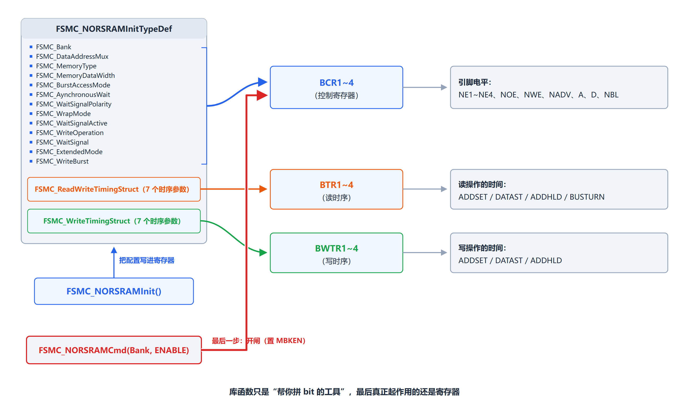

**这张图怎么读**：

1. 画布左边一列是**三个初始化结构体/函数**：`FSMC_NORSRAMInit()`（方框内列出它的两个子结构体）；
2. 中间一列是**寄存器**：`BCR1~4`、`BTR1~4`、`BWTR1~4`；
3. 右边一列是**硬件结果**：`NE1~NE4` 引脚、地址/数据/控制信号的时序；
4. 用**蓝色箭头**从 `FSMC_NORSRAMInitTypeDef` 的 13 个成员指向 `BCRx` 的各个位；用**橙色箭头**从 `FSMC_ReadWriteTimingStruct` 指向 `BTRx`；用**绿色箭头**从 `FSMC_WriteTimingStruct` 指向 `BWTRx`；
5. 用**红色箭头**从 `FSMC_NORSRAMCmd()` 指向 `BCRx` 的 bit0（`MBKEN`），并标注"最后一步，开闸"；
6. **这张图要你理解**：**库函数只是"帮你拼 bit 的工具"，最后真正起作用的还是寄存器。**

---

## 12.7 FSMC 使用举例：用 FSMC 驱动 TFT-LCD

### 先别急着看教材：这一节到底要干什么？

教材选了一个非常典型、也非常实用的例子：**用 FSMC 驱动一块 2.8 寸彩色液晶屏**。

这个例子的巧妙之处在于：

> **LCD 本来不是存储器，但它的接口"长得像" SRAM。于是我们就把 LCD 当成一片 SRAM 来用，靠 FSMC 直接"写地址"就完成显示。**

**为什么这很重要？** 因为如果不用 FSMC，你要用普通 GPIO 一根一根地去翻 `WR`、`RD`、`CS`、16 根数据线……写一个像素要几十条指令，刷屏慢得没法看。用 FSMC 之后：

```c
LCD->LCD_RAM = 0xF800;   // 一行代码，就往屏幕上写了一个红点！
```

### 12.7.1 模块简介

**【教材内容】**
> "TFT-LCD 即薄膜晶体管液晶显示器，其英文全称为 **T**hin **F**ilm **T**ransistor-**L**iquid **C**rystal **D**isplay。TFT-LCD 与无源 TN-LCD、STN-LCD 的简单矩阵不同，它在液晶显示屏的每一个像素上都设置有一个薄膜晶体管 (TFT)，可有效地克服非选通时的串扰，使显示液晶屏的静态特性与扫描线数无关，大大提高了图像质量。TFT-LCD 也被叫作真彩液晶显示器。"

**【术语解释】**

| 缩写 | 英文全称 | 中文 | 大白话 |
|---|---|---|---|
| TFT | Thin Film Transistor | 薄膜晶体管 | 每个像素配一个"小开关"，防止旁边的像素串味 |
| LCD | Liquid Crystal Display | 液晶显示器 | 靠液晶分子转向来挡光/透光的显示屏 |
| GRAM | Graphics RAM | 显存 | 屏幕自己的"画布内存"，存着每个像素的颜色 |
| RGB565 | Red-Green-Blue 5-6-5 | — | 用 5+6+5 = 16 位表示一个像素的颜色 |

**【教材内容】ATK-2.8'TFT-LCD-V2.0 模块特点**（只保留对理解本章有用的）：

> "- 高分辨率：**320×240 像素，16 位真彩显示，颜色格式为 RGB565**；
> - 采用 **ILI9341 驱动**，该芯片**直接自带 GRAM**，无需外加驱动器；
> - 速度快，理论上最高刷屏速度可达 **197 帧/秒**；
> - 接口简单（**LCD 采用 16 位 Intel 8080 并口**，触摸屏采用 SPI 接口），使用方便；"

**【术语解释：ILI9341】**
ILI9341 是一颗"**液晶驱动芯片**"。它长在 LCD 模块的电路板上，负责：
1. 接收 MCU 发来的命令和数据；
2. 把颜色数据存进自己的 **GRAM**（显存）；
3. 不停地把 GRAM 里的内容"画"到液晶屏上。

**所以 MCU 其实不直接控制液晶，而是通过 ILI9341 这个"中间人"。**

### 12.7.2 模块引脚说明

**【教材内容】表 12-27 ATK-2.8'TFT-LCD 模块引脚说明**（只列本章用得到的）：

| 引脚编号 | 名称 | 说明 |
|---|---|---|
| 1 | `CS` | LCD 片选信号（低电平有效） |
| 2 | `RS` | **命令/数据控制信号（0，命令；1，数据）** |
| 3 | `WR` | 写使能信号（低电平有效） |
| 4 | `RD` | 读使能信号（低电平有效） |
| 5 | `RST` | 复位信号（低电平有效） |
| 6～21 | `D0~D15` | 双向数据总线 |
| 22,26,27 | `GND` | 地线 |
| 23 | `BL_CTR` | 背光控制引脚（高电平点亮背光，低电平关闭） |
| 24,25 | `VCC3.3` | 主电源供电引脚（3.3V） |
| 28 | `VCC5` | 背光供电引脚（5V） |
| 29～34 | （触摸屏 SPI 相关） | 本章不涉及 |

> **【教材内容】**："从表 12-27 可以看出，LCD 控制器总共需要 21 个 I/O 口，背光控制需要 1 个 I/O 口，电容触摸屏需要 6 个 I/O 口，这样整个模块需要 28 个 I/O 口驱动。"

#### 【重点】`RS` 信号是什么？为什么它这么关键？

**`RS`** = **R**egister **S**elect = **寄存器选择**（也叫 D/CX，Data/Command）。

大白话：

> ILI9341 只有一组数据线 `D[15:0]`，它既用来传"命令"，也用来传"数据"。
> **那怎么区分这次送过去的是命令还是数据呢？** ——靠 `RS` 这根线：
> - `RS = 0` → "注意，这次送的是**命令**"（比如"开始写显存"）
> - `RS = 1` → "这次送的是**数据**"（比如一个像素的颜色）

**这就是本节的"题眼"**：

> **FSMC 没有 `RS` 这根线！LCD 也没有地址线！**
> 那怎么让 FSMC 帮我们产生 `RS` 呢？

**教材的答案**：**把 LCD 的 `RS` 接到 FSMC 的 `A16` 地址线上。**
然后"用不同的地址"来区分命令和数据：

```
访问某个地址时，FSMC 的 A16 = 0  →  RS = 0  →  送命令
访问另一个地址时，FSMC 的 A16 = 1  →  RS = 1  →  送数据
```

**这就是本节最精妙的一招**，我们后面 12.7.4 会详细算地址。

### 12.7.3 LCD 接口时序

**【教材内容】**
> "ATK-2.8'TFT-LCD 模块采用 16 位 8080 总线接口，总线读写时序如图 12-18 所示。"

**【先补一个前置知识：什么叫"8080 总线接口"？】**

**8080** 指的是 Intel 8080 时代定下的一种并行外设接口风格，也叫 **Intel 总线**。它的特征是：

- 有**分开**的读选通 `RD` 和写选通 `WR` 两根线（低电平有效）；
- 有一根 `CS` 片选；
- 有一组数据线；
- 有 `RS`（或者叫 D/C）区分命令和数据。

（另一种风格叫 **6800 总线 / Motorola 总线**，它只有一根 `E` 使能和一根 `R/W` 方向线。买模块的时候要注意是哪种。）

#### 【教材原图】图 12-18 总线读写时序

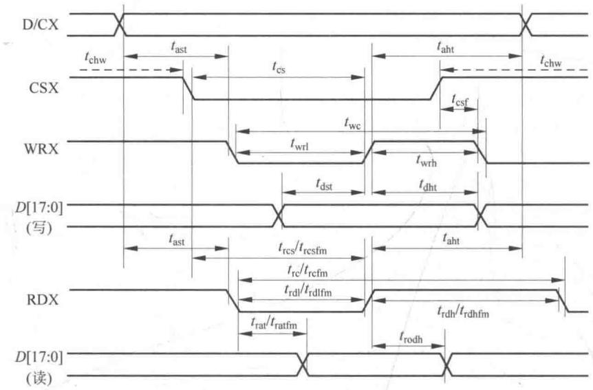

**这张图怎么读**（图上分上半部分"写"、下半部分"读"）：

**先看上半部分（写时序）**，从上到下：

1. `D/CX`（就是 `RS`）：在写操作期间保持不变（要么 0 要么 1，表示这次是命令还是数据）。图左边标了 `t_chw`（CSX 高电平脉冲宽度）。
2. `CSX`（就是 `CS`）：**先拉低**（选中），并且要在 `WRX` 拉低之前就拉低——这段时间叫 `t_cs`（**片选信号建立时间，写**，最小 15ns）。
3. `WRX`（就是 `WR`）：**拉低**，保持 `t_wrl`（**写控制脉冲低电平时间**，最小 15ns），然后**拉高**，保持 `t_wrh`（**写控制脉冲高电平时间**，最小 15ns）。
   - `t_wrl + t_wrh` 合起来 ≈ `t_wc`（**写周期**，最小 66ns）。
4. `D[17:0]`（写）：数据在 `WRX` 拉低之前就要准备好（`t_dst` 写数据建立时间，最小 10ns），在 `WRX` 拉高之后还要保持一会儿（`t_dht` 写数据保持时间，最小 10ns）。

**再看下半部分（读时序）**：

1. `CSX` 同样先拉低（读 ID 时 `t_rcs` 最小 45ns；读显存时 `t_rcsfm` 最小 355ns）。
2. `RDX`（就是 `RD`）：拉低保持 `t_rdl`（读控制低电平时间，最小 45ns），拉高保持 `t_rdh`（最小 90ns），整个周期 `t_rc` 最小 160ns。
3. `D[17:0]`（读）：在 `RDX` 拉低后，数据要过一段时间才有效（`t_rat` 读访问时间，最大 40ns）。

#### 【教材内容】表 12-28 16 位 8080 并口读写时间参数（单位：ns）

| 信号 | 符号 | 参数说明 | 最小值 | 最大值 |
|---|---|---|---|---|
| D/CX | `t_ast` | 地址建立时间 | 0 | — |
| | `t_aht` | 地址保持时间（读/写） | 0 | — |
| CSX | `t_chw` | CSX 高电平脉冲宽度 | 0 | — |
| | `t_cs` | 片选信号建立时间（写） | 15 | — |
| | `t_rcs` | 片选信号建立时间（读 ID） | 45 | — |
| | `t_rcsfm` | 片选信号建立时间（读 FM） | 355 | — |
| | `t_csf` | 片选等待时间（写/读） | 10 | — |
| WRX | `t_wc` | **写周期** | **66** | — |
| | `t_wrh` | 写控制脉冲高电平时间 | 15 | — |
| | `t_wrl` | 写控制脉冲低电平时间 | 15 | — |
| RDX(FM) | `t_rcfm` | **读周期（FM，读显存）** | **450** | — |
| | `t_rdhfm` | 读控制高电平时间（FM） | 90 | — |
| | `t_rdlfm` | 读控制低电平时间（FM） | 355 | — |
| RDX(ID) | `t_rc` | **读周期（ID，读型号）** | **160** | — |
| | `t_rdh` | 读控制高电平时间 | 90 | — |
| | `t_rdl` | 读控制低电平时间 | 45 | — |
| D[15:0] | `t_dst` | 写数据建立时间 | 10 | — |
| | `t_dht` | 写数据保持时间 | 10 | — |
| | `t_rat` | 读访问时间 | — | 40 |
| | `t_ratfm` | 读访问时间（FM） | — | 340 |
| | `t_rod` | 读输出禁止时间 | 20 | 80 |

> **【教材内容】**："从表 12-28 可以看出，模块的写周期是非常快的，只需要 **66ns** 即可，理论上最大速度可以达到 1515 万像素每秒，即刷屏速度可以达到每秒钟 **197 帧**。模块的读取速度相对较慢：读 ID（RD(ID)）周期是 **160ns**，读显存周期是 **450ns**[RD(FM)]。"

**这三个数字要记住，因为 12.7.4 要用它们来检查 FSMC 的时序配得对不对**：

```
写周期   t_wc   ≥ 66 ns     ← 我们要让 FSMC 的写时间 ≥ 66ns
读 ID    t_rc   ≥ 160 ns    ← 我们要让 FSMC 的读时间 ≥ 160ns
读显存   t_rcfm ≥ 450 ns    ← 如果读显存，读时间要 ≥ 450ns
```

### 12.7.4 LCD 驱动说明

#### 1）信号连接

**【教材内容】**
> "ATK-2.8'TFT-LCD 模块采用 16 位 8080 并口模式与微处理器或微控制器连接，LCD 驱动需要用到的信号线如下：
> `CS`——LCD 片选信号。
> `WR`——向 LCD 写入数据。
> `RD`——从 LCD 读取数据。
> `D[15:0]`——16 位双向数据线。
> `RST`——硬复位 LCD。
> `RS`——命令/数据标志（0，读写命令；1，读写数据）。"

> "除了以上信号，一般还需要用到 `RST` 和 `BL_CTR`，其中，`RST` 是液晶的硬复位脚，低电平有效，用于复位 ILI9341 芯片，实现液晶复位，在每次初始化之前，建议先执行硬复位。`BL_CTR` 是背光控制引脚，高电平有效，`BL_CTR` 自带了 100kΩ 下拉电阻，必须接高电平，背光才会亮。另外，**可以用 PWM 控制 BL_CTR 脚，从而控制背光的亮度**。"

> **【跨章联系】** "用 PWM 控制背光亮度"——这就是第 8 章定时器里学的 PWM！原理是：**快速开关背光，通过"开多久、关多久"的比例（占空比）来控制人眼看到的平均亮度。** 亮的时间长 → 看起来亮；亮的时间短 → 看起来暗。

#### 【教材原图】图 12-21 STM32F103 FSMC 与 TFT-LCD 接线图

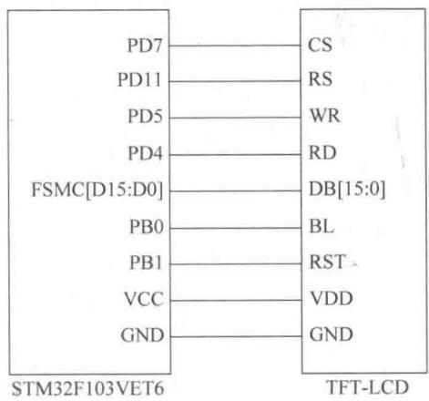

**这张图怎么读**：

1. **左边一个大方框**，底部标注 `STM32F103VET6`（就是我们的 MCU）；
2. **右边一个大方框**，底部标注 `TFT-LCD`（就是液晶模块）；
3. **中间是 9 根连线**，从左边引到右边：

```
左边（STM32）      右边（LCD）
   PD7   ──────────  CS
   PD11  ──────────  RS
   PD5   ──────────  WR
   PD4   ──────────  RD
FSMC[D15:D0] ──────  DB[15:0]
   PB0   ──────────  BL
   PB1   ──────────  RST
   VCC   ──────────  VDD
   GND   ──────────  GND
```

4. **注意最左边写的是"PD7、PD11、PD5、PD4"这些"端口引脚名"**，而不是"FSMC_NE1、FSMC_A16"这些"功能名"。

**【补充解释】这两套名字的关系（这是本图最容易卡住的地方）：**

STM32 的引脚是"一芯多用"的：同一根物理引脚，可以通过"复用功能配置"变成不同的角色。对 STM32F103VET6 来说：

| 端口引脚（图 12-21 上的名字） | 复用功能（FSMC 的角色） | 在 LCD 上接的是 |
|---|---|---|
| `PD7` | `FSMC_NE1`（片选） | `CS` |
| `PD11` | `FSMC_A16`（地址线第 16 位） | `RS` |
| `PD5` | `FSMC_NWE`（写使能） | `WR` |
| `PD4` | `FSMC_NOE`（读使能） | `RD` |
| `PD14,PD15,PD0,PD1,PE7~PE15,PD8,PD9,PD10` | `FSMC_D0~D15`（数据线） | `DB[15:0]` |
| `PB0` | （普通 GPIO） | `BL`（背光） |
| `PB1` | （普通 GPIO） | `RST`（复位） |

> **【重点】`RS` 接到 `FSMC_A16` 上——这就是"把 LCD 当成 SRAM"的关键。**
> 因为 FSMC 只会产生"地址"，不会产生"命令/数据"这种信号。所以我们"借用"地址线 `A16` 来充当 `RS`：
> **地址里 A16 = 0 → RS = 0 → 命令；地址里 A16 = 1 → RS = 1 → 数据。**

**【教材内容】表 12-36 TFT-LCD 信号线**

| TFT-LCD 信号线 | 含义 | 连接 STM32F103 引脚 |
|---|---|---|
| `CS` | 片选信号 | `PD7` |
| `RS` | 命令/数据标志 0:命令；1:数据 | `PD11` |
| `WR` | 写入数据 | `PD5` |
| `RD` | 读取数据 | `PD4` |
| `RST` | 硬复位 | `PB1` |
| `BL` | 背光控制 | `PB0` |
| `DB[15:0]` | 16 位数据线 | `FSMC[D15:D0]` |

#### 【教材原图】图 12-19 16 位数据与显存对应关系图

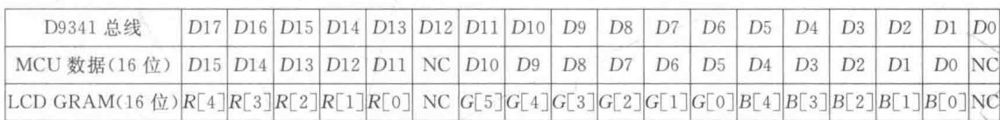

**这张图怎么读**（它是一张"位对位"的对应表）：

图上有三行：

```
行1：D9341 总线 | D17 D16 D15 D14 D13 D12 D11 D10 D9 D8 D7 D6 D5 D4 D3 D2 D1 D0
行2：MCU 数据(16位)| D15 D14 D13 D12 D11 NC  D10 D9  D8 D7 D6 D5 D4 D3 D2 D1 D0 NC
行3：LCD GRAM(16位)| R4  R3  R2  R1  R0  NC  G5  G4  G3 G2 G1 G0 B4 B3 B2 B1 B0 NC
```

**逐列对照**（从左往右）：

| ILI9341 的线 | 接到 MCU 的哪根线 | 对应 GRAM 里的哪一位 | 颜色分量 |
|---|---|---|---|
| `D17` | `D15` | `R4` | 红（最高位） |
| `D16` | `D14` | `R3` | 红 |
| `D15` | `D13` | `R2` | 红 |
| `D14` | `D12` | `R1` | 红 |
| `D13` | `D11` | `R0` | 红（最低位） |
| `D12` | （没引出来） | — | — |
| `D11` | `D10` | `G5` | 绿（最高位） |
| `D10` | `D9` | `G4` | 绿 |
| `D9` | `D8` | `G3` | 绿 |
| `D8` | `D7` | `G2` | 绿 |
| `D7` | `D6` | `G1` | 绿 |
| `D6` | `D5` | `G0` | 绿（最低位） |
| `D5` | `D4` | `B4` | 蓝（最高位） |
| `D4` | `D3` | `B3` | 蓝 |
| `D3` | `D2` | `B2` | 蓝 |
| `D2` | `D1` | `B1` | 蓝 |
| `D1` | `D0` | `B0` | 蓝（最低位） |
| `D0` | （没引出来） | — | — |

> **【教材内容】**："从图 12-19 中可以看出，ILI9341 在 16 位模式下，数据线有用的是 `D17~D13` 和 `D11~D1`，`D0` 和 `D12` 没有用到，实际上在 LCD 模块下，ILI9341 的 `D0` 和 `D12` 压根就没有引出来，这样，ILI9341 的 `D17~D13` 和 `D11~D1` 对应 MCU 的 `D15~D0`。"
>
> "**MCU 的 16 位数据，最低 5 位代表蓝色，中间 6 位为绿色，最高 5 位为红色。数值越大，表示该颜色越深。** 另外，ILI9341 所有的指令都是 8 位的（高 8 位无效），且参数除了读写 GRAM 的时候是 16 位，其他操作参数都是 8 位的。"

**【补充解释】RGB565 到底怎么排？**

```
一个 16 位像素（RGB565）：

 bit:  15 14 13 12 11 | 10  9  8  7  6  5 |  4  3  2  1  0
       └──── R[4:0] ──┘└──── G[5:0] ──────┘└──── B[4:0] ──┘
       红：5 位          绿：6 位             蓝：5 位
```

**为什么绿色有 6 位？** 因为人眼对绿色最敏感，多给它一位能让画面看起来更自然。

**用教材例程里的颜色验算一下**：

```
BLACK = 0x0000
= 0000 0000 0000 0000
  R=00000  G=000000  B=00000   → 全黑 ✓

BLUE = 0x001F
= 0000 0000 0001 1111
  R=00000  G=000000  B=11111   → 纯蓝 ✓

RED = 0xF800
= 1111 1000 0000 0000
  R=11111  G=000000  B=00000   → 纯红 ✓

WHITE = 0xFFFF
= 1111 1111 1111 1111
  R=11111  G=111111  B=11111   → 全白 ✓
```

> **这就是"为什么 RED 是 0xF800 而不是 0x000F"的答案**——因为红色在**高位**。

#### 2）操作命令

**【教材内容】**："ILI9341 的命令很多，限于篇幅，这里仅介绍 ILI9341 的几个重要命令。"

#### （1）读 ID 指令 `0xD3`

**【教材内容】表 12-29 读 ID 指令 0xD3 的参数描述**

| 顺序 | RS | RD | WR | HEX |
|---|---|---|---|---|
| 指令 | 0 | 1 | ↑ | `D3H` |
| 参数1 | 1 | ↑ | 1 | X（dummy） |
| 参数2 | 1 | ↑ | 1 | `00H` |
| 参数3 | 1 | ↑ | 1 | `93H` |
| 参数4 | 1 | ↑ | 1 | `41H` |

> **【教材内容】**："从表 12-29 可以看出，0xD3 指令后面跟了 4 个参数，最后 2 个参数，读出来是 0x93 和 0x41，刚好是控制器 ILI9341 的数字部分。通过该指令，可判别 LCD 驱动器的型号，可以根据控制器的型号去执行对应驱动 IC 的初始化代码，从而使得程序代码支持不同驱动 IC 的 LCD。"

**大白话**：这是"**问一下屏幕：你是谁？**"。屏幕回答"我是 9341"。这样同一套代码可以适配不同型号的屏。

#### （2）存储访问控制指令 `0x36`

**【教材内容】表 12-30**

| 顺序 | RS | RD | WR | D7 | D6 | D5 | D4 | D3 | D2 | D1 | D0 | HEX |
|---|---|---|---|---|---|---|---|---|---|---|---|---|
| 指令 | 0 | 1 | ↑ | 0 | 0 | 1 | 1 | 0 | 1 | 1 | 0 | `36H` |
| 参数 | 1 | 1 | ↑ | MY | MX | MV | ML | BGR | MH | 0 | 0 | — |

> "从表 12-30 可以看出，0x36 指令后面紧跟一个参数，这里主要关注 MY、MX、MV 这 3 个位，通过这 3 个位的设置，可以控制整个 ILI9341 的全部扫描方向。"

**【教材内容】表 12-31 MY、MX、MV 设置与 LCD 扫描方向关系表**

| MY | MX | MV | 效果：LCD 扫描方向（GRAM 自增方式） |
|---|---|---|---|
| 0 | 0 | 0 | 从左到右，从上到下 |
| 1 | 0 | 0 | 从左到右，从下到上 |
| 0 | 1 | 0 | 从右到左，从上到下 |
| 1 | 1 | 0 | 从右到左，从下到上 |
| 0 | 0 | 1 | 从上到下，从左到右 |
| 0 | 1 | 1 | 从上到下，从右到左 |
| 1 | 0 | 1 | 从下到上，从左到右 |
| 1 | 1 | 1 | 从下到上，从右到左 |

> "在利用 ILI9341 显示内容的时候有很大的灵活性。比如显示 BMP 图片时，BMP 的译码数据从图片的左下角开始，慢慢显示到右上角。如果设置 LCD 扫描方向为从左到右，从下到上，那么只需要设置一次坐标，然后不停地向 LCD 填充颜色数据即可，这样可以大大提高显示速度。"

**大白话**：这个指令决定"**我每写一个像素，下一个像素写到哪儿**"。选对方向，就能配合数据源的顺序，一口气把一整张图刷进去，中途不用重新设坐标。

#### （3）列地址设置指令 `0x2A`（设 x 坐标）

**【教材内容】表 12-32**：指令 `0x2A` 后面跟 4 个参数：`SC[15:8]`、`SC[7:0]`、`EC[15:8]`、`EC[7:0]`。

> "在默认扫描方式时，该指令用于设置 x 坐标。指令带有 4 个参数，实际上是 2 个坐标值 SC 和 EC，即**列地址的起始值和结束值，SC 必须小于等于 EC，且 0 ≤ SC/EC ≤ 239**。一般在设置 x 坐标的时候，只需要带 2 个参数即可，也就是设置 SC 即可，因为如果 EC 没有变化，只需要设置一次即可（在初始化 ILI9341 的时候设置），从而提高速度。"

**注意 `≤ 239`**：因为屏幕宽 240（列号 0～239）。

#### （4）页地址设置指令 `0x2B`（设 y 坐标）

**【教材内容】表 12-33**：指令 `0x2B` 后面跟 4 个参数：`SP[15:8]`、`SP[7:0]`、`EP[15:8]`、`EP[7:0]`。

> "与 0x2A 指令类似，在默认扫描方式（从左到右、从上到下）时，该指令用于设置纵坐标（y 坐标）。……**SP 必须小于等于 EP，且 0 ≤ SP/EP ≤ 319**。"

**注意 `≤ 319`**：因为屏幕高 320（行号 0～319）。

#### （5）写 GRAM 指令 `0x2C`

**【教材内容】表 12-34**：指令 `0x2C` 之后，可以连续写 `D1[15:0]`、`D2[15:0]`、……、`Dn[15:0]`。

> "由表 12-34 可知，在收到指令 0x2C 之后，数据有效位宽变为 16 位，可以连续写入 LCD GRAM 值，而 **GRAM 的地址将根据 MY/MX/MV 设置的扫描方向进行自增**。例如，假设设置的是从左到右、从上到下的扫描方式，那么设置好起始坐标（通过 SC、SP 设置）后，每写入一个颜色值，GRAM 地址将会自动自增 1（SC++），如果碰到 EC，则回到 SC，同时 SP++，一直到坐标 (EC, EP) 结束，其间无须再次设置坐标，从而大大提高写入速度。"

**这段话画成图**：

```
设置 SC=0, EC=239, SP=0, EP=319（整屏），扫描方向"从左到右，从上到下"

写第 1 个像素 → (0, 0)
写第 2 个像素 → (1, 0)
...
写第 240 个像素 → (239, 0)
写第 241 个像素 → (0, 1)      ← 碰到 EC 了，回到 SC，SP++
写第 242 个像素 → (1, 1)
...
一直到 (239, 319) 结束
```

> **这就是"清屏"能一行代码搞定的原因**：设好坐标 → 发 0x2C → 循环写 76800 次颜色 → 全屏都是这个颜色。

#### （6）读 GRAM 指令 `0x2E`

**【教材内容】表 12-35**

> "该指令用于读取 ILI9341 的显存（GRAM）。……ILI9341 收到该指令后，**第一次输出的是 dummy 数据，也就是无效的数据**；第二次开始，读取到的才是有效的 GRAM 数据[从坐标 (SC, SP) 开始]，输出规律为：每个颜色分量占 8 个位，一次输出 2 个颜色分量。比如，第一次输出是 R1G1，随后的规律为 B1R2、G2B2、R3G3、B3R4、G4B4、R5G5，以此类推。如果只读取一个点的颜色值，那么只需要接收到参数 3 即可。"

**"dummy 数据"是什么？**

大白话：**第一口是"假"的。**

因为 ILI9341 内部要先"准备"一下，所以第一次读出来的是没用的数据，必须**丢掉**。这就是教材例程里为什么连着读了好几次：

```c
LCD_WR_REG(0XD3);
lcddev.id = LCD_RD_DATA();    //dummy read   ← 丢掉
lcddev.id = LCD_RD_DATA();    //读到0X00     ← 参数2
lcddev.id = LCD_RD_DATA();    //读取93       ← 参数3
lcddev.id <<= 8;
lcddev.id |= LCD_RD_DATA();   //读取41       ← 参数4
```

#### 3）使用流程

**【教材原图】图 12-20 TFT-LCD 使用流程**

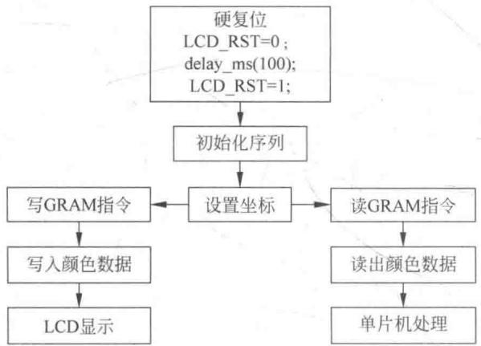

**这张图怎么读**：

图是一个流程图，从上往下、再分成左右两条支路：

```
        ┌──────────────────────────┐
        │        硬复位             │
        │  LCD_RST=0;              │
        │  delay_ms(100);          │
        │  LCD_RST=1;              │
        └────────────┬─────────────┘
                     ↓
        ┌──────────────────────────┐
        │       初始化序列          │   ← 只执行一次
        └────────────┬─────────────┘
                     ↓
        ┌──────────────────────────┐
        │        设置坐标           │
        └──────┬────────────┬──────┘
               ↓            ↓
      ┌──────────────┐  ┌──────────────┐
      │  写 GRAM 指令 │  │  读 GRAM 指令 │
      └──────┬───────┘  └──────┬───────┘
             ↓                 ↓
      ┌──────────────┐  ┌──────────────┐
      │  写入颜色数据 │  │  读出颜色数据 │
      └──────┬───────┘  └──────┬───────┘
             ↓                 ↓
      ┌──────────────┐  ┌──────────────┐
      │   LCD 显示    │  │  单片机处理   │
      └──────────────┘  └──────────────┘
```

> **【教材内容】**："在图 12-20 中，硬复位和初始化序列，只需要执行一次即可。**画点流程为：设置坐标 → 写 GRAM 指令 → 写入颜色数据**，然后在 LCD 上面就可以看到对应的点，显示写入的颜色了。**读点流程为：设置坐标 → 读 GRAM 指令 → 读取颜色数据**，这样就可以获取到对应点的颜色数据。"

**【教材内容】使用 FSMC 驱动 TFT-LCD 的步骤**：

> "(1) 初始化 FSMC；
> ① 设置使用到的存储块和区号；
> ② 设置存储器类型；
> ③ 设置数据宽度；
> ④ 设置写使能；
> ⑤ 设置扩展模式使能位；
> ⑥ 设置数据/地址复用使能；
> ⑦ 设置读时序；
> ⑧ 设置写时序；
> ⑨ 其他设置；
> ⑩ 初始化 FSMC；
> ⑪ 使能存储块和区块。
> (2) 初始化 TFT-LCD（包括电源控制、伽马设置、背光控制等，具体设置请参考 LCD 技术手册）；
> (3) 填充指定坐标的像素，实现图形字符的显示。"

> **【补充解释】"伽马设置"是什么？**
> 伽马（Gamma）是"亮度与数值之间的非线性关系"。人眼对暗部变化更敏感，所以屏幕出厂前要用一组曲线校正一下，让渐变更自然。这部分是 ILI9341 内部的寄存器设置，跟 FSMC 无关，照抄厂家给的初始化表就行。

### 【例 12-1】完整代码逐行讲解

**【教材内容】例 12-1**
> "使用 STM32F103VET6 的 FSMC 模块操作 ATK-2.8'TFT-LCD 模块。
> 解：使用 STM32F103VET6 的 FSMC 模块操作 TFT-LCD 时，FSMC 是把 TFT-LCD 当成 SRAM 设备来用的，其操作时序和 SRAM 的控制完全类似，唯一不同的就是 TFT-LCD 有命令/数据控制信号（即 RS 信号），但是没有地址信号。由于 FSMC 没有 RS 信号，TFT-LCD 没有地址信号，所以将 TFT-LCD 的 RS 信号接到 FSMC 的 A16 端，**操作地址的 A16 位为 1 时 RS 为 1，操作地址的 A16 位为 0 时 RS 为 0**，通过这个方法可区分读写命令还是数据。"

#### 【关键推导】为什么是 `0x60000000 | 0x0001FFFE`？

教材代码第一句就是：

```c
//使用 NOR/SRAM 的 Bank1.sector1,A16 作为数据命令区分线
#define LCD_BASE ((u32)(0x60000000)|0x0001FFFE)
#define LCD ((LCD_TypeDef *) LCD_BASE)
```

**我们一步一步算清楚这个地址。**

**第 1 步：确定用哪个小区。**

代码注释写"Bank1.sector1"→ 块 1 小区 1 → `NE1` → 基地址 `0x60000000`。

**第 2 步：确定 RS 接在哪根地址线上。**

`RS` 接 `FSMC_A16`。

**第 3 步：`FSMC_A16` 对应内部地址的哪一位？**

这是**最容易错的一步**！因为外部存储器是 **16 位**（`FSMC_MemoryDataWidth_16b`），根据表 12-1：

```
16 位存储器：  HADDR[25:1]  ↔  FSMC_A[24:0]
所以：        FSMC_A[16]   ↔  HADDR[17]
```

**不是 HADDR[16]，是 HADDR[17]！** 因为整个地址线"错开了一位"。

**第 4 步：算两个地址。**

```
LCD_BASE = 0x60000000 | 0x0001FFFE = 0x6001FFFE

结构体：
typedef struct {
    vu16 LCD_REG;   // 第一个成员，在偏移 0 处
    vu16 LCD_RAM;   // 第二个成员，在偏移 2 处
} LCD_TypeDef;

所以：
LCD->LCD_REG 的地址 = 0x6001FFFE + 0 = 0x6001FFFE
LCD->LCD_RAM 的地址 = 0x6001FFFE + 2 = 0x60020000
```

**第 5 步：检查 HADDR[17] 分别是多少。**

```
0x6001FFFE 写成二进制（只看低 20 位就够）：
  0x1FFFE = 0001 1111 1111 1111 1110
              ↑
            bit16 = 1
            bit17 = 0

  完整：0x6001FFFE = 0110 0000 0000 0001 1111 1111 1111 1110
                                      ↑
                                    bit17 = 0

0x60020000 = 0110 0000 0000 0010 0000 0000 0000 0000
                            ↑
                          bit17 = 1
```

**第 6 步：得出结论。**

| 访问 | 内部地址 | HADDR[17] | FSMC_A16 | LCD 的 RS | 含义 |
|---|---|---|---|---|---|
| `LCD->LCD_REG` | `0x6001FFFE` | **0** | **0** | **0** | **命令** |
| `LCD->LCD_RAM` | `0x60020000` | **1** | **1** | **1** | **数据** |

**完美对应！** 这就是为什么代码里：

```c
LCD->LCD_REG = regval;   // 写命令（RS=0）
LCD->LCD_RAM = data;     // 写数据（RS=1）
```

> **【教材表述的一个小瑕疵】**
> 教材说"操作地址的 A16 位为 1 时 RS 为 1，操作地址的 A16 位为 0 时 RS 为 0"。
> 严格来说，这里的"A16"指的是**FSMC 的 A16 引脚**，它对应的是**内部地址的 bit17**，不是内部地址的 bit16。
> 因为地址线在 16 位模式下"错开一位"，这一点如果理解错，地址就算不出来了。

> **【补充解释】`0x0001FFFE` 这个数为什么必须这么选？**
> 它必须同时满足三个条件：
> 1. **`bit0 = 0`**：因为 16 位访问要求地址是 2 的倍数（半字对齐）；
> 2. **基地址的 `HADDR[17] = 0`**：这样 `LCD_REG` 的 `A16 = 0` → `RS = 0` → 命令；
> 3. **基地址 + 2 的 `HADDR[17] = 1`**：这样 `LCD_RAM` 的 `A16 = 1` → `RS = 1` → 数据。
>
> 第 3 条是关键：**"加 2" 必须让 bit17 进位**。所以基地址的低 17 位必须是"从 bit1 到 bit16 全是 1"：
> ```
> 0x0001FFFE = 0001 1111 1111 1111 1110
>                 ↑
>               bit16 = 1，bit17 = 0
> 加 2 之后： 0x00020000 = 0010 0000 0000 0000 0000
>                             ↑
>                           bit17 = 1  ← 进位成功！
> ```
> **所以 `0x0001FFFE` 不是随便挑的**——如果直接写 `0x60000000`，那么 `LCD_REG` 在 `0x60000000`、`LCD_RAM` 在 `0x60000002`，**两者的 bit17 都是 0**，`A16` 永远等于 0，两个成员就都变成"命令"了，程序会完全失灵。

#### 【辅助理解图】RS 接 A16 的原理

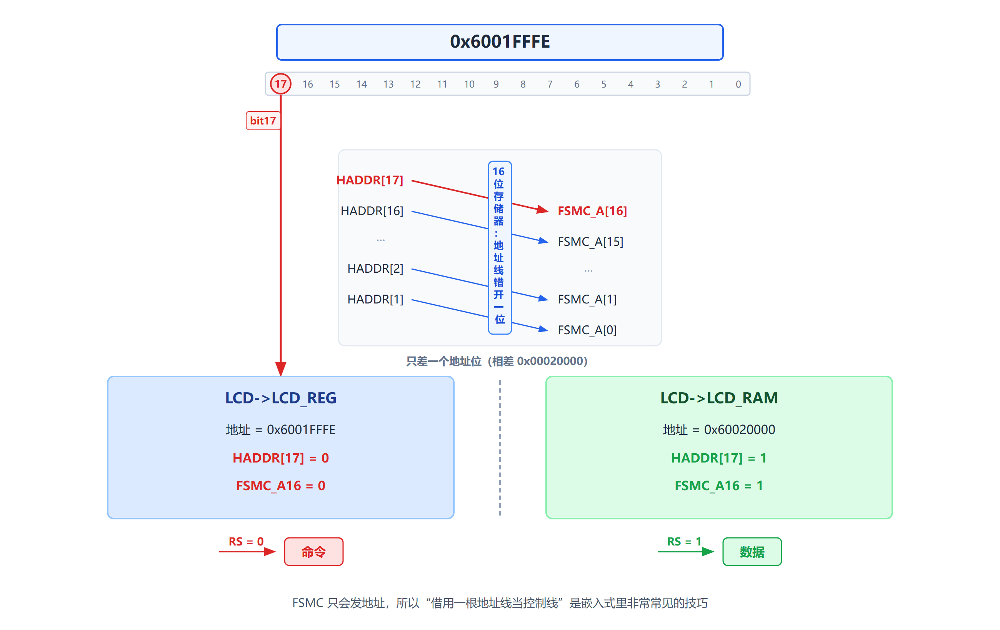

**这张图怎么读**：

1. 上方画一个 32 位的地址方块 `0x6001FFFE`，把其中 **bit17** 用红色高亮圈出来，并在旁边写"→ 错开一位后变成 FSMC_A16"；
2. 中间画一个"16 位存储器地址错位"的小示意：`HADDR[25:1] → FSMC_A[24:0]`，用一根斜线表示错位；
3. 下方画两个并列的小盒子：
   - 左边盒子写 `LCD->LCD_REG`，地址 `0x6001FFFE`，bit17=0，箭头指向 `A16=0`，再指向 `RS=0`，标注"**命令**"；
   - 右边盒子写 `LCD->LCD_RAM`，地址 `0x60020000`，bit17=1，箭头指向 `A16=1`，再指向 `RS=1`，标注"**数据**"；
4. 最下面写一行小字："**同一个结构体的两个成员，只差一个地址位，就实现了'命令/数据'的区分。**"
5. **这张图要你理解**：**FSMC 只会发地址，所以"借用一根地址线当控制线"是嵌入式里非常常见的技巧。**

#### 【辅助理解图】写一个像素的完整数据流

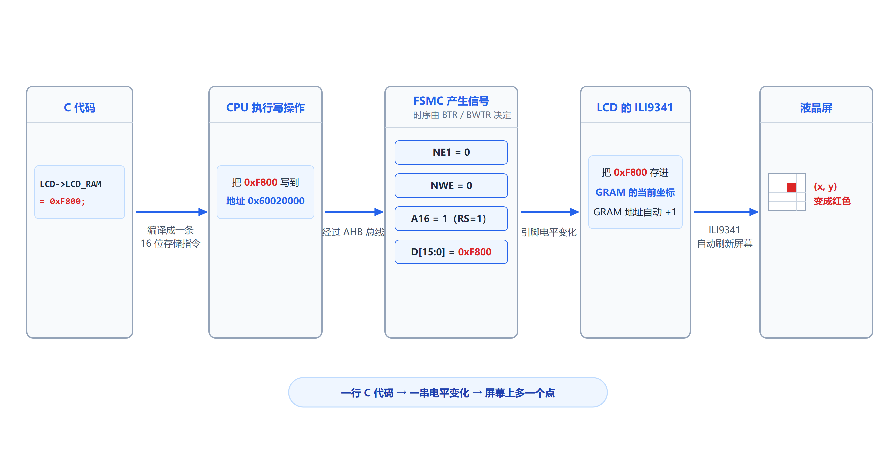

**这张图怎么读**：

1. 从左到右画 5 个环节，用箭头串起来：
   ```
   [C 代码] → [CPU 执行写操作] → [FSMC 产生信号] → [LCD 的 ILI9341] → [液晶屏]
   ```
2. 第一个环节写 `LCD->LCD_RAM = 0xF800;`；
3. 第二个环节写"CPU 把 `0xF800` 写到地址 `0x60020000`"；
4. 第三个环节画一排小信号线，标注 `NE1=0`、`NWE=0`、`A16=1`（RS=1）、`D[15:0]=0xF800`；
5. 第四个环节写"ILI9341 把 `0xF800` 存进 GRAM 的当前坐标"；
6. 第五个环节画一个小方块，涂成红色，标注"屏幕上的一个红点"；
7. 图下方写一行小字："**一行 C 代码 → 一串电平变化 → 屏幕上多一个点。**"
8. **这张图要你理解**：**"软件写一个数就控制硬件"这件事，中间经过了哪几步。**

#### 代码逐块讲解

下面按教材代码的逻辑块来讲。**每一块都按"这段想完成什么 → 逐行 → CPU 做什么 → 寄存器发生什么 → 硬件发生什么"来讲。**

#### 【代码块 1】头文件和宏定义

```c
#include "delay.h"
#include "stm32f10x.h"
#define LCD_LED PBout(0)    //LCD 背光
//使用 NOR/SRAM 的 Bank1.sector1,A16 作为数据命令区分线
#define LCD_BASE ((u32)(0x60000000)|0x0001FFFE)
#define LCD ((LCD_TypeDef *) LCD_BASE)
//颜色
#define BLACK 0x0000
#define BLUE 0x001F
#define WHITE 0xFFFF
#define RED 0xF800
```

**这段想完成什么**：给后面的代码起几个"好记的名字"，并把 LCD 的地址算出来。

| 代码 | CPU 做什么 | 寄存器发生什么 | 硬件发生什么 |
|---|---|---|---|
| `#include "stm32f10x.h"` | （编译期）把芯片的寄存器定义引进来 | — | — |
| `#define LCD_LED PBout(0)` | 编译期把 `LCD_LED` 替换成"操作 PB0 的表达式" | — | 后面 `LCD_LED = 1` 会去写 GPIOB 的 `BSRR`/`ODR` |
| `#define LCD_BASE (...)` | 编译期算出一个常量地址 `0x6001FFFE` | — | — |
| `#define LCD ((LCD_TypeDef *) LCD_BASE)` | 把常量地址**强制转换成一个结构体指针** | — | 以后 `LCD->xxx` 就是"访问 `0x6001FFFE` 附近的地址" |
| `#define BLACK/BLUE/WHITE/RED` | 编译期替换成颜色值 | — | 写进 GRAM 就是对应颜色 |

**【重点】`(LCD_TypeDef *) LCD_BASE` 是什么意思？**

拆开看：

```
LCD_BASE               →  一个数字：0x6001FFFE
(LCD_TypeDef *)        →  强制类型转换：把这个数字当作"指向 LCD_TypeDef 结构体的指针"
```

**为什么可以这么干？** 因为在 C 语言里，**"指针"就是"地址"**。而 STM32 的外设寄存器就是"有地址的格子"。所以：

```c
LCD->LCD_REG   ≡   *(volatile uint16_t *)(0x6001FFFE)
LCD->LCD_RAM   ≡   *(volatile uint16_t *)(0x60020000)
```

> **【快速复习：`volatile` 是什么？】**
> `volatile` 是 C 语言的一个关键字，意思是"**这个变量的值可能会被硬件偷偷改掉，编译器你不要自作聪明地优化它**"。
> 在本例里，`LCD_RAM` 的值其实是"屏幕上的像素"，硬件会变它，所以必须加 `volatile`（代码里的 `vu16` 就是 `volatile uint16_t` 的缩写）。
> **不加 `volatile` 的后果**：编译器可能把多次读合并成一次，导致你读到的永远是同一个值。

#### 【代码块 2】LCD 参数结构体

```c
typedef struct 
{
    u16 width;    //LCD 宽度
    u16 height;   //LCD 高度
    u16 id;       //LCD ID
    u8 dir;       //横屏还是竖屏控制：0,竖屏；1,横屏
    u16 wramcmd;  //开始写 gram 指令
    u16 setxcmd;  //设置 x 坐标指令
    u16 setycmd;  //设置 y 坐标指令
}_lcd_dev;

_lcd_dev lcddev;
```

**这段想完成什么**：用一个结构体把"这块屏的基本信息"打包存起来。

**为什么要这样？** 因为**同一套代码要支持不同型号、不同方向的屏**。把这些信息集中放在一个全局变量里，改一处就能全改。

#### 【代码块 3】LCD 地址结构体

```c
//LCD 地址结构体
typedef struct 
{
    vu16 LCD_REG;
    vu16 LCD_RAM;
} LCD_TypeDef;
```

**这段想完成什么**：**这是整个例程最核心的一句设计。**

**逐行解释**：

```
vu16 LCD_REG;   →  在偏移 0 处放一个 16 位变量
vu16 LCD_RAM;   →  在偏移 2 处放一个 16 位变量
```

**CPU 做什么**：`LCD->LCD_REG = 0xD3;` 时，CPU 会执行一次"**16 位写**"，地址是 `0x6001FFFE`。
**寄存器发生什么**：这次写落在 FSMC 的地址范围内，被 FSMC 接住（不是写进内部 RAM）。
**硬件发生什么**：
```
FSMC 看到地址 0x6001FFFE
  → HADDR[27:26] = 00  → 选中 NE1（CS 拉低）
  → HADDR[17] = 0      → A16 = 0  → RS = 0（命令）
  → NWE 拉低（写）
  → D[15:0] = 0x00D3
  → ILI9341 收到命令 0xD3
```

> **【巧妙的点】** 因为 C 语言里**结构体成员是按顺序、按大小紧挨着排布的**，所以"两个成员"就自动变成了"两个相差 2 的地址"。而这两个地址**恰好只有 `HADDR[17]` 不同**，于是"访问不同成员"就等价于"切换 RS"。

#### 【代码块 4】底层读写函数

```c
//写寄存器函数
//regval:寄存器值
void LCD_WR_REG(u16 regval)
{
    LCD->LCD_REG = regval;
}

//写 LCD 数据
//data:要写入的值
void LCD_WR_DATA(u16 data)
{
    LCD->LCD_RAM = data;
}

//读 LCD 数据
//返回值:读到的值
u16 LCD_RD_DATA(void)
{
    vu16 ram;
    ram = LCD->LCD_RAM;
    return ram;
}
```

| 函数 | 想完成什么 | 硬件发生什么 |
|---|---|---|
| `LCD_WR_REG(regval)` | 给 LCD 发一条**命令** | 写 `0x6001FFFE` → `A16=0` → `RS=0` → `NWE` 一个低脉冲 |
| `LCD_WR_DATA(data)` | 给 LCD 发一个**数据** | 写 `0x60020000` → `A16=1` → `RS=1` → `NWE` 一个低脉冲 |
| `LCD_RD_DATA()` | 从 LCD 读一个**数据** | 读 `0x60020000` → `A16=1` → `RS=1` → `NOE` 一个低脉冲 → 数据进 CPU |

**【注意】读的时候返回类型是 `u16`（16 位）。** 因为 ILI9341 在 16 位模式下数据就是 16 位的。

#### 【代码块 5】写寄存器 / 读寄存器 / 写 GRAM 准备

```c
//写寄存器
//LCD_Reg:寄存器地址
//LCD_RegValue:要写入的数据
void LCD_WriteReg(u16 LCD_Reg, u16 LCD_RegValue)
{
    LCD->LCD_REG = LCD_Reg;      // 先发命令
    LCD->LCD_RAM = LCD_RegValue; // 再发数据
}

//读寄存器
//LCD_Reg:寄存器地址
//返回值:读到的数据
u16 LCD_ReadReg(u16 LCD_Reg)
{
    LCD_WR_REG(LCD_Reg);      // 先发命令
    delay_us(5);              // 等 5 微秒（ILI9341 需要一点反应时间）
    return LCD_RD_DATA();     // 再读数据
}

//开始写 GRAM
void LCD_WriteRAM_Prepare(void)
{
    LCD->LCD_REG = lcddev.wramcmd;   // 发 0x2C 命令
}

//LCD 写 GRAM
//RGB_Code:颜色值
void LCD_WriteRAM(u16 RGB_Code)
{
    LCD->LCD_RAM = RGB_Code;         // 写颜色
}
```

**这一组的"协议"要理解清楚**：

```
ILI9341 的规矩：
  先发"命令"（RS=0）告诉它"接下来干什么"
  再发"参数/数据"（RS=1）

所以"写一个寄存器"其实是两步：
  LCD->LCD_REG = 寄存器号;     ← 第一步：命令
  LCD->LCD_RAM = 值;          ← 第二步：数据
```

**【为什么 `LCD_ReadReg` 里要 `delay_us(5)`？】**
因为 ILI9341 收到命令后需要一点时间准备数据，如果你立刻去读，可能读到旧值或无效值。**这是"读操作比写操作慢"的一个具体体现**（对照表 12-28：读周期 160ns，写周期只要 66ns）。

#### 【代码块 6】设置光标位置

```c
//设置光标位置
//Xpos:横坐标
//Ypos:纵坐标
void LCD_SetCursor(u16 Xpos, u16 Ypos)
{
    LCD_WR_REG(lcddev.setxcmd);          // 发 0x2A（设置列地址）
    LCD_WR_DATA(Xpos >> 8);              // 高 8 位
    LCD_WR_DATA(Xpos & 0XFF);            // 低 8 位
    LCD_WR_REG(lcddev.setycmd);          // 发 0x2B（设置页地址）
    LCD_WR_DATA(Ypos >> 8);              // 高 8 位
    LCD_WR_DATA(Ypos & 0XFF);            // 低 8 位
}
```

**逐行拆解位运算**（这里不许跳步）：

```
假设 Xpos = 200 = 0x00C8

Xpos >> 8    →  0x00C8 >> 8 = 0x0000   （把高 8 位移到低 8 位）
Xpos & 0xFF  →  0x00C8 & 0x00FF = 0x00C8

运算前：  0000 0000 1100 1000   (0x00C8)
右移 8 位：0000 0000 0000 0000   (0x0000)  ← 高 8 位
与 0x00FF：0000 0000 1100 1000   (0x00C8)  ← 低 8 位

假设 Ypos = 300 = 0x012C

Ypos >> 8    →  0x012C >> 8 = 0x0001
Ypos & 0xFF  →  0x012C & 0x00FF = 0x002C

运算前：  0000 0001 0010 1100   (0x012C)
右移 8 位：0000 0000 0000 0001   (0x0001)  ← 高 8 位
与 0x00FF：0000 0000 0010 1100   (0x002C)  ← 低 8 位
```

**为什么要把 16 位拆成两个 8 位发？**

因为教材说："ILI9341 所有的指令都是 8 位的（高 8 位无效），且参数除了读写 GRAM 的时候是 16 位，**其他操作参数都是 8 位的**。"

所以设置坐标时，`SC`/`EC`/`SP`/`EP` 这些参数要**拆成高字节 + 低字节**，分两次发。

> **【易错点】** 16 位数据线上送 8 位参数时，**高 8 位是无效的**。所以发 `0x00C8` 和发 `0x00C8`（低 8 位 `0xC8`）是一样的效果，但为了代码清晰，教材还是老老实实把高字节填 0。

#### 【代码块 7】画点

```c
//画点
//x,y:坐标
//color:颜色
void LCD_DrawPoint(u16 x,u16 y,u16 color)
{
    LCD_SetCursor(x,y);        //设置光标位置
    LCD_WriteRAM_Prepare();    //开始写入 GRAM
    LCD->LCD_RAM = color;      //写颜色（注意：直接操作 LCD_RAM，比 LCD_WriteRAM 少一次函数调用）
}
```

**这段想完成什么**：在 `(x, y)` 处画一个 `color` 颜色的点。

**硬件上发生了什么**（完整链条）：

```
第 1 步：LCD_SetCursor(x, y)
        → 发 0x2A + x 的高低位  →  ILI9341 记下"列从 x 开始"
        → 发 0x2B + y 的高低位  →  ILI9341 记下"页从 y 开始"

第 2 步：LCD_WriteRAM_Prepare()
        → 发 0x2C              →  ILI9341 进入"接收像素数据"状态

第 3 步：LCD->LCD_RAM = color
        → 写地址 0x60020000    →  A16=1 → RS=1 → 数据
        → NWE 一个低脉冲       →  ILI9341 把这个 16 位颜色存进 GRAM 的 (x, y)
        → 屏幕上的 (x, y) 变成这个颜色
        → GRAM 地址自动 +1（按扫描方向）
```

#### 【代码块 8】清屏

```c
//清屏函数
//color:要清屏的填充色
void LCD_Clear(u16 color)
{
    u32 index = 0;
    u32 totalpoint = lcddev.width;
    totalpoint *= lcddev.height;      //得到总点数
    LCD_SetCursor(0x00, 0x0000);      //设置光标位置
    LCD_WriteRAM_Prepare();           //开始写入 GRAM
    for(index = 0; index < totalpoint; index++)
    {
        LCD->LCD_RAM = color;
    }
}
```

**这段想完成什么**：把整个屏幕刷成同一种颜色。

**关键点**：

```
totalpoint = width × height = 240 × 320 = 76800
```

**为什么循环里只需要写 `LCD_RAM`，不需要每次都设坐标？**

因为教材说："GRAM 的地址将根据 MY/MX/MV 设置的扫描方向进行自增"。**每写一个像素，ILI9341 自己会把地址往后挪一格。**

**性能上有多少提升？** 如果不自增，每个点都要发 4 个字节（0x2A + 高 + 低 + 0x2B + 高 + 低 ≈ 6 次写）。现在每个点只要 1 次写。**快了 6 倍以上。**

#### 【代码块 9】显示字符

```c
//在指定位置显示一个字符
//x,y:起始坐标
//num:要显示的字符:" "--->"~"
//size:字体大小12/16/24
//mode:叠加方式(1)还是非叠加方式(0)
void LCD_ShowChar(u16 x,u16 y,u8 num,u8 size,u8 mode)
{
    u8 temp,t1,t;
    u16 y0 = y;
    u8 csize=(size/8+((size%8)?1:0))*(size/2); //得到字体一个字符对应
    num = num - ' ';
    //得到偏移后的值(ASCII字库是从空格开始取模,所以- ' '
    for(t=0;t<csize;t++)
    {
        if(size==12)temp=asc2_1206[num][t]; //调用1206字体
        else return; //没有的字库
        for(t1=0;t1<8;t1++)
        {
            if(temp&0x80) LCD_DrawPoint(x,y,BLACK);
            else if(mode==0)LCD_DrawPoint(x,y,BLUE);
            temp<<=1;
            y++;
            if(y>=lcddev.height)return; //超区域了
            if((y-y0)==size)
            {
                y=y0;
                x++;
                if(x>=lcddev.width)return; //超区域了
                break;
            }
        }
    }
}
```

**这段想完成什么**：把一个 ASCII 字符的"点阵"逐点画到屏幕上。

**【先补一个前置知识：什么叫"点阵字库"？】**

计算机里的字，是用"**一堆点**"拼出来的。比如 12×6 的字符 `A`，就是一张 12 行 × 6 列的黑白图：

```
12 行高，6 列宽（实际用了 6 列）
每 8 个点用 1 个字节表示（所以每行 1 个字节，12 行 = 12 个字节）
```

教材里那个巨大的数组：

```c
const unsigned char asc2_1206[95][12] = { ... };
```

意思是：**95 个字符（从空格到 `~`）× 每个字符 12 个字节**。

**逐行解释代码**：

| 代码 | 含义 | 硬件/数据发生什么 |
|---|---|---|
| `u8 csize=(size/8+((size%8)?1:0))*(size/2);` | 算出一个字符占多少字节 | 对 12 号字：`12/8 + (12%8?1:0) = 1+1 = 2`，`2 × (12/2) = 12` 字节 ✓ |
| `num = num - ' ';` | 把 ASCII 码转成数组下标 | `' '` 是 0x20，是数组第 0 项。所以 `'A'`(0x41) → 下标 0x21 = 33 |
| `temp = asc2_1206[num][t];` | 取出这个字符的第 `t` 个字节 | 从 Flash 里读常量数据 |
| `if(temp & 0x80) LCD_DrawPoint(x,y,BLACK);` | **判断最高位是不是 1** | 是 1 → 画黑点（笔画的点） |
| `else if(mode==0) LCD_DrawPoint(x,y,BLUE);` | 是 0 → 画背景色（非叠加模式） | 是 0 → 画蓝点（背景） |
| `temp <<= 1;` | **把 `temp` 左移一位** | 这样下一次 `& 0x80` 就检查下一个 bit |
| `y++;` | 往下走一行 | |
| `if((y-y0)==size){ y=y0; x++; ... }` | 画满一列（12 行）之后，回到顶部，往右移一列 | |

**重点讲清"逐位移位"这个技巧**（这是位操作最经典的用法）：

```
假设 temp = 0b10100000（一个字节，代表 8 个点的黑白）

第 1 次：temp & 0x80
       1010 0000
     & 1000 0000
     -----------
       1000 0000  ≠ 0  →  最高位是 1  →  画黑点
       temp <<= 1  →  0100 0000

第 2 次：temp & 0x80
       0100 0000
     & 1000 0000
     -----------
       0000 0000  = 0  →  最高位是 0  →  画背景色
       temp <<= 1  →  1000 0000

第 3 次：temp & 0x80
       1000 0000
     & 1000 0000
     -----------
       1000 0000  ≠ 0  →  画黑点
       temp <<= 1  →  0000 0000

第 4～8 次：都是 0  →  都画背景色
```

**结论**：`temp & 0x80` 检查最高位，`temp <<= 1` 把下一位"搬"到最高位。**这是一个"逐位扫描字节"的标准套路。**

> **【教材原话】**："//12 * 12 ASCII 字符集点阵"
> 【待核验】教材给的 `asc2_1206[95][12]` 数组在 MinerU 解析结果里**大面积损坏**（出现 `Ox20`、`1x87`、重复的 `/* "{"}}` 等乱码）。这部分是字库数据，不影响本章 FSMC 的原理理解，但**不能照抄**。详见文末"待核验"。

#### 【代码块 10】显示字符串

```c
//显示字符串
//x,y:起点坐标
//width,height:区域大小
//size:字体大小
//*p:字符串起始地址
void LCD_ShowString(u16 x,u16 y,u16 width,u16 height,u8 size,u8 *p)
{
    u8 x0 = x;
    width += x;
    height += y;
    while((*p<='~')&&(*p>=' ')) //判断是不是非法字符!
    {
        if(x>=width){x=x0;y+=size;}
        if(y>=height)break;
        LCD_ShowChar(x,y,*p,size,0);
        x+=size/2;
        p++;
    }
}
```

**这段想完成什么**：把一整串字符连续显示出来。

**关键点**：

| 代码 | 含义 |
|---|---|
| `u8 *p` | `p` 是一个指针，指向字符串的第一个字符 |
| `width += x; height += y;` | 把"区域大小"换算成"右下角的绝对坐标" |
| `while((*p<='~')&&(*p>=' '))` | 只要字符还在可打印范围内就继续 |
| `*p` | 取当前字符（指针解引用） |
| `x += size/2;` | **为什么是 `size/2`？** 因为 12 号字的宽度是 6 = 12/2，所以每显示一个字符，x 前进 6 个像素 |
| `p++;` | 指针后移，指向下一个字符 |
| `if(x>=width){x=x0;y+=size;}` | 一行排满了，换行 |

> **【快速复习：指针】** `p` 里存的是"字符在内存里的地址"，`*p` 是"那个地址里的字符"，`p++` 是"地址加 1，指向下一个字符"。字符串在 C 语言里就是"一串连续的字符，最后一个是用 0 结尾"。

#### 【代码块 11】主函数

```c
int main(void)
{
    Delay_Init();
    NVIC_PriorityGroupConfig(NVIC_PriorityGroup_2);
    LCD_Init();
    LCD_Clear(WHITE);
    delay_ms(1000);
    while(1)
    {
        LCD_ShowString(70, 120, 120, 24, 12, "STM32 TFT-LCD TEST");
    }
}
```

**逐行**：

| 代码 | 做什么 |
|---|---|
| `Delay_Init();` | 初始化延时函数（后面要用 `delay_ms`） |
| `NVIC_PriorityGroupConfig(NVIC_PriorityGroup_2);` | 设置中断优先级分组（第 7 章的内容） |
| `LCD_Init();` | **初始化 FSMC + 初始化 LCD**（下面详讲） |
| `LCD_Clear(WHITE);` | 清成白屏 |
| `LCD_ShowString(70, 120, 120, 24, 12, "STM32 TFT-LCD TEST");` | 在 (70,120) 处显示一行字 |
| `while(1) { ... }` | 死循环，反复显示（教材代码把显示放在循环里） |

#### 【代码块 12】`LCD_Init()` —— 本章最重要的函数

```c
//初始化 LCD
void LCD_Init(void)
{
    GPIO_InitTypeDef GPIO_InitStructure;
    FSMC_NORSRAMInitTypeDef FSMC_NORSRAMInitStructure;
    FSMC_NORSRAMTimingInitTypeDef readWriteTiming;
    FSMC_NORSRAMTimingInitTypeDef writeTiming;

    RCC_AHBPeriphClockCmd(RCC_AHBPeriph_FSMC, ENABLE); //使能 FSMC 时钟
    RCC_APB2PeriphClockCmd(RCC_APB2Periph_GPIOB | RCC_APB2Periph_GPIOD | RCC_APB2Periph_GPIOE, ENABLE);
```

**第一步：开时钟。**

> **【为什么必须先开时钟？】**
> STM32 为了省电，每个外设默认都是"断电"的。不开时钟，你写它的寄存器就像"往一个没通电的房间里扔纸条"——完全没用。
> **这是初学者最常见的"程序跑不起来"原因。**（第 3 章讲时钟时反复强调过。）

```
RCC_AHBPeriphClockCmd(RCC_AHBPeriph_FSMC, ENABLE);
    → 给 FSMC 这个外设供电（它在 AHB 总线上）
    → 不开这一步，后面所有 FSMC 寄存器都写不进去

RCC_APB2PeriphClockCmd(RCC_APB2Periph_GPIOB | GPIOD | GPIOE, ENABLE);
    → 给 GPIOB / GPIOD / GPIOE 供电
    → 因为 LCD 用的引脚都在 B、D、E 这三个端口上
```

```c
    GPIO_InitStructure.GPIO_Pin = GPIO_Pin_0; //背光控制
    GPIO_InitStructure.GPIO_Mode = GPIO_Mode_Out_PP;
    GPIO_InitStructure.GPIO_Speed = GPIO_Speed_50MHz;
    GPIO_Init(GPIOB, &GPIO_InitStructure);

    GPIO_InitStructure.GPIO_Pin = GPIO_Pin_1; //硬复位
    GPIO_InitStructure.GPIO_Mode = GPIO_Mode_Out_PP;
    GPIO_InitStructure.GPIO_Speed = GPIO_Speed_50MHz;
    GPIO_Init(GPIOB, &GPIO_InitStructure);
    GPIO_ResetBits(GPIOB, GPIO_Pin_1);
```

**第二步：把 PB0（背光）和 PB1（复位）配成普通输出。**

- `GPIO_Mode_Out_PP` = 推挽输出（第 6 章 GPIO 讲过）；
- `GPIO_ResetBits(GPIOB, GPIO_Pin_1);` → **把 PB1 拉低 = 执行硬复位**（`RST` 低有效）。

```c
    GPIO_InitStructure.GPIO_Pin =
    GPIO_Pin_0 | GPIO_Pin_1 | GPIO_Pin_4 | GPIO_Pin_5 | GPIO_Pin_7 | GPIO_Pin_8 |
    GPIO_Pin_9 | GPIO_Pin_10 | GPIO_Pin_11 | GPIO_Pin_14 | GPIO_Pin_15;
    GPIO_InitStructure.GPIO_Mode = GPIO_Mode_AF_PP; //复用推挽输出
    GPIO_InitStructure.GPIO_Speed = GPIO_Speed_50MHz;
    GPIO_Init(GPIOD, &GPIO_InitStructure);

    GPIO_InitStructure.GPIO_Pin =
    GPIO_Pin_7 | GPIO_Pin_8 | GPIO_Pin_9 | GPIO_Pin_10 | GPIO_Pin_11 | GPIO_Pin_12 |
    GPIO_Pin_13 | GPIO_Pin_14 | GPIO_Pin_15; //PORTE 复用推挽输出
    GPIO_InitStructure.GPIO_Mode = GPIO_Mode_AF_PP;
    GPIO_InitStructure.GPIO_Speed = GPIO_Speed_50MHz;
    GPIO_Init(GPIOE, &GPIO_InitStructure);
```

**第三步：把 LCD 用到的引脚配成"复用推挽输出"。**

> **【关键概念：`GPIO_Mode_AF_PP` 是什么？】**
> `AF` = Alternate Function = **复用功能**。
> 大白话：**这根引脚不再由"你写 GPIO 寄存器"来控制，而是交给某个外设（这里是 FSMC）来控制。**
> 这就是"引脚复用"——**一根引脚可以扮演不同角色，你要在初始化时告诉它"你现在扮演谁"。**
> （第 6 章 GPIO 讲过这个概念，这里再复习一次。）

**【补充解释】这些引脚分别对应 FSMC 的什么功能？**

| 端口 | 引脚 | FSMC 复用功能 |
|---|---|---|
| GPIOD | PD0、PD1 | `FSMC_D2`、`FSMC_D3` |
| GPIOD | PD4、PD5 | `FSMC_NOE`、`FSMC_NWE` |
| GPIOD | PD7 | `FSMC_NE1` |
| GPIOD | PD8、PD9、PD10 | `FSMC_D13`、`FSMC_D14`、`FSMC_D15` |
| GPIOD | PD11 | `FSMC_A16` |
| GPIOD | PD14、PD15 | `FSMC_D0`、`FSMC_D1` |
| GPIOE | PE7～PE15 | `FSMC_D4`～`FSMC_D12` |

（以 STM32F103VET6 数据手册的复用功能表为准。）

**注意这个引脚分配是"零碎"的**：数据线 D0、D1 在 PD14、PD15，D2、D3 在 PD0、PD1，D4~D12 在 PE7~PE15，D13~D15 在 PD8~PD10。**这不是随便定的，是芯片内部焊死的**——你想用 FSMC，就必须按这个表接线。

```c
    readWriteTiming.FSMC_AddressSetupTime = 0x01; //地址建立时间(ADDSET)为 2 个 HCLK 1/36M = 27ns
    readWriteTiming.FSMC_AddressHoldTime = 0x00; //地址保持时间,模式 A 未用到
    readWriteTiming.FSMC_DataSetupTime = 0x0f; //数据保存时间为 16 个 HCLK
    readWriteTiming.FSMC_BusTurnAroundDuration = 0x00;
    readWriteTiming.FSMC_CLKDivision = 0x00;
    readWriteTiming.FSMC_DataLatency = 0x00;
    readWriteTiming.FSMC_AccessMode = FSMC_AccessMode_A; //模式 A
```

**第四步：配读时序（`readWriteTiming` → 会写进 `BTR1`）。**

| 成员 | 值 | 实际时间 | 为什么这么选 |
|---|---|---|---|
| `AddressSetupTime` | `0x01` | (1+1) = 2 HCLK = 27.8ns | 给 ILI9341 时间锁存地址 |
| `AddressHoldTime` | `0x00` | 模式 A 不用这个字段 | — |
| `DataSetupTime` | `0x0F` | 读 = (15+3) = 18 HCLK = 250ns | 要满足读 ID 的 160ns |
| `BusTurnAroundDuration` | `0x00` | 不用（非复用模式） | — |
| `CLKDivision` | `0x00` | 不用（异步模式） | — |
| `DataLatency` | `0x00` | 不用（异步模式） | — |
| `AccessMode` | `FSMC_AccessMode_A` | `ACCMOD = 00` | 选模式 A |

```c
    writeTiming.FSMC_AddressSetupTime = 0x00;    //地址建立时间为1个HCLK
    writeTiming.FSMC_AddressHoldTime = 0x00;    //地址保持时间
    writeTiming.FSMC_DataSetupTime = 0x03;    //数据保存时间为4个HCLK
    writeTiming.FSMC_BusTurnAroundDuration = 0x00;
    writeTiming.FSMC_CLKDivision = 0x00;
    writeTiming.FSMC_DataLatency = 0x00;
    writeTiming.FSMC_AccessMode = FSMC_AccessMode_A;    //模式A
```

**第五步：配写时序（`writeTiming` → 会写进 `BWTR1`）。**

| 成员 | 值 | 实际时间 | 为什么这么选 |
|---|---|---|---|
| `AddressSetupTime` | `0x00` | (0+1) = 1 HCLK = 13.9ns | 写操作可以更快 |
| `DataSetupTime` | `0x03` | 写 = (3+1) = 4 HCLK = 55.6ns | 加上地址阶段共 69.4ns > 66ns ✓ |
| `AccessMode` | `FSMC_AccessMode_A` | — | 读写都选模式 A |

> **【这就是"扩展模式"的价值】** 读要 250ns、写只要 69ns，**读写速度差 3.6 倍**。如果只有一套时序，你只能按读的要求配（慢），写也跟着慢。分开配之后，写就能跑得很快 → **刷屏速度大大提升**。

```c
    FSMC_NORSRAMInitStructure.FSMC_Bank = FSMC_Bank1_NORSRAM1;    //使用NE1
    FSMC_NORSRAMInitStructure.FSMC_DataAddressMux = FSMC_DataAddressMux_Disable;
        //不复用数据地址
    FSMC_NORSRAMInitStructure.FSMC_MemoryType = FSMC_MemoryType_SRAM;    //SRAM
    FSMC_NORSRAMInitStructure.FSMC_MemoryDataWidth = FSMC_MemoryDataWidth_16b;
        //存储器数据宽度为16bit
    FSMC_NORSRAMInitStructure.FSMC_BurstAccessMode = FSMC_BurstAccessMode_Disable;
    FSMC_NORSRAMInitStructure.FSMC_WaitSignalPolarity = FSMC_WaitSignalPolarity_Low;
    FSMC_NORSRAMInitStructure.FSMC_AynchronousWait = FSMC_AynchronousWait_Disable;
    FSMC_NORSRAMInitStructure.FSMC_WrapMode = FSMC_WrapMode_Disable;
    FSMC_NORSRAMInitStructure.FSMC_WaitSignalActive = FSMC_WaitSignalActive_BeforeWaitState;
    FSMC_NORSRAMInitStructure.FSMC_WriteOperation = FSMC_WriteOperation_Enable;
        //存储器写使能
    FSMC_NORSRAMInitStructure.FSMC_WaitSignal = FSMC_WaitSignal_Disable;
    FSMC_NORSRAMInitStructure.FSMC_ExtendedMode = FSMC_ExtendedMode_Enable;
        //读写使用不同的时序
    FSMC_NORSRAMInitStructure.FSMC_WriteBurst = FSMC_WriteBurst_Disable;
    FSMC_NORSRAMInitStructure.FSMC_ReadWriteTimingStruct = &readWriteTiming;    //读写时序
    FSMC_NORSRAMInitStructure.FSMC_WriteTimingStruct = &writeTiming;    //写时序

    FSMC_NORSRAMInit(&FSMC_NORSRAMInitStructure);    //初始化FSMC配置

    FSMC_NORSRAMCmd(FSMC_Bank1_NORSRAM1, ENABLE);    //使能BANK1
```

**第六步：填 `FSMC_NORSRAMInitTypeDef` 结构体，调用库函数。**

逐项对照（重点看"为什么这么填"）：

| 成员 | 填的值 | 写进 BCR 哪一位 | 为什么 |
|---|---|---|---|
| `FSMC_Bank` | `FSMC_Bank1_NORSRAM1` | — | 用 NE1，地址 `0x60000000` 起 |
| `FSMC_DataAddressMux` | `_Disable` | bit1 `MUXEN = 0` | **必须显式关掉**！因为复位默认是"复用"，而 LCD 是**非复用**接口 |
| `FSMC_MemoryType` | `FSMC_MemoryType_SRAM` | bit3~2 `MTYP = 00` | **把 LCD 当 SRAM**（教材正文解释了原因） |
| `FSMC_MemoryDataWidth` | `_16b` | bit5~4 `MWID = 01` | LCD 是 16 位 8080 接口 |
| `FSMC_BurstAccessMode` | `_Disable` | bit8 `BURSTEN = 0` | 用异步，不用同步成组 |
| `FSMC_WaitSignalPolarity` | `_Low` | bit9 `WAITPOL = 0` | 不用等待信号，随便填 |
| `FSMC_AynchronousWait` | `_Disable` | bit15 `ASYNCWAIT = 0` | 不用等待信号 |
| `FSMC_WrapMode` | `_Disable` | bit10 `WRAPMOD = 0` | 不用成组 |
| `FSMC_WaitSignalActive` | `_BeforeWaitState` | bit11 `WAITCFG = 0` | 不用等待信号 |
| `FSMC_WriteOperation` | `_Enable` | bit12 `WREN = 1` | **要往 LCD 写数据，必须打开** |
| `FSMC_WaitSignal` | `_Disable` | bit13 `WAITEN = 0` | 不用等待信号 |
| `FSMC_ExtendedMode` | `_Enable` | bit14 `EXTMOD = 1` | **读写用不同时序，必须打开** |
| `FSMC_WriteBurst` | `_Disable` | bit19 `CBURSTRW = 0` | 写不用同步成组 |
| `FSMC_ReadWriteTimingStruct` | `&readWriteTiming` | → `BTR1` | 读时序 |
| `FSMC_WriteTimingStruct` | `&writeTiming` | → `BWTR1` | 写时序 |

> **【`&readWriteTiming` 里的 `&` 是什么意思？】**
> `&` 是"取地址"运算符。结构体成员要求的是**指针**（`FSMC_NORSRAMTimingInitTypeDef *`），所以必须传地址 `&readWriteTiming`，不能直接传 `readWriteTiming`。

```c
    delay_ms(100);
    GPIO_SetBits(GPIOB, GPIO_Pin_1);
    delay_ms(50);
```

**第七步：结束硬复位。**

`GPIO_SetBits(GPIOB, GPIO_Pin_1)` → PB1 拉高 → `RST` 变高 → ILI9341 退出复位，开始工作。

```c
    lcddev.id = LCD_ReadReg(0x0000);    //读ID
    LCD_WR_REG(0XD3);
    lcddev.id = LCD_RD_DATA();    //dummy read
    lcddev.id = LCD_RD_DATA();    //读到0X00
    lcddev.id = LCD_RD_DATA();    //读取93
    lcddev.id<<=8;
    lcddev.id |= LCD_RD_DATA();    //读取41
    if(lcddev.id==0X9341)    //9341 初始化
    {
        ...  （一长串初始化命令）
    }
```

**第八步：读 ID，判断是不是 ILI9341。**

**逐行拆解位操作**（不跳步）：

```
假设 4 次读到的值依次是：dummy、0x00、0x93、0x41

lcddev.id = LCD_RD_DATA();   →  id = dummy（没用）
lcddev.id = LCD_RD_DATA();   →  id = 0x0000
lcddev.id = LCD_RD_DATA();   →  id = 0x0093
lcddev.id <<= 8;             →  id = 0x9300

  运算前：0x0093 = 0000 0000 1001 0011
  左移 8：         1001 0011 0000 0000 = 0x9300

lcddev.id |= LCD_RD_DATA();  →  id = 0x9300 | 0x0041

  运算前：0x9300 = 1001 0011 0000 0000
  或上：  0x0041 = 0000 0000 0100 0001
  运算后：0x9341 = 1001 0011 0100 0001  ✓

所以 lcddev.id == 0x9341  →  确认是 ILI9341
```

```c
    LCD_Display_Dir(0); //默认为竖屏
    LCD_LED = 1; //点亮背光
    LCD_Clear(WHITE);
}
```

**第九步：设置显示方向、开背光、清屏。**

- `LCD_Display_Dir(0)`：竖屏。教材代码里：
  ```c
  if(dir == 0) {
      lcddev.dir = 0;
      lcddev.width = 240;      // 宽 240
      lcddev.height = 320;     // 高 320
      lcddev.wramcmd = 0X2C;   // 写 GRAM 命令
      lcddev.setxcmd = 0X2A;   // 设 x 命令
      lcddev.setycmd = 0X2B;   // 设 y 命令
  }
  ```
  **注意**：这里把 `0x2C`、`0x2A`、`0x2B` 存进结构体，是为了让上层函数不用硬编码这些命令号——**如果以后换成别的驱动 IC，只改这里就行。**
- `LCD_LED = 1;` → PB0 拉高 → 背光亮。

#### 【补充解释】把整个例程的"软硬件链条"画出来

```
【软件】
   LCD->LCD_RAM = 0xF800;
        ↓ 编译成一条 16 位存储指令（STRH）
【CPU】
   把 0xF800 写到地址 0x60020000
        ↓ AHB 总线（32 位，可能拆成 16 位）
【FSMC】
   - 判断地址落在块 1 小区 1（0x60000000~0x63FFFFFF）→ 选中 NE1
   - HADDR[17] = 1 → FSMC_A16 = 1
   - 按 BTR/BWTR 配置的时间参数，依次动作：
       ADDSET+1 个 HCLK：把地址放出去，NE1 拉低
       DATAST+1 个 HCLK：把数据放上 D[15:0]，NWE 拉低
       再等 1 个 HCLK：NWE 拉高，NE1 拉高
        ↓ 引脚电平
【LCD 模块】
   - CS = 0（被选中）
   - RS = 1（这是数据）
   - WR 一个低脉冲
   - DB[15:0] = 0xF800
        ↓
【ILI9341】
   把 0xF800 存进 GRAM 的当前坐标 (SC, SP)
   GRAM 地址自动 +1
        ↓
【液晶屏】
   (SC, SP) 这个像素变成红色
```

**这张链条就是 AGENTS.md 里说的"程序 → CPU → 地址 → 寄存器 → 硬件 → 引脚"这条链在本章的具体样子。**

---

## 12.8 【补充解释】习题 12-2 的思路：用 FSMC 外扩一片 SRAM

> **【重要说明】本节是【补充解释】，不是教材正文。**
> 教材 12.8 节的习题 12-2 是："查阅相关资料，简述如何使用 STM32F103ZET6 扩展片外 RAM，RAM 型号选为 IS62WV51216，画出电路原理图并编写相关初始化程序和读写程序。"
> 教材**没有给答案**，下面是我们按本章原理推出来的解题思路。**其中用到的器件参数（时序）请以 IS62WV51216 数据手册为准。**

### 第 1 步：先搞清楚 IS62WV51216 是什么

**IS62WV51216** 是 ISSI 公司的一款**异步静态随机存储器（Asynchronous SRAM）**。

| 参数 | 值 | 说明 |
|---|---|---|
| 容量 | 512K × 16 位 | = 524288 个半字 = **1 MB** |
| 数据宽度 | 16 位 | `I/O0`~`I/O15` |
| 地址线 | `A0`~`A18`，共 **19 根** | 2^19 = 524288 ✓ |
| 电源 | 3.3V | 和 STM32 同电压，可以直接接 |
| 控制信号 | `CE#`（片选）、`OE#`（读）、`WE#`（写）、`UB#`（高字节）、`LB#`（低字节） | 低有效（`#` 就是 FSMC 里的 `N`） |
| 访问时间 | 常见有 45ns / 55ns / 70ns 几种 | **下面按 55ns 举例** |

### 第 2 步：决定挂到 FSMC 的哪个位置

```
容量 1MB → 用块 1 的任意一个小区（每个小区最大 64MB）都够
选 小区 1  →  NE1  →  基地址 0x60000000
地址范围：0x60000000 ～ 0x600FFFFF（1MB）
```

### 第 3 步：接线

| SRAM 引脚 | 接到 STM32 的 | 说明 |
|---|---|---|
| `A0`~`A18` | `FSMC_A0`~`FSMC_A18` | **注意：16 位存储器，内部 HADDR 会错开一位**（见 12.3.1） |
| `I/O0`~`I/O15` | `FSMC_D0`~`FSMC_D15` | 数据 |
| `CE#` | `FSMC_NE1`（PD7） | 片选 |
| `OE#` | `FSMC_NOE`（PD4） | 读使能 |
| `WE#` | `FSMC_NWE`（PD5） | 写使能 |
| `UB#` | `FSMC_NBL1` | 高字节使能 |
| `LB#` | `FSMC_NBL0` | 低字节使能 |
| `VCC` / `GND` | 3.3V / GND | 电源 |

**接线图（示意）**：

```
        STM32F103ZET6                          IS62WV51216
   ┌────────────────────┐                 ┌────────────────────┐
   │                    │                 │                    │
   │  FSMC_A[18:0] ─────┼─────────────────┼─ A[18:0]           │
   │  FSMC_D[15:0] ─────┼─────────────────┼─ I/O[15:0]         │
   │  FSMC_NE1 (PD7) ───┼─────────────────┼─ CE#               │
   │  FSMC_NOE (PD4) ───┼─────────────────┼─ OE#               │
   │  FSMC_NWE (PD5) ───┼─────────────────┼─ WE#               │
   │  FSMC_NBL1 ────────┼─────────────────┼─ UB#               │
   │  FSMC_NBL0 ────────┼─────────────────┼─ LB#               │
   │  3.3V ─────────────┼─────────────────┼─ VCC               │
   │  GND ──────────────┼─────────────────┼─ GND               │
   └────────────────────┘                 └────────────────────┘
```

> **【思考题】为什么 `UB#`/`LB#` 要接 `NBL1`/`NBL0`？**
> 因为 STM32 支持"只写一个字节"（比如 `*(uint8_t *)0x60000001 = 0x55;`）。这时 FSMC 会拉低 `NBL` 中的一根，告诉 SRAM"只改一半"。如果没有这根线，就只能整 16 位一起写（见 12.2 规则 3）。

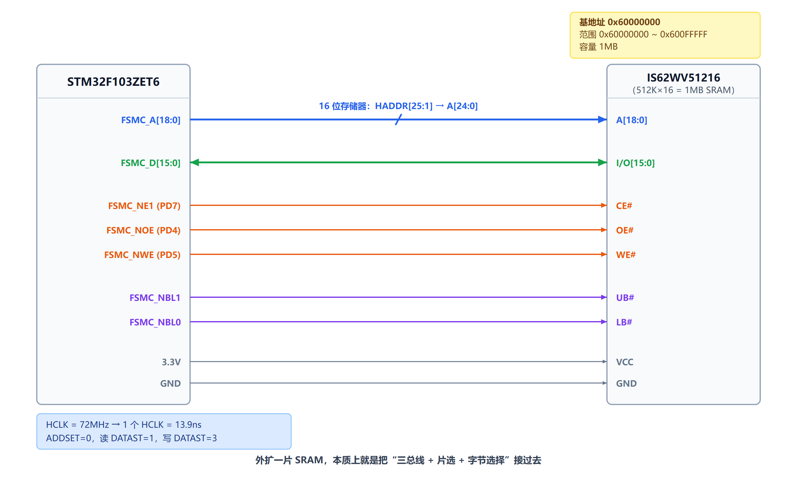

**这张图怎么读**：

1. 左边画 `STM32F103ZET6` 方框，右边画 `IS62WV51216` 方框；
2. 中间画 5 组连线，每组用不同颜色：地址（蓝色，19 根合并成一根粗线）、数据（绿色，双向箭头，16 根合并）、控制（橙色，3 根：`NE1→CE#`、`NOE→OE#`、`NWE→WE#`）、字节选择（紫色，2 根：`NBL1→UB#`、`NBL0→LB#`）、电源（灰色，2 根）；
3. 在地址线旁边画一个小小的"错位"标记，并标注"**16 位存储器：HADDR[25:1] → A[24:0]**"；
4. 右上角写一个地址标签框："**基地址 0x60000000，范围 0x60000000~0x600FFFFF（1MB）**"；
5. **这张图要你理解**：**外扩一片 SRAM，本质上就是"把三总线 + 片选 + 字节选择接过去"。**

### 第 4 步：算时序参数（HCLK = 72MHz）

【假设】SRAM 的 `t_AA = 55ns`（读）、`t_WC = 55ns`（写）。

**读**：

```
要求：(ADDSET+1) + (DATAST+3) 个 HCLK ≥ 55ns
1 个 HCLK = 13.9ns
取 ADDSET = 0 → 1 个 HCLK = 13.9ns
取 DATAST = 1 → 读数据阶段 = 1+3 = 4 个 HCLK = 55.6ns
总计 = 1 + 4 = 5 个 HCLK = 69.4ns ≥ 55ns ✓
```

**写**：

```
要求：(ADDSET+1) + (DATAST+1) 个 HCLK ≥ 55ns
取 ADDSET = 0 → 1 个 HCLK
取 DATAST = 3 → 写数据阶段 = 3+1 = 4 个 HCLK = 55.6ns
总计 = 1 + 4 = 5 个 HCLK = 69.4ns ≥ 55ns ✓
```

**结论**：`ADDSET = 0`，读 `DATAST = 1`，写 `DATAST = 3`。

### 第 5 步：写初始化代码

```c
#include "stm32f10x.h"

void SRAM_Init(void)
{
    GPIO_InitTypeDef GPIO_InitStructure;
    FSMC_NORSRAMInitTypeDef FSMC_InitStructure;
    FSMC_NORSRAMTimingInitTypeDef readTiming;
    FSMC_NORSRAMTimingInitTypeDef writeTiming;

    /* 1. 开时钟 */
    RCC_AHBPeriphClockCmd(RCC_AHBPeriph_FSMC, ENABLE);
    RCC_APB2PeriphClockCmd(RCC_APB2Periph_GPIOD | RCC_APB2Periph_GPIOE |
                           RCC_APB2Periph_GPIOF | RCC_APB2Periph_GPIOG, ENABLE);

    /* 2. 把 FSMC 用到的引脚配成复用推挽输出 */
    /*    具体引脚随封装不同而不同，请查数据手册 */
    GPIO_InitStructure.GPIO_Pin = ...;   /* 地址线、数据线、NE1、NOE、NWE、NBL */
    GPIO_InitStructure.GPIO_Mode = GPIO_Mode_AF_PP;
    GPIO_InitStructure.GPIO_Speed = GPIO_Speed_50MHz;
    GPIO_Init(GPIOD, &GPIO_InitStructure);
    /* ... 其他端口同理 ... */

    /* 3. 读时序：ADDSET=0, DATAST=1, 模式 A */
    readTiming.FSMC_AddressSetupTime      = 0x00;
    readTiming.FSMC_AddressHoldTime       = 0x00;  /* 模式 A 不用 */
    readTiming.FSMC_DataSetupTime         = 0x01;
    readTiming.FSMC_BusTurnAroundDuration = 0x00;
    readTiming.FSMC_CLKDivision           = 0x00;
    readTiming.FSMC_DataLatency           = 0x00;
    readTiming.FSMC_AccessMode            = FSMC_AccessMode_A;

    /* 4. 写时序：ADDSET=0, DATAST=3, 模式 A */
    writeTiming.FSMC_AddressSetupTime      = 0x00;
    writeTiming.FSMC_AddressHoldTime       = 0x00;
    writeTiming.FSMC_DataSetupTime         = 0x03;
    writeTiming.FSMC_BusTurnAroundDuration = 0x00;
    writeTiming.FSMC_CLKDivision           = 0x00;
    writeTiming.FSMC_DataLatency           = 0x00;
    writeTiming.FSMC_AccessMode            = FSMC_AccessMode_A;

    /* 5. 填配置结构体 */
    FSMC_InitStructure.FSMC_Bank                  = FSMC_Bank1_NORSRAM1;
    FSMC_InitStructure.FSMC_DataAddressMux        = FSMC_DataAddressMux_Disable; /* 不复用 */
    FSMC_InitStructure.FSMC_MemoryType            = FSMC_MemoryType_SRAM;        /* 就是 SRAM */
    FSMC_InitStructure.FSMC_MemoryDataWidth       = FSMC_MemoryDataWidth_16b;    /* 16 位 */
    FSMC_InitStructure.FSMC_BurstAccessMode       = FSMC_BurstAccessMode_Disable;
    FSMC_InitStructure.FSMC_AsynchronousWait      = FSMC_AsynchronousWait_Disable;
    FSMC_InitStructure.FSMC_WaitSignalPolarity    = FSMC_WaitSignalPolarity_Low;
    FSMC_InitStructure.FSMC_WrapMode              = FSMC_WrapMode_Disable;
    FSMC_InitStructure.FSMC_WaitSignalActive      = FSMC_WaitSignalActive_BeforeWaitState;
    FSMC_InitStructure.FSMC_WriteOperation        = FSMC_WriteOperation_Enable;  /* 允许写 */
    FSMC_InitStructure.FSMC_WaitSignal            = FSMC_WaitSignal_Disable;
    FSMC_InitStructure.FSMC_ExtendedMode          = FSMC_ExtendedMode_Enable;    /* 读写分开 */
    FSMC_InitStructure.FSMC_WriteBurst            = FSMC_WriteBurst_Disable;
    FSMC_InitStructure.FSMC_ReadWriteTimingStruct = &readTiming;
    FSMC_InitStructure.FSMC_WriteTimingStruct     = &writeTiming;

    /* 6. 写寄存器 + 开闸 */
    FSMC_NORSRAMInit(&FSMC_InitStructure);
    FSMC_NORSRAMCmd(FSMC_Bank1_NORSRAM1, ENABLE);
}
```

> **【注意】** 上面的结构体成员名写的是 `FSMC_AsynchronousWait`（正确拼写）。但**教材代码里用的是 `FSMC_AynchronousWait`（少一个 s）**，这是 ST 官方库的历史遗留拼写。**实际写代码时以你手上的库头文件为准**（用错了会编译报错，反而好发现）。

### 第 6 步：写读写程序

```c
/* 定义一个指向外部 SRAM 的指针 */
#define EXT_SRAM_BASE   ((uint32_t)0x60000000)

/* 写一个 16 位数据 */
void SRAM_WriteHalfWord(uint32_t offset, uint16_t data)
{
    *(volatile uint16_t *)(EXT_SRAM_BASE + offset) = data;
}

/* 读一个 16 位数据 */
uint16_t SRAM_ReadHalfWord(uint32_t offset)
{
    return *(volatile uint16_t *)(EXT_SRAM_BASE + offset);
}

/* 写一个字节（用到 NBL 字节选择） */
void SRAM_WriteByte(uint32_t offset, uint8_t data)
{
    *(volatile uint8_t *)(EXT_SRAM_BASE + offset) = data;
}

/* 用法示例：做一个读写测试 */
int main(void)
{
    uint16_t i;
    SRAM_Init();

    /* 写 1000 个半字 */
    for(i = 0; i < 1000; i++)
    {
        SRAM_WriteHalfWord(i * 2, i);
    }

    /* 读回来检查 */
    for(i = 0; i < 1000; i++)
    {
        if(SRAM_ReadHalfWord(i * 2) != i)
        {
            /* 数据不对！可能是时序配得太快，或者接线有问题 */
            while(1);
        }
    }

    while(1);   /* 全部正确 */
}
```

**逐行解释关键行**：

```c
*(volatile uint16_t *)(EXT_SRAM_BASE + offset) = data;
```

拆开看（**从里到外**）：

| 片段 | 含义 |
|---|---|
| `EXT_SRAM_BASE + offset` | 算出要访问的地址，比如 `0x60000000 + 0x0004 = 0x60000004` |
| `(volatile uint16_t *)` | 把这个整数**强制转换**成"指向 16 位变量的指针" |
| `*( ... )` | **解引用**：访问那个地址 |
| `= data` | 把 `data` 写进去 |

**硬件发生什么**：

```
CPU 执行一条 16 位存储指令，地址 0x60000004
  → AHB 总线
  → FSMC 发现地址在块 1 小区 1 → NE1 拉低
  → 按 BTR/BWTR 的时序：先出地址，再出数据，NWE 一个低脉冲
  → IS62WV51216 收到 CE#=0、WE#=0、A[18:0]、I/O[15:0]
  → SRAM 把数据存进内部对应的格子
```

> **【为什么一定要加 `volatile`？】**
> 因为编译器的"优化"很聪明：如果它发现你写了一个值又马上读回来，它可能觉得"反正刚写进去，我知道是啥"，直接把常量返回给你，**根本不访问硬件**。加了 `volatile` 就是告诉编译器："**别猜，老老实实去访问那个地址。**"
> **外设寄存器访问、外扩存储器访问，都必须加 `volatile`。**

---

## 12.9 容易搞混的地方（考试前必看）

### 混淆点 1：`HCLK` 和 `CLK`

| | HCLK | CLK |
|---|---|---|
| 是什么 | AHB 总线时钟 | **输出到外部存储器的**存储器时钟 |
| 频率 | 72MHz | HCLK 分频，`(CLKDIV+1) × HCLK` |
| 什么时候用 | 永远 | **只有同步成组模式才输出** |
| 单位用在 | ADDSET/DATAST/ADDHLD/BUSTURN/CLKDIV | **DATLAT** |

**一句话**：**`DATLAT` 的单位是 CLK 周期，其他参数的默认单位是 HCLK 周期。**

### 混淆点 2：三个"时间阶段"的名字

```
第 1 阶段 = 地址建立阶段（Address setup）    → 由 ADDSET 控制
中间阶段 = 地址保持阶段（Address hold）      → 由 ADDHLD 控制（只有模式 D / 复用模式用）
第 2 阶段 = 数据阶段（Data phase）           → 由 DATAST 控制
最后     = 总线恢复阶段（Bus turnaround）    → 由 BUSTURN 控制
```

**注意"地址保持"和"数据保持"这两个词**：教材把 `DATAST` 的说明写成"数据**保持**时间"，但它其实指的是"**数据阶段**的长度"。真正的"保持时间"是那个 +2 个 HCLK 的尾巴。**看时序图比看名字可靠。**

### 混淆点 3：`DATAST` 的 "+3" 和 "+1"

```
读操作：数据阶段 = DATAST + 3 个 HCLK   （因为后面还有 2 个 HCLK 的采样/保持）
写操作：数据阶段 = DATAST + 1 个 HCLK
```

**怎么记？** 对照图 12-3（读）和图 12-4（写）：**读的图下面多画了"数据采集/数据存储"两个 HCLK，所以是 +3。**

### 混淆点 4：`N` 前缀 = 低电平有效

```
NE = 0   → 选中
NOE = 0  → 读
NWE = 0  → 写
NADV = 0 → 现在线上是地址
NBL = 0  → 这一半字节有效
NWAIT = 0（当 WAITPOL=0 时）→ 存储器说"等一下"
```

**反过来说**：`NE = 1` 是"没选中"，`NOE = 1` 是"不读"。**千万不要按高电平有效的习惯去理解。**

### 混淆点 5：`NWAIT` 是**输入**

```
其他所有信号：FSMC → 存储器（输出）
NWAIT：       存储器 → FSMC（输入）
```

**只有存储器知道自己准备好没有**，所以只有它能"喊停"。

### 混淆点 6：`MUXEN` 的复位默认值是 **1**（复用）

```
复位后 MUXEN = 1  →  默认是"地址/数据复用"
```

所以如果你接的是**非复用**的 SRAM/LCD，**必须在初始化里显式写 `FSMC_DataAddressMux_Disable`**，否则 FSMC 会按"复用"的方式发信号，`NADV` 乱动、地址错乱。

**教材例程里正是这么做的**：
```c
FSMC_NORSRAMInitStructure.FSMC_DataAddressMux = FSMC_DataAddressMux_Disable;
```

### 混淆点 7：`MBKEN` 复位后只有块 1 是开的

```
复位后：MBKEN(BCR1) = 1（块 1 开）
        MBKEN(BCR2/3/4) = 0（禁用）
```

**访问被禁用的块 → AHB 报错。** 所以如果你要用 NE2，**别忘了调 `FSMC_NORSRAMCmd(FSMC_Bank1_NORSRAM2, ENABLE)`**。

### 混淆点 8：16 位存储器，地址线"错开一位"

```
8 位存储器： HADDR[25:0] ↔ FSMC_A[25:0]
16 位存储器：HADDR[25:1] ↔ FSMC_A[24:0]     ← HADDR[0] 被丢掉
```

**推论**：`FSMC_A[n]` 对应的是 `HADDR[n+1]`。
**所以**：`FSMC_A16` 对应 `HADDR[17]`（这就是 LCD 例程里 `0x0001FFFE` 和 `0x00020000` 的由来）。

### 混淆点 9：`BCR` / `BTR` / `BWTR` 分工

```
BCR  = Bank Control Register    → 这个小区上"是什么器件"（类型、宽度、模式开关）
BTR  = Bank Timing Register     → "读"的时序参数
BWTR = Bank Write Timing Reg.   → "写"的时序参数（只有 EXTMOD=1 才生效）
```

**记忆**：**`BCR` 管"是什么"，`BTR` 管"读多快"，`BWTR` 管"写多快"。**

### 混淆点 10：`EXTMOD = 0` 时 `BWTR` 完全失效

```
EXTMOD = 0  →  只用 BTR（读和写都用它），BWTR 写了也没用
EXTMOD = 1  →  BTR 管读，BWTR 管写
```

**最常见的 bug**：配了 `writeTiming` 却发现写速度没变 → 因为 `EXTMOD` 忘了置 1。

### 混淆点 11：NOR 闪存不能做 8 位写

```
有字节选择（SRAM/ROM/PSRAM）： 8 位读写都行（用 NBL[1:0]）
没有字节选择（NOR/16 位 NAND）：8 位只能读，不能写
```

**为什么 NOR 不能 8 位写？** 因为它没有 `NBL` 这类"只写一半"的信号，你给 8 位它不知道另外 8 位怎么办。

### 混淆点 12：`RS` 接 `A16`，但对应的是内部地址的 `bit17`

**这是最容易算错的一个。** 因为 16 位存储器地址线错开一位：

```
LCD 的 RS ← FSMC 的 A16 ← HADDR[17]   （不是 HADDR[16]！）
```

### 混淆点 13：LCD 在 FSMC 眼里是 **SRAM**，不是 NOR

```
FSMC_MemoryType = FSMC_MemoryType_SRAM;   ← 教材例程
```

**为什么？** 因为 LCD 的 8080 接口时序更像 SRAM：`CS`、`RD`、`WR`、数据线、地址线（用来当 `RS`），没有 `NADV`、没有 `NWAIT`。

### 混淆点 14：FSMC 寄存器必须**按 32 位访问**

```
正确：*(volatile uint32_t *)0xA0000000 = 0x000030DB;
错误：*(volatile uint8_t  *)0xA0000000 = 0xDB;
错误：*(volatile uint16_t *)0xA0000000 = 0x30DB;
```

### 混淆点 15：库函数里的值 = 寄存器字段的值（不用减一）

```
FSMC_AddressSetupTime = 0x01   →  ADDSET 字段 = 1  →  实际时间 = (1+1) = 2 个 HCLK
```

**不要把"库函数的值"当成"实际周期数"。**

---

## 12.10 本章真正要记住什么

如果考完试你只记得下面这 10 条，这一章就没白学。

### 一、FSMC 是什么

**FSMC = Flexible Static Memory Controller = 灵活静态存储器控制器。**
它是 STM32 内部挂在 **AHB 总线**上的一个外设，作用是：

1. **翻译**：把 AHB 的 32 位请求翻译成外部存储器的 8/16 位三总线时序；
2. **控时**：用可编程的时序参数，满足外部器件的速度要求。

**三总线**：地址（`A[25:0]`）、数据（`D[15:0]`）、控制（`NE`/`NOE`/`NWE`/`NADV`）。

### 二、FSMC 的四大模块

1. **AHB 接口**（含配置寄存器）；
2. **NOR 闪存和 PSRAM 控制器**；
3. **NAND 闪存和 PC 卡控制器**；
4. **外部设备接口**。

### 三、存储块和地址

| 块 | 地址范围 | 器件 | 片选 |
|---|---|---|---|
| 块 1 | `0x60000000`～`0x6FFFFFFF`（4 × 64MB） | NOR / PSRAM / SRAM / LCD | `NE1`～`NE4` |
| 块 2 | `0x70000000`～`0x7FFFFFFF` | NAND | `NCE2` |
| 块 3 | `0x80000000`～`0x8FFFFFFF` | NAND | `NCE3` |
| 块 4 | `0x90000000`～`0x9FFFFFFF` | PC 卡 | `NCE4` |

**块 1 的 4 个小区由 `HADDR[27:26]` 选择。**

### 四、地址映射

```
8 位存储器： HADDR[25:0] ↔ FSMC_A[25:0]
16 位存储器：HADDR[25:1] ↔ FSMC_A[24:0]，HADDR[0] 丢弃
```

### 五、接口信号（记住方向）

```
输出（FSMC → 存储器）：NE[x]、NOE、NWE、NADV、A[25:0]、NBL[1:0]、CLK
双向：                  D[15:0]
输入（存储器 → FSMC）： NWAIT
带 N 前缀的都是低电平有效
```

### 六、五种时序模式的区别

```
模式 1：基准（NOE 从周期头低到尾、无 NADV）
模式 A：NOE 晚一步拉低（只在数据阶段有效）+ 读写两套时序
模式 2/B：多 NADV + （模式B）读写两套时序
模式 C：NOE 只在数据阶段有效 + NADV 动 + 读写两套时序
模式 D：NADV 动 + NOE 在 NADV 之后翻转 + 有地址保持阶段
复用模式：地址低 16 位走数据总线 + 有 ADDHLD 和 BUSTURN
```

### 七、时序参数公式

```
地址建立 = (ADDSET + 1) 个 HCLK
地址保持 = (ADDHLD + 1) 个 HCLK（模式 D / 复用模式）
读数据   = (DATAST + 3) 个 HCLK
写数据   = (DATAST + 1) 个 HCLK
总线恢复 = (BUSTURN + 1) 个 HCLK
CLK 周期 = (CLKDIV + 1) 个 HCLK
数据延时 = (DATLAT + 2) 个 CLK
```

### 八、三个寄存器

```
FSMC_BCR1~4   偏移 0x00 + 8×(x−1)    复位值 0x000030DX   管"是什么器件"
FSMC_BTR1~4   偏移 0x04 + 8×(x−1)    复位值 0x0FFFFFFF   管读时序
FSMC_BWTR1~4  偏移 0x104 + 8×(x−1)   复位值 0x0FFFFFFF   管写时序
基地址：0xA0000000，必须以 32 位访问
```

### 九、库函数

```c
FSMC_NORSRAMInit();    // 初始化（配 BCR + BTR + BWTR）
FSMC_NORSRAMCmd();     // 使能存储块（置 MBKEN）
```

**注意**：`Init` 之后**必须** `Cmd` 才生效。

### 十、LCD 例程的核心技巧

```
把 LCD 的 RS 接到 FSMC 的 A16
   → 用两个不同的地址（相差 0x00020000）区分"命令"和"数据"
   → 因为 16 位存储器地址错开一位，A16 对应 HADDR[17]
   → 所以 LCD_REG 在 0x6001FFFE（A16=0，命令）
      LCD_RAM 在 0x60020000（A16=1，数据）
```

---

## 习题思路

### 习题 12-1：简述 STM32F103VET6 的 FSMC 模块的特点

**答题思路**（按教材 12.1.1 的原文组织，分点作答）：

1. **接口性质**：提供类似 8086 的三总线接口（地址总线、数据总线、控制总线），可以把 AHB 传输信号转换成外部设备协议，并满足访问外部设备的时序要求。
2. **支持的器件**：
   - 具有静态存储器接口的器件：SRAM、ROM、NOR 闪存、PSRAM；
   - 两个 NAND 闪存块，支持硬件 ECC，可检测多达 8KB 数据；
   - 16 位 PC 卡兼容设备。
3. **数据宽度**：支持 8 位或 16 位数据总线。
4. **片选与配置**：每个存储器块都有独立的片选控制，都可以独立配置。
5. **时序可编程**：
   - 等待周期可编程（多达 15 个周期）；
   - 总线恢复周期可编程（多达 15 个周期）；
   - 输出使能和写使能延迟可编程（多达 15 个周期）；
   - 独立的读写时序和协议。
6. **字节选择**：为 PSRAM 和 SRAM 提供写使能和字节选择输出（`NWE` 和 `NBL[1:0]`）。
7. **数据宽度转换**：将 32 位 AHB 访问请求转换为对外部 16 位或 8 位器件连续的 16 位或 8 位访问。
8. **写 FIFO**：具有 16 个字、每个字 32 位宽的写入 FIFO，允许在写入较慢存储器时释放 AHB 总线。
9. **成组访问**：支持对同步器件的成组访问模式，如 NOR 闪存和 PSRAM。
10. **地址映像**：外部存储器划分为固定大小 256MB 的 4 个存储块。

### 习题 12-2

见 12.8 节（【补充解释】）。

---

## 待核验

以下是本次重构过程中发现的、需要回到原始 PDF 核验的疑点。**按页码排列。**

> **说明**：本次写作中尝试渲染原始 PDF 页面进行核验，但当前环境**未安装 `pymupdf`**，且 **pip 无法联网安装**（`SSL: SSLEOFError`，重试 3 次后 `No matching distribution found`）。因此本次核验依据为：
> ① MinerU 解析文本 `tools/index/ch12_source.md`；② 教材原图（`mineru/微机原理2/images/`、`mineru/微机原理3/images/` 中的 jpg，已用 Read 工具逐张查看）。**凡无法确定的，一律在下方列出，未把推测当作教材原文。**

| 序号 | 页码 | 疑点 | 我的处理 |
|---|---|---|---|
| 1 | p192（12.1.1 主要功能 4） | 教材写"时序可编程……等待周期可编程（多达 15 个周期）、总线恢复周期可编程（多达 15 个周期）、输出使能和写使能延迟可编程（多达 15 个周期）"。但按寄存器定义，`DATAST` 是 8 位字段，最大 256 个周期，不是 15 | 正文中按寄存器定义（DATAST 最大 256）讲解，并指出教材这句话把不同参数混在一起说了 |
| 2 | p196（表 12-2） | 表 12-2 写"地址保持时间"最小 **2** 个 HCLK；但 12.5 节寄存器说明写"`ADDHLD = 0000` 时，地址保持时间 = **1** 个 HCLK 周期" | 正文统一按 `ADDHLD+1` 讲解，此处标为疑点 |
| 3 | p196（表 12-2） | "时钟分频因子"的最小/最大写作 1/16，单位为"HCLK"。但寄存器说明里 `CLKDIV=0000` 是"保留"，`0001` 才对应"1 个 CLK 周期 = 2 个 HCLK 周期" | 正文中同时给出"字段值范围 0~15"和"实际分频比 = CLKDIV+1"两种表述 |
| 4 | p12（微机原理3，BCR 寄存器总表） | 表里把 bit15 标为"保留"，但 `WAITPOL`（bit9）的说明写"仅当位 15 为 1 时有意义"。按参考手册 bit15 应为 `ASYNCWAIT` | 正文按 `ASYNCWAIT`（异步等待使能）讲解，并标为疑点 |
| 5 | p12（微机原理3） | BCR 复位值写作 `0x000030DX`，`X` 未说明取值。本讲义按各字段复位默认值反推出：块 1 为 `0x000030DB`（`MTYP=10`、`MBKEN=1`），块 2~4 为 `0x000030D2`（`MTYP=00`、`MBKEN=0`） | 已在正文给出完整推导过程，供核验 |
| 6 | p6（微机原理3，表 12-18、表 12-19） | 模式 D 的 `BCRx` / `BTRx` 表中 `ACCMOD` 写作 `0x2`，但 12.5 节明确写"`11`：访问模式 D"。按正文应为 `0x3` | 正文按 **模式 D = `ACCMOD = 11`（0x3）** 讲解，并标为疑点 |
| 7 | p16（微机原理3，BWTR 说明） | `BWTR` 的 `ADDHLD` 写"`0000 0000` 保留；`0001` = 2 个 HCLK；`0010` = 3 个 HCLK"，即疑似 `ADDHLD+2`；而 `BTR` 的 `ADDHLD` 写"`0000` = 1 个 HCLK"，即 `ADDHLD+1`。同一字段两处不一致 | 正文统一按 `ADDHLD+1` 讲解，并标为疑点 |
| 8 | p195（表 12-1） | 表头写"最大访问存储器空间(**位**)"，值为"64MB×8=512Mb""64MB/2×16=512Mb"。单位标注（位 vs 字节）容易误解 | 正文补充解释为"64MB 字节 = 512Mb 位"，并给出两种宽度的换算 |
| 9 | p198～p10（微机原理3） | 图号与页面对应关系混乱：图 12-4（模式 1 写）被 MinerU 放在 p199 块首；图 12-5（模式 A 读）在"微机原理3"p0；图 12-7、12-8、12-9、12-11、12-13、12-14 在素材中标注为"无题注" | 正文只引用有明确题注的图（12-3、12-4、12-5、12-6、12-10、12-12、12-15、12-16），其余以文字描述 |
| 10 | p2（微机原理3） | 有两张图被 MinerU 标为"（无题注）"，从上下文看应是图 12-7（模式 2 写）和图 12-8（模式 B 写） | 正文以文字描述，未插图 |
| 11 | p22（微机原理3） | 图 12-19 被 MinerU 标注为"**表** 图 12-19 16 位数据与显存对应关系图"，且内容以表格形式解析 | 正文按表格讲解，并说明这是"图 12-19 的内容" |
| 12 | p28～p29（微机原理3） | ASCII 字库数组 `asc2_1206[95][12]` 大面积 OCR 损坏（出现 `Ox20`、`OB`、`1x87`、重复的 `/* "{"}}` 等），且部分行数不足 | 正文只讲点阵字库的原理和 `LCD_ShowChar` 的位操作逻辑，**未照抄损坏的字库数据**，并标注不可直接使用 |
| 13 | p28（微机原理3） | 代码 `lcddev.id = LCD_ReadReg(0x0000); //读ID` 读的是寄存器 `0x0000`，教材未说明这条语句的用途（从上下文看可能是无效/冗余代码） | 正文照录并标注"教材未说明" |
| 14 | p27（微机原理3） | 例程中 `LCD_ShowChar` 用 `BLACK` 画笔画、`BLUE` 画背景（非叠加模式），而清屏用的是 `WHITE`，颜色搭配看起来不协调 | 正文照录教材代码，未做修改 |
| 15 | p27（微机原理3） | 教材代码用 `FSMC_AynchronousWait`（少一个 s），本讲义 12.8 的示例代码用正确拼写 `FSMC_AsynchronousWait` | 正文已说明两者关系，实际编译以库头文件为准 |
| 16 | p22（微机原理3） | 教材注释 `//地址建立时间(ADDSET)为 2 个 HCLK 1/36M = 27ns`。"1/36M"容易被误读为 HCLK = 36MHz | 正文已解释：HCLK = 72MHz，2 个 HCLK = 2/72MHz = 1/36MHz ≈ 27.8ns，两者数值相同 |
| 17 | p20（微机原理3，表 12-27） | 引脚 23 名称为 `BL_CTR`，但表 12-36 写 `BL`；同一模块两种叫法 | 正文两处照录，并说明是同一个引脚 |
| 18 | p20（微机原理3，表 12-27） | 引脚 32 在表 12-27 中写"BUSY 电阻触摸屏忙信号"，但在前面的排针图（表 12-27 上方的 2×17 排针表）中第 32 脚写"MO" | 正文只列了本章用得到的引脚，触摸屏相关引脚未展开 |
| 19 | p19～p20（微机原理3） | 12.7.1 说"ATK-2.8'TFT-LCD-**V2.0** 是 ALIENTEK 推出的一款高性能 2.8 寸**电容**触摸屏模块"，但紧接着又说"采用钢化玻璃**电阻**式触摸屏，采用 XPT2046 触摸控制芯片"。电容/电阻前后矛盾（XPT2046 是电阻触摸屏控制器） | 正文照录，并标注矛盾 |
| 20 | p22（微机原理3） | ILI9341 显存总大小教材写"172 800B（240×320×18/8）"。240×320×18/8 = 172800 ✓，但下一句说"即 18 位模式（26 万色）下的显存量"，而 2^18 = 262144 ≈ 26 万 ✓，此处一致（**已核对通过，仅记录**） | 已核对通过 |
| 21 | p192 | 教材说 FSMC"能够与同步或异步存储器或者 **16 位 PC 存储器卡**接口连接"，与 12.3 节"存储块 4 用于访问 PC 卡设备"一致（**已核对通过，仅记录**） | 已核对通过 |
| 22 | 12.7 例程 GPIO 引脚 | 教材只给了"PD0/PD1/PD4/PD5/PD7/PD8~PD11/PD14/PD15、PE7~PE15"这些端口引脚，**没有给出它们对应的 FSMC 复用功能名**。本讲义补充的对应关系（PD7=NE1、PD11=A16、PD5=NWE、PD4=NOE、D0~D15 的分配）来自 STM32F103VET6 数据手册的复用功能表，**未在教材中查到** | 已在正文标注为【补充解释】，建议按数据手册核验 |
| 23 | 微机原理2 图 12-3（p198）、微机原理3 图 12-5（p0）、图 12-9（p3） | **原稿把三张时序图的 `NOE` 读错了**：原稿说模式 1 的 `NOE` "在第 2 段一开始才拉低"、模式 A 的 `NOE` "在数据阶段末尾提前抬高"。本次逐列测量原图像素（图 12-3 = 884×626、图 12-5 = 887×634、图 12-9 = 884×626，`PIL` 读灰度后按列找暗像素段）：① 图 12-3 的 `NEx` 由 y≈228 降到 275、`NOE` 由 y≈308 降到 356，**两个下降沿落在同一条竖直虚线 x≈203 上**（第 1 段起点，即"周期一开始就一起拉低"）；② 图 12-5 的 `NEx` 仍在 x≈203 下降，但 `NOE` 在 x≈480~560 之间还是高电平（y≈310），到 x≈514（第 2 条虚线＝数据阶段起点）才降到 y≈358，并且在最后 2 HCLK 段内（x≈702~768）仍为低，上升沿与 `NEx` 一同出现在 x≈768（周期末）；③ 图 12-9（模式 C 读，MinerU 丢了题注）的 `NOE` 与图 12-5 完全一致，只是第二行信号换成 `NADV` | 已按原图改写 12.4.3 的模式 1 逐行拆解、模式 A 对比表与"图上怎么看"、模式 A/模式 C 一句话总结、5 种模式对比总表、易错点，并新增图 12-5b（`ch12_noe_compare.png`）：**模式 A/C 与模式 1 的差别是"`NOE` 晚一步拉低、有效时间更短"，不是"提前抬高"** |

**说明**：以上疑点均来自 MinerU 解析文本 `tools/index/ch12_source.md` 与教材原图。**凡是我无法通过现有材料确定的地方，都已在正文中明确标注为"疑点"或"补充解释"，没有把推测当作教材原文。** 建议在有原始 PDF 的条件下逐条核验。

---

### 图片作业索引（本讲义新生成的辅助图）

本讲义共申请生成 14 张辅助理解图，作业文件：`notes/images/jobs/ch12.json`。

| 图号 | 文件 | 用途 |
|---|---|---|
| 图 12-0a | `ch12_fsmc_position.png` | FSMC 在 STM32 系统中的位置 |
| 图 12-1a | `ch12_fsmc_structure.png` | FSMC 内部四大模块简化图 |
| 图 12-2a | `ch12_ahb_split.png` | 32 位 AHB 访问拆成 16/8 位外部访问 |
| 图 12-3a | `ch12_address_chain.png` | 地址链：0x60000002 → 外部地址线 |
| 图 12-3b | `ch12_haddr_mapping.png` | 8 位 vs 16 位存储器地址线接法对比 |
| 图 12-4a | `ch12_signals.png` | FSMC 与外部 NOR/SRAM 的信号连接图 |
| 图 12-5a | `ch12_mode_compare.png` | 模式 1 / A / B 读时序对比 |
| 图 12-5b | `ch12_noe_compare.png` | 模式 1 / A / C 的 `NOE` 读使能对比（只看 NOE 一个信号） |
| 图 12-6a | `ch12_timing_params.png` | 时序参数与 HCLK 周期的换算 |
| 图 12-7a | `ch12_reg_map.png` | FSMC 寄存器地址分布 |
| 图 12-8a | `ch12_lib.png` | 固件库函数与寄存器的关系 |
| 图 12-9a | `ch12_lcd_rs_a16.png` | 用地址位 A16 充当 RS 信号的原理 |
| 图 12-10a | `ch12_lcd_dataflow.png` | 写一个像素的完整数据流 |
| 图 12-11a | `ch12_sram_expand.png` | FSMC 外扩 SRAM 连接示意 |

（作业文件 `ch12.json` 共 14 条，与上表一一对应。）

> **【重要】本章的位图（BCR/BTR/BWTR）全部使用 ASCII 图 + 表格，没有申请生成图片。**
> 原因见任务要求 C 条：**位图、地址换算这类要求数值精确的内容，优先用 ASCII 图 + markdown 表格，保证 bit 号与数值准确。**

---

### 引用教材原图清单

| 图号 | 教材原图文件 | 所在页 | 本讲义中的位置 |
|---|---|---|---|
| 图 12-1 | `mineru/微机原理2/images/d51a61ec0f3ca5a544b853002f16053dc6991b14dec1b5877b5f43d0e33a1f52.jpg` | p193 | 12.1.2 |
| 图 12-2 | `mineru/微机原理2/images/b7db18d6b38bc7ad0aabc46ab5005b6eee9574662f9259f5f56e39888e427d51.jpg` | p194 | 12.3 |
| 图 12-3 | `mineru/微机原理2/images/882f5e669ed56661f2bc27cbb947e86c8fb46984ee809e84d30410558bf2ac4e.jpg` | p198 | 12.4.3 模式 1 |
| 图 12-4 | `mineru/微机原理2/images/adce07f5bed5a15c454d42b1a96cf9a03e10fcb7b1006bf065f0051ee25b3157.jpg` | p199 | 12.4.3 模式 1 |
| 图 12-5 | `mineru/微机原理3/images/f123dcb1437ba51861950d299341da20a735816d932d5293826d2c78c2e35d08.jpg` | 微机原理3 p0 | 12.4.3 模式 A |
| 图 12-6 | `mineru/微机原理3/images/4b385ae48d69c75850d1f421e77cf02279504428fccb2a691d69ca5629d9f4db.jpg` | 微机原理3 p1 | 12.4.3 模式 2/B |
| 图 12-9 | `mineru/微机原理3/images/160bbc070a40704313022b4a555fc49db34296d9c5f7cf74f2640ebd2d6ff6fe.jpg` | 微机原理3 p3 | 12.4.3 模式 C（补充说明里引用，未插图；MinerU 解析时丢了题注，已逐像素核对波形） |
| 图 12-10 | `mineru/微机原理3/images/ac5f77edb92a6c879dab1b419182e6f1181e0c72031da7f54cef69b611a92c93.jpg` | 微机原理3 p4 | 12.4.3 模式 C |
| 图 12-12 | `mineru/微机原理3/images/ea23812421d9824223ac8bec489b09555a20f96d3aef9dbe52f0ff47f57611a3.jpg` | 微机原理3 p6 | 12.4.3 模式 D |
| 图 12-15 | `mineru/微机原理3/images/4f7e121aa3a8c5c1e1d25955891ed9d4cbecc0b9b1a24c2d5aec784a544ae959.jpg` | 微机原理3 p10 | 12.4.4 同步成组读 |
| 图 12-18 | `mineru/微机原理3/images/29d2b662caa0aacae0d4a4796e2d5707f87579a3433db58c61974e0a25c88166.jpg` | 微机原理3 p21 | 12.7.3 LCD 接口时序 |
| 图 12-19 | `mineru/微机原理3/images/b67c09a5e25cce783f063cda86887a32e2f0244d0b5cde9d086067f58d684eef.jpg` | 微机原理3 p22 | 12.7.4 RGB565 对应关系 |
| 图 12-20 | `mineru/微机原理3/images/d5788ddf07f36c05db815e778da2ca24c3e95760896fc2b91c7a9e93c71b603b.jpg` | 微机原理3 p26 | 12.7.4 使用流程 |
| 图 12-21 | `mineru/微机原理3/images/f75d0c0bc39a315657daff4d3f6a4a6f820b15051599f0a3a1d615ea5f534e02.jpg` | 微机原理3 p26 | 12.7.4 接线图 |
| 图 12-16 | `mineru/微机原理3/images/e620ee7c98b485459d658250ac903386d11b0278977871fadb85475753eadb10.jpg` | 微机原理3 p11 | 12.4.4 同步写（仅提及，未展开） |

**以上 15 个文件均已确认存在**（本次用 `python` + `os.path.exists` 逐条检查上表路径，结果全部 `OK`；原先的记录方式为 `ls mineru/微机原理2/images/<文件名>.jpg` 与 `ls mineru/微机原理3/images/<文件名>.jpg`）。

---

### 本章自查（对照 TASK.md 第二十二节）

#### 内容

- [x] 核心知识有没有遗漏？——覆盖了 FSMC 功能、结构（4 模块）、AHB 接口、地址映像（4 存储块 + HADDR 映射）、接口信号（10 个信号逐个讲）、5 种时序模式、时序参数计算、同步成组读、3 组寄存器（逐位）、固件库函数、LCD 完整例程、外扩 SRAM 思路。
- [x] 有没有错误删掉考试可能需要的内容？——保留了教材全部表格（12-1～12-36 中与 NOR/PSRAM 相关的部分）和全部关键结论。
- [x] 有没有模型自行加入教材不支持的结论？——所有补充内容都标了【补充解释】，并把 22 条疑点列在"待核验"里。

#### 可理解性

- [x] 一个前置知识薄弱的人能否读懂？——补了 8 个前置知识（总线、片选、存储器映射、时钟周期、各种存储器、读写使能、总线复用、寄存器/0x/位复习）。
- [x] 有没有术语突然出现？——首次出现的术语都给了英文全称、中文名、缩写、大白话、用途（FSMC、AHB、APB、SRAM、PSRAM、NOR/NAND、ECC、FIFO、TFT、GRAM、RGB565、burst、latency、busturn、dummy read 等）。
- [x] 有没有连续三段以上都是教材式语言？——教材原文一律用引用块标出并紧跟"翻译"。
- [x] 有没有可以用例子却没有例子？——做了 2 个完整的时序演算（LCD 例程 + 55ns SRAM），并逐步展开 0x0001FFFE 的地址推导、`id<<=8 | ...` 的位运算、`temp&0x80` 的逐位扫描。

#### 图像

- [x] 本章是否图太少？——正文引用（贴图）教材原图 **13 张**（文末清单共列 15 张，其中图 12-16 只提及未展开、图 12-9 只作文字引用未贴图）+ 申请生成 14 张辅助图。
- [x] 有没有应该画结构图的地方？——FSMC 结构（图 12-1 + 辅助图 12-1a）。
- [x] 有没有应该画数据流的地方？——写像素数据流（辅助图 12-10a）、地址链（辅助图 12-3a）。
- [x] 有没有应该画时序图的地方？——模式 1/A/B/C/D 全部引用教材原图 + 辅助对比图 12-5a + 参数换算图 12-6a。
- [x] 教材原图是否需要简化版？——图 12-1（结构框图）配了简化版辅助图；图 12-15（同步成组读）用"分七层看"的方式逐层拆解。

#### 代码

- [x] 是否解释了代码目的？——每个代码块开头都有"这段想完成什么"。
- [x] 是否解释了寄存器变化？——用表格列出"成员 → 寄存器位 → 实际时间"。
- [x] 是否解释了硬件发生什么？——每段代码后面都有"CPU 做什么 / 寄存器发生什么 / 硬件发生什么"。

#### 前置知识

- [x] 有没有隐藏前提没有讲？——补了"对齐/非对齐""指针""volatile""复用功能 AF""点阵字库""8080 总线"等。
