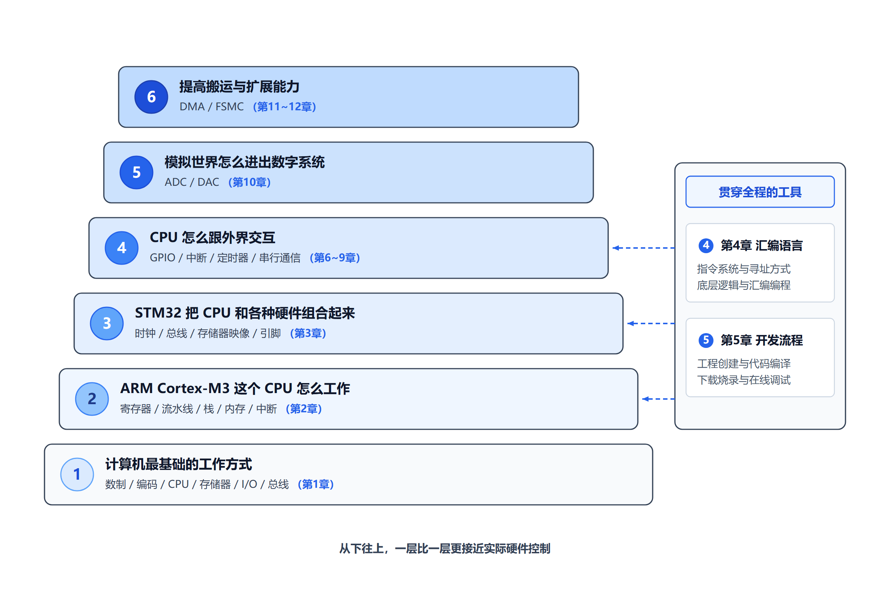
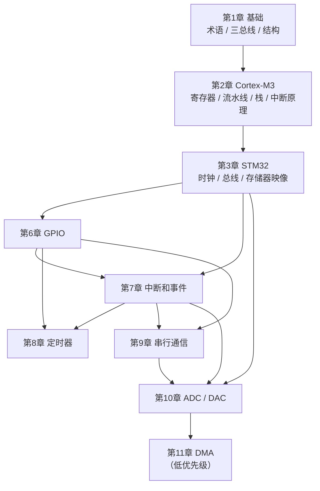
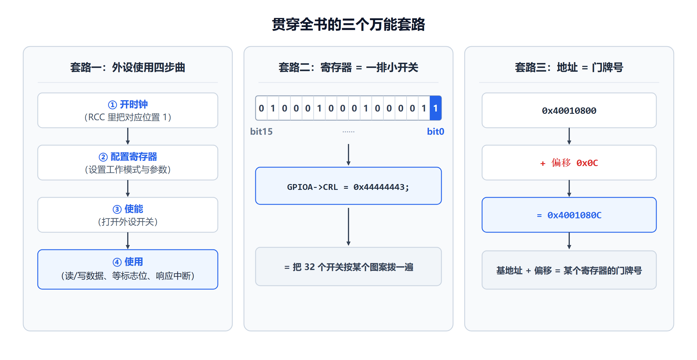

# 全书复习总览

> 这是复习版讲义的**总入口**。开始复习之前，先花 10 分钟把这一页看完。
>
> 它回答四个问题：
> 1. 这门课到底讲了什么？
> 2. 老师实际讲到哪儿了？（**这决定了你该重点复习什么**）
> 3. 每章该花多少力气？
> 4. 怎么在有限时间里把整门课过一遍？
>
> 教材：《基于ARM的微机原理与接口技术——STM32嵌入式系统架构、编程与应用》（陈桂友，第 2 版）
> 详细版讲义（第一遍学习用）：`notes/00_全书知识地图.md` 及 `notes/01`～`12` 各章

---

## 一、先看这个：老师实际讲到哪儿了

这一节是本复习版和原来的完整讲义**最大的区别**——复习要跟着老师的节奏走。

### 1. 目前手上有的 PPT

| 老师 | 覆盖章节 | 文件位置 |
|---|---|---|
| 陈洁平 | 第 1、2、3 章 | `PPT/陈洁平课件/` |
| 梁桥康 | 第 2、3 章 | `PPT/梁桥康课件/` |

两位老师的第 2、3 章 PPT **内容高度一致**（同一套模板，只有排版和个别措辞不同），
第 1 章只有陈老师版。两份合起来看，就是目前能确认的全部授课范围。

### 2. 本复习版的做法：有 PPT 的章就先做

用户已明确：**不去猜考试范围，有多少 PPT 就做多少章**。所以本复习版的实际推进方式是：

| 情况 | 处理 |
|---|---|
| 有 PPT 的章（目前是第 **1、2、3、5、6、7、8** 章） | **已完成**，严格按 PPT 的实际覆盖与篇幅分配重点 |
| PPT 尚未齐全的章 | **第 9 章**目前只有陈老师版（梁老师版未到），**第 10 章**两份都没到，均等 PPT 齐了再做 |
| 教材有、PPT 完全没有的章（第 4、11、12 章） | 列为最低优先级，**暂不制作**，等你提供 PPT 或明确要求再做 |

> 补充说明：第 4 章的汇编内容其实**已经并进第 2 章**讲了——
> 第 2 章 PPT 里大量出现 `MOV`/`CMP`/`BNE`/`BL`/`BX`/`MRS`/`MSR`/`CPS`/`PUSH`/`POP`/`LDM`/`STM` 等指令。
> 所以复习第 2 章时，顺便就把第 4 章最要紧的部分覆盖了。

### 3. 目前 PPT 到第 8 章

课程正讲到第 8 章（定时器）附近。**第 9 章的梁老师版、第 10 章的两份 PPT 还没有提供**，
这两章的复习版等 PPT 齐了再做。

---

## 二、这门课在讲什么（一句话 + 一张图）

如果只用一句话：

> **这门课讲的是"一块小小的 STM32 芯片，是怎么被程序指挥着去感知外部世界、并控制外部世界的"。**

整本书的骨架其实很朴素：

> **一个会算数的内核 + 一堆有门牌号的存储单元 + 一圈能读能写的引脚 + 一条把它们连起来的总线 + 一个让它们同步的时钟。**

其余所有章节，都是在给这五样东西加细节。



**看图方法**：从最底下第一层往上看。越往下越接近原理，越往上越接近"我实际能控制什么硬件"。
复习时如果某章看不进去，先回到这张图确认"这章在整座阶梯的哪一层"。

---

## 三、全书章节地图与复习优先级

下面是全书 12 章的清单。**优先级依据**写在每章后面，不是凭空定的。

### 优先级判断的三条依据

1. **PPT 覆盖程度**：PPT 讲了、而且占篇幅大 → 优先级高。
2. **是否全书地基**：后面的章节反复用它 → 即使 PPT 没展开也必须掌握。
3. **是否有 PPT 覆盖**：没有 PPT 的章节降级，等你提供后再补做。

### 分级总表

| 章 | 内容 | 优先级 | 判断依据 |
|---|---|---|---|
| **1** | 基础知识（术语、基本构成、冯·诺依曼/哈佛、流水线、CISC/RISC、ARM） | ★★★ | PPT 有 55 页，覆盖面完整；且是全书地基，后面每章都用 |
| **2** | Cortex-M3 处理器（组件、总线、流水线、寄存器、模式、堆栈、存储器管理、中断） | ★★★ | 两位老师各 2 个文件共约 110 页，是**目前 PPT 投入最多的一章** |
| **3** | STM32F1 系列微控制器（架构、存储器映像、时钟、引脚、最小系统） | ★★★ | 两位老师都有完整一章；时钟与存储器映像是后面所有外设的前提 |
| **4** | 汇编语言及程序设计 | ★★ | 未单独出 PPT，但第 2 章 PPT 用了大量汇编指令；**并入第 2 章复习** |
| **5** | ARM 微控制器开发（开发流程、启动过程、程序映像、C 语言、固件库） | ★★ | **PPT 已提供**（陈 40 页 / 梁 44 页）；是第 6 章的直接前置 |
| **6** | 通用输入输出接口 GPIO | ★★★ | **PPT 已提供**（陈 65 页 / 梁 76 页）；"第一次真正控制硬件"，后面外设都重复这套套路 |
| **7** | 中断和事件 | ★★★ | **PPT 已提供**（陈 41 页 / 梁 53 页）；第 2 章讲原理，本章讲怎么在 STM32 上真正用起来 |
| **8** | 定时器 | ★★★ | **PPT 已提供**（陈 60 页 / 梁 79 页），主讲**定时中断**；PWM/捕获在 PPT 里只提名称，不教 |
| **9** | 串行通信（USART、SPI） | ★★★ | **仅陈老师版 PPT**（梁老师版未到），**等齐了再做** |
| **10** | 模拟量模块（ADC / DAC） | ★★★ | **PPT 未提供**；公式和计算较多 |
| **11** | DMA | ★ | 无 PPT，暂不制作 |
| **12** | FSMC | ★ | 无 PPT，暂不制作 |

> **注意**：优先级里 ★★★ 的章多，不代表"每章都要花同样时间"。
> 第 2、3、8 章 PPT 篇幅明显更大，实际投入应该更多；第 5、6、7 章按正常节奏走即可。

### 章节之间的依赖关系



**怎么读**：箭头表示"要复习后面的，最好先能回忆出前面的"。
所以复习时间紧的时候，**顺着箭头从上往下走**是最省力的顺序——
这也是上面"路径 A"的排列依据。

> 第 12 章 FSMC 没有画进来：它没有 PPT 覆盖，且与主线依赖关系较弱，列为最低优先级。

---

## 四、贯穿全书的三个"万能套路"

这三件事在后面每一章都会反复出现。**复习时如果记不住细节，先把这三个套路回忆起来**，
大部分章节的框架就能自己搭出来。

### 套路一：外设使用四步曲

无论 GPIO、定时器、串口还是 ADC，用法几乎都是这四步：

```
① 开时钟      给这个外设供电（RCC 寄存器里把对应位置 1）
      ↓
② 配置寄存器  设置工作模式、参数（写各种 CR / PSC / ARR ...）
      ↓
③ 使能        把外设开关打开（通常也是某个寄存器的某一位）
      ↓
④ 使用        读数据 / 写数据 / 等标志位 / 响应中断
```

> **为什么必须先开时钟？** 这是第 3 章讲时钟结构时最关键的结论：
> STM32 的每个外设都有独立的时钟开关，**时钟不开，外设的寄存器写了也没反应**。
> 这一点第 3 章会正式讲，第 6 章开始每次都要用。

### 套路二：寄存器 = 一排小开关

一个 32 位寄存器，不是"一个数字"，而是 **32 个小开关**。
看到这种写法：

```c
GPIOA->CRL = 0x44444443;
```

不要把它当成一个整体，要理解成"把 32 个开关按某个图案拨了一遍"。

### 套路三：地址 = 门牌号

CPU 眼里没有"内存"和"外设"的区别，只有"地址"：

```
0x40010800   ← GPIOA 的基地址
0x4001080C   ← 加上偏移 0x0C 就是 ODR 寄存器
```

要能反应出：**基地址 + 偏移 = 某个具体寄存器的门牌号**。
这条链在第 3、6、7、8、9、10、11、12 章会一直用。



**看图方法**：三张卡片分别是"怎么用外设""怎么看寄存器""怎么看地址"。
现在看细节可能还陌生，先记住有这三个套路；复习到第 6 章 GPIO 时回头再看，
会发现它把 GPIO 的用法全概括了。

---

## 五、不同情况下的复习路径

时间不同，走法不同。请对号入座。

### 路径 A：距离考试还有几天，要全面过一遍

按依赖顺序，从下往上：

```
第1章 → 第2章 → 第3章 → 第6章 → 第7章 → 第8章 → 第9章 → 第10章
（第4、5章穿插：第4章只看第2章用到的指令，第5章看启动流程和固件库套路）
（第11、12章：时间允许再看）
```

每章按这个节奏：**先看"本章知识框架" → 看分级知识点 → 只看 ★★★ 和 ★★ → 做章末自测 → 看考前速查**。

### 路径 B：只剩一两天，要抓大头

只走这条路：

```
第2章（寄存器 + 流水线 + 栈 + 中断原理）
   ↓
第3章（时钟 + 存储器映像）
   ↓
第6章（GPIO 四步曲）
   ↓
第7章（中断落地）→ 第8章（定时器/定时中断）
```

理由：第 2、3 章是老师 PPT 投入最多的地方，第 6 章是"外设套路"的样板，
第 7、8 章是外设里最常考的。**第 9、10 章如果时间不够，只看考前速查。**

### 路径 C：考前最后两小时

只做两件事：

1. 把每章的 **「本章考前速查」** 连着读一遍（每章几分钟）。
2. 把 `跨章节易混知识对照.md` 读一遍。

不要在这时候去啃新知识点。

---

## 六、全书反复出现、必须记牢的基础

下面这些内容**在多个章节反复出现**。本复习版的做法是：
**在第一次出现的地方讲清楚，之后只做简短回顾**，不重复解释。

| 基础内容 | 第一次讲清 | 之后会在哪用到 |
|---|---|---|
| 位（bit）与字节 | 第 1 章 | 第 2 章 xPSR 标志位、第 6 章 CRL、第 7 章 NVIC 寄存器 |
| 地址与地址空间 | 第 1 章 | 第 3 章存储器映像、第 6～12 章所有寄存器访问 |
| 三总线（AB / DB / CB） | 第 1 章 | 第 2 章 Cortex-M3 总线结构、第 3 章总线矩阵 |
| 冯·诺依曼 vs 哈佛结构 | 第 1 章 | 第 2 章"为什么取指和取数能同时进行" |
| 流水线 | 第 1 章 | 第 2 章三级流水线、PC 指向哪条指令 |
| 寄存器是什么 | 第 1 章 | 全书 |
| 栈 / 先进后出 | 第 2 章 | 第 7 章中断压栈、第 9 章、第 11 章 |
| 中断是什么 | 第 2 章 | 第 7 章整章、第 8/9/10/11 章的中断方式 |
| 时钟的作用 | 第 3 章 | 第 6～12 章每个外设第一步都是"开时钟" |

> **说明**：十六进制读写、位掩码、二进制与地址的换算等，是第 1 章"常用单位及术语"里
> **讲地址、总线、指令时顺带建立**的基本功（PPT 中直接使用，没有单独设"数制"一节）。
> 复习时如果对某处十六进制换算卡壳，回到第 1 章"地址"那一条即可。

> **复习提示**：如果复习到第 6 章发现"寄存器写不进去"，多半不是第 6 章没学好，
> 而是第 3 章的"外设时钟"或第 1 章的"位操作"没回忆起来。**回头补比硬啃有效。**

---

## 七、需要优先掌握的知识链

考试和实际做题时，知识往往是**成链**出现的。下面四条链最常出现，建议按链来记，而不是按点来记。

### 知识链 1：地址是怎么变成一个寄存器的

```
地址空间（4GB）
  → 某外设的基地址（如 GPIOA = 0x40010800）
  → 加上寄存器偏移（如 CRL 偏移 0x00、ODR 偏移 0x0C）
  → 得到最终寄存器地址
  → 用指针访问它（*(volatile uint32_t *)0x4001080C）
```

涉及：第 1 章（地址）、第 3 章（存储器映像）、第 6 章（GPIO 寄存器）。

### 知识链 2：一次中断从头到尾发生了什么

```
外设事件发生 → 置标志位
  → NVIC 收到请求，比较优先级
  → 硬件自动压栈 8 个寄存器（xPSR, PC, LR, R12, R3~R0）
  → 查向量表，取出 ISR 入口地址
  → 执行 ISR
  → 清除外设标志位
  → 硬件自动出栈，恢复现场，回到原程序
```

涉及：第 2 章（中断原理、NVIC、压栈）、第 7 章（EXTI 与 NVIC 落地）。

### 知识链 3：一个外设从零到能用

```
开时钟（RCC）→ 配置 GPIO 引脚复用 → 配置外设寄存器 → 使能外设 → 使用（查询或中断）
```

涉及：第 3 章（时钟）、第 6 章（GPIO）、第 7～12 章（每个外设）。

### 知识链 4：一个数字怎么变成电压，又怎么变回来

```
现实世界的电压 → ADC 采样 → 逐次逼近 → 数字量（0～4095）
                                        ↓
                                    DAC → 电压
```

涉及：第 10 章（ADC/DAC）。

---

## 八、本复习版的使用方法

### 每章的结构

每章都按同一个结构组织，你可以按需跳读：

| 小节 | 内容 | 什么时候看 |
|---|---|---|
| 1. 本章知识框架 | 这一章研究什么、几个模块、什么关系 | 复习前先看，建立框架 |
| 2. 重点知识 | 按 ★★★ / ★★ / ★ 分级 | 主要复习内容 |
| 3. 重要知识之间的联系 | 容易混淆、容易忘记的联系 | 复习中后段 |
| 4. 高频易错点 | 容易记错、容易漏条件的地方 | 考前必看 |
| 5. 本章考前速查 | 几分钟能扫完的极简清单 | 考前最后一遍 |
| 6. 本章快速自测 | 问答式，含参考答案 | 自测用，先自己答再看答案 |

### 标记含义

| 标记 | 含义 |
|---|---|
| ★★★ | **重点掌握**：PPT 强调、或全书地基，必须能自己讲出来 |
| ★★ | **理解掌握**：PPT 提到但展开不多，能说清即可 |
| ★ | **了解即可**：一句话能说个大概就行 |
| 【PPT 重点】 | 该知识点在老师 PPT 中占较大篇幅或反复出现 |
| 【PPT 未展开】 | PPT 里没讲或只提了一句，但属于必要地基，故保留 |
| 【易错】 | 容易记错、记混的地方 |
| 【来源】 | 标注对应 PPT 与完整讲义的出处（便于核查） |

### 和完整讲义的关系

- **本复习版**：快速回忆、考前突击、阶段性自测。
- **完整讲义**（`notes/01`～`12`）：第一次学习、看不懂细节时查阅。

复习时如果某处卡住，不要死磕复习版，直接去完整讲义对应小节看详细解释——
**这是设计好的分工，不是复习版写得不好。**

---

## 九、目前已知的局限（请留意）

为了不误导复习方向，下面几条如实说明：

1. **PPT 目前到第 8 章**。第 9、10 章的复习版等 PPT 齐了再做，
   届时会按老师的实际覆盖重新校准重点。
2. **本复习版严格以老师 PPT 为准，不收录 PPT 没讲的内容**。
   例如第二版教材已删除、PPT 中也没有的"数制与编码"（二进制/十六进制转换、原码/反码/补码、
   BCD 码、ASCII 码、汉字编码）**已从复习版移除**。完整讲义里仍保留这些内容（那是第一版教材的
   范围），**复习时请以复习版为准**。
3. **两位老师 PPT 有一处表述差异**：BASEPRI 阈值 `0x40` 对应的优先级数值，
   陈版写"即 2"，梁版写"即 4"并注明"F1 实际只用 bit7~4"。本复习版只讲机制、不纠结数字，
   差异已记录在 `REVIEW_PROGRESS.md`。
4. **每章的自测题都包含教材课后习题**（标注为「教材习题 X-Y」），
   因为那是老师布置过的作业，参考价值最高。
5. **梁老师的第 5、6、7、8 章 PPT 都是图片型 PDF**（无文字层），已用图像模型逐页转录后使用。
   转录稿在 `tools/index/ppt/梁桥康课件__第5章_OCR.md`～`__第8章_OCR.md`。
   正文中若个别数字/位号与你的纸质教材有出入，**以教材和原始 PPT 为准**。

---

## 十、下一步

- 逐章复习讲义：`01`～`03`、`05`～`08` 已全部完成；`09`、`10` 等 PPT 齐了再做
- 跨章对比：`跨章节易混知识对照.md`
- 制作进度与来源映射：`REVIEW_PROGRESS.md`

> **最后提醒一句**：这份总览里的优先级是**依据现有 PPT 证据**做的判断，
> 不是老师给的考试范围。复习时如果发现老师课上反复强调某个本复习版标为 ★★ 的内容，
> **以老师的强调为准**。
