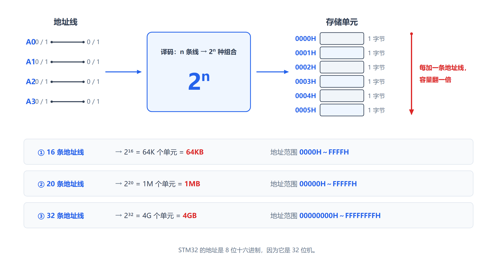
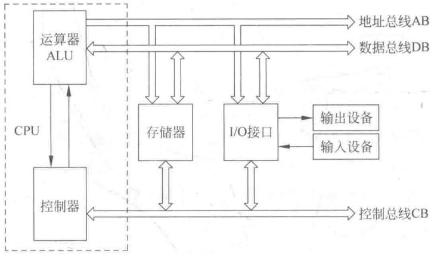
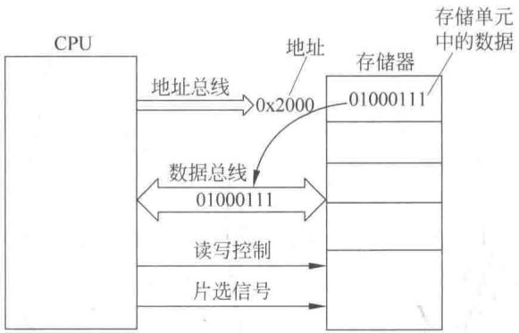
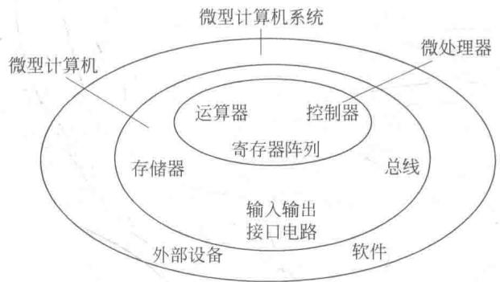
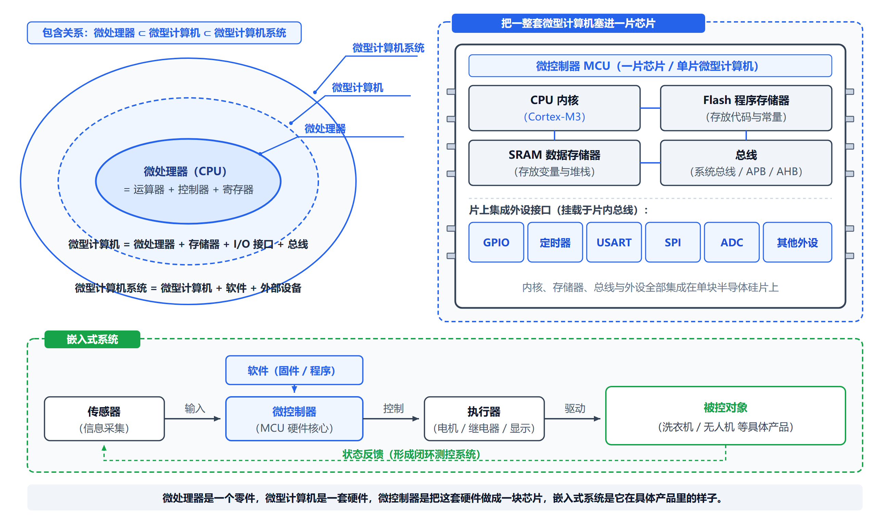
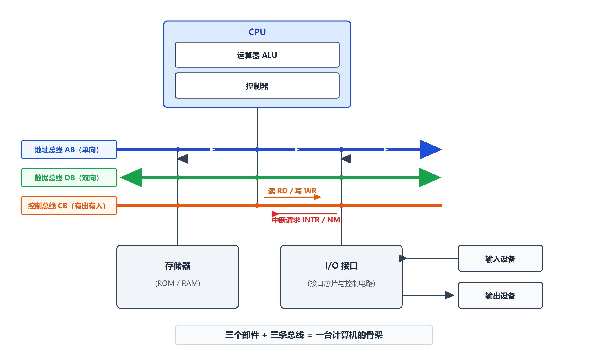
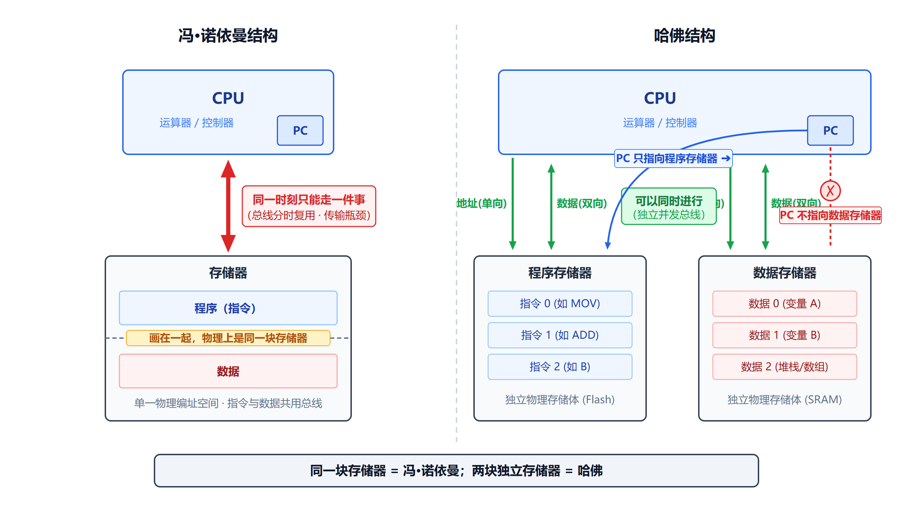
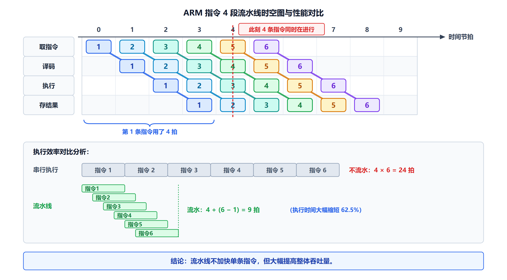

# 第 1 章 精简复习 — 基础知识

> **本章定位**：全书的地基。这一章定义了后面每一章都要用的名词：位、字节、地址、总线、指令、CPU、存储器、I/O。
>
> **本复习版说明（重要）**：本复习版**严格以老师 PPT 为准**。
> 第 1 章 PPT 共 55 页，其中**术语与基本构成占 22 页**（p9～p30），是投入最集中的部分。
> **PPT 中没有"数制及其编码"这一节**——没有二进制转换、原码/反码/补码、BCD 码、ASCII 码、汉字编码的内容。
> 这些内容在第二版教材中已精简，本复习版相应**不再收录**。
> 如果你在别处遇到"补码""BCD"这类说法，说明那是第一版教材的内容，不是本课程的重点。
>
> 详细版见 `../01_基础知识.md`（注意：完整讲义包含第一版的数制编码内容，复习时请以本复习版为准）

---

## 一、本章知识框架

第 1 章回答一个问题：**计算机到底是由什么组成的？它凭什么能工作？**

```
① 先认识"零件"的名称        1.2 常用单位及术语（14 个术语）
   （位、字节、字、字长、K/M/G/T、MIPS、地址、总线、访问、
     机器指令、汇编指令、指令系统、汇编/反汇编、高级语言）
            ↓
② 再认识"零件"怎么拼成一台机器  1.3 微型计算机的基本构成
   （CPU + 存储器 + I/O 接口，靠三总线连起来）
            ↓
③ 最后认识"设计思想"          1.4 微型计算机的结构
   （冯·诺依曼 / 哈佛 / Cache / 流水线 / CISC-RISC）
            ↓
④ 落到"本书用哪款芯片"        1.5 ARM 概述
            ↓
⑤ 了解这门技术用在哪          1.6 微型计算机的应用
```

**一句话记住本章**：

> **一个会算数的 CPU + 一堆有门牌号的存储单元 + 一圈 I/O 接口 + 三条总线把它们连起来 = 一台计算机。**

---

## 二、重点知识

### 2.1 微型计算机发展概述 ★ 【PPT p7～p8】

**只需记住几个关键节点**：

| 时间 | 事件 |
|---|---|
| — | **第一台通用数字电子计算机 ENIAC**（占地 170 平方米、重 30 吨、耗电 150 千瓦、使用 18000 多个电子管） |
| **1971 年** | 美国 Intel 公司生产出**第一片微处理器 4004** |
| 1976 年 | 推出高档微处理器，如 Intel 8085、Zilog Z80 |
| 1978 年 | 推出性能与中档 16 位小型机相当的微处理器，代表产品 **Intel 8086** |
| 21 世纪 | 新一代计算机：以人工智能技术为驱动、新型软件为支撑 |

**计算机技术的发展方向**：**满足高速运算的通用计算机系统**；**满足测控系统需要的嵌入式计算机系统**。

> 这一节属于**背景了解**，考试不会考细节。记住"**微型机的发展取决于微处理器**"就够了。

---

### 2.2 常用单位及术语 ★★★ 【PPT 重点：p9～p19，共 11 页】

> **这一节是第 1 章 PPT 投入最多的部分（14 个术语逐条讲）**。每个术语后面 11 章都会反复出现，一条都不能漏。

#### （1）位（bit）★

> **计算机所能表示的最小的数字单位，即二进制数的位。每位只有两种状态 0、1。**

**大白话**：**bit = 一个 0 或者一个 1。** 它是信息的最小单位，再往下就没了——不能说"半个 bit"。

**为什么计算机用 0 和 1**：芯片里最基本的元件是晶体管，它最可靠的状态只有两种——**导通（高电平）**和**截止（低电平）**。如果硬要分出 10 档电压，稍微有点干扰就会把"3 档"认成"4 档"。**只用两种状态，抗干扰能力最强。**

> **所以计算机选二进制，不是因为算起来方便，而是因为它在电路上最可靠。**

#### （2）字节（Byte）★

> **8 位（bit）二进制数为一个字节，是内存的基本单位，常用 B 表示。**

**大白话**：**Byte = 8 个 bit 打包在一起。**

- 它是**内存的基本单位**：内存里每个"格子"装 1 个字节；
- 它是**地址的基本单位**：给内存编号时，**一个编号对应 1 个字节**（不是对应 1 个 bit）。

**【易错】B 和 b 完全不是一回事**：

| 符号 | 含义 | 例子 |
|---|---|---|
| **B**（大写） | Byte，字节 | 100MB 是 100 兆**字节** |
| **b**（小写） | bit，位 | 100Mbps 是每秒 100 兆**位** |

> 网速说的 "100Mbps" 其实是 100 兆**位**/秒 = 12.5 兆**字节**/秒。这是买宽带时最常见的误解。

#### （3）字（word）与（4）字长 ★

**字（word）**：> **字通常由 16、32 或 64 个位（bit）组成，具体取决于计算机的架构和配置。**

**字长**：> **字长即字的长度，是一次可以并行处理的数据的位数，即数据线的条数。常与 CPU 内部的寄存器、运算装置、总线宽度一致。常用微型计算机字长有 8 位、32 位和 64 位。**

**把"字长"这句话拆开理解**：

| 说法 | 含义 |
|---|---|
| "一次可以**并行处理**的数据的位数" | "并行"就是"同时"。字长 32 位 = CPU **一次就能同时处理 32 个 0/1** |
| "即**数据线的条数**" | 数据要"一次全部搬进去"，就得有同样多的通道。**32 条数据线 → 字长 32 位** |
| "常与寄存器、运算装置、总线宽度**一致**" | 这样数据从内存到寄存器到运算器，**一路都是 32 位宽，不用拆分拼接** |

> **字长是衡量一台计算机性能的重要指标，也是"多少位机"这个说法的来源**：8 位机、16 位机、**32 位机（STM32 就是 32 位机）**。

**【易错】"字"的长度随机器而变**：

| 机器 | 1 字的长度 |
|---|---|
| 8 位机 | 8 位 |
| 16 位机（如 8086） | 16 位 |
| **32 位机（STM32）** | **32 位** |

> 读 ARM/STM32 资料时：**byte（字节）= 8 位、half-word（半字）= 16 位、word（字）= 32 位**。
> 做题以题目/教材的定义为准。

#### （5）数量单位（K、M、G、T）★

> - **K**（千，Kilo 的符号）：**1K = 1024**，如 1KB 表示 1024 个字节
> - **M**（兆，Million 的符号）：**1M = 1K × 1K**
> - **G**（吉，Giga 的符号）：**1G = 1K × 1M**
> - **T**（太，Tera 的符号）：**1T = 1M × 1M**

**【易错】这里的 1024 是整门课最容易出错的地方之一**：

> 生活中 1 千米 = 1000 米，所以直觉上"1K"应该等于 1000。
> 但在计算机里，**1K = 1024 = 2¹⁰**——因为要和二进制对得齐。

#### （6）MIPS ★

> **MIPS 为单字长定点指令平均执行速度 Million Instructions Per Second 的缩写，即每秒处理百万条机器语言指令数。这是衡量 CPU 速度的一个指标。**

**大白话**：**MIPS = 每秒能执行多少百万条指令。** 数字越大，CPU 越快。

#### （7）地址 ★★★ 【本节最重要的知识点之一】

> **地址是微型计算机存储单元的编号**，通常 **8bit 为一个单元**，每个单元有独立的编号。
> **存储器地址的最大编号（容量）有限，由地址线的条数决定。** 如：
> - **16 条地址线的容量为 64KB**（`0000H` ～ `FFFFH`）
> - **20 条地址线的容量为 1MB**（`00000H` ～ `FFFFFH`）

**【类比】**

> 想象一个大楼里的**信箱墙**，上面密密麻麻全是信箱，每个信箱都有一个编号：001、002、003……
> - **信箱 = 存储单元**（能存 1 个字节的数据）
> - **编号 = 地址**（CPU 用它来找"我要的是哪一个信箱"）
> - **信箱里的信 = 数据**（真正存的内容）
>
> **类比的边界**：真实的存储单元是由晶体管构成的电路；大楼的信箱编号是给人看的，计算机的地址是给电路译码用的。但"**编号 → 定位 → 取出内容**"这个本质完全一致。

**为什么要地址**：因为 CPU 要读写数据时，必须先告诉内存："**我要的是哪一个格子**"。没有地址，内存不知道自己该把哪个格子里的数据送出去。

**一步一步推演：为什么 20 条地址线 = 1MB？**

```
第一步：一条地址线只有 2 种状态（0 或 1）→ 只能区分 2 个单元
第二步：两条地址线的组合有 00、01、10、11 → 4 种 = 2²
第三步：n 条地址线 → 2ⁿ 种组合 → 能区分 2ⁿ 个不同的单元
第四步：代入

16 条：2¹⁶ = 65536 个单元
       每个单元 1 字节
       65536 字节 = 64 × 1024 字节 = 64KB
       地址范围：0000H ～ FFFFH
                 ↑ 4 位十六进制 = 16 位

20 条：2²⁰ = 1048576 个单元 = 1 048 576 字节
       1048576 ÷ 1024 = 1024KB = 1MB
       地址范围：00000H ～ FFFFFH
                 ↑ 5 位十六进制 = 20 位
```

**【必背结论】**：

> **n 条地址线 → 容量 = 2ⁿ 字节**

| 地址线条数 | 容量 | 地址范围（十六进制） | 十六进制位数 |
|---|---|---|---|
| 16 条 | **64KB** | `0000H` ～ `FFFFH` | 4 位 |
| 20 条 | **1MB** | `00000H` ～ `FFFFFH` | 5 位 |
| **32 条** | **4GB** | `00000000H` ～ `FFFFFFFFH` | **8 位** |

> **顺带解释了一个大问题**：为什么 STM32 的地址看起来都是 `0x40010800` 这种 **8 位十六进制**？
> 因为 STM32 是 **32 位机，有 32 条地址线**，能访问 2³² = 4GB 的地址空间，地址需要用 8 位十六进制来写。
> **这个 4GB 地址空间在第 3 章讲"存储器映像"时会详细展开。**



*左边是地址线，中间是译码（n 条线 → 2ⁿ 种组合），右边是存储单元阵列。**每往左加一条地址线，容量翻一倍**。*

#### （8）总线 ★★★

> **CPU 是微型计算机的核心。微型计算机利用三总线将 CPU 与系统的其他部件如存储器、I/O 接口等联系起来的。**
> **总线是具有同类性质的一组信号线。**
> 三总线分别是**地址总线 AB**（Address Bus）、**数据总线 DB**（Data Bus）和**控制总线 CB**（Control Bus）。

**【类比】**

> 总线就像**连接不同办公室的道路**。CPU、存储器、I/O 接口都住在不同的"办公室"里，它们之间要传东西，就得有路。
> **类比的边界**：真实的总线不是"路"，而是一组金属导线（在芯片内部是极细的连线），上面跑的是电信号。

**三总线的分工（本节的骨架，下一节 1.3 会详细展开）**：

| 总线 | 方向 | 干什么 | 什么决定它的能力 |
|---|---|---|---|
| **地址总线 AB** | **单向**（CPU 发出） | 输出将要访问的存储单元或 I/O 口的地址 | **地址线条数 → 决定寻址范围（容量）** |
| **数据总线 DB** | **双向** | 在 CPU 与存储器/外设之间传送数据 | **数据线条数 → 决定一次能传多少位** |
| **控制总线 CB** | **双向**（有出有入） | CPU 对存储器、I/O 进行控制和联络 | 传输读写信号、中断请求等 |

#### （9）访问 ★

> CPU 对寄存器、存储器或 I/O 接口电路的两类操作：
> - **"写入"或写操作**：把数据存入寄存器、存储器或 I/O 接口电路；
> - **"读出"或读操作**：把数据从寄存器、存储器或 I/O 接口电路取到 CPU。
>
> 这两种操作过程统称为**"访问"**。

**大白话**：**访问 = "读"和"写"的统称。**

#### （10）机器指令 ★★

> **机器指令是由二进制代码组成，可以直接由微处理器进行译码、执行。**
>
> 一条机器指令应包含**要求微处理器所要完成的操作**，以及**参与该操作的数据或该数据所在的地址**，有时还要有**操作结果的存放地址信息**。这些都是以二进制数字的形式表示的。某些特殊指令不需要数据或地址。

**大白话**：**机器指令 = CPU 能直接"看懂"的 0/1 串。**

#### （11）汇编指令 ★★ 【PPT 给了具体例子】

> 微处理器能够而且只能够识别二进制数，指令也用二进制数表示。例如，一条 4 字节的指令如下：

```
00001111
00100100
00010010
01000101
```

> 这就是用二进制数表示的可以直接由微处理器进行译码、执行的机器指令。

**但这条指令的含义是**：将十六进制数 `0x1245` 送到寄存器 R1 中。

**编程时使用比较容易看出其操作含义、用英文缩写形式表示的指令**：

```asm
MOV  R1, #0x1245
```

> 这种形式的指令叫做**汇编指令**，这种编程语言称为**汇编语言**。
> **不同厂家的 CPU 配备有不同格式的汇编语言指令系统，互不兼容**，用汇编语言编写的程序叫做**汇编语言源程序**。

> **【理解重点】这段对比想说明什么？**
> **同一件事（把 0x1245 放进 R1），机器里存的是一串看不懂的 0/1，人看的是 `MOV R1, #0x1245`。**
> 汇编指令是"给人看的写法"，机器指令是"给机器执行的写法"，两者一一对应。

#### （12）指令系统 ★

> **指令系统是一台计算机所能识别的全部指令的集合。**

#### （13）汇编与反汇编 ★

> - **汇编**：汇编语言源程序翻译成与之相对应的用二进制数表示的机器语言，才能被微处理器所识别和执行，这种翻译叫做**汇编**。
> - **反汇编**：将用二进制数表示的机器语言形式的程序翻译成汇编语言形式的源程序的过程叫做**反汇编**。

**方向对照**：

```
汇编：  汇编源程序  ──→  机器语言（二进制）
反汇编：机器语言    ──→  汇编源程序
```

#### （14）高级语言 ★

> 汇编指令虽然比二进制机器指令容易阅读和编写，但还是不如高级语言更接近英语自然语言。解决方法是用高级语言编程，再用某种特殊程序翻译成机器语言。
>
> **将用高级语言编写的用户程序翻译成微处理器的机器语言程序的软件，叫做编译器。**
>
> 现在市面上有各种 C 编译器，能把 C 语言转换成微处理器的机器语言。这种编译器比较适宜于对汇编语言不熟悉的用户使用，**其缺点是不可避免地会出现编译后的机器程序冗长、不够简练，导致程序运行时间长、速度低等问题。**

**三个层次的对照（这是本节的主线）**：

| 层次 | 例子 | 谁看得懂 | 需要什么工具 |
|---|---|---|---|
| **机器语言** | `00001111 00100100 ...` | **CPU** | — |
| **汇编语言** | `MOV R1, #0x1245` | 人（略懂硬件） | **汇编器** |
| **高级语言** | `r1 = 0x1245;`（C 语言） | 人（容易） | **编译器** |

> **为什么学这门课要懂汇编？** 因为汇编能让你**看清每条指令到底动了哪个寄存器**——这是理解硬件的唯一途径。第 2 章、第 4 章会反复用到。

---

### 2.3 微型计算机的基本构成 ★★★ 【PPT 重点：p20～p31，共 12 页】

#### 三个部件 + 三条总线

> 典型的微型计算机的基本结构包括：
> - **微处理器（CPU）**
> - **存储器**
> - **输入/输出接口（I/O 接口）**
> - **外部设备**
> - **系统总线**



**教材原图分三遍看**：

1. **第一遍，只看三个住户**：`CPU`（大脑）、`存储器`（存东西）、`I/O 接口`（跟外界打交道）。任何计算机拆到最粗，只有这三块。
2. **第二遍，加上三条横线**：上面是地址总线（右端单箭头，**单向**）、中间是数据总线（两端都有箭头，**双向**）、下面是控制总线。
3. **第三遍，放大看 CPU 内部**：`运算器 ALU`（真正算数的地方）+ `控制器`（负责指挥）。**控制器有一条箭头指向控制总线，说明指挥信号是从这里发出去的。**

#### 三总线各自干什么（逐条展开）

**【地址总线 AB】**

> **地址总线 AB 是单向的，输出地址信号**，即输出将要访问的存储器单元或 I/O 口的地址。**地址线的多少决定了系统直接寻址存储器的范围。**

> 例如，Intel 8086 CPU 共有 **20 条地址线**，分别用 **A19～A0** 表示，其中 **A0 为最低位**。20 位地址线可以确定 **2²⁰ = 1024×1024 个**不同的地址（称为 **1MB** 内存单元）。20 位地址用十六进制数表示时，范围为 **00000H～FFFFFH**。

**为什么是"单向"的**：因为"我要访问哪里"这个信息，**永远是 CPU 说、别的部件听**。存储器不会对 CPU 说"你来访问我第 5 号单元吧"。

**A19～A0 是什么意思**：给 20 条线起的名字。**A 表示 Address（地址），A0 是最低位（对应 2⁰），A19 是最高位（对应 2¹⁹）**。数据线同理，用 D15～D0、D7～D0 这样的名字。

**【数据总线 DB】**

> 数据总线 DB 是**传输数据或代码**的一组信号线，数据线的数目一般**与处理器的字长相等**。
>
> 这里所说的传输的数据是广义的：数据的实际含义可能是表示数字的数据，也可能是二进制数字表示的指令，甚至有时可能是某些特定地址，因为它们都是用二进制数表示，都可以在数据总线上传输。
>
> 数据线的多少决定了**一次能够传送数据的位数**。16 位微处理器的 DB 是 16 条，分别表示为 **D15～D0**，**D0 为最低位**。8 位微处理器的数据总线 DB 是 8 条，表示为 **D7～D0**。
>
> 数据在 CPU 与存储器（或 I/O 接口）间的传送可以是**双向**的，因此 **DB 称为双向总线**。
>
> 所有读写数据的操作，都是指 CPU 进行读写。**CPU 读操作时，外部数据通过数据总线送往 CPU；CPU 写操作时，CPU 数据通过数据总线送往外部。**
>
> 存储器、接口电路都和数据总线相连，它们都有各自不同的地址，CPU 通过不同的地址确定与之联系的器件。**任何时刻，数据总线上都不能同时出现两个数据**，换言之，各个器件是在**分时使用数据总线**。

**三个关键点**：

**（1）"数据"是广义的**——数据总线上跑的东西可能是**数据**（比如要存的数字 100）、**指令**（CPU 要执行的命令）、甚至**地址**。所以"数据总线"里的"数据"，意思是"**一切用二进制表示的信息**"。

**（2）为什么是"双向"的**：

```
读操作：存储器/外设 → 数据总线 → CPU
写操作：CPU → 数据总线 → 存储器/外设
```

**（3）为什么"分时使用"**：因为同一时刻总线上只能有一个数据。CPU 通过**不同的地址**确定要跟哪个器件打交道——就像打电话时先拨号，接通了才能说话。

**【控制总线 CB】**

> 控制总线 CB 是**双向**的，CPU 对存储器、I/O 接口进行控制和联络。
> - **输出控制信号**：CPU 发给存储器或 I/O 接口的控制信号（如**读信号 RD、写信号 WR**）；
> - **输入控制信号**：CPU 通过接口接收的外设发来的信号（如**外部中断请求信号 INTR、非屏蔽中断请求信号 NMI**）。
>
> **若符号上有一横线，一般表示该信号为低电平有效**，否则为高电平有效。
>
> 在连接系统总线的设备中，**某时刻只能有一个发送者向总线发送信号；但可以有多个设备从总线上同时获取信号。**

**【易错】最后这句话很重要**：

```
某时刻只能有【一个】发送者  ← 不然信号会打架
但可以有【多个】接收者      ← 大家一起听没问题
```

#### 微处理器（CPU）内部有什么

> 微处理器简称 **MP**（Micro Processor），也称 **μP**，是微型机的核心部件，通常称为**中央处理单元 CPU**（Central Processing Unit），包括：
> - **运算器 ALU**（Arithmetic Logic Unit）
> - **控制器 CU**（Control Unit）
> - **寄存器 R**（Registers）
> - **内部总线**等电路
>
> ——集成在**一片硅片**上。

**【先补一个前置知识：什么叫寄存器？】**

> **寄存器 = CPU 内部的一组高速存储单元，可以理解成 CPU 手边的"小纸条"。**
>
> 打个比方：CPU 是办公室里的工作人员。
> - **内存（RAM）** 是旁边的**文件柜**——容量大，但要走过去开抽屉，慢；
> - **寄存器** 是工作人员**桌面上随手就能拿到的小纸条**——容量极小，但伸手就拿到，快。
>
> **为什么需要寄存器**：CPU 做运算时，不可能每次都去"文件柜"取数据。它必须先把数据取到"桌面"上（寄存器），算完了再放回去。
>
> **类比的边界**：真实寄存器不是"纸条"，而是由触发器构成的高速存储电路，容量只有几十个到几百个字节，但速度与 CPU 同频。**第 2 章会把 Cortex-M3 的寄存器一个一个讲清楚。**

#### 存储器

> 存储器分为**程序存储器和数据存储器**两类。程序包括系统程序和用户程序。**每个存储器单元具有一个地址，单元中存储一个字节（8 个二进制位）内容。**



**它到底是怎么工作的——一次完整的"读"操作**：

```
① CPU 把要读的地址放到地址总线上
② CPU 通过控制总线发出"读"信号
③ 存储器收到地址和读信号，把对应单元里的数据放到数据总线上
④ CPU 从数据总线上取走数据
```

> **这条链是后面所有章节的样板**：无论读的是内存、还是 GPIO 寄存器、还是 ADC 转换结果，**流程都是这四步**。

#### I/O 接口

> I/O 接口主要用于 **CPU 和外部设备之间交换数据**。
> 常见形式：**并行口、串行口、USB 口**……

**为什么需要 I/O 接口**：外部设备五花八门（键盘、显示器、传感器、电机），速度、电平、数据格式都不一样。**I/O 接口就是 CPU 和外设之间的"翻译 + 中转站"。**

#### 五个容易混的概念（PPT 专门辨析）

**【微处理器】**

> 简称 MP，也称 μP，是微型机的核心部件，通常称为 CPU。**将运算器、控制器集成在一片芯片上。**
>
> 其功能如下：
> - 对指令**译码并执行**规定动作；
> - 能与存储器及外设**交换数据**；
> - 可**响应**其他部件的中断请求；
> - 提供系统所需的**定时和控制**。

**【微型计算机】**

> 在 CPU 的基础上配置**存储器、I/O 接口电路、系统总线**。

**【微型计算机系统】**

> 以微机为主体，配置**系统软件和外设**。软件部分包括**系统软件**（如操作系统）和**应用软件**（如字处理软件）。



**这张图是"三个同心椭圆"，从里往外一层包一层**：

1. **最里面**：**微处理器**——里面写着"运算器、控制器、寄存器阵列"；
2. **中间一圈**：**微型计算机**——多了"存储器、总线、输入输出接口电路"；
3. **最外面一圈**：**微型计算机系统**——又多了"外部设备、软件"。

**所以这三个概念不是并列的，而是层层包含**：

```
微处理器  ⊂  微型计算机  ⊂  微型计算机系统
```

**【微控制器 MCU】**

> 一个集成在**一块芯片上的完整计算机系统**，具有一个完整计算机所需要的大部分部件：**中央处理单元（CPU）、存储器、内部和外部总线系统**。同时，集成诸如**通信接口、定时器、实时时钟**等外围设备（简称**外设**）。

**【嵌入式系统】**

> 嵌入式系统是**以应用为中心、以计算机技术为基础、软硬件可裁剪、能够适应应用系统对功能、可靠性、成本、体积、功耗严格要求的专用计算机系统。**

**微处理器 vs 微控制器（本节最重要的一句话）**：

> **微控制器和微处理器的区别是：微控制器不仅包含微处理器，还包含其他更多的内容。**

| | 微处理器（MPU） | 微控制器（MCU） |
|---|---|---|
| 包含什么 | **只有 CPU** | **CPU + 存储器 + 总线 + 外设** |
| 能单独工作吗 | **不能**，必须外接存储器、接口 | **能**，一片芯片就是一个系统 |
| 典型用途 | 个人电脑、服务器 | 家电、玩具、工业控制、仪器仪表 |
| 典型例子 | Intel 酷睿、奔腾 | **STM32F103**、51 单片机 |
| 类比 | 只有"大脑" | "大脑 + 记忆 + 手脚"打包在一颗芯片里 |

**【类比】**

> - **微处理器**像一台**台式机主机**：性能强，但要接显示器、键盘、硬盘才能用。
> - **微控制器**像一台**手机**：屏幕、电池、摄像头、CPU 全都塞在一起，拿起来就能用。
>
> **类比的边界**：手机其实比微控制器复杂得多（它有操作系统、大容量存储）；真正的微控制器往往**没有操作系统**，程序直接跑在裸机上。但"**集成度高、自成一体**"这个特点是相通的。



*左半边是三个同心圆（层层包含）；右半边是微控制器（一片芯片里塞进整套微型计算机）；最下面是嵌入式系统（微控制器在具体产品里的样子）。*



*以后看到任何 STM32 结构图，先在心里拆成"主（CPU）+ 从（存储器/外设）+ 总线"三块，就不会迷路。*

---

### 2.4 微型计算机的结构 ★★★ 【PPT 重点：p32～p44，共 13 页】

> 这一节讲四个"设计思想"：**程序和数据怎么放**（冯·诺依曼 vs 哈佛）、**CPU 快内存慢怎么办**（Cache）、**一条条串着执行太慢怎么办**（流水线）、**指令该设计得多而全还是少而精**（CISC vs RISC）。

#### 2.4.1 冯·诺依曼结构 ★★★

**"存储程序"思想（核心）**：

> 在冯·诺依曼结构中，计算机系统由**一个中央处理单元（CPU）**和**一个存储器**组成，**数据和指令都存储在存储器中**，CPU 可以根据所给的地址对存储器进行读或写。**程序指令和数据的宽度相同。**

**"存储程序"思想可以简化概括为 3 点**：

1. 计算机包括**运算器、控制器、存储器、输入/输出设备**；
2. 计算机内部应采用**二进制**来表示指令和数据；
3. 将编写好的**程序和数据保存到存储器**，然后计算机**自动地逐条取出指令和数据进行分析、处理和执行**。

**第 3 条为什么革命性**：

> **在"存储程序"出现之前**：计算机要换一个任务，得**重新接线、重新拨开关**，把电路结构改成"专门做这件事"的样子。换任务就像重新装修房子。
>
> **有了"存储程序"之后**：电路结构**不用改**，程序变成**存在存储器里的数据**。换任务只要**换一份程序**，就像换一张光盘。
>
> **这一下就把计算机从"专用机器"变成了"通用机器"。**

**冯·诺依曼结构的特点（重点理解"共享"两个字）**：

> **数据和指令都存储在存储器中，程序指令和数据不加区分，均采用数据总线进行传输**，因此，**数据访问和指令存取不能同时在总线上传输**。

```
同一时刻，总线只能干一件事：
   要么去"取指令"（因为下一条指令还没拿到）
   要么去"读数据"（因为要算的东西还没拿到）

两件事不能同时做 → 这就是所谓的"冯·诺依曼瓶颈"
```

**典型代表**：**Intel 8086、ARM7、MIPS 处理器**等。

#### 2.4.2 哈佛结构 ★★★

> 在哈佛体系结构中，**数据和程序使用各自独立的存储器**。
> **程序计数器 PC 只指向程序存储器而不指向数据存储器**，因此，**在哈佛体系结构的计算机上难以编写自修改程序**（IAP，In Application Programming，在应用编程）。

**哈佛结构的优点**：

1. **独立的程序存储器和数据存储器提高了数字信号处理的性能**；
2. **指令和数据可以有不同的数据宽度，具有较高效率**。

**典型代表**：恩智浦公司的 **MC68 系列**、Zilog 公司的 **Z8 系列**、**ARM9、ARM10 系列**等。

#### 【必背】两种结构的对比

| 对比项 | **冯·诺依曼结构** | **哈佛结构** |
|---|---|---|
| 程序和数据存在哪 | **同一个存储器** | **各自独立的两个存储器** |
| 能否同时取指令和数据 | **不能**（共用一条总线） | **可以**（各有各的通路） |
| 指令和数据的宽度 | **相同** | **可以不同** |
| PC 指向哪 | 那唯一的存储器 | **只指向程序存储器** |
| 能否写自修改程序 | 相对容易 | **很难**（IAP 受限） |
| 优点 | 结构简单、灵活 | 速度快、效率高（尤其适合数字信号处理） |
| 代表 | Intel 8086、ARM7、MIPS | MC68 系列、Z8 系列、ARM9、ARM10 |



*判断一个结构属于哪一类，只要问一句："**指令和数据是不是住在两个不同的存储器里？**"*

> **【伏笔】** 本书主角 **Cortex-M3 基于哈佛结构**（第 2 章会详细讲它的总线结构）。
> 另外注意：教材第 1 章讲流水线时用的是**四段**例子，而 Cortex-M3 是**三级**流水线——别把这两个数字搞混。

#### 2.4.3 高速缓冲存储器 Cache ★★

**要解决的问题**：**微处理器运行速度快、存储器存取速度慢的矛盾。**

> 为了解决这个矛盾，在两者之间加一级**高速缓冲器 Cache**。Cache 采用与制作 CPU 相同的半导体工艺，**速度与 CPU 匹配**，其**容量约占主存的 1% 左右**。

**Cache 的作用过程**：

> 当 CPU 要从主存储器（在个人计算机中称为内存）中读取一个数据时，**先在 Cache 中查找是否有该数据**：
> - **若有**，则立即从 Cache 中读取到 CPU；
> - **否则**，用一个主存储器访问时间从主存储器中读取这个数据送 CPU，**与此同时，将包含这个数据字的整个数据块送到 Cache 中**。

**为什么有效**：

> 由于**存储器访问具有局部性（程序执行局部性原理）**，此后的若干次存储器访问中要读取的数据位于刚才取到 Cache 中的数据块中的可能性很大。**只要替换算法与写入策略得当，Cache 的命中率可达 99% 以上**，它有效地减少 CPU 访问低速内存的次数，从而提高读取数据的速度和整机的性能。

**把这段拆成三句话**：

**（1）问题是什么**：CPU 很快（一次运算几纳秒），内存很慢（一次访问几十纳秒）。CPU 干完一件事，要等很久才能拿到下一个数据，**大量时间浪费在"等"上**。

**（2）怎么办**：在 CPU 和内存之间加一层**又小又快**的仓库（Cache）。

**（3）为什么管用**：靠**程序执行局部性原理**——刚取过的数据块，接下来很可能还会被用到。**命中率 99%** 的意思是：100 次访问里有 99 次能在 Cache 里找到，只有 1 次需要去慢内存。

> **一句话记住**：**速度越快的东西越贵、越小**，所以存储系统一定是"金字塔式分层"的——用少量快的 + 大量慢的，凑出"又快又大"的效果。

#### 2.4.4 流水线技术 ★★★

> **流水线（Pipeline）技术是指在程序执行时多条指令重叠操作的一种准并行处理实现技术。**
> 流水线的工作方式：就像工业生产中的**装配流水线**。
> 在工业制造中采用流水线可以提高单位时间的生产量；同样在 CPU 中采用流水线设计也有助于提高 CPU 的效率。

**【PPT 给的汽车装配例子】**

> 假设装配一辆汽车需要 4 个步骤：
> （1）**冲压**：制作车身外壳和底盘等部件；
> （2）**焊接**：将冲压成形后的各部件焊接成车；
> （3）**涂装**：将车身等主要部件清洗、化学处理、打磨、喷漆和烘干；
> （4）**总装**：将各部件组装成车。
>
> 对应地需要冲压、焊接、涂装和总装四个工人。采用流水线的制造方式，**同一时刻四辆汽车在装配**。
> 如不采用流水线，那么第一辆汽车依次经过上述四个步骤装配完成之后，下一辆汽车才开始进行装配，**同一时刻只有一辆汽车在装配**。

**时空图怎么读**：

> 流水线技术可以使用**时空图**来说明。**时空图从时间和空间两个方面描述了流水线的工作过程。**
> **时空图中，横坐标代表时间，纵坐标代表流水线的各个段。**

**关键结论**：

```
不流水线（4 段，3 条指令）：
  指令1: [取][译][执][存]
  指令2:             [取][译][执][存]
  指令3:                         [取][译][执][存]
  共 4 × 3 = 12 拍

流水线：
  指令1: [取][译][执][存]
  指令2:     [取][译][执][存]
  指令3:         [取][译][执][存]
  共 4 + (3 − 1) = 6 拍
```

> **公式：n 条指令、m 段流水线，总时间 = m + (n − 1) 个节拍**（理想情况）。
> 当 n 很大时，**平均每条指令只花约 1 个节拍**。

**【最容易搞错的一句话】**：

> **流水线没有让单条指令变快**（还是 4 个节拍），**但让整体吞吐量大幅提高。**

> 采用流水线设计之后，指令就可以**连续不断地进行处理**。在同一个较长的时间段内，显然拥有流水线设计的 CPU 能够处理更多的指令。



*看图方法：斜着看是"一条指令的一生"，竖着看是"此刻同时在干的活"。*

#### 2.4.5 CISC 和 RISC ★★

**【CISC：复杂指令系统计算机】**

> 20 世纪 70 年代末发展起来的计算机，其结构随着 VLSI（Very Large Scale Integration，**超大规模集成电路**）技术的飞速发展而越来越复杂，**大多数计算机的指令系统多达几百条**，这些计算机被称为**复杂指令系统计算机**（Complex Instruction Set Computer，**CISC**）。
>
> 在 CISC 指令集的各种指令中，**大约有 20% 的指令会被反复使用，占整个程序代码的 80%**。而余下的指令却不经常使用，在程序设计中只占 20%，这种情况造成了**硬件和资源的浪费**。
>
> CISC 结构的处理器都有一个指令集，每执行一条指令，处理器要在**几百条指令中分类查找**对应指令，因此需要一定的时间；由于指令的复杂，增加了处理器的**结构复杂性以及逻辑电路的级数，降低了时钟频率**，使指令执行的速度变慢，**纯 CISC 结构的处理器执行一条指令至少需要一个以上的时钟周期**。

> 这就是著名的"**二八定律**"在计算机上的体现：你花了 100% 的电路成本去实现 100% 的指令，结果**只有 20% 的指令真正被大量使用**。

**【RISC：精简指令系统计算机】**

> **RISC** 是**精简指令集计算机**（Reduced Instruction Set Computer）的简称，其指令集结构**只有少数简单的指令**，使计算机硬件简化，**将 CPU 的时钟频率提得很高**，配合流水线结构可做到**一个时钟周期执行一条指令**，使整个系统的性能得到提高，性能超过 CISC 结构的计算机。

**RISC 指令系统的特点（三条，必背）**：

1. **选取使用频率最高的一些简单指令**；
2. **指令长度固定，指令格式和寻址方式种类少**；
3. **只有取数据和存数据指令访问存储器，其余指令的操作数在寄存器之间进行**。

**为什么这三条重要**：

- **指令长度固定** → CPU 能提前知道"下一条指令从哪开始"，从而**边取指令边译码** → **这是流水线能顺畅工作的前提**；
- **只有 Load/Store 访存** → 把"访问慢内存"和"快速运算"分开，**流水线不容易被打断**。

**【对比表（必背）】**

| 对比项 | **CISC** | **RISC** |
|---|---|---|
| 全称 | Complex Instruction Set Computer | Reduced Instruction Set Computer |
| 中文 | 复杂指令系统计算机 | 精简指令系统计算机 |
| 指令数量 | 多（**几百条**） | 少（**几十条**） |
| 指令长度 | **不固定** | **固定** |
| 指令格式/寻址方式 | 多而复杂 | 少而简单 |
| 访存方式 | 很多指令都能访问存储器 | **只有 Load/Store 指令访存** |
| 时钟频率 | 较低 | **较高** |
| 一条指令要几个时钟周期 | **≥ 1 个**（通常多个） | **可做到 1 个** |
| 流水线 | 难做 | **适合流水线** |
| 典型代表 | x86 系列 | **ARM**、MIPS、RISC-V |

> **【类比】**
> **CISC 像一本"大词典"**：词条多、每一条都能一次说清很复杂的意思，但查起来慢、书又厚。
> **RISC 像一本"基础词汇表"**：只有少量简单词，但每个词都学得快、说得快，复杂的句子用几个简单词组合起来说。
>
> **类比的边界**：RISC 并不是"什么都做不了"，而是"用简单的指令组合完成复杂的事"，代价是需要更多条指令（但每条都快）。

> **【这对本书意味着什么】**
> 本书的主角 **ARM 是 RISC 架构**。所以后面你会看到：
> - 指令数量不多，但很规整；
> - **指令长度固定**（第 4 章会看到 ARM 指令是固定 32 位，Thumb 指令是固定 16 位）；
> - **只有专门的 Load/Store 指令（`LDR`/`STR`）能访问存储器**，其他运算都在寄存器之间进行；
> - **流水线**是它的重要特征（第 2 章会详细讲 Cortex-M3 的三级流水线）。
>
> **所以这一小节不是"背景知识"，而是理解 ARM 为什么长成这样的钥匙。**

---

### 2.5 ARM 概述 ★★ 【PPT 重点：p45～p49】

#### ARM 是什么

> **ARM**（Advanced Risc Machines）称作**高级精简指令集机器**（Advanced RISC Machine），是一个 **32 位精简指令集（RISC）处理器架构**，其广泛应用于嵌入式系统设计。
>
> **ARM 既可以认为是一个公司的名称，也可以认为是一类微处理器的通称，还可以认为是一种技术的名称。**

**三个身份要分清**：

| ARM 的三种身份 | 含义 | 例子 |
|---|---|---|
| **一家公司** | 英国 ARM 公司 | "ARM 公司把内核授权给 ST" |
| **一类处理器** | 采用 ARM 架构的处理器 | "这块板子上用的是 ARM" |
| **一种技术/架构** | ARM 指令集体系结构（32 位 RISC） | "ARM 架构是 RISC" |

> **ARM 公司是一家出售 IP（技术知识产权）的公司**——它自己不生产芯片，而是把内核设计**授权**给别的厂商（如 ST），由厂商加上外设做成芯片。

#### ARMv7 处理器分类（重点）

> ARMv7 根据应用分类：

| 系列 | 定位 | 特点 | 典型用途 |
|---|---|---|---|
| **Cortex-A**（Application Processor） | 应用处理器 | **最快频率、最高性能、合理功耗** | 手机、平板 |
| **Cortex-R**（Real-time Processor） | 实时控制器 | **实时响应、合理性能、较低功耗** | 硬盘控制器、汽车刹车 |
| **Cortex-M**（Micro Controller） | 微控制器 | **一般性能、最低成本、极低功耗** | **本书主角（Cortex-M3）** |

#### ARM 架构的演变

> 1985 年以来，ARM 陆续发布了多个 ARM 内核架构版本，从 **ARM V4 架构**开始。目前，ARM 体系结构已经经历了 **6 个版本**。
> 各个版本中还有一些**变种**，如支持 **Thumb 指令集的 T 变种**、**长乘法指令（M）变种**、**ARM 媒体功能扩展（SIMD）变种**、**支持 Java 的 J 变种**和**增强功能的 E 变种**等。

**命名规则要会读（以 ARM7TDMI 为例）**：

```
A R M 7  T  D  M  I
│   │   │  │  │  └─ I：Embedded ICE（嵌入式在线仿真调试）
│   │   │  │  └──── M：内嵌硬件乘法器（长乘法指令）
│   │   │  └─────── D：片上 Debug（调试支持）
│   │   └────────── T：支持 Thumb 指令集（16 位"压缩版"指令，代码体积小）
│   └────────────── 7：ARM7 系列
└────────────────── ARM：架构名
```

> **Thumb 指令集是什么**：ARM 原来的指令都是 32 位的，程序占用空间大；Thumb 是一套 **16 位**的"压缩版指令"，**代码体积小、省存储空间**。（第 4 章会再讲。）

**Cortex 系列的定位**：

> **Cortex** 是 ARM 的新一代处理器内核，本质上是 **ARM V7 架构的实现**。与以前的向下兼容、逐步升级策略不同，**Cortex 系列处理器是全新开发的**。正是由于 Cortex 放弃了向前兼容，老版本的程序必须经过**移植**才能在 Cortex 处理器上运行。

**Cortex-M 系列芯片的特点**：

> 许多厂商提供的 Cortex-M 系列芯片内集成了大量 **Flash 存储器（数十 KB 到数百 KB）、ADC、USART、SPI、I2C、DAC、CAN、USB、定时器**等组件。

> **这句话其实是在提前"剧透"第 3 章和第 6～12 章的内容**：
> **Cortex-M 系列芯片 = Cortex-M 内核 + 一大堆外设。**
> 那些缩写是什么，后面每一章都会专门讲：
>
> | 缩写 | 一句话 | 本书章节 |
> |---|---|---|
> | **GPIO** | 通用输入输出接口：让程序控制引脚读入或输出高低电平 | 第 6 章 |
> | Flash | 存程序的地方，断电不丢 | 第 3 章 |
> | **ADC** | 把电压变成数字 | 第 10 章 |
> | **USART** | 通用同步/异步收发器，就是"串口" | 第 9 章 |
> | **SPI** | 一种高速串行通信接口 | 第 9 章 |
> | **DAC** | 把数字变成电压 | 第 10 章 |
> | **DMA** | 直接存储器访问：不经过 CPU，直接把数据从一处搬到另一处 | 第 11 章 |
> | 定时器 | 数时间、产生波形 | 第 8 章 |

#### ARM 开发调试工具

> - **硬件调试工具**：**JLink、ULink** 等。
> - **软件开发工具**：**Keil MDK**、IAR、TASKING、CodeSourcery、Rowley Associates、GNU C 编译器等。

---

### 2.6 微型计算机的应用 ★ 【PPT p50～p55，概括性介绍】

**六类应用，每类一两句话即可**：

| 应用领域 | 一句话 |
|---|---|
| **科学计算** | 通用微型计算机的重要应用之一。多个微处理器可构成超级计算机 |
| **信息处理** | 互联网上的信息检索、传输、分类、加工、存储和打印 |
| **工业控制** | **过程控制是微型计算机应用最多、也是最有效的方面之一**（自动化生产线、数据采集系统、电梯智能控制、各种报警系统） |
| **仪器、仪表控制** | 用微处理器代替传统机械部件，减小体积、降低价格、提高可靠性（逻辑分析仪、CT 扫描仪、超声扫描仪） |
| **家用电器和民用产品控制** | 洗衣机、冰箱、自动报时/控制/报警系统 |
| **人工智能** | 机器人、语言识别、图像识别、自然语言处理、专家系统 |

> 这一节属于**背景了解**，考试不会考细节。记住"**过程控制是应用最多、最有效的方面**"就够了。

---

## 三、重要知识之间的联系

### 对比 1：冯·诺依曼 vs 哈佛

**怎么判断**：问一句"**指令和数据是不是住在两个不同的存储器里？**"
住一起 → 冯·诺依曼；分两处 → 哈佛。

**为什么先学冯·诺依曼再学哈佛**：冯·诺依曼是"最朴素的想法"（一块存储器装两样东西），哈佛是在它基础上为了解决"取指和取数抢总线"的问题而分家的。

### 对比 2：CISC vs RISC

**怎么判断**：问"**指令长度固定吗？是不是只有 Load/Store 能访存？**"
都答"是" → RISC。

**为什么先学 CISC 再学 RISC**：CISC 是"什么都做进硬件"的思路，导致电路复杂、频率上不去；RISC 反过来"只留常用的"，让硬件简单、频率高、适合流水线。**ARM 是 RISC，所以后面所有章节的指令都很规整。**

### 对比 3：三个"计算机"概念

```
微处理器（只有 CPU）
   ⊂ 微型计算机（+ 存储器 + I/O + 总线）
      ⊂ 微型计算机系统（+ 软件 + 外部设备）
```

**微控制器**是另一条思路：把"微型计算机"这一整套塞进**一片芯片**。

### 对比 4：教材第 1 章的"四段流水线" vs 第 2 章的"三级流水线"

| | 第 1 章（教材通用讲法） | 第 2 章（Cortex-M3 实际） |
|---|---|---|
| 段数 | **4 段** | **3 级** |
| 各段 | 取指、译码、执行、**存结果** | 取指、译码、执行 |

**不要混**。第 1 章是"通用原理示意"，第 2 章是"这块芯片的实际结构"。

### 对比 5：三个语言层次

| 层次 | 例子 | 谁看得懂 | 翻译工具 |
|---|---|---|---|
| **机器语言** | `00001111 00100100 ...` | **CPU** | — |
| **汇编语言** | `MOV R1, #0x1245` | 人（略懂硬件） | **汇编器** |
| **高级语言** | `r1 = 0x1245;` | 人（容易） | **编译器** |

---

## 四、高频易错点

> 以下为**常见易错点**（不是历年考试统计）。

| # | 易错点 | 正确理解 |
|---|---|---|
| 1 | 以为 `1K = 1000` | **1K = 1024 = 2¹⁰**，因为要和二进制对得齐 |
| 2 | 把 B 和 b 混为一谈 | **B = 字节（8 位）**，**b = 位**；100Mbps = 12.5MB/s |
| 3 | 认为"字"永远是 16 位 | **字长由机器决定**：16 位机是 16 位，**32 位机（STM32）是 32 位**；做题以题目为准 |
| 4 | 以为 20 条地址线范围是 `00000H～FFFFFFH` | 20 条只能给出 **5 位**十六进制：`00000H～FFFFFH` |
| 5 | 地址总线和数据总线方向记反 | **地址总线单向（CPU 发出）**，**数据总线双向** |
| 6 | 以为总线上可以多个设备同时发送 | **某时刻只能有一个发送者**，但可以有**多个接收者** |
| 7 | 以为流水线能让单条指令变快 | **流水线只提高吞吐量**，单条指令的执行时间不变 |
| 8 | 把微处理器和微控制器当一回事 | **微控制器 = 微处理器 + 存储器 + 总线 + 外设**，一片芯片自成系统 |
| 9 | 把"汇编"和"反汇编"方向搞反 | **汇编**：汇编源程序 → 机器语言；**反汇编**：机器语言 → 汇编源程序 |
| 10 | 以为哈佛结构也能随便写自修改程序 | **哈佛结构的 PC 只指向程序存储器**，所以**很难写自修改程序**（IAP 受限） |
| 11 | 以为 Cache 存的是"整个内存" | Cache 容量**只占主存的约 1%**，靠**局部性原理**和**按块搬运**提高命中率 |
| 12 | 把"处理模式 + 用户级"当成合法状态 | 这是**非法组合**——处理异常必须特权级（第 2 章会讲） |

---

## 五、本章考前速查

> 几分钟扫一遍，只看这一节就能回忆全章骨架。

### 术语（14 条）

- **位（bit）**：最小单位，只有 0、1
- **字节（Byte）**：**8 位**，内存的基本单位，符号 **B**
- **字（word）**：通常 16、32 或 64 位，取决于机器
- **字长**：**一次可以并行处理的数据位数 = 数据线条数**；常与寄存器、运算器、总线宽度一致
- **K/M/G/T**：**1K = 1024**，1M = 1K×1K，1G = 1K×1M，1T = 1M×1M
- **MIPS**：每秒处理**百万条**机器语言指令数，衡量 CPU 速度
- **地址**：存储单元的**编号**，通常 **8 bit 为一个单元**
- **总线**：具有同类性质的一组信号线
- **访问**：读操作和写操作的统称
- **机器指令**：由**二进制代码**组成，可直接被 CPU 译码执行
- **汇编指令**：用英文缩写表示，如 `MOV R1, #0x1245`
- **指令系统**：一台计算机能识别的**全部指令的集合**
- **汇编 / 反汇编**：汇编源程序 ⇄ 机器语言
- **高级语言**：由**编译器**翻译成机器语言

### 地址容量（必背）

> **n 条地址线 → 容量 = 2ⁿ 字节**

| 地址线 | 容量 | 地址范围 | 十六进制位数 |
|---|---|---|---|
| 16 条 | **64KB** | `0000H`～`FFFFH` | 4 位 |
| 20 条 | **1MB** | `00000H`～`FFFFFH` | 5 位 |
| **32 条** | **4GB** | 8 位十六进制 | **8 位** |

### 三总线

| 总线 | 方向 | 决定什么 |
|---|---|---|
| 地址总线 AB | **单向** | 寻址范围（容量） |
| 数据总线 DB | **双向** | 一次能传多少位 |
| 控制总线 CB | **双向** | 控制与联络 |

### 五个概念（层层包含）

```
微处理器（只有 CPU）⊂ 微型计算机（+存储器+I/O+总线）⊂ 微型计算机系统（+软件+外设）
微控制器（MCU）= 把微型计算机塞进一片芯片
嵌入式系统 = 以应用为中心、软硬件可裁剪的专用计算机系统
```

### 结构与技术

- **冯·诺依曼**：指令和数据**同一存储器**，**不能同时取**，宽度相同（8086、ARM7、MIPS）
- **哈佛**：指令和数据**分开存储**，**可同时取**，宽度可不同，**PC 只指向程序存储器**（ARM9、ARM10）
- **Cache**：解决 CPU 快 / 内存慢；靠**局部性原理 + 按块搬运**；容量约主存 1%；命中率 99%+
- **流水线**：**n 条指令、m 段 → m + (n−1) 拍**；**不加快单条指令，只提高吞吐量**
- **CISC**：指令多、长度不固定、难做流水线（x86）
- **RISC**：指令少、**长度固定**、**只有 Load/Store 访存**、适合流水线（**ARM**）

### ARM

- **ARM 的三个身份**：公司 / 一类处理器 / 一种技术（32 位 RISC）
- **ARM 公司出售 IP 授权**，不自己生产芯片
- **ARMv7 三条线**：**Cortex-A**（应用）/ **Cortex-R**（实时）/ **Cortex-M**（微控制器，本书主角）
- **开发工具**：硬件 JLink/ULink；软件 **Keil MDK**、IAR

---

## 六、本章快速自测

> **用法**：先自己答，再看答案。
> **标注说明**：标有「**教材习题 X-Y**」的题目，来自教材第 1 章课后习题——**这些是老师布置过的作业题，考试出现的可能性较高**。

---

### 第一部分：教材课后习题

**Q1（教材习题 1-6）** 简述微控制器的定义。

<details><summary>答案</summary>

**微控制器（Micro Controller Unit，MCU）** 是指**一个集成在一块芯片上的完整计算机系统**。

它具有一个完整计算机所需要的**大部分部件**：
- **中央处理单元（CPU）**
- **存储器**
- **内部和外部总线系统**

同时，还集成了诸如**通信接口、定时器、实时时钟**等外围设备（简称**外设**）。

**它与微处理器的区别是：微控制器不仅包含微处理器，还包含其他更多的内容。** ★★★

**答题要点提醒**：这道题的关键是"**一片芯片**"和"**完整计算机系统**"两个词，以及最后那句与微处理器的区别。
</details>

---

**Q2（教材习题 1-7）** 什么是嵌入式系统？它与一般微型计算机系统在结构上有什么区别？

<details><summary>答案</summary>

**（1）什么是嵌入式系统**

国内普遍认同的定义：

> **以应用为中心，以计算机技术为基础，软件硬件可裁剪，适应应用系统对功能、可靠性、成本、体积、功耗严格要求的专用计算机系统。**

其架构可分为 **4 个部分**：**处理器、存储器、输入/输出接口（I/O）和软件**。

**（2）与一般微型计算机系统的区别（结构上）**

| 对比项 | 一般微型计算机系统 | 嵌入式系统 |
|---|---|---|
| 目的 | 通用（什么都能干） | **专用**（只为某个产品服务） |
| 硬件 | 微处理器 + 存储器 + I/O + 总线 + 外部设备 | **处理器 + 存储器 + I/O**（常集成在一片 MCU 里） |
| 软件 | 系统软件 + 应用软件，**界限清楚** | **应用软件与操作系统紧密结合**，不加区分 |
| 存储介质 | 有硬盘等大容量存储 | **不具备硬盘那样大容量的存储介质，多用 EEPROM 或 Flash** |
| 要求 | 追求性能、通用性 | 对**功能、可靠性、成本、体积、功耗**有严格要求，**可裁剪** |

**答题要点提醒**：这道题有两问，**别只答定义忘了对比**。对比至少要写"专用 vs 通用"和"软硬件可裁剪"两点。★★★
</details>

---

**Q3（教材习题 1-8）** 简述冯·诺依曼结构和哈佛结构的区别。

<details><summary>答案</summary>

**① 存储器组织不同**：冯·诺依曼结构中，程序指令和数据**都存储在同一个存储器中，不加区分**；哈佛结构中，数据和程序**使用各自独立的存储器**。

**② 传输方式不同**：冯·诺依曼结构中指令和数据**均采用数据总线传输**，因此数据访问和指令存取**不能同时进行**；哈佛结构有各自独立的通路，**可以同时进行**。

**③ 宽度与效率**：冯·诺依曼结构中程序指令和数据的**宽度相同**；哈佛结构中指令和数据**可以有不同的数据宽度**，效率较高，尤其适合数字信号处理。

**④ PC 的指向不同**：哈佛结构中**程序计数器 PC 只指向程序存储器而不指向数据存储器**，因此很难编写**自修改程序**（IAP 受限）。

**⑤ 典型代表**：冯·诺依曼结构——**Intel 8086、ARM7、MIPS**；哈佛结构——**MC68 系列、Z8 系列、ARM9、ARM10 系列**。

**答题要点提醒**：这是一道典型的"**对比题**"，答题要**分条对照**，不要写成两段独立的介绍。**五条中至少写出前四条。** ★★★
</details>

---

**Q4（教材习题 1-9）** 简述流水线技术的特点。

<details><summary>答案</summary>

**① 定义**：流水线技术是指在程序执行时**多条指令重叠进行操作**的一种**准并行处理**实现技术。

**② 分段**：CPU 的工作大致分为**取指、译码、执行、存结果** 4 个步骤（段）。

**③ 效果**：采用流水线设计后，指令可以**连续不断地进行处理**；在同一段较长时间内，有流水线的 CPU 能处理更多的指令。

**④ 本质**：它**不缩短单条指令的执行时间**，而是提高**整体吞吐量**（单位时间完成的指令数）。理想情况下，n 条指令、m 段流水线的总时间约为 **m + (n − 1)** 个时钟节拍。

**⑤ 类比**：就像工业生产中的装配流水线，可以提高单位时间的生产量。

**答题要点提醒**：第 ④ 条是**最容易被漏掉的、也是最能体现理解的一条**——很多人只写"提高速度"，没写"单条指令不变快"。★★★
</details>

---

**Q5（教材习题 1-10）** 简述微控制器的应用。

<details><summary>答案</summary>

微控制器的应用领域非常广泛，主要有：

① **科学计算**——多个微处理器可构成高性能计算机系统；
② **信息处理**——对多媒体信息进行检索、传输、分类、加工、存储和打印；
③ **工业控制**——流水线智能化管理、电梯控制、报警系统等；
④ **仪器、仪表控制**——精密测量设备、逻辑分析仪、CT 扫描仪、医用设备等；
⑤ **家用电器和民用产品控制**——电饭煲、洗衣机、冰箱、空调、彩电等；
⑥ **人工智能方面**——机器人、语言/图像识别、自然语言处理、专家系统等。

此外，导弹导航装置、飞机仪表控制、网络通信与数据传输、智能 IC 卡、汽车安全系统、摄像设备、程控玩具等都离不开微控制器。

**答题要点提醒**：这道题是"**列举题**"，**答出 6 个领域即可满分**，每个领域用几个字带过就行，不需要展开。★
</details>

---

### 第二部分：补充理解题

**Q6（原理）为什么计算机内部偏偏用二进制，而不用人类习惯的十进制？**

<details><summary>答案</summary>

因为**二进制在电路上最可靠**。芯片里最基本的元件是晶体管，它最可靠的状态只有两种：**导通（高电平）**和**截止（低电平）**。如果硬要让它表示 10 种状态（靠电压高低分 10 档），稍微有点干扰或温度变化，电压就会漂移，"3 档"可能被认成"4 档"。只用两种状态时，电压高一点低一点都没关系，只要能分清"高/低"就行。

**注意**：不是因为二进制算起来方便，而是因为**它在电路上最可靠**。★★★
</details>

---

**Q7（计算）STM32 有 32 条地址线，它能访问多大的地址空间？为什么 STM32 的地址都写成 `0x40010800` 这样的 8 位十六进制？**

<details><summary>答案</summary>

**能访问 2³² 字节 = 4GB。**

推演：n 条地址线 → 2ⁿ 种组合 → 2ⁿ 个单元（每单元 1 字节）→ 容量 = 2ⁿ 字节。

```
32 条 → 2³² = 4 294 967 296 字节
      = 4 × 1024³ 字节
      = 4GB
```

**为什么是 8 位十六进制**：32 位二进制 ÷ 4（1 位十六进制对应 4 位二进制）= **8 位十六进制**。

所以地址范围是 `0x00000000` ～ `0xFFFFFFFF`，**每一位十六进制恰好对应 4 个二进制位**，写起来短又能一眼还原。

**扩展记忆**：
- 16 条地址线 → 64KB → `0000H`～`FFFFH`（4 位十六进制）
- 20 条地址线 → 1MB → `00000H`～`FFFFFH`（5 位十六进制）
- 32 条地址线 → 4GB → 8 位十六进制

**易错提醒**：20 条地址线只能给出 **5 位**十六进制，不要写成 6 位。★★★
</details>

---

**Q8（概念）三条总线的方向分别是什么？各由什么决定它的能力？**

<details><summary>答案</summary>

| 总线 | 方向 | 决定什么 |
|---|---|---|
| **地址总线 AB** | **单向**（CPU 发出） | **地址线的条数** → 决定能直接寻址的范围（容量） |
| **数据总线 DB** | **双向** | **数据线的条数** → 决定一次能传送多少位 |
| **控制总线 CB** | **双向**（有出有入） | 传输读/写控制信号、中断请求等 |

**为什么地址总线是单向的**：因为"我要访问哪里"这个信息**永远是 CPU 说、别的部件听**。存储器不会反过来告诉 CPU "你来访问我第 5 号单元吧"。

**为什么数据总线是双向的**：因为数据既要读进来（读操作：存储器/外设 → CPU），又要写出去（写操作：CPU → 存储器/外设）。

**补充**：**任何时刻数据总线上都不能同时出现两个数据**——各器件是**分时使用**数据总线的。**某时刻只能有一个发送者，但可以有多个设备同时获取信号。** ★★★
</details>

---

**Q9（概念）"微处理器""微型计算机""微控制器"三个概念有什么区别和联系？**

<details><summary>答案</summary>

**层层包含关系**：

```
微处理器（只有 CPU：运算器 + 控制器 + 寄存器）
   ⊂ 微型计算机（+ 存储器 + I/O 接口 + 系统总线）
      ⊂ 微型计算机系统（+ 软件 + 外部设备）
```

**微控制器是另一条思路**：

> **微控制器（MCU）= 把"微型计算机"这一整套塞进一片芯片**（CPU + 存储器 + 总线 + 外设）。

| | 微处理器（MPU） | 微控制器（MCU） |
|---|---|---|
| 包含什么 | **只有 CPU** | **CPU + 存储器 + 总线 + 外设** |
| 能单独工作吗 | **不能**，必须外接存储器、接口 | **能**，一片芯片就是一个系统 |
| 典型例子 | Intel 酷睿、奔腾 | **STM32F103**、51 单片机 |

**一句话**：**微处理器只是一个部件；微型计算机是一套硬件；微控制器是把这套硬件做成一块芯片。**

**易错提醒**：把微处理器和微控制器混为一谈，就会对"芯片上为什么还有 Flash、还有串口"感到莫名其妙。★★★
</details>

---

**Q10（易错）一个字节的 B 和一位的 b 有什么区别？"100Mbps 的网速"实际有多快？**

<details><summary>答案</summary>

| 符号 | 含义 | 换算 |
|---|---|---|
| **B**（大写） | Byte，**字节** | 1B = 8 位 |
| **b**（小写） | bit，**位** | — |

**100Mbps 的网速**：

```
100Mbps = 100 兆【位】/秒
        = 100 ÷ 8 兆【字节】/秒
        = 12.5 MB/s
```

**所以"100Mbps"实际下载速度大约是每秒 12.5 兆字节**——这是买宽带时最常见的误解。

**记忆方法**：**大写 B 是"大"单位（字节），小写 b 是"小"单位（位）**，1 个大单位 = 8 个小单位。★★
</details>

---

**Q11（区别）"汇编"和"反汇编"的方向分别是什么？为什么学这门课要懂汇编？**

<details><summary>答案</summary>

**方向对照**：

```
汇编：  汇编源程序  ──→  机器语言（二进制）      ← 给人写的程序"翻译"给机器
反汇编：机器语言    ──→  汇编源程序              ← 把机器里的 0/1"翻译"给人看
```

**记忆方法**：**"汇编"就是"把汇编语言汇编成机器码"**（目标是机器）；**"反汇编"是反方向**（目标是人）。

**为什么学这门课要懂汇编**：

> 因为**汇编能让你看清每条指令到底动了哪个寄存器**——这是理解硬件的唯一途径。

三个语言层次的对比：

| 层次 | 例子 | 谁看得懂 | 翻译工具 |
|---|---|---|---|
| 机器语言 | `00001111 00100100 ...` | **CPU** | — |
| **汇编语言** | `MOV R1, #0x1245` | 人（略懂硬件） | **汇编器** |
| 高级语言 | `r1 = 0x1245;` | 人（容易） | **编译器** |

**教材特别提醒**：**不同厂家的 CPU 配备有不同格式的汇编语言指令系统，互不兼容**；高级语言的缺点是编译后的机器程序**可能冗长、不够简练**，导致运行时间长、速度低。★★
</details>

---

**Q12（计算）一条 4 段流水线执行 10 条指令需要多少个节拍？流水线让单条指令变快了吗？**

<details><summary>答案</summary>

**需要 4 + (10 − 1) = 13 个节拍。**

公式：**n 条指令、m 段流水线 → m + (n − 1) 拍**（理想情况）。

```
不流水线：每条 4 拍，10 条 = 4 × 10 = 40 拍
流水线：  4 + 9 = 13 拍
```

**没有让单条指令变快。** 第 1 条指令仍然要 4 个节拍才完成。

**流水线提高的是"吞吐量"**——平均下来每条指令只花约 1.3 个节拍（13 ÷ 10）。就像工厂装配流水线：造一辆车的时间没变，但单位时间能造出更多的车。

**为什么能这样**：把指令执行拆成几个独立的阶段，**由不同的硬件单元处理**，于是可以**并行工作**。

**易错提醒**：
- 不要说"流水线让每条指令更快了"——**单条指令不快，是整体吞吐量高了**；
- 注意教材第 1 章讲的是 **4 段**，而 Cortex-M3 是 **3 级**流水线，别混。★★★
</details>

---

**Q13（概念）RISC 的三个特点是什么？为什么这三条对流水线很重要？**

<details><summary>答案</summary>

**RISC 的三个特点**：

1. **选取使用频率最高的一些简单指令**（CISC 里 20% 的指令占了 80% 的代码，那就只做这 20%）；
2. **指令长度固定，指令格式和寻址方式种类少**；
3. **只有取数（Load）和存数（Store）指令访问存储器**，其余指令的操作数都在寄存器之间。

**为什么重要**：

- **第 2 条（长度固定）是流水线的前提**：指令长度一样，CPU 就能提前知道"下一条指令从哪开始"，从而**边取指边译码**。CISC 指令长短不一，CPU 得先"猜"这条有多长，流水线就很难做。
- **第 3 条把"访问慢内存"和"快速运算"分开了**：运算指令只碰寄存器，执行时间短且可预测；访存指令单独走一条路。**这样流水线不容易被打断**。

**对本课程的意义**：**ARM 是 RISC**，所以第 4 章会反复出现 `LDR`/`STR`——因为只有这两类指令能碰存储器。★★
</details>

---

## 本章来源对照

> 便于核查是否有遗漏。PPT 页码来自实际提取的课件文本，未作推测。

| 本节内容 | 对应 PPT | 页 | 完整讲义 |
|---|---|---|---|
| 1.1 微型计算机发展概述 | 陈-第1章 | p7～p8 | 1.1 |
| 1.2 常用单位及术语（14 条） | 陈-第1章 | **p9～p19** | 1.3.1 |
| 1.3 微型计算机的基本构成 | 陈-第1章 | **p20～p31** | 1.3.2 / 1.3.3 |
| 1.4 微型计算机的结构（冯·诺依曼/哈佛/Cache/流水线/CISC-RISC） | 陈-第1章 | **p32～p44** | 1.3.4 |
| 1.5 ARM 概述 | 陈-第1章 | p45～p49 | 1.4 |
| 1.6 微型计算机的应用 | 陈-第1章 | p50～p55 | 1.5 |
| 教材习题 1-6～1-10 | 对应 PPT 第 1 章内容 | — | 1.6 |

**说明**：

1. **第 1 章只有陈洁平老师的课件**（55 页），梁桥康老师无第 1 章 PPT。
2. **本复习版已按老师 PPT 的范围删减**：
   - **不再收录**：数制与编码（二进制/十六进制转换、原码/反码/补码、BCD 码、ASCII 码、汉字编码）——**PPT 中没有这一节**；
   - **保留**：PPT 实际讲到的 14 个术语、基本构成、四种结构、ARM 概述、应用。
3. **图片路径**：本复习版引用的图片已复制到 `review/images/` 下，使用**同级相对路径**，确保在各种 Markdown 查看器中都能正常显示。
