# 第 2 章 精简复习 — Cortex-M3 处理器

> **本章定位**：把第 1 章那个笼统的"CPU"拆开看，弄清它内部到底有哪些零件、怎么一步步执行指令。
> 本章是**全书 PPT 投入最多的一章**（两位老师各两个文件，合计约 220 页），也是第 7 章中断、第 8 章定时器的原理基础。
>
> **本复习版说明（重要）**：本复习版**严格以老师 PPT 为准**，只收录 PPT 实际讲到的内容。
> PPT 中**没有**展开的内容（如流水线的"冒险/暂停"、IF-THEN 语句块、向量表重定位 VTOR、
> 堆栈溢出与不可重入等）**已从本复习版删除**——这些属于第一版教材或手册细节，不是本课程重点。
>
> 详细版见 `../02_Cortex-M3处理器.md`

---

## 一、本章知识框架

本章回答一个问题：**CPU 一次只能做一件很小的事，为什么它看起来这么快、还这么可靠？**

```
① 处理器由哪些零件组成？     2.1 组件 + 2.2 总线结构
   （内核 + NVIC + SysTick + 总线矩阵 + 调试单元）
            ↓
② 它怎么一步步执行指令？      2.3 流水线
   （取指 → 译码 → 执行，三级重叠）
            ↓
③ 数据放在哪里？              2.4 寄存器 + 2.6 堆栈
   （CPU 手边的"小格子" + 内存里的"草稿纸"）
            ↓
④ 它的"身份和权限"怎么管理？  2.5 工作模式和工作等级
   （线程/处理模式 × 特权/用户级）
            ↓
⑤ 它眼里的世界长什么样？      2.7 存储器管理
   （4GB 地址空间、位带、端模式、非对齐访问）
            ↓
⑥ 正在干活时被打断怎么办？    2.8 异常与中断 ← 本章篇幅最大、最重要
   （NVIC、优先级、压栈、向量表、咬尾、迟来）
            ↓
⑦ 上电那一刻发生了什么？      2.9 复位序列
```

**一句话记住本章**：

> **一个三级流水线的内核 + 一排寄存器 + 两个堆栈 + 一套分级中断机制 = Cortex-M3。**

---

## 二、重点知识

### 2.1 处理器的组成 ★★★ 【PPT 重点：陈 p1～p9 / 梁 p2～p9】

#### 一颗 Cortex-M3 芯片 ≠ ARM 公司做的

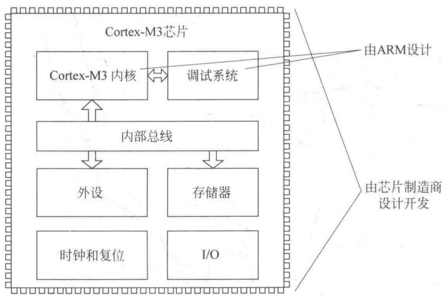

**这张图只要看懂一件事**：图里有一条竖虚线，把芯片分成左右两部分：

| 左边（**由 ARM 设计**） | 右边（**由芯片制造商设计开发**） |
|---|---|
| Cortex-M3 内核、调试系统 | 外设、存储器、时钟和复位、I/O |

> **这解释了一个常见困惑**：为什么 ST、NXP、TI 的芯片都叫"Cortex-M3"，但外设数量、存储器大小完全不同？
> **因为内核是同一个（ARM 卖的是"设计图纸"），外面的配置各家不同。**

#### 内核内部的四个部件（= 平时说的 CPU）

```
指令取指单元  →  译码单元  →  寄存器组  →  运算器
（把指令拿进来）  （看懂它）   （暂存数据）   （真的算）
```

正好对应"取指令 → 译码 → 执行"三步。

#### 内核自带的设施（PPT 列了 8 个，只有 3 个要重点记）

| 名称 | 中文 | 一句话 | 重要度 |
|---|---|---|---|
| **NVIC** | 嵌套向量中断控制器 | 中断的"总调度室"：谁敲门、该不该开门、先开哪个门 | ★★★ |
| **SysTick** | 系统滴答定时器 | 一个 **24 位倒计时计数器**，能定时产生中断，作为系统定时器使用 | ★★★ |
| **总线矩阵** | Bus Matrix | 总线的"立交桥"；还负责**非对齐访问**、**位带支持**、提供**写缓冲区** | ★★★ |
| MPU | 内存保护单元 | 可选件：给存储器划"禁区" | ★ |
| FPB / DWT / ITM / ETM / TPIU / ROM 表 | 各种调试单元 | 全是**调试（debug）**用的，属于开发工具链范畴 | ★ |

#### NVIC 的 6 条特性（PPT 专门列出）

1. 外部中断可配置为 **1～240 个**（STM32F1：60 个可屏蔽中断 + 若干系统异常）；
2. **优先级位可配置为 3～8 位**；
3. 中断优先级可**动态重新配置**；
4. **优先级分组**，分为占先（抢占）中断等级和非占先中断等级；
5. 支持**咬尾**（tail-chaining）和**迟来**（late arrival）中断；
6. 处理器状态在进入中断时**自动保存**，退出时**自动恢复**。

#### Cortex-M3 内核的特性（PPT 逐条列出）

**必须记住的 5 条**：

| # | 特性 | 说明 |
|---|---|---|
| 1 | **ARMv7-M 架构** | 采用 Thumb-2 指令集；**Cortex-M3 不能执行 ARM 指令** |
| 2 | **哈佛处理器架构** | 在加载/存储数据的同时能够执行指令取指 |
| 3 | **三级流水线** | 取指、译码、执行 |
| 4 | **32 位单周期乘法 + 硬件除法** | 集成硬件除法功能 |
| 5 | **分组的堆栈指针** | 主堆栈 MSP 和进程堆栈 PSP |

**其余几条**（了解即可）：

- 中断响应快速且支持**多级中断嵌套**，中断延迟短；
- **处理模式（handler mode）和线程模式（thread mode）**；
- Thumb 状态和调试状态；
- **可中断-可继续的 LDM/STM、PUSH/POP**（多寄存器操作被打断后能接着做，不用重来），低中断延迟；
- **低延迟进入和退出 ISR**，自动保存和恢复；
- **支持非对齐访问**；
- 功耗低；门数目少（价格低）、调试成本低。

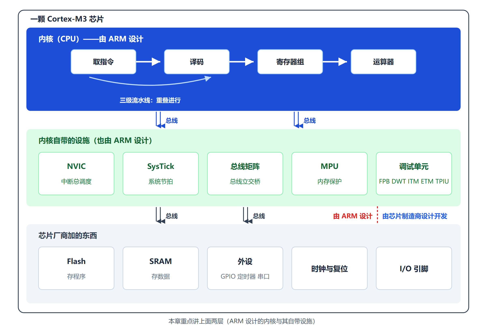

*最上层（蓝）是 ARM 设计的内核，本章主角；中层（绿）是内核自带设施；下层（灰）是芯片厂商加的，第 3 章以后才讲。*

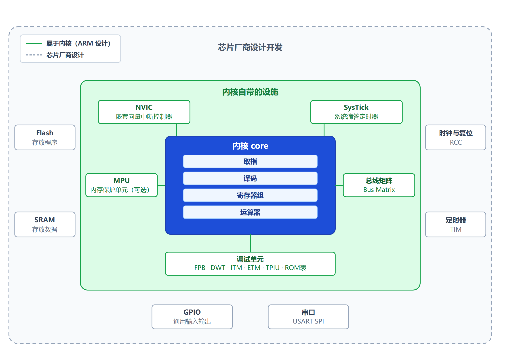

*最内圈是内核；中间圈是内核自带设施（NVIC/SysTick/总线矩阵/MPU/调试单元）；最外圈是芯片厂商加的东西。*

---

### 2.2 总线结构 ★★ 【PPT 重点：陈 p10～p12 / 梁 p10～p12】

**基于哈佛体系结构**，有专门的数据总线和指令总线，使数据访问和指令存取可以**并行进行**，效率大大提高。

**Cortex-M3 的四条总线**：

| 总线 | 干什么 |
|---|---|
| **I-Code 指令总线** | 用于从**代码空间取指令和向量** |
| **D-Code 数据总线** | 用于对**代码空间**进行数据加载/存储以及调试访问 |
| **系统总线** | 访问**内存和外设**：SRAM、片上外设、片外 RAM、片外扩展设备以及系统级存储区 |
| **外设总线（PPB）** | 用于访问**私有外设**（如 GPIO、定时器、UART） |

**AMBA 片上总线的两个层次**：

- **AHB**（Advanced High performance Bus，系统总线）：主要用于**高性能模块**（如 CPU、DMA 等）之间的连接；
- **APB**（Advanced Peripheral Bus，外设总线）：主要用于**低带宽的外设**之间的连接。

> **【易错】I-Code 和 D-Code 都是访问"代码空间"的，区别是什么？**
> **I-Code 只取指令，D-Code 取数据（对代码空间做数据读写，比如读常量表）**。
> 分成两条路，取指和取数就能同时进行。

---

### 2.3 流水线 ★★★ 【PPT 重点：陈 p13～p19 / 梁 p13～p19，含推演过程】

#### 三级流水线

| 阶段 | 英文 | 干什么 |
|---|---|---|
| 1 | **fetch** 取指 | 从存储器（代码区）**装载一条指令** |
| 2 | **decode** 译码 | **识别**将要被执行的指令 |
| 3 | **execute** 执行 | **处理指令并将结果写回寄存器** |

**PPT 明确标出的两个要点**：

> - **在译码时进行分支预测，遇跳转指令也不会打断流水线**；
> - **PC 值总是指向正在取指的指令**。

**核心表格（PPT 里用四张图逐周期推演过）**：

```
周期节拍      1        2        3        4        5        6
──────────────────────────────────────────────────────────────
指令 N      取指令    译码     执行
指令 N+1              取指令    译码     执行
指令 N+2                       取指令    译码     执行
指令 N+3                                取指令    译码     执行
```

**PPT 的逐周期推演**：

- **第 1 个周期**：PC 指向指令 1，指令 1 进入**取指**阶段；
- **第 2 个周期**：PC 指向指令 2，指令 1 进入**译码**，同时取出指令 2；
- **第 3 个周期**：PC 指向指令 3，指令 1 进入**执行**，指令 2 进入译码，取出指令 3；
- **第 4 个周期**：指令 1 **执行完成**，指令 2、3 推进一级，同时开始指令 4 的取指。

**怎么读**：

- **斜着看**：每个数字连成一条从左上到右下的斜线 → "一条指令的一生"；
- **竖着看**：第 3 周期里同时在做"指令 N 的执行、N+1 的译码、N+2 的取指" → "此刻同时在干的活"。

**总效果**：

```
不用流水线：4 条指令 × 3 周期 = 12 个周期
用三级流水线：6 个周期全部完成
```

> **PPT 的结论**：**通过将每条指令的执行过程拆分为取指、译码、执行三个独立的阶段，并让它们并行工作**，
> 这三个阶段由不同的硬件单元处理，从而实现了并行。

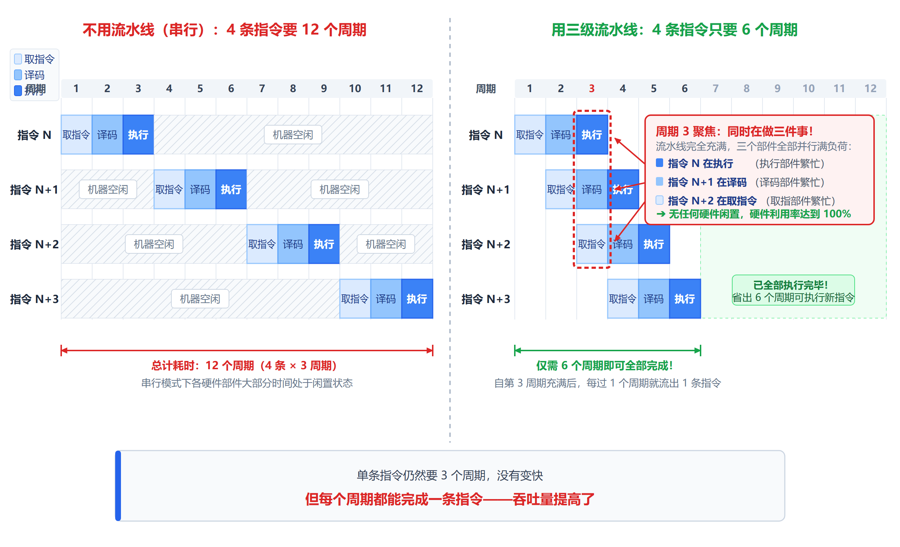

*左半边每条指令独占 3 格、中间大片空白；右半边三格错开、机器一直不空闲。*

> **【最重要的一句话】单条指令的执行时间没有缩短（还是 3 个周期），但"每周期完成的指令数"提高了。**

#### PC 指向哪里（必记）

> **PC 值总是指向正在取指的指令。**

所以当你"执行"某条指令时，PC 已经指向后面的指令了。**读 PC 得到的是"当前指令地址 + 4"**（因为取指和译码之间差了一级）。

#### 分支预测：PPT 用两组推演对比

PPT 用**同一个程序段**做了两次推演，对比"不带分支预测"和"带分支预测"：

```
地址        指令
0x0200      MOV     R0, #00
0x0202      ADDS    R0, R0, #1
0x0204      CMP     R0, #0x7D0
0x0208      BNE     0x00000202
0x020A      BX      0x00000300
0x020C      LDR     R1, #00
...
0x0300      MOV     R2, #20
```

**【ARM7：不带分支预测】**

```
step1:  取指 MOV
step2:  取指 ADDS   译码 MOV
step3:  取指 CMP    译码 ADDS  执行 MOV
step4:  取指 BNE    译码 CMP   执行 ADDS
step5:  取指 BX     译码 BNE   执行 CMP
step6:  取指 LDR    译码 BX    执行 BNE
step6:  --           --         执行 ADDS  ← 跳到 0x0202
```

> **执行时遇跳转指令则清空流水线。**

**【Cortex-M3：带分支预测】**

```
step1:  取指 MOV
step2:  取指 ADDS   译码 MOV
step3:  取指 CMP    译码 ADDS  执行 MOV
step4:  取指 BNE    译码 CMP   执行 ADDS
step5:  取指 ADDS   译码 BNE   执行 CMP   ← 注意：这里取的是 0x0202 的 ADDS
step6:  取指 CMP    译码 ADDS  执行 BNE
```

> **因为带分支预测，跳转指令在译码时就被识别，取指时流水线自动加载跳转后地址的指令。**

**两张图的区别**：

| | ARM7（不带分支预测） | Cortex-M3（带分支预测） |
|---|---|---|
| 识别跳转的时机 | **执行**时才发现要跳 | **译码**时就识别出跳转 |
| 已经取回的指令 | **全部作废，清空流水线** | **继续用**，取指直接加载跳转后地址 |
| 结果 | 白做几个周期的工作 | 流水线不被打断 |

**关键差异在 step5**：ARM7 取回了 `BX`（错的），而 Cortex-M3 取回了 `ADDS`（对的，就是跳转目标 `0x0202` 处的指令）。

> **这就是"分支预测"的价值：把"跳转要付出代价"这件事尽量消掉。**

---

### 2.4 寄存器 ★★★ 【PPT 重点：陈 p20～p35 / 梁 p20～p33，本章最重要的基础】

#### 寄存器组全景

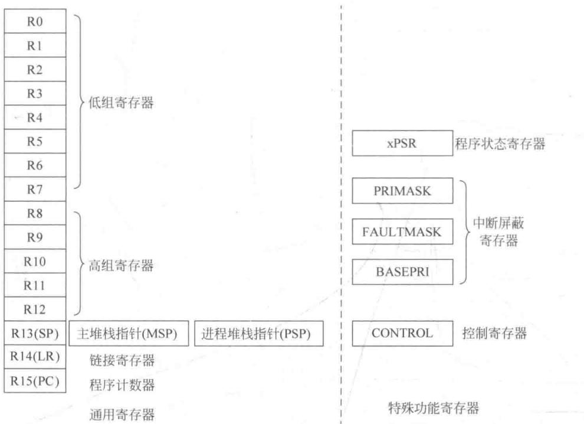

教材图分**左右两栏**：

```
左栏 = 通用寄存器              右栏 = 特殊功能寄存器
R0～R7   低组寄存器            xPSR          程序状态寄存器
R8～R12  高组寄存器            PRIMASK   ┐
R13(SP)  → MSP / PSP          FAULTMASK ├  中断屏蔽寄存器
R14(LR)  → 链接寄存器           BASEPRI   ┘
R15(PC)  → 程序计数器          CONTROL       控制寄存器
```

> **右栏这些寄存器不能用普通指令随便改，必须用 `MRS`/`MSR` 指令**——因为它们是"设置项"，乱改会让 CPU 行为失控。

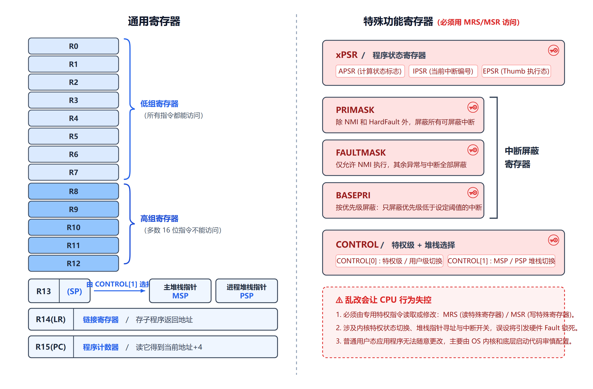

*左栏是"随便用来存数据的"，右栏是"控制 CPU 自身行为的开关"（图中画成需要钥匙才能打开）。*

#### 低组 / 高组寄存器

| | R0～R7（低组） | R8～R12（高组） |
|---|---|---|
| 位宽 | 32 位 | 32 位 |
| 谁能访问 | **可以被指定通用寄存器的所有指令访问**（16 位和 32 位都行） | **可以被指定通用寄存器的所有 32 位指令访问**；**能被少数 16 位指令访问** |
| 复位后初值 | **随机**（芯片刚上电时是垃圾值，不要假设是 0） | 随机 |

**为什么分两组**：16 位指令编码空间太小，寄存器编号只能占 **3 个 bit** → 只能表示 0～7 → 只能指向 R0～R7。

#### R13（SP）：一个名字，两个实体

```
        你写 R13 / SP
              │
              ▼
      ┌───────────────┐
      │  当前是哪个堆栈？ │   ← 由 CONTROL[1] 决定
      └───────────────┘
         │            │
         ▼            ▼
    ┌─────────┐  ┌─────────┐
    │   MSP   │  │   PSP   │
    │ 主堆栈   │  │ 进程堆栈 │
    └─────────┘  └─────────┘
```

| 堆栈 | 全称 | 谁用 |
|---|---|---|
| **MSP** | Main Stack Pointer，主堆栈指针 | **中断处理、异常处理、默认的普通程序**；**复位后默认** |
| **PSP** | Process Stack Pointer，进程堆栈指针 | **普通程序里，特意切换给用户任务用的** |

**关键点**：**逻辑上共用 R13，物理上独立的 MSP 和 PSP，硬件自动切换**。当作为 R13 使用时，只能用"当前状态确定的那个堆栈"；**另一个只能通过 `MRS`/`MSR` 访问**。

**由 CONTROL 寄存器的 bit[1] 控制**：

```
CONTROL[1] = 0（默认） → 用 MSP
CONTROL[1] = 1         → 用 PSP
```

#### R14（LR）：链接寄存器

> 在执行**分支(branch)和链接(BL)指令**或**带有交换的分支和链接指令(BLX)**时，**LR 用于保存 PC 的返回地址**。
> 主要用于保存**子程序的返回地址**。**LR 也用于异常返回。**

**PPT 给的例子（含地址推演）**：

```asm
main
    ...
    BL.W    delay       ; 调用 delay
    ...
delay:
    ...
    BX      LR          ; 返回
```

```
地址        R14(LR)
0x20F0      （BL.W 所在地址）
0x20F4      0x20F4     ← 执行 BL 指令，LR 的值同时更新
            （BL 下一条指令的地址）
```

> **PPT 的标注**：**执行 BL 指令，LR 的值同时更新**；**LR = BL 当前行的下一条指令地址**。

**为什么把返回地址放 LR 而不是压栈**：**为了减少访问内存的次数**。只做一级调用时（A 调 B，B 直接返回），返回地址就在 LR 里，**根本不用碰内存**。

> **【易错】教材特意提醒：如果 function1 要使用 LR，必须在使用前 PUSH。**
> 意思是：如果函数内部还要调用别的函数（或者自己要用 LR 做别的事），就必须**先把 LR 压进堆栈保护起来**，
> 否则调用完回来时 LR 已经被改掉，`BX LR` 就会跳到错误的地方——教材说这叫"**程序跑飞**"。

#### R15（PC）：程序计数器

> **程序计数器总是指向正在取指的指令。**
> **该寄存器的位 0 始终为 0**，因此，指令始终与**字或半字边界对齐**。

**【易错】这一条和前面 2.3 节的"读 PC 得当前地址 + 4"合起来理解**：

```
① PC 总是指向【正在取指】的指令
② PC 的 bit0 始终为 0 → 指令与字（4 字节）或半字（2 字节）边界对齐
③ 读 PC 得到的是"当前指令地址 + 4"
```

#### 特殊功能寄存器之一：xPSR

**三类特殊功能寄存器**：

| 类别 | 包含 | 作用 |
|---|---|---|
| 程序状态寄存器 | **xPSR**（含 APSR、IPSR、EPSR） | 用于指示程序的运行状态 |
| 中断屏蔽寄存器 | **PRIMASK、FAULTMASK、BASEPRI** | 控制中断/异常的开关 |
| 控制寄存器 | **CONTROL** | 决定特权级别、决定用哪个堆栈指针 |

> **对程序状态寄存器的访问只能使用 MRS 和 MSR 指令**：
> - `MRS <reg>, <special_reg>`：将特殊功能寄存器的值读到通用寄存器；
> - `MSR <special_reg>, <reg>`：将通用寄存器的值写到特殊功能寄存器。

**xPSR 由三个子寄存器"叠"在一起组成，共用一个 32 位**：

```
bit    31  30  29  28  27  26 25  24   23 20   19 16   15 10  9  8  7  6  5  4 0
      +---+---+---+---+---+-----+---+-------+-------+-------+--+--+--+--+--+----+
xPSR  | N | Z | C | V | Q |ICI/IT| T |       |       | ICI/IT|  |  |  |  |  |异常号|
      +---+---+---+---+---+-----+---+-------+-------+-------+--+--+--+--+--+----+
       └────── APSR ────────┘                    └── EPSR ──┘      └── IPSR ──┘
```

**【APSR 的 5 个标志位——这是本章最需要记的位】**

| 位 | 名称 | 英文 | = 1 表示 | = 0 表示 |
|---|---|---|---|---|
| bit31 | **N** | Negative（负数或小于标志） | **结果为负数或小于** | 结果为正数或大于 |
| bit30 | **Z** | Zero（零标志） | **结果为 0** | 结果为非 0 |
| bit29 | **C** | Carry（进位/借位标志） | **加操作产生进位，或减操作没有产生借位** | 加操作没有产生进位，或减操作产生借位 |
| bit28 | **V** | oVerflow（溢出标志） | **溢出** | 没有溢出 |
| bit27 | **Q** | sticky saturation（粘着饱和） | **不考虑**（PPT 注明） | — |

> **这 5 个标志有什么用？** 它们是**条件跳转的依据**——就像做算术时在草稿纸边上记的记号，后面遇到"如果结果为零就跳转"时不用重算。

> **【先补一个前置知识：什么叫"溢出"？】**
> 32 位有符号数能表示的范围大约是 −21 亿 ～ +21 亿。
> 如果 `2 000 000 000 + 2 000 000 000`，真实结果 40 亿超出了这个范围，寄存器里放不下，就会"绕回去"变成一个错误的负数。
> 这种情况就是**溢出**，V 标志会被置 1 提醒你"这次运算的结果不可信"。

**【IPSR：中断号寄存器】**

> **中断号寄存器（IPSR）包含当前激活的异常的 ISR 编号。**

**PPT 的位分配**：

```
bit    31                                                          9   8                    0
      +-----------------------------------------------------------+---+---------------------+
IPSR  |                       保留                                 |      中断号           |
      +-----------------------------------------------------------+---+---------------------+
```

**PPT 给的编号例子**：

```
基础级别  = 0        （线程模式，没在处理任何异常）
Reset     = 1
NMI       = 2
SVCall    = 11
...
```

**为什么需要它**：因为**多个中断可能共用同一个处理程序**。处理程序一进来就看看 IPSR："哦，现在编号是 11，那就是 SVCall 把我叫醒的。"

**【EPSR：执行状态寄存器】**

> **为什么需要 EPSR？**
> LDM、STM 和 If-then 指令，为**多周期指令**。如果在执行以上多周期指令时发生异常，处理器会**暂时停止**以上指令的操作，进入异常，这时需要**保护现场**。

**EPSR 包含两个重叠的区域**：

| 区域 | 作用 |
|---|---|
| **可中断-可继续指令（ICI）区** | **多寄存器加载（LDM）和存储（STM）操作是可中断的**。EPSR 的 ICI 区用来保存**从产生中断的点继续执行**多寄存器加载和存储操作时所必需的信息 |
| **If-then 状态区（IT 区）** | 包含了 If-Then 指令的执行状态位 |

> **注意**：**ICI 区和 IT 区是重叠的**，但 **If-Then 模块内的多寄存器加载或存储操作不具有可中断-可继续功能**。

**不能直接访问 EPSR**。若想修改 EPSR，必须发生以下两个事件之一：
1. **在执行 LDM 或 STM 指令时产生一次中断**；
2. **执行 If-Then 指令**。

**【补充解释：什么叫"多寄存器加载/存储"？】**

> 一条 `LDM`（Load Multiple）指令可以一次把**好几个寄存器**从内存里装回来，比如"从 SP 指向的地方连续取 8 个字，分别放进 R0～R7"。
> 这种指令执行时间长，如果中途来中断，硬件的做法是**记住做到第几个了**，回来接着做。

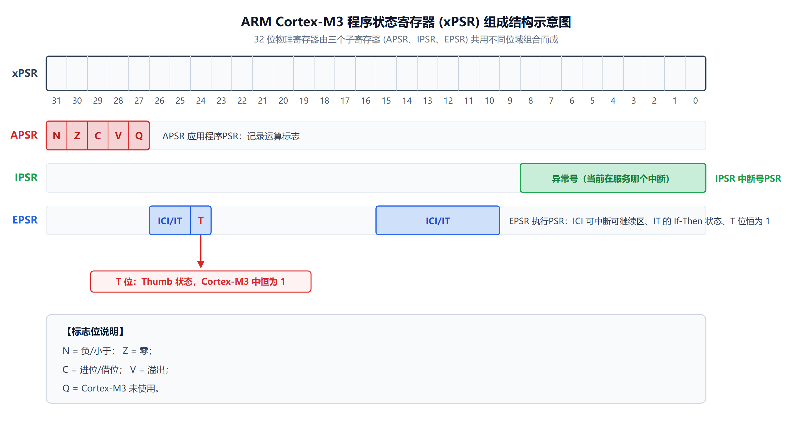

*一个 32 位寄存器，三拨人共用不同的位——看图时只记这句话。*

#### 特殊功能寄存器之二：中断屏蔽寄存器

**三类中断屏蔽寄存器**：

| 寄存器 | 作用 | 默认值 |
|---|---|---|
| **PRIMASK** | **相当于中断总开关**：为 1 时**所有中断被屏蔽**；为 0 时中断能正常响应。**只有最低位有效** | 0 |
| **FAULTMASK** | 为 1 时**关闭异常**（比 PRIMASK 更彻底） | 0 |
| **BASEPRI** | **可屏蔽等于和低于某个优先级的中断** | 0 |

```
                          谁能响应？
┌──────────────────────────────────────────────────────────┐
│ PRIMASK   = 1 ： 所有中断被屏蔽                            │
│ FAULTMASK = 1 ： 关闭异常（FAULTMASK = 0 时开异常）        │
│ BASEPRI   = X ： 屏蔽优先级【等于和低于】X 的中断           │
└──────────────────────────────────────────────────────────┘
                优先级号越小 → 优先级越高
```

**【PPT 的 BASEPRI 例子】**

> 例如，把 BASEPRI 设置为 **0x40**（即 4，芯片型号确定），则 **4 和 4 以上优先级的中断被屏蔽**，只有 0 和 1 优先级的中断不被屏蔽。

**PPT（梁版）的补充说明**：

> **F1 实际只用 bit7~4（高 4 bit）**，bit3~0 读出来永远是 0。

> **【易错】两位老师对同一个例子的数字表述略有不同**（陈版写"即 2"，梁版写"即 4"）。
> 这个数字本身不是重点——**重点记住机制**：**BASEPRI 设一个阈值，优先级号 ≥ 这个阈值的都被屏蔽**。
> 阈值越小，屏蔽的范围越小（只屏蔽低优先级的）。

**【为了快速开关中断，Cortex-M3 专门提供了一条 CPS 指令】**

```asm
CPSID  I     ; PRIMASK = 1，关中断
CPSIE  I     ; PRIMASK = 0，开中断
CPSID  F     ; FAULTMASK = 1，关异常
CPSIE  F     ; FAULTMASK = 0，开异常
```

- **CPS** = Change Processor State = 改变处理器状态；
- **CPSID** = CPS Interrupt Disable（关）；**CPSIE** = CPS Interrupt Enable（开）；
- 后缀 **I** 表示操作 PRIMASK，后缀 **F** 表示操作 FAULTMASK。

> **为什么要有 CPS 这条专门指令**：用 MRS + 改位 + MSR 需要三条指令，还要占用一个通用寄存器。
> CPS 一条就搞定，**关中断本身要快**——不然你"准备关中断"的这段时间里可能就被中断了。

**【易错】MRS 和 MSR 千万别记反**：

```
MRS = Move from Special register to Register   特殊 → 通用   = 读
MSR = Move from Register to Special register   通用 → 特殊   = 写
```

> 口诀：**MRS 里最后是 R（Register），所以结果是进寄存器** → 读。

#### 特殊功能寄存器之三：CONTROL

**CONTROL 寄存器由两个状态位组成**：

```
bit     31                              2   1   0
       +---------------------------------+---+---+
CONTROL|           未使用（保留）          | 1 | 0 |
       +---------------------------------+---+---+
                                          │   │
                        CONTROL[1] ───────┘   └─────── CONTROL[0]
                     堆栈指针选择                   特权级别选择
```

| 位 | = 0 | = 1 |
|---|---|---|
| **CONTROL[0]** | **特权模式** | **用户模式** |
| **CONTROL[1]** | **主堆栈（MSP）** | **进程堆栈（PSP）** |

**CONTROL 也通过 MRS 和 MSR 访问**：

```asm
MRS  R0, CONTROL
MSR  CONTROL, R0
```

**特权访问和用户访问的切换（PPT 给了两段代码）**：

**从处理模式退出时切换**：

```asm
MOV  R0, #0x00
MSR  CONTROL, R0      ; 清零 CONTROL[0] → 退出后是特权访问
```

**从特权线程模式进入用户访问**：

```asm
MRS  R0, CONTROL
ORR  R0, R0, #0x01    ; 置位 CONTROL[0]
MSR  CONTROL, R0
```

> **PPT 的说明**：
> - 在**处理模式**下，通过 MSR 指令**清零 CONTROL[0]**，退出处理模式进入线程模式时**切换到特权访问**；
> - 在**处理模式**下，通过 MSR 指令**置位 CONTROL[0]**，退出处理模式进入线程模式时**切换到用户访问**；
> - 在**线程模式特权访问**下，通过 MSR 指令置位 CONTROL[0]，**即可由特权访问进入用户访问**。

---

### 2.5 工作模式和工作等级 ★★★ 【PPT 重点：陈 p36～p42 / 梁 p34～p41】

#### 2 种模式 × 2 种等级 = 3 种合法状态

> **Cortex-M3 支持 2 种工作模式和 2 个工作等级。**

| | **特权级** | **用户级** |
|---|---|---|
| 运行**异常服务例程**时 | **处理模式** | ❌ **错误的用法** |
| 运行**主程序**时 | **线程模式** | **线程模式** |

```
① 线程模式 + 用户级      ← 普通应用程序（受限）
② 线程模式 + 特权级      ← 主程序，但权限很高（复位后的默认状态）
③ 处理模式 + 特权级      ← 异常服务例程（必须）
```

#### 特权级与用户级的差别

> **特权执行可以访问所有资源。**
> **非特权执行时对有些资源的访问受到限制或不允许访问**，如：
> - **部分指令的使用**（设置 FAULTMASK 和 PRIMASK 的 CPS 指令）；
> - **对系统控制空间（SCS）的大部分寄存器的访问**。

#### 两种模式的进入方式

**线程模式**：
- **在复位时处理器进入线程模式**；
- **异常返回时处理器进入线程模式**；
- **特权和用户（非特权）代码能够在线程模式下运行**。

**处理模式**：
- **出现异常时处理器进入处理模式**；
- **在处理模式中，所有代码都是特权访问的**。

#### 三种执行模式的比较（PPT 给了完整表格）

| 执行模式 | 进入方式 | 堆栈 SP | 用途 |
|---|---|---|---|
| **特权线程模式** | ① 复位；② 在特权处理模式下使用 MSR 指令清零 CONTROL[0] | 使用 **SP_main**：复位后默认；或清零 CONTROL[1]<br>使用 **SP_process**：置位 CONTROL[1]，或在退出特权处理模式前修改 EXC_RETURN[3:0] 为 `0b1101` | 普通程序 |
| **非特权线程模式** | 在特权线程模式或特权处理模式下使用 MSR 指令置位 CONTROL[0] | 同上 | **多用于操作系统的任务状态**（线程模式 + SP_process） |
| **特权处理模式** | **出现异常** | **只能使用 SP_main** | **在前后台和操作系统中用于中断状态** |

> **PPT 的补充**：在退出特权处理模式前，修改返回值 `EXC_RETURN[3:0]` 为 `0b1001` → 使用 SP_main；改为 `0b1101` → 使用 SP_process。

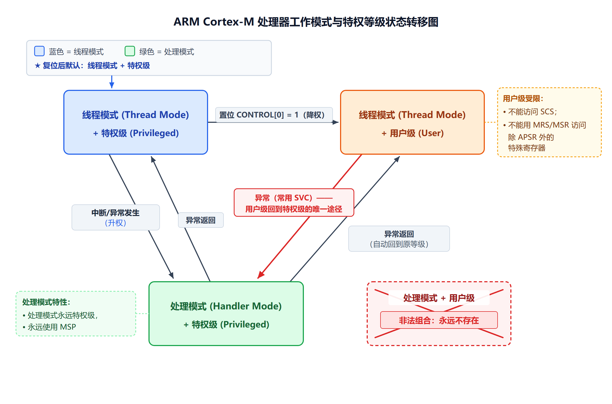

*复位后是"线程模式 + 特权级"，异常进处理模式，异常退出回线程模式；CONTROL[0] 决定线程模式下是特权还是用户。*

---

### 2.6 堆栈 ★★★ 【PPT 重点：陈 p43～p51 / 梁 p42～p48，含压栈过程逐字节推演】

#### 栈的定义与模型

> **堆栈操作就是对内存的读写操作**，但是其地址由专门的寄存器——**堆栈指针（SP）**给出，
> 其数据操作模式满足**先进后出（FILO）**的规则。

> **Cortex-M3 使用的是"向下生长的满栈"模型。** 堆栈是**按字操作**的，即每次入栈和出栈都是 **32 位数据**，
> 因此 **SP 值总是执行自增 4 / 减 4 操作**，而不是加 1 和减 1。

> 【类比】食堂里洗好的盘子一只只往上叠：放盘子只能放最上面，拿盘子也只能从最上面拿。
> **那根"指着最上面那只盘子"的手指，就是栈顶指针（SP）。**
>
> **类比的边界**：真实计算机里的"盘子摞"是**往低地址方向长的**，而且每只"盘子"固定是 4 字节。

| 术语 | 含义 |
|---|---|
| **向下生长** | PUSH 时 SP **减小**，POP 时 SP **增大** |
| **满栈** | **SP 指向"最后一个被压入的 32 位数值"** |
| **按字操作** | 每次 PUSH/POP 都是 **32 位（4 字节）**，SP 变化量永远是 **±4** |

#### PUSH 和 POP 的执行过程（必背）

> **PUSH 操作时，SP 先自减 4，再存入数据到 SP 所指存储器位置；**
> **POP 操作正好相反，先从 SP 所指存储器位置读出数据，SP 再自增 4。**

```
PUSH：SP 先自减 4，再存入数据
POP ：先从 SP 读出数据，SP 再自增 4
```

**【易错】顺序不能反**：**PUSH 是"先减后存"**；**POP 是"先读后加"**。

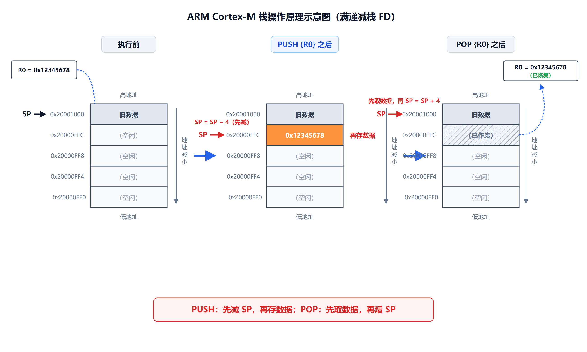

*PUSH 时 SP 向下移动（地址减小），POP 时 SP 向上移动（地址增大）。*

#### 双堆栈机制

> **Cortex-M3 的堆栈有两个：主堆栈（MSP）和进程堆栈（PSP）。**
> **MSP 和 PSP 都被称为 R13**，在程序中可以通过 **MRS/MSR 指令设置 CONTROL[1]** 来指定选用的堆栈指针。

**PPT 的表格**：

| | 处理模式 | 线程模式 |
|---|---|---|
| 可用 MSP | **始终使用 MSP** | 可用 MSP |
| 可用 PSP | — | 也可用 PSP |

**三条关键规则**：

```
① 复位后，所有代码都使用主堆栈
② 所有异常都使用主堆栈
③ 堆栈指针 R13 在 SP_main 和 SP_process 之间切换
   在任何时候，进程堆栈和主堆栈中只有一个是可见的，由 R13 指示
```

**为什么要两个堆栈**：**让操作系统的堆栈和应用程序的堆栈分开，程序出错不会毁掉系统。**

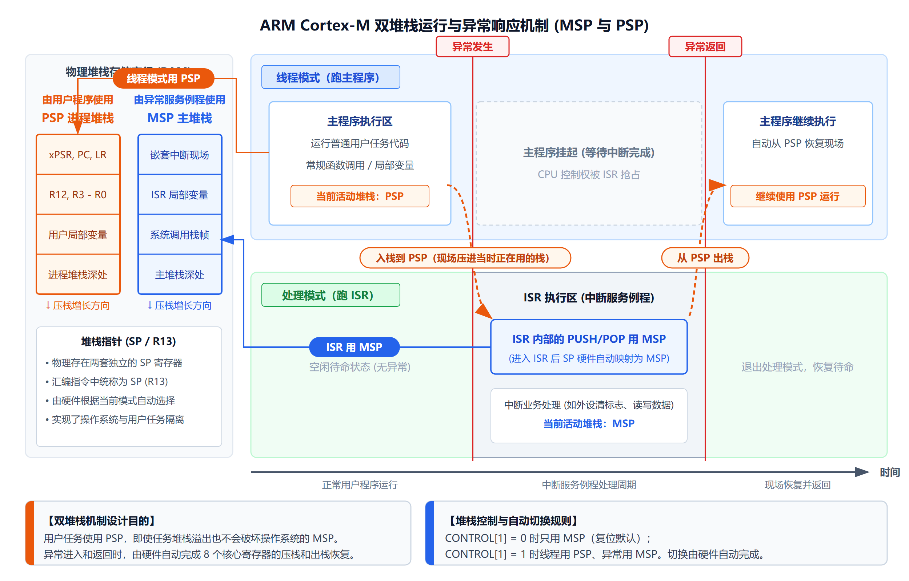

*处理模式始终用 MSP；线程模式由 CONTROL[1] 决定用 MSP 还是 PSP。*

#### 主堆栈压栈过程（PPT 逐格推演）

**PPT 给出的是"在 KEIL MDK 编译器下，堆栈增长为满递减"**：

```
数据
…
数据
栈底
数据        地址              数据增长方向（向下）
主堆栈      SP ──────▶ 0x20000400
                      0x200003FC
                      0x200003F8
```

**产生中断时，硬件自动压栈 8 个寄存器**：

```
主堆栈
SP ──▶ XPSR
       PC
       LR
       R12
       R3
       …
       R0
       0x20000400
       0x200003FC
       0x200003F8
       ← 硬件自动压栈
```

**退出中断时，硬件自动出栈，寄存器恢复为进入前的值**：

> **退出异常，寄存器恢复为进入前的值。**

> **这 8 个寄存器的详细顺序和地址，在 2.8 节会完整展开。** 这里先记住**"中断会消耗 32 字节栈空间"**。

---

### 2.7 存储器管理 ★★★ 【PPT 重点：陈-II p1～p11 / 梁-II p1～p10】

#### 2.7.1 存储器空间分配

> **Cortex-M3 支持访问 4GB 存储空间，有一个单一固定的存储器映射。**

**特点（PPT 列出 4 条）**：

1. **存储器映射是预定义的**，并且还规定好了**哪个位置使用哪条总线**；
2. **支持位带（Bit Band）操作**。通过它，实现了对单一比特（某个位）的**原子操作**。位带操作**仅适用于一些特殊的存储器区域**；
3. **支持非对齐访问和互斥访问**；
4. **支持小端模式和大端模式**。

**主干七个区（必背）**：

| 区名 | 地址范围 | 大小 | 用来干什么 |
|---|---|---|---|
| **代码区** | `0x00000000 ～ 0x1FFFFFFF` | **512MB** | 主要用于存放程序代码 |
| **片上 SRAM 区** | `0x20000000 ～ 0x3FFFFFFF` | **512MB** | 连接片上的 SRAM |
| **片上外设区** | `0x40000000 ～ 0x5FFFFFFF` | **512MB** | 映射片上外设 |
| **外部 RAM 区** | `0x60000000 ～ 0x9FFFFFFF` | **1GB** | 连接外部 RAM |
| **外部设备区** | `0xA0000000 ～ 0xDFFFFFFF` | **1GB** | 连接外部设备 |
| **专用外设总线区** | `0xE0000000 ～ 0xE00FFFFF` | **1MB** | NVIC、SysTick、MPU、调试部件 |
| **芯片厂商指定区** | — | — | 芯片厂商自己安排 |

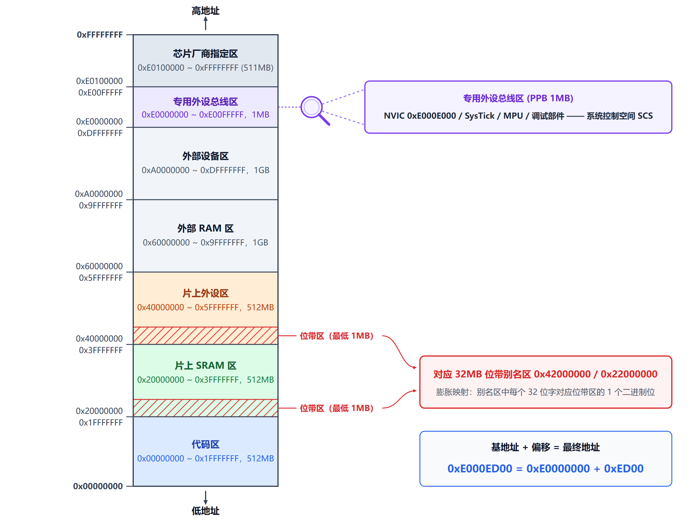

*先记七个主干区，再回头看教材原图看细节就清楚了。*

#### 2.7.2 位带操作（bit-band）★★★ 【PPT 用 4 页讲，含 C 代码】

**先补前置知识：为什么"改一位"很麻烦？**

假设内存地址 `0x20000000` 里存着一个字节 `0x37 = 0011 0111`，现在想把 **bit2 改成 0**。传统做法要三步：

```
① 读出整个字节       → 得到 0x37
② 修改 bit2          → 0x37 的 bit2 是 1，清 0 后得 0011 0011 = 0x33
③ 写回整个字节       → 把 0x33 写回 0x20000000
```

**问题在哪？**

> **"读-改-写"这三步不是原子的。** 如果在第 ① 步和第 ③ 步之间来了一个中断，中断服务程序也去改同一个字节，那么：
>
> ```
> 主程序：读 → 0x37
>         （中断来了）
> ISR   ：读 → 0x37，改别的位 → 写回 0xXX
>         （中断返回）
> 主程序：改 bit2 → 0x33，写回 0x33   ← ISR 的修改被覆盖了！丢失！
> ```

**位带就是来解决这个问题的：它把"读-改-写"三步做成硬件支持的、不可被打断的一条操作。**

**位带的两个术语**：

| 术语 | 定义 |
|---|---|
| **位带区** | 支持位带操作的地址区 |
| **位带别名** | 位带区中位的别名。**对别名的访问最终映射到位带区中某一位的访问上** |

**支持位带操作的两个内存区**：

```
① 0x20000000 ～ 0x200FFFFF   （内部 SRAM 区中的最低 1MB）
② 0x40000000 ～ 0x400FFFFF   （片上外设区中的最低 1MB）
```

**对应的别名区**：

```
① 0x22000000 ～ 0x23FFFFFF   （32MB）
② 0x42000000 ～ 0x43FFFFFF   （32MB）
```

**"膨胀"关系：每一位 → 一个字（32 位）**

> **位带别名区把每个位膨胀成一个 32 位的字**，当访问位带别名区中的字时，就和访问原始比特一样。

```
位带区（1MB）                     位带别名区（32MB）
┌──────────────────┐             ┌──────────────────┐
│  字节 0           │             │  字 0  ← bit0 的别名 │
│  ┌─┬─┬─┬─┬─┬─┬─┬─┐│  膨胀 32 倍  │  字 1  ← bit1 的别名 │
│  │b7│b6│…│b1│b0││ ──────────▶ │  字 2  ← bit2 的别名 │
│  └─┴─┴─┴─┴─┴─┴─┴─┘│             │  ...                 │
│  字节 1           │             │  字 7  ← bit7 的别名 │
└──────────────────┘             └──────────────────┘
   1MB × 8 位 = 8M 个位           8M 个字 × 4 字节 = 32MB
```

**32 倍是怎么来的**：

```
位带区：1MB = 1 048 576 字节 = 8 388 608 个位
别名区：每个位占 1 个字 = 4 字节
        8 388 608 位 × 4 字节 = 33 554 432 字节 = 32MB
32MB ÷ 1MB = 32 倍
```

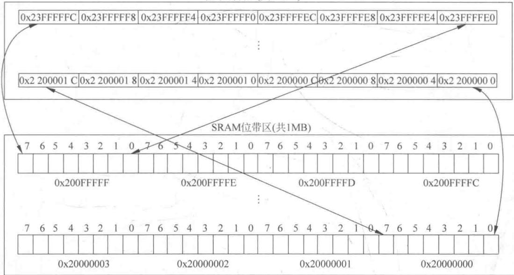

*左边每个小格子是一位，右边每个大格子是一个 32 位字，箭头表示"膨胀 32 倍"。*

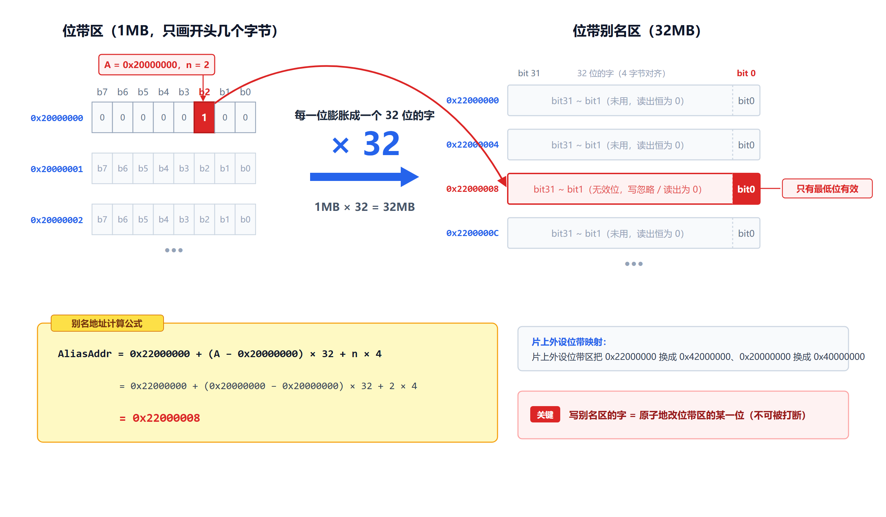

*"1 位 → 1 个字"这个膨胀关系是位带的全部秘密。*

#### 别名地址换算公式（必背）

**内部 SRAM 位带区**：

```
AliasAddr = 0x22000000 + ((A − 0x20000000) × 8 + n) × 4
          = 0x22000000 + (A − 0x20000000) × 32 + n × 4
```

**片上外设位带区**：

```
AliasAddr = 0x42000000 + ((A − 0x40000000) × 8 + n) × 4
          = 0x42000000 + (A − 0x40000000) × 32 + n × 4
```

| 符号 | 含义 |
|---|---|
| `A` | 位带区中，这个位**所在字节的地址** |
| `n` | 位序号，`0 ≤ n ≤ 7`（字节内的第几位） |
| `AliasAddr` | 这个位在别名区的对应地址 |

**公式为什么长这样（PPT 的解释）**：

> 式中，"**×4**"是因为一个字为 4 字节，"**×8**"表示一个字节为 8 位。

**拆开推导**：

```
(A − 0x20000000)           → 这个字节是位带区里的第几个字节
(A − 0x20000000) × 8       → 这个字节之前一共有多少个位（每字节 8 位）
(A − 0x20000000) × 8 + n   → 这个位是位带区里的第几个位
× 4                         → 每个位在别名区占 4 字节
```

**手算验证（教材表 2-4 的三行）**：

```
例 1：0x20000000 的 bit0
AliasAddr = 0x22000000 + 0 × 32 + 0 × 4 = 0x22000000  ✓

例 2：0x20000000 的 bit2
AliasAddr = 0x22000000 + 0 × 32 + 2 × 4 = 0x22000008  ✓

例 3：0x20000004 的 bit1
(A − 0x20000000) = 4
4 × 32 = 128 = 0x80
AliasAddr = 0x22000000 + 0x80 + 4 = 0x22000084  ✓
```

#### 位带操作的实例（PPT 给了完整例子）

> **教材实例**：
> （1）在地址 `0x20000000` 处写入 `0x3355AACC`；
> （2）读地址 `0x22000008`。本次访问将读取 `0x20000000` 的 **bit2**，**值为 1**；
> （3）往地址 `0x22000008` 处**写 0**。本次操作将 `0x20000000` 的 **bit2 清零**；
> （4）再读取 `0x20000000`，将返回 **`0x3355AAC8`**（bit2 清零）。

**验证第（4）步**：

```
原值     0x3355AACC = 0011 0011 0101 0101 1010 1010 1100 1100
                                                       ↑ bit2 = 1
把 bit2 清 0：
         0x3355AAC8 = 0011 0011 0101 0101 1010 1010 1100 1000
                                                       ↑ bit2 = 0

验算：0xCC = 1100 1100，清掉 bit2 → 1100 1000 = 0xC8  ✓
```

#### 位带操作的 C 语言用法（PPT 给了代码）

```c
#define DEVICE_REG0       ((volatile unsigned long *) (0x40000000))
#define DEVICE_REG0_BIT0  ((volatile unsigned long *) (0x42000000))
#define DEVICE_REG0_BIT1  ((volatile unsigned long *) (0x42000004))
...
*DEVICE_REG0 = 0xAB;                    // 使用正常地址访问寄存器
...
*DEVICE_REG0 = *DEVICE_REG0 | 0x2;      // 使用传统方法设置 bit1
...
*DEVICE_REG0_BIT1 = 0x1;                // 通过位带别名地址设置 bit1
```

**三种写法的区别（PPT 备注里讲得很清楚）**：

| 写法 | 硬件具体动作 | 特点 |
|---|---|---|
| `*DEVICE_REG0 = 0xAB` | 该寄存器的所有 32 个位**被一次性覆盖** | 这是最直接的 CPU 写总线操作，**一次完成，不会产生"读改写"的过程** |
| `*DEVICE_REG0 \|= 0x2` | ① **读**：CPU 先从地址读取当前寄存器的全部 32 位值<br>② **改**：CPU 内部逻辑进行按位或运算<br>③ **写**：CPU 再将计算好的结果整个写回 | **读-改-写三步** |
| `*DEVICE_REG0_BIT1 = 0x1` | 硬件读取原始地址的值 → **硬件只修改第 1 位为 1，其他位保持不变** → 硬件将修改后的值写回原始地址 | **硬件保证原子性**（读、改、写由硬件一次完成） |

---

#### 2.7.3 端模式（Endianness）★★

**PPT 的位图**：

```
小端模式：存储器视图                大端模式：存储器视图
D[31:24]                           D[7:0]
D[23:16]                           D[15:8]
D[15:8]                            D[23:16]
D[7:0]                             D[31:24]
地址                               地址
0x1003                             0x1003
0x1002                             0x1002
0x1001                             0x1001
0x1000                             0x1000
```

**PPT 的定义**：

> **小端模式：数据的高位字节保存在高位地址，低位字节保存在低位地址。**

**PPT 的结论**：

> **为避免麻烦，统一使用小端模式。**

**【易错】小端的口诀是"低对低"**——**低位字节放在低位地址**。不要记成"高对低"。

#### 2.7.4 非对齐访问支持 ★★

**PPT 的说明**：

> **ARM Cortex-M3 支持非对齐访问，提高存储器使用率。**

**PPT 的对比图含义**：

```
不支持非对齐访问时：
  Long (32)   Long (32)
  short (16)  short (16)
  Char  Char  Char  Char
  Unused (wasted) space          ← 空洞，浪费了
  Data aligned on word boundaries

支持非对齐访问时：
  Char  Long (32)  short (16)
  Char Char  Char  short (16)  Long (32)
  Free space Can be used         ← 空洞可以被利用
```

**大白话**：不支持非对齐访问时，数据必须放在"对齐"的位置（比如 32 位数据必须放在 4 的倍数地址上），中间会留下**填不满的空洞**。支持之后，**这些空洞可以被利用，存储器使用率提高**。

> **【补充解释】什么是"非对齐访问"**：比如一个 32 位数存在地址 `0x1001`（不是 4 的倍数）上，CPU 也能读，
> **硬件会自动拆成两次对齐访问再拼起来**。

---

### 2.8 异常与中断 ★★★ 【PPT 投入最多：陈-II p12～p60 / 梁-II p11～p61】

#### 2.8.1 中断的基本概念

**正式定义**：

> 所谓**中断**是指计算机在执行程序的过程中，出现某些事件需要立即处理时，
> **CPU 暂时中止正在执行的程序，转去执行对某种请求的处理程序**。
> 当处理程序执行完毕后，CPU 再回到先前被暂时中止的程序继续执行。

**5 个必须掌握的术语**：

| 术语 | 含义 |
|---|---|
| **中断系统** | 实现"中断"这种功能的部件 |
| **中断源** | 请示 CPU 中断的**请求源** |
| **中断响应** | 中断源向 CPU 发出中断申请，CPU 暂停当前工作转去处理该事件 |
| **中断服务** | 对整个事件的处理过程 |
| **中断返回** | 事件处理完毕，CPU 返回到被中断的地方 |

**中断的优势与作用（PPT 列了 3 条）**：

1. **可及时处理控制系统中许多随机发生的事件**；
2. **较好解决快速 CPU 和慢速外设之间的矛盾，可使 CPU 和外设并行工作**；
3. **具备了处理故障的能力，提高了系统自身的可靠性**。

**PPT 给的适用场景**：

> - 当计算机正在正常运行一个程序段的时候，如果有一个**紧急事件**出现，又必须要立即处理这个紧急的事件；
> - 计算机一边工作一边随时准备处理一个事件，但**不确定该事件出现的确切时刻**，像处理防火防盗事件一样。

#### 【重点对比】中断 vs 调用子程序（PPT 专门列表）

| 中断 | 调用子程序 |
|---|---|
| 产生时刻是**随机的** | 程序中**事先安排好的** |
| **既保护断点（自动），又保护现场（程序）** | 可只保护断点（自动） |
| 处理程序的入口地址是**单片机硬件确定的，用户不能改变** | 子程序的入口地址是**程序编排的** |

> **这张表很重要**：它说明中断和子程序调用虽然形式相似（都是"跳出去再回来"），
> 但**触发方式、现场保护范围、入口地址来源**三处都不同。

#### 其他重要概念（PPT 逐个列出）

| 概念 | 说明 |
|---|---|
| **开中断 / 关中断** | 中断的开放（**开中断、中断允许、中断使能**）和中断的关闭（**关中断、中断禁止、中断除能**）可以**通过指令设置相关特殊功能寄存器的内容来实现**，**这是 CPU 能否接受中断请求的关键**。只有在开中断的情况下，才有可能接受中断源的请求 |
| **保护现场 / 恢复现场** | 进入子程序或中断处理程序后保存这些寄存器中的值叫**保护现场**；返回前恢复叫**恢复现场**。**通用寄存器的保存和恢复需要由堆栈操作指令来完成；返回地址的保存与恢复的堆栈操作都是在相应的子程序的调用和返回指令的操作中自动完成的，无需再用专门的堆栈操作指令** |
| **中断的响应** | CPU 响应中断源请求时，由**中断系统硬件**控制 CPU 从主程序转去执行中断服务程序，同时**把断点地址自动送入堆栈**进行保护 |
| **中断的撤除** | 在响应中断请求后、返回主程序之前，**该中断请求标志应该撤除**，否则 CPU 执行完中断服务程序会**误判为又发生了中断请求而错误地再次进入中断服务程序** |

> **【易错】"中断的撤除"这一条最容易忘**。写 ISR 时必须在返回前清除外设的中断标志位，否则会**反复进入中断**。

#### 2.8.2 异常与中断的关系

**概念**：

> **只要正常的程序被暂时中止，处理器就进入异常模式。** 异常包括复位、系统故障、外设中断等事件。

**关键规则**：

> **所有异常可以通过 NVIC（嵌套向量中断控制器）进行控制**，通过 NVIC 可以设置各个异常的优先等级并对异常进行处理。
> **所有异常都在处理器模式（Handler Mode）中处理。**

**异常的类型**：

> 系统复位、**NMI（不可屏蔽中断）**、硬件故障、存储器管理、总线故障、使用故障、
> **SVCall（软件中断）**、调试监控和 **IRQ 中断**等。

**IRQ 中断的分类**：

> IRQ 中断：自带的 **PendSV（系统服务请求）**、**SysTick（系统节拍定时器）**和与芯片外设相关的**外部中断**。

> **【重要理解】"异常"是大概念，"中断"是其中一种。**
> 教材说"只要正常的程序被暂时中止，处理器就进入异常模式"——**中断、故障、复位都算异常**。

#### 2.8.3 嵌套向量中断控制器 NVIC

> **Cortex-M3 内核集成了中断控制器——嵌套向量中断控制器（Nested Vectored Interrupt Controller，NVIC）。**

**NVIC 的 5 条功能（PPT 列出）**：

1. **可嵌套中断支持**；
2. **向量中断支持**；
3. **动态优先级调整支持**；
4. **中断延迟大大缩短**；
5. **中断可屏蔽**。

#### 2.8.4 异常与外部中断清单（必背）

**编号规则**：

> 支持总计 **256 种**系统异常及外部中断。
> **编号为 1～15 的异常为系统异常；大于等于 16 的异常则全部是外部中断。**

| 编号 | 类型 | 优先级 | 说明 |
|---|---|---|---|
| 0 | — | — | **没有异常**（正常状态） |
| 1 | **复位 Reset** | **−3（最高）** | 在上电和热复位时调用 |
| 2 | **NMI** | **−2** | **不可停止**，也不会被复位之外的任何异常抢占 |
| 3 | **硬故障 HardFault** | **−1** | 当故障由于优先级或是可配置的故障处理程序被禁能原因而无法激活时，所有类型的故障都会以硬故障的方式激活 |
| 4 | **存储器管理** | 可调整 | MPU 不匹配，包括访问冲突和不匹配 |
| 5 | **总线故障** | 可调整 | 预取指故障、存储器访问故障和其它地址/存储器相关的故障 |
| 6 | **用法故障** | 可调整 | 例如执行未定义的指令或试图进行非法的状态转变 |
| 7～10 | 保留 | — | — |
| 11 | **SVCall** | 可调整 | 使用 SVC 指令的系统服务调用 |
| 12 | **调试监控器** | 可调整 | 调试监控器（当没有暂停时） |
| 13 | 保留 | — | — |
| 14 | **PendSV** | 可调整 | 系统服务的**可挂起（pendable）请求** |
| 15 | **SysTick** | 可调整 | 系统节拍定时器已启动（fired） |
| **≥16** | **外部中断** | 可调整 | 中断在 ARM Cortex-M3 内核之外发出且通过 NVIC 返回 |

> **PPT 的重要提示**：**上表其实也是一张完整向量表。当异常产生后，处理器根据中断号从向量表中取出异常处理函数入口（函数指针）。**

**【易错】三个固定优先级的异常**：

```
复位 = −3，NMI = −2，硬Fault = −1
—— 它们是【负数】，比所有其他异常都高
```

**这张表怎么记？抓三个关键**：

```
① 1、2、3 号是"三巨头"：复位、NMI、硬 Fault
   —— 优先级固定为 −3、−2、−1（负数！），比所有其他异常都高

② 4、5、6 号是"三种 Fault"：存储器管理、总线故障、用法故障
   —— 都是"程序或硬件出错"

③ 11、14、15 号是"系统服务三件套"：
   SVCall（打报告）、PendSV（可挂起的系统请求）、SysTick（系统节拍）
   —— 这三个是操作系统最常用的
```

#### 2.8.5 中断寄存器（PPT 逐个列表）

> **每个外部中断与 NVIC 中的下列寄存器有关**：
> - **使能与除能寄存器**（除能是"清除使能"的简称，也就是平常所说的禁止）
> - **挂起与解挂寄存器**
> - **优先级寄存器**
> - **活动状态寄存器**

**下列寄存器也对中断处理有重大影响**：

> - **异常屏蔽寄存器**（PRIMASK, FAULTMASK 以及 BASEPRI）
> - **向量表偏移量寄存器**
> - **软件触发中断寄存器**
> - **优先级分组位段**

**【（1）中断的使能与除能】**

> Cortex-M3 中有 **240 对**使能位/除能位，每个中断拥有一对，它们分布在 **8 对 32 位寄存器**中（最后一对没有用完）。
> **欲使能一个中断，需要写 1 到对应使能寄存器的位中；欲除能一个中断，需要写 1 到对应除能寄存器的位中。**
> **如果往它们中写 0，则不会有任何效果。**

**寄存器地址表（PPT 给出）**：

| 名称 | 类型 | 地址 | 描述 |
|---|---|---|---|
| **ISER0** | R/W | `0xE000_E100` | 中断 0-31 的**使能**寄存器。位[n]：中断 #n 使能位（异常号 16+n） |
| ISER1 | R/W | `0xE000_E104` | 中断 32-63 的使能寄存器 |
| … | … | … | … |
| ISER7 | R/W | `0xE000_E11C` | 中断 224-239 的使能寄存器，共 16 个使能位 |
| **ICER0** | R/W | `0xE000_E180` | 中断 0-31 的**除能**寄存器。位[n]：中断 #n 除能位（异常号 16+n） |
| ICER1 | R/W | `0xE000_E184` | 中断 32-63 的除能寄存器 |
| … | … | … | … |
| ICER7 | R/W | `0xE000_E19C` | 中断 224-239 的除能寄存器，共 16 个除能位 |

**为什么"写 0 无效"是个关键设计**：

> **写零无效是个很关键的设计理念**，通过这种方式，**使能/除能中断时只需把需要设置的位写成 1，其它的位可以全部为零。**

> **【易错】这个设计避免了"读-改-写"**——不用先读出整个寄存器的值，改一位，再写回去。
> 直接写一个只有目标位是 1 的值就行，**不会误改其他位**。

**【（2）中断的挂起与解挂】**

> **如果中断发生时，正在处理同级或高优先级异常，或者被屏蔽，则中断不能立即得到响应，此时中断被挂起。**
>
> 中断的挂起状态可以通过**中断挂起寄存器（ISPR）**和**中断挂起清除寄存器（ICPR）**来读取。
> 也可以向这两个寄存器写入数据，实现**手工挂起或清除挂起（解挂）**。

| 名称 | 类型 | 地址 | 描述 |
|---|---|---|---|
| **ISPR0** | R/W | `0xE000_E200` | 中断 0-31 的**挂起**寄存器。位[n]：中断 #n 挂起位（异常号 16+n） |
| ISPR1 | R/W | `0xE000_E204` | 中断 32-63 的挂起寄存器 |
| … | … | … | … |
| ISPR7 | R/W | `0xE000_E21C` | 中断 224-239 的挂起寄存器，共 16 个挂起位 |
| **ICPR0** | R/W | `0xE000_E280` | 中断 0-31 的**解挂**寄存器。位[n]：中断 #n 解挂位（异常号 16+n） |
| ICPR1 | R/W | `0xE000_E284` | 中断 32-63 的解挂寄存器 |
| … | … | … | … |
| ICPR7 | R/W | `0xE000_E29C` | 中断 224-239 的解挂寄存器，共 16 个解挂位 |

**【（3）活跃状态】**

> **每个外部中断都有一个活跃状态位。在处理器执行了中断服务程序（ISR）的第一条指令后，该位就被置 1，并且直到 ISR 返回时才硬件清零。**

| 名称 | 地址 | 描述 |
|---|---|---|
| **IABR0** | `0xE000_E300` | 中断 0-31 的**活跃状态**寄存器。位[n]：中断 #n 活动状态（异常号 16+n） |
| IABR1 | `0xE000_E304` | 中断 32-63 的活跃状态寄存器 |
| … | … | … |
| IABR7 | `0xE000_E31C` | 中断 224-239 的活跃状态寄存器，共 16 个状态位 |

**【（4）中断优先级寄存器族】**

> **每个异常都有一个对应的优先级寄存器，每个寄存器占用 8 位**，Cortex-M3 最多使用 8 位，最少使用 3 位。
> **4 个相邻的优先级寄存器拼成一个 32 位寄存器。**
> 根据优先级组的设置，优先级可以被分为高低两个位段，分别是**抢占优先级**和**副优先级**。

> **名称 PRI_0～PRI_239 分别对应于 MDK 开发环境中优先级寄存器定义 `NVIC->IP[0]`～`NVIC->IP[239]`。**

#### 2.8.6 优先级（本章最易错的概念）

**【核心规则（必考）】**

> 在 Cortex-M3 中，**优先级对于异常来说很关键**，它会影响一个异常能否被响应及何时被响应。
> **优先级的数值越小，优先级越高。**
>
> 原则上，Cortex-M3 支持**三个固定的高优先级**和**多达 256 级的可编程优先级**，并且支持 **128 级抢占**。
> 但绝大多数 Cortex-M3 芯片在设计时会**裁掉表达优先级的几个低端有效位**，以达到减少更多优先级数的目的，
> 实际上支持的优先级数会较少，如 **8 级、16 级、32 级**等。

**例：只用 3 位表达优先级**

> Bit[4:0] 没有使用，**读它们总是返回零，写它们则忽略写入的值**。
> 因此 8 个优先级为 **0x00（优先级最高）、0x20、0x40、0x60、0x80、0xA0、0xC0 以及 0xE0（优先级最低）**。

**【易错】为什么 8 个优先级的值是 0x00、0x20、0x40…而不是 0、1、2…？**

因为**高 3 位有效**（bit7、bit6、bit5），低 5 位被裁掉：

```
0x00 = 0000 0000   → bit[7:5] = 000
0x20 = 0010 0000   → bit[7:5] = 001
0x40 = 0100 0000   → bit[7:5] = 010
...
0xE0 = 1110 0000   → bit[7:5] = 111
```

**【优先级的设置】**

> **用户可设置的最高优先级为 0 号**，优先级低于复位、NMI 以及硬件故障。
>
> **注意：0 号优先级也是所有可调整优先级的默认优先级。** 如果将两个或更多的中断指定为**相同的优先级**，
> 那么它们的**硬件优先级（位置编号越高优先级越低）**就决定了处理器响应这些中断的顺序。
> **硬件优先级不能嵌套，只是在同时激活时优先响应。**
>
> **例如，如果 PendSV 和 SysTick 的优先级都为 0，那么 PendSV 的优先级更高。**

> **NVIC 支持由软件配置的优先级（称为软件优先级）。通过对中断优先级寄存器的 8 位 PRI_N 区执行写操作，指定软件优先级后，硬件优先级无效。**

**【优先级的分级（PPT 用图表示）】**

```
复位          ┐
不可屏蔽中断   │  优先级不可调整
硬故障        ┘
存储器管理     ┐
总线故障       │
使用故障       │
SVCall        │  优先级可调整
调试监控器     │
PendSV        │
SysTick       │
外部中断       ┘
        ← 优先级由高到低
```

#### 2.8.7 抢占优先级和副优先级（PPT 用 2 页讲）

**【优先级分组机制】**

> 通过**应用中断和复位控制寄存器 AIRCR 中的 PRIGROUP 位域**，可把每个 PRI_N 中的值拆分为
> **抢占优先级（组优先级）**和**次优先级（子优先级）**两部分。
>
> 如果有多个挂起异常共用相同的组优先级，则需使用**次优先级**来决定同组中异常的优先级，这就是同组内的次优先级。
> **组优先级和次优先级的结合就是通常所说的优先级。**
>
> **如果两个挂起异常具有相同的优先级，则挂起异常的编号越低优先级越高。**

**【优先级分组表（必背）】**

| PRIGROUP[2:0] | 中断优先级区 PRI_N[7:0] | 占先区 | 次优先级区 | 占先优先级的数目 | 次优先级的数目 |
|---|---|---|---|---|---|
| b000 | bxxxxxxx.y | [7:1] | [0] | 128 | 2 |
| b001 | bxxxxxx.yy | [7:2] | [1:0] | 64 | 4 |
| b010 | bxxxxx.yyy | [7:3] | [2:0] | 32 | 8 |
| b011 | bxxxx.yyyy | [7:4] | [3:0] | 16 | 16 |
| b100 | bxxx.yyyyy | [7:5] | [4:0] | 8 | 32 |
| b101 | bxx.yyyyyy | [7:6] | [5:0] | 4 | 64 |
| b110 | bx.yyyyyyy | [7] | [6:0] | 2 | 128 |
| b111 | b.yyyyyyyy | **无** | [7:0] | **0** | 256 |

**这张表怎么读**（以 PRIGROUP = 5 为例）：

```
PRIGROUP = 5
   ↓
抢占优先级 = 位段 [7:6] → 2 位 → 2² = 4 级抢占
副优先级   = 位段 [5:0] → 6 位 → 2⁶ = 64 级副优先级
```

**【PPT 给的具体例子】**

> **例如，若采用 3 位来表示优先级（[7:5]），并且优先级组的值是 5（从 Bit5 处分组），
> 则可得到 4 级抢占优先级，且在每个抢占优先级的内部有两个副优先级。**

```
bit      7     6     5     4     3     2     1     0
       +-----+-----+-----+-----+-----+-----+-----+-----+
       | 抢占优先级 | 副  |  未使用（被裁掉，读回 0）      |
       |  [7:6]    |[5]  |                              |
       +-----+-----+-----+-----+-----+-----+-----+-----+
         └──┬──┘   └┬┘
         2 位      1 位
        4 级       2 级
```

**验证"4 级抢占 × 2 级副 = 8 个优先级"**：

```
优先级值   二进制(bit7:5)   抢占(bit7:6)   副(bit5)    说明
─────────────────────────────────────────────────────────────
0x00       000             00 (第0级)     0         抢占0，副0  ← 最高
0x20       001             00 (第0级)     1         抢占0，副1
0x40       010             01 (第1级)     0         抢占1，副0
0x60       011             01 (第1级)     1         抢占1，副1
0x80       100             10 (第2级)     0         抢占2，副0
0xA0       101             10 (第2级)     1         抢占2，副1
0xC0       110             11 (第3级)     0         抢占3，副0
0xE0       111             11 (第3级)     1         抢占3，副1  ← 最低
```

**【AIRCR 寄存器（重点）】**

> AIRCR 寄存器对中断提供**优先级分组控制**、**数据访问的端状态**（大端或小端）、**系统复位控制**。
> **要对这个寄存器写操作，必须在 VECTKEY 位段中写入 0x05FA，否则写操作无效。**

> **【易错】忘了写 VECTKEY 是常见错误**——写了但没生效，程序看起来"没反应"，其实是被硬件忽略了。

**AIRCR 的地址**：`0xE000ED00`。

**【优先级分组的关键结论（教材原话）】**

> **优先级分组规定：副优先级至少是 1 位，抢占优先级最多是 7 位，有 128 级抢占优先级。**
>
> Cortex-M3 允许从 Bit7 处分组，此时**所有的位用来表达副优先级，没有任何位表达抢占优先级，
> 因而所有优先级可编程的异常之间就不会发生抢占，Cortex-M3 的中断嵌套机制失效**。
>
> **这对于复位、NMI 和硬 Fault 3 个最高优先级无效**，即它们无论何时出现，都立即无条件抢占所有优先级可编程的异常。

**【抢占优先级 vs 副优先级的区别（最易混）】**

| | **抢占优先级** | **副优先级** |
|---|---|---|
| 作用 | **决定抢占行为** | **处理"内务"** |
| 不同时 | 抢占优先级更高的异常**可以抢占**正在运行的异常 | — |
| 相同时 | **不能打断** | 决定**同组内的排队顺序**（副优先级最高的先响应） |

> 【类比】医院急诊分诊：
> **抢占优先级** = 病情的紧急程度分类。医生正在看一个"轻症"病人，来了一个"重症"，**重症可以立刻插队**（抢占）。
> **副优先级** = 同一紧急程度内部的排序。医生面前同时排着两个"轻症"，按副优先级——**副优先级高的先看**，
> 但**它不能插到重症前面**。

#### 2.8.8 向量表

**什么是向量表**：

> 在发生中断并做出响应时，**从表中查询与中断对应的处理例程入口地址，各向量占用 4 字节**。

**【向量地址怎么算（必考）】**

> **向量地址 = 向量表基址 + (异常号 × 4)**

**为什么是 ×4**：因为每个向量占 **4 字节**（一个 32 位地址）。

**PPT 给的例子**：

```
外部 IRQ 0 的异常类型为 16
  ↓
IRQ 0 的向量地址 = 16 × 4 = 0x40
```

**多算几个验证**：

```
异常号 1（复位）  → 1 × 4 = 0x04
异常号 2（NMI）   → 2 × 4 = 0x08
异常号 3（硬Fault）→ 3 × 4 = 0x0C
异常号 11（SVCall）→ 11 × 4 = 0x2C
异常号 15（SysTick）→ 15 × 4 = 0x3C
异常号 16（IRQ#0） → 16 × 4 = 0x40
异常号 17（IRQ#1） → 17 × 4 = 0x44
```

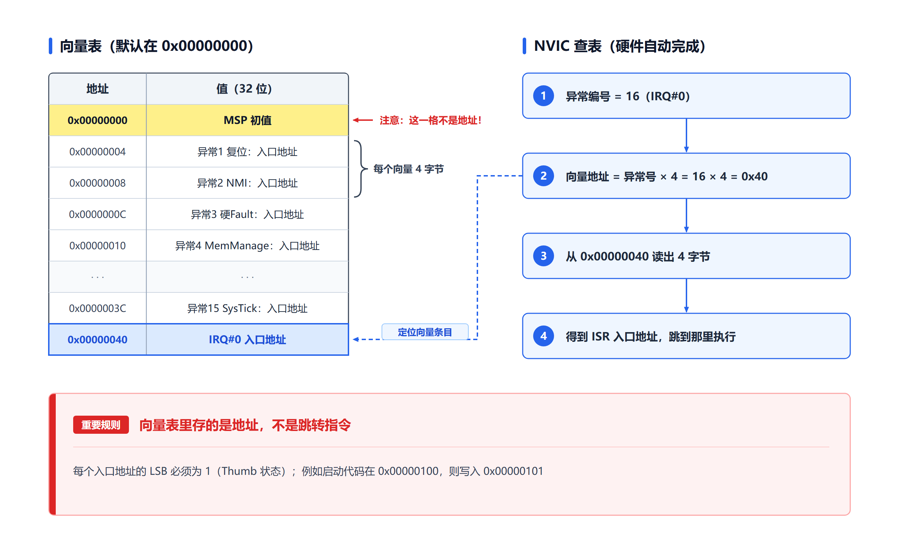

*向量表里存的是"地址"，不是"跳转指令"。*

#### 2.8.9 中断输入及挂起（PPT 用 6 张图讲）

PPT 用 6 个场景说明"挂起"和"活跃"状态的变化，**核心是理解这两种状态的含义和区别**：

| PPT 的场景 | 说明 |
|---|---|
| 中断挂起示意图 | 中断请求来了，但**还没得到响应** → 挂起状态 |
| 中断在得到处理器响应之前被清除挂起状态 | 请求在响应前撤销了 |
| 在处理器进入服务例程后对中断活跃状态的设置 | **执行 ISR 第一条指令后，活跃位置 1** |
| 一直维持的中断请求导致服务例程返回后再次挂起该中断 | 请求信号一直有效 → 返回后又挂起 |
| 中断请求出现多个脉冲时视为一次中断请求 | 挂起位是"电平/锁存"性质，不是计数器 |
| 在执行 ISR 时中断挂起再次发生 | 处理过程中又来了新请求 |

**【三种状态的含义（这是本节的骨架）】**

| 状态 | 含义 | 什么时候变 |
|---|---|---|
| **挂起（Pending）** | 中断**已经被提出，但还没被响应** | 外设发出请求时置位 |
| **活跃（Active）** | 中断**正在被处理** | **执行 ISR 第一条指令后**置位，**ISR 返回时硬件清零** |
| **撤销（清除挂起）** | 请求被取消 | 向 ICPR 写 1 |

> **【理解重点】"挂起"是"排队等处理"，"活跃"是"正在处理"。**
> 一个中断可以先挂起、再活跃；也可以**同时**挂起且活跃（处理中又来了新请求）。

#### 2.8.10 Fault 类异常

**Cortex-M3 中的 Fault 分类**：

1. **总线 Fault**；
2. **存储器管理 Fault**；
3. **用法 Fault**；
4. **Hard Fault**。

**应对 Fault 的常用方法**：

| 方法 | 说明 |
|---|---|
| **复位** | 设置 NVIC 应用程序中断及复位控制寄存器中的 **VECTRESET 位**。**只复位处理器内核而不复位其他片上部件** |
| **恢复** | 在一些场合下，还是有希望解决产生 Fault 问题的 |
| **中止相关任务** | 如果系统运行了一个 RTOS，则相关的任务可以被终结或者重新开始 |

#### 2.8.11 中断的具体行为（本章最重要的部分）

**【异常进入步骤（PPT 逐条列出，注意是硬件自动完成）】**

| 步骤 | 内容 |
|---|---|
| ① **硬件压栈** | 在所选的堆栈上将 **xPSR、PC、LR、R12、R3、R2、R1、R0** 压栈（共 8 个） |
| ② **读向量表** | 读存储器中的向量表，地址为**向量表基址 + (异常号 × 4)**，取出中断函数入口 |
| ③ **更新 LR** | LR 设置为 **EXC_RETURN**，以便从异常中退出。**注意：LR 的值并非进入异常程序的地址，是特殊值** |
| ④ **更新 PC** | 利用向量表读出的位置更新 PC。**直到第一条指令开始执行时，才能处理迟来异常** |
| ⑤ **加载流水线** | 从向量表指向的位置加载指令。**它与寄存器压栈操作同时执行** |

> **PPT（梁版）的注**：**以上步骤由硬件自动完成，仅需 12 个时钟周期。**

**【入栈的 8 个寄存器与堆栈布局（必背）】**

```
① xPSR    ← 程序状态（N/Z/C/V/Q + 异常号）
② PC      ← 被打断处的下一条指令地址（"断点"）
③ LR
④ R12
⑤ R3
⑥ R2
⑦ R1
⑧ R0
```

**PPT 的压栈寄存器与 SP 更新图**：

```
当前的 SP
R2
R1
R3
R12
LR
PC
xPSR
<前面的值>
R0
原来的 SP

注：使用进程堆栈时，上下文保存在进程堆栈；
    使用主堆栈时，上下文保存在主堆栈中。
    压栈操作由硬件保存以上 8 个数据。
```

**入栈后的堆栈（假设入栈开始时 SP = N）**：

| 地址 | 寄存器 |
|---|---|
| **旧 SP = N** | （原先已压入的内容） |
| `N − 4` | **xPSR** |
| `N − 8` | **PC** ← 断点地址！ |
| `N − 12` | **LR** |
| `N − 16` | **R12** |
| `N − 20` | **R3** |
| `N − 24` | **R2** |
| `N − 28` | **R1** |
| **新 SP = N − 32** | **R0** |

```
             入栈前                        入栈后
地址          内容                地址          内容
0x20001000  ┌──────────┐        0x20001000  ┌──────────┐
            │ 旧数据    │                    │ 旧数据    │
0x20000FFC  ├──────────┤        0x20000FFC  ├──────────┤
            │  空闲     │                    │  xPSR    │ ← N−4
0x20000FF8  ├──────────┤        0x20000FF8  ├──────────┤
            │  空闲     │                    │  PC      │ ← N−8 （断点！）
0x20000FF4  ├──────────┤        0x20000FF4  ├──────────┤
            │  空闲     │                    │  LR      │ ← N−12
0x20000FF0  ├──────────┤        0x20000FF0  ├──────────┤
            │  空闲     │                    │  R12     │ ← N−16
0x20000FEC  ├──────────┤        0x20000FEC  ├──────────┤
            │  空闲     │                    │  R3      │ ← N−20
0x20000FE8  ├──────────┤        0x20000FE8  ├──────────┤
            │  空闲     │                    │  R2      │ ← N−24
0x20000FE4  ├──────────┤        0x20000FE4  ├──────────┤
            │  空闲     │                    │  R1      │ ← N−28
0x20000FE0  ├──────────┤        0x20000FE0  ├──────────┤
            │  空闲     │                    │  R0      │ ← N−32
            └──────────┘                    └──────────┘
  ▲                                          ▲
  SP = N                                      SP = N−32
```

**从这张图能看出三件事**：

1. **8 个寄存器 × 4 字节 = 32 字节**，所以每次中断至少要消耗 **32 字节栈空间**；
2. **PC 在 `N−8` 处**——这就是"断点地址"保存的位置，中断返回时弹回 PC，程序就从被打断处继续；
3. **R0 在最下面**（`N−32`），它是最后一个被写进去的。

**为什么是这 8 个寄存器**：

> 因为 ARM 架构规定：**R0～R3、R12、LR、PC、xPSR 是"调用者保存（caller-saved）"寄存器**——
> 被调用的函数（这里是 ISR）可以随便用它们，不保证原值。
> 那么"调用者"（被打断的程序）想保住自己的值，就得自己存。**Cortex-M3 把这个活儿用硬件替你干了。**
>
> 而 **R4～R11 是"被调用者保存"寄存器**——**ISR 如果想用它们，必须自己 PUSH/POP**。硬件不管。

**为什么"一旦进入服务例程就一直使用主堆栈"**：

因为**中断可能嵌套**。如果嵌套时还在用 PSP，多个 ISR 就可能把用户堆栈搞乱。统一用 MSP 之后：

```
用户程序 ── PSP（自己的栈，自己管）
所有 ISR ── MSP（系统的栈，中断专用）
```

**【异常退出步骤（PPT 逐条列出）】**

```
① 执行 BX LR，触发异常返回
② 读取 LR 中的 EXC_RETURN，解析低 4 位，选定堆栈（MSP/PSP）
③ 从选定堆栈弹出：R0, R1, R2, R3, R12, LR, PC, xPSR
④ 把弹出的 xPSR 写入内核 xPSR，硬件自动更新 IPSR（IPSR = xPSR[8:0]）
⑤ 判断 IPSR[8:0]：
     ≠ 0 → 回到 Handler 模式，恢复上一层嵌套中断继续运行
     = 0 → 进入线程模式
⑥ 若进入线程模式，根据 EXC_RETURN[3:0] 选择堆栈：
     0b1001：线程模式，主堆栈 MSP
     0b1101：线程模式，进程堆栈 PSP
⑦ 更新 PC，跳转执行代码
```

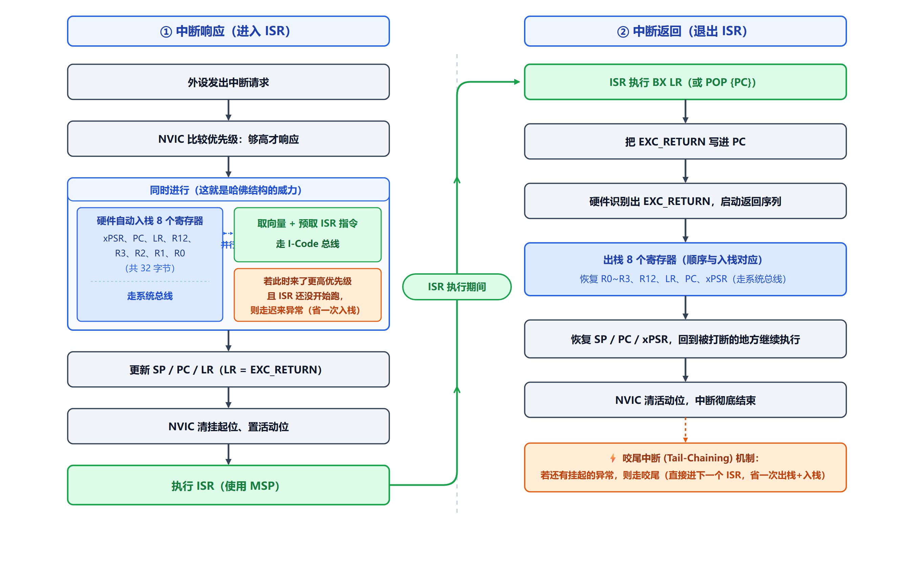

*从外设请求到 ISR 返回的完整链条，重点是"硬件自动压栈 8 个寄存器"和"查向量表"这两步。*

#### 2.8.12 高级中断技术（PPT 用 3 页讲）

**【技术 1：中断嵌套 — 占先（抢占）】**

> 在异常处理程序中，一个新的异常比当前的异常优先级更高，处理器**打断当前的流程**，响应优先级更高的异常，
> 此时产生**中断嵌套**。

```
用户程序 → 中断1（优先级3）→ 中断2（优先级2）打断中断1
                            → 中断2 完成 → 回到中断1 → 中断1 完成 → 回用户程序

压栈 → 压栈 → 出栈 → 出栈
```

**【技术 2：咬尾（tail-chaining）】**

> **咬尾技术是处理器用来加速中断响应的一种机制。在结束 ISR 时，如果存在一个挂起中断，其优先级高于正在返回的 ISR 或线程，那么就会跳过出栈操作，转而将控制权让给新的 ISR。**
>
> **中断 1 结束的出栈和中断 2 压栈的内容完全相同，因此咬尾技术无需压栈。**

```
没有咬尾：
ISR#1 执行完毕
   ↓
① 执行 POP 操作恢复系统现场        ← 白干！
② 系统处理挂起的异常
③ 执行 PUSH 操作保护系统现场       ← 又白干！
   ↓
ISR#2 开始执行

有咬尾：
ISR#1 执行完毕
   ↓
发现还有 ISR#2 挂着 → 直接跳到 ISR#2（栈里的现场原封不动，接着用）
   ↓
ISR#2 执行完毕 → POP（这时才出栈一次）
```

**PPT 的原话（为什么咬尾有用）**：

> 当处理器在响应某异常时，如果又发生其他中断，若其优先级不高，则被阻塞。那么中断返回时，正常操作流程如下：
> （1）执行 **POP** 操作以恢复系统现场；
> （2）系统处理挂起的异常；
> （3）执行 **PUSH** 操作以保护系统现场。
>
> **显然，POP 和 PUSH 操作所涉及的系统现场是一样的，这个操作会白白浪费 CPU 时间。**

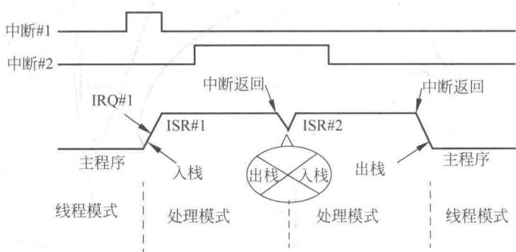

*ISR#1 结束后没有"落回"主程序，而是直接横着连到 ISR#2；"出栈"只出现在 ISR#2 的末尾。*

**【技术 3：迟来（late arrival）】**

> **迟来是处理器用来加速占先的一种机制。如果在保存前一个占先的状态时出现一个优先级更高的中断，则处理器转去处理优先级更高的中断，开始该中断的取向量操作。**
> **状态保存不会受到迟来的影响。返回时，采用常规的咬尾技术。**

**PPT 的图**：

```
用户程序 → 中断1（优先级3）→ 中断2（优先级2）
压栈 → 出栈 → 继续压栈 → 执行末尾连锁（不需出栈）→ 压栈完成
```

**大白话**：

```
正常抢占：
  ISR#1 已经开始执行，来了 #2（优先级更高）
  → 需要"再入栈一次"（把 ISR#1 的现场存起来）→ 多花时间、多花 32 字节栈

迟来的情况：
  ISR#1 的现场刚压完，但 ISR#1 的第一条指令还没执行
  → 此时来了 #2（优先级更高）
  → "反正栈里存的是主程序的现场，还没开始跑 ISR#1 呢"
  → 直接把这次入栈当作"为 #2 准备的"，然后执行 ISR#2！→ 省掉一次入栈
```

**【易错】咬尾 vs 迟来**：

| | 咬尾（tail-chaining） | 迟来（late arrival） |
|---|---|---|
| 作用时机 | 中断**结束**出栈时 | 中断**开始**入栈时 |
| 省掉什么 | 省掉"一次 POP + 一次 PUSH" | 省掉"一次入栈" |
| 触发条件 | 结束 ISR 时还有**挂起中断**，且优先级高于正在返回的 | 入栈阶段还没执行 ISR 第一条指令时，来了**更高优先级**请求 |

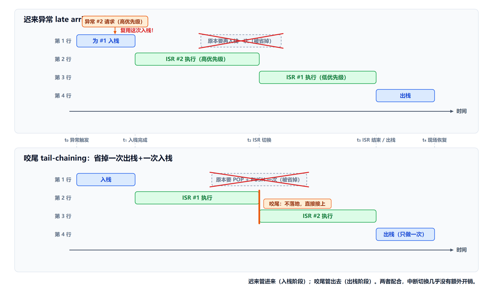

*咬尾管"结束"（省掉出栈+入栈），迟来管"开始"（省掉一次入栈）。*

#### 2.8.13 异常返回值 EXC_RETURN

**EXC_RETURN 是什么**：进入异常时，**LR 被设置为一个特殊值**（不是返回地址），退出时把这个值写回 PC 就触发异常返回。

**位段详解**：

```
bit    31                              4   3   2   1   0
      +--------------------------------+---+---+---+---+
      |      必须全为 1（标识）           |   |   |   |   |
      +--------------------------------+---+---+---+---+
```

| 位段 | 定义 |
|---|---|
| **[31:4]** | EXC_RETURN 的**标识：必须全为 1** |
| **3** | **0 = 返回后进入处理模式；1 = 返回后进入线程模式** |
| **2** | **0 = 从主堆栈中做出栈操作，返回后使用 MSP；1 = 从进程堆栈中做出栈操作，返回后使用 PSP** |
| **1** | **保留，必须为 0** |
| **0** | **0 = 返回后 ARM 状态；1 = 返回后 Thumb 状态。在 Cortex-M3 中必须为 1** |

**三个合法的 EXC_RETURN 值（必背）**：

| 数值 | 功能 | 低 4 位 |
|---|---|---|
| **`0xFFFFFFF1`** | **返回处理模式** | `0001` |
| **`0xFFFFFFF9`** | **返回线程模式，使用主堆栈（MSP）** | `1001` |
| **`0xFFFFFFFD`** | **返回线程模式，使用线程堆栈（PSP）** | `1101` |

**验证**：

```
0xFFFFFFF1 → 低 4 位 0001：bit3=0（处理模式）, bit2=0（MSP）, bit1=0, bit0=1 ✓
0xFFFFFFF9 → 低 4 位 1001：bit3=1（线程模式）, bit2=0（MSP）, bit1=0, bit0=1 ✓
0xFFFFFFFD → 低 4 位 1101：bit3=1（线程模式）, bit2=1（PSP）, bit1=0, bit0=1 ✓
```

**十六进制 → 二进制换算（不跳步）**：

```
0xF1 = 1111 0001
0xF9 = 1111 1001
0xFD = 1111 1101

（F = 1111，1 = 0001，9 = 1001，D = 1101）
```

---

### 2.9 复位序列 ★★ 【PPT 重点：陈-II p58～p60 / 梁-II p58～p61】

**PPT 给出的四个内容**：

1. **程序映像中的向量表**；
2. **初始 MSP 及 PC 初始化的一个范例**；
3. **复位流程**；
4. **程序的执行流程**。

#### 程序映像与向量表

> **Cortex-M3 处理器的程序映像是从地址 `0x00000000` 开始的。程序映像的开始处为向量表。**

**"程序映像" = 烧写进 Flash 的那份完整程序**（代码 + 常量 + 向量表等）。

```
地址
0x00000000  ┌────────────────────────────┐
            │  MSP 的初始值（4 字节）      │ ← 第 1 个字（不是地址！）
0x00000004  ├────────────────────────────┤
            │  异常 1（复位）的入口地址     │ ← 复位向量
0x00000008  ├────────────────────────────┤
            │  异常 2（NMI）的入口地址      │
0x0000000C  ├────────────────────────────┤
            │  异常 3（硬 Fault）的入口地址  │
            │  ...                       │
0x0000003C  ├────────────────────────────┤
            │  异常 15（SysTick）的入口地址  │
0x00000040  ├────────────────────────────┤
            │  IRQ#0 的入口地址            │
            │  ...                       │
            └────────────────────────────┘
                    ↓ 向量表结束之后
            ┌────────────────────────────┐
            │  真正的程序代码               │
            │  （启动代码 / main 函数等）    │
            └────────────────────────────┘
```

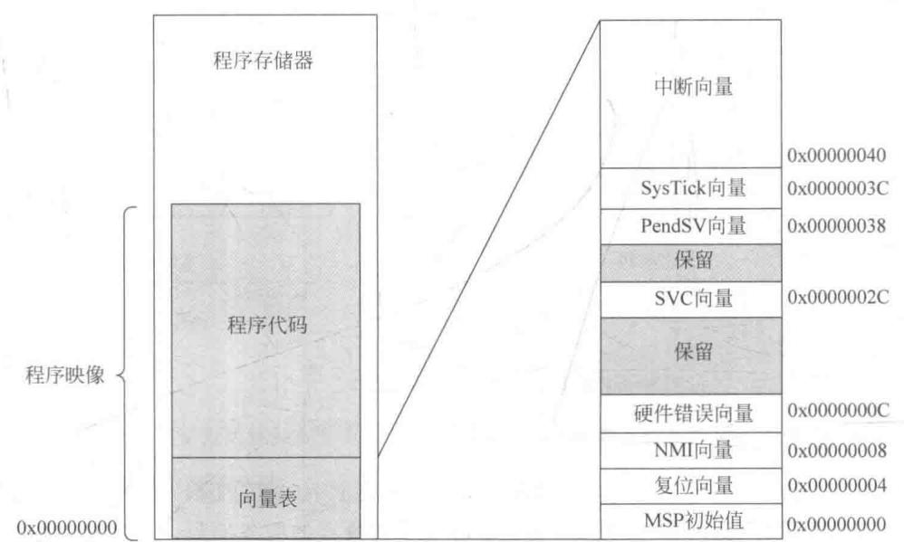

*第 1 行（`0x00000000`）标的是"**MSP 的初始值**"——注意它不是入口地址，而是一个"栈顶地址"。*

#### 复位流程

**复位序列 = 从向量表里取两样东西**：

```
① 从 0x00000000 取出 MSP 的初始值 → 装进 SP
② 从 0x00000004 取出复位向量      → 装进 PC
③ 开始执行第一条指令
```

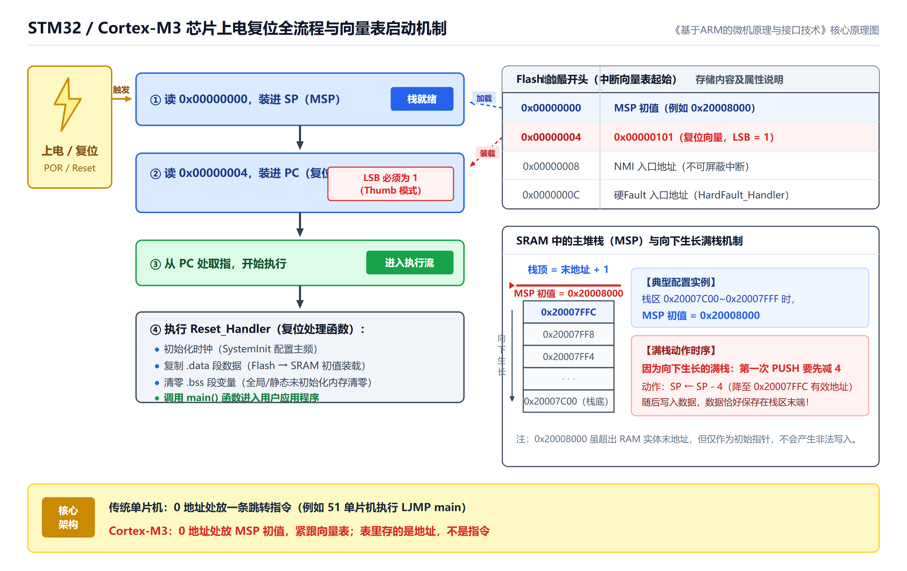

*复位时硬件自动做两件事：把 `0x00000000` 的值装进 SP、把 `0x00000004` 的值装进 PC。*

> **【易错】向量表里存的入口地址，最低位都是 1**（表示 Thumb 指令）。
> 所以如果启动代码位于 `0x00000100`，`0x00000004` 处存的值是 `0x00000101`。

---

## 三、重要知识之间的联系

### 对比 1：MSP vs PSP

| | MSP（主堆栈） | PSP（进程堆栈） |
|---|---|---|
| 谁用 | **中断处理、异常处理、默认的普通程序** | **普通程序里特意切换给用户任务用的** |
| 复位后默认 | **是** | 否 |
| 处理模式下 | **只能使用 MSP** | 不能用 |
| 线程模式下 | 可用 | 可用（由 CONTROL[1] 选择） |
| 目的 | 系统/中断专用 | 用户任务专用，出错不毁系统 |

**怎么选**：**中断一律用 MSP；用户任务想隔离就用 PSP。**

### 对比 2：MRS vs MSR

| | MRS | MSR |
|---|---|---|
| 全称 | Move from Special register to **R**egister | Move from **R**egister to **S**pecial register |
| 方向 | 特殊 → 通用 | 通用 → 特殊 |
| 用途 | **读** | **写** |

**口诀**：**MRS 里最后是 R，所以结果是进寄存器** → 读。

### 对比 3：PRIMASK / FAULTMASK / BASEPRI

| 寄存器 | 屏蔽范围 |
|---|---|
| **PRIMASK** | **所有中断被屏蔽**（只有最低位有效） |
| **FAULTMASK** | **关闭异常**（比 PRIMASK 更彻底） |
| **BASEPRI** | **屏蔽等于和低于某个优先级的中断**；**写 0 则取消屏蔽** |

**快速开关用 CPS 指令**：`CPSID I`/`CPSIE I`（操作 PRIMASK）、`CPSID F`/`CPSIE F`（操作 FAULTMASK）。

### 对比 4：抢占优先级 vs 副优先级

| | 抢占优先级 | 副优先级 |
|---|---|---|
| 作用 | **决定能否打断** | **决定排队顺序** |
| 不同时 | 高抢占可以**打断**低抢占 | — |
| 相同时 | **不能打断** | 按副优先级**排队** |

### 对比 5：咬尾 vs 迟来

**一句话记忆**：**咬尾省"结束时的出栈+入栈"，迟来省"开始时的入栈"。**

### 对比 6：中断 vs 子程序调用

| 中断 | 调用子程序 |
|---|---|
| 产生时刻**随机** | 事先**安排好的** |
| **保护断点（自动）+ 保护现场（程序）** | 可只保护断点（自动） |
| 入口地址由**硬件确定，用户不能改变** | 入口地址由**程序编排** |

### 对比 7：第 1 章"四段流水线" vs 第 2 章"三级流水线"

| | 第 1 章（教材通用讲法） | 第 2 章（Cortex-M3 实际） |
|---|---|---|
| 段数 | **4 段** | **3 级** |
| 各段 | 取指、译码、执行、**存结果** | 取指、译码、执行 |

**不要混**。第 1 章是"通用原理示意"，第 2 章是"这块芯片的实际结构"。

### 对比 8：三种中断状态

| 状态 | 含义 | 什么时候变 |
|---|---|---|
| **挂起** | 已被提出，但**还没被响应** | 外设发出请求时置位 |
| **活跃** | **正在被处理** | 执行 ISR 第一条指令后置位，ISR 返回时硬件清零 |
| **撤销** | 请求被取消 | 向 ICPR 写 1 |

---

## 四、高频易错点

> 以下为**常见易错点**（不是历年考试统计）。

| # | 易错点 | 正确理解 |
|---|---|---|
| 1 | 把 MRS 和 MSR 记反 | **MRS = 读**（特殊→通用）；**MSR = 写**（通用→特殊） |
| 2 | 以为 PC 指向"下一条要执行的指令" | **PC 总是指向正在取指的指令**；**读 PC 得到当前指令地址 + 4** |
| 3 | 忘记 PC 的 bit0 始终为 0 | 所以**指令始终与字或半字边界对齐** |
| 4 | PUSH/POP 的顺序记反 | **PUSH 先减 SP 再存**；**POP 先读再加 SP** |
| 5 | 以为改一位就是一条指令 | 传统做法是**读-改-写三步，不是原子的**；**位带**才能做到原子操作 |
| 6 | 位带别名公式记错 | `0x22000000 + (A−0x20000000)×32 + n×4`；**×8 是每字节 8 位，×4 是每位占 4 字节** |
| 7 | 把"优先级数值小"记成"优先级低" | **优先级数值越小，优先级越高**（复位 = −3 最高） |
| 8 | 以为复位/NMI/硬Fault 的优先级可改 | **它们是负数且固定**，不可调整 |
| 9 | 8 级优先级的值写成 0、1、2… | 应该是 **0x00、0x20、0x40…0xE0**（高 3 位有效） |
| 10 | 抢占优先级相同也能打断 | **相同不能打断**，只能**排队** |
| 11 | 以为中断只压栈"用到的寄存器" | **硬件固定压 8 个**：xPSR、PC、LR、R12、R3～R0 |
| 12 | 以为 ISR 用 R4～R11 也由硬件保存 | **不会**——R4～R11 是"被调用者保存"，**ISR 要自己 PUSH/POP** |
| 13 | 忘记清除外设中断标志位 | **中断的撤除**：返回前必须清标志，否则会反复进入中断 |
| 14 | 写 AIRCR 忘了 VECTKEY | 必须写 **`0x05FA`**，否则**写操作无效** |
| 15 | 把咬尾和迟来搞混 | **咬尾管结束（省出栈+入栈）**；**迟来管开始（省一次入栈）** |
| 16 | 小端模式记成"高对低" | **小端 = 低字节放低地址**（"低对低"） |
| 17 | 以为 ISER 要写 0 才能关闭中断 | **写 0 无效**！关闭中断要写 **ICER** 的对应位（写 1） |
| 18 | 以为位带操作到处都能用 | **只有两个区的最低 1MB** 支持位带 |
| 19 | 把"活跃"和"挂起"搞混 | **挂起 = 排队等处理**；**活跃 = 正在处理**（执行 ISR 第一条指令后置位） |
| 20 | 以为 CPU 能执行 ARM 指令 | **Cortex-M3 只认 Thumb-2，不能执行 ARM 指令** |

---

## 五、本章考前速查

> 几分钟扫一遍，只看这一节就能回忆全章骨架。

### 组成与结构

- **一颗芯片 = ARM 设计的内核 + 芯片厂商加的外设/存储器/时钟/IO**，中间靠**总线**连接
- 内核内部：**取指 → 译码 → 寄存器组 → 运算器**
- 内核自带关键设施：**NVIC（中断）、SysTick（24 位定时）、总线矩阵（总线+位带+写缓冲）、MPU**
- 内核特性：**ARMv7-M 架构、Thumb-2 指令集、32 位、哈佛结构、三级流水线、单周期乘法、硬件除法**
- **Cortex-M3 不能执行 ARM 指令**
- 四条总线：**I-Code（取指令）、D-Code（代码空间取数据）、系统总线（内存外设）、PPB（私有外设）**
- **AHB 连高性能模块（CPU/DMA）；APB 连低带宽外设**

### 流水线

- **三级：取指、译码、执行**；n 条指令、3 级 → **3 + (n−1)** 拍
- **单条指令不变快，吞吐量提高**
- **PC 总是指向正在取指的指令** → 读 PC = **当前地址 + 4**
- **分支预测**：**跳转指令在译码时就被识别**，取指时流水线**自动加载跳转后地址的指令**，不清空流水线
- ARM7 不带分支预测：**执行时遇跳转指令则清空流水线**

### 寄存器

| 寄存器 | 关键点 |
|---|---|
| R0～R7 | **所有指令**可访问 |
| R8～R12 | **所有 32 位指令**可访问；**少数 16 位指令**可访问 |
| R13(SP) | **一个名字两个实体**：MSP / PSP，由 CONTROL[1] 选 |
| R14(LR) | 存返回地址；**`BL`/`BLX` 自动填**；嵌套调用前要 PUSH |
| R15(PC) | **总指向正在取指的指令**；**bit0 始终为 0**（与字/半字边界对齐） |
| xPSR | **APSR**(N/Z/C/V/Q) + **IPSR**(异常号) + **EPSR**(ICI/IT、T 位) |
| PRIMASK | **所有中断被屏蔽**；只有最低位有效；**CPSID I / CPSIE I** |
| FAULTMASK | **关闭异常**；**CPSID F / CPSIE F** |
| BASEPRI | **屏蔽等于和低于阈值的中断**；**写 0 取消屏蔽**；F1 只用 bit7~4 |
| CONTROL | bit1 选堆栈（0=MSP，1=PSP）；bit0 选等级（0=特权，1=用户） |

**APSR 标志**：**N**（负）、**Z**（零）、**C**（进位）、**V**（溢出）、**Q**（不考虑）

### 工作模式

- **2 种模式 × 2 种等级 = 3 种合法状态**：线程+特权、线程+用户、处理+特权
- **处理模式一定是特权级**
- 复位时进入**线程模式**；异常返回时进入**线程模式**；出现异常时进入**处理模式**
- 复位后默认 = **线程模式 + 特权级**

### 堆栈

- **向下生长的满栈**，**按字操作**（SP 变化 ±4）
- **PUSH：SP 先自减 4，再存入数据；POP：先从 SP 读出数据，SP 再自增 4**
- **复位后所有代码用 MSP；所有异常用 MSP**；线程模式可由 CONTROL[1] 选 PSP
- 中断**自动压栈 8 个**：xPSR、PC、LR、R12、R3、R2、R1、R0 = **32 字节**

### 存储器管理

- **4GB 七区**：代码 512MB / SRAM 512MB / 片上外设 512MB / 外部 RAM 1GB / 外部设备 1GB / PPB 1MB / 厂商区
- **位带两区**：SRAM `0x20000000～0x200FFFFF`、外设 `0x40000000～0x400FFFFF`
- **别名区**：`0x22000000` 起、`0x42000000` 起，各 32MB（**膨胀 32 倍**）
- **公式**：`0x22000000 + (A−0x20000000)×32 + n×4`
- **小端模式 = 低字节放低地址**；**Cortex-M3 支持非对齐访问**

### 异常与中断

- **编号**：1～15 系统异常，≥16 外部中断；**共 256 种**
- **固定优先级**：复位 **−3**、NMI **−2**、硬Fault **−1**（负数，最高，不可改）
- **优先级数值越小越高**；支持 128 级抢占；实际优先级数被芯片裁剪
- **抢占优先级决定能否打断；副优先级决定排队顺序**
- **写 0 无效**：使能写 ISER、除能写 ICER、挂起写 ISPR、解挂写 ICPR
- **活跃位**：执行 ISR 第一条指令后置 1，ISR 返回时硬件清零
- **AIRCR 必须写 `0x05FA` 才生效**
- **向量地址 = 向量表基址 + (异常号 × 4)**
- **异常进入**：硬件压栈 8 个 → 读向量表 → LR = EXC_RETURN → 更新 PC
- **异常退出**：`BX LR` 触发；**EXC_RETURN 三个值**：
  - `0xFFFFFFF1` 返回**处理模式**
  - `0xFFFFFFF9` 返回**线程模式 + MSP**
  - `0xFFFFFFFD` 返回**线程模式 + PSP**
- **咬尾**：省掉结束时的"出栈+入栈"；**迟来**：省掉开始时的一次入栈
- **四类 Fault**：总线、存储器管理、用法、**硬 Fault（兜底）**

---

## 六、本章快速自测

> **用法**：先自己答，再看答案。
> **标注说明**：标有「**教材习题 X-Y**」的题目，来自教材第 2 章课后习题——**这些是老师布置过的作业题，考试出现的可能性较高**。

---

### 第一部分：教材课后习题

**Q1（教材习题 2-1）** 试画出 Cortex-M3 的内核体系结构。

<details><summary>答案</summary>

**画出这些模块和它们的关系**：

```
Cortex-M3 内核
├── 指令取指单元（fetch）
├── 译码单元（decode）
├── 寄存器组（R0~R12、SP、LR、PC、xPSR、中断屏蔽寄存器、CONTROL）
├── 运算器（ALU）
└── 对外接口：I-Code 总线、D-Code 总线、系统总线、PPB
```

**也可以按"内核自带设施"的角度画**：

```
Cortex-M3 内核
├── 取指 / 译码 / 寄存器组 / 运算器
├── NVIC（嵌套向量中断控制器）
├── SysTick（系统定时器）
├── 总线矩阵
├── MPU（可选）
└── 调试单元（FPB / DWT / ITM / ETM / TPIU / ROM 表）
```

**答题要点提醒**：题目问的是"**内核**体系结构"，所以**不要画外设、存储器、时钟**（那是"处理器"或"芯片"的结构）。**这是本题最常见的失分点。** ★★★
</details>

---

**Q2（教材习题 2-2）** Cortex-M3 内核有哪几种工作模式？

<details><summary>答案</summary>

**两种工作模式**：
- **处理模式（handler mode）**——运行异常服务例程时；
- **线程模式（thread mode）**——运行主程序时。

**两个工作等级**：
- **特权级（privileged level）**；
- **用户级（user level）**。

**三种合法组合**：

```
① 线程模式 + 特权级      ← 复位后的默认状态
② 线程模式 + 用户级
③ 处理模式 + 特权级      ← 异常服务例程（必须）
```

**"处理模式 + 用户级"是非法组合**——异常服务例程必须在特权级下执行。

**补充要点**：
- **复位时进入线程模式；异常返回时进入线程模式；出现异常时进入处理模式**；
- **在处理模式中，所有代码都是特权访问的**；
- **特权执行可以访问所有资源；非特权执行时对有些资源的访问受到限制或不允许**（如部分 CPS 指令、对系统控制空间 SCS 大部分寄存器的访问）。

**答题要点提醒**：题目问"工作模式"，但**完整答案要把"两个等级"和"三种合法组合"一起写出来**——只写"两种模式"会丢分。★★★
</details>

---

**Q3（教材习题 2-3）** 异常和中断有什么不同？Cortex-M3 内核中可以管理的异常和中断有哪些？

<details><summary>答案</summary>

**（1）区别**

在 ARM 领域，**凡是打断程序顺序执行的事件都叫异常**；**中断只是异常的一种**（特指来自外部/外设的请求）。

异常还包括复位、NMI、各种 Fault、SVCall、PendSV、SysTick 等。由于处理过程都通过中断服务机制，本书对两者不严格区分。

**（2）清单**

> 支持总计 **256 种**系统异常及外部中断。**编号为 1～15 的异常为系统异常；大于等于 16 的异常则全部是外部中断。**

**系统异常（编号 1～15）**：

| 编号 | 类型 |
|---|---|
| 1 | 复位 Reset |
| 2 | NMI（不可屏蔽中断） |
| 3 | 硬故障 HardFault |
| 4 | 存储器管理 |
| 5 | 总线故障 |
| 6 | 用法故障 |
| 7～10 | 保留 |
| 11 | SVCall |
| 12 | 调试监控器 |
| 13 | 保留 |
| 14 | PendSV |
| 15 | SysTick |

**外部中断（编号 16～255）**：IRQ#0～IRQ#239。

**注意**：**没有编号为 0 的异常**（0 表示"没有异常在运行"，即正常状态）。★★★
</details>

---

**Q4（教材习题 2-4）** 简述 Cortex-M3 中断的特点。

<details><summary>答案</summary>

**从 NVIC 的 5 大功能 + 具体行为两方面答**：

**（1）NVIC 的 5 条功能**：

1. **可嵌套中断支持**；
2. **向量中断支持**；
3. **动态优先级调整支持**；
4. **中断延迟大大缩短**；
5. **中断可屏蔽**。

**（2）具体行为上的特点**：

1. **可嵌套**：硬件自动比较优先级，高优先级可抢占低优先级；
2. **向量化**：自动查向量表得到 ISR 入口地址，无需软件判断；
3. **动态优先级**：运行时可改优先级；
4. **中断延迟短**：
   - **入栈与取向量并行**（哈佛结构，两条总线）；
   - **硬件自动保存/恢复 8 个寄存器**（xPSR、PC、LR、R12、R3～R0），无需软件 PUSH/POP；
   - **咬尾（tail-chaining）** 省掉相邻中断间的一次出栈+入栈；
   - **迟来异常（late arrival）** 省掉抢占时的一次入栈；
5. **可屏蔽**：用 PRIMASK / FAULTMASK / BASEPRI 控制屏蔽范围；
6. **EXC_RETURN 机制**：返回靠把 EXC_RETURN 写进 PC，因此 C 语言里 ISR 就是普通函数，不需要特殊关键字。

**答题要点提醒**：这道题**最好按"NVIC 功能"和"具体机制"两部分组织**，只写 NVIC 的 5 条会显得单薄。★★★
</details>

---

**Q5（教材习题 2-5）** Cortex-M3 的中断优先级如何设置？

<details><summary>答案</summary>

1. **优先级数值越小，优先级越高**；
2. **复位（−3）、NMI（−2）、硬 Fault（−1）** 三个优先级**固定**，且高于所有其他异常；
3. 其他异常的优先级**可编程，但不能为负数**；
4. 优先级寄存器中**实际有效的位数由芯片厂商裁剪**（NVIC 的优先级位可配置为 **3～8 位**，即最少 8 级、最多 256 级；常见 4 位 = 16 级）；
5. 通过 **AIRCR 的 PRIGROUP 位段**把有效优先级位分成**抢占优先级**和**副优先级**两部分，共 8 种分组方式（0～7）；
6. **写 AIRCR 必须同时把 VECTKEY = 0x05FA 写入高 16 位**；
7. **抢占优先级决定能否抢占；副优先级决定同抢占档内的响应顺序**；
8. **优先级分组应在开机初始化时一次性设置好**。

**具体例子**：若采用 3 位表示优先级（[7:5]），优先级组的值是 5（从 Bit5 处分组），则得到 **4 级抢占优先级**，每个抢占优先级内部有 **2 个副优先级**，共 8 个优先级（0x00、0x20、…、0xE0）。

**答题要点提醒**：第 5、6、7 条是本题的核心，**别漏了 VECTKEY**。★★★
</details>

---

**Q6（教材习题 2-6）** 简述 Cortex-M3 位带操作的基本原理和作用。

<details><summary>答案</summary>

**（1）基本原理**

- 有**两个位带区**：`0x20000000～0x200FFFFF`（SRAM 最低 1MB）和 `0x40000000～0x400FFFFF`（外设最低 1MB）；
- 每个位带区对应一个 **32MB 的位带别名区**（SRAM → `0x22000000`，外设 → `0x42000000`）；
- **位带区中的每一位，膨胀成别名区中的一个 32 位字**（只有最低位有效）；
- 换算公式：

```
SRAM ：AliasAddr = 0x22000000 + (A − 0x20000000) × 32 + n × 4
外设 ：AliasAddr = 0x42000000 + (A − 0x40000000) × 32 + n × 4
```

- 对别名的**读**：读出对应字后把目标位返回；对别名的**写**：硬件只改目标位，其他位保持不变——**读-改-写由硬件一次完成，不可被打断**。

**（2）作用**

1. 用普通的 load/store 指令就能操作**单个位**，不必写"读 → 改 → 写回"三步；
2. **原子操作**：消除了"读-修改-写"被中断打断的风险，可用于多任务共享资源的互锁访问；
3. 对**硬件 I/O 密集型的底层程序**（如用 GPIO 单独控制每盏 LED）极为有用；
4. **简化"按某个位跳转"的判断**。

**典型例子**：

```c
*DEVICE_REG0 = *DEVICE_REG0 | 0x2;   // 传统方法：读-改-写三步，不是原子的
*DEVICE_REG0_BIT1 = 0x1;             // 位带方法：硬件保证原子性
```

**答题要点提醒**：这道题有"原理"和"作用"两问，**别只答作用忘了公式**。★★★
</details>

---

**Q7（教材习题 2-7）** Cortex-M3 的堆栈有哪些特点？

<details><summary>答案</summary>

1. **向下生长的满栈**：**PUSH 时 SP 先自减 4 再存；POP 时先从 SP 读出数据、SP 再自增 4**；**SP 指向最后一个压入的 32 位数值**；
2. **按字操作**：每次入栈/出栈都是 **32 位**，SP 变化量恒为 **±4**；
3. **两个堆栈**：**MSP**（主堆栈：中断处理、异常处理、默认的普通程序）和 **PSP**（进程堆栈：普通程序里特意切换给用户任务用的），**都叫 R13**，由 **CONTROL[1]** 选择（0 = MSP，1 = PSP）；
4. **切换自动**：**逻辑上共用 R13，物理上独立的 MSP 和 PSP，硬件自动切换**；
5. **中断时自动入栈 8 个寄存器**（xPSR、PC、LR、R12、R3～R0），占 **32 字节**；**R4～R11 需要软件自己保存**；
6. **复位后所有代码都使用主堆栈；所有异常都使用主堆栈**；
7. 双堆栈的目的是**让操作系统的堆栈和应用程序的堆栈分开，程序出错不会毁掉系统**。

**答题要点提醒**：第 1、3、5 条是必答项。★★★
</details>

---

### 第二部分：补充理解题

**Q8（原理）Cortex-M3 是三级流水线。一条指令要经过哪三个阶段？为什么"单条指令没有变快，但 CPU 看起来快了很多"？**

<details><summary>答案</summary>

**三个阶段**：**取指（fetch）→ 译码（decode）→ 执行（execute）**。

```
周期节拍      1        2        3        4        5        6
指令 N      取指令    译码     执行
指令 N+1              取指令    译码     执行
指令 N+2                       取指令    译码     执行
指令 N+3                                取指令    译码     执行
```

**"没变快"的原因**：一条指令仍然要独占 3 个周期才能走完（从取指到执行）。

**"看起来快"的原因**：三条指令在**同一时刻处于不同阶段**，重叠进行。不用流水线时 4 条指令要 12 个周期，用流水线只要 6 个周期。**稳定后每个周期都能完成一条指令**（理想情况）。

> **所以流水线提高的是"吞吐量"（单位时间完成的指令数），不是"单条指令的延迟"。** ★★★
</details>

---

**Q9（原理）什么是分支预测？它和"不带分支预测"相比，差别体现在哪一步？**

<details><summary>答案</summary>

**分支预测**：流水线总是按"地址连续"的假设去取下一条指令，遇到跳转指令时，这个假设就错了。

- **不带分支预测**：**执行**时才发现要跳转，此时已经取回、译码好的几条指令**全部作废，清空流水线**；
- **带分支预测**：**跳转指令在译码时就被识别**，取指时流水线**自动加载跳转后地址的指令**，不用清空。

**差别体现在 step5**（以 PPT 的推演为例）：

```
指令序列：
0x0200  MOV   R0, #00
0x0202  ADDS  R0, R0, #1
0x0204  CMP   R0, #0x7D0
0x0208  BNE   0x00000202     ← 跳回 0x0202
0x020A  BX    0x00000300
0x020C  LDR   R1, #00

ARM7（不带分支预测）的 step5：取指 BX      ← 错的（本来要跳回 0x0202）
Cortex-M3（带分支预测）的 step5：取指 ADDS  ← 对的（0x0202 处正是 ADDS）
```

**为什么 Cortex-M3 能提前知道**：因为**跳转指令在译码阶段就被识别出来**（`BNE` 在 step4 进入译码，step5 时取指单元已经知道要跳到 0x0202）。

**意义**：**跳转是要付出代价的，流水线越深代价越大。分支预测把"遇跳转就清空流水线"这件事尽量消掉。** ★★★
</details>

---

**Q10（计算）把内部 SRAM 中地址 `0x20000008` 的第 3 位，用位带别名地址表示。写出计算过程。**

<details><summary>答案</summary>

```
A = 0x20000008（字节地址）
n = 3（字节内第 3 位）

AliasAddr = 0x22000000 + (A − 0x20000000) × 32 + n × 4

第一步：(A − 0x20000000) = 0x20000008 − 0x20000000 = 8
第二步：8 × 32 = 256 = 0x100
第三步：n × 4 = 3 × 4 = 12 = 0xC
第四步：AliasAddr = 0x22000000 + 0x100 + 0xC = 0x2200010C
```

**所以别名地址是 `0x2200010C`。** ★★★

**公式记忆**：`×8` 是"每字节 8 位"（算出位编号），`×4` 是"每个位在别名区占 4 字节"（32 位字）。

**易错提醒**：
- 如果是**片上外设区**（`0x40000000` 起），基地址要换成 `0x42000000`；
- 公式里的 `n` 是**字节内的位号（0～7）**。
</details>

---

**Q11（概念）MSP 和 PSP 有什么区别？什么时候用哪个？处理模式下能用 PSP 吗？**

<details><summary>答案</summary>

| | **MSP**（主堆栈） | **PSP**（进程堆栈） |
|---|---|---|
| 谁用 | **中断处理、异常处理、默认的普通程序** | **普通程序里，特意切换给用户任务用的** |
| 复位后默认 | **是** | 否 |

**什么时候用哪个**：

- **所有异常（中断）都使用 MSP**——这是硬性规则，**处理模式下只能用 MSP**；
- **线程模式**可以通过 **CONTROL[1]** 选择：`0 = MSP`（默认）、`1 = PSP`。

**处理模式下能用 PSP 吗？不能。**

```
处理模式（Handler）   → 始终使用 MSP
线程模式（Thread）    → 可用 MSP，也可用 PSP（由 CONTROL[1] 决定）
```

**为什么要有两个堆栈**：**让操作系统的堆栈和应用程序的堆栈分开，程序出错不会毁掉系统**。典型用法是 RTOS 里给每个任务分配一个 PSP，而内核和中断统一用 MSP。★★★
</details>

---

**Q12（区别）MRS 和 MSR 有什么区别？怎么快速记住不搞反？**

<details><summary>答案</summary>

| | MRS | MSR |
|---|---|---|
| 全称 | **M**ove from special register to **R**egister | **M**ove from **R**egister to **S**pecial register |
| 方向 | **特殊 → 通用** | **通用 → 特殊** |
| 用途 | **读** | **写** |

```asm
MRS  R0, BASEPRI      ; 读：把 BASEPRI 的值读到 R0
MSR  BASEPRI, R0      ; 写：把 R0 的值写到 BASEPRI
```

**记忆口诀**：**MRS 里最后是 R（Register），所以结果是"进寄存器"** → **MRS = 读**。

**注意语法顺序也相反**：MRS 是 `MRS <通用寄存器>, <特殊寄存器>`；MSR 是 `MSR <特殊寄存器>, <通用寄存器>`。★★★

**补充**：快速开关中断用 **CPS 指令**更省事：
```asm
CPSID I   ; PRIMASK = 1，关中断
CPSIE I   ; PRIMASK = 0，开中断
```
因为用 MRS+改位+MSR 要三条指令还要占一个通用寄存器，而**关中断本身要快**。
</details>

---

**Q13（计算）外部中断 IRQ#5 的异常编号是多少？它的向量地址是多少？**

<details><summary>答案</summary>

```
外部中断编号从 16 开始，IRQ#0 对应异常号 16
  ↓
异常编号 = IRQ 编号 + 16 = 5 + 16 = 21

向量地址 = 向量表基址 + (异常号 × 4) = 0 + 21 × 4 = 84 = 0x54
```

**所以异常编号是 21，向量地址是 `0x54`。** ★★★

**验证**（用已知的几个对照）：
```
异常号 16（IRQ#0）→ 16 × 4 = 0x40  ✓
异常号 17（IRQ#1）→ 17 × 4 = 0x44  ✓
异常号 21（IRQ#5）→ 21 × 4 = 0x54
```

**易错提醒**：
- 向量表里存的入口地址**最低位都是 1**（表示 Thumb 指令），所以实际存的值会是 `0x55` 这样的奇数——但**向量地址本身是 `0x54`**，两者不要混。
</details>

---

**Q14（原理）中断发生时，硬件自动压栈哪 8 个寄存器？为什么是这 8 个？ISR 里如果要用 R4 怎么办？**

<details><summary>答案</summary>

**压栈的 8 个寄存器**：

```
① xPSR   ② PC（断点地址）  ③ LR   ④ R12
⑤ R3     ⑥ R2              ⑦ R1   ⑧ R0
```

**共 8 × 4 = 32 字节栈空间。**

**为什么是这 8 个**：ARM 架构规定 **R0～R3、R12、LR、PC、xPSR 是"调用者保存（caller-saved）"寄存器**——被调用的函数（这里是 ISR）可以随便用它们，不保证原值。所以"调用者"（被打断的程序）想保住自己的值，就得自己存。**Cortex-M3 把这个活儿用硬件替你干了。**

**ISR 里用 R4 怎么办**：**自己写 `PUSH {R4}` / `POP {R4}`**。

因为 **R4～R11 是"被调用者保存（callee-saved）"寄存器**——**ISR 如果想用它们，必须自己保护，硬件不管**。

> 这就是为什么在汇编写的 ISR 里，经常看到开头一段 `PUSH {R4-R7, LR}`、结尾一段 `POP {R4-R7, PC}`——**它保护的是硬件不管的那部分寄存器**。★★★
</details>

---

**Q15（区别）"咬尾"和"迟来"分别解决什么问题？各在什么时候起作用？**

<details><summary>答案</summary>

| | **咬尾**（tail-chaining） | **迟来**（late arrival） |
|---|---|---|
| 作用时机 | 中断**结束出栈**时 | 中断**开始入栈**时 |
| 触发条件 | 结束 ISR 时还有**挂起中断**，且优先级高于正在返回的 | 入栈阶段**还没执行 ISR 第一条指令**时，来了**更高优先级**请求 |
| 省掉什么 | 省掉"一次 POP + 一次 PUSH" | 省掉"一次入栈" |
| 目的 | 加速**连续中断**处理 | 加速**抢占** |

**咬尾的浪费在哪**：

```
ISR#1 结束 → POP 恢复现场 → 发现 ISR#2 挂着 → PUSH 保存现场 → 执行 ISR#2
                ↑ 白干                              ↑ 又白干
```

因为 **ISR#1 结束时的出栈内容和 ISR#2 的压栈内容完全相同**，所以可以直接跳过，让 ISR#2 沿用 ISR#1 已经压好的现场。**"后一个异常把前一个的尾巴咬掉了。"**

**迟来的巧妙之处**：

```
ISR#1 的现场刚压完，但 ISR#1 的第一条指令还没执行
   ↓
此时来了 #2（优先级更高）
   ↓
"反正栈里存的是主程序的现场，还没开始跑 ISR#1 呢"
   ↓
直接把这次入栈当作"为 #2 准备的"，然后执行 ISR#2
```

**一句话记忆**：**咬尾管"结束"，迟来管"开始"。** ★★★
</details>

---

**Q16（计算）EXC_RETURN 的三个合法值分别是什么？各自代表什么？写出低 4 位的二进制。**

<details><summary>答案</summary>

| 数值 | 功能 | 低 4 位 |
|---|---|---|
| **`0xFFFFFFF1`** | **返回处理模式** | `0001` |
| **`0xFFFFFFF9`** | **返回线程模式，使用主堆栈（MSP）** | `1001` |
| **`0xFFFFFFFD`** | **返回线程模式，使用进程堆栈（PSP）** | `1101` |

**位段含义**：

```
bit[31:4] = 全为 1（标识）
bit3 = 0 → 处理模式；1 → 线程模式
bit2 = 0 → 用 MSP 出栈；1 → 用 PSP 出栈
bit1 = 0（保留）
bit0 = 1（Thumb，Cortex-M3 中必须为 1）
```

**验证**：

```
0xF1 = 1111 0001 → bit3=0, bit2=0, bit1=0, bit0=1 → 处理模式 + MSP ✓
0xF9 = 1111 1001 → bit3=1, bit2=0, bit1=0, bit0=1 → 线程模式 + MSP ✓
0xFD = 1111 1101 → bit3=1, bit2=1, bit1=0, bit0=1 → 线程模式 + PSP ✓
```

**易错提醒**：**bit0 永远是 1**（Thumb），所以只有这三个值是合法的。★★★
</details>

---

**Q17（易错）如果两个中断的优先级相同，哪个先被响应？如果抢占优先级相同但副优先级不同呢？**

<details><summary>答案</summary>

**情况 1：优先级完全相同（含副优先级）**

看**硬件优先级**：**位置编号越高，优先级越低**。

> 例如 PendSV（编号 14）和 SysTick（编号 15）优先级都为 0，那么 **PendSV 更高**（编号更小）。
>
> **注意：硬件优先级不能嵌套**，只是在**同时激活时**决定先响应谁。

**情况 2：抢占优先级相同，副优先级不同**

**副优先级高的先执行**，但**不能打断**正在运行的 ISR：

```
抢占优先级【不同】 → 可以【打断】正在运行的 ISR（形成嵌套）
抢占优先级【相同】 → 【不能打断】，只能【排队】，
                     等当前 ISR 结束后按副优先级顺序处理
```

**【易错】很多人以为"副优先级高就能插队"——不能。**
副优先级只处理"**内务**"，即**抢占优先级相同的多个挂起异常之间的排队顺序**。

**PPT 的类比**：抢占优先级是"病情紧急程度"（重症可以插队），副优先级是"同一紧急程度内部的排序"（不能插到重症前面）。★★★
</details>

---

**Q18（概念）PRIMASK、FAULTMASK、BASEPRI 三个寄存器各屏蔽什么？**

<details><summary>答案</summary>

| 寄存器 | 屏蔽范围 |
|---|---|
| **PRIMASK**（只有最低位有效） | **所有中断被屏蔽**；为 0 时中断能正常响应 |
| **FAULTMASK** | **关闭异常**（比 PRIMASK 更彻底） |
| **BASEPRI** | **屏蔽等于和低于某个优先级的中断**；**向 BASEPRI 写 0，则取消中断屏蔽** |

```
PRIMASK   = 1 ： 所有中断被屏蔽
FAULTMASK = 1 ： 关闭异常
BASEPRI   = X ： 屏蔽优先级【等于和低于】X 的中断
```

**操作方式**：

```asm
CPSID I     ; PRIMASK = 1，关中断
CPSIE I     ; PRIMASK = 0，开中断
CPSID F     ; FAULTMASK = 1，关异常
CPSIE F     ; FAULTMASK = 0，开异常
```

或者用 MRS/MSR 直接读写。

**PPT 的 BASEPRI 例子**：把 BASEPRI 设置为 `0x40`，则 `0x40` 及以上的优先级被屏蔽，只有更低数值的优先级不被屏蔽。

**补充（梁版 PPT）**：**F1 实际只用 bit7~4（高 4 bit）**，bit3~0 读出来永远是 0。

**注意**：**只有特权级才能访问这 3 个寄存器。** ★★★
</details>

---

**Q19（综合）把一个 GPIO 引脚配置成"上升沿触发外部中断"，从中断产生到 ISR 执行完，中间硬件自动做了哪些事？**

<details><summary>答案</summary>

**硬件自动完成的步骤**：

```
① 引脚上出现上升沿 → 外设置位挂起标志（中断被【挂起】）
② NVIC 收到中断请求，比较优先级
③ 若优先级允许 → 处理器响应，进入异常进入序列：
   a. 【硬件压栈】把 xPSR、PC、LR、R12、R3、R2、R1、R0 压入当前堆栈
      （32 字节；线程模式下用 PSP，一旦进入 ISR 就切到 MSP）
   b. 【读向量表】地址 = 向量表基址 + 异常号 × 4，取出 ISR 入口地址
   c. 【更新 LR】LR 设为 EXC_RETURN（如 0xFFFFFFF9）
   d. 【更新 PC】跳到 ISR 入口
   e. 【加载流水线】从 ISR 入口开始取指令（与压栈同时进行）
④ 执行 ISR 的第一条指令 → 该中断的【活跃位】被置 1
⑤ ISR 里【必须】清除外设的中断标志位（否则会反复进入）
⑥ ISR 末尾执行 BX LR → 触发异常返回
   a. 读 EXC_RETURN，解析低 4 位，选定堆栈
   b. 从堆栈弹出 R0、R1、R2、R3、R12、LR、PC、xPSR
   c. 更新 IPSR；IPSR = 0 时回到线程模式
   d. 更新 PC，回到被打断的地方继续执行
```

**关键要点**：

- **压栈是硬件自动的**（8 个寄存器），**不需要写指令**；
- **PC 被压栈 = 保存了"断点地址"**，返回时弹回 PC 就接着跑；
- **活跃位在执行 ISR 第一条指令后置 1**，ISR 返回时硬件清零；
- **清除外设中断标志位必须由程序自己做**（这就是"中断的撤除"）；
- 如果 ISR 里要用 **R4～R11**，**必须自己 PUSH/POP**（硬件不管）。

**补充**：如果 ISR 还没执行完又来了更高优先级的中断，会形成**中断嵌套**；如果 ISR 刚结束就发现有挂起中断，会触发**咬尾**（省掉一次出栈+入栈）。★★★
</details>

---

## 本章来源对照

> 便于核查是否有遗漏。PPT 页码来自实际提取的课件文本，未作推测。

| 本节内容 | 对应 PPT | 页 | 完整讲义 |
|---|---|---|---|
| 2.1 简介与组件 | 陈-I / 梁-I | 陈 p1～p9 / 梁 p2～p9 | 2.1 |
| 2.2 总线结构 | 陈-I / 梁-I | 陈 p10～p12 / 梁 p10～p12 | 2.2 |
| 2.3 流水线 | 陈-I / 梁-I | 陈 p13～p19 / 梁 p13～p19 | 2.3 |
| 2.4 寄存器 | 陈-I / 梁-I | 陈 p20～p35 / 梁 p20～p33 | 2.4 |
| 2.5 工作模式和工作等级 | 陈-I / 梁-I | 陈 p36～p42 / 梁 p34～p41 | 2.5 |
| 2.6 堆栈 | 陈-I / 梁-I | 陈 p43～p51 / 梁 p42～p48 | 2.6 |
| 2.7 存储器管理（含位带、端模式、非对齐） | 陈-II / 梁-II | 陈 p1～p11 / 梁 p1～p10 | 2.7 |
| 2.8 异常与中断 | 陈-II / 梁-II | 陈 p12～p57 / 梁 p11～p57 | 2.8 |
| 2.9 复位序列 | 陈-II / 梁-II | 陈 p58～p60 / 梁 p58～p61 | 2.9 |
| 教材习题 2-1～2-7 | 对应 PPT 第 2 章内容 | — | 2.12 |

**说明**：

1. 「陈-I」= `PPT/陈洁平课件/第2章 Cortex-M3处理器-I-陈.pdf`（51 页）；
   「陈-II」= `...-II-陈.pdf`（60 页）；
   「梁-I」= `PPT/梁桥康课件/第2章 Cortex-M3处理器-I.pdf`（48 页）；
   「梁-II」= `...-II.pptx`（61 页）。
2. 两位老师内容高度一致，本复习版取并集。
3. **本复习版已按老师 PPT 的范围删减**——以下内容 PPT 中**没有**，故未收录：
   - 流水线的"冒险/暂停（hazard）"与"隔一个周期取指"；
   - IF-THEN 语句块（IT 指令）；
   - 向量表重定位与 VTOR 寄存器；
   - 中断嵌套的"堆栈溢出""相同异常不可重入"两个坑；
   - EXC_RETURN 的"地址范围不可执行"设计说明；
   - 位带操作的"必须用 volatile"等编程细节。
4. **图片路径**：本复习版引用的图片已复制到 `review/images/` 下，使用**同级相对路径**，确保在各种 Markdown 查看器中都能正常显示。
5. 第 2 章 PPT 中大量出现的汇编指令（`MOV`/`ADDS`/`CMP`/`BNE`/`BX`/`BL.W`/`MRS`/`MSR`/`CPS`/`PUSH`/`POP`/`LDM`/`STM`）
   覆盖了教材第 4 章的核心内容，**复习本章即可覆盖第 4 章最要紧的部分**，故不单独制作第 4 章复习版。
