# 第 3 章 精简复习 — STM32F1 系列微控制器

> **本章定位**：第 2 章讲的是"CPU 内核"（ARM 设计的那部分），本章讲的是"**芯片**"——
> 内核外面包了什么、时钟怎么组织、存储器怎么编址、引脚怎么分布。
> 本章是**后面所有外设章节（第 6～12 章）的前置**：不知道时钟怎么开、地址怎么算，写任何外设程序都会卡住。
>
> **本复习版说明**：本章 PPT 两位老师都讲完了 3.1～3.6 全部内容（陈 24 页 / 梁 22 页），
> 内容高度一致。本复习版按 PPT 实际篇幅分配重点，其中**时钟结构**和**存储器映像**是重中之重。
>
> 详细版见 `../03_STM32控制器.md`

---

## 一、本章知识框架

本章回答一个问题：**一颗 STM32 芯片里到底有什么？这些东西怎么组织起来的？**

```
① 这款芯片叫什么、什么规格？    3.1 简介与型号命名规则
   （STM32F103VET6 每一位字母的含义）
            ↓
② 芯片内部是怎么连起来的？      3.2 系统架构与内部结构
   （总线矩阵、AHB/APB 桥、DMA、SRAM/Flash/FSMC）
            ↓
③ CPU 怎么找到这些硬件？        3.3 存储器映像
   （4GB 统一编址，8 个 512MB 的块）
            ↓
④ 这些东西靠什么同步工作？      3.4 时钟结构 ← 本章最核心
   （5 个时钟源 → PLL 倍频 → 分频器 → 各路频率）
            ↓
⑤ 芯片怎么跟外部世界连接？      3.5 引脚
   （VET6 比 ZET6 少 PF、PG 两个口）
            ↓
⑥ 怎么让它真正跑起来？          3.6 最小系统设计
   （复位电路、晶振电路、启动设置、JTAG、电源）
```

**一句话记住本章**：

> **STM32 = Cortex-M3 内核 + 总线矩阵 + 一大圈外设 + 一套分级时钟 + 一排引脚。**

---

## 二、重点知识

### 3.1 STM32F1 系列简介与型号命名规则 ★★★ 【PPT 重点：陈 p3～p4 / 梁 p3～p4】

#### 发展简史

> **2007 年 6 月，ST 宣布了第一款基于 Cortex-M3 并内嵌 32K~128K 闪存的 STM32 微控制器系列产品。**

**Cortex-M3 系列微处理器的主要特点（PPT 列出）**：

- Thumb-2 指令集架构（ISA）的子集；
- **哈佛处理器架构**，在加载/存储数据的同时能够执行指令取指；
- **三级流水线**；
- **32 位单周期乘法**；
- **具备硬件除法**；
- Thumb 状态和调试状态；
- **处理模式和线程模式**；
- **ISR 的低延迟进入和退出**；
- 可中断-可继续的 LDM/STM，PUSH/POP；
- ARMv6 类型 BE8/LE 支持；
- ARMv6 非对齐访问；
- **分支预测功能**。

> 这份清单其实就是第 2 章的"内核特性"列表——**说明第 3 章是在第 2 章的基础上讲"芯片"**。

#### 型号命名规则（必会）

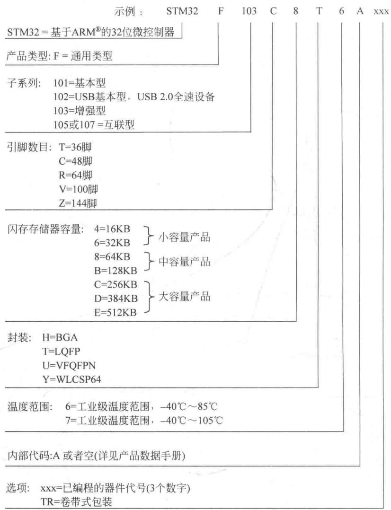

**这张图的排版是"上面一行示例，下面用竖线连到说明"**：

1. **先看最上面一行**：`STM32` `F` `103` `C` `8` `T` `6` `A` `xxx`——一个完整型号被切成 9 段；
2. **再顺着每一段的竖线往下看**，每一段下面都写清了它代表什么；
3. 图的左侧是"段"，右侧是"这段的取值表"。

**逐段拆解**：

| 位置 | 取值 | 含义 |
|---|---|---|
| 第 1 段 | `STM32` | 基于 ARM® 的 32 位微控制器 |
| 第 2 段 | `F` | 产品类型：F = 通用类型 |
| 第 3 段 | `101` / `102` / `103` / `105` / `107` | 子系列：101 = 基本型；102 = USB 基本型；**103 = 增强型**；105 或 107 = 互联型 |
| 第 4 段 | `T` / `C` / `R` / `V` / `Z` | 引脚数目：T=36 脚；C=48 脚；R=64 脚；**V=100 脚**；**Z=144 脚** |
| 第 5 段 | `4`/`6`/`8`/`B`/`C`/`D`/`E` | 闪存容量：4=16KB；6=32KB；8=64KB（小容量）；B=128KB（中容量）；C=256KB；D=384KB；**E=512KB**（大容量） |
| 第 6 段 | `H`/`T`/`U`/`Y` | 封装：H=BGA；**T=LQFP**；U=VFQFPN；Y=WLCSP64 |
| 第 7 段 | `6`/`7` | 温度范围：**6 = 工业级 −40℃～85℃**；7 = 工业级 −40℃～105℃ |
| 第 8 段 | `A` 或空 | 内部代码 |
| 第 9 段 | `xxx` / `TR` | 选项：xxx = 已编程的器件代号；TR = 卷带式包装 |

**现在拆本课程的主角 `STM32F103VET6`**：

```
STM32  F  103  V    E    T   6
  │    │   │   │    │    │   │
  │    │   │   │    │    │   └─ 6  = 工业级温度范围 −40℃～85℃
  │    │   │   │    │    └───── T  = LQFP 封装
  │    │   │   │    └────────── E  = 512KB Flash（大容量产品）
  │    │   │   └─────────────── V  = 100 个引脚
  │    │   └─────────────────── 103 = 增强型子系列
  │    └─────────────────────── F  = 通用类型
  └──────────────────────────── STM32 = 基于 ARM 的 32 位微控制器
```

**`STM32F103ZET6` 只差一位**：

```
STM32  F  103  Z    E    T   6
                │    │    │   │
                │    │    │   └─ 6  = 工业级 −40℃～85℃
                │    │    └───── T  = LQFP 封装
                │    └────────── E  = 512KB Flash
                └─────────────── Z  = 144 个引脚
```

> **看出来了没有？** 这两个型号只差一位：`V`（100 脚）和 `Z`（144 脚）。
> 也就是说：**它们的 Flash 一样大（512KB）、系列一样（F103）、封装一样（LQFP）、温度等级一样**，
> 唯一区别就是**引脚数量不同**。

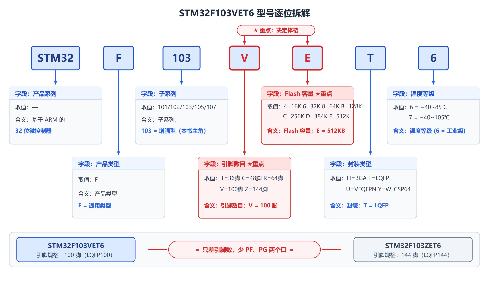

*看图重点：`V` 决定"有多少根引脚"，`E` 决定"Flash 有多大"。*

#### 五位产品线

| 产品线 | 定位 | CPU 最高频率 | 特色 |
|---|---|---|---|
| STM32F100 | 超值型 | 24MHz | 具有电机控制和 CEC 功能 |
| STM32F101 | 基本型 | 36MHz | 具有高达 1MB 的 Flash |
| STM32F102 | 连接型 | 48MHz | 具备 USB FS device 接口 |
| **STM32F103** | **增强型** | **72MHz** | **高达 1MB Flash、电机控制、USB、CAN** |
| STM32F105/107 | 互联型 | 72MHz | 以太网 MAC、CAN、USB 2.0 OTG |

> **STM32F1 系列包含 5 个产品线，它们的引脚、外设和软件互相兼容。**
> 翻译成大白话：你在 F103 上学的东西，换到 F107 上大体还能用。

---

### 3.2 系统架构与内部结构 ★★★ 【PPT 重点：陈 p5～p10 / 梁 p5～p10】

#### 系统架构：三条总线层次

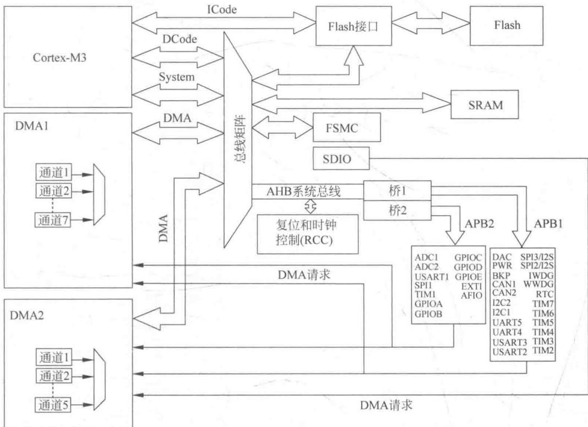

**PPT 把设备按总线分成了三组**：

| 总线 | 挂什么设备 | 频率 |
|---|---|---|
| **AHB**（Advanced High performance Bus） | 高性能设备（内核、DMA、SRAM、Flash 接口、FSMC） | 72MHz |
| **APB2**（高速外设） | GPIO、ADC、USART1、SPI1、TIM1/TIM8 等 | 72MHz |
| **APB1**（低速外设） | TIM2～TIM7、USART2/3、SPI2、I2C、DAC、PWR 等 | 36MHz |

> **PPT 的标注原文**：
> - "连接在 **APB1**（低速外设，**36MHz**）上的设备"
> - "连接在 **APB2**（高速外设，**72MHz**）上的设备"
> - "连接在 **AHB**（Advanced High performance Bus）上的设备"

#### STM32F1 系列产品的主要构成（PPT 逐条列出）

| 部件 | 说明（PPT 原话） |
|---|---|
| **Cortex-M3 内核、DCode 总线（D-bus）和系统总线（S-bus）** | 内核和两条主总线 |
| **通用 DMA1 和通用 DMA2** | 直接内存访问，**用于数据搬运** |
| **内部 SRAM** | 静态随机存取存储器，**高速、易失性、成本高**，**系统内存角色** |
| **内部闪存存储器** | **非易失性、读取快擦除慢**，**程序存储角色** |
| **FSMC** | 可变静态存储控制器，专用外设模块，**接口控制器角色** |
| **AHB 到 APB 的桥（AHB2APBx）** | **它连接所有的 APB 设备** |

> **【理解重点】这段话用一句话概括就是**：
> **内核（CPU）→ 通过 AHB 连高性能部件（DMA、SRAM、Flash、FSMC）→ 再通过 AHB2APB 桥连低速外设。**
> 层次清楚了，第 6 章以后看到"某个外设挂在 APB1 还是 APB2 上"就不会迷路。

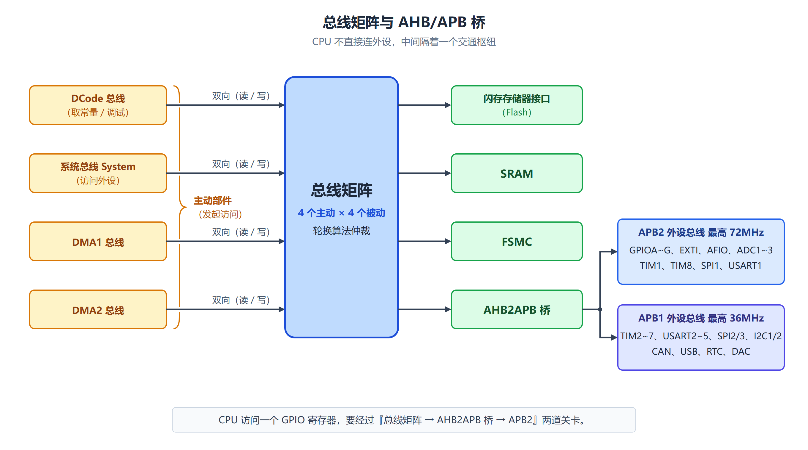

*内核不直接跟外设说话，中间隔着一层总线矩阵和 AHB2APB 桥。*

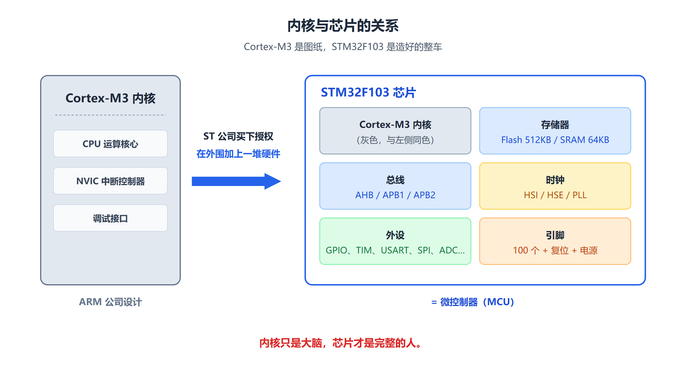

*第 2 章讲的是"内核"，本章讲的是"内核 + 外设 = 芯片"。*

#### STM32F103ZET6 的内部架构

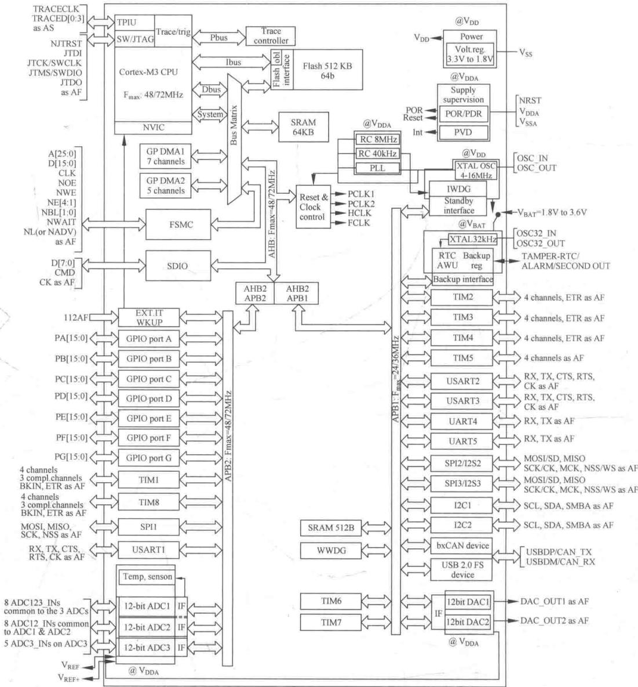

#### STM32F103VET6 包含的特性（PPT 逐条列出 15 条）

**1、内核**

- （1）ARM 32 位的 **Cortex-M3**
- （2）**单周期乘法和硬件除法**

**2、存储器**

- （1）**512K 字节的闪存程序存储器**
- （2）**64K 字节的 SRAM**
- （3）带有 **4 个片选信号**的灵活的静态存储器控制器，支持 Compact Flash、SRAM、PSRAM、NOR 和 NAND 存储器

**3、LCD 并行接口**，支持 8080/6800 模式

**4、时钟、复位和电源管理**

**5、低功耗**

**6、3 个 12 位模数转换器（ADC）**

**7、2 个 12 位数模转换器（DAC）**

**8、12 通道 DMA 控制器**

**9、串行单线调试（SWD）和 JTAG 接口**

**10、快速 I/O 端口（PA~PG）**

**11、多达 11 个定时器**

**12、多达 13 个通信接口**

**13、CRC 计算单元，96 位的芯片唯一代码**

**14、LQFP144 封装形式**

**15、工作温度：−40℃～+105℃**

> **【易错】第 15 条与命名规则有矛盾**：
> 教材写"工作温度 −40℃～+105℃"，但型号后缀是 `6`，按图 3-1 的命名规则 `6 = 工业级 −40℃～85℃`，`7` 才是 −40℃～105℃。
> **教材本身对不上**（已核对原 PDF p76，教材原文如此）。**答题时按命名规则答 `6 = −40～85℃` 更稳妥**，
> 这个矛盾点记录在 `REVIEW_PROGRESS.md` 中。

---

### 3.3 存储器映像 ★★★ 【PPT 重点：陈 p11～p13 / 梁 p11】

#### 核心思想：统一寻址

**PPT 的原文（两位老师都有这段话）**：

> 程序存储器、数据存储器、寄存器和输入输出端口**被组织在同一个 4GB 的线性地址空间内**，
> 实现了硬件资源的标准化管理，为开发者提供了一个简洁、高效、统一的编程模型。
>
> **设计逻辑：统一寻址。存储器映像将外设的控制寄存器也映射到内存地址空间中。
> 这样一来，访问外设寄存器就变得像访问普通内存地址一样简单。**

**【类比】**

> 整个 4GB 地址空间像一座城市的**门牌号总表**。
> 城市里不同的区域分配给不同的用途：
> 这一片是住宅区（Flash），那一片是仓库区（SRAM），还有一片是工厂区（外设），
> 最边上一片是政府机关（内核自己的 NVIC、SysTick）。
> **每栋楼在哪个区、门牌号是多少，都是规划好的。**

> **真实硬件**：这里的地址分配是由 **ARM 架构规定 + 芯片厂商细化**共同决定的，
> CPU 硬件会**真的根据地址去选总线**——地址落在哪个区，CPU 就走哪条总线去访问。

#### 4GB 地址空间怎么分

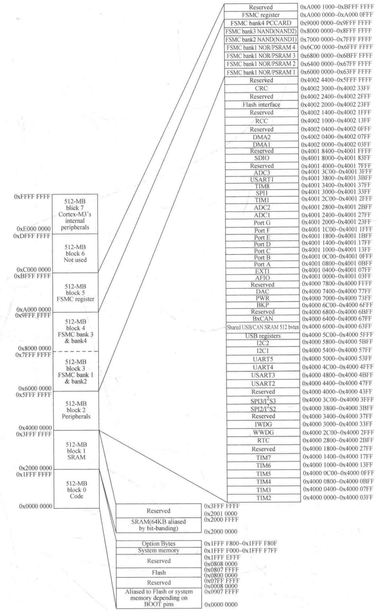

**先看哪里？** 这张图是**竖着排**的：左边一列是**大块分区**，中间用斜线连到右边一列是**更细的划分**。

1. **先只看最左边那一列**：从下往上，一共 8 个大块，**每块 512MB**；
2. **再看中间那条斜线**：它从"Peripherals（外设）"引出来，指向右边一整列——**外设区内部还有几十个更小的格子**；
3. **最下面还有两个小斜线**：分别从 Code 和 SRAM 引出来，表示这两个区内部也有细节。

**8 个大块**：

| 块号 | 地址范围 | 名称 | 里面放什么 |
|---|---|---|---|
| 0 | `0x0000 0000 ~ 0x1FFF FFFF` | Code（代码区） | 启动时映射 Flash/系统存储器 |
| 1 | `0x2000 0000 ~ 0x3FFF FFFF` | SRAM | **片内 64KB SRAM 在最低端** |
| 2 | `0x4000 0000 ~ 0x5FFF FFFF` | **Peripherals（片上外设）** | **所有外设寄存器都在这里** |
| 3 | `0x6000 0000 ~ 0x7FFF FFFF` | FSMC bank1 & bank2 | 外扩存储器 |
| 4 | `0x8000 0000 ~ 0x9FFF FFFF` | FSMC bank3 & bank4 | 外扩存储器 |
| 5 | `0xA000 0000 ~ 0xBFFF FFFF` | FSMC register | FSMC 自己的寄存器 |
| 6 | `0xC000 0000 ~ 0xDFFF FFFF` | Not used | 未使用 |
| 7 | `0xE000 0000 ~ 0xFFFF FFFF` | Cortex-M3 internal peripherals | **内核自己的东西：NVIC、SysTick、调试单元** |

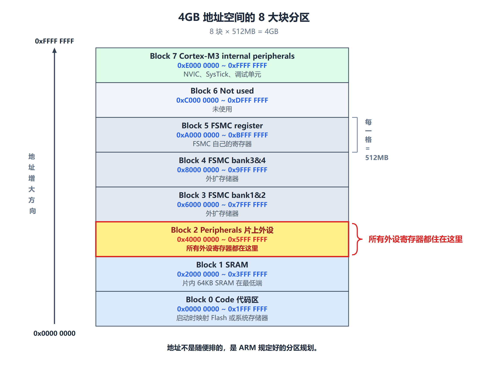

*记住 8 个 512MB 的块——这是后面所有地址计算的骨架。*

#### 外设区内部（重点看这一列）

图右侧那一长列，就是把 block 2（`0x4000 0000` 起）内部再细分：

```
0x4002 1000 ~ 0x4002 13FF  RCC（复位和时钟控制）  ← 开时钟就在这里
0x4002 0400 ~ 0x4002 07FF  DMA2
0x4002 0000 ~ 0x4002 03FF  DMA1
0x4001 3800 ~ 0x4001 3BFF  USART1
0x4001 3000 ~ 0x4001 33FF  SPI1
0x4001 2C00 ~ 0x4001 2FFF  TIM1
0x4001 2400 ~ 0x4001 27FF  ADC1
0x4001 2000 ~ 0x4001 23FF  Port G
0x4001 1C00 ~ 0x4001 1FFF  Port F
0x4001 1800 ~ 0x4001 1BFF  Port E
0x4001 1400 ~ 0x4001 17FF  Port D
0x4001 1000 ~ 0x4001 13FF  Port C
0x4001 0C00 ~ 0x4001 0FFF  Port B
0x4001 0800 ~ 0x4001 0BFF  Port A   ← GPIOA 就在这里
0x4001 0400 ~ 0x4001 07FF  EXTI
0x4001 0000 ~ 0x4001 03FF  AFIO
0x4000 7400 ~ 0x4000 77FF  DAC
0x4000 7000 ~ 0x4000 73FF  PWR
0x4000 6C00 ~ 0x4000 6FFF  BKP
0x4000 6400 ~ 0x4000 67FF  bxCAN
0x4000 5800 ~ 0x4000 5BFF  I2C2
0x4000 5400 ~ 0x4000 57FF  I2C1
0x4000 5000 ~ 0x4000 53FF  UART5
0x4000 4C00 ~ 0x4000 4FFF  UART4
0x4000 4800 ~ 0x4000 4BFF  USART3
0x4000 4400 ~ 0x4000 47FF  USART2
0x4000 3800 ~ 0x4000 3BFF  SPI2/I2S2
0x4000 3400 ~ 0x4000 37FF  SPI3/I2S3（部分型号）
0x4000 3000 ~ 0x4000 33FF  IWDG（独立看门狗）
0x4000 2C00 ~ 0x4000 2FFF  WWDG（窗口看门狗）
0x4000 2800 ~ 0x4000 2BFF  RTC
0x4000 2400 ~ 0x4000 27FF  Reserved
0x4000 2000 ~ 0x4000 23FF  TIM8
...
0x4000 0400 ~ 0x4000 07FF  TIM4
0x4000 0000 ~ 0x4000 03FF  TIM2
```

> **【本节最实用的一条】把这张表当作"查地址的字典"**。
> 第 6 章以后每配一个外设，都要先知道它的寄存器地址在哪。
> **最常用的是这两个**：
> - **`0x4002 1000` = RCC**（复位和时钟控制）——**开时钟要写这里**；
> - **`0x4001 0800` = GPIOA**——**第 6 章的主角**。

#### 教材提到的三个细节

**1、STM32F103ZET6 存储器映射**

**2、STM32F103ZET6 内置外设的地址范围**

**3、嵌入式闪存的组织**

> **PPT 的提示**：内置外设的地址范围参见教材表 3-1；嵌入式闪存的组织参见教材表 3-2。

#### 数据按小端格式存放

> **教材原话**：数据字节以**小端格式**存放在存储器中。一个字中的**最低地址字节**被认为是该字的**最低有效字节**，而最高地址字节是最高有效字节。

**用一个具体例子看**：假设有个 32 位数据 `0x12345678`，要存到地址 `0x2000 0000` 开始的地方。

```
地址          存放的字节
0x20000000    0x78   ← 最低有效字节（Least Significant Byte）
0x20000001    0x56
0x20000002    0x34
0x20000003    0x12   ← 最高有效字节（Most Significant Byte）
```

**规律**：**地址越低，放的是越不重要的字节**。Cortex-M3 同时支持小端和大端，但 **STM32 实际使用的是小端**。

---

### 3.4 时钟结构 ★★★ 【PPT 重点：陈 p14～p17 / 梁 p12～p15，本章最核心】

#### 先补前置知识：什么叫时钟

**时钟（Clock）= 芯片里一串不停跳动的方波信号。**

```
       ┌───┐   ┌───┐   ┌───┐   ┌───┐
       │   │   │   │   │   │   │   │
  ─────┘   └───┘   └───┘   └───┘   └────
       ↑       ↑       ↑       ↑
       上升沿  上升沿  上升沿  上升沿
       ├───────┤
        一个周期
```

- **时钟周期**：一个完整方波占用的时间；
- **频率**：1 秒内有多少个周期，**频率 = 1 / 周期**；
- **1MHz = 1 000 000 Hz**，表示每秒 100 万个周期。

**例**：72MHz 的时钟，周期是多少？

```
T = 1 / 72 000 000 s ≈ 13.9 纳秒（ns）
```

**也就是说：CPU 每 13.9 纳秒就能执行一步动作。**

> 【类比】时钟像**工厂的下班铃**。铃响一次，流水线上的工人（各个硬件模块）就完成一步动作。
> 铃响得越快（频率越高），单位时间干的活越多，但耗电也越多。
>
> **真实硬件**：时钟不是"命令"，而是**节拍基准**。数字电路里所有触发器都在时钟边沿统一更新状态。
> **没有时钟，芯片里的一切都静止不动。**

**为什么芯片需要时钟？** 因为数字电路的状态变化必须**同步**。如果每个模块想什么时候变就什么时候变，
信号就会互相打架。有了统一的时钟，所有模块都遵守同一条规矩：

> **只在时钟边沿这一刻更新状态，其余时间保持稳定。**

#### 五个时钟源（必背）

> **STM32 系列微控制器中，有 5 个时钟源**：
> - **HSI**（High Speed Internal）**高速内部时钟**
> - **HSE**（High Speed External）**高速外部时钟**
> - **LSI**（Low Speed Internal）**低速内部时钟**
> - **LSE**（Low Speed External）**低速外部时钟**
> - **PLL**（Phase Locked Loop）**锁相环倍频输出**
>
> **其中的 HSI、HSE、或 PLL 可被用来驱动系统时钟。**
> **其中的 LSI、LSE 作为二级时钟源。**

| 时钟源 | 频率 | 来源 | 主要用途 |
|---|---|---|---|
| **HSI** | 8MHz | 内部 RC 振荡器 | 复位后的默认系统时钟；HSE 失效时的备用时钟 |
| **HSE** | 4～16MHz（板上一般用 **8MHz**） | 外部晶体，接在 OSC_IN / OSC_OUT | 精确主时钟；经 PLL 倍频后作系统时钟 |
| **LSI** | 约 40kHz | 内部 RC 振荡器 | **独立看门狗（IWDG）**；可驱动 RTC |
| **LSE** | 32.768kHz | 外部晶体，接在 OSC32_IN / OSC32_OUT | **RTC 实时时钟** |
| **PLL** | 可配置 | 对 HSI/2 或 HSE 倍频 | 产生高频（如 72MHz） |

**【RC 振荡器 vs 晶体振荡器】**

| | RC 振荡器 | 晶体振荡器（Crystal） |
|---|---|---|
| 怎么产生振荡 | 电阻 + 电容 + 内部电路 | 石英晶体的机械谐振 |
| 需不需要外接元件 | **不需要**，芯片内部就有 | **需要**，要在引脚上接晶体和电容 |
| 精度 | 较差（±1% 甚至更多） | **很好**（几十 ppm） |
| 启动速度 | 快 | 慢一些 |
| 成本 | 低 | 高一点 |

> **补充**：**为什么 RTC 用 32.768kHz 这个奇怪的数字？**
> 因为 `32768 = 2¹⁵`。把它连续 15 次二分频，就正好得到 **1Hz**（每秒一次）——标准的"秒"信号。
> 这是电子表、RTC 芯片的行业惯例。

#### 基于 ARM Cortex 内核的时钟特点（PPT 专门用一页讲）

**PPT 原文**：

> 普通的 8/16 位单片机：**只有 1 个系统时钟频率**；
>
> 基于 ARM Cortex 内核的 MCU：**具有多个时钟频率，分别供给内核和不同外设模块**。
>
> - **高速时钟供中央处理器等高速设备使用，低速时钟供外设等低速设备使用。**
> - **各模块时钟相互独立，可单独开启 / 关闭，便于低功耗控制。使用外设前，必须先使能其对应时钟，外设才能正常工作。**
> - **MCU 允许输出时钟信号到外部 MCO 引脚**，相应的 GPIO 端口寄存器必须被配置为相应功能。
>   可用信号源：**SYSCLK、HSI、HSE、PLL 时钟/2**。

> **【本课程最重要的一条结论】"使用外设前，必须先使能其对应时钟，外设才能正常工作。"**
>
> **这就是第 6～12 章每一章的第一步都是"开时钟"的原因。**
> 时钟不开，外设的寄存器写了也没反应——这是初学者最常见的困惑之一。

#### 时钟树：整体结构

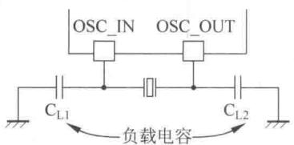

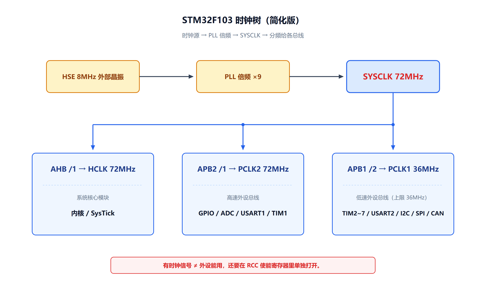

*从左往右看：5 个时钟源 → PLL 倍频 → SYSCLK → AHB/APB 预分频 → 各路频率。*

**时钟树的三层结构**：

```
第一层：5 个时钟源（HSI / HSE / LSI / LSE / PLL）
            ↓
第二层：选出系统时钟 SYSCLK
        （SYSCLK 可由 HSI、HSE 或 PLL 提供）
            ↓
第三层：分频与分发
        SYSCLK ──→ AHB 预分频器 ──→ HCLK
                                      ├──→ 内核 FCLK
                                      ├──→ /8 ──→ SysTick 外部时钟
                                      └──→ /2 ──→ SDIO
                    ┌─────────────────┴─────────────────┐
                    ↓                                   ↓
          APB1 预分频器                        APB2 预分频器
                    ↓                                   ↓
              PCLK1（最大 36MHz）              PCLK2（最大 72MHz）
                    ↓                                   ↓
        APB1 外设（TIM2~7、USART2/3…）    APB2 外设（GPIO、ADC、USART1…）
```

**PPT 关于 PLL 的说明**：

> 其中的 HSI、HSE 或 PLL 可被用来驱动系统时钟。
> **实际 PLL 是来自于 HSI、HSE。**

#### 【重点】定时器时钟 ×2 规则

**PPT 的标注**：

```
APB1 预分频器旁：若 APB1 预分频系数 = 1，则频率不变；否则频率 ×2  ──→ TIMxCLK（定时器 2~7）
APB2 预分频器旁：若 APB2 预分频系数 = 1，则频率不变；否则频率 ×2  ──→ TIMxCLK（定时器 1 和 8）
```

**教材原文**：

> 定时器时钟频率分配由硬件按以下两种情况自动设置：
> （1）如果相应的 APB 预分频系数是 **1**，定时器的时钟频率**与所在 APB 总线频率一致**；
> （2）否则，定时器的时钟频率被设为与其相连的 APB 总线频率的 **2 倍**。

#### 其他几个派生时钟

```
PCLK2 ──/2,/4,/6,/8──→ ADCCLK（最大 14MHz）
PLLCLK ──/1 或 /1.5──→ USBCLK（48MHz）
```

> ADC 时钟由高速 APB2 时钟经 2、4、6 或 8 分频后获得。
> 如果需要在应用中使用 USB 接口，PLL 必须被设置为输出 48 或 72MHz 时钟，用于提供 48MHz 的 USBCLK 时钟。
> **SDIO 接口的时钟频率固定为 HCLK/2。**
> RCC 通过 AHB 时钟（HCLK）**8 分频**后作为 Cortex 系统定时器（SysTick）的外部时钟。

#### 【必会计算】8MHz 怎么变成 72MHz

**这是本节最重要的一个计算，请务必自己动手算一遍。**

**已知**：板子上焊的是 **8MHz** 晶振；我们希望 **HCLK = 72MHz**。

```
第 1 步：选 HSE 作 PLL 输入，且不分频
        HSE = 8MHz
        PLLXTPRE = 0（不分频）→ PLL 输入 = 8MHz

第 2 步：设 PLL 倍频系数 = 9
        PLLCLK = 8MHz × 9 = 72MHz

第 3 步：把 SYSCLK 切到 PLL
        SYSCLK = PLLCLK = 72MHz

第 4 步：AHB 预分频器设 ÷1
        HCLK = SYSCLK ÷ 1 = 72MHz

第 5 步：APB2 预分频器设 ÷1
        PCLK2 = HCLK ÷ 1 = 72MHz   ✓（APB2 允许到 72MHz）

第 6 步：APB1 预分频器设 ÷2
        PCLK1 = HCLK ÷ 2 = 36MHz   ✓（APB1 最高只能 36MHz，正好顶格）

第 7 步：算定时器的时钟
        TIM1、TIM8（挂在 APB2）：预分频系数 = 1 → 定时器时钟 = PCLK2 = 72MHz
        TIM2～TIM7（挂在 APB1）：预分频系数 = 2 ≠ 1 → 定时器时钟 = PCLK1 × 2 = 36 × 2 = 72MHz

第 8 步：算 ADC 时钟
        ADCCLK = PCLK2 ÷ 6 = 72 ÷ 6 = 12MHz   ✓（不超过 14MHz）

第 9 步：算 USB 时钟
        USBCLK = PLLCLK ÷ 1.5 = 72 ÷ 1.5 = 48MHz   ✓
```

> **【最容易错的地方】第 7 步**：两条规则的结果都是 72MHz，但走的是**完全不同的路径**：
> - TIM1/TIM8：APB2 预分频 = 1 → **频率不变**，直接用 PCLK2 = 72MHz；
> - TIM2～TIM7：APB1 预分频 = 2 ≠ 1 → **频率 ×2**，36 × 2 = 72MHz。
>
> **看起来结果一样，但如果你把 APB1 预分频改成 ÷4，TIM2 的时钟就变成 18 × 2 = 36MHz 了**——所以规则必须记牢。

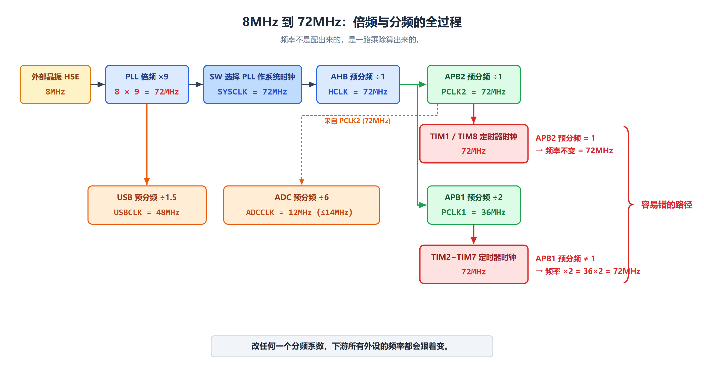

*跟着这张图把上面的九步走一遍，比背数字有用得多。*

#### RTC 和看门狗时钟（PPT 教材都提到）

**RTC 时钟源选择**：通过设置**备份域控制寄存器（RCC_BDCR）**里的 **RTCSEL[1:0]** 位，
RTCCLK 时钟源可以由 **HSE/128、LSE 或 LSI** 提供。**除非备份域复位，此选择不能被改变。**

| RTCSEL 选的源 | 送给 RTC 的频率 | 关键特性 |
|---|---|---|
| **LSE**（32.768kHz） | 32.768kHz | **只要 VBAT 维持供电，尽管 VDD 供电被切断，RTC 仍可继续工作** ✅ 想"断电还走时"就选它 |
| **LSI**（约 40kHz） | 约 40kHz | LSI **不在**备份域。切断 VDD 供电，不能保证状态 |
| **HSE/128**（8MHz ÷ 128） | 62.5kHz | HSE **不在**备份域。VDD 被切断时 RTC 状态不确定 |

> **用大白话总结**：
> - **LSE + VBAT 电池** = 最稳的组合：主电源拔了，时间照样走（这就是手机、电脑主板上那颗小纽扣电池的作用）；
> - **LSI** = 省一颗晶振，但精度差，主电源断了不一定靠得住；
> - **HSE/128** = 用主晶振分频顺便给 RTC 用，但断电会出问题。

**看门狗时钟**：

> 如果**独立看门狗（IWDG）**已经由硬件选项或软件启动，
> **LSI 振荡器将被强制在打开状态，并且不能被关闭。**

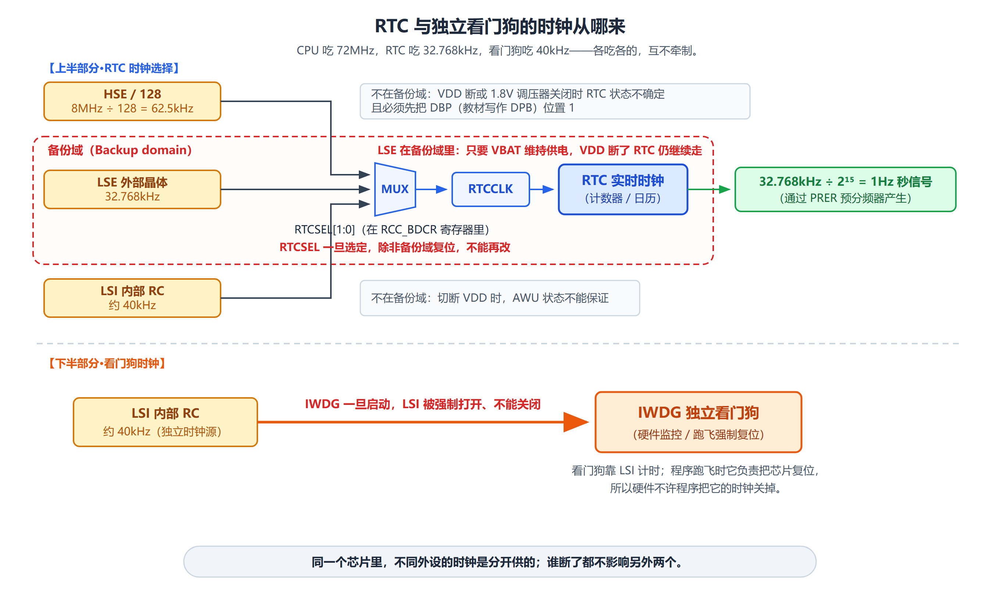

*RTC 靠 LSE + VBAT 实现"断电还走时"；看门狗靠 LSI，一旦启动就关不掉。*

---

### 3.5 引脚 ★★ 【PPT 重点：陈 p18～p19 / 梁 p16～p17】

#### VET6 与 ZET6 的区别

> **STM32F103VET6 比 STM32F103ZET6 少了 2 个口：PF 口和 PG 口，其他资源一样。**

> **PPT 的提示**：STM32F103VET6 的引脚定义参见教材表 3-3。

> **为什么教材从 3.5 节开始改用 `STM32F103VET6` 讲？**
> 因为它是 100 脚的 LQFP 封装，**引脚少、板子好画、芯片好焊**，而且做实验用的最小系统板基本都用它。

#### 启动配置引脚（必背）

**PPT 给的表格**：

| 启动模式选择引脚 |  | 启动模式 | 说明 |
|---|---|---|---|
| **BOOT1** | **BOOT0** | | |
| X | **0** | **主闪存存储器** | 主闪存存储器被选为启动区域 |
| **0** | **1** | **系统存储器** | 系统存储器被选为启动区域 |
| **1** | **1** | **内置 SRAM** | 内置 SRAM 被选为启动区域 |

**记忆方法**：

```
BOOT0 = 0  → 从 Flash 启动（正常运行）★最常用
BOOT0 = 1、BOOT1 = 0 → 从系统存储器启动（通常用于串口下载程序）
BOOT0 = 1、BOOT1 = 1 → 从内置 SRAM 启动（调试用）
```

> **注意**：**BOOT0 = 0 时，BOOT1 是"X"（无所谓）**——因为已经选了 Flash，BOOT1 不起作用。

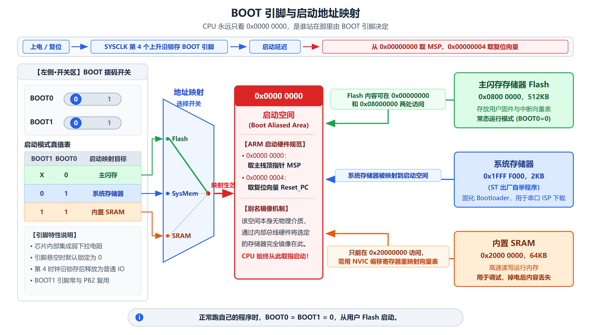

*BOOT0 和 BOOT1 两个引脚决定芯片上电后从哪里开始取指令。*

---

### 3.6 最小系统设计 ★★ 【PPT 重点：陈 p20～p24 / 梁 p18～p22】

#### 什么是最小系统

> **最小系统是指能够让单片机正常工作的包含最少元器件的系统。**

**最小系统核心电路**：

> **复位电路、晶体震荡电路、启动设置电路和 JTAG 接口电路。**

**PPT 列出的 6 个部分**：

| # | 电路 | 作用（PPT 原话） |
|---|---|---|
| 1 | **最小系统核心电路** | **复位电路、晶体震荡电路、启动设置电路和 JTAG 接口电路** |
| 2 | **USB 转 TTL 串口电路** | 便于**串行通信** |
| 3 | **独立按键** | **外部中断检测和待机唤醒** |
| 4 | **ADC 采集电路** | 采集模拟量 |
| 5 | **流水灯电路** | **16 位流水灯** |
| 6 | **电源电路** | **外部电源、USB 电源和 Jlink 电源** |

> **【理解重点】这 6 个部分其实是一张"第 6～10 章的预告片"**：
> - **核心电路**（复位 + 晶振 + 启动 + JTAG）→ 芯片能跑起来的最低要求；
> - **USB 转 TTL 串口** → 第 9 章串行通信；
> - **独立按键** → 第 6 章 GPIO 输入 + 第 7 章外部中断；
> - **ADC 采集电路** → 第 10 章；
> - **流水灯** → 第 6 章 GPIO 输出（最经典的入门实验）；
> - **电源电路** → 硬件基础。
>
> **所以这一节不是"硬件课"，而是"后面每章要用到的硬件接口清单"。**

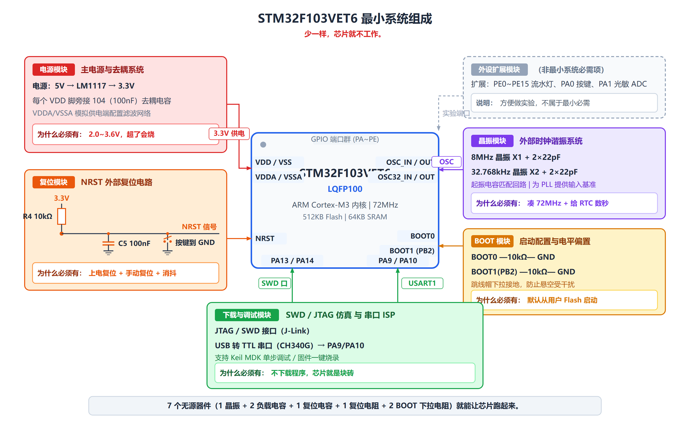

*把最小系统拆成"核心电路 + 各种接口电路"，就能看出后面每章对应哪一块硬件。*

---

## 三、重要知识之间的联系

### 对比 1：内核 vs 芯片

| | **内核（Cortex-M3）** | **芯片（STM32F103VET6）** |
|---|---|---|
| 谁设计的 | **ARM 公司** | **ST 公司**（用 ARM 的内核 + 自己的外设） |
| 包含什么 | 取指/译码/寄存器组/运算器 + NVIC + SysTick + 总线矩阵 | 内核 + Flash + SRAM + 一大堆外设 + 时钟 + 引脚 |
| 讲的章节 | **第 2 章** | **第 3 章（本章）** |

**为什么不同厂家的芯片都叫"Cortex-M3"但外设完全不同**：因为内核是同一个，外面的配置各家不同。

### 对比 2：AHB / APB2 / APB1

| 总线 | 频率（典型） | 挂什么 |
|---|---|---|
| **AHB** | **72MHz** | 高性能设备（内核、DMA、SRAM、Flash、FSMC） |
| **APB2** | **72MHz** | 高速外设（GPIO、ADC、USART1、SPI1、TIM1/TIM8） |
| **APB1** | **36MHz** | 低速外设（TIM2～7、USART2/3、SPI2、I2C、DAC、PWR） |

**记忆方法**：**数字越大越慢**（APB2 比 APB1 快）。

### 对比 3：Flash vs SRAM

| | **Flash（闪存）** | **SRAM** |
|---|---|---|
| 易失性 | **非易失性**（断电不丢） | **易失性**（断电就丢） |
| 速度 | 读取快，**擦除慢** | **高速** |
| 成本 | 低 | **成本高** |
| 角色 | **程序存储** | **系统内存** |
| 地址（F103） | `0x0800 0000` 起，**512KB** | `0x2000 0000` 起，**64KB** |

### 对比 4：HSI vs HSE / LSI vs LSE

| | 内部（Internal） | 外部（External） |
|---|---|---|
| **高速（High Speed）** | **HSI** = 8MHz RC | **HSE** = 4～16MHz 晶体（板上一般 8MHz） |
| **低速（Low Speed）** | **LSI** ≈ 40kHz RC | **LSE** = 32.768kHz 晶体 |

**记忆方法**：**字母顺序就是规律**——第 1 个字母 H/L 表示速度，第 2 个字母 S = Speed，
第 3 个字母 I/E 表示内部/外部。

### 对比 5：主闪存启动 vs 系统存储器启动 vs SRAM 启动

| BOOT1 | BOOT0 | 从哪启动 | 什么时候用 |
|---|---|---|---|
| X | **0** | **主闪存存储器** | **正常运行**（最常用） |
| 0 | 1 | 系统存储器 | 串口下载程序 |
| 1 | 1 | 内置 SRAM | 调试 |

---

## 四、高频易错点

> 以下为**常见易错点**（不是历年考试统计）。

| # | 易错点 | 正确理解 |
|---|---|---|
| 1 | 以为"外设配好寄存器就能用" | **必须先开时钟**！"使用外设前，必须先使能其对应时钟，外设才能正常工作" |
| 2 | 把 APB1 和 APB2 的频率记反 | **APB1 = 36MHz（低速）、APB2 = 72MHz（高速）** |
| 3 | 忘记"定时器时钟 ×2 规则" | **APB 预分频系数 = 1 时频率不变；≠ 1 时定时器时钟 = APB 频率 × 2** |
| 4 | 以为 8 个块大小不一样 | **每块都是 512MB**（0 号块到 7 号块，共 4GB） |
| 5 | 把外设区地址记成 `0x5000 0000` | **片上外设区是 `0x4000 0000 ~ 0x5FFF FFFF`**（块 2） |
| 6 | 以为内核的 NVIC 在"外设区" | **内核自己的东西（NVIC/SysTick）在块 7：`0xE000 0000` 起** |
| 7 | 小端模式记成"高字节放低地址" | **小端 = 最低地址字节是最低有效字节**（"低对低"） |
| 8 | 把型号第 4 位和第 5 位搞混 | **第 4 位是引脚数（V=100、Z=144），第 5 位是 Flash（E=512KB）** |
| 9 | 温度等级按教材正文答 | 教材正文写"−40～+105℃"，但**命名规则里 `6 = −40～85℃`**，两者矛盾（教材本身的问题），**答题按命名规则更稳妥** |
| 10 | 以为 VET6 和 ZET6 差别很大 | **只少了 PF、PG 两个 GPIO 口**，其他资源一样 |
| 11 | 以为 BOOT0=0 时 BOOT1 也要设 | **BOOT0 = 0 时 BOOT1 是"X"（无所谓）** |
| 12 | 以为 PLL 的输入只能是 HSE | **PLL 可以来自 HSI 或 HSE** |

---

## 五、本章考前速查

> 几分钟扫一遍，只看这一节就能回忆全章骨架。

### 型号命名（`STM32F103VET6`）

```
STM32  F  103  V    E    T   6
                │    │    │   └─ 6 = 工业级 −40℃～85℃
                │    │    └───── T = LQFP 封装
                │    └────────── E = 512KB Flash（大容量）
                └─────────────── V = 100 个引脚（Z = 144 个）
```

- **VET6 比 ZET6 只少 PF、PG 两个口**
- **五位产品线**：100 超值 / 101 基本 / 102 连接 / **103 增强（主角）** / 105·107 互联

### 系统架构

- **三组总线**：**AHB 72MHz**（内核/DMA/SRAM/Flash/FSMC）、**APB2 72MHz**（高速外设）、**APB1 36MHz**（低速外设）
- **AHB2APB 桥**连接所有 APB 设备
- 主要部件：Cortex-M3 内核、DMA1/DMA2、**内部 SRAM（高速、易失、成本高 → 系统内存角色）**、**内部闪存（非易失、读取快擦除慢 → 程序存储角色）**、FSMC

### 存储器映像

- **统一寻址**：程序存储器、数据存储器、寄存器、I/O 端口都在**同一个 4GB 线性地址空间**
- **8 个 512MB 的块**：
  - 块 0 Code `0x0000 0000`
  - 块 1 SRAM `0x2000 0000`
  - **块 2 片上外设 `0x4000 0000`**（所有外设寄存器）
  - 块 3/4 FSMC 外扩
  - 块 5 FSMC 寄存器
  - 块 7 Cortex-M3 内部外设 `0xE000 0000`（NVIC/SysTick）
- **常用地址**：**RCC = `0x4002 1000`**（开时钟）、**GPIOA = `0x4001 0800`**
- **数据按小端存放**：最低地址字节 = 最低有效字节

### 时钟结构

**5 个时钟源**：

| 源 | 频率 | 用途 |
|---|---|---|
| **HSI** | 8MHz（内部 RC） | 复位后默认 |
| **HSE** | 4～16MHz（板上 8MHz，外部晶体） | 经 PLL 倍频作系统时钟 |
| **LSI** | ≈40kHz（内部 RC） | 独立看门狗 |
| **LSE** | 32.768kHz（外部晶体） | RTC |
| **PLL** | 可配置 | 倍频（来自 HSI 或 HSE） |

**Cortex 内核时钟特点**：

- **多个时钟频率，分别供给内核和不同外设模块**（普通 8/16 位单片机只有 1 个）
- **各模块时钟相互独立，可单独开启/关闭**，便于低功耗控制
- **使用外设前，必须先使能其对应时钟** ★★★
- 可输出时钟到 **MCO 引脚**（信号源：SYSCLK、HSI、HSE、PLL 时钟/2）

**8MHz → 72MHz 的关键配置**：

```
HSE 8MHz → PLL ×9 → PLLCLK 72MHz → SYSCLK
SYSCLK ÷1 = HCLK 72MHz
HCLK ÷1 = PCLK2 72MHz（APB2）
HCLK ÷2 = PCLK1 36MHz（APB1）
TIM1/TIM8 = PCLK2 = 72MHz（预分频=1，不变）
TIM2~7 = PCLK1 × 2 = 72MHz（预分频≠1，×2）
ADCCLK = PCLK2 ÷ 6 = 12MHz
USBCLK = PLLCLK ÷ 1.5 = 48MHz
```

**定时器时钟 ×2 规则（必记）**：

> **APB 预分频系数 = 1 → 定时器时钟 = APB 频率；≠ 1 → 定时器时钟 = APB 频率 × 2。**

**RTC 时钟源**（RCC_BDCR 的 RTCSEL[1:0]）：**LSE / LSI / HSE÷128**；
只有 **LSE + VBAT** 能实现"主电源断电仍继续走时"。

### 引脚与启动

**启动模式（必背）**：

| BOOT1 | BOOT0 | 启动区域 |
|---|---|---|
| X | **0** | **主闪存存储器**（正常运行） |
| 0 | 1 | 系统存储器 |
| 1 | 1 | 内置 SRAM |

### 最小系统

- **定义**：能够让单片机正常工作的包含**最少元器件**的系统
- **核心电路**：**复位电路、晶体震荡电路、启动设置电路、JTAG 接口电路**
- **6 个部分**：核心电路、USB 转 TTL 串口、独立按键、ADC 采集、流水灯、电源电路

---

## 六、本章快速自测

> **用法**：先自己答，再看答案。
> **标注说明**：标有「**教材习题 X-Y**」的题目，来自教材第 3 章课后习题。

---

### 第一部分：教材课后习题

**Q1（教材习题 3-1）** 简述 Cortex-M3 处理器的特点。

<details><summary>答案</summary>

可从这几个角度答（**这道题的答案在第 2 章**）：

1. **32 位 RISC 内核，哈佛结构**——在加载/存储数据的同时能够执行指令取指；
2. **三级流水线 + 分支预测**；
3. **16 个通用寄存器**（R0～R12 加上 SP/LR/PC）、**MSP/PSP 双堆栈**；
4. **支持位带操作**（原子位操作）；
5. **内置 NVIC**，支持中断嵌套和优先级；
6. **支持线程/处理两种模式、特权/非特权两个等级**；
7. **32 位单周期乘法、硬件除法**；
8. **Thumb-2 指令集**；
9. **可中断-可继续的 LDM/STM、PUSH/POP**，低中断延迟；
10. **支持非对齐访问**；
11. 支持睡眠、深度睡眠等**低功耗模式**；
12. 调试方便（SWD/JTAG、ETM）。

**答题要点提醒**：这道题把第 2 章的核心特性串了一遍，**答出 6～8 条即可**。
关键是"哈佛结构 + 三级流水线 + NVIC + 双堆栈 + 位带"这几条别漏。★★★
</details>

---

**Q2（教材习题 3-2）** STM32F103VET6 的存储器结构有什么特点？

<details><summary>答案</summary>

答题要点：

1. 程序存储器、数据存储器、寄存器和 I/O 端口**统一编址在同一个 4GB 线性地址空间**；
2. 分成 **8 个 512MB 的块**；
3. **Flash `0x0800 0000`，512KB**，256 页 × 2KB，有主存储块和信息块；
4. **SRAM `0x2000 0000`，64KB**，可按字节/半字/字访问；
5. **外设寄存器映射在 `0x4000 0000 ~ 0x5FFF FFFF`**，可用访问内存的方式访问；
6. 数据按**小端**格式存放；
7. 有两个**位带区**（SRAM 最低 1MB、外设最低 1MB）及对应的 **32MB 位带别名区**。

**答题要点提醒**：**"统一编址"和"8 个 512MB 块"是这道题的核心**，其余是补充。★★★
</details>

---

**Q3（教材习题 3-3）** STM32F103VET6 的时钟结构对于系统的功耗控制有什么作用？

<details><summary>答案</summary>

答题要点：

1. STM32 有 **5 个时钟源**（HSI/HSE/LSI/LSE/PLL），**每个时钟源都可以被独立地启动或关闭**；
2. **每个外设的时钟也可以单独使能/关闭**（RCC_APBxENR 的各位）——**不用某个外设时把它的时钟关掉，这部分电路就不耗电**；
3. 通过 **AHB/APB1/APB2 预分频器**可以降低总线频率，**动态降频省电**；
4. 系统支持**睡眠、停机、待机三种低功耗模式**，在低功耗模式下时钟可以被关闭或切换到低速时钟（LSI/LSE）；
5. **RTC 可以在停机/待机模式下由 LSE/LSI 继续运行**，实现定时唤醒；
6. RTC 的时钟源可以单独选择（RCC_BDCR 的 RTCSEL[1:0]），**用 LSE + VBAT 时主电源断了 RTC 仍能计时**。

**答题要点提醒**：这道题的关键是抓住"**独立开关**"这个设计思想——
**功耗控制的前提是"能单独关掉"**。第 2 条（外设时钟单独使能）和第 4 条（低功耗模式）是必答项。★★★
</details>

---

### 第二部分：补充理解题

**Q4（计算）把 `STM32F103VET6` 这个型号逐位拆开，说明每一位的含义。**

<details><summary>答案</summary>

```
STM32  F  103  V    E    T   6
  │    │   │   │    │    │   │
  │    │   │   │    │    │   └─ 6  = 工业级温度范围 −40℃～85℃
  │    │   │   │    │    └───── T  = LQFP 封装
  │    │   │   │    └────────── E  = 512KB Flash（大容量产品）
  │    │   │   └─────────────── V  = 100 个引脚
  │    │   └─────────────────── 103 = 增强型子系列
  │    └─────────────────────── F  = 通用类型
  └──────────────────────────── STM32 = 基于 ARM 的 32 位微控制器
```

**结论**：这是**增强型（103）、100 引脚（V）、512KB Flash（E）、LQFP 封装（T）、工业级 −40～85℃（6）**的 STM32。

**易错提醒**：
- **第 4 位是引脚数**（T=36、C=48、R=64、**V=100**、**Z=144**），**第 5 位是 Flash 容量**（E=512KB），别搞反；
- **温度等级**：教材正文写"−40～+105℃"，但命名规则里 **6 = −40～85℃、7 = −40～105℃**，两者矛盾（教材本身的问题）。**答题按命名规则更稳妥。** ★★★
</details>

---

**Q5（概念）为什么 STM32 的地址都写成 `0x40010800` 这样的 8 位十六进制？4GB 地址空间是怎么分块的？**

<details><summary>答案</summary>

**为什么是 8 位十六进制**：STM32 是 **32 位机**，有 32 条地址线，能访问 **2³² = 4GB** 地址空间。
32 位二进制 ÷ 4（1 位十六进制对应 4 位二进制）= **8 位十六进制**。

**8 个块，每块 512MB**：

| 块号 | 地址范围 | 名称 |
|---|---|---|
| 0 | `0x0000 0000 ~ 0x1FFF FFFF` | Code（代码区） |
| 1 | `0x2000 0000 ~ 0x3FFF FFFF` | SRAM |
| 2 | `0x4000 0000 ~ 0x5FFF FFFF` | **Peripherals（片上外设）** |
| 3 | `0x6000 0000 ~ 0x7FFF FFFF` | FSMC bank1 & bank2 |
| 4 | `0x8000 0000 ~ 0x9FFF FFFF` | FSMC bank3 & bank4 |
| 5 | `0xA000 0000 ~ 0xBFFF FFFF` | FSMC register |
| 6 | `0xC000 0000 ~ 0xDFFF FFFF` | Not used |
| 7 | `0xE000 0000 ~ 0xFFFF FFFF` | Cortex-M3 内部外设（NVIC/SysTick） |

**验算**：`0x20000000`（每块大小）= 2³² ÷ 8 = 536 870 912 字节 = **512MB** ✓

**最实用的两条**：**RCC = `0x4002 1000`**（开时钟要写这里）、**GPIOA = `0x4001 0800`**。★★★
</details>

---

**Q6（原理）为什么说"使用外设前必须先使能其对应时钟"？这个设计和普通 8/16 位单片机有什么不同？**

<details><summary>答案</summary>

**先看普通单片机和 STM32 的差别**：

> 普通的 8/16 位单片机：**只有 1 个系统时钟频率**；
> 基于 ARM Cortex 内核的 MCU：**具有多个时钟频率，分别供给内核和不同外设模块**。

**为什么必须单独开时钟**：因为 STM32 的**每个外设都有独立的时钟开关**（在 RCC 寄存器里）。
时钟不开，这个外设的电路就是"静止"的——**寄存器写了也没反应**。

```
① 开时钟      给这个外设供电（RCC 寄存器里把对应位置 1）
      ↓
② 配置寄存器  设置工作模式、参数
      ↓
③ 使能        把外设开关打开
      ↓
④ 使用        读数据 / 写数据 / 等标志位 / 响应中断
```

**这个设计的价值（PPT 原话）**：

> **各模块时钟相互独立，可单独开启/关闭，便于低功耗控制。**

也就是说，**不用的外设把时钟关掉，这部分电路就不耗电**。这是低功耗设计的核心手段之一。

**易错提醒**：这是初学者最常见的困惑——"我寄存器都配对了，为什么没反应？"
**十有八九是忘了开时钟。** ★★★
</details>

---

**Q7（计算）板上焊的是 8MHz 晶振，怎么让 HCLK = 72MHz？算出 PCLK1、PCLK2、TIM2 的时钟、ADCCLK 分别是多少。**

<details><summary>答案</summary>

```
第 1 步：选 HSE 作 PLL 输入，不分频
        PLL 输入 = 8MHz

第 2 步：设 PLL 倍频系数 = 9
        PLLCLK = 8MHz × 9 = 72MHz

第 3 步：把 SYSCLK 切到 PLL
        SYSCLK = 72MHz

第 4 步：AHB 预分频器 ÷1
        HCLK = 72MHz

第 5 步：APB2 预分频器 ÷1
        PCLK2 = HCLK ÷ 1 = 72MHz

第 6 步：APB1 预分频器 ÷2
        PCLK1 = HCLK ÷ 2 = 36MHz

第 7 步：定时器时钟（TIM2 挂在 APB1）
        APB1 预分频系数 = 2 ≠ 1
        → TIM2 时钟 = PCLK1 × 2 = 36 × 2 = 72MHz

第 8 步：ADC 时钟
        ADCCLK = PCLK2 ÷ 6 = 72 ÷ 6 = 12MHz
```

**答案汇总**：

| 时钟 | 数值 |
|---|---|
| HCLK | **72MHz** |
| PCLK2（APB2） | **72MHz** |
| PCLK1（APB1） | **36MHz** |
| TIM2 时钟 | **72MHz** |
| ADCCLK | **12MHz** |

**易错提醒**：**TIM2 的时钟不是 36MHz 而是 72MHz**——因为 APB1 预分频系数 ≠ 1，硬件自动把定时器时钟设为 APB 频率的 **2 倍**。★★★
</details>

---

**Q8（区别）AHB、APB1、APB2 三条总线的频率和挂载设备有什么不同？**

<details><summary>答案</summary>

| 总线 | 频率（典型） | 挂什么设备 |
|---|---|---|
| **AHB** | **72MHz** | 高性能设备：**内核、DMA、SRAM、Flash 接口、FSMC** |
| **APB2** | **72MHz** | **高速外设**：GPIO、ADC、USART1、SPI1、TIM1/TIM8 |
| **APB1** | **36MHz** | **低速外设**：TIM2～TIM7、USART2/3、SPI2、I2C、DAC、PWR |

**PPT 的原话**：

> - 连接在 **APB1**（低速外设，**36MHz**）上的设备
> - 连接在 **APB2**（高速外设，**72MHz**）上的设备
> - 连接在 **AHB**（Advanced High performance Bus）上的设备

**结构关系**：

```
内核 ──AHB──┬── DMA / SRAM / Flash / FSMC
            └── AHB2APB 桥 ──┬── APB2（72MHz）→ 高速外设
                             └── APB1（36MHz）→ 低速外设
```

**记忆方法**：**数字越大越慢**（APB2 比 APB1 快）。★★★
</details>

---

**Q9（易错）STM32F103VET6 和 STM32F103ZET6 有什么区别？**

<details><summary>答案</summary>

**只差一位字母**：

```
STM32F103VET6  →  V = 100 个引脚
STM32F103ZET6  →  Z = 144 个引脚
```

**其他完全一样**：Flash 一样大（512KB）、系列一样（F103）、封装一样（LQFP）、温度等级一样。

**具体差别（教材原话）**：

> **STM32F103VET6 比 STM32F103ZET6 少了 2 个口：PF 口和 PG 口，其他资源一样。**

**为什么课程用 VET6**：它是 100 脚 LQFP 封装，**引脚少、板子好画、芯片好焊**，
而且做实验用的最小系统板基本都用它。

**易错提醒**：不要以为"少两个口"就是"少很多功能"——**只少了 PF、PG 这两个 GPIO 口**，
Flash、SRAM、外设数量都没变。★★
</details>

---

**Q10（概念）BOOT0 和 BOOT1 两个引脚是干什么的？三种启动模式分别用在什么场合？**

<details><summary>答案</summary>

这两个引脚决定**芯片上电后从哪里开始取指令**。

| BOOT1 | BOOT0 | 启动模式 | 说明 | 什么时候用 |
|---|---|---|---|---|
| **X** | **0** | **主闪存存储器** | 主闪存存储器被选为启动区域 | **正常运行**（最常用） |
| **0** | **1** | **系统存储器** | 系统存储器被选为启动区域 | 串口下载程序 |
| **1** | **1** | **内置 SRAM** | 内置 SRAM 被选为启动区域 | 调试 |

**记忆方法**：

```
BOOT0 = 0        → 从 Flash 启动（正常运行）
BOOT0 = 1 且 BOOT1 = 0 → 从系统存储器启动（下载模式）
BOOT0 = 1 且 BOOT1 = 1 → 从内置 SRAM 启动
```

**易错提醒**：**BOOT0 = 0 时，BOOT1 是"X"（无所谓）**——因为已经选了 Flash，BOOT1 不起作用。★★★
</details>

---

**Q11（概念）什么是最小系统？最小系统的核心电路包含哪几部分？**

<details><summary>答案</summary>

**定义**：

> **最小系统是指能够让单片机正常工作的包含最少元器件的系统。**

**核心电路**：

> **复位电路、晶体震荡电路、启动设置电路和 JTAG 接口电路。**

**PPT 列出的完整 6 个部分**：

| # | 电路 | 作用 |
|---|---|---|
| 1 | **最小系统核心电路** | 复位、晶振、启动设置、JTAG |
| 2 | **USB 转 TTL 串口电路** | 便于串行通信 |
| 3 | **独立按键** | 外部中断检测和待机唤醒 |
| 4 | **ADC 采集电路** | 采集模拟量 |
| 5 | **流水灯电路** | 16 位流水灯 |
| 6 | **电源电路** | 外部电源、USB 电源和 Jlink 电源 |

**理解要点**：这 6 个部分其实是"**后面每章要用到的硬件接口清单**"——
串口对应第 9 章、按键对应第 6/7 章、ADC 对应第 10 章、流水灯对应第 6 章。★★
</details>

---

**Q12（综合）程序烧进 Flash 后，芯片上电是怎么跑起来的？把时钟、启动模式、存储器映像串起来说一遍。**

<details><summary>答案</summary>

**上电后的完整链条**：

```
① 复位
   - 硬件从向量表（0x00000000）取 MSP 初值 → 装进 SP
   - 从 0x00000004 取复位向量 → 装进 PC
   - 开始执行第一条指令

② 启动模式决定"从哪取指令"
   - BOOT0 = 0（默认）→ 从【主闪存存储器】启动
   - 代码就在 Flash 里（0x0800 0000 起，512KB）

③ 时钟启动（启动代码负责）
   - 复位后默认用 HSI（8MHz 内部 RC）——不够快
   - 启动代码配置：HSE 8MHz → PLL ×9 → 72MHz → SYSCLK
   - 分频：HCLK = 72MHz、PCLK2 = 72MHz、PCLK1 = 36MHz
   - 切到 PLL 后，整个芯片跑到 72MHz

④ 初始化数据段、调用 main
   - 把 Flash 里的初始化数据搬到 SRAM（0x2000 0000 起，64KB）
   - 调用 main() 函数

⑤ main 里要用某个外设时
   - 【必须先开时钟】写 RCC（0x4002 1000）里对应的使能位
   - 然后配置外设寄存器（外设寄存器地址在 0x4000 0000 ~ 0x5FFF FFFF）
   - 再使能外设，然后使用
```

**关键要点串联**：

| 环节 | 涉及本章哪一节 |
|---|---|
| 从哪取指令 | **3.5 启动模式**（BOOT0/BOOT1） |
| 代码和数据放哪 | **3.3 存储器映像**（Flash `0x0800 0000`、SRAM `0x2000 0000`） |
| 时钟怎么起来 | **3.4 时钟结构**（HSI 默认 → HSE+PLL → 72MHz） |
| 外设怎么用 | **3.4**（先开时钟）+ **3.3**（寄存器地址在 `0x4000 0000` 区） |
| 硬件怎么接 | **3.6 最小系统**（晶振、复位、JTAG） |

**易错提醒**：很多人只记得"程序从 Flash 跑"，忘了**时钟也是启动代码配的**——
复位后芯片其实先跑在 HSI 8MHz 上，是启动代码把 PLL 打开才到 72MHz 的。★★★
</details>

---

## 本章来源对照

> 便于核查是否有遗漏。PPT 页码来自实际提取的课件文本，未作推测。

| 本节内容 | 对应 PPT | 页 | 完整讲义 |
|---|---|---|---|
| 3.1 简介与型号命名规则 | 陈 / 梁 | 陈 p3～p4 / 梁 p3～p4 | 3.1 |
| 3.2 系统架构与内部结构 | 陈 / 梁 | 陈 p5～p10 / 梁 p5～p10 | 3.2 |
| 3.3 存储器映像 | 陈 / 梁 | 陈 p11～p13 / 梁 p11 | 3.3 |
| 3.4 时钟结构 | 陈 / 梁 | 陈 p14～p17 / 梁 p12～p15 | 3.4 |
| 3.5 引脚（含启动配置） | 陈 / 梁 | 陈 p18～p19 / 梁 p16～p17 | 3.5 |
| 3.6 最小系统设计 | 陈 / 梁 | 陈 p20～p24 / 梁 p18～p22 | 3.6 |
| 教材习题 3-1～3-3 | 对应 PPT 第 3 章内容 | — | 3.10 |

**说明**：

1. 「陈」= `PPT/陈洁平课件/第3章 STM32F1系列微控制器-陈.pdf`（24 页）；
   「梁」= `PPT/梁桥康课件/第3章 STM32F1系列微控制器.pptx`（22 页，封面署名为「李哲」）。
2. 两位老师本章内容**高度一致**，本复习版取并集。
3. **教材本身的一处矛盾**：教材正文写 STM32F103ZET6 工作温度"−40℃～+105℃"，
   但型号后缀 `6` 按命名规则是 **−40～85℃**（`7` 才是 −40～105℃）。已核对原 PDF，教材原文如此。
   本复习版按命名规则处理，并已记录到 `REVIEW_PROGRESS.md`。
4. **图片路径**：本复习版引用的图片已复制到 `review/images/` 下，使用**同级相对路径**，
   确保在各种 Markdown 查看器中都能正常显示。
