# 第 5 章 精简复习 — ARM 微控制器开发

> **本章定位**：前四章讲的是"原理"，本章讲的是"**怎么真的把程序跑起来**"。
> 它回答一个非常实际的问题：**你写的一个 `.c` 文件，是怎么一步步变成能烧进芯片的固件，又怎么在上电后跑起来的？**
> 本章也是第 6 章的**直接前置**：GPIO 程序里那三行"开时钟、配模式、读/写"，前两行用的就是本章的固件库函数。
>
> **本复习版说明**：两位老师的第 5 章 PPT 内容互补——
> 陈老师版（40 页）侧重**流程与固件库**，梁老师版（44 页，图片型）额外补充了**程序映像四段结构、C 数据类型表、寄存器版 vs 库版对比**。
> 本复习版取并集，重点按 PPT 实际篇幅分配。
>
> 详细版见 `../05_ARM微控制器开发.md`

---

## 一、本章知识框架

本章回答一个问题：**代码是怎么变成能跑的固件的？上电后又是怎么跑起来的？**

```
① 代码怎么变成固件？          5.1 开发流程
   （.c → .o → 可执行映像 → Flash）
            ↓
② 芯片上电后怎么找到程序？    5.2 处理器的启动过程
   （取 MSP 初值 → 取复位向量 → 启动代码 → main）
            ↓
③ 外设怎么初始化？            5.3 输入和输出接口
   （开时钟 → 配 I/O → 配外设 → 配中断）
            ↓
④ 固件里到底装了什么？        5.4 程序映像
   （向量表 + C 启动代码 + 程序代码 + C 库代码）
            ↓
⑤ 用 C 怎么写硬件程序？       5.5 C 语言开发 ARM 应用
   （数据类型 + 指针访问外设 + volatile + CMSIS）
            ↓
⑥ 有没有更省事的写法？        5.6 固件库
   （库函数 vs 直接操作寄存器）
            ↓
⑦ 有没有更省事的工具？        5.7 STM32CubeMX
   （图形化配置，自动生成初始化代码）
```

**一句话记住本章**：

> **编译器生成映像 → 启动代码准备环境 → 固件库封装寄存器 → 你在 main 里调用它们。**

---

## 二、重点知识

### 5.1 开发流程 ★★★ 【PPT 重点：陈 p3～p4 / 梁 p6～p7】

#### 程序代码的生成流程（必背）

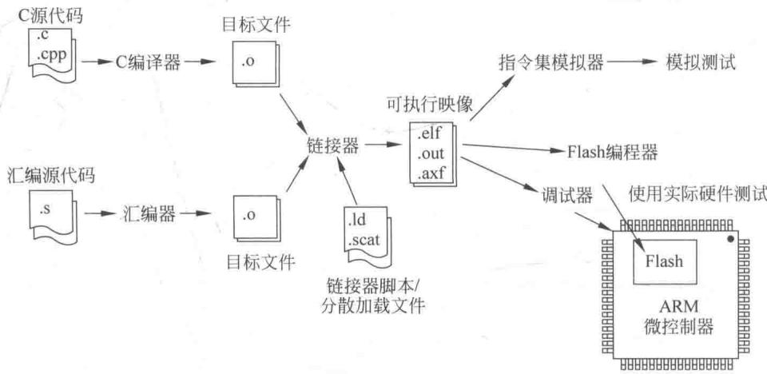

**这张图先别管所有箭头，只看三样东西。**

**第一层：左边两个"入口"（原料从哪来）**

- **C 源代码**（`.c`、`.cpp`）——大多数情况下你会用的入口；
- **汇编源代码**（`.s`）——第 4 章那种写法，或启动代码那种必须用汇编的地方。

**第二层：中间三台"机器"（谁在加工）**

| 工具 | 输入 | 输出 |
|---|---|---|
| **C 编译器** | C 源代码 `.c` / `.cpp` | **目标文件 `.o`** |
| **汇编器** | 汇编源代码 `.s` | **目标文件 `.o`** |
| **链接器** | 所有 `.o` + 库代码 + **链接器脚本** | **可执行映像** `.elf` / `.out` / `.axf` |

**注意图上两根箭头汇合在链接器上**——这就是"**混合编程**"：C 编出来的零件和汇编编出来的零件，最后由同一个链接器装到一起。

**第三层：右下方那个"额外输入"（最容易忽略）**

> 图里在链接器下面画了一个 `.ld` / `.scat`，标注是"**链接器脚本 / 分散加载文件**"。
>
> **链接器不是自己知道"代码该放到 0x08000000、变量该放到 0x20000000"的。
> 是你（或开发工具）通过链接脚本告诉它的。**

**第四层：最右边的三条出口（映像做出来之后干嘛）**

| 出口 | 通向谁 | 用途 |
|---|---|---|
| 上 | **指令集模拟器** → 模拟测试 | 电脑上假装有个 CPU，直接跑，不用真板子 |
| 中 | **Flash 编程器** | 把映像写进芯片的 Flash |
| 下 | **调试器** → 使用实际硬件测试 | 在真板子上单步调试 |

> **这张图在提醒你**：**程序最终的落脚点是芯片里的 Flash**，不是电脑硬盘。

**【先补一个前置知识：为什么要有"目标文件"这个半成品？】**

> 因为一个工程里可能有 10 个 `.c` 文件。如果每次改一个字就重新翻译整本书，太慢了。
> 所以做法是：**每个 `.c` 单独翻译成一个 `.o`**；改哪个就重新翻译哪个；最后再把所有 `.o` **拼**成一本完整的书。
> **"拼"这个动作，就叫链接。**

#### IDE + ICE 的开发过程

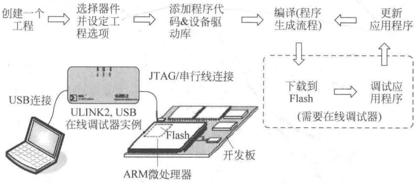

**图 5-1 讲的是"文件怎么变"，图 5-2 讲的是"人怎么操作"。**

**人的操作步骤（6 步）**：

```
创建一个工程
    ↓
选择器件并设定工程选项
    ↓
添加程序代码 & 设备驱动库
    ↓
编译（程序生成流程）      ←—— 这一步就是图 5-1 的全过程
    ↓
下载到 Flash（需要在线调试器）
    ↓
调试应用程序
    ↓
更新你的应用程序（循环回上面）
```

**硬件连接**：

> 笔记本电脑 → **USB** → **ULINK2 在线调试器** → **JTAG/串行线** → 开发板（ARM 微处理器 + Flash）。

> **ICE** = In-Circuit Emulator，**在线调试器**。它的作用是"能钻进芯片里看"：
> 单步执行、下断点、看寄存器、看内存。

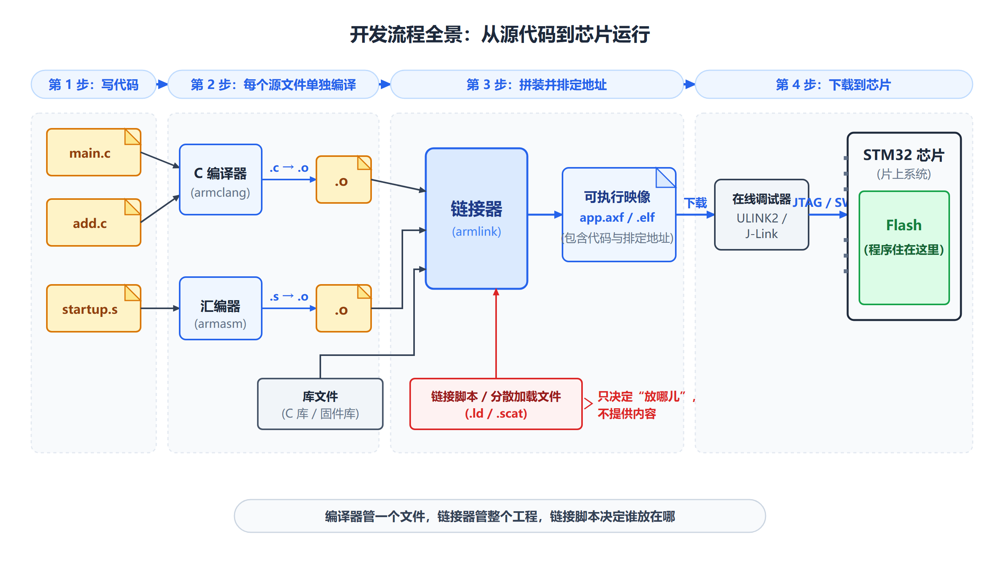

*从左到右：写代码 → 编译 → 链接 → 下载 → 调试，每一步产出什么。*

---

### 5.2 处理器的启动过程 ★★★ 【PPT 重点：陈 p5～p6 / 梁 p8～p10】

#### 复位后发生了什么（本章最核心）

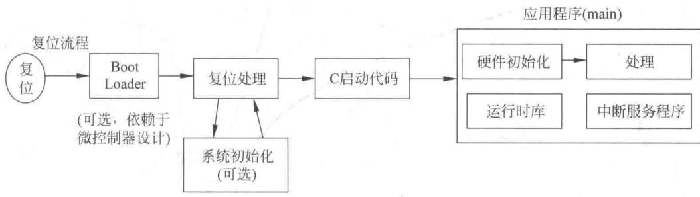

**沿着箭头往右走，一共 5 个盒子**：

| 顺序 | 盒子 | 关键标注 | 说明 |
|---|---|---|---|
| 1 | **Boot Loader** | "（**可选**，依赖于微控制器设计）" | 芯片内部固化的引导程序，**先跑它**，再跑你的程序 |
| 2 | **复位处理** | 下面挂着"**系统初始化（可选）**"，用**双向箭头**连接 | 复位处理程序；它可能顺手把系统初始化了，也可能留给后面 |
| 3 | **C 启动代码** | — | 准备 C 语言运行环境：初始化变量、清内存、准备堆 |
| 4 | **应用程序（main）** | 右边一个大方框 | 终于到你的代码了 |
| 5 | 大框内部 | 分成四块 | **硬件初始化 → 处理**；下面还有**运行时库**和**中断服务程序** |

**特别注意第 2 个盒子和下面那个小盒子之间的双向箭头**：

> 这说明：**"系统初始化"这件事，放在复位处理里做，还是放到 main 里做，取决于具体工程。**
> **STM32 的官方启动文件是在复位处理里调用 `SystemInit()` 的。**

**【先补一个前置知识：Boot Loader 是什么？】**

> **Boot Loader** = 引导加载程序。
> **大白话**：芯片里预装的一个"小管家"。上电后它先跑，检查一下情况（比如有没有人在通过串口给你升级程序），
> 确认没别的事，再把控制权交给 Flash 里的用户程序。
>
> **教材原话**："大多数情况下，Boot Loader 都是固定的，只有 Flash 存储器中的用户程序才是可变的。"

**【先补一个前置知识：什么是启动代码？】**

> **启动代码**（Startup Code）是"**在 main 之前跑的那段程序**"。
>
> **教材原话**："在复位流程中，处理器会取出 MSP 的初始值和复位向量，然后开始执行复位处理，
> 这些所需信息都放在一个叫作**启动代码**的程序文件中。"
>
> **对 C 语言工程**："**无须编程者考虑启动代码，因为 C 语言开发工具会将其自动插入程序映像中。**"
> **对汇编语言工程**："许多工作需要开发者自行完成，例如设置堆栈、设置程序的入口等。"

> **结论**：**用 C 开发时，启动代码是"白送"的**，你不用写，但你必须知道它在干什么
> （否则你永远不明白变量为什么会有初值）。

#### 上电后的时间轴（必背）

```
复位 ──→ [ 取出 MSP 的初始值 ] ──→ [ 取出复位向量 ] ──→ [ 取第一条指令 ] ──→ ...
          ↑                          ↑                    ↑
       地址 0x00000000            地址 0x00000004        跳到复位向量指向的地址
```

- **第一个方框标着 0x00000000**：CPU 去这个地址，取出 **MSP 的初始值**，装进 SP；
- **第二个方框标着 0x00000004**：CPU 去这个地址，取出**复位向量**；
- 然后有一个**弯回来的箭头**：**复位向量里存的是一个地址**，CPU 拿着这个地址去那里取第一条指令。

> **为什么要有这个"弯箭头"？**
> 因为**复位向量里装的不是指令，是地址**。CPU 必须先把它读出来，再"跳"过去。
>
> **这和传统单片机完全不同**——教材第 2 章专门强调：
> "绝大多数的其他微处理器或单片机架构总是从 0 地址开始执行第一条指令……**在 Cortex-M3 中，
> 在 0 地址处存放 MSP 的初始值**，然后紧跟着就是向量表……**向量表中的数值是 32 位的地址，而不是跳转指令。**"

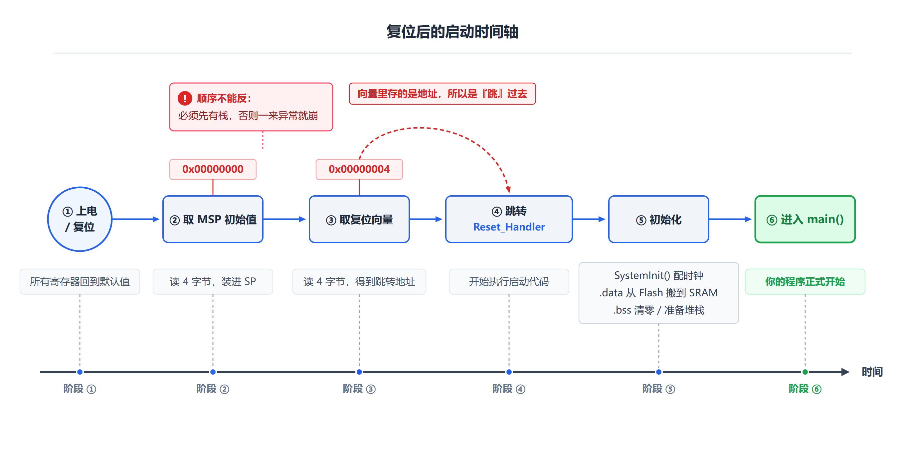

*从左到右 6 个阶段：上电 → 取 MSP → 取复位向量 → 执行启动代码 → 初始化变量 → 进入 main。*

#### 启动代码干了什么（必背 4 件事）

**梁版 PPT 总结得很清楚**：

```
① 搬移 .data：已初始化的全局变量从 Flash 复制到 SRAM
② 清零 .bss：未初始化的区域全部清 0
③ 初始化堆：备好 malloc 用的控制变量
④ 跳转 main()，交棒给应用程序
```

> **教材原话**："C 启动代码用于设置像全局变量之类的数据，也会**清零加载时未被初始化的内存区域**。
> 对于使用 `malloc` 等 C 函数的应用程序，C 启动代码还需要**初始化堆空间的控制变量**。
> 初始化完成后，启动代码**跳转到 main() 程序执行**。"

**【理解重点】为什么必须"搬移 .data"？**

> 因为你写的 `int a = 5;` 这个"5"是**初值**，它必须存在**断电不丢**的地方（Flash）。
> 但程序运行时，`a` 是一个**变量**，必须住在**可读可写**的地方（SRAM）。
> 所以启动代码要做的事就是：**把 Flash 里存着的初值，复制到 SRAM 里那块属于 `a` 的位置。**

#### 应用程序包含哪几个部分

> **教材原话**：应用程序通常包含以下几个部分：
> - **硬件初始化**（如时钟、PLL 和外设）；
> - **应用程序的处理部分**；
> - **中断服务程序**。
>
> 另外，应用程序可能用 C 库函数，C 编译器/链接器会将所需的库函数纳入编译好的程序映像中。

**图里画了 4 块**（比文字多一块"运行时库"）：

| 块 | 作用 |
|---|---|
| **硬件初始化** | 配时钟、PLL、外设（箭头指向"处理"，表示初始化完才进处理） |
| **处理** | 你自己写的业务逻辑主体 |
| **运行时库** | 链接进来的 C 库函数代码（`printf`、除法、浮点等） |
| **中断服务程序** | 响应中断时才执行的代码 |

> **看书时注意**：正文按"应用程序包含哪几部分"数是 **3 项**（库代码被单独放在下一句讲）；
> 看图时数方框是 **4 块**。两者说的是同一件事，只是"数法"不同。

---

### 5.3 输入和输出接口 ★★ 【PPT 重点：陈 p7 / 梁 p11】

#### 外设的典型初始化步骤（必背，第 6 章直接用）

> 嵌入式系统中可用的输入和输出接口可能有数字和模拟输入/输出（I/O）、UART、I2C 和 SPI 等。
> 许多微控制器还提供 USB、以太网、CAN、LCD 以及 SD 卡等接口，**这些接口是由微控制器的外设控制的**。

**外设的典型初始化步骤（PPT 原文 4 步）**：

| 步骤 | 内容 |
|---|---|
| **（1）** | **使能外设时钟，配置外设对应的 GPIO 引脚** |
| **（2）** | **配置 GPIO 引脚模式** |
| **（3）** | **配置外设的控制寄存器，设置外设工作参数** |
| **（4）** | **（可选）配置中断** |

**梁版 PPT 的四步卡片**（表述略有不同，意思一样）：

```
1 配置时钟   使能外设时钟信号，必要时初始化相应引脚
2 配置 I/O   设置引脚的输入 / 输出模式
3 配置外设   设置外设的工作模式与参数
4 配置中断   使能中断并配置 NVIC 优先级
```

> **【本章最重要的一条"套路"】这四步会在第 6～12 章每一章重复出现。**
> 第 6 章 GPIO 就是这四步的第一个实例；第 8 章定时器、第 9 章串口、第 10 章 ADC 全都是同一套。
>
> **背下这四步，后面每一章都能自己推出流程。**

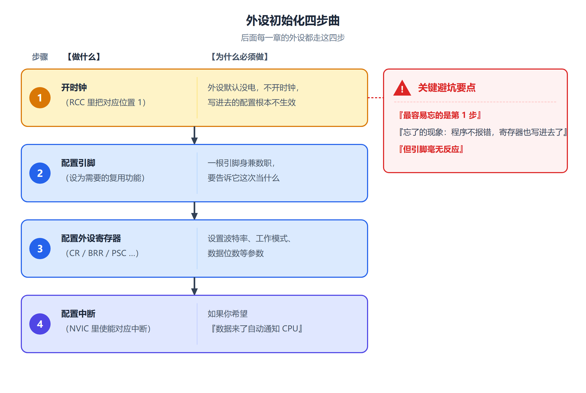

*开时钟 → 配 I/O → 配外设 → 配中断。这个顺序不能颠倒：没有时钟，后面全都白搭。*

---

### 5.4 程序映像 ★★★ 【PPT 重点：陈 p8～p12 / 梁 p12～p16】

#### 程序映像的四个部分（必背）

> **Cortex-M3 的程序映像一般包含以下几个部分**：
> 1. **向量表**；
> 2. **C 启动代码**；
> 3. **程序代码**（应用程序代码和数据）；
> 4. **C 库代码**（C 库函数的程序代码，**链接时插入**）。

**梁版 PPT 的补充**：

> **程序映像是烧写进 Flash 的那一整个二进制文件。**
> 链接器把上面四部分**按地址顺序拼在一起**，上电后处理器就从最前面的**向量表**开始工作。

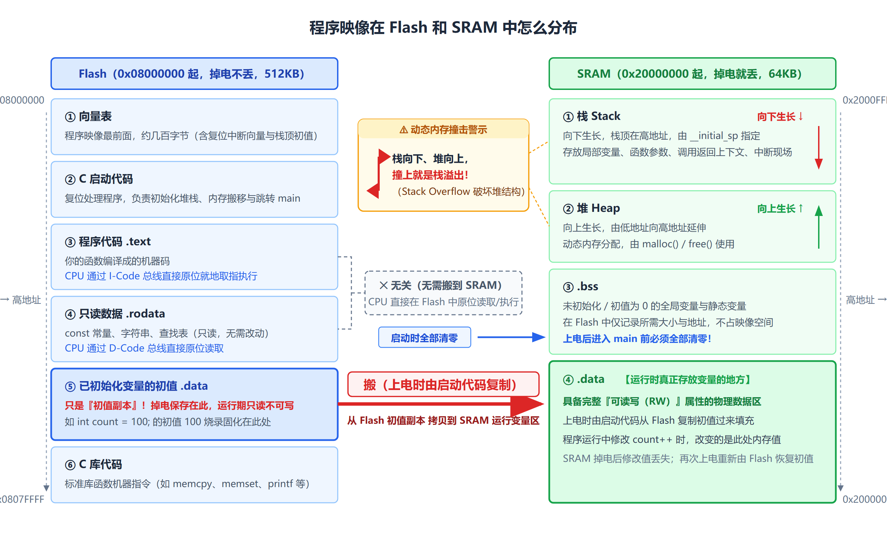

*四部分按地址顺序排：向量表在最前（0x08000000），然后是启动代码、程序代码、库代码。*

#### 1. 向量表

> 向量表可以用 **C 语言或汇编语言**实现。
>
> **Keil MDK 创建 STM32 工程时，则将向量表作为汇编启动代码的一部分，并且使用定义常量数据（DCD）指令创建。**
> ST 公司提供的启动文件 `startup_stm32f10x_hd.s` 使用汇编实现向量表。

**启动文件片段（教材 p124）**：

```assembly
Stack_Size      EQU     0x00000400
                        AREA    STACK, NOINIT, READWRITE, ALIGN=3
Stack_Mem       SPACE   Stack_Size          ; 分配栈空间
__initial_sp

Heap_Size       EQU     0x00000200
                        AREA    HEAP, NOINIT, READWRITE, ALIGN=3
__heap_base
Heap_Mem        SPACE   Heap_Size           ; 分配堆空间
__heap_limit

                PRESERVE8                   ; 表明该文件中的代码预留 8 字节对齐的栈
                THUMB
; 向量表，复位时映射到地址 0
                AREA    RESET, DATA, READONLY
                EXPORT  __Vectors
                EXPORT  __Vectors_End
                EXPORT  __Vectors_Size
__Vectors       DCD     __initial_sp        ; 栈顶
                DCD     Reset_Handler       ; 复位处理程序入口地址
                DCD     NMI_Handler         ; NMI 处理程序入口地址
                DCD     HardFault_Handler   ; 硬件错误处理程序入口地址
                DCD     MemManage_Handler   ; MPU Fault Handler
```

**这张表必须记住前 4 行**：

| 偏移 | 内容 | 说明 |
|---|---|---|
| **0x00** | `__initial_sp` | **MSP 初始值**（不是地址！） |
| **0x04** | `Reset_Handler` | 复位处理入口 |
| **0x08** | `NMI_Handler` | NMI 入口 |
| **0x0C** | `HardFault_Handler` | 硬 Fault 入口 |

> **为什么第 0 项是栈顶？**
> 因为**复位时硬件要先建立堆栈**，才谈得上保存现场、调用函数。
> 所以向量表的第一项不是函数地址，而是 **MSP 的初始值**——**这是最容易记错的一点。**

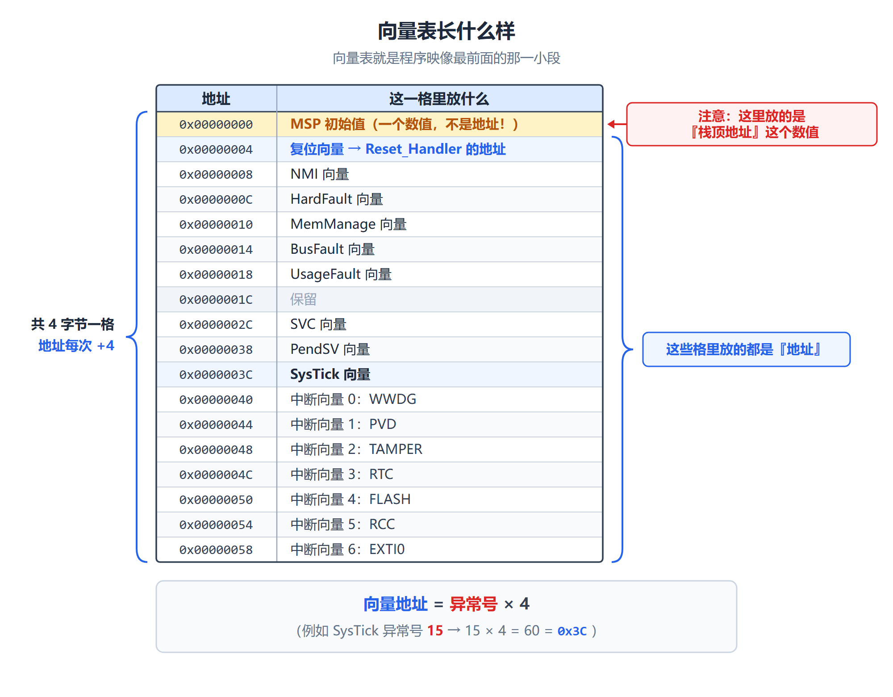

*左边地址从 0x00000000 递增；**第一格放的是"数值"（MSP 初值），从第二格开始才是"地址"**。*

#### 2. C 启动代码

> C 启动代码用于设置像全局变量之类的数据，也会清零加载时未被初始化的内存区域。
> 对于使用 `malloc` 等 C 函数的应用程序，C 启动代码还需要初始化堆空间的控制变量。
> **初始化完成后，启动代码跳转到 main() 程序执行。**

（具体做的 4 件事见 5.2 节。）

#### 3. 程序代码

> 程序代码包括**指令及各类数据**：
> - **变量的初始值**；
> - **程序代码中的常量**；
> - **其他的常量**，比如查找表和图像数据，它们也被合并在程序映像中。

#### 4. C 库代码

> 当使用特定的 C/C++ 库函数时，**它们的库代码就会由链接器嵌入到程序映像中**。

**梁版 PPT 的补充**：

> **只有真正用到的函数才会被拼入，没用到的不会占用空间。**
> **所以：换用不同的库函数，映像大小会变。**

---

### 5.5 C 语言开发 ARM 应用 ★★★ 【PPT 重点：陈 p13～p24 / 梁 p17～p25】

#### 5.5.1 数据类型

**梁版 PPT 给的完整表格**：

| C 和 C99 数据类型 | 位数 | 范围（有符号） | 范围（无符号） |
|---|---|---|---|
| `char`, `int8_t`, `uint8_t` | **8** | −128～127 | 0～255 |
| `short`, `int16_t`, `uint16_t` | **16** | −32 768～32 767 | 0～65 535 |
| `int`, `int32_t`, `uint32_t` | **32** | −2 147 483 648～2 147 483 647 | 0～4 294 967 295 |
| `long` | **32** | 同上 | 同上 |
| `long long`, `int64_t`, `uint64_t` | **64** | −2⁶³～2⁶³−1 | 0～2⁶⁴−1 |
| `float` | 32 | ±3.4028234×10³⁸ | — |
| `double` | 64 | ±1.7976931348623157×10³⁰⁸ | — |
| `pointers`（指针） | **32** | 0x0～0xFFFFFFFF | — |
| `enum` | 8/16/32 | 可能的最小数据类型 | — |
| `bool`(C++), `_Bool`(C) | 8 | 真或假 | — |
| `wchar_t` | 16 | 0～65 535 | — |

> **梁版 PPT 的实用建议**：**开发中一般不用 `int` / `long`，而用 `stdint.h` 的 `uint8_t` / `uint16_t` / `uint32_t`。**
>
> **为什么？** 因为 `int` 的位数**在不同平台上可能不同**（有的编译器 `int` 是 16 位）。
> 而 `uint32_t` 明确规定了是 32 位，写硬件驱动时必须精确。

**【易错】32 位无符号数的上限是 4 294 967 295，不是 4 294 967 265。**
（网络上有些资料写成 265，是错的。正确值 = 2³² − 1 = **4 294 967 295**。）

#### 5.5.2 用 C 语言操作外设（本章最关键的一段）

> 对于 ARM Cortex-M3 微控制器，**外设寄存器被映射到系统存储器空间，它们可以通过指针进行访问。**

**方法（教材原文）**：

```c
#define PERIPH_BASE           ((uint32_t)0x40000000)  // 外设基地址
#define APB1PERIPH_BASE       PERIPH_BASE
#define APB2PERIPH_BASE       (PERIPH_BASE + 0x10000)
#define USART1_BASE           (APB2PERIPH_BASE + 0x3800) // 计算出 USART1 外设寄存器组的物理起始地址
#define USART1                ((USART_TypeDef *) USART1_BASE) // 将基地址强制类型转换为指向 USART_TypeDef 结构体的指针
```

> 此后，`USART1` 就是一个**结构体指针**，可以通过 `USART1->SR`、`USART1->DR` 等方式访问各个寄存器。

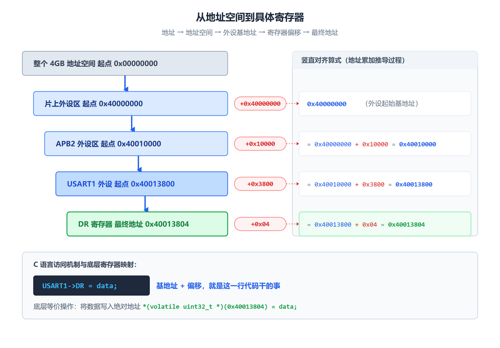

*四步：`PERIPH_BASE`（0x40000000）→ 加 0x10000 得 APB2 基址 → 加 0x3800 得 USART1 基址 → 强转成结构体指针。*

#### 结构体 `USART_TypeDef` 的定义

```c
typedef struct
{
  __IO uint16_t SR;
  uint16_t      RESERVED0;
  __IO uint16_t DR;
  uint16_t      RESERVED1;
  __IO uint16_t BRR;
  uint16_t      RESERVED2;
  __IO uint16_t CR1;
  uint16_t      RESERVED3;
  __IO uint16_t CR2;
  uint16_t      RESERVED4;
  __IO uint16_t CR3;
  uint16_t      RESERVED5;
  __IO uint16_t GTPR;
  uint16_t      RESERVED6;
} USART_TypeDef;
```

**【必考】为什么寄存器之间要插 `RESERVED`？（教材专门用一页讲）**

> 在 STM32 系列中，**USART 的寄存器虽然是 16 位（`uint16_t`）有效位宽，
> 但每个寄存器的地址偏移是 4 字节（32 位）对齐的**（例如 SR 在 0x00，DR 在 0x04，BRR 在 0x08……）。
>
> **如果直接按顺序定义 16 位成员而不加填充，编译器会按自然对齐规则排列：
> SR 占 2 字节，紧接着 DR 就会位于偏移 0x02，这与硬件要求的 0x04 不符。**
>
> **因此，在每个有效寄存器之间插入一个 RESERVED（保留）字段（也占 2 字节），
> 使得下一个有效寄存器偏移增加 4 字节，从而精确匹配硬件寄存器地址映射。**

**内存布局对照**：

```
偏移      成员
+0x00     SR
+0x02     RESERVED0     ← 填充，让下一个有效寄存器跳到 0x04
+0x04     DR
+0x06     RESERVED1
+0x08     BRR
+0x0A     RESERVED2
+0x0C     CR1
+0x0E     RESERVED3
```

> **一句话记住**：**`RESERVED` 是用来"占位对齐"的**，让结构体成员的偏移正好等于硬件寄存器的偏移。

#### 整体工作原理（教材总结的三条）

```
① 内存映射：Cortex-M3 将外设寄存器固定映射到系统存储空间的特定物理地址。
② 基地址 + 偏移：通过宏计算出外设寄存器组的起始地址，再通过结构体成员的偏移量来访问单个寄存器。
③ 指针访问：USART1 是一个指向结构体的指针，
   引用操作 USART1->SR 等价于读取地址 USART1_BASE + 0x00 处的 16 位值。
```

**实际用法**：

```c
USART1->DR = mydata;    // 使用 USART1 发送一个字节的数据
```

> **教材的结论**：**STM32 固件库函数就是基于这种思路设计的。**

#### 【必考】`volatile` 和 `__IO`

> **教材原话**：在定义 `USART_TypeDef` 结构时，使用了 `__IO` 变量类型，
> 该类型实质上是 **`volatile` 的宏定义**。外设访问定义指针时，**需要使用 `volatile` 关键字，用于防止相关变量被优化。**

**梁版 PPT 的解释更直白**：

> **外设寄存器的读写有副作用，编译器必须每次都老老实实去访问内存。**

**【先补一个前置知识：为什么必须加 `volatile`？】**

> 编译器很聪明，它会做"优化"。比如：
> ```c
> while (USART1->SR & 0x80) { }   // 等待某个标志位置位
> ```
> 如果没加 `volatile`，编译器会想："这个循环里 `SR` 又没被改过，那它的值不会变，
> 干脆只读一次，然后变成死循环。"——**这样程序就永远等不到了。**
>
> 加了 `volatile` 就是告诉编译器："**这个变量的值可能随时被硬件改掉，每次都必须真的去内存里读。**"

> **一句话记住**：**`volatile` = "别优化我，每次都去内存读"**。写硬件程序时它是**保命的**。

#### 5.5.3 CMSIS（Cortex 微控制器软件接口标准）

**（1）CMSIS 简介**

> 为了使软件产品具有**高度的兼容性和可移植性**，ARM 公司与许多微控制器供应商和软件方案供应商共同努力，
> 开发了一个**通用的软件框架 CMSIS**，该框架适用于大多数 Cortex-M 处理器以及 Cortex-M 微控制器产品。
> **CMSIS 针对处理器特性提供了标准化的操作函数。**

**（2）CMSIS 的标准化内容（7 条）**

> - **标准化的操作函数**，用于访问 **NVIC、系统控制块（SCB）、SysTick** 的中断控制和初始化；
> - **NVIC、SCB 和 SysTick 寄存器的标准化定义**；
> - **使用 Cortex-M 微控制器特殊指令的标准化函数**；
> - **系统异常处理的标准化命名**；
> - **系统初始化函数的标准化命名**——通用的系统初始化函数被命名为 **`void SystemInit(void)`**；
> - **为时钟频率信息建立标准化的变量**——这个变量为 **`SystemCoreClock`**；
> - **设备驱动库的通用平台**。

> **【重点记两个名字】**
> - **`SystemInit()`** —— 系统初始化函数（启动代码里会调用它）；
> - **`SystemCoreClock`** —— 存当前系统时钟频率的全局变量。

**（3）CMSIS 的组织结构（4 层）**

> ① **核心外设访问层**；
> ② **中间件访问层**；
> ③ **设备外设访问层（MCU 相关）**；
> ④ **外设的访问函数（MCU 相关）**。

**梁版 PPT 的补充说明**：

| 层 | 负责什么 |
|---|---|
| ① 核心外设访问层 | **内核寄存器与核心功能函数**（ARM 提供） |
| ② 中间件访问层 | **访问中间件的通用 API**（ARM 提供） |
| ③ 设备外设访问层 | **芯片相关的中断与外设寄存器定义** |
| ④ 外设访问函数 | **芯片相关的外设驱动函数** |

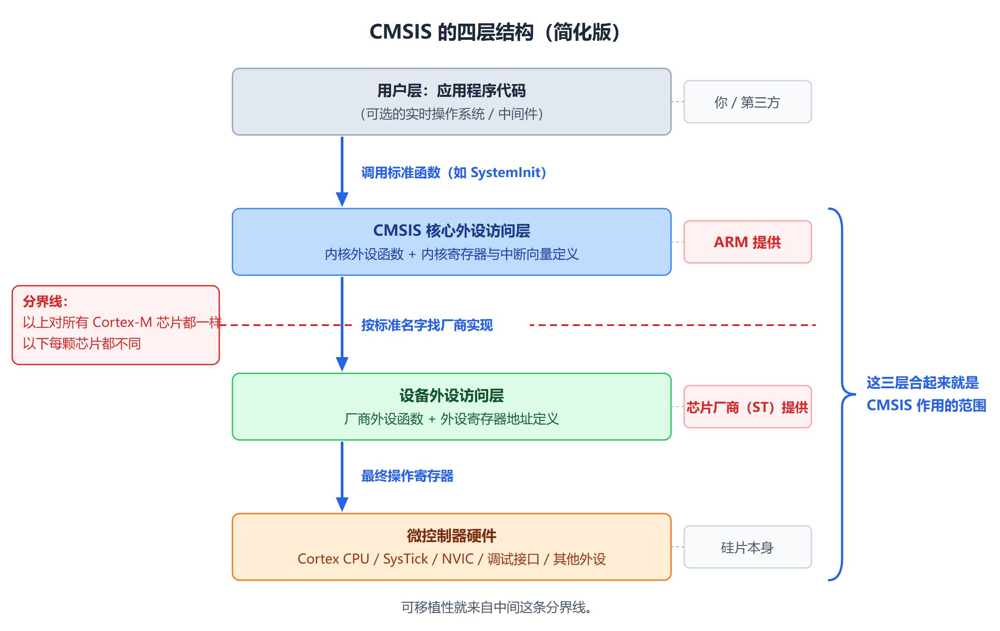

*越往下越贴近硬件、越依赖具体芯片；越往上越通用、越可以跨厂商复用。*

> **梁版 PPT 的结论**：**同一段访问内核外设的代码，可以在不同厂商的 Cortex-M 芯片之间直接复用。**

**（4）CMSIS 的使用**

**工程文件组织**（梁版 PPT 的图）：

```
工程
├── 启动代码（包括向量表）
├── 应用程序代码（#include <device>.h ; int main(void){...}）
├── <device>.h
├── core_cm3.c
├── system_<device>.h
└── 外设驱动文件
```

**CMSIS 设备驱动程序架构**：

| 文件 | 作用 |
|---|---|
| `core_cm3.h` | **内核外设访问层** |
| `core_cmFunc.h` / `core_cmInstr.h` | 特殊寄存器 / 特殊指令访问函数的头文件 |
| `core_cm3.c` | 访问特殊指令的函数 |
| `system_<device>.h` | 中断数量和外设寄存器定义 |
| `system_<device>.c` | 包括初始化的系统函数 |
| 外设驱动代码 | 设备外设访问层和其他的访问函数 |

---

### 5.6 固件库 ★★★ 【PPT 重点：陈 p25～p38 / 梁 p26～p40】

#### 固件库是什么

> ST（意法半导体）为了方便用户开发程序，提供了一套丰富的 STM32 固件库。使用固件库开发应用系统可以大大提高用户的开发效率。
>
> **固件库就是函数的集合，固件库函数的作用是：向下负责直接操作寄存器，向上提供用户函数调用的接口（API）。**

**梁版 PPT 的概括**：**库是「寄存器」与「应用程序」之间的一层翻译。**

```
用户应用程序
    ↓
固件库函数（API）
    ↓
直接读写寄存器
    ↓
片上外设硬件
```

#### 5.6.1 基于固件库开发和直接操作寄存器的区别（必背）

> 固件库将寄存器底层操作都封装起来，提供一整套 API 供开发者调用。
> **用户一般不需要知道操作的是哪个寄存器，只需要知道调用哪些函数即可。**
> 通过使用固件函数库，用户无需深入掌握细节，也可以轻松应用每一个外设。
> 因此，使用固件函数库可以大大减少用户的程序编写时间，进而降低开发成本。
> **并且，所有的驱动程序源代码都符合 ANSI-C 标准，不受开发环境影响。**

**教材给的对比例子**：

```c
GPIOx->BRR = 0x0011;                                      // 直接寄存器操作
GPIO_ResetBits(GPIOx, GPIO_Pin_0 | GPIO_Pin_4);           // 固件库函数
// 功能：把 GPIOx 端口的 Pin0 和 Pin4 这两个引脚置为低电平
```

**PPT 的对比表**：

| | **固件库函数** | **直接操作寄存器** |
|---|---|---|
| 程序代码大小 | **较大** | **较小** |
| 执行速度 | **较慢** | **较快** |
| 鲁棒性 | **高** | 需自己查手册，出错风险高 |
| 可读性/可移植性 | **好** | 较差（依赖具体芯片） |
| 时序与位域控制 | 被封装 | **完全可控** |

**梁版 PPT 的实用建议**：

> **初学与快速开发用库；追求极致性能、空间或需要精确控制时，直接操作寄存器。**
>
> **寄存器版在少量引脚、要求确定性的场合有优势**（比如启动代码、驱动底层、中断里改一个位）；
> **库版在批量初始化时并不吃亏**，可读性、可移植性和不会配错位域。

**梁版 PPT 给了同一件事的两种写法（很有价值）**：

```c
/* 寄存器版（4 条语句）：让 PB5 输出低电平 */
RCC->APB2ENR |= (1U << 3);       /* ① 开 GPIOB 时钟 */
GPIOB->CRL &= ~(0xFU << 20);     /* ② 清 PB5 的 4 位配置域 */
GPIOB->CRL |= (0x3U << 20);      /* CNB=00 推挽, MODE=11, 50MHz */
GPIOB->BSRR = (1U << 5) << 16;   /* ③ 复位 PB5 → 低电平 → 点亮 */
```

```c
/* 标准外设库 SPL 版 */
GPIO_InitTypeDef GPIO_InitStructure;
RCC_APB2PeriphClockCmd(RCC_APB2Periph_GPIOB, ENABLE);
GPIO_InitStructure.GPIO_Pin   = GPIO_Pin_5;
GPIO_InitStructure.GPIO_Mode  = GPIO_Mode_Out_PP;
GPIO_InitStructure.GPIO_Speed = GPIO_Speed_50MHz;
GPIO_Init(GPIOB, &GPIO_InitStructure);
GPIO_ResetBits(GPIOB, GPIO_Pin_5);
```

> **这两段对照非常值得记住**：它们是**同一件事的两种写法**，第 6 章会详细展开。
> 看懂了这个对照，就理解了"固件库到底帮你做了什么"。

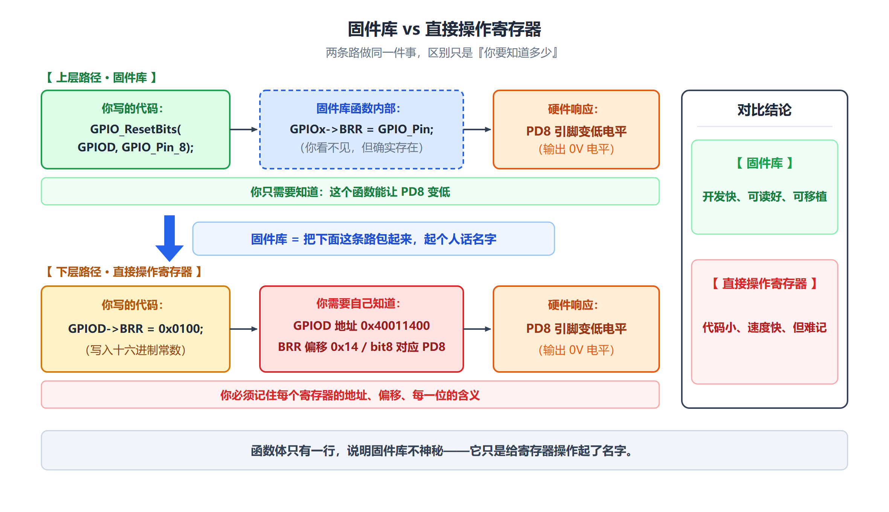

*库版：代码长、可读性好、不容易配错；寄存器版：代码短、执行快、要自己查手册。*

#### 5.6.2 STM32 固件库简介

**（1）CMSIS 应用程序的三个基本功能层**

> ① **核内外设访问层**：ARM 公司提供的访问，定义处理器内部寄存器地址以及功能函数；
> ② **中间件访问层**：定义访问中间件的通用 API，由 ARM 公司提供；
> ③ **外设访问层**：定义硬件寄存器的地址以及外设的访问函数。

> **【注意】"3 层"和"4 层"的说法**
> 5.5.3 节讲 CMSIS 组织结构时是 **4 层**，5.6.2 节讲固件库时概括为 **3 层**。
> 两者只是"数法"不同：**4 层把厂商负责的部分再细分成"设备外设访问层"和"外设的访问函数"两层**。
> **作答时按题目所在小节的说法写即可。**

**（2）STM32 固件库函数的命名规则**

**外设缩写表（梁版 PPT 给了完整版，很实用）**：

| 缩写 | 外设名称 | 缩写 | 外设名称 |
|---|---|---|---|
| **ADC** | 模数转换器 | **IWDG** | 独立看门狗 |
| **BKP** | 备份寄存器 | **NVIC** | 嵌套中断向量列表控制器 |
| **CAN** | 控制器局域网模块 | **PWR** | 电源/功耗控制 |
| **CRC** | CRC 计算单元 | **RCC** | 复位与时钟控制器 |
| **DAC** | 数模转换器 | **RTC** | 实时时钟 |
| **DMA** | 直接内存存取控制器 | **SDIO** | SDIO 接口 |
| **EXTI** | 外部中断事件控制器 | **SPI** | 串行外设接口 |
| **FLASH** | 闪存存储器 | **SysTick** | 系统嘀嗒定时器 |
| **FSMC** | 灵活的静态存储器控制器 | **TIM** | 通用定时器 |
| **GPIO** | 通用输入/输出端口 | **TIM1** | 高级控制定时器 |
| **I2C** | I2C 总线接口 | **USART** | 通用同步异步接收发射端 |
| **I2S** | I2S 总线接口 | **WWDG** | 窗口看门狗 |

**（3）变量编码规则**

> 在文件 `stm32f10x_type.h` 中定义了固件库函数中常用的变量。

**普通变量**：

```c
typedef signed long   s32;
typedef signed short  s16;
typedef signed char   s8;
typedef unsigned long u32;
typedef unsigned short u16;
typedef unsigned char  u8;
```

**梁版 PPT 的命名规律**：

```
s = signed（有符号）
u = unsigned（无符号）
数字 = 位宽 8 / 16 / 32
例如 s32 = 有符号 32 位整型
```

> **还有带 `const` 的 `sc32`、带 `volatile` 的 `vs32` 等变体。**

**四种枚举类型（必背）**：

| 类型 | 取值 | 定义 |
|---|---|---|
| **`bool`** | `FALSE=0`、`TRUE=!FALSE` | `typedef enum { FALSE = 0, TRUE = !FALSE } bool;` |
| **`FlagStatus`** | `RESET=0`（已复位）、`SET=!RESET`（已置位） | `typedef enum { RESET = 0, SET = !RESET } FlagStatus;` |
| **`FunctionalState`** | `DISABLE=0`（除能）、`ENABLE=!DISABLE`（使能） | `typedef enum { DISABLE = 0, ENABLE = !DISABLE } FunctionalState;` |
| **`ErrorStatus`** | `ERROR=0`（出错）、`SUCCESS=!ERROR`（成功） | `typedef enum { ERROR = 0, SUCCESS = !ERROR } ErrorStatus;` |

> **【易错】`ErrorStatus` 里 `ERROR = 0`、`SUCCESS = 1`**——**成功是 1，不是 0**。
> 这和 C 语言里"0 表示成功"的习惯**相反**，但固件库就是这么定义的，别记反。
>
> **为什么用 `!FALSE` 而不是直接写 1？** 梁版 PPT 的解释：**让两者的取值"天生互斥"**，
> 不管底层布尔类型怎么实现，`TRUE` 一定是 `FALSE` 的反面。

**（4）外设结构体**

> 可以通过指向各个外设的指针访问各外设的控制寄存器。
> 这些指针所指向的数据结构与各个外设的寄存器布局**一一对应**。
> 文件 **`stm32f10x_map.h`** 包含了所有外设控制寄存器的结构。

**以 SPI 为例**：

```c
typedef struct
{
  vu16 CR1;
  u16  RESERVED0;
  vu16 CR2;
  u16  RESERVED1;
  vu16 SR;
  u16  RESERVED2;
  vu16 DR;
  u16  RESERVED3;
  vu16 CRCPR;
  u16  RESERVED4;
  vu16 RXCRCR;
  u16  RESERVED5;
  vu16 TXCRCR;
  u16  RESERVED6;
} SPI_TypeDef;
```

> `vu16` = **volatile unsigned short**，`u16` = unsigned short。
> **同样用 `RESERVED` 做 4 字节对齐**（道理和 `USART_TypeDef` 一样）。

**外设声明**：

> 文件 **`stm32f10x.h`** 包含了所有外设的声明。

```c
#define PERIPH_BASE      ((u32)0x40000000)
#define APB1PERIPH_BASE  PERIPH_BASE
#define APB2PERIPH_BASE  (PERIPH_BASE + 0x10000)
/* SPI1 Base Address definition */
#define SPI1_BASE        (APB2PERIPH_BASE + 0x3000)
#define SPI1             ((SPI_TypeDef *) SPI1_BASE)
```

**梁版 PPT 的两步总结**：

```
① 算基地址: PERIPH_BASE → APB2PERIPH_BASE → SPI1_BASE
② 转指针:   SPI1 = (SPI_TypeDef *) SPI1_BASE
```

**（5）常用的固件函数库文件**

| 文件名 | 描述 |
|---|---|
| **`stm32f10x_conf.h`** | 设置了所有使用到的外设，由不同的 Define 语句组成。用户可以在该文件中进行参数设置，可以利用模板使能或除能外设，可以修改外部振荡器的参数 |
| **`stm32f10x_it.h`** | 包含了所有的**中断处理程序的原型** |
| **`stm32f10x_it.c`** | 包含了所有的**中断处理程序**（如果未使用中断，则所有的函数体都为空）。用户可以加入自己的中断程序代码 |
| **`stm32f10x_lib.h`** | **主头文件**，包含了其他头文件 |
| **`stm32f10x_lib.c`** | 包括所有外设指针的定义、初始化等 |
| **`stm32f10x.h`** | 包含了**外设存储器映像、寄存器数据结构和所有寄存器物理地址的声明** |
| **`stm32f10x_type.h`** | 包含所有其他文件使用的**通用数据类型和枚举** |
| **`stm32f10x_ppp.h`** | PPP 外设对应一个头文件，包含了该外设使用的函数原型、数据结构和枚举 |
| **`stm32f10x_ppp.c`** | PPP 外设对应的源文件，包含了该外设使用的函数体 |

> **最常打交道的是这几个**：
> - **`stm32f10x.h`** —— 几乎所有程序的第一行都是 `#include "stm32f10x.h"`；
> - **`stm32f10x_conf.h`** —— 要加/减外设驱动就在这里改；
> - **`stm32f10x_it.c`** —— 写中断服务程序就放这里。

---

### 5.7 STM32CubeMX ★ 【PPT 重点：陈 p39～p40 / 梁 p41～p42】

> **STM32CubeMX** 是由 ST 公司推出的一款用于 STM32 微控制器配置的**图形化工具**，
> 能帮助开发者通过直观的图像界面快速完成 STM32 微控制器的**硬件配置、外设初始化以及中间件设置**等工作，
> 使用户专注于业务代码的开发。

**主要功能和特点（5 条）**：

| 功能 | 说明 |
|---|---|
| **硬件配置** | 通过图形化界面配置**引脚、时钟树以及电源设置**，无需手动查阅数据手册 |
| **外设初始化** | 支持定时器、UART、I2C、SPI 等外设的**参数设置和功能配置** |
| **中间件设置** | 内置 **FreeRTOS、LwIP、USB Device** 等中间件，可轻松加入项目 |
| **代码生成** | 根据配置**自动生成初始化代码**，支持 IAR、Keil MDK、STM32CubeIDE，可选 **HAL 库或 LL 库** |
| **项目管理** | 创建、打开、保存项目，也可导入已有项目 |

**使用流程**：

```
① 在图形界面上勾选并配置
        ↓
② 一键生成初始化代码
        ↓
③ 用户专注编写业务代码
```

> **梁版 PPT 的定位**：**固件库给你函数，CubeMX 帮你把工程搭起来。**

> **【本章的元认知提醒（陈版 PPT 原话）】**
> **CubeMX 降低了工程初始化难度，但容易让学生忽略寄存器机制。**
> **CubeMX 示例使用 HAL 层函数，与前面标准外设库不是同一套 API。**

---

## 三、重要知识之间的联系

### 对比 1：编译器 / 汇编器 / 链接器

| 工具 | 输入 | 输出 | 工厂里的角色 |
|---|---|---|---|
| **编译器** | C 源代码 `.c` / `.cpp` | 目标文件 `.o` | 把图纸加工成零件的机床 |
| **汇编器** | 汇编源代码 `.s` | 目标文件 `.o` | 同样的机床，原料是汇编 |
| **链接器** | 所有 `.o` + 库 + **链接脚本** | 可执行映像 `.elf`/`.axf` | 总装车间 |

### 对比 2：四种文件扩展名

| 扩展名 | 是什么 | 能不能直接烧进芯片 |
|---|---|---|
| `.c` / `.cpp` / `.s` | **源代码**（人写的） | ❌ |
| `.o` | **目标文件**（半成品） | ❌ |
| `.elf` / `.out` / `.axf` | **可执行映像**（成品） | ✅ |
| `.ld` / `.scat` | **链接脚本**（告诉链接器怎么摆） | ❌（不是程序） |

### 对比 3：固件库 vs 直接操作寄存器

| | **固件库函数** | **直接操作寄存器** |
|---|---|---|
| 代码大小 | **较大** | **较小** |
| 执行速度 | **较慢** | **较快** |
| 鲁棒性 | **高** | 需自己查手册，易出错 |
| 可读性 | **好** | 差（一堆位运算） |
| 可移植性 | **好**（符合 ANSI-C） | 差（依赖具体芯片） |
| 时序/位域控制 | 被封装 | **完全可控** |
| 适合场合 | 初学、快速开发、批量初始化 | 启动代码、驱动底层、追求极致性能 |

**教材的典型对照**：

```c
GPIOx->BRR = 0x0011;                             // 直接寄存器操作
GPIO_ResetBits(GPIOx, GPIO_Pin_0 | GPIO_Pin_4);  // 固件库函数
```

### 对比 4：CMSIS 的"3 层"与"4 层"

| 说法 | 出处 | 层次 |
|---|---|---|
| **4 层** | 教材 5.5.3（讲组织结构） | ① 核心外设访问层 ② 中间件访问层 ③ 设备外设访问层 ④ 外设的访问函数 |
| **3 层** | 教材 5.6.2（讲固件库） | ① 核内外设访问层 ② 中间件访问层 ③ 外设访问层 |

> **两者说的是同一张图**，只是 4 层把厂商负责的部分再细分成两层。
> **答题时按题目所在小节的说法写**，并说明拆分关系即可。

### 对比 5：`__IO` / `volatile` / `vu16`

| 写法 | 全称 | 含义 |
|---|---|---|
| **`__IO`** | `volatile` 的宏定义 | 每次都必须真的去内存读写 |
| **`volatile`** | C 语言关键字 | 同上 |
| **`vu16`** | volatile unsigned short | 16 位无符号 + volatile |
| **`u16`** | unsigned short | 16 位无符号（无 volatile） |

> **共同点**：**凡是"硬件会改"或"写了有副作用"的寄存器，都必须带 `volatile`。**

### 对比 6：向量表第 0 项 vs 其它项

| 位置 | 内容 | 是地址吗 |
|---|---|---|
| **0x00** | **MSP 初始值** | ❌ **是数值** |
| 0x04 起 | 各异常处理程序入口地址 | ✅ **是地址** |

> **这是本章最容易记错的一点**：向量表第一项是**栈顶地址**，不是函数地址。

---

## 四、高频易错点

> 以下为**常见易错点**（不是历年考试统计）。

| # | 易错点 | 正确理解 |
|---|---|---|
| 1 | 以为向量表第 0 项是 `Reset_Handler` | **第 0 项是 MSP 初始值**（一个数值，不是地址）；第 1 项（0x04）才是复位向量 |
| 2 | 以为复位后从 0 地址执行第一条指令 | **Cortex-M3 从 0x00 取 MSP 初值、从 0x04 取复位向量，然后跳到复位向量指向的地址** |
| 3 | 以为启动代码要自己写 | **用 C 开发时，开发工具会自动插入启动代码**；只有汇编工程才需要自己写 |
| 4 | 忘记 `volatile` / `__IO` | **外设寄存器必须用 `volatile`**，否则编译器优化会让"等标志位"变成死循环 |
| 5 | 结构体里为什么有 `RESERVED` | 因为寄存器是 **16 位有效位宽但按 4 字节偏移**，需要填充对齐；不填的话 `DR` 会落到 0x02 而不是 0x04 |
| 6 | 以为 `ErrorStatus` 里 `SUCCESS = 0` | **`ERROR = 0`、`SUCCESS = 1`**，和 C 语言"0 表示成功"的习惯**相反** |
| 7 | 把 `FlagStatus` 和 `FunctionalState` 搞混 | **`FlagStatus`：`SET`/`RESET`**（标志位状态）；**`FunctionalState`：`ENABLE`/`DISABLE`**（功能开关） |
| 8 | 以为 CMSIS 是 ST 的 | **CMSIS 是 ARM 公司主导制定的标准**；ST 的固件库是"按这个标准做的实现" |
| 9 | 把 CMSIS 的 3 层和 4 层当成矛盾 | 两种数法指同一张图，4 层把厂商部分再拆成两层 |
| 10 | 以为 `.o` 文件能直接烧进芯片 | `.o` 是**半成品**；能烧的是 `.elf`/`.axf` 这类**可执行映像** |
| 11 | 以为链接器自己知道代码放哪 | **是链接脚本（`.ld`/`.scat`）告诉它的** |
| 12 | 以为固件库"比寄存器快" | 恰好相反：**库代码更大、更慢，但更鲁棒、更好读** |
| 13 | 以为 `int` 一定是 32 位 | **不同平台可能不同**，所以工程上要用 `uint8_t`/`uint16_t`/`uint32_t` 这类明确位宽的类型 |
| 14 | 32 位无符号上限记成 4 294 967 265 | 正确是 **4 294 967 295**（= 2³² − 1） |
| 15 | 以为 CubeMX 生成的就是"标准库代码" | **CubeMX 默认生成 HAL 库代码，和标准外设库（SPL）不是同一套 API** |

---

## 五、本章考前速查

> 几分钟扫一遍，只看这一节就能回忆全章骨架。

### 开发流程

```
C 源代码 .c/.cpp ──[C 编译器]──→ 目标文件 .o ─┐
                                              ├─[链接器]─→ 可执行映像 .elf/.axf
汇编源代码 .s    ──[汇编器]────→ 目标文件 .o ─┘         ↑
                                                    链接脚本 .ld/.scat
        ↓
指令集模拟器（模拟测试）/ Flash 编程器（下载）/ 调试器（实际硬件测试）
```

**人的操作 6 步**：创建工程 → 选择器件 → 添加代码与驱动库 → 编译 → 下载到 Flash → 调试

### 启动过程

```
复位
  ↓ 硬件自动
取 0x00000000 处的 MSP 初始值 → 装进 SP
取 0x00000004 处的复位向量     → 装进 PC
  ↓
执行启动代码（可选：Boot Loader → 复位处理 → 系统初始化）
  ↓ C 启动代码做 4 件事
① 搬移 .data（已初始化全局变量 Flash → SRAM）
② 清零 .bss（未初始化区域）
③ 初始化堆（malloc 用）
④ 跳转 main()
```

> **复位是唯一会自动修改堆栈指针的"异常"。**

### 程序映像（四部分）

| 顺序 | 部分 | 内容 |
|---|---|---|
| 1 | **向量表** | 第 0 项 = **MSP 初值**；0x04 起 = 各处理程序入口 |
| 2 | **C 启动代码** | 搬 .data、清 .bss、初始化堆、跳 main |
| 3 | **程序代码** | 指令 + 变量初值 + 常量 + 查找表 |
| 4 | **C 库代码** | 用到才链接进来 |

**启动文件 `startup_stm32f10x_hd.s` 的四行关键 DCD**：

```
0x00  __initial_sp        ← 栈顶（不是地址）
0x04  Reset_Handler
0x08  NMI_Handler
0x0C  HardFault_Handler
```

### C 语言操作外设（三步）

```
① 内存映射：外设寄存器固定映射到系统存储空间的物理地址
② 基地址 + 偏移：宏算基址，编译器算成员偏移
③ 指针访问：USART1->SR 等价于读 USART1_BASE + 0x00
```

**典型定义**：

```c
#define PERIPH_BASE     ((uint32_t)0x40000000)
#define APB2PERIPH_BASE (PERIPH_BASE + 0x10000)
#define USART1_BASE     (APB2PERIPH_BASE + 0x3800)
#define USART1          ((USART_TypeDef *) USART1_BASE)
```

**为什么结构体里要 `RESERVED`**：寄存器有效位宽 16 位，但**偏移按 4 字节对齐**；填充后 `DR` 才在 0x04 而不是 0x02。

**为什么必须 `volatile`（`__IO`）**：防止编译器优化掉"等待硬件改值"的循环。

### CMSIS

- **全称**：Cortex Microcontroller Software Interface Standard（Cortex 微控制器软件接口标准）
- **谁做的**：**ARM 公司**联合各厂商
- **目的**：**兼容性和可移植性**
- **7 项标准化内容**：操作函数、NVIC/SCB/SysTick 寄存器定义、特殊指令函数、异常命名、**`SystemInit(void)`**、**`SystemCoreClock`**、设备驱动库平台
- **4 层**：核心外设访问层 / 中间件访问层 / 设备外设访问层 / 外设访问函数

### 固件库

- **是什么**：函数的集合，**向下操作寄存器，向上提供 API**
- **对比**：

| | 固件库 | 直接寄存器 |
|---|---|---|
| 代码大小 | 大 | 小 |
| 速度 | 慢 | 快 |
| 鲁棒性 | 高 | 低（易配错） |
| 可读性 | 好 | 差 |

**变量类型**：

```
s = signed，u = unsigned，数字 = 位宽
s32/u32 = 32 位有/无符号
```

**四种枚举（必背）**：

| 类型 | 取值 |
|---|---|
| `bool` | `FALSE=0`、`TRUE=1` |
| `FlagStatus` | `RESET=0`、`SET=1` |
| `FunctionalState` | `DISABLE=0`、`ENABLE=1` |
| `ErrorStatus` | **`ERROR=0`、`SUCCESS=1`** |

**常用文件**：`stm32f10x.h`（寄存器地址与结构体）、`stm32f10x_conf.h`（外设配置）、`stm32f10x_it.c`（中断服务程序）、`stm32f10x_type.h`（数据类型）

### STM32CubeMX

- **是谁的**：ST 公司的**图形化配置工具**
- **5 个功能**：硬件配置、外设初始化、中间件设置、**代码生成**、项目管理
- **生成什么**：**HAL 库或 LL 库**代码（**和标准外设库不是同一套 API**）
- **注意**：方便，但**容易忽略寄存器机制**

---

## 六、本章快速自测

> **用法**：先自己答，再看答案。
> **标注说明**：标有「**教材习题 X-Y**」的题目，来自教材第 5 章课后习题。

---

### 第一部分：教材课后习题

**Q1（教材习题 5-1）** 简述 ARM 微控制器应用系统开发的一般过程。

<details><summary>答案</summary>

按教材 5.1、5.2 节，完整过程是：

1. **创建工程、选择器件**：在 IDE（如 Keil MDK）中新建工程，选择目标芯片型号（这决定了 Flash/SRAM 的地址范围）；
2. **添加程序代码与设备驱动库**：加入自己的 `.c`/`.s` 源文件，加入启动代码和固件库；
3. **编译**：C 源文件经**编译器**生成目标文件 `.o`；汇编源文件经**汇编器**生成 `.o`；
4. **链接**：**链接器**根据**链接脚本（分散加载文件）**，把所有 `.o` 和所需库代码拼装成**可执行映像**（`.elf`/`.axf`/`.out`）；
5. **下载**：通过**在线调试器**（ULINK2 / J-Link / ST-Link，经 JTAG 或 SWD 连接），把映像烧写进微控制器的 **Flash**；
6. **调试**：利用 IDE 与调试器进行单步、断点、查看寄存器/变量等调试；
7. **迭代**：修改代码后重新编译、下载、调试，直到满足要求。

**也可以按教材图 5-2 的 6 步简答**：

```
创建工程 → 选择器件并设定工程选项 → 添加程序代码及设备驱动库
→ 编译 → 下载到 Flash → 调试应用程序（→ 更新应用程序，循环）
```

**答题要点提醒**：两种答法都对——**"6 步流程"是操作视角，"7 步"是文件视角**。
答题时把"编译 → 链接 → 下载 → 调试"这条主干写清楚，基本就能拿满分。★★★
</details>

---

**Q2（教材习题 5-2）** 固件库函数和 CMSIS 的关系是怎样的？

<details><summary>答案</summary>

1. **CMSIS 是 ARM 公司联合各微控制器厂商制定的通用软件接口标准**，适用于大多数 Cortex-M 处理器及微控制器产品，目的是提高软件的**兼容性和可移植性**。

2. CMSIS 主要针对**处理器内核特性**提供标准化内容：
   - 访问 NVIC、SCB、SysTick 的操作函数；
   - 这些寄存器的标准化定义；
   - 使用 Cortex-M 特殊指令的标准化函数；
   - 系统异常处理的标准化命名；
   - 系统初始化函数的标准化命名（**`void SystemInit(void)`**）；
   - 时钟频率变量（**`SystemCoreClock`**）；
   - 设备驱动库的通用平台。

3. **STM32 固件库是按照 CMSIS 规范设计的**。芯片厂商编写库函数时必须遵循 CMSIS 规范，例如系统初始化函数必须命名为 `SystemInit`。

4. **因此，使用 STM32 固件库时，实际上就已经在使用 CMSIS 了**（教材原文："CMSIS 被集成在微控制器供应商提供的设备驱动包中，如果使用设备驱动库进行软件开发，那么就已经在使用 CMSIS 了"）。

5. **层次关系**：CMSIS 处于**中间层**，向下与内核和外设打交道，向上为应用程序（以及实时操作系统）提供统一接口。
   固件库中的**内核外设访问层**属于 CMSIS，**设备外设访问层**由 ST 按 CMSIS 风格提供。

**一句话总结**：

> **CMSIS 是"标准"，固件库是"按这个标准做的实现"，固件库包含了 CMSIS 部分。**

**答题要点提醒**：这道题的关键是"**标准 vs 实现**"这层关系，不要答成"两个并列的东西"。
另外可以补一句"3 层 / 4 层只是数法不同"，显示理解得更细。★★★
</details>

---

**Q3（教材习题 5-3）** 对照 STM32F103VET6 的存储器映射，查看 5.4 节给出的程序映像中断向量表各个中断的入口地址。

<details><summary>答案</summary>

**解题思路**：

**1. 先确定向量表在哪儿**

- Cortex-M3 的向量表默认位于 **0x00000000**；
- STM32F103VET6 从主闪存启动时，**主闪存被映射到启动空间 0x00000000**，但仍可在原地址 **0x08000000** 访问；
- 所以向量表既可以从 **0x00000000 + 偏移** 看，也可以从 **0x08000000 + 偏移** 看。

**2. 用公式算**

> **向量地址 = 异常号 × 4**

**3. 逐项列出**

| 序号 | 向量名 | 异常号 | 相对偏移 | 从 Flash 启动的绝对地址 |
|---|---|---|---|---|
| — | **MSP 初始值** | — | **0x00** | 0x08000000 |
| 1 | **Reset_Handler** | 1 | **0x04** | 0x08000004 |
| 2 | NMI_Handler | 2 | 0x08 | 0x08000008 |
| 3 | HardFault_Handler | 3 | 0x0C | 0x0800000C |
| 4 | MemManage_Handler | 4 | 0x10 | 0x08000010 |
| 5 | BusFault_Handler | 5 | 0x14 | 0x08000014 |
| 6 | UsageFault_Handler | 6 | 0x18 | 0x08000018 |
| — | 保留 | 7～10 | 0x1C～0x28 | 0x0800001C～0x08000028 |
| 11 | SVC_Handler | 11 | **0x2C** | 0x0800002C |
| 12 | DebugMon_Handler | 12 | 0x30 | 0x08000030 |
| — | 保留 | 13 | 0x34 | 0x08000034 |
| 14 | PendSV_Handler | 14 | **0x38** | 0x08000038 |
| 15 | SysTick_Handler | 15 | **0x3C** | 0x0800003C |
| 16 | **WWDG_IRQHandler**（IRQ0） | 16 | **0x40** | 0x08000040 |
| 17 | PVD_IRQHandler（IRQ1） | 17 | 0x44 | 0x08000044 |
| 18 | TAMPER_IRQHandler（IRQ2） | 18 | 0x48 | 0x08000048 |
| 19 | RTC_IRQHandler（IRQ3） | 19 | 0x4C | 0x0800004C |
| 20 | FLASH_IRQHandler（IRQ4） | 20 | 0x50 | 0x08000050 |
| 21 | RCC_IRQHandler（IRQ5） | 21 | 0x54 | 0x08000054 |
| 22 | EXTI0_IRQHandler（IRQ6） | 22 | 0x58 | 0x08000058 |

**4. 验算**

```
SysTick 异常号 = 15，向量地址 = 15 × 4 = 60 = 0x3C   ✓
IRQ0（WWDG）异常号 = 16，向量地址 = 16 × 4 = 64 = 0x40   ✓
```

**答题时必须补充两点**：

1. **向量表里存的是"地址"，不是"指令"**，而且每个地址的**最低位（LSB）必须是 1**，表示使用 Thumb 指令集。
   例如若 `Reset_Handler` 位于 0x08000100，则 0x00000004（或 0x08000004）处应填 **0x08000101**。
2. **每个向量占 4 字节**，所以 n 号向量在向量表中的偏移是 **n × 4**。

**易错提醒**：**第 0 项（0x00）是 MSP 初始值，不是地址**——题目问"各个中断的入口地址"时，**第 0 项不能算作入口地址**。★★★
</details>

---

### 第二部分：补充理解题

**Q4（原理）一个 `.c` 文件是怎么变成能烧进芯片的固件的？中间每一步的产物是什么？**

<details><summary>答案</summary>

```
main.c
  │  ① C 编译器
  ▼
main.o              ← 目标文件（半成品）
  │
  │  ② 链接器（还需要：其他 .o + 库代码 + 链接脚本 .ld）
  ▼
main.elf / .axf      ← 可执行映像（成品）
  │  ③ Flash 编程器
  ▼
芯片里的 Flash       ← 最终的落脚点
```

**每一步的作用**：

| 步骤 | 工具 | 输入 | 输出 | 类比 |
|---|---|---|---|---|
| ① | **C 编译器** | `.c` / `.cpp` | **`.o`** | 把图纸加工成零件 |
| ② | **链接器** | 所有 `.o` + 库 + `.ld` | **`.elf`/`.axf`** | 总装车间，把所有零件装成整机 |
| ③ | **Flash 编程器** | 可执行映像 | 写进 Flash | 把整机送到现场 |

**为什么要"目标文件"这个半成品**：

> 一个工程可能有 10 个 `.c`。如果每次改一个字就重新翻译整本书，太慢。
> 所以每个 `.c` 单独编译成 `.o`，改哪个重新编译哪个，最后再统一链接。

**链接脚本的作用**：

> **链接器不是自己知道"代码放 0x08000000、变量放 0x20000000"的**，
> 是链接脚本（`.ld` / `.scat`）告诉它的。

**易错提醒**：`.o` 文件**不能直接烧进芯片**，必须经过链接。★★★
</details>

---

**Q5（原理）芯片上电后，第一条指令是从哪里来的？为什么向量表第 0 项不是函数地址？**

<details><summary>答案</summary>

**上电后的硬件动作**：

```
① 复位 → 所有寄存器回到默认值
② 硬件自动读 0x00000000 处的 4 字节 → 装进 SP（MSP 初始值）
③ 硬件自动读 0x00000004 处的 4 字节 → 作为跳转地址装进 PC
④ 跳到该地址，取第一条指令
```

**为什么第 0 项是 MSP 初值，不是函数地址**：

> **因为复位时硬件要先建立堆栈，才谈得上保存现场、调用函数。**
>
> 想一想：如果第 0 项就跳进某个函数，而这个函数里马上要调用别的函数（需要压栈），
> 但此时 **SP 还没设置**——栈是空的、SP 指向垃圾地址，一压栈就崩了。
>
> 所以顺序必须是：**先有栈 → 再跳**。

**这和传统单片机的区别**：

> 传统单片机（如 8051）**总是从 0 地址开始执行第一条指令**，0 地址处放一条**跳转指令**。
> 而 **Cortex-M3 的 0 地址处放的是 MSP 初值（一个数值），不是指令**；紧跟着才是向量表，
> **向量表里存的都是 32 位地址，不是跳转指令**。

**梁版 PPT 的一句话总结**：

> **复位是唯一会自动修改堆栈指针的"异常"。**

**易错提醒**：这是本章最容易记错的一点——**看到"向量表第一个是什么"就要条件反射答"MSP 初始值"**。★★★
</details>

---

**Q6（原理）C 启动代码在 main 之前做了哪四件事？为什么必须"搬移 .data"？**

<details><summary>答案</summary>

**四件事**：

```
① 搬移 .data：已初始化的全局变量从 Flash 复制到 SRAM
② 清零 .bss：未初始化的区域全部清 0
③ 初始化堆：备好 malloc 用的控制变量
④ 跳转 main()，交棒给应用程序
```

**为什么必须"搬移 .data"**：

> 你写的 `int a = 5;` 这个"5"是**初值**，它必须存在**断电不丢**的地方（Flash）。
> 但程序运行时，`a` 是一个**变量**，必须住在**可读可写**的地方（SRAM）。
>
> **所以启动代码要做的事就是：把 Flash 里存着的初值，复制到 SRAM 里那块属于 `a` 的位置。**

**为什么必须"清零 .bss"**：

> C 语言规定：**未初始化的全局变量默认为 0**。
> 但 SRAM 上电后是**随机值**（不是 0）。
> 所以启动代码必须把这一块**全部写 0**，才能满足 C 语言的语义。

**教材原话**：

> "C 启动代码用于设置像全局变量之类的数据，也会清零加载时未被初始化的内存区域。
> 对于使用 `malloc` 等 C 函数的应用程序，C 启动代码还需要初始化堆空间的控制变量。
> **初始化完成后，启动代码跳转到 main() 程序执行。**"

**补充**：**用 C 开发时启动代码是工具自动插入的**，你不用写；但**用汇编开发时要自己写**。★★★
</details>

---

**Q7（必考）`USART_TypeDef` 里为什么每个寄存器之间要插一个 `RESERVED` 字段？**

<details><summary>答案</summary>

**因为"有效位宽"和"地址偏移"不一致。**

> 在 STM32 中，**USART 的寄存器虽然是 16 位（`uint16_t`）有效位宽，
> 但每个寄存器的地址偏移是 4 字节（32 位）对齐的**
> （SR 在 0x00，DR 在 0x04，BRR 在 0x08……）。

**如果不加填充会怎样**：

```
typedef struct {
    uint16_t SR;    // 占 2 字节，偏移 0x00
    uint16_t DR;    // 编译器按自然对齐排在 0x02 —— 但硬件要求 0x04！
    ...
} USART_TypeDef;
```

> **编译器会按自然对齐规则排列：SR 占 2 字节，紧接着 DR 就会位于偏移 0x02，
> 这与硬件要求的 0x04 不符。**

**加了填充之后**：

```
偏移      成员
+0x00     SR
+0x02     RESERVED0     ← 填充 2 字节
+0x04     DR            ← 正好对上硬件
+0x06     RESERVED1
+0x08     BRR
+0x0A     RESERVED2
+0x0C     CR1
```

> **在每个有效寄存器之间插入一个 RESERVED 字段（也占 2 字节），
> 使得下一个有效寄存器偏移增加 4 字节，从而精确匹配硬件寄存器地址映射。**

**一句话记住**：**`RESERVED` 是用来"占位对齐"的**，让结构体成员的偏移正好等于硬件寄存器的偏移。

**延伸**：`SPI_TypeDef` 也是同样的写法（`vu16 CR1; u16 RESERVED0; ...`），道理完全一样。★★★
</details>

---

**Q8（必考）为什么外设寄存器指针必须用 `volatile`（`__IO`）？不加会怎样？**

<details><summary>答案</summary>

**因为编译器会做优化，而外设寄存器的值是"硬件会改"的。**

**不加 `volatile` 会出什么问题**：

```c
while (USART1->SR & 0x80) { }   // 等待某个标志位置位
```

编译器会想：

> "这个循环里 `SR` 又没被改过，那它的值不会变，何必每次都读？干脆只读一次，
> 如果条件不成立就**死循环**。"

——**这样程序就永远等不到了。**

**加上 `volatile` 之后**：

> 编译器知道"这个变量的值可能随时被硬件改掉，**每次都必须真的去内存里读**"。

**教材原话**：

> 在定义 `USART_TypeDef` 结构时，使用了 `__IO` 变量类型，**该类型实质上是 `volatile` 的宏定义**。
> 外设访问定义指针时，**需要使用 `volatile` 关键字，用于防止相关变量被优化。**

**梁版 PPT 更直白**：

> **外设寄存器的读写有副作用，编译器必须每次都老老实实去访问内存。**

**一句话记住**：

> **`volatile` = "别优化我，每次都去内存读"。写硬件程序时它是保命的。**

**相关的写法**：

| 写法 | 含义 |
|---|---|
| `__IO` | `volatile` 的宏定义 |
| `vu16` | volatile unsigned short |
| `u16` | unsigned short（无 volatile） |

**易错提醒**：不只是"读"要用 `volatile`，**"写"也一样**——
你写一个值到寄存器，编译器不能因为"这个值后面没人读"就把这次写优化掉。★★★
</details>

---

**Q9（区别）固件库和直接操作寄存器各有什么优缺点？什么时候用哪个？**

<details><summary>答案</summary>

| | **固件库函数** | **直接操作寄存器** |
|---|---|---|
| 程序代码大小 | **较大** | **较小** |
| 执行速度 | **较慢** | **较快** |
| 鲁棒性 | **高**（边界检查齐全） | 需自己查手册，**出错风险高** |
| 可读性 | **好** | 差（一堆位运算） |
| 可移植性 | **好**（符合 ANSI-C） | 差（依赖具体芯片） |
| 时序/位域控制 | 被封装 | **完全可控** |

**教材的典型对照**：

```c
GPIOx->BRR = 0x0011;                             // 直接寄存器操作
GPIO_ResetBits(GPIOx, GPIO_Pin_0 | GPIO_Pin_4);  // 固件库函数
// 功能相同：把 Pin0 和 Pin4 置为低电平
```

**什么时候用哪个（梁版 PPT 的建议）**：

> **初学与快速开发用库；追求极致性能、空间或需要精确控制时，直接操作寄存器。**
>
> - **寄存器版**在**少量引脚、要求确定性**的场合有优势（启动代码、驱动底层、中断里改一个位）；
> - **库版**在**批量初始化**时并不吃亏，可读性、可移植性好，且**不会配错位域**。

**注意**：**"会用库"不等于"懂原理"**。
梁版 PPT 的提醒：**能从标准库函数回推到 RCC、CRL/CRH、ODR/IDR，才算真正掌握**。

**教材的定位**：**固件库函数就是基于"指针访问寄存器"这个思路设计的**——
库函数内部做的，就是你在寄存器版里手写的那几行。★★★
</details>

---

**Q10（概念）CMSIS 是什么？它标准化了哪些东西？**

<details><summary>答案</summary>

**CMSIS = Cortex Microcontroller Software Interface Standard（Cortex 微控制器软件接口标准）**。

> 为了使软件产品具有**高度的兼容性和可移植性**，**ARM 公司**与许多微控制器供应商和软件方案供应商共同努力，
> 开发了一个**通用的软件框架 CMSIS**，适用于大多数 Cortex-M 处理器以及 Cortex-M 微控制器产品。

**标准化的 7 项内容**：

1. **标准化的操作函数**——访问 **NVIC、系统控制块（SCB）、SysTick** 的中断控制和初始化；
2. **NVIC、SCB 和 SysTick 寄存器的标准化定义**；
3. **使用 Cortex-M 微控制器特殊指令的标准化函数**；
4. **系统异常处理的标准化命名**；
5. **系统初始化函数的标准化命名**——`void SystemInit(void)`；
6. **为时钟频率信息建立标准化的变量**——`SystemCoreClock`；
7. **设备驱动库的通用平台**。

**组织结构（4 层）**：

| 层 | 负责什么 | 谁提供 |
|---|---|---|
| ① **核心外设访问层** | 内核寄存器与核心功能函数 | **ARM** |
| ② **中间件访问层** | 访问中间件的通用 API | **ARM** |
| ③ **设备外设访问层** | 芯片相关的中断与外设寄存器定义 | 芯片厂商 |
| ④ **外设访问函数** | 芯片相关的外设驱动函数 | 芯片厂商 |

**意义**：

> **同一段访问内核外设的代码，可以在不同厂商的 Cortex-M 芯片之间直接复用。**

**易错提醒**：
- **CMSIS 是 ARM 主导的**，不是 ST；
- **"3 层"和"4 层"只是数法不同**（3 层把厂商部分合成一层）。★★
</details>

---

**Q11（易错）`FlagStatus`、`FunctionalState`、`ErrorStatus` 三个枚举的取值分别是什么？哪个最容易记错？**

<details><summary>答案</summary>

| 类型 | 用途 | 取值 |
|---|---|---|
| **`FlagStatus`** | 标志位状态 | **`RESET = 0`**（已复位）、**`SET = !RESET`**（已置位） |
| **`FunctionalState`** | 功能开关 | **`DISABLE = 0`**（除能）、**`ENABLE = !DISABLE`**（使能） |
| **`ErrorStatus`** | 函数执行结果 | **`ERROR = 0`**（出错）、**`SUCCESS = !ERROR`**（成功） |

**最容易记错的是 `ErrorStatus`**：

> 因为 C 语言里习惯"**0 表示成功**"（`return 0;`），
> 但固件库的 `ErrorStatus` **恰好相反**——**`ERROR = 0`、`SUCCESS = 1`**。
>
> **看到 `ErrorStatus` 就要提醒自己：这里 0 是出错。**

**为什么用 `!FALSE` / `!RESET` / `!DISABLE` 而不是直接写 1**：

> 梁版 PPT 的解释：**让两者的取值"天生互斥"**——
> 不管底层布尔类型怎么实现，`TRUE` 一定是 `FALSE` 的反面，不会出现两个都是 0 的情况。

**记忆方法**：

```
FlagStatus      → RESET / SET      （像开关：复位 / 置位）
FunctionalState → DISABLE / ENABLE （像电源：关 / 开）
ErrorStatus     → ERROR / SUCCESS  （像结果：错 / 对，但 0 = 错！）
```

**易错提醒**：`FlagStatus` 和 `FunctionalState` 不要混——
前者描述"**某个标志位是什么状态**"，后者描述"**要不要打开某个功能**"。★★
</details>

---

**Q12（综合）从你在 Keil 里点"编译"到芯片上 LED 亮起来，中间发生了什么？请把开发流程、启动过程、程序映像串起来。**

<details><summary>答案</summary>

**阶段一：编译链接（在电脑上）**

```
① C 源代码 .c / .cpp  ──[C 编译器]──→  目标文件 .o
   汇编源代码 .s       ──[汇编器]────→  目标文件 .o
                                            ↓
② 链接器 + 链接脚本 .ld + 库代码  →  可执行映像 .elf / .axf
```

**映像里包含四部分**（按地址顺序）：

```
0x08000000  ┌──────────────────┐
            │  向量表（第 0 项 = MSP 初值）│
            ├──────────────────┤
            │  C 启动代码        │
            ├──────────────────┤
            │  程序代码（你的 main）│
            ├──────────────────┤
            │  C 库代码          │
            └──────────────────┘
```

**阶段二：下载（在电脑和板子之间）**

```
③ Flash 编程器（经在线调试器 ULINK2/J-Link，走 JTAG/SWD）
   把可执行映像写进芯片的 Flash
```

**阶段三：上电运行（在芯片里）**

```
④ 复位
   ↓ 硬件自动
   读 0x00000000 → MSP 初始值 → 装进 SP
   读 0x00000004 → 复位向量   → 装进 PC
   ↓
⑤ （可选）Boot Loader → 复位处理 → 系统初始化（SystemInit 配时钟）
   ↓
⑥ C 启动代码：
   搬移 .data（全局变量初值 Flash → SRAM）
   清零 .bss
   初始化堆
   跳转 main()
   ↓
⑦ main() 里：
   开 GPIOE 时钟（RCC->APB2ENR）
   配置 PE0 为推挽输出（GPIOE->CRL）
   循环：GPIOE->ODR 置位 / 清零 → LED 亮 / 灭
```

**关键串联点**：

| 环节 | 对应本章哪一节 |
|---|---|
| 代码怎么变成映像 | **5.1 开发流程** |
| 映像里装了什么 | **5.4 程序映像** |
| 上电后怎么跑起来 | **5.2 启动过程** |
| 外设怎么初始化 | **5.3 输入输出接口**（4 步） |
| main 里怎么写硬件代码 | **5.5 C 语言操作外设** + **5.6 固件库** |

**易错提醒**：**很多人以为"下载完程序就自动跑"**——其实中间还有**复位 → 取 MSP → 取复位向量 → 启动代码 → main** 这一整条链。
如果程序"不跑"或"变量初值不对"，问题往往出在**启动代码或链接脚本**，而不是 main 里。★★★
</details>

---

## 本章来源对照

> 便于核查是否有遗漏。PPT 页码来自实际提取/OCR 的课件文本，未作推测。

| 本节内容 | 对应 PPT | 页 | 完整讲义 |
|---|---|---|---|
| 5.1 开发流程 | 陈 / 梁 | 陈 p3～p4 / 梁 p6～p7 | 5.1 |
| 5.2 处理器的启动过程 | 陈 / 梁 | 陈 p5～p6 / 梁 p8～p10 | 5.2 |
| 5.3 输入和输出接口 | 陈 / 梁 | 陈 p7 / 梁 p11 | 5.3 |
| 5.4 程序映像 | 陈 / 梁 | 陈 p8～p12 / 梁 p12～p16 | 5.4 |
| 5.5 C 语言开发 ARM 应用 | 陈 / 梁 | 陈 p13～p24 / 梁 p17～p25 | 5.5 |
| 5.6 固件库 | 陈 / 梁 | 陈 p25～p38 / 梁 p26～p40 | 5.6 |
| 5.7 STM32CubeMX | 陈 / 梁 | 陈 p39～p40 / 梁 p41～p42 | 5.7 |
| 教材习题 5-1～5-3 | 对应 PPT 第 5 章内容 | — | 5.7 |

**说明**：

1. 「陈」= `PPT/陈洁平课件/第5章 ARM微控制器开发-陈.pdf`（40 页，有文字层）；
   「梁」= `PPT/梁桥康课件/第5章 ARM微控制器开发.pptx.pdf`（44 页，**图片型，无文字层**）。
2. **梁老师版是图片型 PDF**（每页都是图片，无法直接提取文字），
   已用 `tools/ocr_ppt_pages.py` 逐页渲染 + `gemini-3.8-flash-tiered` 读图转录，
   结果存于 `tools/index/ppt/梁桥康课件__第5章_OCR.md`（44 页全部成功）。
3. **两位老师内容互补**：陈版侧重流程与固件库的"是什么"；梁版额外补充了
   **程序映像四段结构、C 数据类型完整表、寄存器版 vs 库版逐行对照、变量命名规律**。
   本复习版取并集。
4. **图片路径**：本复习版引用的图片已复制到 `review/images/` 下，使用**同级相对路径**。
5. **PPT 中的课堂练习题**（梁版 p2～p4、p43～p44）已作为"补充理解题"的素材来源，
   但题目内容与本章正文重复，故不单独收录。
