# 第 6 章 精简复习 — 通用输入/输出接口 GPIO

> **本章定位**：这是**第一次真正用软件控制硬件**的一章。
> 前面五章都在讲"原理"，本章开始"动手"：让一根引脚输出高/低电平，或者读进外面的电平。
>
> **更重要的是**：本章的"开时钟 → 配模式 → 读/写"三步，是第 7～12 章**每一个外设**都要重复的套路。
> **GPIO 这一章学扎实了，后面每一章都会轻松很多。**
>
> **本复习版说明**：两位老师的第 6 章 PPT 内容高度一致（陈 65 页 / 梁 76 页，同一套内容）；
> 梁版额外补充了 8 种模式的"典型场景"表和更细的寄存器位图说明。本复习版取并集。
>
> 详细版见 `../06_GPIO.md`

---

## 一、本章知识框架

本章回答一个问题：**程序写几个数，怎么就能让一根引脚变高变低？**

```
① GPIO 是什么？                6.1 概述
   （80 根口线、5 个端口、每端口 16 位、7 个寄存器）
            ↓
② 引脚内部是什么电路？          6.2 I/O 位的基本结构
   （输入驱动器 + 输出驱动器 + 保护二极管 + 复用通道）
            ↓
③ 有哪几种工作方式？            6.3 8 种工作模式
   （输入 4 种 + 输出 4 种）
            ↓
④ 这些模式写在哪里？            6.4 GPIO 的寄存器
   （CRL/CRH 配模式，IDR/ODR 读写数据，BSRR/BRR 原子操作，LCKR 锁定）
            ↓
⑤ 为什么必须先开时钟？          6.5 RCC 时钟模块
   （RCC_APB2ENR 的 IOPxEN 位）
            ↓
⑥ 实际怎么写程序？              6.6 GPIO 的使用
   （汇编 / C 直接操作寄存器 / 固件库 / CubeMX 四种方式）
            ↓
⑦ 完整例子                    6.7 两个小实验
```

**一句话记住本章**：

> **GPIO = 一排由寄存器控制的电开关。写 ODR 决定输出什么，读 IDR 知道输入是什么。**

---

## 二、重点知识

### 6.1 GPIO 概述 ★★★ 【PPT 重点：陈 p4～p6 / 梁 p7～p10】

#### 一行代码到一根引脚：软硬件联动链

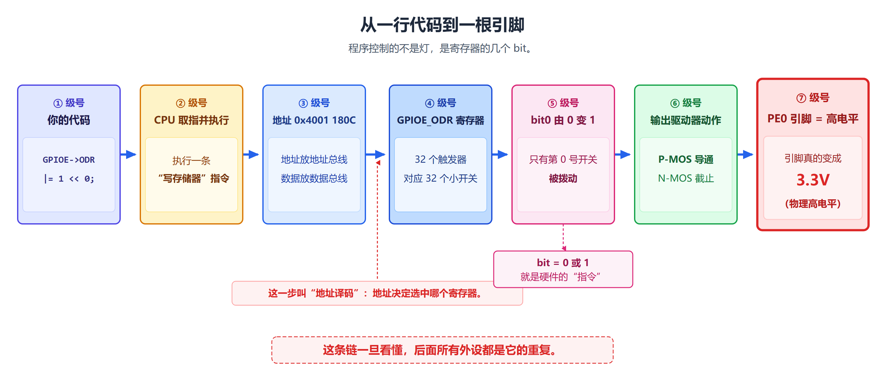

**这张图从左往右一共七级**：

| 级别 | 图里画的是什么 | 对应的真实东西 |
|---|---|---|
| 第 1 级 | `GPIOE->ODR \|= 1 << 0;` | **你写的代码**（C 语言文本） |
| 第 2 级 | "CPU 执行 STR 指令" | CPU 执行一条"写存储器"指令 |
| 第 3 级 | "地址 0x4001 180C" | CPU 把地址放到地址总线上，把数据放到数据总线上 |
| 第 4 级 | "GPIOE_ODR 寄存器" | 这个地址对应的硬件寄存器（32 个触发器） |
| 第 5 级 | "bit0 由 0 变 1" | 32 个小开关里，第 0 号开关被拨到 1 |
| 第 6 级 | "输出驱动器：P-MOS 导通 / N-MOS 截止" | GPIO 内部的 MOS 管电路改变通断状态 |
| 第 7 级 | "PE0 = 高电平（3.3V）" | 芯片外部那根真实的金属引脚，电压真的变了 |

**【本章的灵魂，一定要理解】**：

> **CPU 根本不"认识"GPIO。它只是往某个地址写了一个数。
> 是"地址译码电路"把这个地址翻译成了"选中的是 GPIOE 的 ODR 寄存器"。
> 硬件电路再根据这个寄存器的内容去控制引脚。**

**【类比】给小区物业写便条**

> 你想让大门口的路灯亮起来，你没法自己爬上去合闸，于是：
> 1. 写一张便条："3 号楼 802 配电箱，第 3 号开关，请拨到 ON"（**代码 + 数据 + 地址**）；
> 2. 通信员把便条送到 802（**地址总线 + 数据总线**）；
> 3. 802 里有一排开关面板，通信员把第 3 号开关拨上去（**寄存器 bit 改变**）；
> 4. 电工看到面板上第 3 号灯亮了，就把路灯的闸合上（**内部电路动作**）；
> 5. 大门口路灯亮（**引脚电平改变**）。
>
> **类比边界**：真实硬件里**没有"人"**去读便条。寄存器是一堆**触发器**，写操作就是让某些触发器翻转；
> "便条"是 32 个 bit 同时到达的电压信号；"通信员"就是**总线**，"找 802"就是**地址译码**。

#### GPIO 是什么

| 项目 | 内容 |
|---|---|
| 英文全称 | **General-Purpose Input/Output** |
| 中文名称 | **通用输入/输出接口** |
| 缩写 | **GPIO** |
| 大白话 | STM32 芯片有很多引脚，GPIO 就是让程序控制这些引脚"读外面的高低电平"或者"向外输出高低电平"的基本功能 |
| 它是干什么的 | 做**开关量**（只有"通/断""高/低"两种状态）的输入和输出：读按键、亮指示灯、驱动继电器、报警输出 |

**教材原文要点**：

> - 几乎所有的嵌入式系统应用中，都涉及**开关量的输入和输出**功能，例如状态指示、报警输出、继电器闭合和断开、按钮状态读入等。
> - STM32F103VET6 有 **80 根**多功能、双向、能承受 5V 电压的快速 I/O 口线；
> - **每 16 根口线分为一组**，分别为 **PA、PB、PC、PD、PE**。

**逐词拆解"80 根多功能双向能承受 5V 电压的快速 I/O 口线"**：

| 词 | 意思 | 补充 |
|---|---|---|
| **80 根** | 一共 80 个可以当 GPIO 用的引脚 | **5 个端口 × 16 根 = 80** |
| **多功能** | 同一根引脚可以干很多种活 | 既能当 GPIO，也能"借"给串口、SPI、定时器（**复用功能**） |
| **双向** | 既能输出也能输入 | 方向由配置寄存器决定 |
| **能承受 5V 电压** | 外面给 5V 也不会烧坏 | 这叫"**5V 容忍**"；**芯片自己供电仍是 3.3V，输出的高电平也是 3.3V** |
| **快速** | 输出速度可以配得比较高 | **最高可配 50MHz** |

#### 7 个寄存器（必背）

> 每个 GPIO 端口有：
> - **两个 32 位配置寄存器**（`GPIOx_CRL`、`GPIOx_CRH`）
> - **两个 32 位数据寄存器**（`GPIOx_IDR`、`GPIOx_ODR`）
> - **一个 32 位置位/复位寄存器**（`GPIOx_BSRR`）
> - **一个 16 位复位寄存器**（`GPIOx_BRR`）
> - **一个 32 位锁定寄存器**（`GPIOx_LCKR`）

**【重要限制】**：

> **I/O 口寄存器必须按 32 位字访问（不允许半字或字节访问）。**

**【为什么 BSRR/BRR 很重要】**：

> **GPIOx_BSRR 和 GPIOx_BRR 寄存器允许对任何 GPIO 寄存器的读/更改的独立访问，
> 这样，在读和更改访问之间产生中断（IRQ）时不会发生危险。**

（这一点在 6.4 节展开。）

#### 端口、位、引脚（三个最容易绕晕的词）

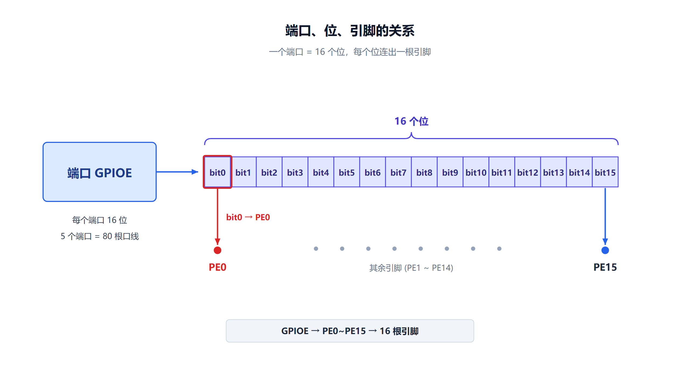

```
端口（Port）      GPIOE
   ↓ 里面有
位（bit）         PE0、PE1、PE2 …… PE15      共 16 位
   ↓ 每个位连到
引脚（Pin）       芯片的第 141 脚、第 142 脚 ……（具体脚号查数据手册）
```

| 写法 | 读作 | 含义 |
|---|---|---|
| `GPIOE` | GPIO E | 整个端口 E（16 根线） |
| `PE0` | P-E-0 | 端口 E 的第 0 号引脚 |
| `Px` | P-x | 泛指某个端口（x = A、B、C、D、E） |
| `Pxy` | P-x-y | 端口 x 的第 y 位（y = 0~15） |
| `GPIOx_ODR` | GPIO-x-ODR | 端口 x 的输出数据寄存器 |

> **【易错】"位 0 到 位 15"为什么不是 1 到 16？**
> 因为这是给计算机看的编号，**计算机习惯从 0 开始数**。第 1 根线叫 bit0，第 16 根线叫 bit15。
> **写代码时特别容易错**：`1 << 0` 指的是 **bit0（PE0）**，不是"第 1 个引脚 = PE1"。

#### 复位后的默认状态（必考）

| 问题 | 答案 | 为什么 |
|---|---|---|
| 芯片刚复位后，引脚是什么模式？ | **浮空输入** | 配置寄存器 CRL/CRH 的复位值是 `0x4444 4444`，每个引脚 4 位是 `0100` = 浮空输入 |
| 那 PA13/PA14/PA15/PB4 呢？ | **上拉/下拉输入**（见下表） | 因为复位后 JTAG 调试接口要能用，不能让它悬空乱跳 |
| 复位后引脚输出什么电平？ | **不输出** | 因为默认是输入模式，输出驱动器根本没开 |

**JTAG 引脚的复位状态**：

| 引脚 | 复用功能 | 复位状态 |
|---|---|---|
| **PA13** | JTMS | **上拉** |
| **PA14** | JTCK | **下拉** |
| **PA15** | JTDI | **上拉** |
| **PB4** | JNTRST | **上拉** |

> **JTAG** = Joint Test Action Group，ARM 芯片最常用的**调试接口**。
> **SWD** = Serial Wire Debug，JTAG 的"两线精简版"，只用 SWCLK、SWDIO 两根线。

> **【易错】"80 根线"不等于"80 个随便用的引脚"**：
> - PA13、PA14、PA15、PB3、PB4 复位后默认被 **JTAG** 占用，要当普通 GPIO 用必须先关 JTAG、改用 SWD；
> - PC13、PC14、PC15 与 RTC、32.768kHz 晶振共用。
>
> **教材说 80 根，是指"硬件上存在 80 个 GPIO 位"**；真正能随便用的要扣掉被调试口、晶振口占用的部分。

#### 高电平 / 低电平

| 名称 | 大白话 | STM32 上的典型情况 |
|---|---|---|
| 高电平 | 电压比较高，代表逻辑 **1** | 接近 **3.3V**（比如 >2V 就算高） |
| 低电平 | 电压比较低，代表逻辑 **0** | 接近 **0V**（比如 <1.3V 就算低） |

> **为什么不精确到"必须 3.300V"**：真实电路有噪声、有压降。标准规定的是**范围**：
> 只要落在"高"的范围里就算 1，落在"低"的范围里就算 0。中间那段（约 1.3V~2V）是"说不清"的地带。
>
> **为什么是 3.3V 而不是 5V**：STM32F103 的供电电压是 **2.0V~3.6V**（典型 3.3V）。
> 虽然 I/O 能承受 5V 输入，但**它自己输出的高电平仍然是 3.3V 左右**。
> **"能承受 5V 输入" ≠ "能输出 5V"。**

#### 为什么要先看流水灯电路（图 3-13）

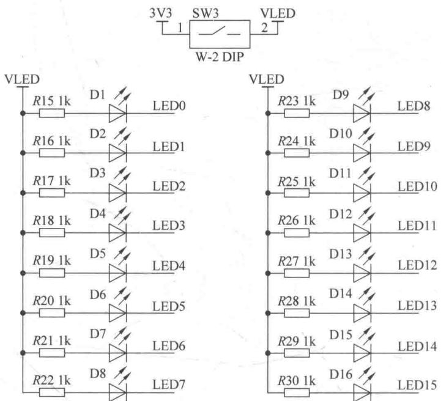

**看图方法**：

1. **先找右边那一列 `LED0`~`LED15`**：一共 16 只发光二极管；
2. **再看每只 LED 左边的电阻**：**限流电阻**，防止电流太大烧掉 LED；
3. **注意 LED 另一头接在哪**：经电阻接到 **+3.3V**，另一端接到 **PE0~PE15**；
4. **最后看开关 SW3**：要把灯点亮，需要把 SW3 拨到 ON 给 LED 供电。

```
   +3.3V
     │
   [限流电阻]
     │
   [ LED ]   ← 电流只能从上往下流
     │
   PE0 引脚
```

- PE0 输出**低电平（0V）**：电流从 +3.3V 流经电阻、LED、进入引脚、流到地 → **灯亮**；
- PE0 输出**高电平（3.3V）**：两端电压差不多，没有电流 → **灯灭**。

> **【关键理解】代码让引脚"输出低电平"，物理上并不是"发出了什么信号"，
> 而是把这个引脚接到地，让电流有了通路。**
> 换句话说：**程序控制的不是"灯"，而是"引脚是被接到地、还是被接到电源"。**

> **注意**：不同的开发板接法可能相反（LED 一端接地、另一端接引脚 → 高电平亮）。
> **判断方法永远是看电路图，而不是背结论。**

---

### 6.2 8 种工作模式 ★★★ 【PPT 重点：陈 p5 / 梁 p8】

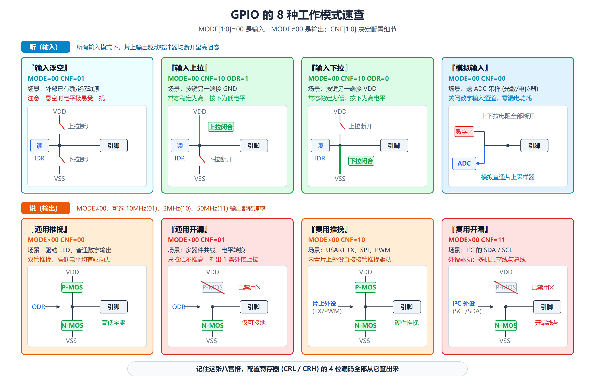

**8 种模式速查表（梁版 PPT 的"典型场景"很实用）**：

| # | 模式 | 一句话 | 典型场景 |
|---|---|---|---|
| 1 | **输入浮空** | 引脚不接内部上拉/下拉，**电平不确定，易受干扰** | 外部已有确定驱动的信号 |
| 2 | **输入上拉** | 内部电阻接 VDD，把不确定信号**钳位到高电平** | 按键（按下接地） |
| 3 | **输入下拉** | 内部电阻接 GND，把不确定信号**钳位到低电平** | 按键（按下接 VDD） |
| 4 | **模拟输入** | **关闭数字输入路径**，适用于 ADC 等模拟量采集 | ADC 采集 |
| 5 | **开漏输出** | **只能主动拉低**，高电平需外部/内部上拉 | I²C |
| 6 | **推挽输出** | **可主动输出高、低电平**，驱动能力较强 | LED、蜂鸣器 |
| 7 | **复用开漏输出** | 由**片上外设**接管输出 | I²C 复用 |
| 8 | **复用推挽输出** | 由**片上外设**接管输出 | 串口、SPI、定时器 PWM |

**按类别归纳**：

| 类别 | 典型场景 | 配置关注点 |
|---|---|---|
| **输入** | 按键、传感器数字量输入 | 浮空/上拉/下拉、读取 IDR |
| **输出** | LED、蜂鸣器、继电器控制 | 推挽/开漏、写 ODR 或 BSRR/BRR |
| **复用** | 串口、SPI、定时器 PWM | AF 模式、必要时配置 AFIO 重映射 |
| **模拟** | ADC 输入等 | **关闭数字输入**，降低引脚功耗 |

> **每个 I/O 位都可以通过软件独立配置；复用功能可理解为"端口被第二功能占用时的配置"。**

---

### 6.3 I/O 位的基本结构 ★★★ 【PPT 重点：陈 p6 / 梁 p9】

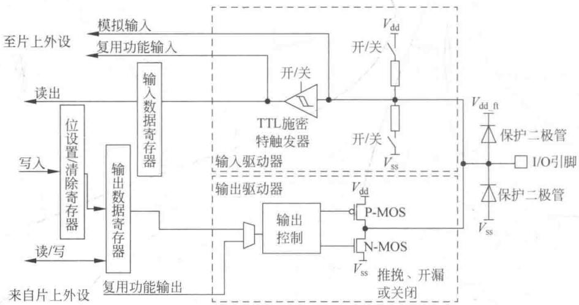

**这张图只记三件事：输入通道、输出通道、保护结构 + 复用通道。**

| 路径 | 怎么走 |
|---|---|
| **输入路径** | 引脚电平 → 保护结构 → **输入驱动器（含施密特触发器）** → **IDR** |
| **输出路径** | **ODR/BSRR/BRR** 的写入 → 输出控制电路 → **输出驱动器（P-MOS / N-MOS）** → 引脚 |
| **复用路径** | 当端口用于第二功能时，信号来自**片上外设**，而不是普通 GPIO 软件写入 |

> **三条路径共用同一引脚：输入采样、输出驱动、外设复用。**

#### 【必考】输入配置 vs 输出配置的本质差异

**输入配置时，内部发生 5 件事**：

| # | 教材原文 | 大白话 |
|---|---|---|
| (1) | **输出缓冲器被禁止** | 输出通道**关了**，引脚不受 ODR 影响 |
| (2) | **施密特触发输入被激活** | 输入通道**开了**，波形被整形 |
| (3) | 根据输入配置（上拉、下拉或浮动）的不同，**弱上拉和下拉电阻被连接** | 两个"橡皮筋"按你选的方式接上（浮空时都不接） |
| (4) | 出现在 I/O 引脚上的数据在**每个 APB2 时钟**被采样到输入数据寄存器 | 每个 APB2 节拍给引脚"拍快照"存进 IDR |
| (5) | 对输入数据寄存器的读访问可得到 I/O 状态 | 读 IDR 就知道引脚现在是什么电平 |

**输出配置时，内部发生 6 件事**：

| # | 教材原文 | 大白话 |
|---|---|---|
| (1) | **输出缓冲器被激活** | 输出通道**开了** |
| (1a) | **开漏模式**：输出 0 激活 N-MOS，输出 1 将端口置于**高阻状态**（P-MOS 从不被激活） | 写 0 拉低；写 1"撒手不管"，需要外面上拉 |
| (1b) | **推挽模式**：输出 0 激活 N-MOS，输出 1 将激活 P-MOS | 写 0 主动拉低，写 1 主动拉高 |
| (2) | **施密特触发输入仍被激活** | 输入通道**也还开着**（输出模式下仍能读回引脚状态） |
| (3) | **弱上拉和下拉电阻被禁止** | 两根"橡皮筋"断开 |
| (4) | 出现在 I/O 引脚上的数据在每个 APB2 时钟被采样到 IDR | IDR 依然在拍快照 |
| (5) | **开漏模式时，读 IDR 得到 I/O 状态** | 想知道引脚真实电平，**读 IDR** |
| (6) | **推挽模式时，读 ODR 得到最后一次写的值** | 读 ODR 只知道你**上次写了什么**，不代表引脚真实电平 |

> **【最常考、也最容易写错程序的两条】第 (5)、(6)**
>
> - **推挽输出**：引脚电平基本等于你写的值，读 ODR 就够了（读的是"你的意图"）；
> - **开漏输出**：你写 1 时引脚是**高阻**，实际电平由**外部上拉电阻**决定。
>   如果外面没接上拉，写 1 后引脚可能"飘"在中间电平。所以**开漏时必须读 IDR**，才能知道真实状态。

**推挽 vs 开漏（电路层面）**：

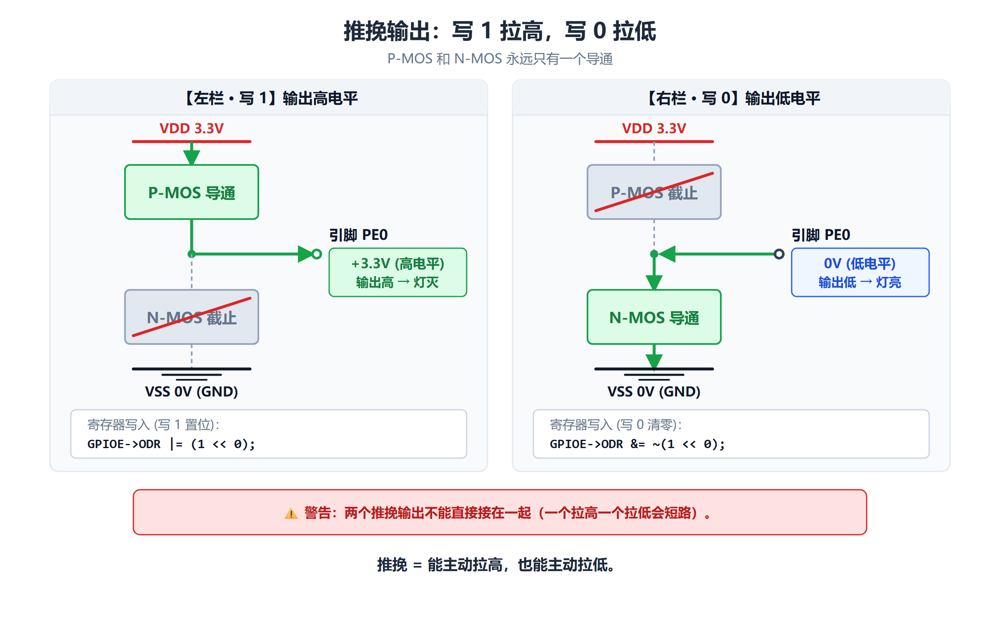

*推挽：写 0 时 N-MOS 导通（拉到地），写 1 时 P-MOS 导通（拉到电源）——两个"推"和"挽"轮流上。*

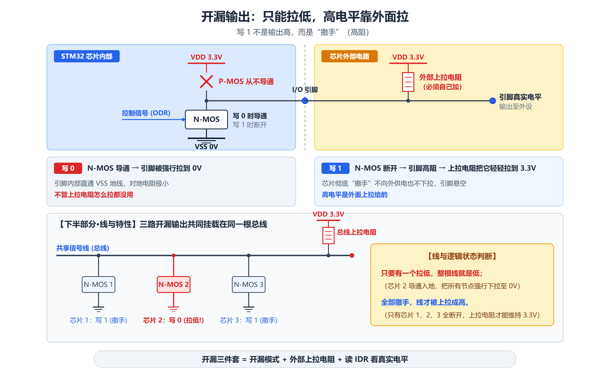

*开漏：P-MOS 从不激活，只有 N-MOS 工作。写 0 拉低，写 1 就是"撒手"（高阻），需要外部上拉电阻才能得到高电平。*

#### MOS 管：为什么能当开关

- **N-MOS**：栅极给"高"就导通，相当于一个**往下接到地（GND/VSS）**的开关；
- **P-MOS**：栅极给"低"就导通，相当于一个**往上接到电源（VDD）**的开关。

> **看到"P-MOS 导通" = "这根线被接到电源，输出高"；**
> **看到"N-MOS 导通" = "这根线被接到地，输出低"。**

#### 复用功能配置（7 件事）

| # | 教材原文 |
|---|---|
| (1) | 在开漏或推挽式配置中，输出缓冲器被打开 |
| (2) | **内置外设的信号驱动输出缓冲器**（复用功能输出） |
| (3) | 施密特触发输入被激活 |
| (4) | 弱上拉和下拉电阻被禁止 |
| (5) | 每个 APB2 时钟周期采样到 IDR |
| (6) | 开漏模式时，读 IDR 可得 I/O 口状态 |
| (7) | 推挽模式时，读 ODR 可得最后一次写的值 |

> **【考试常考的一句话】配置成复用输出后，引脚的输出由"片上外设"驱动，而不再由 GPIOx_ODR 驱动。**
>
> **教材原文**："如果把端口配置成复用输出功能，则**引脚和输出寄存器断开**，并和片上外设的输出信号连接。"
>
> **还有一个坑**："如果软件把一个 GPIO 脚配置成复用输出功能，但是**外设没有被激活**，那么它的输出将不确定。"

#### 模拟输入配置（4 件事）

| # | 教材原文 |
|---|---|
| (1) | 输出缓冲器被禁止 |
| (2) | **禁止施密特触发输入**，实现了每个模拟 I/O 引脚上的**零消耗**。施密特触发输出值被**强置为 0** |
| (3) | 弱上拉和下拉电阻被禁止 |
| (4) | **读取输入数据寄存器时数值为 0** |

> **为什么模拟输入要把数字部分全部关掉？**
>
> 因为模拟信号最怕"负载"和"干扰"：
> - 如果施密特触发器还开着，它会把 1.65V 这种"中间电压"一会儿判成 0、一会儿判成 1，**纯粹是噪声源**；
> - 如果弱上拉/下拉还接着，它会像一只手把电压往 3.3V 或 0V 拽，**测出来就不是真值**。
>
> **所以：当引脚要送给 ADC 用时，必须配成模拟输入（`GPIO_Mode_AIN`）。**

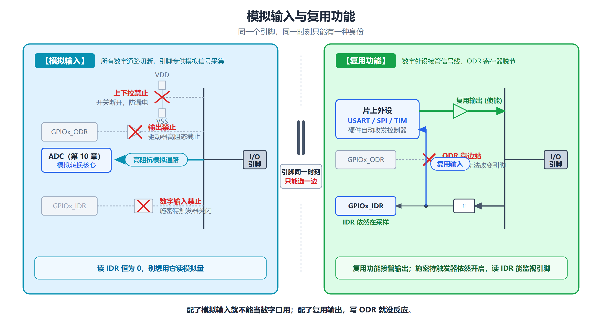

*模拟输入：数字部分全部关闭，信号直接进 ADC；复用：信号改由片上外设接管。*

---

### 6.4 GPIO 的寄存器 ★★★ 【PPT 重点：陈 p18～p26 / 梁 p22～p35，本章核心】

#### 地址链与 7 个寄存器的偏移（必背）

**端口基地址**：

| 端口 | 地址范围 | 首地址（基地址） |
|---|---|---|
| PA | `0x4001 0800 ~ 0x4001 0BFF` | **`0x4001 0800`** |
| PB | `0x4001 0C00 ~ 0x4001 0FFF` | `0x4001 0C00` |
| PC | `0x4001 1000 ~ 0x4001 13FF` | `0x4001 1000` |
| PD | `0x4001 1400 ~ 0x4001 17FF` | `0x4001 1400` |
| PE | `0x4001 1800 ~ 0x4001 1BFF` | **`0x4001 1800`** |

> **教材原文**："各个端口的第一个地址称为该端口的**首地址**，如 PA 的首地址为 0x4001 0800。
> 后续介绍寄存器时，各个寄存器的地址都是以**偏移量**的方式给出，
> 寄存器的物理地址就是**基地址加上偏移量**。"

**7 个寄存器的偏移量表（必须背下来）**：

| 偏移量 | 寄存器 | 中文名 | 功能 | 复位值 |
|---|---|---|---|---|
| **`0x00`** | **GPIOx_CRL** | 端口配置低寄存器 | 配置 **bit0~bit7** 这 8 根引脚 | `0x4444 4444` |
| **`0x04`** | **GPIOx_CRH** | 端口配置高寄存器 | 配置 **bit8~bit15** 这 8 根引脚 | `0x4444 4444` |
| **`0x08`** | **GPIOx_IDR** | 端口输入数据寄存器 | 读出 16 根引脚的输入电平 | `0x0000 XXXX` |
| **`0x0C`** | **GPIOx_ODR** | 端口输出数据寄存器 | 决定 16 根引脚输出什么 | `0x0000 0000` |
| **`0x10`** | **GPIOx_BSRR** | 端口位设置/清除寄存器 | **原子地**置位/清位 | `0x0000 0000` |
| **`0x14`** | **GPIOx_BRR** | 端口位清除寄存器 | **原子地**清位 | `0x0000 0000` |
| **`0x18`** | **GPIOx_LCKR** | 端口配置锁定寄存器 | 冻结引脚配置 | `0x0000 0000` |

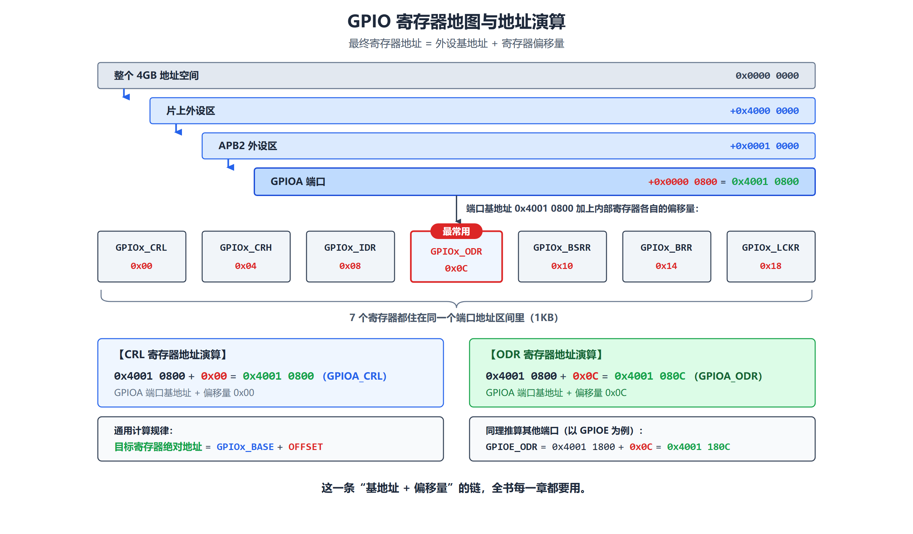

*一个端口占 1KB，7 个寄存器只用掉前 0x1C 字节。基地址 + 偏移量 = 绝对地址。*

**地址演算（必须会算）**：

```
例 1：GPIOA_CRL  = 0x4001 0800 + 0x00 = 0x4001 0800
例 2：GPIOA_ODR  = 0x4001 0800 + 0x0C = 0x4001 080C
例 3：GPIOE_ODR  = 0x4001 1800 + 0x0C = 0x4001 180C
例 4：GPIOE_CRL  = 0x4001 1800 + 0x00 = 0x4001 1800
```

> **【易错】PPT（陈版 p19）的例子里写的是 `GPIOE_ODR = GPIOE_BASE + 0x0C = 0x4001 180C`，
> 但同一行前面的标题写的是"计算 PA 端口 ODR 寄存器的地址"**——这是 PPT 的笔误，
> **下面算的是 GPIOE，不是 GPIOA**。按算式为准。

#### CRL / CRH：每个引脚 4 位配置（本章最重要）

**规则**：

> **`GPIOx_CRL` 管理 Px0~Px7；`GPIOx_CRH` 管理 Px8~Px15。**
> **每个引脚由 CNF[1:0] 与 MODE[1:0] 共 4 位决定工作模式。**

**位图（以 CRL 为例）**：

```
        GPIOx_CRL（偏移 0x00，复位值 0x4444 4444）
 31  30  29  28  27  26  25  24  23  22  21  20  19  18  17  16
+---+---+---+---+---+---+---+---+---+---+---+---+---+---+---+---+
| CNF7  | MODE7 | CNF6  | MODE6 | CNF5  | MODE5 | CNF4  | MODE4 |
| [1:0] | [1:0] | [1:0] | [1:0] | [1:0] | [1:0] | [1:0] | [1:0] |
+---+---+---+---+---+---+---+---+---+---+---+---+---+---+---+---+
 15  14  13  12  11  10   9   8   7   6   5   4   3   2   1   0
+---+---+---+---+---+---+---+---+---+---+---+---+---+---+---+---+
| CNF3  | MODE3 | CNF2  | MODE2 | CNF1  | MODE1 | CNF0  | MODE0 |
| [1:0] | [1:0] | [1:0] | [1:0] | [1:0] | [1:0] | [1:0] | [1:0] |
+---+---+---+---+---+---+---+---+---+---+---+---+---+---+---+---+
                                                          ↑   ↑
                                                     CNF0   MODE0
                                                    （bit3:2）（bit1:0）
```

> **怎么记这个排布**：**每 4 个 bit 管一根引脚**，从高位到低位依次是 **P7、P6、P5、P4、P3、P2、P1、P0**。
> 每一组 4 bit 里：**高 2 位是 CNF（功能），低 2 位是 MODE（方向+速度）**。

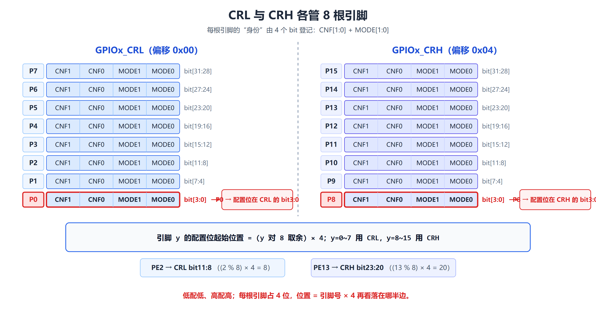

*CRL 管 P0~P7，CRH 管 P8~P15，两者结构完全一样。*

**MODE[1:0] 的含义（决定方向 + 速度）**：

| MODE[1:0] | 含义 |
|---|---|
| **`00`** | **输入模式** |
| `01` | **输出模式，最大速度 10MHz** |
| `10` | **输出模式，最大速度 2MHz** |
| `11` | **输出模式，最大速度 50MHz** |

**【必背】CNF[1:0] 的含义（输入和输出两套意思）**：

| CNF[1:0] | 输入模式含义 | 输出模式含义 |
|---|---|---|
| **`00`** | **模拟输入** | **通用推挽输出** |
| **`01`** | **浮空输入** | **通用开漏输出** |
| **`10`** | **上拉/下拉输入** | **复用推挽输出** |
| **`11`** | **保留** | **复用开漏输出** |

> **【这张表是本章最核心的一张表】**——它把 8 种模式全部编码进去了。
>
> **读法**：先看 MODE 决定"输入还是输出"，再看 CNF 决定"具体哪一种"。

**完整编码表（8 种模式的 4 位值）**：

| 二进制串（bit3 bit2 bit1 bit0） | 十六进制 | CNF（bit3:2） | MODE（bit1:0） | 结果 |
|---|---|---|---|---|
| `0 0 0 0` | `0x0` | 00 | 00 | **模拟输入** |
| `0 1 0 0` | `0x4` | 01 | 00 | **浮空输入**（复位后的默认值） |
| `1 0 0 0` | `0x8` | 10 | 00 | **上拉/下拉输入**（哪个由 ODR 对应位决定） |
| `1 1 0 0` | `0xC` | 11 | 00 | 保留（别用） |
| `0 0 0 1` | `0x1` | 00 | 01 | 通用推挽输出，10MHz |
| `0 1 0 1` | `0x5` | 01 | 01 | 通用开漏输出，10MHz |
| `1 0 0 1` | `0x9` | 10 | 01 | 复用推挽输出，10MHz |
| `1 1 0 1` | `0xD` | 11 | 01 | 复用开漏输出，10MHz |
| `0 0 1 0` | `0x2` | 00 | 10 | 通用推挽输出，**2MHz** |
| `0 0 1 1` | `0x3` | 00 | 11 | **通用推挽输出，50MHz** ← 例 6-2 用的就是这个 |

> **【易错】最容易错的一行**：`0x8` = `1000b`，左边 `10` 是 CNF=10（上拉/下拉），
> 右边 `00` 是 MODE=00（**输入**）——所以它是**输入**，不是"推挽 2MHz"。
> （"推挽 2MHz" 的编码是 `0010` = `0x2`。**两者正好是"位序读反了"的典型错误。**）

**为什么例 6-2 写 `0x00000003` 就表示"推挽输出 50MHz"**：

```
0x3 = 0011b
      高 2 位 00 = CNF0 = 通用推挽
      低 2 位 11 = MODE0 = 输出、50MHz  ✓
```

**复位值 `0x4444 4444` 的解读**：

```
   0x4     4     4     4     4     4     4     4
    ↓      ↓     ↓     ↓     ↓     ↓     ↓     ↓
  0100   0100  0100  0100  0100  0100  0100  0100
   ↑
 P7组 …… 每一组都是 0100

   0100 拆开： CNF = 01 → 浮空输入
              MODE = 00 → 输入模式
```

> **结论**：**复位后，GPIOA~GPIOE 的所有普通引脚都是浮空输入模式。**

#### IDR / ODR / BSRR / BRR：读写端口状态（必考）

| 寄存器 | 位域与作用 | 强调 |
|---|---|---|
| **GPIOx_IDR** | `IDRy[15:0]` 端口输入数据，**只能读** | 读出值对应 **I/O 口实际状态** |
| **GPIOx_ODR** | `ODRy[15:0]` 端口输出数据，**可读写** | 写 1/0 改变输出数据 |
| **GPIOx_BSRR** | `BSy` 置位；`BRy` 清除 | 对**单个位**写 1，**未写位不受影响** |
| **GPIOx_BRR** | `BRy` 清除对应 ODR 位 | 只用于复位/输出低电平 |

**结构图**：

```
输入引脚状态 ──→ [ IDR ]  只读，反映输入状态
                   ↑
输出引脚电平 ←── [ ODR ]  读/写，保存输出数据
```

**【IDR 的用法】**

```c
uint32_t pa_idr = GPIOA->IDR;     // 读取整个 IDR，存入局部变量
uint8_t  pa9    = (pa_idr >> 9) & 1;   // 提取 bit9 → PA9 电平
```

**【ODR 的用法】**

```c
GPIOA->ODR |= (1 << 10);    // PA10 输出高电平（置位）
GPIOA->ODR &= ~(1 << 2);    // PA2 输出低电平（清零）
GPIOA->ODR ^= (1 << 3);     // PA3 翻转
```

#### 【必考】BSRR：高 16 位复位、低 16 位置位

> **高 16 位负责复位（写 1 引脚电平变低），低 16 位负责置位（写 1 引脚电平变高）。**

```
bit    31                    16  15                    0
      +------------------------+------------------------+
BSRR  |  BR15 … BR0（复位位）   |  BS15 … BS0（置位位）    |
      +------------------------+------------------------+
```

**PPT 的两个例子**：

```c
// 例 1：通过 BSRR 操作将 PA10 置高，将 PA8、PA9、PA10 同时置高
GPIOA->BSRR = (1 << 10);                          // PA10 置高
GPIOA->BSRR = (1 << 8) | (1 << 9) | (1 << 10);    // PA8、PA9、PA10 同时置高

// 例 2：通过 BSRR 操作将 PA8、PA9、PA10 同时复位
GPIOA->BSRR = (1 << 24) | (1 << 25) | (1 << 26);
```

> **【验算例 2】** `(1<<24)` 就是 `BSRR` 的 bit24，而 bit24 = 高 16 位的第 8 位 = **BR8** → 复位 PA8。
> 同理 `(1<<25)` = BR9、`(1<<26)` = BR10。**所以这三句确实是"把 PA8、PA9、PA10 同时复位"。**

**BRR 的用法（只有低 16 位，只能清位）**：

```c
GPIOE->BRR = (1 << 0);      // 对 PE0 清 0（BR0 = 1）
```

#### 【本章最重要的原理】为什么推荐 BSRR/BRR，而不是 `ODR |=`

**先看用 `ODR` 会出什么事**：

```c
GPIOE->ODR = GPIOE->ODR & ~(1 << 0);   // 读—改—写
```

```
时刻 ①  CPU 读 ODR        → 得到 0x0000 0002（PE1 目前是 1）
时刻 ②  CPU 算出要写回的值 → 0x0000 0002（只把 bit0 清 0，bit1 保持原样）
时刻 ③  ★ 这时候发生了中断！★
        中断服务程序把 PE1 改成 0 → 此刻 ODR 变成 0x0000 0000
时刻 ④  CPU 把刚才算好的 0x0000 0002 写回 ODR
         → bit0 确实清成了 0（这一步是对的 ✓）
         → 但 bit1 也被写成 1：中断里"把 PE1 清 0"的修改被覆盖、丢了！
```

**问题出在哪**：CPU 写回的是**基于"旧值"算出来的结果**。它不知道在"读"和"写"之间，
别人（中断服务程序）已经改过这块寄存器。这种"谁先谁后不确定、结果也就不确定"的情况叫**竞态（race）**。

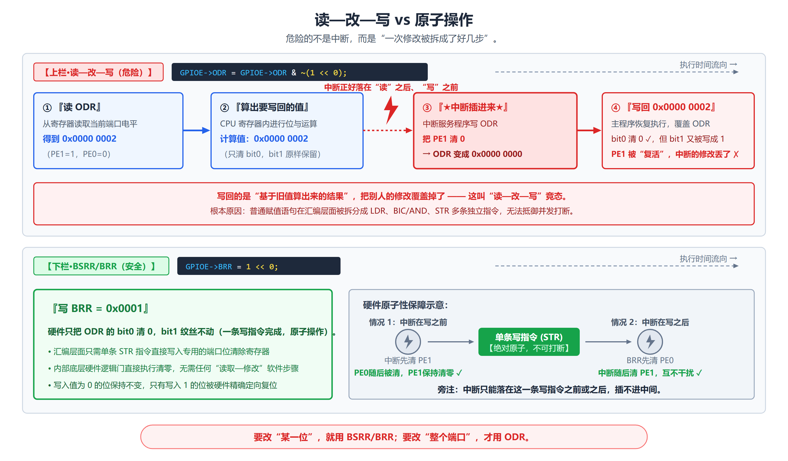

*上图：中断插在"读"和"写"之间，导致中断里的修改被覆盖。下图：BSRR 只有"写"一步，中断插不进去。*

**用 BSRR/BRR 就没有这个问题**：

```c
GPIOE->BRR = 1 << 0;   // 写 0x0001：硬件只把 bit0 清零，其他位一个也不碰
```

> **这种"一条指令完成、中间不可能被打断"的操作，叫原子操作。**
>
> **为什么推荐 BSRR/BRR（PPT 原文）**：
> - 对"**单个位**"写 1 即可完成置位/清除，**不必先读 ODR 再改写**；
> - **在中断环境下更不容易发生读—改—写竞争**。
>
> **教材原文**："GPIOx_BSRR 和 GPIOx_BRR 寄存器允许对任何 GPIO 寄存器的读/更改的独立访问，
> 这样，在**读和更改访问之间产生中断（IRQ）时不会发生危险**。"

> **【补充】`|=` 和 `&=` 什么时候可以用？**
> **初始化阶段可以**（这时一般没有中断来抢着改同一个寄存器）。
> **运行中频繁改输出值**，就应该用 BSRR/BRR。

#### LCKR：锁定机制 ★

**锁定什么**：**冻结端口位的配置**（CRL/CRH 里的那 4 位）。

> **教材原文**："锁定机制允许冻结 IO 配置。当在一个端口位上执行了锁定（LOCK）程序，
> 在**下一次复位之前**，将不能再更改端口位的配置。
> 这个功能主要用于一些**关键引脚的配置**，防止程序跑飞引起灾难性后果。"

**【重要边界】锁的只是"配置"，不锁输出值**：

- **锁住的是 CRL/CRH 里的 4 位**（工作模式、速度）；
- **不锁 ODR 的输出值**（你依然可以点灯/灭灯）；
- **复位后自动解锁**（不是永久的）。

**【必考】LCKR 的位分配**：

```
bit    31 ~ 17     16         15   14   …   3   …   0
      +---------+------+------+----+-----+---+-----+---+
LCKR  |  保留    | LCKK |LCK15 |LCK14| ... |LCK3| ... |LCK0|
      +---------+------+------+----+-----+---+-----+---+
                   ↑
              LCKK —— 锁键
                       └────── LCK15:0 —— 锁位 ──────┘
```

**【必考】LCKK 锁定序列：写 1 → 写 0 → 写 1 → 读 0 → 读 1**

```c
uint32_t lock_val = (1 << 16) | (1 << 3);   // LCKK(bit16)=1，锁定 PA3
GPIOA->LCKR = lock_val;                 // ① 写 LCKK=1
GPIOA->LCKR = (1 << 3);                 // ② 写 LCKK=0
GPIOA->LCKR = lock_val;                 // ③ 写 LCKK=1
uint32_t temp = GPIOA->LCKR;            // ④ 读，预期读到 LCKK=0（握手）
temp = GPIOA->LCKR;                     // ⑤ 再读，读到 LCKK=1，确认锁定成功
```

> **为什么第 ④ 步要"预期读到 0"？**
> 这是硬件的一个**握手协议**：第 ③ 步写入后，硬件先把你读到的值置成 0，
> 再在下一次读时返回 1，**用两次读的不同结果证明"锁定动作真的被执行了"**。
> 这是防止时序问题导致误判的设计。

**两种实现方式**：

```c
// 方式 1：手写这 5 步
// 方式 2：调用标准库函数
GPIO_PinLockConfig(GPIOA, GPIO_Pin_3);
```

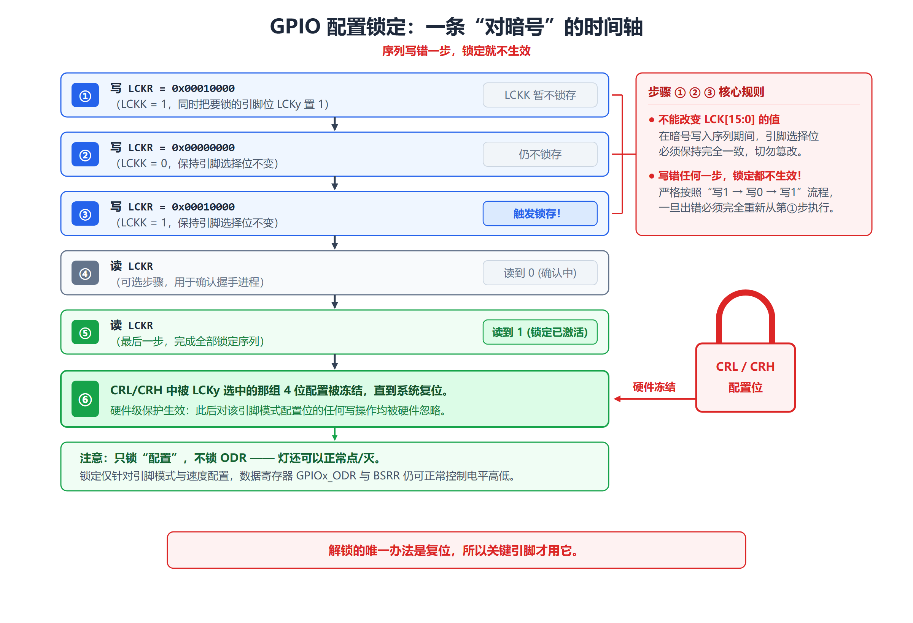

*5 步握手：写 1 → 写 0 → 写 1 → 读 0 → 读 1。少一步都不行。*

---

### 6.5 RCC 时钟模块 ★★★ 【PPT 重点：陈 p27～p45 / 梁 p36～p53，本章最容易被忽略但最致命】

#### 为什么必须先开时钟（灯不亮的头号原因）

> **教材原文**："要使用某个外设，**必须使能该外设的时钟**。
> 时钟配置需要先考虑系统时钟的来源（内部时钟、外部时钟、外部振荡器），以及是否需要锁相环（PLL）。
> 然后再考虑内部总线和外部总线，最后考虑外设的时钟信号。
> 应遵从**先倍频作为处理器的时钟，然后再由内向外分频**的原则。"
>
> "RCC 时钟模块寄存器的首地址是 **0x4002 1000**。"

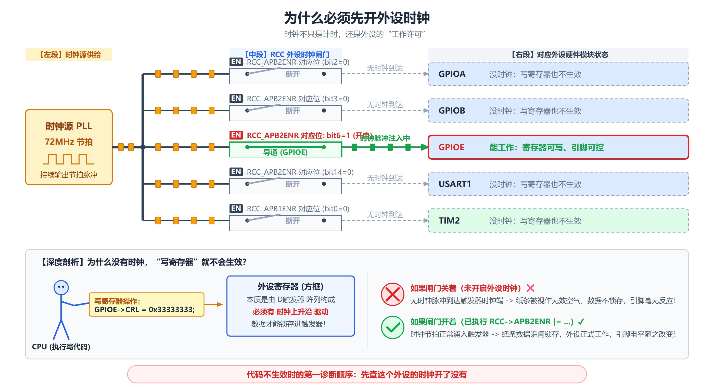

*中间是一排闸门，每个闸门对应一个外设，由 RCC 使能寄存器里的某一位控制。闸门关着时，往外设寄存器写数据——写了也白写。*

**【本章最容易吃亏的地方】**：

> **忘了开 GPIO 的时钟，你配的所有寄存器都写不进去，引脚一点反应都没有。**
> 这不是"程序错了"，而是**这个外设根本没有通电（没有时钟）**。

**【类比】** 外设像一间办公室，时钟像"整栋楼的总电闸分给这一间的电"：

- 总电闸（系统时钟）一直开着；
- 每个房间有一个**分闸**（使能位）；
- 房间没合闸时，你在黑屋子里写笔记（写寄存器），写完也没人记得住（**值存不住**）；
- 只有合上分闸（写 1 使能），房间才开始工作。

**为什么"没时钟就写不进去"**：

> 所谓"关时钟"，是 RCC 里的**时钟门控电路**停止向这个外设送时钟脉冲。后果是：
> - 外设内部的**触发器不再更新**——你写进去的值**存不住**；
> - 外设的**状态机、计数器不再推进**；
> - 所以结论只有一个：**关着时钟时对寄存器的任何操作都是"不可依赖"的**。
>
> **正确顺序永远是"先开时钟 → 再写寄存器"。**
> 千万不要有"先把寄存器配好，再开时钟"这种想法。

而且**不用的外设关掉时钟可以省电**——这正是 STM32 低功耗设计的基本手段。

#### RCC 的 10 个寄存器（必背其中 3 个）

**基地址**：**`0x4002 1000`**

| 偏移量 | 寄存器 | 中文名 | 和 GPIO 的关系 |
|---|---|---|---|
| `0x00` | **RCC_CR** | 时钟控制寄存器 | 开关 HSI/HSE/PLL 等时钟源 |
| `0x04` | **RCC_CFGR** | 时钟配置寄存器 | 选系统时钟源、各种分频、PLL 倍频 |
| `0x08` | **RCC_CIR** | 时钟中断寄存器 | 时钟就绪/失效的中断 |
| `0x0C` | **RCC_APB2RSTR** | APB2 外设复位寄存器 | 复位 GPIOA~E 等 |
| `0x10` | **RCC_APB1RSTR** | APB1 外设复位寄存器 | 复位 APB1 上的外设 |
| `0x14` | **RCC_AHBENR** | AHB 外设时钟使能寄存器 | 开 DMA、SRAM、FSMC 等时钟 |
| **`0x18`** | **RCC_APB2ENR** | **APB2 外设时钟使能寄存器** | **★ 开 GPIOA~E 时钟就靠它** |
| `0x1C` | **RCC_APB1ENR** | APB1 外设时钟使能寄存器 | 开 TIM2~7、USART2~5 等时钟 |
| `0x20` | **RCC_BDCR** | 备份域控制寄存器 | RTC、LSE |
| `0x24` | **RCC_CSR** | 控制/状态寄存器 | 复位标志、LSI |

**地址演算**：

```
  0x4002 1000      （RCC 基地址）
+ 0x0000 0018      （APB2ENR 偏移量）
──────────────
  0x4002 1018      （RCC_APB2ENR 的绝对地址）
```

**这行代码的物理含义**：

```c
RCC->APB2ENR |= RCC_APB2Periph_GPIOE;
// 就是往地址 0x40021018 写一个数，把 bit6（IOPEEN）置 1
```

#### 【必背】RCC_APB2ENR 的 GPIO 相关位

| 位 | 名称 | 对应 |
|---|---|---|
| **bit0** | **AFIOEN** | **复用功能 I/O 时钟使能** |
| **bit2** | **IOPAEN** | **GPIOA** |
| **bit3** | **IOPBEN** | **GPIOB** |
| **bit4** | **IOPCEN** | **GPIOC** |
| **bit5** | **IOPDEN** | **GPIOD** |
| **bit6** | **IOPEEN** | **GPIOE** |
| bit7 | IOPFEN | GPIOF（VET6 没有） |
| bit8 | IOPGEN | GPIOG（VET6 没有） |
| bit9~15 | ADC3、USART1、TIM8、SPI1、TIM1、ADC2、ADC1 | 其他 APB2 外设 |

> **`0=关闭，1=开启`。**

**例子里那行代码**：

```c
#define RCC_APB2Periph_GPIOE  ((uint32_t)0x00000040)
RCC->APB2ENR |= RCC_APB2Periph_GPIOE;   // 0x40 = 1<<6 = IOPEEN
```

> **【验算】** `0x40 = 0100 0000b`，bit6 = 1 → **IOPEEN**。✓ 这就是"开 GPIOE 时钟"。

#### RCC_CR：时钟控制寄存器（要点）

**偏移 `0x00`，复位值 `0x0000 XX83`。**

> **教材原文**："时钟配置主要就是对 RCC 时钟模块的寄存器进行设置。"

**关键字段（PPT 逐个列出）**：

| 位 | 名称 | 作用 |
|---|---|---|
| 0 | **HSION** | 内部 8MHz RC 使能（**复位后为 1**） |
| 1 | **HSIRDY** | 内部 8MHz **就绪**（只读） |
| 7:3 | **HSITRIM[4:0]** | 频率调整 |
| 15:8 | **HSICAL[7:0]** | 校准值 |
| **16** | **HSEON** | **外部高速时钟使能** |
| **17** | **HSERDY** | **外部高速时钟就绪**（只读） |
| 18 | HSEBYP | 外部高速时钟旁路 |
| 19 | CSSON | 时钟安全系统使能 |
| **24** | **PLLON** | **PLL 使能** |
| **25** | **PLLRDY** | **PLL 锁定/就绪标志**（只读） |

**【PPT 的例子】**

```c
RCC->CR |= (1 << 16);                    // HSEON=1，开启 HSE
while ((RCC->CR & (1 << 17)) == 0) { }   // 等待 HSERDY 就绪
```

> **【易错】`PLLON` = bit24，`PLLRDY` = bit25**——只差一位，**这是背 RCC_CR 的经典易错点**。
>
> **标准流程永远是**：**先写 ON 位打开 → 再轮询 RDY 位等就绪 → 就绪后才允许切换/使用。**
>
> 晶振不是"一通电就立刻稳定出 8MHz"的。石英晶体起振需要时间（几百微秒到几毫秒），
> PLL 锁频也需要时间。

#### RCC_CFGR：时钟配置寄存器（要点）

**偏移 `0x04`，复位值 `0x0000 0000`。**

**关键字段**：

| 字段 | 位 | 作用 |
|---|---|---|
| **SW[1:0]** | bit1:0 | **系统时钟源选择**（00=HSI，01=HSE，10=PLL） |
| **SWS[1:0]** | bit3:2 | **当前系统时钟源状态**（实际在用的是哪个） |
| **HPRE[3:0]** | — | AHB 预分频 |
| **PPRE1[2:0]** | — | APB1 预分频 |
| **PPRE2[2:0]** | — | APB2 预分频 |
| **ADCPRE[1:0]** | — | ADC 预分频 |
| **PLLSRC** | bit16 | PLL 输入时钟源 |
| **PLLXTPRE** | bit17 | HSE 预分频 |
| **PLLMUL[3:0]** | bit21:18 | PLL 倍频 |
| **USBPRE** | bit22 | USB 预分频 |
| **MCO[2:0]** | bit26:24 | 时钟输出 |

**【PPT 的例子】**

```c
RCC->CFGR |= 0x001D0400;    // HSE×9，PCLK1=HCLK/2
RCC->CFGR |= 0x00000002;    // SW=10，选择 PLL 为系统时钟
```

> **【关键理解】为什么要读 SWS 而不相信自己刚写的 SW？**
> 因为**切换时钟源需要时间**，硬件切换完成后会把 SWS 更新成"实际在用的源"。
> **读 SWS 才是"确认"，写 SW 只是"请求"。**

#### 其他 RCC 寄存器（了解即可）

| 寄存器 | 偏移 | 要点 |
|---|---|---|
| **RCC_CIR** | `0x08` | 时钟中断：`CSSC`、各 `RDYC` 清标志；`xxxRDYIE` 使能中断；`xxxRDYF` 状态标志 |
| **RCC_APB2RSTR** | `0x0C` | 写 1 **复位**该外设，写 0 无作用。GPIO 相关：`IOPARST`~`IOPGRST`、`AFIORST` |
| **RCC_APB1RSTR** | `0x10` | 复位 APB1 外设（DAC、PWR、BKP、CAN、USB、I2C、USART2/3、SPI2/3、TIM2~7 等） |
| **RCC_AHBENR** | `0x14` | `SDIOEN`(10)、`FSMCEN`(8)、`CRCEN`(6)、`FLITFEN`(4)、`SRAMEN`(2)、`DMA2EN`(1)、`DMA1EN`(0) |
| **RCC_APB1ENR** | `0x1C` | 开 TIM2~7、USART2~5、SPI2/3、I2C1/2、DAC、PWR、BKP、CAN、USB 等时钟 |
| **RCC_BDCR** | `0x20` | `BDRST`(16)、`RTCEN`(15)、**`RTCSEL[1:0]`(9:8)**、`LSEBYP`(2)、`LSERDY`(1)、`LSEON`(0) |
| **RCC_CSR** | `0x24` | 复位原因标志 `LPWRRSTF`(31)~`PINRSTF`(26)、**`RMVF`(24) 清标志**、`LSIRDY`(1)、`LSION`(0) |

**RTCSEL 编码（PPT 原文）**：

```
00：无时钟
01：LSE
10：LSI
11：HSE 经 128 分频
```

> **RTC 时钟源一旦选定，直到下次备份域复位前不能改变。**

#### 固件库的时钟函数（第 6 章直接用）

| 函数 | 作用 | 例子 |
|---|---|---|
| **`SystemInit()`** | **系统初始化**，在调用 `main` 之前由启动文件调用 | **自动调用，不需要用户调用** |
| **`RCC_APB1PeriphClockCmd()`** | 使能挂接在 **APB1** 上的外设时钟 | `RCC_APB1PeriphClockCmd(RCC_APB1Periph_TIM2, ENABLE);` |
| **`RCC_APB2PeriphClockCmd()`** | 使能挂接在 **APB2** 上的外设时钟 | `RCC_APB2PeriphClockCmd(RCC_APB2Periph_GPIOB \| RCC_APB2Periph_GPIOE, ENABLE);` |
| **`RCC_AHBPeriphClockCmd()`** | 使能挂接在 **AHB** 上的外设时钟 | `RCC_AHBPeriphClockCmd(RCC_AHBPeriph_DMA, ENABLE);` |

> **【重要】`SystemInit()` 是"白送"的**——它在 `main` 之前由启动文件自动调用，
> 负责把系统时钟配到 72MHz。**你不需要自己调用它**，但要知道它存在。
>
> **用汇编开发时，需要用户自行编写设置时钟的代码。**

---

### 6.6 GPIO 的使用 ★★★ 【PPT 重点：陈 p46～p62 / 梁 p55～p68】

#### 三个标准步骤（必背）

> **使用 GPIO 时，按下面步骤进行**：
> 1. **配置系统时钟并打开 GPIO 口的时钟**；
> 2. **设置 GPIO 口位的工作模式**；
> 3. **使用 GPIO 口位进行输入或输出**。

| 步骤 | 大白话 | 对应寄存器 | 不做会怎样 |
|---|---|---|---|
| ① **开时钟** | 给这个端口"通电" | `RCC_APB2ENR` | **后面写什么都没用** |
| ② **配模式** | 告诉引脚"你是输入还是输出、推挽还是开漏、什么速度" | `GPIOx_CRL` / `CRH` | 引脚还是"浮空输入"，输出不了 |
| ③ **输入/输出** | 读 IDR 或写 ODR/BSRR/BRR | `IDR` / `ODR` / `BSRR` / `BRR` | 没这一步就没有实际动作 |

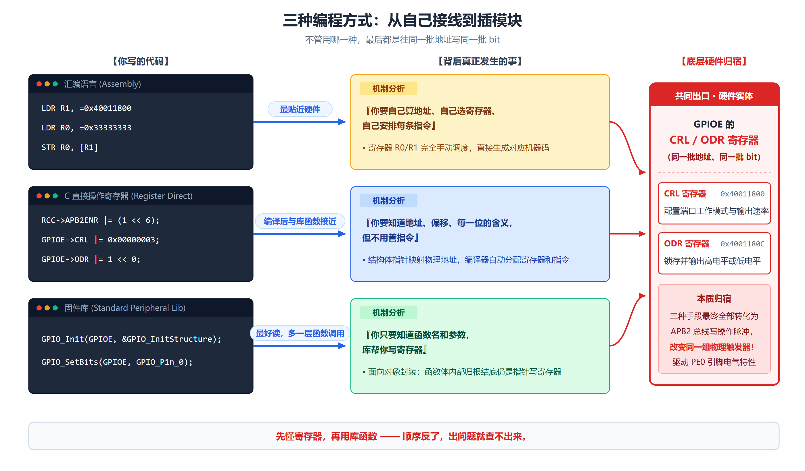

*开时钟 → 配模式 → 读写。这三步在第 7～12 章会以同样的形式反复出现。*

#### 四种访问方式对比（PPT 有一张总结表）

| 方式 | 优点 | 局限 | 课堂定位 |
|---|---|---|---|
| **汇编** | **最接近指令和地址** | 代码量大、可维护性弱 | 理解"地址访问" |
| **C 语言直接操作寄存器** | 清楚、轻量、可控 | 需要熟悉位域和手册 | **本章底层重点** |
| **标准库** | 可读性强、开发效率高 | 隐藏部分底层细节 | **本课程主线** |
| **CubeMX / HAL** | 工程搭建快、自动初始化 | 更抽象，**API 与标准库不同** | 扩展了解 |

> **【本章的验收标准（PPT 原话）】**
> **能用标准库完成实验，不代表已经理解 GPIO；
> 能从标准库函数回推到 RCC、CRL/CRH、ODR/IDR，才算真正掌握本章。**

#### 方式一：汇编（例 6-1）

**任务**：控制连接 **PE0** 的 LED **亮 0.5s、灭 0.5s**。

```asm
; 关键思想：直接向物理地址写数据
GPIOE       EQU 0x40011800
GPIOE_CRL   EQU 0x40011800
GPIOE_ODR   EQU 0x4001180C
RCC_APB2ENR EQU 0x40021018
; 1) 使能 GPIOE 时钟
; 2) PE0 配置为推挽输出 50MHz
; 3) 循环写 ODR，配合延时翻转 LED0
```

**PPT 的思考题**：

> **若把 `GPIOE_ODR` 改成 `GPIOE_IDR`，是否还能控制 LED？为什么？**

**答案：不能。**

```
原因：
① IDR 是【输入数据寄存器】，它是只读的（反映引脚当前电平），
   往它里面写值不会改变引脚输出；
② 输出引脚的电平由 ODR（或 BSRR/BRR）控制；
③ 而且 IDR 反映的是引脚实际电平——如果引脚配成推挽输出，
   它反映的是上一次输出的值，你写 IDR 也不会让它变。
```

#### 方式二：C 语言直接操作寄存器（例 6-2）★★★

```c
#include "stm32f10x.h"
#define LED0 (1 << 0)
#define RCC_APB2Periph_GPIOE ((uint32_t)0x00000040)

int main(void)
{
    RCC->APB2ENR |= RCC_APB2Periph_GPIOE; // 使能时钟
    GPIOE->CRL &= 0xFFFFFFF0;    // 清除 PE0 配置位
    GPIOE->CRL |= 0x00000003;    // PE0 推挽输出，50MHz
    while (1) {
        GPIOE->ODR |= LED0;      // PE0 输出高
        delay_ms(500);
        GPIOE->ODR &= ~LED0;     // PE0 输出低
        delay_ms(500);
    }
}
```

**逐行解读（PPT 原话）**：

| 代码 | 含义 |
|---|---|
| `RCC->APB2ENR \|= RCC_APB2Periph_GPIOE;` | 打开 GPIOE 时钟；**GPIOE 对应 bit6，即 0x00000040** |
| `GPIOE->CRL &= 0xFFFFFFF0;` | **PE0 的配置字段位于 CRL 的最低 4 位**，先清零 |
| `GPIOE->CRL \|= 0x00000003;` | **`0x00000003` 表示 MODE0=11、CNF0=00，即 50MHz 通用推挽输出** |
| `GPIOE->ODR \|= LED0;` | **ODR 的 bit0 对应 PE0 的输出数据** |

**位运算展开（不跳步）**：

```
第 1 步 &= 0xFFFFFFF0：
  运算前（复位值）： 0x4444 4444 = ... 0100 0100
  掩码：             0xFFFFFFF0 = ... 1111 0000
  AND 后：           0x4444 4440 = ... 0100 0000
                                        ↑↑↑↑ PE0 的 4 位被清零

第 2 步 |= 0x00000003：
  运算前：           0x4444 4440
  掩码：             0x00000003 = ... 0000 0011
  OR 后：            0x4444 4443 = ... 0100 0011
                                        ↑↑↑↑ 0011 = CNF=00 推挽，MODE=11 50MHz
```

> **【易错】为什么不能直接 `GPIOE->CRL = 0x00000003;`？**
> 因为那会把**其他 7 根引脚（PE1~PE7）的配置全部改成 0**（模拟输入），
> 如果它们原本有别的用途，就被你毁了。
> **`&=` + `|=` 只动你关心的 4 位，其他位保持原样。**

> **PPT 的延伸提示**：**实际工程中可用 BSRR/BRR 替代 ODR 读改写，以提高单个位操作的原子性。**

#### 方式三：固件库（例 6-3）★★★

**GPIO 初始化结构体**：

```c
typedef struct
{
    uint16_t GPIO_Pin;              // 选择引脚
    GPIOSpeed_TypeDef GPIO_Speed;   // 设置输出速率
    GPIOMode_TypeDef  GPIO_Mode;    // 设置工作模式
} GPIO_InitTypeDef;
```

> **GPIO 初始化本质：选择哪个引脚、以什么模式工作、输出速度是多少。**

**`GPIO_Pin` 的取值**：

```
GPIO_Pin_0
GPIO_Pin_1
...
GPIO_Pin_15
GPIO_Pin_All
GPIO_Pin_0 | GPIO_Pin_1    ← 按位或，同时选择 0 号和 1 号引脚
```

**`GPIO_Speed` 的取值（必背）**：

| 取值 | 含义 |
|---|---|
| `GPIO_Speed_10MHz` | 最高输出速率 **10 MHz** |
| `GPIO_Speed_2MHz` | 最高输出速率 **2 MHz** |
| `GPIO_Speed_50MHz` | 最高输出速率 **50 MHz** |

**`GPIO_Mode` 的取值（8 种，必背）**：

| 取值 | 工作模式 |
|---|---|
| **`GPIO_Mode_AIN`** | **模拟输入** |
| **`GPIO_Mode_IN_FLOATING`** | **浮空输入** |
| **`GPIO_Mode_IPD`** | **下拉输入** |
| **`GPIO_Mode_IPU`** | **上拉输入** |
| **`GPIO_Mode_Out_OD`** | **开漏输出** |
| **`GPIO_Mode_Out_PP`** | **推挽输出** |
| **`GPIO_Mode_AF_OD`** | **复用开漏输出** |
| **`GPIO_Mode_AF_PP`** | **复用推挽输出** |

> **记忆方法**：
> - `IN_` 开头是输入，`Out_` 开头是通用输出，`AF_` 开头是复用输出；
> - `PP` = Push-Pull（推挽），`OD` = Open-Drain（开漏）；
> - `IPU` = Input Pull-Up（上拉），`IPD` = Input Pull-Down（下拉），`AIN` = Analog IN（模拟）。

**初始化代码结构（PPT 给了完整流程）**：

```
定义结构体变量 → 配置引脚 → 配置模式 → 配置速率 → 调用 GPIO_Init()
```

```c
// 以 PE0 推挽输出、50MHz 为例
GPIO_InitTypeDef GPIO_InitStructure;
GPIO_InitStructure.GPIO_Pin   = GPIO_Pin_0;
GPIO_InitStructure.GPIO_Mode  = GPIO_Mode_Out_PP;
GPIO_InitStructure.GPIO_Speed = GPIO_Speed_50MHz;
GPIO_Init(GPIOE, &GPIO_InitStructure);
```

**例 6-3 完整流程**：

```c
GPIO_InitTypeDef GPIO_InitStructure;
RCC_APB2PeriphClockCmd(RCC_APB2Periph_GPIOE, ENABLE);   // ① 开时钟
GPIO_InitStructure.GPIO_Pin   = GPIO_Pin_0;             // ② 选 PE0
GPIO_InitStructure.GPIO_Mode  = GPIO_Mode_Out_PP;       // ③ 推挽输出
GPIO_InitStructure.GPIO_Speed = GPIO_Speed_50MHz;       // ④ 50MHz
GPIO_Init(GPIOE, &GPIO_InitStructure);                  // ⑤ 写入寄存器

while (1) {
    GPIO_SetBits(GPIOE, GPIO_Pin_0);    // PE0 输出高
    delay_ms(500);
    GPIO_ResetBits(GPIOE, GPIO_Pin_0);  // PE0 输出低
    delay_ms(500);
}
```

**重点库函数（PPT 列出）**：

| 类别 | 函数 |
|---|---|
| **初始化类** | `GPIO_DeInit()`、`GPIO_AFIODeInit()`、**`GPIO_Init()`**、`GPIO_StructInit()` |
| **输出控制类** | **`GPIO_SetBits()`**、**`GPIO_ResetBits()`**、`GPIO_WriteBit()`、`GPIO_Write()` |
| **输入读取类** | `GPIO_ReadInputDataBit()`、`GPIO_ReadInputData()` |
| **输出状态读取类** | `GPIO_ReadOutputDataBit()`、`GPIO_ReadOutputData()` |
| **配置扩展类** | `GPIO_PinLockConfig()`、`GPIO_PinRemapConfig()`、`GPIO_EXTILineConfig()` |

**四个最常用的（必背）**：

```c
void GPIO_SetBits(GPIO_TypeDef* GPIOx, uint16_t GPIO_Pin);      // 置 1，输出高电平
void GPIO_ResetBits(GPIO_TypeDef* GPIOx, uint16_t GPIO_Pin);    // 清 0，输出低电平
void GPIO_WriteBit(GPIO_TypeDef* GPIOx, uint16_t GPIO_Pin, BitAction BitVal); // 设置指定引脚
void GPIO_Write(GPIO_TypeDef* GPIOx, uint16_t PortVal);         // 向整个端口写数据
```

**用法**：

```c
GPIO_SetBits(GPIOE, GPIO_Pin_0);
GPIO_ResetBits(GPIOE, GPIO_Pin_0);
GPIO_WriteBit(GPIOE, GPIO_Pin_8, Bit_SET);
GPIO_Write(GPIOE, 0x1705);
```

> **【库函数与寄存器的对应关系（理解这条就懂了库）】**
>
> | 库函数 | 内部做的事 |
> |---|---|
> | `GPIO_SetBits()` | 写 **BSRR** 的低 16 位 |
> | `GPIO_ResetBits()` | 写 **BRR**（或 BSRR 的高 16 位） |
> | `GPIO_Init()` | 按参数算出 4 位编码，写 **CRL/CRH** |
> | `RCC_APB2PeriphClockCmd()` | 写 **RCC_APB2ENR** |
>
> **这就是"从标准库函数回推到寄存器"**——PPT 说的"真正掌握本章"的标准。

#### 方式四：CubeMX（了解）

**配置流程**：

```
选择芯片 STM32F103VET6
    ↓
配置 RCC：HSE + PLL 到 72MHz
    ↓
配置 GPIO：PE0 = GPIO_Output
    ↓
生成 MDK 工程
    ↓
加入用户代码
```

```c
while (1)
{
    HAL_GPIO_TogglePin(GPIOE, GPIO_PIN_0);
    HAL_Delay(500);
}
```

> **【PPT 的两条提醒】**
> - **CubeMX 降低工程初始化难度，但容易让学生忽略寄存器机制。**
> - **CubeMX 示例使用 HAL 层函数，与前面标准外设库不是同一套 API。**

---

### 6.7 两个小实验 ★★ 【PPT 重点：陈 p59～p60 / 梁 p69～p74】

#### 实验一：控制 LED 闪烁

**任务**：PE0 上的 LED **亮 0.5s、灭 0.5s** 循环。

**三种写法**：

| 方式 | 关键代码 |
|---|---|
| **汇编** | `GPIOE_ODR EQU 0x4001180C`，循环写 ODR |
| **C 寄存器** | `GPIOE->CRL &= 0xFFFFFFF0; GPIOE->CRL \|= 0x00000003;` 然后 `ODR \|= LED0` / `&= ~LED0` |
| **固件库** | `GPIO_Init(GPIOE, &GPIO_InitStructure);` 然后 `GPIO_SetBits` / `GPIO_ResetBits` |

**程序执行过程**：

```
PE0 输出高电平 → 延时 500ms → PE0 输出低电平 → 延时 500ms → 不断循环
```

> **注意 LED 的接法**：教材板子上是 **PE0 输出低电平时灯亮**（LED 接 +3.3V）。
> 如果换一块板子，接法可能相反，**以电路图为准**。

#### 实验二：按键控制 LED

**接线**：按键接 **PA0**，LED 接 **PE0**。

**要点**：

1. **开两个时钟**：`RCC_APB2Periph_GPIOA` 和 `RCC_APB2Periph_GPIOE`；
2. **PE0 配成推挽输出**；
3. **PA0 配成上拉输入**（`GPIO_Mode_IPU`）；
4. **读 `GPIO_ReadInputDataBit(GPIOA, GPIO_Pin_0)` 判断**；
5. **加软件消抖**（按键机械抖动约 5~20ms）。

> **为什么输入要配"上拉"**：
> 按键一端接 PA0、另一端接地。**没按下时**，PA0 悬空——如果没有上拉，电平不确定（可能读到随机值）；
> **有了内部上拉**，没按下时被钳位到高电平；**按下时**被接到地，读到低电平。
> **这样"高=没按、低=按下"就确定了。**

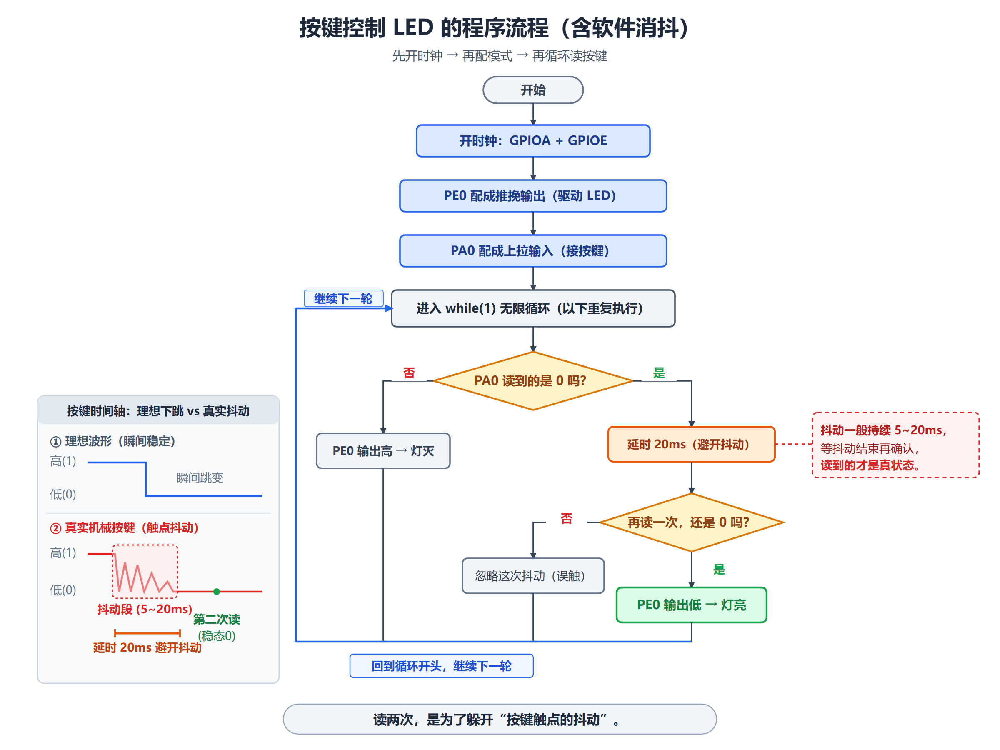

*按键从"物理抖动"到"软件确认"的完整流程，消抖是必做的一步。*

---

## 三、重要知识之间的联系

### 对比 1：8 种模式一览（本章最核心的表）

| MODE | CNF | 模式 | 典型用途 |
|---|---|---|---|
| `00` | `00` | **模拟输入** | ADC 采集 |
| `00` | `01` | **浮空输入** | 外部有确定驱动的信号 |
| `00` | `10` | **上拉/下拉输入** | 按键 |
| `00` | `11` | 保留 | — |
| `01` | `00` | 通用推挽输出 10MHz | 一般输出 |
| `10` | `00` | 通用推挽输出 2MHz | 低速输出 |
| `11` | `00` | **通用推挽输出 50MHz** | **LED、蜂鸣器** |
| `01` | `01` | 通用开漏输出 10MHz | I²C |
| `10` | `10` | 复用推挽输出 | 串口、SPI、PWM |
| `11` | `11` | 复用开漏输出 | I²C 复用 |

**判断口诀**：

```
先看 MODE：00 = 输入，其它 = 输出
再看 CNF：输入时 00/01/10 = 模拟/浮空/上下拉
          输出时 00/01/10/11 = 推挽/开漏/复用推挽/复用开漏
```

### 对比 2：IDR vs ODR

| | **IDR**（输入数据寄存器） | **ODR**（输出数据寄存器） |
|---|---|---|
| 读写 | **只读** | **可读可写** |
| 反映什么 | **引脚的实际电平** | **你写下去的输出值** |
| 什么时候用 | 读按键、读传感器 | 控制 LED、继电器 |
| 注意 | 每个 APB2 周期采样一次，**可能有 1 拍延迟** | **读 ODR 不一定等于引脚真实电平**（尤其开漏时） |

### 对比 3：ODR 写 vs BSRR/BRR 写（必考）

| | `ODR \|= (1<<n)` | `BSRR = (1<<n)` | `BRR = (1<<n)` |
|---|---|---|---|
| 操作 | **读—改—写**（3 步） | **只写**（1 步） | **只写**（1 步） |
| 原子性 | **不是原子的** | **原子的** | **原子的** |
| 会不会影响其他位 | 理论上不会（掩码保住了），但**中断环境下会丢修改** | **不会**（硬件只动指定位） | **不会** |
| 推荐场景 | **初始化阶段** | **运行中置位** | **运行中清位** |

**BSRR 的结构**：

```
bit31:16 = BR15~BR0（写 1 → 清 0）
bit15:0  = BS15~BS0（写 1 → 置 1）
```

### 对比 4：推挽输出 vs 开漏输出（必考）

| | **推挽（Push-Pull, PP）** | **开漏（Open-Drain, OD）** |
|---|---|---|
| P-MOS | **参与**（写 1 时导通） | **从不激活** |
| N-MOS | 参与（写 0 时导通） | 参与（写 0 时导通） |
| 写 1 时 | **主动输出高电平** | **高阻态**（"撒手"） |
| 写 0 时 | 主动拉低 | 主动拉低 |
| 高电平从哪来 | 芯片内部 | **必须外部上拉电阻** |
| 能否"线与" | 不能 | **能**（多个开漏接一起，任一拉低就低） |
| 典型用途 | LED、蜂鸣器、一般输出 | **I²C**、需要线与的场合 |
| 读真实电平 | 读 **ODR** 就够 | **必须读 IDR** |

### 对比 5：输入配置 vs 输出配置（硬件内部）

| 项目 | **输入配置** | **输出配置** |
|---|---|---|
| 输出缓冲器 | **被禁止** | **被激活** |
| 施密特触发输入 | **被激活** | **仍被激活** |
| 弱上拉/下拉 | **按配置连接** | **被禁止** |
| IDR | 每个 APB2 周期采样 | 每个 APB2 周期采样 |
| 读什么 | 读 IDR = 引脚状态 | 推挽读 ODR；**开漏读 IDR** |

### 对比 6：四种访问方式

| 方式 | 代码量 | 可读性 | 执行速度 | 学习价值 |
|---|---|---|---|---|
| **汇编** | 大 | 差 | 快 | **理解"地址访问"** |
| **C 直接操作寄存器** | 中 | 中 | 快 | **本章底层重点** |
| **标准库** | 大 | **好** | 慢 | **本课程主线** |
| **CubeMX/HAL** | 小（生成） | 好 | 慢 | 扩展了解 |

### 对比 7：GPIO 端口地址速查

| 端口 | 基地址 | CRL | CRH | IDR | ODR | BSRR | BRR | LCKR |
|---|---|---|---|---|---|---|---|---|
| **PA** | `0x40010800` | `0800` | `0804` | `0808` | **`080C`** | `0810` | `0814` | `0818` |
| PB | `0x40010C00` | `0C00` | `0C04` | `0C08` | `0C0C` | `0C10` | `0C14` | `0C18` |
| PC | `0x40011000` | `1000` | `1004` | `1008` | `100C` | `1010` | `1014` | `1018` |
| PD | `0x40011400` | `1400` | `1404` | `1408` | `140C` | `1410` | `1414` | `1418` |
| **PE** | `0x40011800` | `1800` | `1804` | `1808` | **`180C`** | `1810` | `1814` | `1818` |

> **记忆方法**：**每个端口的基地址相差 `0x400`**，寄存器偏移从 `0x00` 到 `0x18` 依次加 4。

---

## 四、高频易错点

> 以下为**常见易错点**（不是历年考试统计）。

| # | 易错点 | 正确理解 |
|---|---|---|
| 1 | **忘了开 GPIO 时钟** | 这是"灯不亮"的头号原因。**配寄存器前必须先写 `RCC->APB2ENR`** |
| 2 | 以为能"先配寄存器再开时钟" | **顺序必须反过来**：先开时钟 → 再写寄存器 |
| 3 | 把 bit 编号当成引脚编号 | **`1 << 0` 是 bit0（PE0），不是 PE1** |
| 4 | 直接给 CRL 赋值 `=` | 会**毁掉其他 7 根引脚**的配置。必须 `&=` 清位再 `\|=` 置位 |
| 5 | 把 `0x8` 当成"推挽 2MHz" | `0x8` = `1000b` = **上拉/下拉输入**；推挽 2MHz 是 `0x2` |
| 6 | 以为 BSRR 只有"置位"功能 | **BSRR 高 16 位是复位、低 16 位是置位**；BRR 才是只能清位 |
| 7 | 运行中用 `ODR \|=` 改单个位 | 中断环境下会**丢失其他位的修改**；应改用 **BSRR/BRR** |
| 8 | 开漏输出读 ODR 判断电平 | **开漏必须读 IDR**——写 1 时引脚是高阻，实际电平由外部上拉决定 |
| 9 | 以为"能承受 5V"就是"能输出 5V" | **输入能承受 5V，输出仍是 3.3V** |
| 10 | 以为复位后引脚是"输出低电平" | **复位后是浮空输入**（CRL/CRH 复位值 `0x4444 4444`） |
| 11 | 以为 PA13/PA14 复位后能随便用 | **复位后被 JTAG 占用**（PA13 上拉、PA14 下拉） |
| 12 | 把 `PLLON` 和 `PLLRDY` 记反 | **`PLLON` = bit24，`PLLRDY` = bit25** |
| 13 | 以为写了 SW 就切换好了 | **写 SW 只是"请求"**；要读 **SWS** 确认切换成功 |
| 14 | 把 `IOPEEN` 的位号记错 | **bit6 → `0x40`**；`IOPAEN` 是 bit2，`AFIOEN` 是 bit0 |
| 15 | 模拟输入还用读 IDR | **模拟输入时读 IDR 永远得 0**（施密特触发被禁止，输出强置 0） |
| 16 | 以为复用输出还能用 ODR 控制 | **配成复用后引脚和 ODR 断开**，改由片上外设驱动 |
| 17 | 复用输出了但外设没使能 | **输出不确定**（教材明确说"外设没有被激活，那么它的输出将不确定"） |
| 18 | 把 LCKR 的 5 步序列记少一步 | **写 1 → 写 0 → 写 1 → 读 0 → 读 1**，一步都不能少 |
| 19 | 以为锁定后连输出都不能改 | **只锁配置（CRL/CRH）**，不锁 ODR 的输出值 |
| 20 | 以为 `GPIO_Mode_IPU` 是"上拉输出" | **`IPU` = Input Pull-Up（上拉输入）**，是输入不是输出 |

---

## 五、本章考前速查

> 几分钟扫一遍，只看这一节就能回忆全章骨架。

### GPIO 基本概念

- **GPIO** = General-Purpose Input/Output，通用输入/输出接口
- **STM32F103VET6：80 根口线，5 个端口（PA~PE），每端口 16 位**
- **特点**：多功能、双向、**能承受 5V 电压**、快速（最高 50MHz）
- **端口 → 位 → 引脚**：`GPIOE` → `PE0~PE15` → 芯片引脚
- **复位后默认：浮空输入**（CRL/CRH = `0x4444 4444`）
- **例外**：PA13 上拉、PA14 下拉、PA15 上拉、PB4 上拉（JTAG）
- **寄存器必须按 32 位字访问**

### 7 个寄存器（必背）

| 偏移 | 寄存器 | 功能 |
|---|---|---|
| **`0x00`** | **CRL** | 配置 **P0~P7** |
| **`0x04`** | **CRH** | 配置 **P8~P15** |
| **`0x08`** | **IDR** | 读输入（**只读**） |
| **`0x0C`** | **ODR** | 写输出（可读写） |
| **`0x10`** | **BSRR** | **低 16 位置位，高 16 位复位** |
| **`0x14`** | **BRR** | 只清位 |
| **`0x18`** | **LCKR** | 锁定配置 |

**端口基地址**：**PA = `0x40010800`**、PB = `0x40010C00`、PC = `0x40011000`、PD = `0x40011400`、**PE = `0x40011800`**（每个差 `0x400`）

**地址计算**：**基地址 + 偏移量**
```
GPIOE_ODR = 0x40011800 + 0x0C = 0x4001180C
```

### CRL/CRH 的 4 位编码（必背）

**MODE[1:0]**：`00` = 输入；`01` = 输出 10MHz；`10` = 输出 2MHz；`11` = 输出 50MHz

**CNF[1:0]**：

| CNF | 输入时 | 输出时 |
|---|---|---|
| `00` | **模拟输入** | **通用推挽** |
| `01` | **浮空输入** | **通用开漏** |
| `10` | **上拉/下拉输入** | **复用推挽** |
| `11` | 保留 | **复用开漏** |

**常用编码**：

```
0x4 = 0100 = 浮空输入（复位默认）
0x8 = 1000 = 上拉/下拉输入
0x0 = 0000 = 模拟输入
0x3 = 0011 = 通用推挽输出 50MHz    ← 最常用
0x2 = 0010 = 通用推挽输出 2MHz
0x1 = 0001 = 通用推挽输出 10MHz
```

### IDR / ODR / BSRR / BRR

- **IDR**：只读，反映**引脚实际电平**，每个 APB2 周期采样一次
- **ODR**：可读写，**保存输出数据**
- **BSRR**：**bit15:0 = BS（置 1）**、**bit31:16 = BR（清 0）**；写 1 有效，**写 0 无影响**
- **BRR**：只能清 0

**【必记】为什么用 BSRR/BRR**：

> **原子操作**，不会在读—改—写之间被中断打断，**不会丢失其他位的修改**。

### 8 种模式与库函数对应

| 库函数宏 | 模式 |
|---|---|
| `GPIO_Mode_AIN` | 模拟输入 |
| `GPIO_Mode_IN_FLOATING` | 浮空输入 |
| `GPIO_Mode_IPD` | 下拉输入 |
| `GPIO_Mode_IPU` | **上拉输入** |
| `GPIO_Mode_Out_OD` | 开漏输出 |
| `GPIO_Mode_Out_PP` | **推挽输出** |
| `GPIO_Mode_AF_OD` | 复用开漏 |
| `GPIO_Mode_AF_PP` | 复用推挽 |

**速度**：`GPIO_Speed_2MHz` / `GPIO_Speed_10MHz` / `GPIO_Speed_50MHz`

### RCC 时钟（必背）

- **RCC 基地址 `0x40021000`**
- **`RCC_APB2ENR` 偏移 `0x18` → 绝对地址 `0x40021018`**
- **GPIO 时钟位**：`IOPAEN`(bit2) / `IOPBEN`(3) / `IOPCEN`(4) / `IOPDEN`(5) / **`IOPEEN`(bit6 = `0x40`)** / `AFIOEN`(bit0)
- **`RCC_CR`**：`HSEON`(16) / `HSERDY`(17) / **`PLLON`(24) / `PLLRDY`(25)** / `HSION`(0) / `HSIRDY`(1)
- **`RCC_CFGR`**：`SW`(1:0) 选择 / `SWS`(3:2) 状态
- **标准流程**：**先写 ON → 轮询 RDY → 再用**
- **库函数**：`RCC_APB1PeriphClockCmd()` / `RCC_APB2PeriphClockCmd()` / `RCC_AHBPeriphClockCmd()`
- **`SystemInit()` 由启动文件自动调用**，不用自己调

### 使用三步（必背）

```
① 开时钟（RCC_APB2ENR）
② 配模式（CRL/CRH，或 GPIO_Init）
③ 输入/输出（读 IDR / 写 ODR、BSRR、BRR）
```

### 四种访问方式

| 方式 | 定位 |
|---|---|
| 汇编 | 理解"地址访问" |
| **C 直接操作寄存器** | **本章底层重点** |
| **标准库** | **本课程主线** |
| CubeMX/HAL | 扩展了解 |

**库函数与寄存器对应**：

| 库函数 | 寄存器 |
|---|---|
| `GPIO_SetBits()` | BSRR 低 16 位 |
| `GPIO_ResetBits()` | BRR（或 BSRR 高 16 位） |
| `GPIO_Init()` | CRL/CRH |
| `RCC_APB2PeriphClockCmd()` | RCC_APB2ENR |

---

## 六、本章快速自测

> **用法**：先自己答，再看答案。
> **标注说明**：标有「**教材习题 X-Y**」的题目，来自教材第 6 章课后习题。

---

### 第一部分：教材课后习题

**Q1（教材习题 6-1）** STM32F103VET6 的 GPIO 有什么功能和特点？

<details><summary>答案</summary>

**（1）基本规模与特点**

- **80 根**多功能、**双向**、能**承受 5V 电压**的**快速** I/O 口线；
- **每 16 根一组**，分为 **PA、PB、PC、PD、PE** 五个端口；
- 每个 I/O 位都可以**通过软件独立配置**。

**（2）7 个寄存器**

每个端口有：**CRL、CRH**（配置）、**IDR、ODR**（数据）、**BSRR、BRR**（置位/复位）、**LCKR**（锁定）。
**寄存器必须按 32 位字访问。**

**（3）8 种工作模式**

输入 4 种：**浮空输入、上拉输入、下拉输入、模拟输入**；
输出 4 种：**通用推挽、通用开漏、复用推挽、复用开漏**。

**（4）6 项功能（教材 6.2 节）**

1. **普通 I/O 功能**：输出写 ODR，输入读 IDR，**复位后默认浮空输入**；
2. **单独的位设置/清除**：用 **BSRR/BRR 原子操作**，不用关中断；
3. **外部中断/唤醒线**：所有端口都有外部中断能力，**端口必须配置成输入模式**；
4. **复用功能（AF）**：引脚可"借"给片上外设（串口、SPI、定时器等）；
5. **软件重映射**：通过 **AFIO** 寄存器把复用功能换到别的引脚；
6. **锁定机制**：执行 LOCK 序列后，**复位前不可更改端口位配置**。

**答题要点提醒**：**"80 根 / 5 个端口 / 16 位一组 / 7 个寄存器 / 8 种模式 / 6 项功能"**——
按这六个数字组织答案，条理最清楚。★★★
</details>

---

**Q2（教材习题 6-2）** 如何确定外设某个寄存器的物理地址？

<details><summary>答案</summary>

**公式**：

> **物理地址 = 该外设的基地址（首地址） + 该寄存器的偏移量**

**计算步骤**：

```
① 查手册/教材，找到该外设的【基地址】
② 查该寄存器的【偏移量】
③ 两者相加
```

**例 1：GPIOA_ODR**

```
查表：GPIOA 基地址 = 0x4001 0800
查表：ODR 偏移量   = 0x0C
相加：0x4001 0800 + 0x0C = 0x4001 080C
```

**例 2：GPIOE_ODR**

```
GPIOE 基地址 = 0x4001 1800
ODR 偏移量   = 0x0C
→ 0x4001 180C
```

**例 3：RCC_APB2ENR**

```
RCC 基地址 = 0x4002 1000
APB2ENR 偏移 = 0x18
→ 0x4002 1018
```

**为什么要这样算（教材原文）**：

> "各个端口的第一个地址称为该端口的**首地址**，如 PA 的首地址为 0x4001 0800。
> 后续介绍寄存器时，各个寄存器的地址都是以**偏移量**的方式给出，
> 寄存器的物理地址就是**基地址加上偏移量**。"

**C 语言的写法**（把地址变成指针）：

```c
#define GPIOA ((GPIO_TypeDef *) 0x40010800)
GPIOA->ODR = 0x0001;    // 等价于 *(volatile uint32_t*)0x4001080C = 0x0001;
```

**易错提醒**：**别忘了 GPIO 端口之间相差 `0x400`**（PA=0x0800、PB=0x0C00、PC=0x1000、PD=0x1400、PE=0x1800）。★★★
</details>

---

**Q3（教材习题 6-3）** 编写程序，用 GPIO 实现流水灯。

<details><summary>答案</summary>

**任务**：让 16 只 LED（接 PE0~PE15）依次点亮，形成"流水"效果。

**三种写法都可以，这里是固件库版（本课程主线）**：

```c
#include "stm32f10x.h"

int main(void)
{
    GPIO_InitTypeDef GPIO_InitStructure;

    /* ① 开时钟 */
    RCC_APB2PeriphClockCmd(RCC_APB2Periph_GPIOE, ENABLE);

    /* ② 配置 PE0~PE15 为推挽输出 50MHz */
    GPIO_InitStructure.GPIO_Pin   = GPIO_Pin_All;      // 全部 16 个引脚
    GPIO_InitStructure.GPIO_Mode  = GPIO_Mode_Out_PP;
    GPIO_InitStructure.GPIO_Speed = GPIO_Speed_50MHz;
    GPIO_Init(GPIOE, &GPIO_InitStructure);

    /* ③ 循环点亮 */
    while (1) {
        for (uint8_t i = 0; i < 16; i++) {
            GPIO_Write(GPIOE, ~(1 << i));   // 只有第 i 位为 0（低电平点亮）
            delay_ms(200);
        }
    }
}
```

**关键点**：

1. **`GPIO_Pin_All`** 一次选中 16 个引脚（等价于 `0xFFFF`）；
2. **`~(1 << i)`**：因为教材板子上 **LED 是低电平点亮**，所以要让第 i 位为 0，其他位为 1；
3. **`GPIO_Write(GPIOE, 值)`** 一次写整个端口。

**更安全的写法（用 BSRR/BRR 原子操作）**：

```c
while (1) {
    for (uint8_t i = 0; i < 16; i++) {
        GPIO_SetBits(GPIOE, 0xFFFF);              // 全部熄灭（高电平）
        GPIO_ResetBits(GPIOE, (1 << i));          // 只点亮第 i 个（低电平）
        delay_ms(200);
    }
}
```

**寄存器版的核心代码**：

```c
RCC->APB2ENR |= (1 << 6);       // 开 GPIOE 时钟
GPIOE->CRL = 0x33333333;        // PE0~PE7 推挽输出 50MHz
GPIOE->CRH = 0x33333333;        // PE8~PE15 推挽输出 50MHz
while (1) {
    for (uint8_t i = 0; i < 16; i++) {
        GPIOE->BSRR = 0xFFFF;            // 全部置高（熄灭）
        GPIOE->BRR  = (1 << i);          // 第 i 位清 0（点亮）
        delay_ms(200);
    }
}
```

> **`0x33333333` 的来历**：每个引脚 4 位，值 `0x3` = `0011b` = **CNF=00 推挽 / MODE=11 50MHz**。
> 8 个引脚 × 4 位 = 32 位，每个 nibble 都是 `3`，所以整个寄存器是 `0x33333333`。

**易错提醒**：
- **别忘了开时钟**；
- **先清位再置位**（`&=` 然后 `|=`），不要直接 `=`，否则会毁掉其他引脚配置；
- **确认 LED 是高电平点亮还是低电平点亮**——这取决于电路图。★★★
</details>

---

**Q4（教材习题 6-4）** 编写程序，用按键控制 LED 亮灭。

<details><summary>答案</summary>

**接线**：按键接 **PA0**，LED 接 **PE0**。

**要点（4 条）**：

1. **开两个时钟**：`RCC_APB2Periph_GPIOA` 和 `RCC_APB2Periph_GPIOE`；
2. **PE0 配成推挽输出**；
3. **PA0 配成上拉输入**（`GPIO_Mode_IPU`）；
4. **读 IDR 判断，并加软件消抖**。

**完整代码**：

```c
#include "stm32f10x.h"

int main(void)
{
    GPIO_InitTypeDef GPIO_InitStructure;

    /* ① 开两个时钟 */
    RCC_APB2PeriphClockCmd(RCC_APB2Periph_GPIOA | RCC_APB2Periph_GPIOE, ENABLE);

    /* ② PE0 推挽输出 */
    GPIO_InitStructure.GPIO_Pin   = GPIO_Pin_0;
    GPIO_InitStructure.GPIO_Mode  = GPIO_Mode_Out_PP;
    GPIO_InitStructure.GPIO_Speed = GPIO_Speed_50MHz;
    GPIO_Init(GPIOE, &GPIO_InitStructure);

    /* ③ PA0 上拉输入 */
    GPIO_InitStructure.GPIO_Pin  = GPIO_Pin_0;
    GPIO_InitStructure.GPIO_Mode = GPIO_Mode_IPU;
    GPIO_Init(GPIOA, &GPIO_InitStructure);

    /* ④ 循环读按键 */
    while (1) {
        if (GPIO_ReadInputDataBit(GPIOA, GPIO_Pin_0) == Bit_RESET) {
            /* 按键按下（低电平） */
            delay_ms(10);    // 消抖
            if (GPIO_ReadInputDataBit(GPIOA, GPIO_Pin_0) == Bit_RESET) {
                GPIO_ResetBits(GPIOE, GPIO_Pin_0);   // 点亮 LED
            }
        } else {
            GPIO_SetBits(GPIOE, GPIO_Pin_0);         // 熄灭 LED
        }
    }
}
```

**为什么按键要配"上拉输入"**：

```
按键一端接 PA0，另一端接地：
  没按下 → PA0 悬空 → 如果没有上拉，电平不确定（可能读到随机值）
  有内部上拉 → 没按下时被钳位到高电平
  按下 → 接到地，读到低电平
所以："高 = 没按，低 = 按下" 就确定了
```

**为什么要消抖**：

> 按键是机械触点，按下和松开的瞬间会产生 **5~20ms 的抖动**（电平快速跳变多次）。
> 如果不消抖，一次按键可能被识别成好几次。
> **软件消抖**：检测到变化后**延时 10~20ms 再读一次**，确认稳定了才算数。

**易错提醒**：
- **两个 GPIO 端口的时钟都要开**（PA 和 PE）；
- **`GPIO_Mode_IPU` 是输入**（Input Pull-Up），不是输出；
- 读按键用 **`GPIO_ReadInputDataBit()`**（读 IDR），不是读 ODR。★★★
</details>

---

### 第二部分：补充理解题

**Q5（原理）程序写一个数到寄存器，为什么引脚电平就变了？把这个链条从头说一遍。**

<details><summary>答案</summary>

**完整链条（七级）**：

```
① 你写代码：GPIOE->ODR |= (1 << 0);
        ↓
② 编译器把它翻译成机器码（一条 STR 指令 + 前面的地址/数据准备）
        ↓
③ CPU 执行 STR：把地址 0x4001 180C 放到地址总线，把数据放到数据总线
        ↓
④ 地址译码电路识别出"这个地址属于 GPIOE 的 ODR 寄存器"，选中它
        ↓
⑤ 数据写进 ODR 的 32 个触发器，bit0 由 0 变 1
        ↓
⑥ ODR 的 bit0 连到 PE0 的输出控制逻辑 → 输出驱动器动作
     （CNF=00 推挽、MODE=11 时：写 1 → P-MOS 导通，引脚接 VDD）
        ↓
⑦ PE0 引脚电压变成高电平（约 3.3V）
```

**最关键的一句话**：

> **CPU 根本不"认识"GPIO。它只是往某个地址写了一个数。
> 是"地址译码电路"把这个地址翻译成了"选中的是 GPIOE 的 ODR"，
> 硬件电路再根据这个寄存器的内容去控制引脚。**

**这个机制叫什么**：**存储器映射（统一编址）**——
外设寄存器和内存住在**同一个 4GB 地址空间**里，所以 CPU 用**访问内存的普通指令**就能操作硬件。

**类比**：给小区物业写便条 → 通信员送到 802 → 拨开关 → 电工合闸 → 路灯亮。
**但真实硬件里没有"人"**，全是触发器、译码电路和 MOS 管在按固定时序工作。★★★
</details>

---

**Q6（必考）CRL 里每个引脚占 4 位。写出"PE0 配置成通用推挽输出、50MHz"的 4 位值，并说明计算过程。**

<details><summary>答案</summary>

**4 位值 = `0011b` = `0x3`。**

**计算过程**：

```
① 先看 MODE[1:0]：决定方向 + 速度
   要"输出"，所以 MODE ≠ 00
   要"50MHz"，查表：MODE = 11

② 再看 CNF[1:0]：决定具体模式
   要"通用推挽"（不是复用），查表：CNF = 00

③ 拼起来
   这 4 位在寄存器里的排布是：CNF 在高 2 位，MODE 在低 2 位
   所以 4 位 = CNF MODE = 00 11 = 0011b = 0x3
```

**写进 CRL**：

```c
GPIOE->CRL &= 0xFFFFFFF0;   // 先清零 PE0 的 4 位
GPIOE->CRL |= 0x00000003;   // 再填入 0011
```

**为什么不能直接赋值**：

> `GPIOE->CRL = 0x00000003;` 会把 **PE1~PE7 的配置全部改成 0**（模拟输入），
> 如果它们原本有别的用途就全毁了。
> **必须先清位（`&=`）再置位（`|=`），只动自己关心的 4 位。**

**易错提醒**：**别把位序读反**。
- `0x8` = `1000b` = CNF=10、MODE=00 = **上拉/下拉输入**；
- `0x2` = `0010b` = CNF=00、MODE=10 = **推挽输出 2MHz**。
两者差得很远。★★★
</details>

---

**Q7（必考）为什么推荐用 BSRR/BRR 而不是 `ODR |=`？举一个具体的出错场景。**

<details><summary>答案</summary>

**因为 `ODR |=` 是"读—改—写"三步，不是原子的。**

**具体出错场景**：

```c
GPIOE->ODR = GPIOE->ODR & ~(1 << 0);   // 想把 PE0 清 0
```

```
时刻 ①  CPU 读 ODR        → 得到 0x0000 0002（PE1 目前是 1）
时刻 ②  CPU 算出要写回的值 → 0x0000 0002（只清 bit0，bit1 保持原样）
时刻 ③  ★ 中断来了！★
        中断服务程序把 PE1 改成 0 → ODR 变成 0x0000 0000
时刻 ④  CPU 把 0x0000 0002 写回
         → bit0 清对了 ✓
         → 但 bit1 被写回 1：中断里"把 PE1 清 0"的修改【被覆盖、丢了】！
```

**问题根源**：CPU 写回的是**基于"旧值"算出来的结果**。它不知道在"读"和"写"之间，
别人已经改过这块寄存器。这叫**竞态（race）**。

**用 BSRR/BRR 就没有这个问题**：

```c
GPIOE->BRR = (1 << 0);   // 只写一个值：硬件只清 bit0，其他位一个也不碰
```

因为整个过程**只有"写"这一步**，中断只能落在它之前或之后，**插不进中间**。

**教材原文**：

> "GPIOx_BSRR 和 GPIOx_BRR 寄存器允许对任何 GPIO 寄存器的读/更改的独立访问，
> 这样，**在读和更改访问之间产生中断（IRQ）时不会发生危险**。"

**BSRR 的结构（记住这个就不会用错）**：

```
bit31:16 = BR15~BR0  （写 1 → 清 0）
bit15:0  = BS15~BS0  （写 1 → 置 1）
```

所以：

```c
GPIOA->BSRR = (1 << 10);                     // PA10 置高（BS10）
GPIOA->BSRR = (1 << (10 + 16));              // PA10 置低（BR10）
```

**什么时候可以继续用 `|=`**：**初始化阶段**（这时一般没有中断来抢同一个寄存器）。
**运行中频繁改输出值，就该用 BSRR/BRR。** ★★★
</details>

---

**Q8（必考）推挽输出和开漏输出有什么区别？为什么开漏输出必须读 IDR 才能知道真实电平？**

<details><summary>答案</summary>

**电路上的区别**：

| | **推挽（PP）** | **开漏（OD）** |
|---|---|---|
| P-MOS | **参与**（写 1 时导通，把引脚接到 VDD） | **从不激活** |
| N-MOS | 参与（写 0 时导通，把引脚接到 GND） | 参与 |
| 写 1 时 | **主动输出高电平** | **高阻态**（"撒手不管"） |
| 写 0 时 | 主动拉低 | 主动拉低 |
| 高电平从哪来 | 芯片内部 | **必须外部上拉电阻** |

**为什么开漏要读 IDR**：

> **开漏写 1 时，引脚是高阻态**——芯片"撒手"了，**引脚的实际电平由外部上拉电阻决定**。
>
> - 如果外面接了上拉电阻 → 引脚被拉到高电平 → 读 IDR 得到 1；
> - 如果外面**没接**上拉 → 引脚"飘"在中间电平，甚至可能被外部电路拉低 → 读 IDR 可能是 0。
>
> 所以：**读 ODR 只能知道你"写了 1"，读 IDR 才知道引脚"实际是什么电平"。**

**教材原文（输出配置第 5、6 条）**：

> "开漏模式时，对**输入数据寄存器**的读访问可得到 I/O 状态；
> 推挽式模式时，对**输出数据寄存器**的读访问得到最后一次写的值。"

**开漏的独特用途**：**"线与"**——多个开漏输出接在一条线上，
**任何一个拉低，整条线就低**。这正是 **I²C 总线**的工作方式（SDA/SCL 都是开漏 + 上拉电阻）。

**推挽的用途**：LED、蜂鸣器、一般数字输出——需要**主动输出高电平**、驱动能力强的场合。★★★
</details>

---

**Q9（原理）为什么"必须先开 GPIO 时钟"？不开时钟直接写寄存器会怎样？**

<details><summary>答案</summary>

**会怎样：寄存器写不进去，引脚一点反应都没有。**

**为什么**：STM32 的每个外设都有一根**时钟门控开关**（在 RCC 寄存器里）。
时钟关着时：

> - 外设内部的**触发器不再更新**——你写进去的值**存不住**；
> - 外设的**状态机、计数器不再推进**——即使某个寄存器侥幸残留旧值，也不会引发任何动作；
> - 所以结论只有一个：**关着时钟时对寄存器的任何操作都是"不可依赖"的**。

**教材原文**：

> "要使用某个外设，**必须使能该外设的时钟**。"
> "如果只配置 GPIO 寄存器而未打开端口时钟，外设访问通常**不会得到预期结果**。"

**类比**：外设像一间办公室，时钟像"分闸"。

- 房间没合闸时，你在黑屋子里写笔记（写寄存器），写完也没人记得住（**值存不住**）；
- 只有合上分闸（写 1 使能），房间才开始工作。

**正确顺序（永远不能反）**：

```
① 开时钟（写 RCC_APB2ENR）
② 配寄存器（写 CRL/CRH/ODR...）
③ 使用
```

**千万不要有"先把寄存器配好，再开时钟"这种想法。**

**GPIO 的时钟在哪个寄存器**：`RCC_APB2ENR`（偏移 `0x18`，绝对地址 `0x40021018`）。

```c
RCC->APB2ENR |= (1 << 6);   // 开 GPIOE 时钟（IOPEEN）
```

**为什么"关时钟能省电"**：不用的外设关掉时钟，内部电路不翻转，就不耗电——
这是 STM32 低功耗设计的基本手段。★★★
</details>

---

**Q10（区别）输入模式下 IDR 是怎么工作的？为什么说它"每个 APB2 周期采样一次"而不是实时反映？**

<details><summary>答案</summary>

**IDR 的工作方式**：**每个 APB2 时钟边沿，硬件把引脚当前的电平"拍一张快照"存进 IDR。**

```
APB2 时钟   ┌─┐  ┌─┐  ┌─┐  ┌─┐  ┌─┐  ┌─┐
            ┘ └──┘ └──┘ └──┘ └──┘ └──┘ └──
             ↑     ↑     ↑     ↑     ↑     ↑
引脚电平 ────┐     ┌───────────┐           ┌────
            └─────┘           └───────────┘
            ①     ②     ③     ④     ⑤     ⑥
IDR 里的值  1     1     1     0     0     1     ← 只在采样时刻更新
```

**为什么不是"实时"**：

> **数字电路是同步电路，所有动作必须跟着时钟节拍走**，才不会乱。
> IDR 不是一个"透明的窗户"，而是一个**每个节拍更新一次的锁存器**。

**实际影响**：

- **读 IDR 可能读到"上一拍"的值**——最多有 **1 个 APB2 周期的延迟**；
- APB2 最高 **72MHz**，一拍约 **13.9ns**；
- 对人工按键（毫秒级）来说快得可以忽略；但对高速信号（几 MHz）这个延迟就要算进去。

**教材原文**：

> "输入数据寄存器（GPIOx_IDR）在**每个 APB2 时钟周期**捕捉 I/O 引脚上的数据。"

**输入配置时的 5 件事（配套记忆）**：

```
① 输出缓冲器被禁止
② 施密特触发输入被激活
③ 按浮空/上拉/下拉连接弱上拉和下拉电阻
④ 每个 APB2 时钟采样到 IDR
⑤ 读 IDR 得到 I/O 状态
```

**易错提醒**：**模拟输入模式下读 IDR 永远得 0**（施密特触发被禁止，输出强置为 0）。★★
</details>

---

**Q11（计算）GPIOE 的 ODR 寄存器地址是多少？写出完整推导。如果要让 PE0 输出高电平，用 BSRR 和 BRR 分别怎么写？**

<details><summary>答案</summary>

**地址推导**：

```
① 查表：GPIOE 的基地址 = 0x4001 1800
② 查表：ODR 的偏移量   = 0x0C
③ 相加：
       0x4001 1800
     + 0x0000 000C
     ─────────────
       0x4001 180C
```

**所以 GPIOE_ODR = `0x4001 180C`。**

**完整地址链（第 3 章讲过）**：

```
0x0000 0000  整个地址空间
  +0x4000 0000 → 外设区
  +0x0001 0000 → APB2 区（0x4001 0000）
  +0x0000 1800 → GPIOE 基地址（0x4001 1800）
  +0x0000 000C → ODR（0x4001 180C）
```

**让 PE0 输出高电平的三种写法**：

```c
/* 写法 1：BSRR 低位（推荐，原子操作） */
GPIOE->BSRR = (1 << 0);          // BS0 = 1 → PE0 置高

/* 写法 2：ODR（读—改—写，非原子） */
GPIOE->ODR |= (1 << 0);          // bit0 = 1

/* 写法 3：固件库 */
GPIO_SetBits(GPIOE, GPIO_Pin_0);
```

**让 PE0 输出低电平的三种写法**：

```c
/* 写法 1：BRR（推荐） */
GPIOE->BRR = (1 << 0);           // BR0 = 1 → PE0 清 0

/* 写法 2：BSRR 高位 */
GPIOE->BSRR = (1 << (0 + 16));   // BR0 = 1

/* 写法 3：ODR */
GPIOE->ODR &= ~(1 << 0);

/* 写法 4：固件库 */
GPIO_ResetBits(GPIOE, GPIO_Pin_0);
```

**易错提醒**：
- **BSRR 的 bit0~15 是"置位"，bit16~31 是"复位"**——别搞反；
- **端口之间基地址相差 `0x400`**（PA=0x0800、PE=0x1800）；
- `GPIOE->ODR |= (1<<0)` 在**中断环境**下不安全，应改用 BSRR。★★★
</details>

---

**Q12（区别）四种访问 GPIO 的方式各有什么优缺点？为什么说"会用标准库不等于理解 GPIO"？**

<details><summary>答案</summary>

| 方式 | 优点 | 局限 | 定位 |
|---|---|---|---|
| **汇编** | **最接近指令和地址** | 代码量大、可维护性弱 | 理解"地址访问" |
| **C 直接操作寄存器** | 清楚、轻量、可控 | 需熟悉位域和手册 | **本章底层重点** |
| **标准库** | 可读性强、开发效率高 | 隐藏部分底层细节 | **本课程主线** |
| **CubeMX/HAL** | 工程搭建快、自动初始化 | 更抽象，**API 与标准库不同** | 扩展了解 |

**为什么"会用标准库不等于理解 GPIO"**：

> **因为库函数把"位运算"和"寄存器地址"全藏起来了。**
>
> 你能写出 `GPIO_Init(GPIOE, &GPIO_InitStructure);`，但如果不清楚它内部做了：
> - 按参数算出每个引脚的 **4 位 CNF+MODE 编码**；
> - 读出 CRL、改掉对应的 4 位、再写回；
>
> ——那就只是"照抄例程、改改参数"。

**"真正掌握本章"的标准（PPT 原话）**：

> **能从标准库函数回推到 RCC、CRL/CRH、ODR/IDR。**

**库函数与寄存器的对应表**：

| 库函数 | 内部做的事 |
|---|---|
| `RCC_APB2PeriphClockCmd()` | 写 **RCC_APB2ENR** |
| `GPIO_Init()` | 算 4 位编码，写 **CRL/CRH** |
| `GPIO_SetBits()` | 写 **BSRR 低 16 位** |
| `GPIO_ResetBits()` | 写 **BRR**（或 BSRR 高 16 位） |
| `GPIO_ReadInputDataBit()` | 读 **IDR** |

**答题要点提醒**：这道题的关键是"**库是封装，不是替代**"——
理解寄存器机制，用库才不会退化。★★★
</details>

---

## 本章来源对照

> 便于核查是否有遗漏。PPT 页码来自实际提取/OCR 的课件文本，未作推测。

| 本节内容 | 对应 PPT | 页 | 完整讲义 |
|---|---|---|---|
| 6.1 GPIO 概述 | 陈 / 梁 | 陈 p4～p6 / 梁 p7～p10 | 6.1 |
| 6.2 I/O 位的基本结构 | 陈 / 梁 | 陈 p6 / 梁 p9 | 6.2 |
| 6.3 8 种工作模式 | 陈 / 梁 | 陈 p5 / 梁 p8 | 6.3 |
| 6.4 GPIO 的寄存器 | 陈 / 梁 | 陈 p18～p26 / 梁 p22～p35 | 6.4 |
| 6.5 RCC 时钟模块 | 陈 / 梁 | 陈 p27～p45 / 梁 p36～p53 | 6.5 |
| 6.6 GPIO 的使用（四种方式） | 陈 / 梁 | 陈 p46～p62 / 梁 p55～p68 | 6.6 |
| 6.7 两个小实验 | 陈 / 梁 | 陈 p59～p60 / 梁 p69～p74 | 6.7 |
| 教材习题 6-1～6-4 | 对应 PPT 第 6 章内容 | — | 6.9.2 |

**说明**：

1. 「陈」= `PPT/陈洁平课件/第6章 _陈.pdf`（65 页，有文字层）；
   「梁」= `PPT/梁桥康课件/第6章 GPIO20260830.pptx.pdf`（76 页，**图片型，无文字层**）。
2. **梁老师版是图片型 PDF**（76 页全部是图片），已用 `tools/ocr_ppt_pages.py` 逐页渲染 +
   `gemini-3.8-flash-tiered` 读图转录，结果存于 `tools/index/ppt/梁桥康课件__第6章_OCR.md`
   （**76 页全部成功**）。
   > **过程中发现并修复了一个 bug**：最初脚本把所有 PDF 的页面 PNG 写到同一目录，
   > 导致第 6 章复用了第 5 章的页面图片、OCR 出来的内容是第 5 章。已改为每份 PDF 独立子目录后重跑。
3. **两位老师本章内容高度一致**（同一套内容）；梁版额外补充了：
   - **8 种模式的"典型场景"表**（按键/传感器、LED/蜂鸣器、串口/SPI/PWM、ADC）；
   - 每个寄存器更细的**位图与逐位说明**；
   - **RCC 每个寄存器的逐位讲解和代码示例**（陈版较简）。
   本复习版取并集。
4. **教材/PPT 本身的两处笔误**（已在正文标注）：
   - 陈版 p19 的地址计算例子，标题写"计算 **PA** 端口 ODR"，但算式用的是 **GPIOE**（`0x4001 180C`）——**以算式为准**；
   - 陈版 p32 的代码 `RCC->CIR |= 1<< 19);` 多了一个右括号。
5. **图片路径**：本复习版引用的图片已复制到 `review/images/` 下，使用**同级相对路径**。
6. **PPT 中的课堂单选题**（梁版 p2～p6、p75 等）内容与本章正文重复，已作为自测题素材来源，不单独收录。
