# 第 7 章 精简复习 — 中断和事件

> **本章定位**：第 2 章讲过中断的"原理"（NVIC、优先级、压栈、向量表），本章讲的是**在 STM32 上怎么真正用起来**——
> 一根引脚上的电平变化，怎么经过 EXTI 变成中断请求，最后跳进你写的 `EXTI0_IRQHandler`。
>
> **本章是第 8～11 章的基础**：定时器中断、串口中断、ADC 中断、DMA 中断，全都是"外设产生请求 → NVIC → ISR"同一套。
>
> **本复习版说明**：两位老师的第 7 章 PPT 内容互补——
> 陈老师版（41 页）侧重**流程图与配置步骤**；梁老师版（53 页，图片型）额外给出**库函数的内部源码实现、AIRCR/ISER/IP 的位段细节、寄存器版完整代码**。
> 本复习版取并集。
>
> 详细版见 `../07_中断和事件.md`

---

## 一、本章知识框架

本章回答一个问题：**一根引脚上的电平变化，是怎么变成"CPU 跳进我的中断函数"的？**

```
① STM32 有哪些中断源？        7.1 中断源及优先级
   （70 个中断、16 级优先级、抢占型 vs 副优先级、5 种分组）
            ↓
② 引脚上的电平变化谁来认？    7.2 外部中断/事件控制器 EXTI
   （边沿检测 → 挂起 PR → 屏蔽 IMR → NVIC）
            ↓
③ 中断和事件有什么区别？      7.2 的"一分为二"
   （进 CPU 还是只给外设一个脉冲）
            ↓
④ 这些配置写在哪？            7.2.2 六个寄存器
   （IMR / EMR / RTSR / FTSR / SWIER / PR）
            ↓
⑤ 怎么写程序？                7.3 外部中断的使用
   （GPIO → AFIO → EXTI → NVIC → ISR 五步）
```

**一句话记住本章**：

> **引脚边沿 → EXTI 认出来 → 挂起位 PR 置 1 → IMR 放行 → NVIC 排队 → CPU 跳 ISR → 写 1 清 PR。**

---

## 二、重点知识

### 7.1 STM32 的中断源及优先级 ★★★ 【PPT 重点：陈 p3～p9 / 梁 p4～p10】

#### 7.1.1 Cortex-M3 内核 vs STM32 实际用到的

> **ARM Cortex-M3 内核支持 256 个中断（16 个内核 + 240 个外部）和可编程 256 级中断优先级的设置**，
> 与其相关的中断控制和中断优先级控制寄存器（NVIC、SYSTICK 等）也都属于 Cortex-M3 内核的部分。
> 但 **STM32 并没有使用 Cortex-M3 内核全部的东西**（如内存保护单元 MPU 等），
> 因此**它的 NVIC 是 Cortex-M3 内核的 NVIC 的子集**。

> **STM32F103VET6 支持的中断共有 70 个，共有 16 级可编程中断优先级的设置（仅使用中断优先级设置 8 位中的高 4 位）。**

**这句话里藏着三个数字，必须记清**：

| 数字 | 含义 |
|---|---|
| **256** | Cortex-M3 **内核架构**支持的中断数（16 内核 + 240 外部） |
| **70** | **STM32F103VET6 实际实现**的中断数 |
| **16 级** | STM32 优先级只有 **16 级**（因为**只用了 8 位中的高 4 位**） |

> **【易错】不要把"256"和"70"、"256 级"和"16 级"混为一谈。**
> 前者是架构上限，后者是这块芯片的实际实现。

**NVIC 与处理器核紧密相连，可实现低延迟中断处理和晚到中断处理。**

> **"位置号 0 之前的中断源属于 Cortex-M3 内核。"**

```
中断源（Interrupt Source） → NVIC（嵌套向量中断控制器） → ISR（中断服务程序）
```

#### 7.1.2 中断源之一：内核异常（必背）

| 优先级 | 名称 | 向量地址 | 描述 |
|---|---|---|---|
| **−3** | **Reset** | `0x0000_0004` | 上电复位或系统复位 |
| **−2** | **NMI** | `0x0000_0008` | 不可屏蔽中断 |
| **−1** | **HardFault** | `0x0000_000C` | 用于所有类型的错误处理 |
| 0 | MemManage | `0x0000_0010` | 存储器管理 |
| 1 | BusFault | `0x0000_0014` | 总线错误、取指失败、存储器访问失败 |
| 2 | UsageFault | `0x0000_0018` | 错误应用、未定义指令或非法状态 |
| 3/4/5/6 | SVCall / DebugMonitor / PendSV / SysTick | `0x0000_002C~003C` | 系统服务、调试、可挂起系统服务、系统滴答定时器 |

> **梁版 PPT 的结论**：**内核异常不是普通外设中断；它们位于中断向量表前部，部分优先级固定，部分可设置。**
>
> **【易错】表中的"优先级 0、1、2"是"优先级数值"**，不是"优先级等级 0 最高"的意思——
> 这里的 0/1/2 是**可编程优先级的最低档**，仍然低于 −3/−2/−1。

#### 7.1.3 中断源之二：外设中断

| 类别 | 典型中断源 | 说明 |
|---|---|---|
| **外部中断** | **EXTI0、EXTI1、EXTI2、EXTI3、EXTI4、EXTI9_5、EXTI15_10** | **GPIO 外部中断线进入 NVIC** |
| **DMA** | DMA1 通道 1~7、DMA2 通道 1~5 | DMA 通道全局中断 |
| **定时器** | TIM1、TIM2、TIM3、TIM4、TIM5、TIM6、TIM7、TIM8 | 溢出、更新、触发、捕获比较等 |
| **通信接口** | USART1~5、SPI1~3、I2C1/2、USB、CAN | 串口、SPI、I2C、USB、CAN 事件或错误 |
| **模拟与系统外设** | ADC1_2、ADC3、PVD、RTC、RCC、FLASH、FSMC、SDIO | 电压检测、RTC、时钟、存储接口等 |

> **本章只讲外部中断和事件**；定时器、串口、ADC 等外设的中断在后续章节再讲。
>
> **【注意】EXTI 只有 7 个 IRQ 通道**（EXTI0、1、2、3、4、EXTI9_5、EXTI15_10）——
> **多条线共用一个通道**。所以进 ISR 后必须用 `EXTI_GetITStatus()` 判断到底是哪条线。

#### 7.1.4 抢占式优先级 vs 副优先级（必背）

| | **抢占式优先级**（Pre-emption Priority） | **副优先级**（Subpriority） |
|---|---|---|
| 作用 | **决定"能不能打断正在执行的中断"** | **决定"谁先排队处理"** |
| 不同时 | **高抢占优先级的可以打断低抢占优先级的** → 形成**中断嵌套** | — |
| 相同时 | **不能打断** | **副优先级高的先响应** |
| 其他叫法 | — | **响应优先级**、**子优先级** |

> **梁版 PPT 的一句话总结**：**抢占级决定嵌套，副级管排队；数值越小，优先级越高。**

> **【易错】数值越小，优先级越高**——不是"数值越大越高"。
> 这条规则在第 2 章已经强调过，本章 PPT 又专门标了一次。

#### 7.1.5 优先级冲突的处理规则（必考）

| 情形 | 处理规则 |
|---|---|
| **两个中断抢占式优先级不同** | **抢占式优先级高的可以嵌套**低抢占式优先级中断 |
| **抢占式优先级相同，副优先级不同** | **不能嵌套；若同时发生，副优先级高者先响应** |
| **抢占式优先级和副优先级都相同** | **按它们在中断表中的排列顺序决定先处理哪一个** |

**判断流程**：

```
中断到来
   ↓
比较抢占式优先级  ← 不同？→ 高的可以嵌套低的
   ↓ 相同
比较副优先级      ← 不同？→ 同时发生时高的先响应
   ↓ 相同
按向量表顺序
```

> **判断是否响应中断的依据：先看抢占式优先级，再看副优先级。**

#### 7.1.6 优先级分组（本章最容易混的地方）

**核心事实**：

> **STM32 只使用中断优先级寄存器 8 位中的高 4 位 bits[7:4]，低 4 位读出为 0，写入被忽略。**
> **高 4 位又被划分为抢占式优先级和副优先级。**

**【这张表必须背下来】**：

| 分组 | 抢占式优先级 | 副优先级 | 含义 |
|---|---|---|---|
| **0** | **0 位 / 0 个级别** | **4 位 / 16 个级别** | **全部用于副优先级**（不能嵌套） |
| **1** | **1 位 / 2 个级别** | **3 位 / 8 个级别** | **常用**：少量嵌套，多级排队 |
| **2** | **2 位 / 4 个级别** | **2 位 / 4 个级别** | 两者均衡 |
| **3** | **3 位 / 8 个级别** | **1 位 / 2 个级别** | 嵌套为主 |
| **4** | **4 位 / 16 个级别** | **0 位 / 0 个级别** | **全部用于抢占式优先级** |

**记忆方法**：

```
分组号 = 抢占优先级的位数
分组 0 → 抢占 0 位、副 4 位
分组 1 → 抢占 1 位、副 3 位
分组 2 → 抢占 2 位、副 2 位
分组 3 → 抢占 3 位、副 1 位
分组 4 → 抢占 4 位、副 0 位
（位数 1+3 = 2+2 = 4，总共 4 位）
```

**分组怎么确定**：

> 通过 **AIRCR（`SCB->AIRCR`，应用中断和复位控制寄存器）** 的位段 **`PRIGROUP[2:0]`，即 bit[10:8]** 确定。

**AIRCR 的位段（梁版 PPT 给得很细）**：

```
bit   31                            16 15   14 11  10  9  8  7  3  2  1  0
     +-------------------------------+----+------+---+--+--+---+---+--+--+
     |          VECTKEY              |END |保留  | PRIGROUP |保留|复位|清异常|清向量|
     +-------------------------------+----+------+---+--+--+---+---+--+--+
             写入必须 = 0x5FA          只读
```

> **写保护：VECTKEY 必须写入 `0x5FA`，否则写操作无效。**（读出是 `0xFA05`）
>
> **【易错】这是写 AIRCR 的"通行证"**——忘了写就完全没反应。

**PRIGROUP 的编码（梁版 PPT 原文）**：

```
PRIGROUP = 0b011 → group0
PRIGROUP = 0b100 → group1
PRIGROUP = 0b101 → group2
PRIGROUP = 0b110 → group3
PRIGROUP = 0b111 → group4
```

> **【易错】分组号 = PRIGROUP 值 − 3。** 也就是 `PRIGROUP = 0b011`（3）对应分组 0。
> 这和"分组号 = 抢占位数"一起记最容易。

**为什么只有 5 个分组，而不是第 2 章说的 8 个？**

> 第 2 章讲的是 **Cortex-M3 架构**：优先级最多 8 位，PRIGROUP 有 8 种取值（0~7）。
> 本章讲的是 **STM32F103 的实现**：只做了 **4 位**优先级，所以只剩 **5 种有意义的划分**（0~4 位抢占）。
> **两者不矛盾**——一个是"规范最多能支持多少"，一个是"这块芯片实际做了多少"。

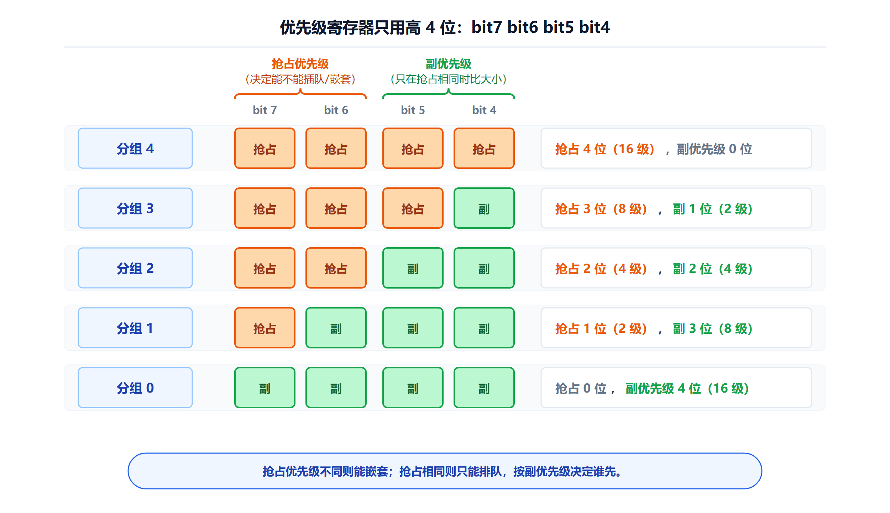

*分组号就是抢占优先级的位数；剩余位数给副优先级，加起来总是 4 位。*

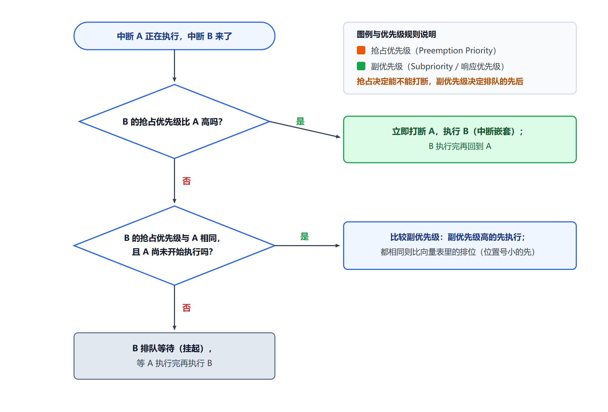

*先比抢占级（能否嵌套），再比副级（谁先排队），最后按向量表顺序。*

#### 7.1.7 PPT 的例子（必会，考试常出这种题）

| 中断 | 抢占式优先级 | 副优先级 | 到达情况 | 处理结论 |
|---|---|---|---|---|
| **EXTI0** | 0 | 1 | **正在执行** | 当前中断 |
| **USART1** | 1 | 0 | 随后到达 | **不能打断 EXTI0**，因抢占式优先级较低 |
| **TIM2** | 0 | 0 | 同时等待 | **不能嵌套 EXTI0**；若一起等待，**副优先级更高，先于 EXTI0 响应** |

**逐条解读**：

```
① USART1（抢占1）vs EXTI0（抢占0）
   抢占数值：EXTI0 = 0 < USART1 = 1
   → EXTI0 优先级更高 → USART1 不能打断 EXTI0

② TIM2（抢占0、副0）vs EXTI0（抢占0、副1）
   抢占相同（都是 0）→ 不能嵌套
   副优先级：TIM2 = 0 < EXTI0 = 1 → TIM2 更高
   → 若同时挂起，TIM2 先响应
```

> **注意最后一句**："**副优先级更高，先于 EXTI0 响应**"——但**前提是"一起等待"**。
> 如果 EXTI0 已经在执行了，TIM2 抢占级相同，**打不断它**，必须等 EXTI0 结束。

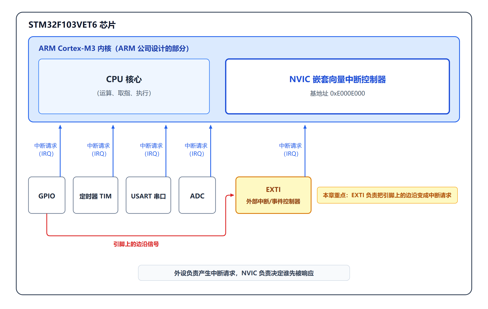

*外设负责产生请求，NVIC 负责调度，CPU 负责执行——三者分工明确。*

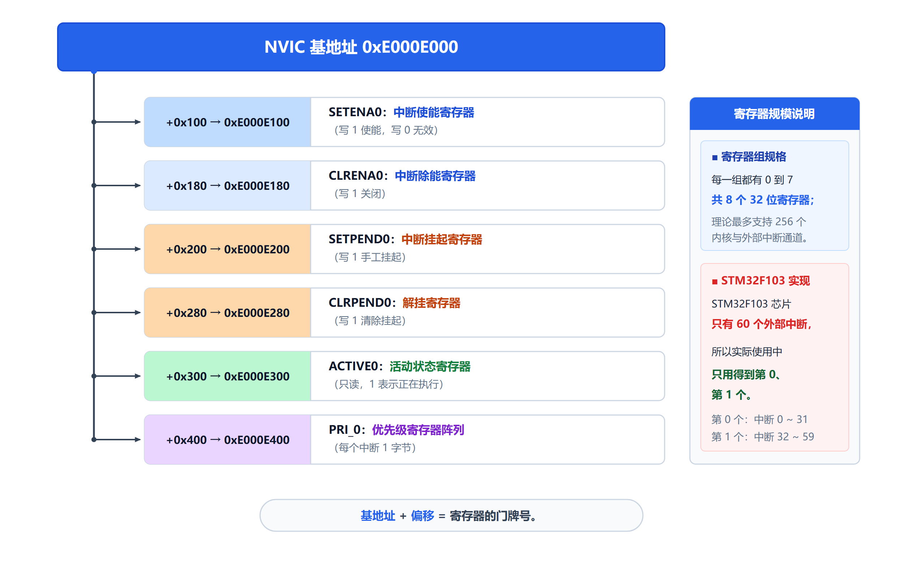

*基地址 `0xE000E000` + 偏移 = 各个寄存器的门牌号。*

---

### 7.2 外部中断/事件控制器 EXTI ★★★ 【PPT 重点：陈 p10～p21 / 梁 p11～p27】

#### 7.2.1 EXTI 是什么

> **外部中断/事件控制器（EXTI）由 20 个产生事件/中断请求的边沿检测器组成。**
> 每个输入线都可以**独立配置输入类型和触发事件**。

**EXTI 的主要特性（4 条）**：

| # | 特性 |
|---|---|
| 1 | **每个中断/事件都有独立的触发和屏蔽** |
| 2 | **每个中断线都有专用的状态位** |
| 3 | **支持多达 20 个软件中断/事件请求** |
| 4 | **能够检测脉冲宽度低于 APB2 时钟宽度的外部信号** |

> **第 4 条很实用**：即使引脚上的脉冲非常短（短到只有一个 APB2 时钟周期那么宽），EXTI 也能检测到。

**EXTI 的位置**：

```
输入线 0~19 ──→ 边沿检测 ──┬──→ 中断请求 ──→ 至 NVIC
                            └──→ 事件脉冲 ──→ 至功能模块
```

> **中断**：产生请求信号给 NVIC，**要进 CPU 中断服务函数**。
> **事件**：产生脉冲信号**直接送到外设**（如定时器、ADC），**可以不经过 CPU，硬件自己触发外设动作**。

#### 7.2.2 EXTI 的内部结构（框图怎么看）

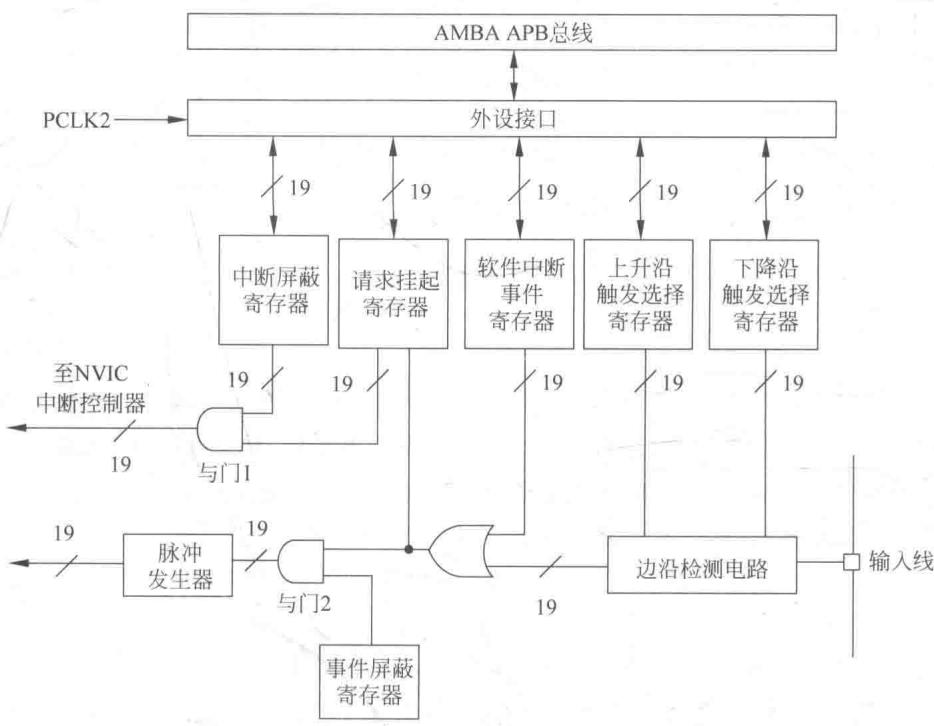

> **看图的关键：这张图是"右进左出"的**——`输入线` 在最右边，`至 NVIC` 和 `脉冲发生器` 在最左边。
> 所以**要从右往左看**，才是信号经过的先后顺序。

**EXTI 由以下几部分构成**：

| 部分 | 作用 |
|---|---|
| **边沿检测电路** | 判断信号有没有发生"跳变" |
| **（或门）** | 把"外部边沿"和"软件触发"合起来 |
| **请求挂起寄存器 PR** | 记住"有请求来了"（**只有中断支路经过它**） |
| **中断屏蔽寄存器 IMR** | 决定请求能不能送到 NVIC |
| **事件屏蔽寄存器 EMR** | 决定请求能不能产生事件脉冲 |
| **软件中断/事件寄存器 SWIER** | 让软件可以"假装"引脚上来了一个边沿 |
| **上升沿触发选择寄存器 RTSR** | 决定"上升沿算不算触发" |
| **下降沿触发选择寄存器 FTSR** | 决定"下降沿算不算触发" |
| **脉冲发生器** | 把一个"跳变"整形成"一个干净的脉冲" |

**两个与门是关键**：

```
【与门 1】请求挂起 PR 的输出 ──┐
                              ├──→ 至 NVIC
         中断屏蔽 IMR 的输出 ──┘
含义：有请求【并且】中断没被屏蔽 → 才向 NVIC 发中断请求

【与门 2】（或门输出）────────┐
                              ├──→ 脉冲发生器 ──→ 事件脉冲
         事件屏蔽 EMR 的输出 ──┘
含义：有请求【并且】事件没被屏蔽 → 才产生事件脉冲
```

**【先补前置知识：与门 / 或门】**

> - **与门（AND）**：两个输入**都为 1**，输出才是 1。= **两个开关串联**，必须都合上才通电。
> - **或门（OR）**：两个输入**只要有一个是 1**，输出就是 1。= **两个开关并联**，合上任一个就通电。

> **图上的"斜线 + 20"**：这是工程图纸惯例，表示"**这是一束线，一共有 20 根**"。
> 图里画的是其中一套，实际芯片里是 20 套并排。

#### 7.2.3 中断路径 vs 事件路径（本章的核心）

**【① 中断路径】**

```
外部信号进入芯片引脚
    ↓
边沿检测电路
    ↓
请求挂起寄存器 PR   ← 检测到配置的边沿，对应位被硬件置 1
    ↓
中断屏蔽 IMR        ← IMR 对应位为 1，请求才能通过与门
    ↓
NVIC 响应
    ↓
CPU 跳进中断服务程序
```

**关键控制项**：

| 控制什么 | 用哪个寄存器 |
|---|---|
| **触发边沿** | **RTSR / FTSR** |
| **中断屏蔽** | **IMR** |
| **挂起状态** | **PR** |

**【② 事件路径】**

```
外部信号
    ↓
边沿检测
    ↓
事件屏蔽 EMR        ← EMR 对应位为 1，事件才能通过
    ↓
脉冲发生器          ← 把一个跳变信号转换为【单脉冲】
    ↓
其他功能模块（定时器、ADC 等）
```

> **事件信号不进入 NVIC，不跳转到中断服务程序。**

**【③ 中断与事件的区别（必背）】**

| 类型 | 信号去向 | 是否进入 NVIC | 是否执行 ISR |
|---|---|---|---|
| **中断** | **CPU / NVIC** | **是** | **是** |
| **事件** | **其他功能模块** | **否** | **否** |

| 概念 | 含义 |
|---|---|
| **事件** | **表示检测到有触发事件发生。事件本质上是一个触发信号**，可用于触发特定外设模块或芯片本身的操作 |
| **中断** | **表示某个事件发生并产生中断，程序跳转到对应中断处理程序中** |

> **PPT 的两句话总结**：
> - **从外部激励信号看，中断和事件没有分别，只是在芯片内部一分为二。**
> - **中断：改变 CPU 执行流；事件：输出触发脉冲。**

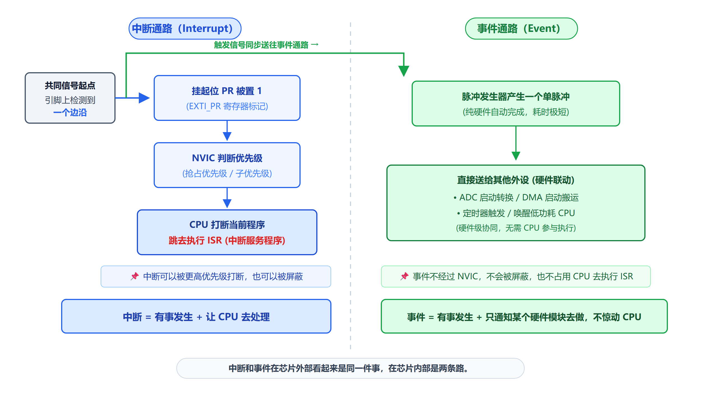

*同一条输入线，在芯片内部"一分为二"：一条经过 PR 进 NVIC，一条只输出脉冲给外设。*

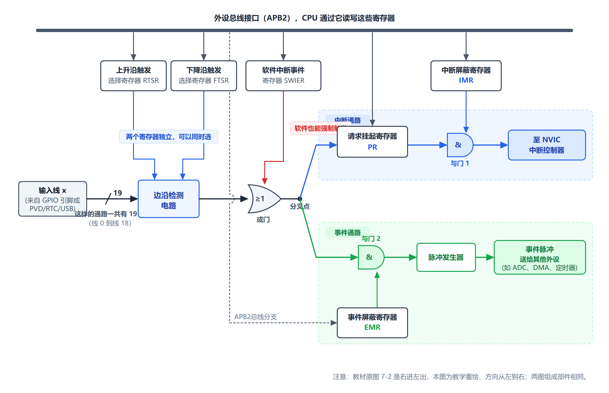

*右进左出：输入线 → 边沿检测 → 与门 → 挂起/屏蔽 → NVIC 或脉冲发生器。*

#### 7.2.4 中断和事件的管理

**【① 硬件中断选择】**

**配置顺序（PPT 原文）**：

```
配置中断屏蔽位        EXTI_IMR
        ↓
配置触发边沿选择位    EXTI_RTSR / EXTI_FTSR
        ↓
配置 NVIC 通道使能和屏蔽位
        ↓
产生中断请求
```

**边沿选择规则**：

> - 若选择**上升沿触发**，则配置 **EXTI_RTSR**；
> - 若选择**下降沿触发**，则配置 **EXTI_FTSR**；
> - **如果同一中断线上同时配置上升沿和下降沿，则任一边沿都可触发中断。**

> **梁版 PPT 的一句话**：**硬件中断 = 触发边沿 + IMR 允许 + NVIC 允许，缺一不可。**

**【② 硬件事件与软件请求】**

**硬件事件选择**：

> - 配置 20 个事件线的屏蔽位 **`EXTI_EMR`**；
> - 配置事件线触发边沿选择位 **`EXTI_RTSR`** 和 **`EXTI_FTSR`**。

**软件中断/事件选择**：

> - 20 条线路均可配置成软件中断/事件线；
> - **先配置 `EXTI_IMR` 和 `EXTI_EMR`**；
> - **再设置软件中断事件寄存器 `EXTI_SWIER` 的请求位**。

```
EXTI_SWIER 写 1
    ↓
置位 PR 挂起位
    ↓
若 IMR 允许 → 产生中断请求
若 EMR 允许 → 产生一个事件脉冲
```

> **软件触发常用于调试，或在程序内部主动产生一次中断/事件请求。**

**【③ 外部中断/事件线映像（必考）】**

> **80 个通用 I/O 可以通过映射方式连接到 16 个外部中断/事件线上。**
> **PAx、PBx、PCx、PDx、PEx 端口的第 x 位对应同一个 EXTIx。**

```
PA0 ┐
PB0 │
PC0 ├─→ AFIO_EXTICR 选择一路 ──→ EXTI0
PD0 │
PE0 ┘

PA1 ┐
PB1 ├─→ AFIO_EXTICR 选择一路 ──→ EXTI1
…   ┘

…
PA15 ┐
PB15 ├─→ AFIO_EXTICR 选择一路 ──→ EXTI15
…    ┘
```

> **【易错】同一时刻每条 EXTI 线只能选一路引脚。**
> 也就是说：**PA0 和 PB0 不能同时都接到 EXTI0**——用了一个，另一个就不能用。

> **【必须做】通过 `AFIO_EXTICRx` 配置 GPIO 线上的外部中断/事件，必须先使能 AFIO 时钟**
> （`RCC_APB2ENR` 的 **bit0**）。

**另外 4 个 EXTI 的连接（不是 GPIO）**：

| EXTI 线 | 连接什么 |
|---|---|
| **EXTI16** | **PVD 输出**（可编程电压检测） |
| **EXTI17** | **RTC 闹钟事件** |
| **EXTI18** | **USB 唤醒事件** |
| **EXTI19** | **以太网唤醒事件** |

**AFIO_EXTICR 的分配（梁版 PPT 给出）**：

| 寄存器 | 控制哪些线 | 每 4 位对应一条 |
|---|---|---|
| **AFIO_EXTICR1** | **EXTI0 ~ EXTI3** | bit[3:0] → EXTI0，bit[7:4] → EXTI1，bit[11:8] → EXTI2，bit[15:12] → EXTI3 |
| AFIO_EXTICR2 | EXTI4 ~ EXTI7 | 同上规律 |
| AFIO_EXTICR3 | EXTI8 ~ EXTI11 | 同上规律 |
| AFIO_EXTICR4 | EXTI12 ~ EXTI15 | 同上规律 |

**4 位编码对应的端口（必背）**：

```
0000 → PA
0001 → PB
0010 → PC
0011 → PD
0100 → PE
0101 → PF
0110 → PG
```

> **记忆方法**：**编码值就是端口的字母顺序号**（A=0、B=1、C=2……）。

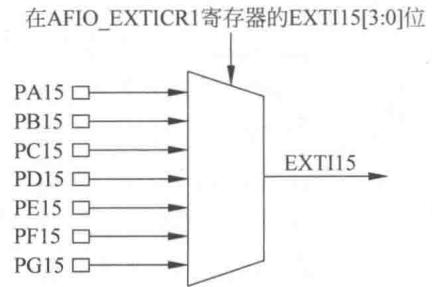

*80 个 GPIO 通过 AFIO_EXTICR 的多路选择器，每个线号只能选一路。*

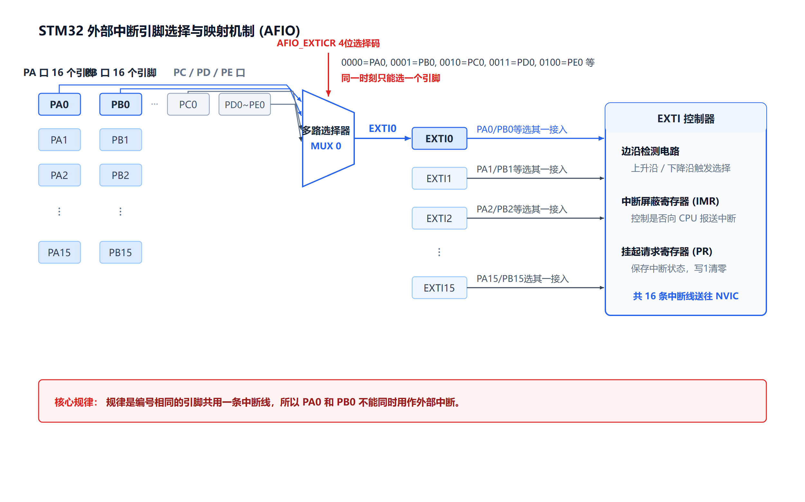

*PA0/PB0/PC0/PD0/PE0 都指向 EXTI0，但同一时刻只能选一个。*

---

### 7.3 EXTI 相关寄存器 ★★★ 【PPT 重点：陈 p18～p21 / 梁 p23～p27】

#### 7.3.1 总表（必须背下来）

> **所有 EXTI 寄存器必须以字（32 位）的方式操作；EXTI 寄存器首地址为 `0x4001_0400`。**

| 寄存器 | 偏移地址 | 复位值 | 作用 |
|---|---|---|---|
| **EXTI_IMR** | **`0x00`** | `0x0000_0000` | **中断屏蔽寄存器** |
| **EXTI_EMR** | **`0x04`** | `0x0000_0000` | **事件屏蔽寄存器** |
| **EXTI_RTSR** | **`0x08`** | `0x0000_0000` | **上升沿触发选择寄存器** |
| **EXTI_FTSR** | **`0x0C`** | `0x0000_0000` | **下降沿触发选择寄存器** |
| **EXTI_SWIER** | **`0x10`** | `0x0000_0000` | **软件中断/事件寄存器** |
| **EXTI_PR** | **`0x14`** | `0x0000_0000` | **挂起寄存器（写 1 清除）** |

> **其中，位 19~0 分别对应 EXTI 线 19~0；线 x 的配置通常写成 MRx、TRx、SWIERx、PRx。**

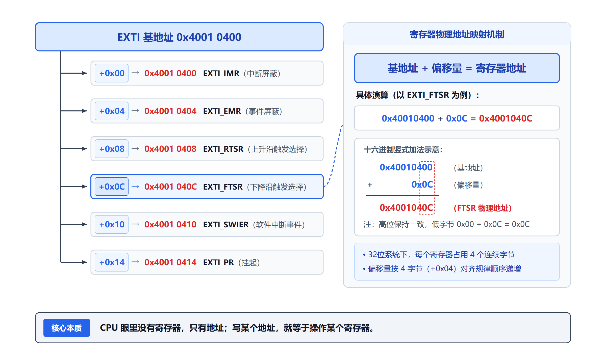

*基地址 `0x40010400` + 偏移 = 各个寄存器的门牌号。*

**地址演算**：

```
EXTI_IMR  = 0x40010400 + 0x00 = 0x40010400
EXTI_EMR  = 0x40010400 + 0x04 = 0x40010404
EXTI_RTSR = 0x40010400 + 0x08 = 0x40010408
EXTI_FTSR = 0x40010400 + 0x0C = 0x4001040C
EXTI_SWIER= 0x40010400 + 0x10 = 0x40010410
EXTI_PR   = 0x40010400 + 0x14 = 0x40010414
```

#### 7.3.2 六个寄存器的位含义（逐条）

**【① EXTI_IMR（中断屏蔽）与 ② EXTI_EMR（事件屏蔽）】**

| 寄存器 | 位[19:0] | **写 0 的含义** | **写 1 的含义** |
|---|---|---|---|
| **EXTI_IMR** | **MRx** | **屏蔽**来自线 x 的**中断请求** | **开放**来自线 x 的**中断请求** |
| **EXTI_EMR** | **MRx** | **屏蔽**来自线 x 的**事件请求** | **开放**来自线 x 的**事件请求** |

**位图（两个寄存器结构完全一样）**：

```
 31                    20 19   18   17   16
+------------------------+----+----+----+----+
|         保留            |MR19|MR18|MR17|MR16|
+------------------------+----+----+----+----+
 15   14   13   12   11   10    9    8    7    6    5    4    3    2    1    0
+----+----+----+----+----+----+----+----+----+----+----+----+----+----+----+----+
|MR15|MR14|MR13|MR12|MR11|MR10|MR9 |MR8 |MR7 |MR6 |MR5 |MR4 |MR3 |MR2 |MR1 |MR0 |
+----+----+----+----+----+----+----+----+----+----+----+----+----+----+----+----+
  ↑                                                                         ↑
 线15                                                                      线0
```

> **PPT 的强调**：
> - **IMR 控制中断请求是否送往中断路径。**
> - **EMR 控制事件请求是否送往事件路径。**
> - **屏蔽位只决定请求能否继续传输，不决定触发边沿。**
> - **中断和事件可以独立使能，也可同时使能。**

**【③ EXTI_RTSR（上升沿）与 ④ EXTI_FTSR（下降沿）】**

| 寄存器 | 位[19:0] | **写 0 的含义** | **写 1 的含义** |
|---|---|---|---|
| **EXTI_RTSR** | **TRx** | **禁止**输入线 x **上升沿触发** | **允许**输入线 x **上升沿触发** |
| **EXTI_FTSR** | **TRx** | **禁止**输入线 x **下降沿触发** | **允许**输入线 x **下降沿触发** |

> **在同一中断线上，可以同时设置上升沿和下降沿触发，任一边沿都可触发中断。**

**三种触发方式**：

```
只配 RTSR → 上升沿触发
只配 FTSR → 下降沿触发
两个都配 → 双边沿触发
```

**【⑤ EXTI_SWIER（软件中断/事件）与 ⑥ EXTI_PR（挂起）】**

| 寄存器 | 位[19:0] | 功能 |
|---|---|---|
| **EXTI_SWIER** | **SWIERx** | **当该位为 0 时，写 1**，若 IMR/EMR 允许，则产生中断/事件 |
| **EXTI_PR** | **PRx** | **0：没有发生中断请求；1：发生了选择的中断请求。向该位写 1 可以清除挂起位** |

> **【必背】中断服务程序结束前必须清除 PR 挂起位，否则会不断进入中断。**

```c
EXTI->SWIER |= (1 << 0);    // 软件触发 EXTI0
EXTI->PR    =  (1 << 0);    // 清除 EXTI0 挂起位（写 1 清除！）
```

> **【易错】PR 是"写 1 清除"**，不是"写 0 清除"。
> 所以清除语句是 `EXTI->PR = (1 << 0)`，**不是** `EXTI->PR &= ~(1 << 0)`。

#### 7.3.3 EXTI 的结构体（库里的定义）

```c
typedef struct
{
  __IO uint32_t IMR;   /* 0x00 中断屏蔽寄存器 */
  __IO uint32_t EMR;   /* 0x04 事件屏蔽寄存器 */
  __IO uint32_t RTSR;  /* 0x08 上升沿触发选择 */
  __IO uint32_t FTSR;  /* 0x0C 下降沿触发选择 */
  __IO uint32_t SWIER; /* 0x10 软件中断事件寄存器 */
  __IO uint32_t PR;    /* 0x14 挂起寄存器 */
} EXTI_TypeDef;

#define EXTI_BASE   (APB2PERIPH_BASE + 0x0400)   /* = 0x40010400 */
#define EXTI        ((EXTI_TypeDef *) EXTI_BASE)
```

> **梁版 PPT 的对应关系**：`EXTI->PR` 就是 `*(volatile uint32_t*)0x4001_0414`。

---

### 7.4 外部中断的使用 ★★★ 【PPT 重点：陈 p22～p39 / 梁 p28～p50】

#### 7.4.1 五个步骤（必背）

> **外部中断的应用编程，可以参考下面的步骤：**

| 步骤 | 内容 |
|---|---|
| **1** | **系统初始化**（如系统时钟） |
| **2** | **GPIO 配置**——**打开 GPIO 和 AFIO 时钟** |
| **3** | **EXTI 配置**——**选择中断引脚** |
| **4** | **NVIC 配置**——**使能通道并设优先级** |
| **5** | **等待中断**——**ISR 中处理中断** |

**PPT 对每一步的说明**：

> **1、系统初始化**：如前所述，在 STM32 的启动文件中已经调用 `SystemInit()` 函数，对系统时钟进行了设置，
> 并且默认系统时钟频率就是 **72MHz**，因此，**这一步可以省略**。
>
> **2、GPIO 配置**：**务必注意打开 GPIO 时钟时，并打开 AFIO 时钟。**
>
> **3、EXTI 配置**：配置需要选择哪个引脚作为中断引脚。
>
> **4、NVIC 配置**：**必须把 NVIC 中对应的通道使能，并且设置优先级别。**
>
> **5、进入循环等待中断发生**，并在中断程序中写入中断发生时应如何处理。

> **梁版 PPT 的主线（背这一句）**：
> **开时钟 → 映射引脚 → 选边沿 → 开屏蔽 → 清挂起**

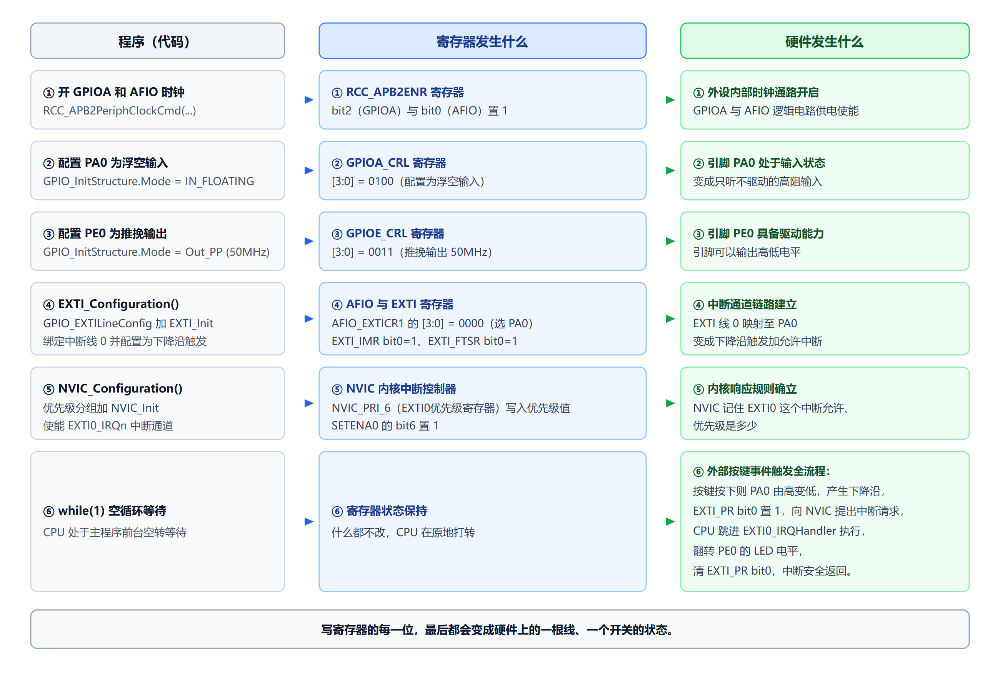

*从按键到 LED 翻转的完整链路：GPIOA 输入 → AFIO 映射 → EXTI 边沿 → NVIC → ISR 翻转 LED。*

#### 7.4.2 NVIC 相关的固件库函数

**【（1）`NVIC_PriorityGroupConfig()`】**

```c
void NVIC_PriorityGroupConfig(u32 NVIC_PriorityGroup);
```

> **函数功能：设置优先级分组。优先级分组只能设置一次。**

| 参数值 | 抢占优先级 | 副优先级 |
|---|---|---|
| `NVIC_PriorityGroup_0` | **0 位** | **4 位** |
| `NVIC_PriorityGroup_1` | **1 位** | **3 位** |
| `NVIC_PriorityGroup_2` | **2 位** | **2 位** |
| `NVIC_PriorityGroup_3` | **3 位** | **1 位** |
| `NVIC_PriorityGroup_4` | **4 位** | **0 位** |

```c
NVIC_PriorityGroupConfig(NVIC_PriorityGroup_1);   // 设置抢占优先级 1 位、副优先级 3 位
```

**梁版 PPT 给了这个函数的内部实现**：

```c
void NVIC_PriorityGroupConfig(uint32_t NVIC_PriorityGroup)
{
  assert_param(IS_NVIC_PRIORITY_GROUP(NVIC_PriorityGroup));
  /* Set the PRIGROUP[10:8] bits according to NVIC_PriorityGroup value */
  SCB->AIRCR = AIRCR_VECTKEY_MASK | NVIC_PriorityGroup;
}
```

> **看出来了吗**：**这个函数干的事就是"往 AIRCR 的 PRIGROUP 位段写值，并且带上 VECTKEY"**。
> `AIRCR_VECTKEY_MASK` 就是那个 `0x5FA << 16`。

**【（2）`NVIC_Init()` 与 `NVIC_InitTypeDef`】**

```c
void NVIC_Init(NVIC_InitTypeDef * NVIC_InitStruct);
```

> 函数功能：根据 `NVIC_InitStruct` 中指定的参数初始化外设 NVIC 寄存器。

```c
typedef struct
{
    uint8_t  NVIC_IRQChannel;                    // 选择需要使能/禁止的 IRQ 通道
    uint8_t  NVIC_IRQChannelPreemptionPriority;  // 设置抢占式优先级
    uint8_t  NVIC_IRQChannelSubPriority;         // 设置副优先级
    FunctionalState NVIC_IRQChannelCmd;          // ENABLE 或 DISABLE
} NVIC_InitTypeDef;
```

> **【理解重点】梁版 PPT 的洞察**：
> **`NVIC_Init` 最终只是把参数写进 NVIC 的寄存器——本质仍是寄存器操作。**
>
> 它的内部实现大致是：
> ```c
> tmppriority = (0x700 - ((SCB->AIRCR) & 0x700)) >> 0x08;   // 算抢占位数
> tmppre = (0x4 - tmppriority);                              // 算子优先级位数
> tmpsub = 0x0F >> tmppriority;                              // 子优先级的掩码
> tmppriority = (抢占值 << tmppre) | (子优先级值 & tmpsub);
> tmppriority = tmppriority << 0x04;                          // 放到高 4 位
> NVIC->IP[NVIC_InitStruct->NVIC_IRQChannel] = tmppriority;
> NVIC->ISER[NVIC_InitStruct->NVIC_IRQChannel >> 0x05] = ...;  // 使能
> ```
> **这就是"库函数到底做了什么"的答案**——它替你把两个优先级数拼成 8 位，写进 `IP` 寄存器，再使能 `ISER`。

**【（3）`NVIC_IRQChannel` 的取值（必背常用）】**

| 通道值 | 描述 |
|---|---|
| **`EXTI0_IRQn`** | 外部中断线 0 中断 |
| **`EXTI1_IRQn`** | 外部中断线 1 中断 |
| **`EXTI2_IRQn`** | 外部中断线 2 中断 |
| **`EXTI3_IRQn`** | 外部中断线 3 中断 |
| **`EXTI4_IRQn`** | 外部中断线 4 中断 |
| **`EXTI9_5_IRQn`** | **外部中断线 9~5 中断**（共用） |
| **`EXTI15_10_IRQn`** | **外部中断线 15~10 中断**（共用） |

**其他典型通道**：

| 通道值 | 描述 |
|---|---|
| `USART1_IRQn` / `USART2_IRQn` / `USART3_IRQn` | USART 全局中断 |
| `TIM2_IRQn` / `TIM3_IRQn` / `TIM4_IRQn` | 定时器全局中断 |
| `DMA1_Channel1_IRQn` 等 | DMA 通道中断 |
| `ADC1_2_IRQn` | ADC1 和 ADC2 全局中断 |
| `RCC_IRQn` / `FLASH_IRQn` | 系统外设中断 |

> **【必记】`EXTI9_5_IRQn` 和 `EXTI15_10_IRQn` 是"合用通道"**——
> 9~5 号线的中断共用一个 ISR，15~10 号线共用一个。
> **进 ISR 后要用 `EXTI_GetITStatus()` 再判断具体是哪一条线。**

**【（4）优先级参数的取值范围（必背，容易填错）】**

| 分组 | 抢占优先级可取值 | 副优先级可取值 |
|---|---|---|
| `NVIC_PriorityGroup_0` | **只能填 0** | **0~15** |
| `NVIC_PriorityGroup_1` | **0~1** | **0~7** |
| `NVIC_PriorityGroup_2` | **0~3** | **0~3** |
| `NVIC_PriorityGroup_3` | **0~7** | **0~1** |
| `NVIC_PriorityGroup_4` | **0~15** | **只能填 0** |

> **PPT 的提醒**：**若选择 Group_0，则 `PreemptionPriority` 参数对中断通道设置不产生影响**；
> **若选择 Group_4，则 `SubPriority` 参数对中断通道设置不产生影响。**
>
> **超出范围的取值会被截断：先确认分组，再填优先级。**

**【（5）NVIC 的三个寄存器（梁版 PPT 的重点）】**

| 寄存器 | 作用 | 访问方式 |
|---|---|---|
| **`NVIC->ISER[m]`** | **中断使能置位** | **写 1 = 使能**，写 0 无动作 |
| **`NVIC->ICER[m]`** | **中断除能** | **写 1 = 禁止**，写 0 无动作 |
| **`NVIC->IP[IRQn]`** | **优先级**（一个中断一个字节） | **只用高 4 位**，低 4 位读 0 |

**位对应关系**：

```
ISER[m] 的 bit n  ↔  IRQ 号 = 32m + n

例：TIM4_IRQn = 30
    m = 30 >> 5 = 0，n = 30 & 0x1F = 30
    NVIC_ISER[0] = 1u << 30;   /* 使能 TIM4 中断 */
    NVIC_IP[30] = 0x40;        /* 优先级 4（0x40 = 0100 0000，高 4 位 = 4）*/
```

> **F10x 最多 68 个 IRQ → 用 ISER[0]~[2] 就够了。**

#### 7.4.3 EXTI 相关的固件库函数

**【（1）`EXTI_Init()` 与 `EXTI_InitTypeDef`】**

```c
void EXTI_Init(EXTI_InitTypeDef * EXTI_InitStruct);
```

> 函数功能：根据 `EXTI_InitStruct` 中指定的参数初始化外设 EXTI 寄存器。

```c
typedef struct
{
    uint32_t            EXTI_Line;     // 选择需要使能或禁止的外部线路
    EXTIMode_TypeDef    EXTI_Mode;     // 设置线路为事件请求或中断请求
    EXTITrigger_TypeDef EXTI_Trigger;  // 设置触发边沿
    FunctionalState     EXTI_LineCmd;  // ENABLE 或 DISABLE
} EXTI_InitTypeDef;
```

**参数取值（必背）**：

| 参数 | 可取值 | 说明 |
|---|---|---|
| **`EXTI_Line`** | `EXTI_Line0` ~ `EXTI_Line19` | 选择外部中断/事件线 |
| **`EXTI_Mode`** | **`EXTI_Mode_Interrupt`** | **设为中断请求** |
| | **`EXTI_Mode_Event`** | **设为事件请求** |
| **`EXTI_Trigger`** | `EXTI_Trigger_Falling` | **下降沿**触发 |
| | `EXTI_Trigger_Rising` | **上升沿**触发 |
| | `EXTI_Trigger_Rising_Falling` | **双边沿**触发 |
| **`EXTI_LineCmd`** | `ENABLE` / `DISABLE` | 使能或禁止 |

```c
EXTI_InitTypeDef EXTI_InitStructure;
EXTI_InitStructure.EXTI_Line    = EXTI_Line0;
EXTI_InitStructure.EXTI_Mode    = EXTI_Mode_Interrupt;
EXTI_InitStructure.EXTI_Trigger = EXTI_Trigger_Falling;
EXTI_InitStructure.EXTI_LineCmd = ENABLE;
EXTI_Init(&EXTI_InitStructure);
```

> **梁版 PPT 的提醒**：**`EXTI_Mode` 选 `Event` 时请求不进 NVIC，只输出脉冲。**

**【（2）三个常用辅助函数】**

| 函数 | 作用 | 示例 |
|---|---|---|
| **`EXTI_GetITStatus()`** | **检查指定 EXTI 线路触发请求是否发生** | `EXTI_GetITStatus(EXTI_Line0)` |
| **`EXTI_ClearITPendingBit()`** | **清除 EXTI 线路中断挂起位** | `EXTI_ClearITPendingBit(EXTI_Line0)` |
| **`GPIO_EXTILineConfig()`** | **选择 GPIO 引脚用作外部中断线路**（写 AFIO_EXTICR） | `GPIO_EXTILineConfig(GPIO_PortSourceGPIOA, GPIO_PinSource0)` |

**典型用法**：

```c
if (EXTI_GetITStatus(EXTI_Line0) != RESET)
{
    // 处理中断
    EXTI_ClearITPendingBit(EXTI_Line0);
}
```

> **`EXTI_ClearITPendingBit()` 内部做的事就是**：`EXTI->PR = EXTI_Line;`（**写 1 清除**）。

**梁版 PPT 给出了 `GPIO_EXTILineConfig` 的完整源码**：

```c
void GPIO_EXTILineConfig(uint8_t GPIO_PortSource, uint8_t GPIO_PinSource)
{
    uint32_t tmp = 0x00;
    tmp = ((uint32_t)0x0F) << (0x04 * (GPIO_PinSource & (uint8_t)0x03));
    AFIO->EXTICR[GPIO_PinSource >> 0x02] &= ~tmp;              // 清除旧配置
    AFIO->EXTICR[GPIO_PinSource >> 0x02] |=
        (((uint32_t)GPIO_PortSource) << (0x04 * (GPIO_PinSource & (uint8_t)0x03)));
}
```

> **这段代码的信息量很大**：
> - `GPIO_PinSource >> 2` → **选哪个 EXTICR**（0~3 号 pin → EXTICR1，4~7 → EXTICR2……）；
> - `GPIO_PinSource & 0x03` → **在这个 EXTICR 里是第几组**（每组 4 位）；
> - `0x04 * (…)` → **左移多少位**；
> - **先 `&= ~tmp` 清旧值，再 `|=` 写新值**——典型的"先清后置"。

#### 7.4.4 完整例子：按键中断翻转 LED（例 7-1）

**任务**：利用连接最小系统板上 **PA0** 的按钮，每按一次按钮，连接 **PE0** 的发光二极管亮灭状态翻转一次。采用外部中断方法实现。

**信号链**：

```
PA0 按键 → GPIOA 输入（浮空输入）→ AFIO 映射 PA0→EXTI0
        → EXTI0 下降沿中断 → NVIC EXTI0_IRQn → ISR 翻转 PE0 LED
```

**程序组成（4 个部分）**：

| 部分 | 作用 |
|---|---|
| `main()` | 配置 GPIOA、GPIOE、EXTI 和 NVIC，并进入 `while(1)` 等待中断 |
| `NVIC_Configuration()` | 设置优先级分组、EXTI0 通道、抢占式优先级和副优先级 |
| `EXTI_Configuration()` | 将 PA0 映射到 `EXTI_Line0`，设置为下降沿中断 |
| `EXTI0_IRQHandler()` | 判断中断状态，翻转 PE0 输出，并清除中断挂起位 |

**① main 里的初始化**：

```c
GPIO_InitTypeDef GPIO_InitStructure;

/* 打开 GPIOA、GPIOE 与 AFIO 时钟 —— 注意 AFIO！ */
RCC_APB2PeriphClockCmd(RCC_APB2Periph_GPIOA |
                       RCC_APB2Periph_AFIO  |
                       RCC_APB2Periph_GPIOE, ENABLE);

/* PA0 配置为浮空输入，连接按键 */
GPIO_InitStructure.GPIO_Pin  = GPIO_Pin_0;
GPIO_InitStructure.GPIO_Mode = GPIO_Mode_IN_FLOATING;
GPIO_Init(GPIOA, &GPIO_InitStructure);

/* PE0 配置为推挽输出，控制 LED */
GPIO_InitStructure.GPIO_Pin   = GPIO_Pin_0;
GPIO_InitStructure.GPIO_Speed = GPIO_Speed_50MHz;
GPIO_InitStructure.GPIO_Mode  = GPIO_Mode_Out_PP;
GPIO_Init(GPIOE, &GPIO_InitStructure);

EXTI_Configuration();
NVIC_Configuration();
while (1);
```

> **梁版 PPT 的提示**：
> - **AFIO 时钟与 GPIO 时钟一起打开**；
> - **按键脚配浮空输入**（输入模式不需要 Speed）；
> - **LED 脚配推挽输出**（输出模式才需要 Speed）。

**② NVIC 配置**：

```c
void NVIC_Configuration(void)
{
    NVIC_InitTypeDef NVIC_InitStructure;
    NVIC_PriorityGroupConfig(NVIC_PriorityGroup_1);   // 分组 1：1 位抢占 + 3 位副
    NVIC_InitStructure.NVIC_IRQChannel                   = EXTI0_IRQn;
    NVIC_InitStructure.NVIC_IRQChannelPreemptionPriority = 0;
    NVIC_InitStructure.NVIC_IRQChannelSubPriority        = 2;
    NVIC_InitStructure.NVIC_IRQChannelCmd                = ENABLE;
    NVIC_Init(&NVIC_InitStructure);
}
```

**③ EXTI 配置**：

```c
void EXTI_Configuration(void)
{
    EXTI_InitTypeDef EXTI_InitStructure;
    GPIO_EXTILineConfig(GPIO_PortSourceGPIOA, GPIO_PinSource0);   // PA0 → EXTI0
    EXTI_InitStructure.EXTI_Line    = EXTI_Line0;
    EXTI_InitStructure.EXTI_Mode    = EXTI_Mode_Interrupt;
    EXTI_InitStructure.EXTI_Trigger = EXTI_Trigger_Falling;       // 下降沿
    EXTI_InitStructure.EXTI_LineCmd = ENABLE;
    EXTI_Init(&EXTI_InitStructure);
}
```

**④ 中断服务函数（必背结构）**：

```c
void EXTI0_IRQHandler(void)
{
    if (EXTI_GetITStatus(EXTI_Line0) != RESET)
    {
        GPIO_WriteBit(GPIOE, GPIO_Pin_0,
            (BitAction)(1 - GPIO_ReadOutputDataBit(GPIOE, GPIO_Pin_0)));   // 翻转
        EXTI_ClearITPendingBit(EXTI_Line0);                                // 清挂起
    }
}
```

> **PPT 的代码解读**：
> - **先判断 `EXTI_Line0` 的中断状态是否真的发生**；
> - **读取 PE0 当前输出状态，并取反后写回，实现 LED 状态翻转**；
> - **最后调用 `EXTI_ClearITPendingBit()` 清除 `EXTI_Line0` 挂起位**；
> - **如果不清除挂起位，程序会不断重新进入该中断服务函数。**
>
> **梁版 PPT 的强制要求**：**函数名必须与启动文件向量表一致：`EXTI0_IRQHandler`。**

#### 7.4.5 寄存器版（同一个例子，直接操作寄存器）

**这一步很重要**——它体现"库函数只是包装"。

**初始化**：

```c
void EXTI0_RegInit(void)
{
    /* 1. 使能 GPIOA、GPIOE、AFIO 时钟 */
    RCC->APB2ENR |= (1<<2) | (1<<6) | (1<<0);

    /* 2. PA0 配置为浮空输入：CNF0=01，MODE0=00 → 0x4 */
    GPIOA->CRL &= ~(0xF << 0);
    GPIOA->CRL |=  (0x4 << 0);

    /* 3. PE0 配置为推挽输出 50MHz：CNF0=00，MODE0=11 → 0x3 */
    GPIOE->CRL &= ~(0xF << 0);
    GPIOE->CRL |=  (0x3 << 0);

    /* 4. AFIO_EXTICR1[3:0]=0000，选择 PA0 映射到 EXTI0 */
    AFIO->EXTICR[0] &= ~(0xF << 0);

    /* 5. EXTI0：允许中断，下降沿触发，禁止上升沿 */
    EXTI->IMR  |=  (1 << 0);
    EXTI->FTSR |=  (1 << 0);
    EXTI->RTSR &= ~(1 << 0);

    /* 6. NVIC 使能 EXTI0 中断通道 */
    NVIC->ISER[0] = (1 << 6);      // EXTI0 是 IRQ6
}
```

> **【必记】`EXTI0` 的 IRQ 号是 6**，所以 `NVIC->ISER[0]` 的 **bit6**。
> 梁版 PPT 在寄存器版里写的正是 `NVIC->ISER[0] = (1 << 6);`，
> 也可以用 `NVIC_EnableIRQ(EXTI0_IRQn);`。

**中断服务函数**：

```c
void EXTI0_IRQHandler(void)
{
    if (EXTI->PR & (1 << 0))          // PA0 触发？
    {
        if (GPIOE->ODR & (1 << 0))
            GPIOE->BRR  = (1 << 0);   // PE0 → 0
        else
            GPIOE->BSRR = (1 << 0);   // PE0 → 1
        EXTI->PR = (1 << 0);          // 写 1 清挂起
    }
}
```

**库函数 vs 寄存器：一一对应表（重点）**：

| 库函数 / 步骤 | 等价寄存器操作 |
|---|---|
| `RCC_APB2PeriphClockCmd(...)` | `RCC->APB2ENR \|= ...` |
| `GPIO_Init(GPIOA, 浮空输入)` | `GPIOA->CRL` 对应 4 位写 `0x4` |
| `GPIO_Init(GPIOE, 推挽输出)` | `GPIOE->CRL` 对应 4 位写 `0x3` |
| `GPIO_EXTILineConfig(...)` | `AFIO->EXTICR[0]` 对应 4 位写 `0` |
| `EXTI_Init(...)` | `EXTI->IMR` / `EXTI->RTSR` / `EXTI->FTSR` |
| `NVIC_Init(...)` | `NVIC->ISER[0]` + `NVIC->IP[n]` |
| `EXTI_ClearITPendingBit(...)` | `EXTI->PR = ...`（写 1 清除） |

> **梁版 PPT 的结论**：**对照第 5/6 章的结论：库只是包装——寄存器版把每一步落到具体寄存器。**

---

## 三、重要知识之间的联系

### 对比 1：中断 vs 事件（本章最核心的对比）

| | **中断** | **事件** |
|---|---|---|
| 信号去向 | **CPU / NVIC** | **其他功能模块**（定时器、ADC 等） |
| 是否进入 NVIC | **是** | **否** |
| 是否执行 ISR | **是** | **否** |
| 经过挂起寄存器 PR | **经过**（会置 PR 位） | **不经过**（所以不置挂起位） |
| 改变 CPU 执行流 | **会** | **不会** |
| 能否被更高优先级打断 | **能** | **不会** |
| 由谁控制开关 | **IMR** | **EMR** |
| 本质 | 一次"打岔"，跳去执行代码 | **一个触发脉冲**，硬件自己触发外设动作 |

> **一句话记**：**中断改变 CPU 执行流；事件只输出一个触发脉冲。**
>
> **从外部激励信号看，中断和事件没有分别，只是在芯片内部一分为二。**

### 对比 2：抢占式优先级 vs 副优先级

| | **抢占式优先级** | **副优先级** |
|---|---|---|
| 决定 | **能不能打断**（嵌套） | **谁先排队** |
| 不同时 | 高的可以嵌套低的 | — |
| 相同时 | 不能打断 | 高的先响应 |
| 又叫 | — | 响应优先级、子优先级 |

### 对比 3：STM32 的 5 种分组（必背）

| 分组 | 抢占位数 | 副优先级位数 | 抢占级数 | 副级数 |
|---|---|---|---|---|
| **0** | 0 | 4 | **1**（只有 0） | **16** |
| **1** | 1 | 3 | **2** | **8** |
| **2** | 2 | 2 | **4** | **4** |
| **3** | 3 | 1 | **8** | **2** |
| **4** | 4 | 0 | **16** | **1**（只有 0） |

> **记忆**：**分组号 = 抢占位数**；**抢占位数 + 副位数 = 4**。

### 对比 4：六个 EXTI 寄存器

| 寄存器 | 偏移 | 管什么 | 易错点 |
|---|---|---|---|
| **IMR** | `0x00` | **中断**能不能送到 NVIC | 写 1 才是"开放" |
| **EMR** | `0x04` | **事件**能不能产生脉冲 | 写 1 才是"开放" |
| **RTSR** | `0x08` | **上升沿**算不算触发 | — |
| **FTSR** | `0x0C` | **下降沿**算不算触发 | — |
| **SWIER** | `0x10` | 软件触发 | 该位为 0 时写 1 才有效 |
| **PR** | `0x14` | 挂起状态 | **写 1 清除**（不是写 0） |

### 对比 5：EXTI 的 7 个 IRQ 通道

| 通道 | 对应线 |
|---|---|
| **EXTI0_IRQn** ~ **EXTI4_IRQn** | **每条线一个独立通道** |
| **EXTI9_5_IRQn** | **线 9、8、7、6、5 共用一个** |
| **EXTI15_10_IRQn** | **线 15、14、13、12、11、10 共用一个** |

> **为什么这样设计**：节省中断向量，代价是**合用通道的 ISR 里必须用 `EXTI_GetITStatus()` 判断来源**。

### 对比 6：第 2 章 vs 第 7 章讲"中断"的分工

| | **第 2 章** | **第 7 章（本章）** |
|---|---|---|
| 讲的层次 | **Cortex-M3 内核**层面 | **STM32 芯片**层面 |
| 重点 | 异常模型、NVIC 架构、压栈、向量表、咬尾/迟来、EXC_RETURN | **引脚怎么变成中断**、EXTI 结构、EXTI 寄存器、配置步骤 |
| 优先级 | 架构支持 **8 位 / 8 种分组** | STM32 实际只用 **4 位 / 5 种分组** |
| 典型问题 | "中断响应时硬件做了什么" | "怎么配一个按键中断" |

> **两章不矛盾**：第 2 章是"规范说最多能怎样"，第 7 章是"这块芯片实际怎么做"。

### 对比 7：`EXTI_Line0` 的地址与 IRQ 号（容易混）

| 项目 | 值 | 说明 |
|---|---|---|
| **EXTI 线号** | **0** | 对应 `EXTI->IMR` 的 bit0 |
| **异常号** | **16 + 6 = 22**（IRQ6） | 外部中断从 16 开始 |
| **IRQ 编号** | **6** | `EXTI0_IRQn` |
| **ISER 位** | **`NVIC->ISER[0]` 的 bit6** | m = 6>>5 = 0，n = 6&0x1F = 6 |
| **向量表偏移** | **`6+16 = 22` → 22 × 4 = `0x58`** | 见第 2 章公式 |

> **【易错】"EXTI 线号"和"IRQ 编号"不是一回事**：
> `EXTI0` 的**线号是 0**，但**IRQ 编号是 6**。
> 配 `EXTI->IMR` 用线号（bit0），配 `NVIC` 用 IRQ 号（`EXTI0_IRQn`）。

---

## 四、高频易错点

> 以下为**常见易错点**（不是历年考试统计）。

| # | 易错点 | 正确理解 |
|---|---|---|
| 1 | **忘了开 AFIO 时钟** | 中断怎么都不来。**AFIO 时钟是 `RCC_APB2ENR` 的 bit0**，必须和 GPIO 时钟一起开 |
| 2 | **忘了使能 NVIC 通道** | EXTI 配好了但中断不来——**请求被挡在 NVIC 门口** |
| 3 | **忘了清挂起位 PR** | **反复进中断，程序卡死**。PR 是"写 1 清除" |
| 4 | **清 PR 用 `&= ~(1<<0)`** | 错！PR 是**写 1 清除**，应该写 `= (1 << 0)` |
| 5 | **ISR 函数名写错** | 中断进了默认的死循环或什么都不做，**名字必须和启动文件向量表一致** |
| 6 | 把 `EXTI0_IRQn` 当成 0 号中断 | **它的 IRQ 编号是 6**（异常号 22） |
| 7 | 以为每个 GPIO 引脚都有独立 EXTI | **只有 16 条 GPIO EXTI 线**，PA0/PB0/…/PE0 共用 EXTI0，**同一时刻只能选一个** |
| 8 | 以为 `EXTI9_5` 每根线一个中断函数 | **5~9 号共用一个 ISR，10~15 号共用一个**，进 ISR 要判断具体线 |
| 9 | **`EXTI_Mode` 配成了事件** | `EXTI_Mode_Event` 不经过 NVIC，**没有 ISR 执行** |
| 10 | 以为写 AIRCR 不用 VECTKEY | **必须写 `0x5FA`**，否则写操作无效 |
| 11 | 把 PRIGROUP 值当成分组号 | **分组号 = PRIGROUP 值 − 3**（`0b011` = 分组 0） |
| 12 | 分组 0 还想靠抢占级嵌套 | **分组 0 抢占位为 0，全部不能嵌套**，只能排队 |
| 13 | 分组 4 还填副优先级 | **分组 4 副优先级位为 0**，填了也没用 |
| 14 | 以为"数值大优先级高" | **数值越小，优先级越高** |
| 15 | 抢占级相同的两个中断能互相打断 | **不能**，只能排队（看副优先级） |
| 16 | 以为副优先级高就能插队打断 | **不能打断**，只影响"同时挂起时谁先" |
| 17 | 以为 STM32 有 256 级优先级 | **STM32F103 只有 16 级**（只用高 4 位） |
| 18 | 把 PCA/PB0 都接到 EXTI0 还想都工作 | **同一线号同一时刻只能选一路引脚** |
| 19 | 以为 `EXTI_Line19` 在本芯片也能用 | 位 19 **只适用于互联型产品**（F105/107）；F103 上到 18 为止（EXTI16~19 是 PVD/RTC/USB/以太网） |
| 20 | 用字节/半字方式写 EXTI 寄存器 | **EXTI 寄存器必须以字（32 位）操作** |

---

## 五、本章考前速查

> 几分钟扫一遍，只看这一节就能回忆全章骨架。

### 中断源与优先级

- **Cortex-M3 架构**：256 个中断（16 内核 + 240 外部）、256 级优先级
- **STM32F103VET6 实际**：**70 个中断、16 级优先级**（只用了 8 位中的**高 4 位**）
- **NVIC 是 Cortex-M3 的 NVIC 的子集**（STM32 没用 MPU 等）
- **内核异常**：Reset（−3）、NMI（−2）、HardFault（−1）、MemManage（0）、BusFault（1）、UsageFault（2）、SVCall/DebugMon/PendSV/SysTick（3~6）
- **抢占式优先级**：决定**能不能打断**（嵌套）
- **副优先级**：决定**谁先排队**
- **数值越小，优先级越高**

### 优先级分组（必背）

| 分组 | 抢占位 | 副位 | 抢占级数 | 副级数 |
|---|---|---|---|---|
| **0** | 0 | 4 | 1 | 16 |
| **1** | 1 | 3 | 2 | 8 |
| **2** | 2 | 2 | 4 | 4 |
| **3** | 3 | 1 | 8 | 2 |
| **4** | 4 | 0 | 16 | 1 |

- **由 AIRCR 的 `PRIGROUP[2:0]`（bit[10:8]）确定**
- **写 AIRCR 必须带 `VECTKEY = 0x5FA`**
- **分组号 = PRIGROUP 值 − 3**

### EXTI

- **20 条线**（0~19）：**0~15 接 GPIO，16~19 接 PVD/RTC/USB/以太网**
- **结构**：边沿检测 → 或门 → **PR 挂起** → **IMR/EMR** → 与门 → NVIC / 脉冲发生器
- **中断路径经过 PR，事件路径不经过 PR**
- **中断 = 改变 CPU 执行流；事件 = 输出触发脉冲**
- **硬件中断 = 触发边沿 + IMR 允许 + NVIC 允许，缺一不可**

### EXTI 寄存器（必背）

| 寄存器 | 偏移 | 作用 |
|---|---|---|
| **IMR** | `0x00` | 中断屏蔽（**写 1 = 开放**） |
| **EMR** | `0x04` | 事件屏蔽（**写 1 = 开放**） |
| **RTSR** | `0x08` | 上升沿触发选择 |
| **FTSR** | `0x0C` | 下降沿触发选择 |
| **SWIER** | `0x10` | 软件触发（为 0 时写 1 有效） |
| **PR** | `0x14` | 挂起（**写 1 清除**） |

**基地址 `0x40010400`，必须以字（32 位）操作。**

### GPIO 到 EXTI 的映射

- **80 个 GPIO → 16 条 EXTI 线**，通过 **`AFIO_EXTICR1~4`** 选择
- **`AFIO_EXTICR1` 管 EXTI0~3**，每 4 位一条线
- **编码**：`0000`=PA、`0001`=PB、`0010`=PC、`0011`=PD、`0100`=PE
- **必须开 AFIO 时钟**（`RCC_APB2ENR` bit0）

### 五个步骤（必背）

```
① 系统初始化（可省略，SystemInit 已配好 72MHz）
② GPIO 配置（开 GPIO + AFIO 时钟）
③ EXTI 配置（选引脚、选边沿、开 IMR）
④ NVIC 配置（使能 IRQ 通道、设优先级）
⑤ 等待中断（ISR 中处理 + 清 PR）
```

**梁版主线**：**开时钟 → 映射引脚 → 选边沿 → 开屏蔽 → 清挂起**

### 常用库函数

| 函数 | 作用 |
|---|---|
| `NVIC_PriorityGroupConfig()` | 设置优先级分组（**只能设一次**） |
| `NVIC_Init()` | 配置 IRQ 通道、优先级、使能 |
| `EXTI_Init()` | 配置 EXTI 线、模式、触发边沿、使能 |
| `EXTI_GetITStatus()` | 检查某条线是否发生中断 |
| `EXTI_ClearITPendingBit()` | 清除挂起位（`EXTI->PR = ...`） |
| `GPIO_EXTILineConfig()` | 把 GPIO 映射到 EXTI 线（写 `AFIO->EXTICR`） |

---

## 六、本章快速自测

> **用法**：先自己答，再看答案。
> **标注说明**：标有「**教材习题 X-Y**」的题目，来自教材第 7 章课后习题。

---

### 第一部分：教材课后习题

**Q1（教材习题 7-1）** 中断和事件的区别有哪些？

<details><summary>答案</summary>

**四条区别**：

1. **中断会置挂起位、经过 NVIC、占用 CPU 执行 ISR；事件不置挂起位、不经过 NVIC、不占用 CPU。**

2. **中断可能被更优先的中断屏蔽，事件不会。**

3. **事件本质是一个触发信号**，用于触发其他外设模块（如定时器、ADC）或唤醒 CPU。

4. **二者的信号通路在"或门的输出"处就分叉**：
   - 一条进**请求挂起寄存器 PR**（中断）；
   - 一条直接进**与门 2**（事件）。
   - **事件通路不经过挂起寄存器，所以事件不置挂起位。**

**用表格总结**：

| | 中断 | 事件 |
|---|---|---|
| 信号去向 | CPU / NVIC | 其他功能模块 |
| 进 NVIC | **是** | **否** |
| 执行 ISR | **是** | **否** |
| 置 PR 挂起位 | **是** | **否** |
| 改变 CPU 执行流 | **会** | **不会** |
| 开关 | **IMR** | **EMR** |

**一句话**：**中断改变 CPU 执行流；事件只输出一个触发脉冲。** ★★★
</details>

---

**Q2（教材习题 7-2）** 中断优先级如何设定？

<details><summary>答案</summary>

**四个步骤**：

**① 先设置优先级分组**

> 写 **AIRCR 的 PRIGROUP 位段**（bit[10:8]），或调用 **`NVIC_PriorityGroupConfig()`**，
> 把 4 个优先级位分成"抢占段 + 副段"。

```c
NVIC_PriorityGroupConfig(NVIC_PriorityGroup_1);   // 1 位抢占 + 3 位副
```

> **【必记】写 AIRCR 必须带 VECTKEY = `0x5FA`**，否则写操作无效。

**② 再为每个中断写优先级寄存器 `PRI_n`**

> 地址：**`0xE000_E400 + n`**（`NVIC->IP[n]`），**只使用高 4 位**。

**③ 数值规则**

> **数值越小优先级越高**；**抢占优先级决定能否嵌套**，**副优先级决定同抢占级下的排队顺序**。

**④ 最后使能该中断**

> 写 **`SETENA`**（`NVIC->ISER[m]`，**写 1 使能**），或 `NVIC_Init` 里设 `NVIC_IRQChannelCmd = ENABLE`。

**完整举例**：

```c
NVIC_InitTypeDef NVIC_InitStructure;
NVIC_PriorityGroupConfig(NVIC_PriorityGroup_1);        // 分组 1
NVIC_InitStructure.NVIC_IRQChannel = EXTI0_IRQn;
NVIC_InitStructure.NVIC_IRQChannelPreemptionPriority = 0;   // 抢占 0（取值 0~1）
NVIC_InitStructure.NVIC_IRQChannelSubPriority = 2;          // 副 2（取值 0~7）
NVIC_InitStructure.NVIC_IRQChannelCmd = ENABLE;
NVIC_Init(&NVIC_InitStructure);
```

**取值范围（分组决定）**：

| 分组 | 抢占可取 | 副可取 |
|---|---|---|
| 0 | 0 | 0~15 |
| 1 | 0~1 | 0~7 |
| 2 | 0~3 | 0~3 |
| 3 | 0~7 | 0~1 |
| 4 | 0~15 | 0 |

**答题要点提醒**：**"先分组 → 再写优先级 → 再使能"** 是标准顺序，
**别漏了 VECTKEY**，也别漏了"数值越小优先级越高"。★★★
</details>

---

**Q3（教材习题 7-3）** 利用连接最小系统板上 PA0 的按钮，每按一次按钮，连接 PE 口的 16 个发光二极管循环点亮。

<details><summary>答案</summary>

**在例 7-1 的基础上改两处**：① PE 口 16 个引脚都要配成推挽输出；② ISR 里改成"移位点亮"。

**完整代码**：

```c
#include "stm32f10x.h"

uint8_t index = 0;        // 当前点亮第几个 LED（0~15）

void GPIO_Config(void)
{
    GPIO_InitTypeDef GPIO_InitStructure;

    /* 开 GPIOA、GPIOE、AFIO 时钟 */
    RCC_APB2PeriphClockCmd(RCC_APB2Periph_GPIOA |
                           RCC_APB2Periph_GPIOE |
                           RCC_APB2Periph_AFIO, ENABLE);

    /* PA0 浮空输入（接按键） */
    GPIO_InitStructure.GPIO_Pin  = GPIO_Pin_0;
    GPIO_InitStructure.GPIO_Mode = GPIO_Mode_IN_FLOATING;
    GPIO_Init(GPIOA, &GPIO_InitStructure);

    /* PE0~PE15 全部推挽输出 50MHz（接 16 个 LED） */
    GPIO_InitStructure.GPIO_Pin   = GPIO_Pin_All;        // ★ 16 个引脚全选
    GPIO_InitStructure.GPIO_Speed = GPIO_Speed_50MHz;
    GPIO_InitStructure.GPIO_Mode  = GPIO_Mode_Out_PP;
    GPIO_Init(GPIOE, &GPIO_InitStructure);
}

void EXTI_Config(void)
{
    EXTI_InitTypeDef EXTI_InitStructure;
    GPIO_EXTILineConfig(GPIO_PortSourceGPIOA, GPIO_PinSource0);   // PA0 → EXTI0
    EXTI_InitStructure.EXTI_Line    = EXTI_Line0;
    EXTI_InitStructure.EXTI_Mode    = EXTI_Mode_Interrupt;
    EXTI_InitStructure.EXTI_Trigger = EXTI_Trigger_Falling;
    EXTI_InitStructure.EXTI_LineCmd = ENABLE;
    EXTI_Init(&EXTI_InitStructure);
}

void NVIC_Config(void)
{
    NVIC_InitTypeDef NVIC_InitStructure;
    NVIC_PriorityGroupConfig(NVIC_PriorityGroup_1);
    NVIC_InitStructure.NVIC_IRQChannel                   = EXTI0_IRQn;
    NVIC_InitStructure.NVIC_IRQChannelPreemptionPriority = 0;
    NVIC_InitStructure.NVIC_IRQChannelSubPriority        = 0;
    NVIC_InitStructure.NVIC_IRQChannelCmd                = ENABLE;
    NVIC_Init(&NVIC_InitStructure);
}

int main(void)
{
    GPIO_Config();
    EXTI_Config();
    NVIC_Config();
    GPIO_Write(GPIOE, 0xFFFF);        // 初始全灭（LED 低电平点亮）
    while (1);
}

/* ★ 中断服务函数：名字不能改 */
void EXTI0_IRQHandler(void)
{
    if (EXTI_GetITStatus(EXTI_Line0) != RESET)
    {
        index = (index + 1) & 0x0F;      // 0→1→…→15→0 循环
        GPIO_Write(GPIOE, ~(1 << index));  // 只让第 index 位为 0（点亮），其余为 1
        EXTI_ClearITPendingBit(EXTI_Line0); // ★ 必须清零
    }
}
```

**几个关键点**：

| 要点 | 说明 |
|---|---|
| **`GPIO_Pin_All`** | 一次选中 16 个引脚（等价于 `0xFFFF`） |
| **`index = (index + 1) & 0x0F`** | 用"与 0x0F"实现 0~15 循环，比 `if (index > 15) index = 0;` 简洁 |
| **`~(1 << index)`** | **LED 低电平点亮**，所以第 index 位写 0、其余写 1 |
| **`GPIO_Write()`** | 一次写整个端口，比逐个引脚写方便 |
| **`EXTI_ClearITPendingBit()`** | **不清就会反复进中断** |

**如果是高电平点亮**（LED 一端接地）：

```c
GPIO_Write(GPIOE, (1 << index));   // 改成这样
```

**易错提醒**：
- **16 个引脚都要配成输出**（`GPIO_Pin_All`），否则没配的还是浮空输入；
- **`GPIO_Write` 会覆盖整个端口**，别和"只改一位"混用（要只改一位用 BSRR/BRR）；
- **必须先清挂起位**，否则一直重进中断。★★★
</details>

---

### 第二部分：补充理解题

**Q4（概念）抢占式优先级和副优先级有什么区别？**

<details><summary>答案</summary>

| | **抢占式优先级** | **副优先级** |
|---|---|---|
| 决定 | **能不能打断**（嵌套） | **谁先排队** |
| 不同时 | **高的可以嵌套低的** | — |
| 相同时 | **不能打断** | **高的先响应** |
| 又叫 | Pre-emption Priority | 响应优先级、子优先级 |

**具体说明**：

> - **高抢占优先级的中断，可以在低抢占优先级中断处理过程中被响应**——这种响应关系称为**中断嵌套**。
> - **副优先级不能产生嵌套**，只决定"同一抢占级、同时挂起时谁先"。

**【PPT 的类比】** 医院急诊分诊：

- **抢占式优先级** = 病情的紧急程度（重症可以**立刻插队**）；
- **副优先级** = 同一紧急程度内部的排序（**不能插到重症前面**）。

**一句话记**：**抢占级决定嵌套，副级管排队。**

**易错提醒**：**副优先级高 ≠ 能打断别人**。只能在"同时等待"时先被响应。★★★
</details>

---

**Q5（计算）如果优先级分组选 2（2 位抢占 + 2 位副），抢占值 1、副值 3，写进 `NVIC->IP[n]` 的 8 位值是多少？**

<details><summary>答案</summary>

```
抢占值 = 1 = 01b
副值   = 3 = 11b

拼成 4 位：抢占在前、副在后 → 01 11 = 0111b

放到 8 位寄存器的高 4 位（因为只用了 bit[7:4]）：
  0111 << 4 = 0111 0000b = 0x70
```

**所以 `NVIC->IP[n] = 0x70`。**

**验证**：

```
0x70 = 0111 0000
       └┬─┘ └┬─┘
       bit7:4  bit3:0 = 0000（保留，读回 0）
        = 0111
          └┬┘└┘
          抢占=01=1  副=11=3  ✓
```

**再举一例**：分组 1（1 位抢占 + 3 位副），抢占 0、副 2：

```
抢占 = 0 = 0b
副   = 2 = 010b
拼成 4 位：0 010 = 0010b
<<4 → 0010 0000b = 0x20
```

**易错提醒**：
- **必须左移 4 位**（因为低 4 位被裁掉了，读回永远是 0）；
- **拼接顺序是"抢占在前（高位）、副在后（低位）"**；
- **位宽要按分组算**，分组 2 时抢占 2 位、副 2 位。★★★
</details>

---

**Q6（原理）为什么 EXTI 要有"中断"和"事件"两条路径？事件路径有什么用？**

<details><summary>答案</summary>

**核心原因：有些场景需要"硬件自己触发外设"，不经过 CPU。**

**中断路径**：

```
引脚边沿 → PR 置 1 → IMR 放行 → NVIC → CPU 跳 ISR
```

**代价**：要压栈、跳转、执行代码、出栈——**消耗 CPU 时间**。

**事件路径**：

```
引脚边沿 → EMR 放行 → 脉冲发生器 → 直接送给外设
```

**好处**：**不经过 CPU，硬件直接触发外设动作**。

**典型用途（PPT 举的例子）**：

| 用途 | 说明 |
|---|---|
| **定时器外部时钟** | 外部脉冲直接驱动定时器计数（每来一个脉冲 CNT+1），**不需要 CPU 干预** |
| **定时器触发输入** | 外部信号触发定时器启动/复位，**用于 PWM 同步、ADC 采样同步** |
| **ADC 触发** | 定时器或外部信号直接触发 ADC 转换 |
| **唤醒事件** | 某些低功耗唤醒用事件而不是中断 |

**PPT 的一句话总结**：

> **事件本质上是一个触发信号，可用于触发特定外设模块或芯片本身的操作。**
> **中断：改变 CPU 执行流；事件：输出触发脉冲。**

**对比记忆**：

| | 中断 | 事件 |
|---|---|---|
| 谁"消费"这个信号 | **CPU（执行 ISR）** | **外设（硬件动作）** |
| 占不占 CPU | **占** | **不占** |
| 适不适合高频 | **不适合**（每次都要进出中断） | **适合**（纯硬件） |

**易错提醒**：如果只想让定时器数外部脉冲，**用事件比用中断高效得多**——
用中断的话每个脉冲都要进一次 ISR，CPU 会被拖垮。★★
</details>

---

**Q7（必考）EXTI 的六个寄存器分别管什么？PR 为什么是"写 1 清除"？**

<details><summary>答案</summary>

| 寄存器 | 偏移 | 管什么 | 关键点 |
|---|---|---|---|
| **EXTI_IMR** | `0x00` | **中断**请求能不能送到 NVIC | **写 1 = 开放**，写 0 = 屏蔽 |
| **EXTI_EMR** | `0x04` | **事件**请求能不能产生脉冲 | **写 1 = 开放**，写 0 = 屏蔽 |
| **EXTI_RTSR** | `0x08` | **上升沿**算不算触发 | 写 1 = 允许 |
| **EXTI_FTSR** | `0x0C` | **下降沿**算不算触发 | 写 1 = 允许；**两个都配 = 双边沿** |
| **EXTI_SWIER** | `0x10` | 软件触发 | **该位为 0 时写 1 才有效** |
| **EXTI_PR** | `0x14` | 挂起状态 | **写 1 清除** |

**为什么 PR 是"写 1 清除"**：

> 因为**中断标志位是"硬件置 1、软件清 0"**的类型。
> 如果用"写 0 清除"，那你写任何一个值的时候，**其他位都会被同时写 0**（因为写操作是整字写入），
> 就误清了别的线的挂起标志。
>
> **"写 1 清除"的好处**：
> - 你只想清 bit0，就写 `0x00000001`，其他位写 0 **不影响**它们；
> - **一次写操作就完成，不需要"读—改—写"**。
>
> 这和 NVIC 的 `ICER`（写 1 除能）、GPIO 的 `BRR`（写 1 清位）是**同一个设计思路**——
> 第 2 章和第 6 章都强调过"**写 0 无影响**"这个设计理念。

**标准写法对比（易错）**：

```c
/* ✗ 错：这是"写 0 清除"的思路，对 PR 无效 */
EXTI->PR &= ~(1 << 0);

/* ✓ 对：写 1 到 bit0，清除 EXTI0 挂起位 */
EXTI->PR = (1 << 0);
```

**后果差别**：写错了 **PR 永远清不掉 → 退出 ISR 后立刻又进去 → 程序卡死在中断里**。★★★
</details>

---

**Q8（必考）80 个 GPIO 引脚是怎么接到 16 条 EXTI 线上的？PA0 和 PB0 能同时用外部中断吗？**

<details><summary>答案</summary>

**映射方法**：通过 **`AFIO_EXTICR1~4`** 的多路选择器。

```
PA0 ┐
PB0 │
PC0 ├─→ AFIO_EXTICR 选择一路 ──→ EXTI0
PD0 │
PE0 ┘
```

> **PAx、PBx、PCx、PDx、PEx 端口的第 x 位对应同一条 EXTIx。**

**AFIO_EXTICR 的分配**：

| 寄存器 | 控制哪些线 | 位分配 |
|---|---|---|
| **AFIO_EXTICR1** | **EXTI0 ~ EXTI3** | bit[3:0]=EXTI0、bit[7:4]=EXTI1、bit[11:8]=EXTI2、bit[15:12]=EXTI3 |
| AFIO_EXTICR2 | EXTI4 ~ EXTI7 | 同上规律 |
| AFIO_EXTICR3 | EXTI8 ~ EXTI11 | 同上规律 |
| AFIO_EXTICR4 | EXTI12 ~ EXTI15 | 同上规律 |

**4 位编码对应的端口**：

```
0000 → PA
0001 → PB
0010 → PC
0011 → PD
0100 → PE
```

**PA0 和 PB0 能同时用外部中断吗？不能。**

> **同一时刻每条 EXTI 线只能选一路引脚。**
> AFIO_EXTICR1 的 bit[3:0] 只能写一个值（PA 或 PB 或 …）。
> **你选了 PA0，PB0 就用不了 EXTI0。**

**解决办法**：如果确实需要两个，就把其中一个改用别的线号（比如 PB1 → EXTI1）。

**另外必须做的事**：

> **通过 `AFIO_EXTICRx` 配置 GPIO 线上的外部中断/事件，必须先使能 AFIO 时钟**
> （`RCC_APB2ENR` 的 **bit0**）。

```c
RCC_APB2PeriphClockCmd(RCC_APB2Periph_AFIO, ENABLE);   // ★ 别忘了
```

**易错提醒**：这是初学者最常踩的坑——**GPIO 时钟开了，但忘了 AFIO 时钟，中断怎么都不来**。★★★
</details>

---

**Q9（区别）`EXTI0_IRQn`、`EXTI9_5_IRQn`、`EXTI15_10_IRQn` 有什么区别？为什么后两个是"合用"的？**

<details><summary>答案</summary>

| 通道 | 对应的线 | 是否独立 |
|---|---|---|
| **`EXTI0_IRQn`** ~ **`EXTI4_IRQn`** | **线 0、1、2、3、4** | **每条线一个独立 IRQ** |
| **`EXTI9_5_IRQn`** | **线 9、8、7、6、5** | **5 条线共用一个 IRQ** |
| **`EXTI15_10_IRQn`** | **线 15、14、13、12、11、10** | **6 条线共用一个 IRQ** |

**为什么这样设计**：

> **为了节省中断向量**。
> Cortex-M3 只有 240 个外部中断位，而 16 条 EXTI 线如果每条都占一个向量，太浪费了。
> 所以只给前 5 条（0~4）单独分配，其余按"每 5 条一组"打包。

**合用的代价与应对**：

> **进 ISR 后必须用 `EXTI_GetITStatus()` 判断到底是哪一条线触发的。**

```c
void EXTI9_5_IRQHandler(void)
{
    if (EXTI_GetITStatus(EXTI_Line5) != RESET) {
        /* 处理 EXTI5 */
        EXTI_ClearITPendingBit(EXTI_Line5);
    }
    if (EXTI_GetITStatus(EXTI_Line6) != RESET) {
        /* 处理 EXTI6 */
        EXTI_ClearITPendingBit(EXTI_Line6);
    }
    /* ... 一直到 Line9 */
}
```

> **注意**：**每条线的挂起位要各自清**——不能只清一个就完事。

**易错提醒**：
- **`EXTI9_5_IRQHandler` 里要逐个检查 5 条线**，不能假设只有一条；
- **漏检某条线 → 那条线的挂起位清不掉 → 反复进中断**；
- **`EXTI0_IRQn` 的 IRQ 编号是 6**（不是 0），这是另一个常见错误。★★★
</details>

---

**Q10（综合）从按下 PA0 上的按键，到 PE0 的灯翻转，中间经过了哪些硬件和软件步骤？**

<details><summary>答案</summary>

**硬件链路**：

```
① 手指按下按键 → PA0 引脚电平从高变低（下降沿）
        ↓
② EXTI 的【边沿检测电路】识别出下降沿（因为配了 FTSR）
        ↓
③ 【请求挂起寄存器 PR】的 bit0 被硬件置 1
        ↓
④ 与门：PR0 = 1【并且】IMR0 = 1 → 请求通过
        ↓
⑤ 请求送到【NVIC】，NVIC 比较优先级
        ↓
⑥ 若优先级允许 → CPU 响应，进入异常进入序列：
     · 硬件自动压栈 8 个寄存器（xPSR、PC、LR、R12、R3~R0）
     · 读向量表，得到 EXTI0_IRQHandler 的入口
     · LR = EXC_RETURN
     · PC = 入口地址
        ↓
⑦ 执行 ISR
```

**软件步骤（在 ISR 里）**：

```c
void EXTI0_IRQHandler(void)
{
    if (EXTI_GetITStatus(EXTI_Line0) != RESET)      // ① 确认是 EXTI0
    {
        GPIO_WriteBit(GPIOE, GPIO_Pin_0,
            (BitAction)(1 - GPIO_ReadOutputDataBit(GPIOE, GPIO_Pin_0)));  // ② 翻转
        EXTI_ClearITPendingBit(EXTI_Line0);         // ③ 清挂起（必须！）
    }
}
```

**然后硬件自动退出**：

```
⑧ ISR 执行 BX LR → 触发异常返回
     · 从堆栈弹出 8 个寄存器
     · 恢复 PC → 回到主循环
```

**这条链的"配置"依据**：

| 步骤 | 在哪配的 |
|---|---|
| 边沿检测能认出下降沿 | `EXTI->FTSR`（`EXTI_Init` 的 `EXTI_Trigger_Falling`） |
| 请求能通过 | `EXTI->IMR`（`EXTI_Mode_Interrupt` + `EXTI_LineCmd = ENABLE`） |
| 引脚能接到 EXTI0 | `AFIO->EXTICR[0]`（`GPIO_EXTILineConfig`） |
| NVIC 能响应 | `NVIC->ISER` + `NVIC->IP`（`NVIC_Init`） |
| ISR 名字对得上 | 启动文件向量表（名字必须叫 `EXTI0_IRQHandler`） |

**最容易出问题的三个点**：

1. **忘了开 AFIO 时钟** → `AFIO->EXTICR` 写不进去 → 引脚接不到 EXTI；
2. **忘了使能 NVIC 通道** → EXTI 配好了，但请求被挡在门口；
3. **忘了清 PR** → 退出后立刻又进去，程序卡死。★★★
</details>

---

**Q11（综合）把例 7-1 从"库函数版"改写成"寄存器版"，列出每一步的对应关系。**

<details><summary>答案</summary>

| 库函数版 | 寄存器版 | 说明 |
|---|---|---|
| `RCC_APB2PeriphClockCmd(RCC_APB2Periph_GPIOA \| RCC_APB2Periph_AFIO \| RCC_APB2Periph_GPIOE, ENABLE)` | `RCC->APB2ENR \|= (1<<2) \| (1<<0) \| (1<<6);` | bit2=IOPAEN、bit0=AFIOEN、bit6=IOPEEN |
| `GPIO_Init(GPIOA, 浮空输入)` | `GPIOA->CRL &= ~(0xF<<0); GPIOA->CRL \|= (0x4<<0);` | `0x4` = CNF=01、MODE=00 = 浮空输入 |
| `GPIO_Init(GPIOE, 推挽输出 50MHz)` | `GPIOE->CRL &= ~(0xF<<0); GPIOE->CRL \|= (0x3<<0);` | `0x3` = CNF=00、MODE=11 = 推挽 50MHz |
| `GPIO_EXTILineConfig(GPIO_PortSourceGPIOA, GPIO_PinSource0)` | `AFIO->EXTICR[0] &= ~(0xF<<0);` | 写 `0000` = 选 PA（**别忘 AFIO 时钟**） |
| `EXTI_Init(... Falling ...)` 的边沿部分 | `EXTI->FTSR \|= (1<<0); EXTI->RTSR &= ~(1<<0);` | 允许下降沿、禁止上升沿 |
| `EXTI_Init(... Interrupt ... ENABLE)` | `EXTI->IMR \|= (1<<0);` | 开放中断线 0 |
| `NVIC_Init(...)` | `NVIC->ISER[0] = (1<<6); NVIC->IP[6] = ...;` | **EXTI0 的 IRQ 号 = 6** |
| `EXTI_GetITStatus(EXTI_Line0)` | `if (EXTI->PR & (1<<0))` | 查挂起位 |
| `EXTI_ClearITPendingBit(EXTI_Line0)` | `EXTI->PR = (1<<0);` | **写 1 清除** |

**完整寄存器版**：

```c
void EXTI0_RegInit(void)
{
    RCC->APB2ENR |= (1<<2) | (1<<0) | (1<<6);   // ① 开 GPIOA/AFIO/GPIOE
    GPIOA->CRL &= ~(0xF << 0);
    GPIOA->CRL |=  (0x4 << 0);                   // ② PA0 浮空输入
    GPIOE->CRL &= ~(0xF << 0);
    GPIOE->CRL |=  (0x3 << 0);                   // ③ PE0 推挽 50MHz
    AFIO->EXTICR[0] &= ~(0xF << 0);              // ④ PA0 → EXTI0
    EXTI->FTSR |=  (1 << 0);                     // ⑤ 下降沿
    EXTI->RTSR &= ~(1 << 0);                     //    禁止上升沿
    EXTI->IMR  |=  (1 << 0);                     // ⑥ 开放中断
    NVIC->ISER[0] = (1 << 6);                    // ⑦ 使能 EXTI0（IRQ6）
}

void EXTI0_IRQHandler(void)
{
    if (EXTI->PR & (1 << 0))
    {
        if (GPIOE->ODR & (1 << 0))
            GPIOE->BRR  = (1 << 0);   // PE0 → 0
        else
            GPIOE->BSRR = (1 << 0);   // PE0 → 1
        EXTI->PR = (1 << 0);          // 写 1 清挂起
    }
}
```

**结论**：**库函数只是把这些寄存器操作包起来**——
正如梁版 PPT 说的：**`NVIC_Init`、`EXTI_Init` 最终只是把参数写进寄存器，本质仍是寄存器操作。** ★★★
</details>

---

## 本章来源对照

> 便于核查是否有遗漏。PPT 页码来自实际提取/OCR 的课件文本，未作推测。

| 本节内容 | 对应 PPT | 页 | 完整讲义 |
|---|---|---|---|
| 7.1 中断源及优先级 | 陈 / 梁 | 陈 p3～p9 / 梁 p4～p10 | 7.1 |
| 7.2 EXTI 结构 | 陈 / 梁 | 陈 p10～p17 / 梁 p11～p22 | 7.3 |
| 7.3 EXTI 寄存器 | 陈 / 梁 | 陈 p18～p21 / 梁 p23～p27 | 7.4 |
| 7.4 外部中断的使用 | 陈 / 梁 | 陈 p22～p39 / 梁 p28～p50 | 7.5 |
| 本章小结 | 陈 / 梁 | 陈 p40 / 梁 p51 | 7.6 |
| 教材习题 7-1～7-3 | 对应 PPT 第 7 章内容 | — | 7.6 |

**说明**：

1. 「陈」= `PPT/陈洁平课件/第7章 -陈.pdf`（41 页，有文字层）；
   「梁」= `PPT/梁桥康课件/第7章 中断1016.pptx.pdf`（53 页，**图片型，无文字层**）。
2. **梁老师版是图片型 PDF**，已用 `tools/ocr_ppt_pages.py` 逐页渲染 + `gemini-3.8-flash-tiered` 转录，
   结果存于 `tools/index/ppt/梁桥康课件__第7章_OCR.md`（**53 页全部成功**）。
3. **两位老师内容互补**：陈版侧重流程图与配置步骤；梁版额外给出：
   - **库函数的内部源码实现**（`NVIC_PriorityGroupConfig`、`NVIC_Init`、`EXTI_Init`、`GPIO_EXTILineConfig`）；
   - **AIRCR 的完整位段**（VECTKEY=0x5FA、PRIGROUP 编码）；
   - **ISER/ICER/IP 的位对应关系**（含 `TIM4_IRQn = 30 → ISER[0] bit30` 的例子）；
   - **AFIO_EXTICR1 的 4 位编码表**（0000=PA … 0110=PG）。
   本复习版取并集。
4. **关于 EXTI 线数的一处差异**：PPT 说"**20 条**"（线 0~19）；
   而教材第 7 章正文/完整讲义说"**19 个**边沿检测器"。
   本复习版按 **PPT 的 20 条**写（线 0~19：0~15 接 GPIO，16~19 接 PVD/RTC/USB/以太网），
   并在正文中说明 bit19 在非互联型产品上是保留位。
5. **图片路径**：本复习版引用的图片已复制到 `review/images/` 下，使用**同级相对路径**。
6. **PPT 中的课堂单选题**（梁版 p12~p15、p41、p52）内容与本章正文重复，已作为自测题素材来源，不单独收录。
