# 第 8 章 精简复习 — 定时器

> **本章定位**：定时器是**整个课程里功能最丰富的外设**，但**本章只讲它的"定时"这一项本事**——
> 怎么数时间、怎么产生定时中断。PWM、输入捕获在 PPT 里只提到名称，不展开（本复习版相应降为 ★）。
>
> 本章的**时基单元（PSC + CNT + ARR）**是后面第 9～11 章的基础：
> 串口的波特率、ADC 的采样触发、DMA 的搬运节奏，很多都要靠定时器。
>
> **本复习版说明**：两位老师的第 8 章 PPT 侧重不同——
> 陈老师版（60 页）主讲**普通定时器的时基单元、计数模式、时钟选择、库函数与例 8-1**；
> 梁老师版（79 页，图片型）**在 8.2 节展开得更细**（40 页），额外给了 CR2/EGR/CCMR 等寄存器位段、
> 外部时钟模式 1/2 的**逐步骤配置**、捕获/比较通道的**硬件结构图**。
> 本章 PPT 的重点是"**普通定时器 TIM2~TIM5**"，高级定时器和基本定时器只作概述。
>
> 详细版见 `../08_定时器.md`

---

## 一、本章知识框架

本章回答一个问题：**一块只会"数数"的电路，怎么就能精确地定时？**

```
① 芯片里有几个定时器？          8.1 Timer 概述
   （11 个：2 高级 + 4 普通 + 2 基本 + 2 看门狗 + 1 SysTick）
            ↓
② 定时器的"心脏"是什么？        8.2 时基单元
   （PSC 预分频 + CNT 计数 + ARR 自动重装）
            ↓
③ 它怎么数？                    8.2 计数器模式
   （向上 / 向下 / 中央对齐）
            ↓
④ 数数的节拍从哪来？            8.2 时钟选择
   （内部时钟 / 外部模式1 / 外部模式2 / 内部触发）
            ↓
⑤ 它还有哪些通道功能？          8.2.7 捕获/比较通道（★ 了解）
   （输入捕获 / 输出比较 / PWM —— PPT 只提名称，不展开）
            ↓
⑥ 这些配置写在哪？              8.3 寄存器
   （CR1 / SR / CNT / PSC / ARR …）
            ↓
⑦ 怎么写程序？                  8.4 库函数与例 8-1
   （算 PSC 和 ARR → 时基初始化 → 开中断 → 启动）
```

**一句话记住本章**：

> **PSC 决定"多久加 1"，ARR 决定"数到几回 0"，CNT 就是那个"数到几了"。**

---

## 二、重点知识

### 8.1 STM32 定时器概述 ★★★ 【PPT 重点：陈 p4～p7 / 梁 p4～p12】

#### 11 个定时器（必背）

> **STM32F103VET6 中一共有 11 个定时器**：
> - **2 个高级控制定时器**
> - **4 个普通定时器**
> - **2 个基本定时器**
> - **2 个看门狗定时器**
> - **1 个系统嘀嗒定时器（SysTick）**
>
> **重点掌握普通定时器。**

| 类别 | 型号 | 数量 | 本章地位 |
|---|---|---|---|
| **高级控制定时器** | **TIM1、TIM8** | 2 | 概述（有**互补 PWM、死区、刹车**，用于电机控制） |
| **普通定时器** | **TIM2、TIM3、TIM4、TIM5** | **4** | **★ 本章主角** |
| **基本定时器** | **TIM6、TIM7** | 2 | 概述（**没有捕获/比较通道**，只能定时） |
| **看门狗定时器** | IWDG、WWDG | 2 | 第 3 章提过 |
| **系统嘀嗒定时器** | **SysTick** | 1 | 内核自带（第 2 章讲过，24 位倒计数） |

**总线归属（必记）**：

```
TIM1、TIM8  →  挂在 APB2 上（高速）
TIM2～TIM7  →  挂在 APB1 上（低速）
```

> **【易错】TIM1/TIM8 在 APB2，TIM2~TIM7 在 APB1。**
> 这决定了开时钟用 `RCC_APB2PeriphClockCmd()` 还是 `RCC_APB1PeriphClockCmd()`。

**三类定时器的能力对比（教材表 8-1）**：

| 型号 | 计数器 | 分辨率 | 计数器类型 | 预分频系数 | DMA 请求 | 捕获/比较通道 | 互补输出 |
|---|---|---|---|---|---|---|---|
| **TIM1、TIM8** | 16 位 | — | 向上、向下、向上/向下 | 1~65536 任意数 | 可以 | **4** | **有** |
| **TIM2~TIM5** | 16 位 | — | 向上、向下、向上/向下 | 1~65536 任意数 | 可以 | **4** | **没有** |
| **TIM6、TIM7** | 16 位 | — | 向上 | 1~65536 任意数 | 可以 | **0** | 没有 |

> **【关键区别】TIM6/TIM7 没有捕获/比较通道**——所以它们只能做"纯定时"，不能做 PWM、不能输入捕获。

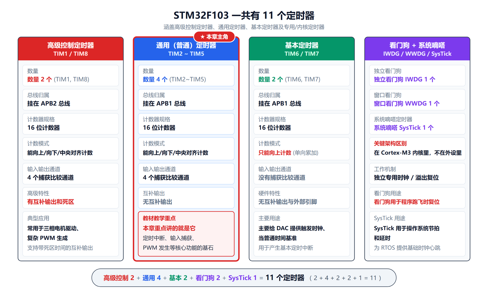

*2 高级 + 4 普通 + 2 基本 + 2 看门狗 + 1 SysTick = 11 个。本章只讲 4 个普通定时器。*

#### 普通定时器 TIM2~TIM5 的主要特性（PPT 列了 7 条）

| # | 特性 |
|---|---|
| 1 | **16 位向上、向下、向上/下自动装载计数器** |
| 2 | **16 位可编程（可以实时修改）预分频器**，时钟计数器的**分频系数范围：1～65535** |
| 3 | **4 个独立通道**，支持多种工作模式：**输入捕获、输出比较、PWM 生成和单脉冲模式输出** |
| 4 | **利用外部信号控制定时器启停和多个定时器级联的同步电路** |
| 5 | **中断/DMA：可触发 DMA 搬运捕获值、PWM 占空比** |
| 6 | **正交编码器接口和霍尔传感器接口** |
| 7 | **触发输入作为外部时钟或者按周期的电流管理**（触发信号同步 AD 采样，实现每个 PWM 周期定点采集电流） |

> **【待核实】第 2 条的分频系数范围**：
> PPT 写"**1～65535**"，但教材表 8-1 写"1~65 536"，而 8.1.1 节特性又写"1~65 535"。
> **按 PSC 是 16 位寄存器、实际分频 = PSC + 1 推算，范围应是 1~65 536**（PSC 写 0~65535）。
> 答题时按 PPT 的"1~65535"写也能接受，但**计算时一定用 `PSC + 1`**。

#### 结构总览

> **STM32 内置 4 个可同步运行的普通定时器（TIM2、TIM3、TIM4、TIM5）**，每个定时器具有：
> - **1 个 16 位自动加载的递加/递减计数器**
> - **1 个 16 位的预分频器**
> - **4 个独立的通道**，每个通道都可用于**输入捕获、输出比较、PWM 和单脉冲模式输出**
> - **任一标准定时器可用于产生 PWM 输出**
> - **独立的 DMA 请求机制**

#### 五种工作模式的信号流向（梁版 PPT 总结得极好，建议背下来）

| # | 模式 | 信号流向 |
|---|---|---|
| **1** | **普通定时（内部时钟）** | `RCC → CK_INT → PSC 预分频 → CNT 计数器 → 计数到 ARR → 更新事件`，产生定时中断 |
| **2** | **PWM 输出** | `CK_INT → PSC → CNT 计数，CNT 与 CCR 比较 → OCxREF → 输出控制 → TIMx_CHx 引脚`输出 PWM |
| **3** | **输入捕获测脉冲** | `TIMx_CHx 引脚输入脉冲 → 滤波边沿检测 → IC 预分频 → 边沿触发锁存 CNT 值到 CCRx`，程序读取 CCRx 计算时间 |
| **4** | **正交编码器** | `编码器 A/B 相接 CH1 CH2 → TI1FP1、TI2FP2 送入编码器接口 → 直接控制 CNT 加减计数`，读 CNT 就得到电机位置 |
| **5** | **外部时钟计数** | `ETR 引脚输入脉冲 → 滤波预分频 → ETRRF → 从模式`，每来一个脉冲 CNT+1 |

> **这五种模式就把定时器的全部用法概括完了。**
> **本章只重点讲模式 1（普通定时）**——这是老师 PPT 实际展开的内容。
> 模式 2~5 在 PPT 里只作为"能力列表"出现，了解名称和信号走向即可。

---

### 8.2 普通定时器的结构 ★★★ 【PPT 重点：陈 p9～p37 / 梁 p13～p52，本章核心】

#### 8.2.1 时基单元：三个寄存器（本章最重要的概念）

> **时基单元包含**：
> - **计数器寄存器（TIMx_CNT）**
> - **预分频器寄存器（TIMx_PSC）**
> - **自动装载寄存器（TIMx_ARR）**

**用大白话+类比理解这三个寄存器**：

| 寄存器 | 大白话 | 类比（秒表/闹钟） |
|---|---|---|
| **TIMx_PSC**（Prescaler，预分频器） | 决定"**多少个时钟脉冲算 1 个数**" | 秒表的**"档位"** |
| **TIMx_CNT**（Counter，计数器） | **当前数到几了** | 秒表上**显示的数字** |
| **TIMx_ARR**（Auto-Reload Register，自动重装载） | **数到几就归零重来** | 你给闹钟设的**"响铃时间"** |

**【类比】用闹钟理解定时器**：

> 你要泡一杯茶，需要 3 分钟。
> - 你把**闹钟**拧到 3 分钟 → 这就是设 **ARR**；
> - 闹钟内部的秒针一格一格走 → 这就是 **CNT** 在加 1；
> - 秒针走一格代表 1 秒，但如果你想要"每 5 秒才跳一格"，就要调档位 → 这就是 **PSC**；
> - 走到 3 分钟时"叮"一声 → 这就是**更新事件 UEV**，同时 **UIF 置 1**。
>
> **类比的边界**：真实硬件里 PSC 不是"档位旋钮"，而是一个"数到 N 输出一个脉冲"的计数器；
> ARR 也不是机械凸轮，而是一个 16 位寄存器。但"设上限、数数、到点报警"的逻辑是一致的。

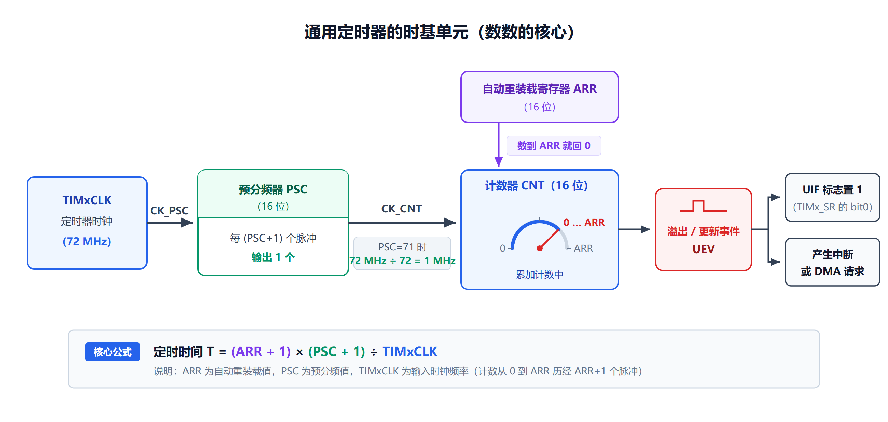

*从左到右：TIMxCLK → PSC 分频 → CNT 计数 → 数到 ARR 就回 0 并产生更新事件 UEV → 置 UIF → 触发中断/DMA。*

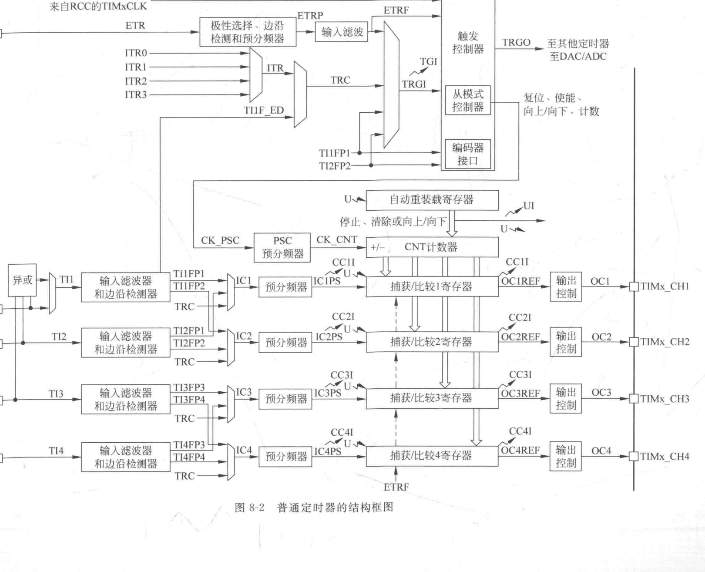

*这张图分三层看：① 中间一竖列是 CNT/ARR/CCR1~4；② 左边进（TI1~TI4 输入捕获）、右边出（OC1~OC4 输出）；③ 最上面的 ETR/ITR/TRC 是时钟源和触发。*

#### 8.2.2 【必考】定时时间公式（本章最容易拿分也最容易丢分的地方）

> **定时时间 T 计算公式**：
>
> **T = (TIM_Period + 1) × (TIM_Prescaler + 1) / TIMxCLK**
>
> 其中，`TIM_Period` 是自动重装载寄存器周期的值；`TIM_Prescaler` 是时钟预分频数；
> `TIMxCLK` 是 TIMx 的时钟频率，**一般为 72MHz**。

用寄存器名字写出来：

```
                     (ARR + 1) × (PSC + 1)
        T  =  ────────────────────────────────
                        TIMxCLK
```

**每一步的物理意义**：

```
第 1 步：TIMxCLK 被 PSC 分频
         CK_CNT = TIMxCLK / (PSC + 1)
         CK_CNT 的周期 t = (PSC + 1) / TIMxCLK

第 2 步：CNT 要数 ARR + 1 个 CK_CNT 脉冲才算一轮
         （从 0 数到 ARR，一共 ARR + 1 个数）

第 3 步：一轮的时间 T = (ARR + 1) × t = (ARR + 1) × (PSC + 1) / TIMxCLK
```

**【必考·为什么是 `ARR + 1` 而不是 `ARR`】**

```
CNT:  0 → 1 → 2 → 3 → 4 → 0 → 1 → ...
                 ↑
            这里 ARR = 4

从 0 到 4 一共经过几个数？0、1、2、3、4 —— 共 5 个 = ARR + 1
```

> **这是初学者最容易错的地方：数"个数"要 +1。**

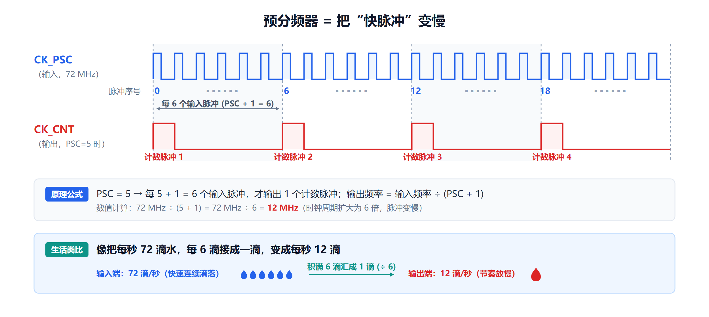

*上面密密的窄脉冲是 CK_PSC（72MHz），下面稀疏的是 CK_CNT。PSC=5 时，每 6 个输入脉冲才出 1 个输出脉冲。*

**【教材原例：1 秒定时】**

> `T = ((1 + TIM_Prescaler) / 72M) × (1 + TIM_Period) = ((1 + 7199) / 72M) × (1 + 9999) = 1 秒`

**一步一步算**：

```
已知：TIMxCLK = 72 MHz = 72 000 000 Hz
      PSC = 7199  →  分频系数 = 7199 + 1 = 7200
      ARR = 9999  →  一轮数 9999 + 1 = 10000 个脉冲

第 1 步：算 CK_CNT
        72 000 000 ÷ 7200 = 10 000 Hz = 10 kHz
        → 一个脉冲的周期 = 1/10 000 s = 100 µs

第 2 步：数 10000 个脉冲
        100 µs × 10 000 = 1 000 000 µs = 1 s

第 3 步：用公式验证
        T = (9999+1) × (7199+1) ÷ 72 000 000
          = 10 000 × 7200 ÷ 72 000 000
          = 1 s   ✓
```

**【必会：算出 0.5 秒（例 8-1 的参数）】**

```
目标：T = 0.5 s，TIMxCLK = 72MHz

思路（先定 PSC，再算 ARR）：
让 CK_CNT = 10 kHz（每 100 µs 加 1）
   PSC + 1 = 72 000 000 ÷ 10 000 = 7200  → PSC = 7199

0.5 s ÷ 100 µs = 5000 个数
   ARR + 1 = 5000  → ARR = 4999

验证：T = 5000 × 7200 ÷ 72 000 000 = 36 000 000 ÷ 72 000 000 = 0.5 s ✓
```

> **所以例 8-1 里写的是 `TIM_Period = 5000-1`、`TIM_Prescaler = 7200-1`。**

**【定时范围（必背）】**

```
最短：PSC = 0、ARR = 0
      T = 1 × 1 ÷ 72 000 000 ≈ 13.9 ns

最长：PSC = 65535、ARR = 65535
      T = 65536 × 65536 ÷ 72 000 000 ≈ 59.65 s

单个普通定时器的定时范围：约 13.9 ns ~ 59.65 s
```

> **要定更长的时间**：只能靠"软件计数"（ISR 里数次数）、或用多个定时器级联。

#### 8.2.3 影子寄存器与预装载（本章最"绕"的地方）

**【为什么需要影子寄存器】**

> **自动装载寄存器具有预装载特性**：读写 TIMx_ARR，实际访问的是**预装载寄存器**，
> 并非直接作用于**影子寄存器**。

**大白话**：

> 你写的新值先进"**预装载寄存器**"（前台），真正控制计数上限的是"**影子寄存器**"（后台）。
> **新值要等到下一次更新事件，才会从"前台"搬到"后台"。**

**为什么要这么设计**：

> 因为**计数器正在运行时**，如果你直接改 ARR，可能改到一半正巧计数器数到旧值，
> 就会出现"这一轮数 9999、下一轮数 4999"的混乱。
> **有了影子寄存器，新值就在一个整周期的边界统一生效**——不会把某一轮切坏。

**【ARPE 位：自动装载预装载使能】**

> **`TIMx_CR1` 寄存器中的 `ARPE` 位——自动装载预装载使能位**
> - **`ARPE = 0`**：**预装载寄存器内容立即传送至影子寄存器**（改就立刻生效）
> - **`ARPE = 1`**：**预装载寄存器内容仅在每次更新事件（UEV）发生时，载入影子寄存器**（推荐）

> **【易错】ARPE 的实际名字**：
> PPT 的 CR1 位表里写作 **`APRE`**（bit7），教材其他地方写作 **`ARPE`**——**是同一个位**。
> 另外教材正文有时写作 `ARPE`、PPT 正文有时写作 `APRE`，不要以为是两个东西。

**【同样的机制也用于 PSC】**

> **预分频器寄存器带有缓冲器，在工作时能被改变，但新的预分频器参数在下一次更新事件到来时被采用。**

#### 8.2.4 更新事件 UEV 与几个关键控制位

> **当计数器达到溢出条件，且 `TIMx_CR1` 寄存器中的 `UDIS` 位等于 '0' 时，产生更新事件。**

**`UDIS`（更新禁止位）**：

> **用于允许/禁止更新事件 UEV 产生**
> - **`UDIS = 0`**：**允许**产生更新事件 UEV
> - **`UDIS = 1`**：**禁止**产生更新事件 UEV

**计数器上溢/下溢、软件置 `UG` 位均可生成 UEV。发生 UEV 时**：

```
① ARR、PSC 预装载寄存器内容载入对应影子寄存器
② CNT 计数器清零 / 重载
③ 硬件置更新标志 UIF，可触发更新中断 / DMA
```

**`URS`（更新请求源选择位）**：

> **用来控制哪些事件能够置位更新中断标志 UIF**
> - **`URS = 0`**：**任意更新事件都会置位 UIF**
> - **`URS = 1`**：**只有计数器溢出/下溢产生的硬件更新事件，才会置位 UIF**
>   （软件 `UG` 置位只置 UIF 标志，不产生更新中断或 DMA 请求）

**`CEN`（计数器使能）**：

> **计数器由预分频器输出时钟 `CK_CNT` 驱动，只有 `TIMx_CR1` 寄存器中的计数器使能位 `CEN` 置位时，`CK_CNT` 才有效**；
> **内部真正的计数器使能信号 `CNT_EN` 相对 `CEN` 延迟一个时钟周期生效。**

```
CEN = 1  →  启动计数
CEN = 0  →  停止计数
```

#### 8.2.5 三种计数模式（必背）

**【① 向上计数模式】**

> **在向上计数模式中，计数器从 0 计数到自动加载值（TIMx_ARR 寄存器的内容），然后重新从 0 开始计数，并且产生一个计数器溢出事件。**

**当发生一个更新事件时，所有的寄存器都被更新，硬件同时（依据 URS 位）设置更新标志位（UIF）。同时执行以下操作**：

> - 预分频器的缓冲区被置入预装载寄存器的值（TIMx_PSC 的内容）
> - 自动装载影子寄存器被重新置入预装载寄存器的值（TIMx_ARR）

**时序**：

```
CNT:   0 → 1 → 2 → … → ARR → 0 → 1 → ...
                        ↑
                   产生溢出事件（UEV、UIF）
```

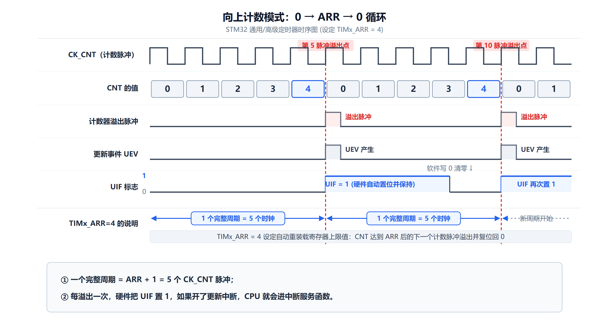

*每数到 ARR 就回 0，并产生一次更新事件 UEV、把 UIF 置 1。*

**【② 向下计数模式】**

> **在向下模式中，计数器从自动装入的值（TIMx_ARR 的值）开始向下计数到 0，然后从自动装入的值重新开始，并产生一个计数器向下溢出事件。**

```
CNT:   ARR → ARR-1 → … → 1 → 0 → ARR → ...
                              ↑
                         产生下溢事件（UEV、UIF）
```

**【③ 中央对齐模式（向上/向下计数）】**

> **在中央对齐模式中，计数器从 0 开始向上计数到自动加载的值（TIMx_ARR 寄存器）- 1，产生一个计数器上溢事件，
> 然后向下计数到 1 并且产生一个计数器下溢事件；然后再从 0 开始重新计数。**

```
CNT:   0 → 1 → 2 → … → ARR-1 → ARR-2 → … → 1 → 0 → 1 → ...
                          ↑                    ↑
                     上溢事件              下溢事件
                     （两个事件都产生 UEV）
```

> **在这个模式中，不能写入 `TIMx_CR1` 中的 DIR 方向位。它由硬件更新并指示当前的计数方向。**

**【一个容易记混的细节】**：

| 模式 | 计数范围 | 一圈数几个数 |
|---|---|---|
| **向上** | **0 ~ ARR** | **ARR + 1** |
| **向下** | **ARR ~ 0** | **ARR + 1** |
| **中央对齐** | **0 ~ ARR−1 ~ 0** | **2 × ARR** |

> **【易错】中央对齐模式数到 `ARR − 1` 就折返，不是 `ARR`。**
> 所以它一轮只有 **2 × ARR** 个计数，而不是 ARR + 1。

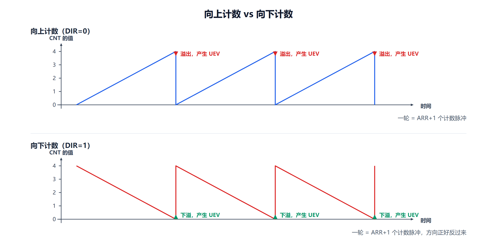

*向上：0→ARR 后回 0；向下：ARR→0 后回 ARR。*

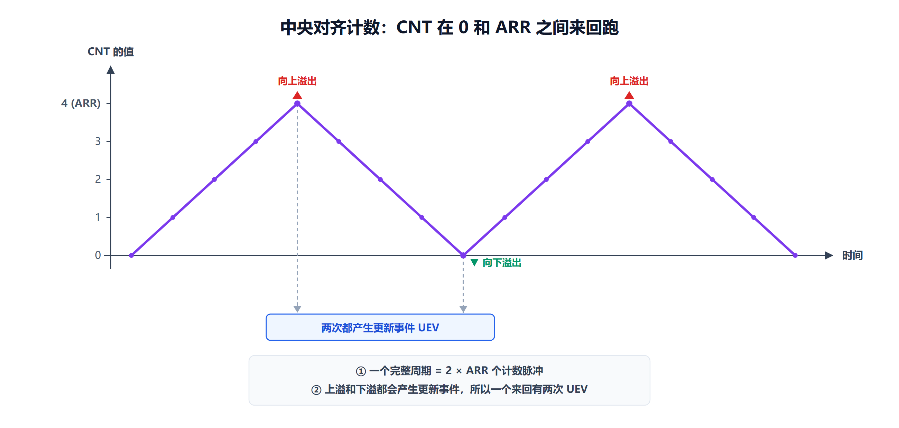

*中央对齐：0→ARR−1→0，像三角波。上下各产生一次溢出事件。*

#### 8.2.6 时钟选择：数数的节拍从哪来（必背）

> **定时器的计数脉冲可由下列时钟源提供**：
> **（1）内部时钟（CK_INT）**
> **（2）外部时钟模式 1：外部输入脚（TIx）**（相当于计数器功能）
> **（3）外部时钟模式 2：外部触发输入（ETR）**（相当于计数器功能）
> **（4）内部触发输入（ITRx）**：使用一个定时器作为另一个定时器的预分频器（相当于定时器级联）

| # | 时钟源 | 从哪个引脚来 | 典型用途 |
|---|---|---|---|
| **1** | **内部时钟 CK_INT** | 芯片内部（经 APB 总线） | **最常用**：普通定时 |
| **2** | **外部时钟模式 1** | **TI1 / TI2**（通道 1/2 的输入引脚） | 数外部脉冲（相当于计数器） |
| **3** | **外部时钟模式 2** | **ETR**（专门的触发引脚） | 数外部脉冲 |
| **4** | **内部触发 ITRx** | 另一个定时器的输出 | **定时器级联**（做更长的定时） |

**【① 内部时钟源 CK_INT（最常用）】**

> **如果禁止从模式控制器，则 CEN、DIR（TIMx_CR1）和 UG 位（TIMx_EGR）是定时器的控制位。
> 只要 CEN 位被写成 '1'，预分频器的时钟就由内部时钟 CK_INT 提供。**

**几个控制位**：

| 位 | 含义 |
|---|---|
| **`CEN`** | **计数器使能**：1 启动计数，0 停止计数 |
| **`DIR`** | **计数方向**：0 向上计数，1 向下计数 |
| **`SMS[2:0]`** | **从模式选择位**：**SMS=000，禁止从模式控制器** |
| **`UG`** | **软件更新事件产生位**：1 产生更新事件脉冲，自动清零 |
| **`CNT_INIT`** | **内部硬件复位脉冲**。UG 写 1 之后硬件产生 CNT_INIT 内部信号，**作用：硬件把计数器 CNT 寄存器清零为 00** |

> **【最常用的一条】什么都不配的时候（SMS=000），定时器就用内部时钟 CK_INT，
> 而 CK_INT 就是 APB 总线给它的时钟（72MHz）。**

**【② 外部时钟模式 1（TIx）——梁版 PPT 给了逐步骤配置】**

> **例：配置向上计数器在 TI2 输入端的上升沿计数，步骤如下**：

```
1. TIMx_CCMR1：CC2S=01，通道 2 检测 TI2 输入的上升沿
2. TIMx_CCMR1：IC2F[3:0]=0000，不需要滤波器
3. TIMx_CCER：CC2P=0，选定上升沿极性（捕获预分频 IC2PSC 不用作触发，默认 00）
4. TIMx_SMCR：SMS=111，选择外部时钟模式 1
5. TIMx_SMCR：TS=110，选定 TI2 作为触发输入源
6. TIMx_CR1：CEN=1，启动计数器
```

> **TI2 每来一个上升沿，CNT 计一次并置 TIF；延时取决于输入端重新同步电路。**

**【③ 外部时钟模式 2（ETR）】**

> **例：配置在 ETR 下每 2 个上升沿计数一次的向上计数器（外部时钟模式 2）**：

```
1. TIMx_SMCR：ETF[3:0]=0000，本例不需要滤波器
2. TIMx_SMCR：ETPS[1:0]=01，外部触发预分频 = 每 2 个 ETR 有效边沿计数器加 1
3. TIMx_SMCR：ETP=0，选定 ETR 上升沿检测
4. TIMx_SMCR：ECE=1，开启外部时钟模式 2
5. TIMx_CR1：CEN=1，启动计数器
```

> **ETR 上升沿与计数器实际时钟之间的延时取决于 ETRP 端的重新同步电路。**

> **【易错】模式 1 和模式 2 的区别**：
> - **模式 1 用 `TI1/TI2`（通道引脚）**，配置 `SMS=111` + `TS`；
> - **模式 2 用 `ETR`（专用触发引脚）**，配置 **`ECE=1`**。
>
> **别把 `SMS=111` 当成万能开关**——模式 2 靠的是 `ECE` 位。

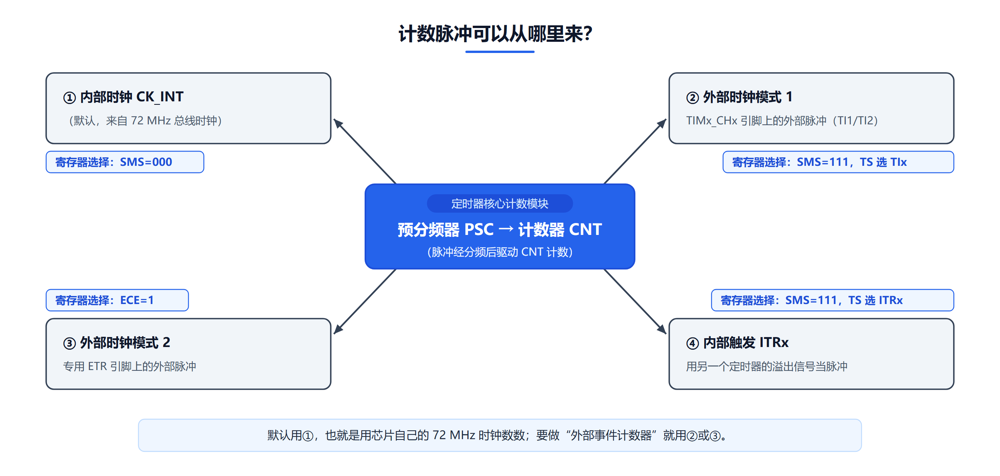

*四种时钟源：CK_INT（内部）、TIx（外部模式1）、ETR（外部模式2）、ITRx（定时器级联）。*

#### 8.2.7 捕获/比较通道 ★ 【PPT 只提到名称，不展开】

> **本节的定位说明（重要）**：
> **两位老师的 PPT 都把"输入捕获、输出比较、PWM、单脉冲"列为普通定时器 4 个通道的功能，
> 但都没有真正展开讲**——陈老师版只在这一页提了一句，梁老师版给了三页硬件结构框图，
> 但没有讲怎么配置、怎么算参数。
>
> **按"以 PPT 为准"的原则，本节只保留到"知道有这回事"的程度（★），
> 不收录 PWM 的占空比公式、模式 1/2 的区别、配置三步骤等内容。**
> 这些属于教材 8.3 节的展开内容，本课程不作为重点。

**【一句话知道它是什么就够了】**

> **定时器的每一个"通道"，既可以当"输入"用，也可以当"输出"用：**
> - 当**输入**用 → **输入捕获**：把外部信号边沿到来瞬间的 CNT 值"拍"进 CCR，用来测频率/脉宽；
> - 当**输出**用 → **输出比较**：CNT 撞到 CCR 时引脚做动作；**PWM 是它的一个特例**。

**普通定时器有 4 个通道**（TIM2~TIM5 都是 4 个），可以同时做 4 件不同的事。

**【结构：一个通道 = 输入通路 + 一个 CCR + 输出通路】**

```
输入：TI1 引脚 → 滤波器 → 边沿检测 → 极性选择 → 预分频 → 【捕获锁存进 CCR1】
输出：【CNT 与 CCR1 比较】→ 输出控制 → 极性 → 输出使能 → OC1 引脚
```

> **关键点**：**一个通道的输入和输出共用同一个 CCR 寄存器**，
> 所以**同一个通道不能同时又当输入又当输出**，得用 `CCxS` 位选一个。

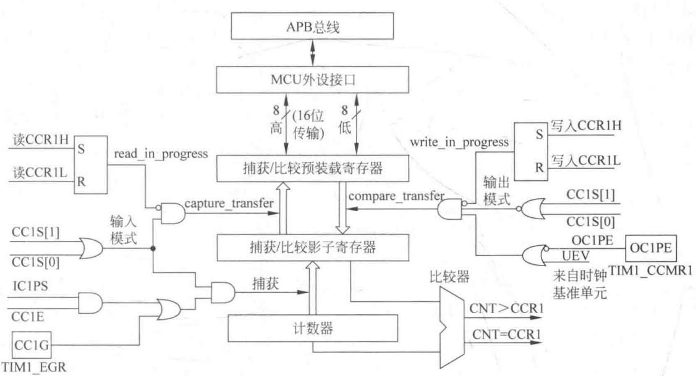

*中间那个大方框就是 `TIMx_CCR1`。上面连着输入通路，下面连着输出通路。*

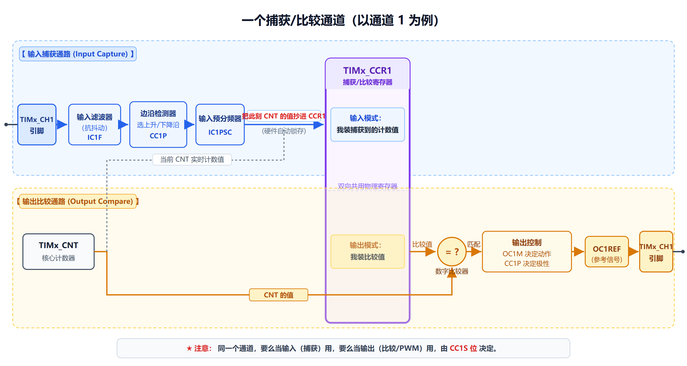

*上半条蓝线是输入捕获，下半条橙线是输出比较。*

**【只要记住这三条】**

| # | 要点 |
|---|---|
| 1 | **4 个通道**，每个通道都能当输入（捕获）或输出（比较） |
| 2 | **输入和输出共用同一个 CCR**，由 `CCxS` 决定方向 |
| 3 | **TIM6/TIM7 没有捕获/比较通道**（所以只能纯定时） |

> **考试如果只考"定时中断"，这一节了解即可。**
> 如果后面实验课要做 PWM 或测频，再回完整讲义的 8.6~8.9 节看详细配置。

### 8.3 普通定时器的寄存器 ★★★ 【PPT 重点：陈 p38～p41 / 梁 p53～p59】

#### 8.3.1 首地址与访问方式

> **普通定时器 TIMx 的首地址是 `0x4000_0000`。**（TIM2 的基地址）
> **普通定时器的寄存器可以用半字（16 位）或字（32 位）的方式操作。**

**TIM2~TIM5 的基地址（梁版 PPT 给出）**：

```c
#define PERIPH_BASE       ((u32)0x40000000)
#define APB1PERIPH_BASE   PERIPH_BASE
#define APB2PERIPH_BASE   (PERIPH_BASE + 0x10000)
#define TIM2_BASE         (APB1PERIPH_BASE + 0x0000)   /* 0x40000000 */
#define TIM3_BASE         (APB1PERIPH_BASE + 0x0400)   /* 0x40000400 */
#define TIM4_BASE         (APB1PERIPH_BASE + 0x0800)   /* 0x40000800 */
#define TIM2              ((TIM_TypeDef *) TIM2_BASE)
```

> **【易错】TIM2 在 `0x40000000`**——这是"外设区基地址 + 0"，看起来像"什么都没有"，
> 但它确实是第一个 APB1 外设。**TIM3 比 TIM2 大 `0x400`，TIM4 再大 `0x400`。**

#### 8.3.2 关键寄存器偏移（必背）

| 寄存器 | 偏移 | 作用 |
|---|---|---|
| **TIMx_CR1** | **`0x00`** | **控制寄存器 1**（CEN、DIR、ARPE、CMS、UDIS、URS…） |
| TIMx_CR2 | `0x04` | 控制寄存器 2（MMS、CCDS、TI1S） |
| TIMx_SMCR | `0x08` | 从模式控制（SMS、TS、ECE、ETR 相关） |
| TIMx_DIER | `0x0C` | **中断/DMA 使能** |
| **TIMx_SR** | **`0x10`** | **状态寄存器**（UIF、CC1IF~CC4IF、TIF） |
| TIMx_EGR | `0x14` | **事件产生**（UG、CC1G~CC4G、TG） |
| TIMx_CCMR1 | `0x18` | 捕获/比较模式（CC1S、OC1M、IC1F…） |
| TIMx_CCMR2 | `0x1C` | 捕获/比较模式（通道 3、4） |
| TIMx_CCER | `0x20` | **捕获/比较使能**（CC1E、CC1P…） |
| **TIMx_CNT** | **`0x24`** | **计数器** |
| **TIMx_PSC** | **`0x28`** | **预分频器** |
| **TIMx_ARR** | **`0x2C`** | **自动重装载** |
| TIMx_CCR1 | `0x34` | 捕获/比较 1 |
| TIMx_CCR2 | `0x38` | 捕获/比较 2 |
| TIMx_CCR3 | `0x3C` | 捕获/比较 3 |
| TIMx_CCR4 | `0x40` | 捕获/比较 4 |

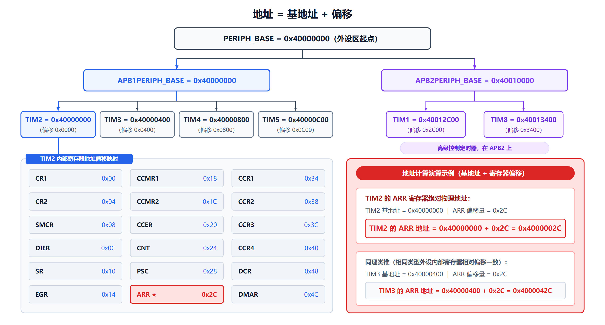

*基地址 + 偏移 = 寄存器地址。**最需要记的是 CNT=0x24、PSC=0x28、ARR=0x2C、SR=0x10。***

#### 8.3.3 CR1（控制寄存器 1）——最重要的寄存器

**偏移 `0x00`。PPT 逐位列出**：

| 位 | 名称 | 功能 |
|---|---|---|
| 15~10 | 保留 | — |
| **[9:8]** | **`CKD[1:0]`** | **时钟分频因子**，定义定时器时钟频率与数字滤波器采样频率的分频比例 |
| **7** | **`ARPE`**（PPT 写作 `APRE`） | **自动重装载预装载允许位**：0：ARR 没有缓冲；1：ARR 有缓冲，更新事件时才装入影子寄存器 |
| **[6:5]** | **`CMS[1:0]`** | **中心对齐模式选择**：`00`=边沿对齐；`01`=中央对齐1（向下计数置 CC 中断）；`10`=中央对齐2（向上计数置）；`11`=中央对齐3（上下都置） |
| **4** | **`DIR`** | **计数方向**（边沿对齐有效，中心对齐该位无效）：0 向上；1 向下 |
| **3** | **`OPM`** | **单脉冲模式**：0 连续计数；1 发生更新事件后 CEN 硬件自动清零，计数器停止 |
| **2** | **`URS`** | **更新请求源**：0 更新事件（溢出/下溢、UG）都产生中断或 DMA；1 仅溢出/下溢产生；软件 UG 只置 UIF 不产生中断 |
| **1** | **`UDIS`** | **更新禁止**：0 更新事件使能；1 禁止更新事件（溢出时 UIF 不置 1，但 UG 仍有效） |
| **0** | **`CEN`** | **计数器使能**：0 关闭；1 开启 |

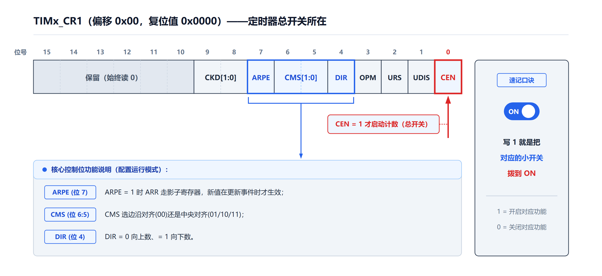

*最常用的三位：CEN（bit0 启动）、DIR（bit4 方向）、ARPE（bit7 预装载）。*

> **【必记】`CEN` 是 bit0** ——这是"启动定时器"的那一位。
> **`TIM_Cmd(TIM2, ENABLE)` 干的事就是把它置 1。**

#### 8.3.4 SR（状态寄存器）——中断标志

**偏移 `0x10`。PPT 逐位列出**：

| 位 | 名称 | 功能 |
|---|---|---|
| **6** | **`TIF`** | **触发中断标志**：TRGI 触发事件到来，硬件置 1；**软件写 0 清零** |
| **4** | **`CC4IF`** | **通道 4 捕获/比较中断标志**。输出模式：CNT==CCR4 置 1；捕获模式：捕获到边沿置 1。**可以软件写 0 清零**，DMA 读 CCR4 硬件自动清零 |
| **3** | **`CC3IF`** | 通道 3，同 CC4IF |
| **2** | **`CC2IF`** | 通道 2，同 CC4IF |
| **1** | **`CC1IF`** | 通道 1，同 CC4IF |
| **0** | **`UIF`** | **更新中断标志**：更新事件发生硬件置 1；溢出/下溢、软件 UG 置位都会置 UIF；**软件写 0 清零** |

> **【易错】定时器的标志位是"写 0 清零"**，和 EXTI 的 PR"写 1 清除"**相反**。
> **`TIM_ClearITPendingBit(TIM2, TIM_IT_Update)` 内部就是把这个位写 0。**

#### 8.3.5 CNT / PSC / ARR（时基三兄弟）

| 寄存器 | 偏移 | 说明 |
|---|---|---|
| **TIMx_CNT** | **`0x24`** | **计数器**（16 位，当前数到几） |
| **TIMx_PSC** | **`0x28`** | **预分频器**（16 位，写 N 表示分频 N+1） |
| **TIMx_ARR** | **`0x2C`** | **自动重装载寄存器**（16 位，数到几回 0） |

**PPT 给的公式**：

> **计数器的时钟频率：`CK_CNT = f_CK_INT / (PSC + 1)`**

> **【必背】`PSC + 1`，不是 `PSC`。** 写 `PSC = 7199` 得到的是 **7200 分频**。

#### 8.3.6 其他几个寄存器（了解）

**CR2（`0x04`）**：

| 位 | 名称 | 功能 |
|---|---|---|
| 7 | `TI1S` | TI1 选择：1 = CH1/2/3 输入全部内连到 TI1（霍尔传感器模式） |
| [6:4] | `MMS[2:0]` | 主模式选择 TRGO：000 UG；001 CNT_EN；010 更新 UEV；011 CC1IF；100~111 OC1~OC4REF |
| 3 | `CCDS` | 捕获/比较 DMA 选择：0 由 CCx 事件产生；1 由更新事件产生 |

**EGR（`0x14`）**：

| 位 | 名称 | 功能 |
|---|---|---|
| 6 | `TG` | 写 1 软件产生 TRGI 触发事件（置 TIF），硬件自动清零；写 0 无效 |
| 4~1 | `CC4G`~`CC1G` | 写 1 软件产生对应通道的捕获/比较事件，置 CCxIF |
| **0** | **`UG`** | **写 1 产生更新事件：CNT 重置、影子寄存器刷新、置 UIF** |

> **`UG` 位就是"手动产生一次更新事件"**——写它一次，可以让 ARR/PSC 的新值立刻装进影子寄存器，
> 不用等下一个周期。调试定时器时很常用。

---

### 8.4 普通定时器的使用 ★★★ 【PPT 重点：陈 p42～p59 / 梁 p60～p78】

#### 8.4.1 固件库的结构体

```c
typedef struct
{
    vu16 CR1;       // 控制寄存器 1
    u16  RESERVED0;
    vu16 CR2;       // 控制寄存器 2
    u16  RESERVED1;
    vu16 SMCR;      // 从模式控制寄存器
    ...
    // 其他寄存器请参阅教材
} TIM_TypeDef;
```

> **【同第 5、6 章】结构体里插 `RESERVED` 是为了 4 字节对齐**——
> 寄存器是 16 位有效，但地址偏移按 32 位算。

#### 8.4.2 六个常用库函数（必背）

| # | 函数 | 作用 |
|---|---|---|
| **1** | **`TIM_DeInit(TIMx)`** | **将 TIMx 寄存器重设为缺省值** |
| **2** | **`TIM_TimeBaseInit(TIMx, &结构体)`** | **初始化时基单元**（PSC、计数模式、ARR、时钟分割）—— **最核心** |
| **3** | **`TIM_ITConfig(TIMx, TIM_IT, ENABLE)`** | **使能/除能指定的 TIM 中断**（写 DIER） |
| **4** | **`TIM_Cmd(TIMx, ENABLE)`** | **启停 TIMx**（写 CR1 的 CEN） |
| **5** | **`TIM_GetITStatus(TIMx, TIM_IT)`** | **检查指定 TIM 中断是否发生**，返回 SET/RESET |
| **6** | **`TIM_ClearITPendingBit(TIMx, TIM_IT)`** | **清除 TIMx 的中断挂起位** |

**【`TIM_TimeBaseInitTypeDef` 结构体】**

```c
typedef struct
{
    u16 TIM_Prescaler;          // 预分频值（写 PSC）
    u16 TIM_CounterMode;        // 计数模式
    u16 TIM_Period;             // 自动重装载周期的值（写 ARR）
    u16 TIM_ClockDivision;      // 时钟分割（只影响输入捕获滤波）
    u8  TIM_RepetitionCounter;  // 重复计数器（只用于 TIM1 和 TIM8）
} TIM_TimeBaseInitTypeDef;
```

**五个成员的含义（PPT 讲得很清楚）**：

| 成员 | 含义 |
|---|---|
| **`TIM_Prescaler`** | **定时器时钟的分频系数，决定计数脉冲快慢** |
| **`TIM_Period`** | **自动重装载寄存器周期的值**（写 ARR） |
| **`TIM_CounterMode`** | **计数器模式** |
| **`TIM_ClockDivision`** | **定时器时钟与"输入信号数字滤波器采样时钟"的分频比，只影响输入捕获滤波，不影响计数速度** |
| **`TIM_RepetitionCounter`** | **只用于 TIM1 和 TIM8**（普通定时器不用管） |

**【`TIM_CounterMode` 的取值】**

| 取值 | 含义 |
|---|---|
| `TIM_CounterMode_Up` | **向上计数模式** |
| `TIM_CounterMode_Down` | 向下计数模式 |
| `TIM_CounterMode_CenterAligned1` | 中央对齐模式 1 |
| `TIM_CounterMode_CenterAligned2` | 中央对齐模式 2 |
| `TIM_CounterMode_CenterAligned3` | 中央对齐模式 3 |

**【`TIM_ClockDivision` 的取值】**

| 取值 | 含义 |
|---|---|
| `TIM_CKD_DIV1` | TDTS = Tck_tim |
| `TIM_CKD_DIV2` | TDTS = 2 Tck_tim |
| `TIM_CKD_DIV4` | TDTS = 4 Tck_tim |

> **【重要】`TIM_ClockDivision` 只影响输入捕获的数字滤波器采样率，不影响计数速度。**
> 做纯定时的时候**随便设 `TIM_CKD_DIV1` 就行**。

**【`TIM_IT` 的取值】**

| 取值 | 含义 |
|---|---|
| **`TIM_IT_Update`** | **更新中断源**（最常用） |
| `TIM_IT_CC1` ~ `TIM_IT_CC4` | 捕获/比较 1~4 中断源 |
| `TIM_IT_Trigger` | 触发中断源 |

#### 8.4.3 五个使用步骤（必背）

> **定时器应用的一般步骤**：
> **（1）系统初始化**，主要初始化时钟等。
> **（2）GPIO 初始化**，用于 LED 指示灯，便于观察。
> **（3）TIMx 的配置**。
> **（4）NVIC 的配置**。
> **（5）编写中断服务函数。**

| 步骤 | 内容 | 关键代码 |
|---|---|---|
| **1** | 系统初始化（时钟） | `SystemInit()` 已自动做好 72MHz |
| **2** | GPIO 初始化（LED） | `RCC_APB2PeriphClockCmd` + `GPIO_Init` |
| **3** | **TIMx 配置** | **`RCC_APB1PeriphClockCmd` → `TIM_DeInit` → `TIM_TimeBaseInit` → `TIM_ITConfig` → `TIM_Cmd`** |
| **4** | NVIC 配置 | `NVIC_PriorityGroupConfig` + `NVIC_Init` |
| **5** | 写 ISR | `TIM2_IRQHandler()` |

> **【必错点】定时器的时钟在 `RCC_APB1ENR`**（TIM2~TIM7），
> 所以要用 **`RCC_APB1PeriphClockCmd(RCC_APB1Periph_TIM2, ENABLE)`**，
> **不是 `RCC_APB2PeriphClockCmd`**（那是给 GPIO 和 TIM1/TIM8 的）。

#### 8.4.4 例 8-1：定时 0.5 秒翻转 LED（必会）

**【任务】**：使用固件库函数编程实现，**利用定时器 2，每隔 0.5 秒，连接 PE0 的指示灯状态翻转一次**。

**【工程配置（PPT 给的）】**：

> 在创建工程出现 "Manage Run-Time Environment" 对话框时：
> 选中 **"Device" → "Startup"**；
> 选中 **"CMSIS" → "CORE"**；
> 选中 **"StdPeriph Drivers"** 中的 **GPIO、Framework、RCC 和 TIM**。

**【① main：GPIO 初始化】**

```c
uint8_t turn = 0;

int main(void)
{
    GPIO_InitTypeDef GPIO_InitStructure;

    RCC_APB2PeriphClockCmd(RCC_APB2Periph_GPIOE, ENABLE);   // GPIOE 时钟
    GPIO_InitStructure.GPIO_Pin   = GPIO_Pin_0;             // LED0 → PE0
    GPIO_InitStructure.GPIO_Mode  = GPIO_Mode_Out_PP;       // 推挽输出
    GPIO_InitStructure.GPIO_Speed = GPIO_Speed_50MHz;       // 50MHz
    GPIO_Init(GPIOE, &GPIO_InitStructure);

    TIMER2_Init();
    NVIC_Config();
    while (1);
}
```

**【② TIMER2_Init：定时器配置（核心）】**

```c
void TIMER2_Init(void)
{
    TIM_TimeBaseInitTypeDef TIM_TimeBaseStructure;

    RCC_APB1PeriphClockCmd(RCC_APB1Periph_TIM2, ENABLE);   // ★ 打开 TIM2 时钟（APB1！）
    TIM_DeInit(TIM2);                                      // 复位 TIM2

    TIM_TimeBaseStructure.TIM_Period        = 5000 - 1;    // ARR，累计 5000 个脉冲（0.5s）
    TIM_TimeBaseStructure.TIM_Prescaler     = 7200 - 1;    // PSC，7200 分频
    TIM_TimeBaseStructure.TIM_CounterMode   = TIM_CounterMode_Up;   // 向上计数
    TIM_TimeBaseStructure.TIM_ClockDivision = TIM_CKD_DIV1;         // 输入捕获滤波（定时不用管）
    TIM_TimeBaseInit(TIM2, &TIM_TimeBaseStructure);        // 初始化 TIM2

    TIM_ITConfig(TIM2, TIM_IT_Update, ENABLE);             // 打开更新溢出中断
    TIM_Cmd(TIM2, ENABLE);                                 // 启动定时器
}
```

**参数是怎么算出来的（必会）**：

```
TIMxCLK = 72 MHz

第 1 步：求 PSC
  让 CK_CNT = 10 kHz（每 100 µs 加 1）
  PSC + 1 = 72 000 000 ÷ 10 000 = 7200
  → PSC = 7200 - 1 = 7199

第 2 步：求 ARR
  0.5 s ÷ 100 µs = 5000
  → ARR = 5000 - 1 = 4999

验证：T = (4999+1) × (7199+1) ÷ 72 000 000
      = 5000 × 7200 ÷ 72 000 000
      = 36 000 000 ÷ 72 000 000
      = 0.5 s  ✓
```

**【③ NVIC_Config：中断配置】**

```c
void NVIC_Config(void)
{
    NVIC_InitTypeDef NVIC_InitStructure;
    NVIC_PriorityGroupConfig(NVIC_PriorityGroup_0);          // 优先级分组
    NVIC_InitStructure.NVIC_IRQChannel                   = TIM2_IRQn;   // 中断源：TIM2
    NVIC_InitStructure.NVIC_IRQChannelPreemptionPriority = 0;
    NVIC_InitStructure.NVIC_IRQChannelSubPriority        = 0;
    NVIC_InitStructure.NVIC_IRQChannelCmd                = ENABLE;
    NVIC_Init(&NVIC_InitStructure);
}
```

> **【注意】`NVIC_PriorityGroup_0` 表示"0 位抢占 + 4 位副优先级"**，
> 所以 **抢占优先级参数实际上不起作用**（只能填 0）。

**【④ 中断服务函数（必须背结构）】**

```c
void TIM2_IRQHandler(void)     // ★ 函数名不能变
{
    if (TIM_GetITStatus(TIM2, TIM_IT_Update) == SET)
    {
        TIM_ClearITPendingBit(TIM2, TIM_IT_Update);   // ★ 先清标志
        turn = 1 - turn;
        if (turn)
            GPIO_ResetBits(GPIOE, GPIO_Pin_0);        // PE0 = 0，LED 亮
        else
            GPIO_SetBits(GPIOE, GPIO_Pin_0);          // PE0 = 1，LED 灭
    }
}
```

> **【必记】ISR 的三段式**：
> **① 判断标志（`TIM_GetITStatus`）→ ② 清标志（`TIM_ClearITPendingBit`）→ ③ 做事**。
> **不清标志 → 退出后立刻又进去 → 程序卡死。**

> **【待核实】教材原文的一处小笔误**：
> 教材例 8-1 里写的是 `TIM_ClearITPendingBit(TIM2, TIM_FLAG_Update);`
> ——第二个参数用了 `TIM_FLAG_Update` 而不是 `TIM_IT_Update`。
> 在 STM32F10x 标准外设库里这两个宏的**数值都是 `0x0001`**，所以**实际运行效果一样**，
> 但**严格来说参数类型用错了**。本复习版按正确的 `TIM_IT_Update` 写。

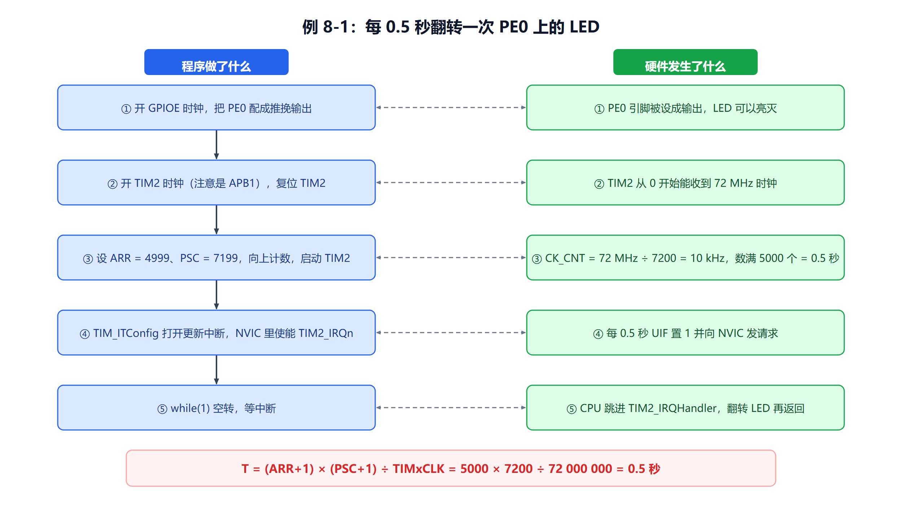

*从 main 初始化 → TIM2 每 0.5s 产生更新事件 → UIF 置 1 → NVIC → ISR 翻转 PE0。*

---

## 三、重要知识之间的联系

### 对比 1：三类定时器的能力

| | **高级 TIM1/TIM8** | **普通 TIM2~TIM5** | **基本 TIM6/TIM7** |
|---|---|---|---|
| 位数 | 16 位 | 16 位 | 16 位 |
| 计数模式 | 向上/向下/中央对齐 | 向上/向下/中央对齐 | **只有向上** |
| **捕获/比较通道** | **4 个** | **4 个** | **0 个** |
| **互补 PWM / 死区 / 刹车** | **有** | **没有** | 没有 |
| 所在总线 | **APB2** | **APB1** | **APB1** |
| 本章地位 | 概述 | **★ 主角** | 概述 |

### 对比 2：三种计数模式

| | **向上** | **向下** | **中央对齐** |
|---|---|---|---|
| 计数过程 | **0 → ARR → 0** | **ARR → 0 → ARR** | **0 → ARR−1 → 1 → 0** |
| 一圈数几个数 | **ARR + 1** | **ARR + 1** | **2 × ARR** |
| 溢出事件 | 上溢 | 下溢 | **上溢 + 下溢各一次** |
| DIR 位 | 可写 | 可写 | **不能写（硬件自动）** |
| 典型用途 | 普通定时、PWM | 特殊计数 | **PWM（波形对称、谐波小）** |

### 对比 3：四种时钟源

| # | 时钟源 | 从哪来 | 关键配置 |
|---|---|---|---|
| **1** | **内部时钟 CK_INT** | 芯片内部（APB） | **SMS = 000**（禁止从模式） |
| **2** | **外部时钟模式 1（TIx）** | **TI1 / TI2 引脚** | **SMS = 111** + **TS** 选源 |
| **3** | **外部时钟模式 2（ETR）** | **ETR 引脚** | **ECE = 1** |
| **4** | **内部触发 ITRx** | 另一个定时器 | **TS 选 ITR** |

### 对比 4：输入捕获 vs 输出比较（★ 了解，本课程不展开）

| | **输入捕获** | **输出比较 / PWM** |
|---|---|---|
| 通道方向 | **输入** | **输出** |
| CCR 里装什么 | **硬件捕获到的 CNT 值** | **你设定的比较门槛** |
| 触发条件 | **外部边沿来了** | **CNT 撞到 CCR** |

> **一个通道不能同时又当输入又当输出**，得用 `CCxS` 位选一个。
> **记住这三行就够了**——具体怎么配、公式怎么算，PPT 没讲，本课程不要求。

### 对比 5：标志位的清除方式（跨章易错）

| 外设 | 标志位 | 怎么清 |
|---|---|---|
| **EXTI**（第 7 章） | `PR` 挂起位 | **写 1 清除** |
| **GPIO**（第 6 章） | `BRR` / `BSRR` | **写 1 有效**（不是"清除"而是"清位"） |
| **NVIC**（第 2/7 章） | `ICER` | **写 1 除能** |
| **定时器**（本章） | `UIF`、`CCxIF` | **写 0 清除** ← **和 EXTI 相反！** |

> **【最容易混的一条】EXTI 的 PR 是"写 1 清除"，定时器的 UIF 是"写 0 清除"。**
> 但**库函数都帮你做好了**：`EXTI_ClearITPendingBit()` 和 `TIM_ClearITPendingBit()` 都可以放心调。

### 对比 6：`TIM_Prescaler` vs `TIM_ClockDivision`（最容易混的一对）

| | **`TIM_Prescaler`（PSC）** | **`TIM_ClockDivision`（CKD）** |
|---|---|---|
| 影响什么 | **计数器的计数速度** | **输入捕获滤波器的采样率** |
| 公式中的地位 | **`T = (ARR+1)(PSC+1)/TIMxCLK` 里有它** | **定时公式里没有它** |
| 做纯定时时 | **必设** | **随便设 `TIM_CKD_DIV1`** |
| 做输入捕获时 | 影响捕获的时间基准 | **影响滤波器带宽（抗抖动能力）** |

> **一句话**：**PSC 管"数得多快"，CKD 管"滤波采得多细"**。做定时时只有 PSC 有用。

---

## 四、高频易错点

> 以下为**常见易错点**（不是历年考试统计）。

| # | 易错点 | 正确理解 |
|---|---|---|
| 1 | **公式用 `ARR` 而不是 `ARR + 1`** | **必须 +1**：从 0 数到 ARR 共 **ARR+1** 个数；PSC 同理要 **+1** |
| 2 | 中央对齐也用 `ARR + 1` 算频率 | **中央对齐是 `2 × ARR`**，不是 `ARR+1` |
| 3 | **开定时器时钟用 `RCC_APB2PeriphClockCmd`** | **TIM2~TIM7 在 APB1**，要用 `RCC_APB1PeriphClockCmd` |
| 4 | 忘了 `TIM_Cmd(TIMx, ENABLE)` | 参数都配好了但**计数器根本不启动**（CEN 没置 1） |
| 5 | **ISR 里忘了清标志** | **反复进中断，程序卡死** |
| 6 | 以为定时器标志要"写 1 清除" | **定时器是"写 0 清除"**（和 EXTI 的 PR 相反） |
| 7 | 把 `TIM_Prescaler` 和 `TIM_ClockDivision` 搞混 | **PSC 管计数速度，CKD 只管输入滤波** |
| 8 | 以为 `PSC = 7200` 就是 7200 分频 | **实际分频 = PSC + 1**，写 7199 才是 7200 分频 |
| 9 | 以为改 ARR 立刻生效 | **默认要等下次更新事件**（影子寄存器）；`ARPE=0` 才立即生效 |
| 10 | 改了 ARR/PSC 后以为立刻生效 | **默认要等下次更新事件**；想立刻生效要写 `UG` 产生一次软件更新 |
| 11 | 以为 TIM6/TIM7 也能做 PWM | **它们没有捕获/比较通道**，只能纯定时 |
| 12 | 以为 TIM2 在 `0x40010000` | **TIM2 基地址是 `0x40000000`**；TIM3 是 `0x40000400` |
| 13 | 把"外部时钟模式 1"和"模式 2"搞混 | **模式 1 用 `TI1/TI2` + `SMS=111`；模式 2 用 `ETR` + `ECE=1`** |
| 14 | 以为中央对齐数到 `ARR` | **中央对齐数到 `ARR − 1`** 就折返 |
| 15 | `NVIC_PriorityGroup_0` 时还设抢占优先级 | 分组 0 **抢占位为 0**，抢占优先级参数不起作用 |
| 16 | 忘了 `TIM_ITConfig` | 定时器在跑、UIF 也置 1，但**中断不会来**（DIER 没使能） |
| 17 | 以为 `TIM_ClockDivision` 影响定时精度 | **不影响**，它只管输入捕获的数字滤波 |
| 18 | 计算时把 MHz 和 Hz 混用 | **`72MHz = 72 000 000 Hz`**，代入公式时要用 Hz |
| 19 | 以为定时范围可以无限长 | **单个普通定时器最长约 59.65 s**（PSC、ARR 都取最大） |
| 20 | `TIM_DeInit` 后忘了重新开时钟 | `TIM_DeInit` 只复位寄存器；**时钟在 RCC 里，不会被清掉**，但顺序上应先开时钟再 DeInit |

---

## 五、本章考前速查

> 几分钟扫一遍，只看这一节就能回忆全章骨架。

### 定时器家族（必背）

```
STM32F103VET6 共 11 个定时器：
  2 高级（TIM1、TIM8）  ← APB2，有互补 PWM/死区/刹车
  4 普通（TIM2~TIM5）    ← APB1，4 个捕获/比较通道  ★本章主角
  2 基本（TIM6、TIM7）   ← APB1，没有捕获/比较通道
  2 看门狗（IWDG、WWDG）
  1 SysTick（内核自带，24 位）
```

### 时基三兄弟（必背）

| 寄存器 | 偏移 | 作用 | 类比 |
|---|---|---|---|
| **TIMx_PSC** | **`0x28`** | **预分频**（分频 = PSC + 1） | 秒表档位 |
| **TIMx_CNT** | **`0x24`** | **计数器**（当前数到几） | 秒表读数 |
| **TIMx_ARR** | **`0x2C`** | **自动重装载**（数到几回 0） | 闹钟设定时间 |

### 定时公式（必背）

```
T = (ARR + 1) × (PSC + 1) ÷ TIMxCLK          （TIMxCLK 一般 = 72MHz）

CK_CNT = TIMxCLK ÷ (PSC + 1)

最短 ≈ 13.9 ns（PSC=0、ARR=0）
最长 ≈ 59.65 s（PSC=65535、ARR=65535）
```

**0.5 秒的参数（例 8-1）**：`PSC = 7199`、`ARR = 4999`
**1 秒的参数（教材原例）**：`PSC = 7199`、`ARR = 9999`

### 三种计数模式

| 模式 | 计数过程 | 一圈数几个 |
|---|---|---|
| **向上** | 0 → ARR → 0 | **ARR + 1** |
| **向下** | ARR → 0 → ARR | **ARR + 1** |
| **中央对齐** | 0 → ARR−1 → 1 → 0 | **2 × ARR** |

### 四种时钟源

| # | 时钟源 | 关键配置 |
|---|---|---|
| 1 | **内部时钟 CK_INT** | **SMS = 000**（默认） |
| 2 | 外部时钟模式 1（TIx） | **SMS = 111** + TS 选源 |
| 3 | 外部时钟模式 2（ETR） | **ECE = 1** |
| 4 | 内部触发 ITRx（级联） | TS 选 ITR |

### 关键控制位（CR1）

| 位 | 名称 | 作用 |
|---|---|---|
| **bit0** | **CEN** | **计数器使能**（启动） |
| bit1 | UDIS | 更新禁止 |
| bit2 | URS | 更新请求源 |
| bit3 | OPM | 单脉冲模式 |
| **bit4** | **DIR** | **计数方向**（0 向上，1 向下） |
| [6:5] | CMS | 中心对齐模式选择 |
| **bit7** | **ARPE** | **自动重装载预装载**（0 立即生效，1 更新事件才生效） |
| [9:8] | CKD | 时钟分频因子（输入滤波用） |

### 状态寄存器 SR

| 位 | 名称 | 含义 |
|---|---|---|
| **bit0** | **UIF** | **更新中断标志**（溢出/下溢/UG 置位，**写 0 清除**） |
| bit1~4 | CC1IF~CC4IF | 捕获/比较中断标志 |
| bit6 | TIF | 触发中断标志 |

### 捕获/比较通道

- **一个通道 = 一条输入通路 + 一个 CCR + 一条输出通路**
- **输入 = 输入捕获**：边沿来了把 CNT 抄进 CCR
- **输出 = 输出比较/PWM**：CNT 撞到 CCR → 引脚动作
- **本课程只考"定时"，PWM/捕获只要求知道有这回事（★）**

### 六个库函数

| 函数 | 作用 |
|---|---|
| `TIM_DeInit()` | 复位 TIMx |
| **`TIM_TimeBaseInit()`** | **初始化时基（PSC/ARR/模式）** |
| **`TIM_ITConfig()`** | **使能中断** |
| **`TIM_Cmd()`** | **启停定时器（CEN）** |
| **`TIM_GetITStatus()`** | **查中断标志** |
| **`TIM_ClearITPendingBit()`** | **清中断标志** |

### 五个使用步骤

```
① 系统初始化（时钟，SystemInit 已配 72MHz）
② GPIO 初始化（LED）
③ TIMx 配置：RCC_APB1PeriphClockCmd → TIM_DeInit → TIM_TimeBaseInit → TIM_ITConfig → TIM_Cmd
④ NVIC 配置：NVIC_PriorityGroupConfig → NVIC_Init
⑤ 写 ISR：判断标志 → 清标志 → 做事
```

---

## 六、本章快速自测

> **用法**：先自己答，再看答案。
> **标注说明**：标有「**教材习题 X-Y**」的题目，来自教材第 8 章课后习题。

---

### 第一部分：教材课后习题

**Q1（教材习题 8-1）** STM32F103VET6 的定时器有哪些？

<details><summary>答案</summary>

**共 11 个**：

| 类别 | 型号 | 数量 |
|---|---|---|
| **高级控制定时器** | **TIM1、TIM8** | 2 |
| **普通（通用）定时器** | **TIM2、TIM3、TIM4、TIM5** | 4 |
| **基本定时器** | **TIM6、TIM7** | 2 |
| **看门狗定时器** | IWDG（独立）、WWDG（窗口） | 2 |
| **系统嘀嗒定时器** | **SysTick** | 1 |

**总线归属**：

```
TIM1、TIM8 → APB2（高速）
TIM2~TIM7 → APB1（低速）
```

**答题要点提醒**：**必须写全 5 类 11 个**，只写"11 个"而不分类会丢分。
另外注意区分 **"普通定时器"和"基本定时器"**——前者有捕获/比较通道，后者没有。★★★
</details>

---

**Q2（教材习题 8-2）** 定时器的定时时间如何设定？定时范围是什么？

<details><summary>答案</summary>

**（1）定时时间公式**

```
T = (ARR + 1) × (PSC + 1) ÷ TIMxCLK

其中：ARR = 自动重装载寄存器的值（TIM_Period）
     PSC = 预分频寄存器的值（TIM_Prescaler）
     TIMxCLK = 定时器时钟频率
```

**（2）设定方法（两步）**

```
第 1 步：先根据 TIMxCLK 选定 PSC，使 CK_CNT 成为一个好算的频率
         CK_CNT = TIMxCLK ÷ (PSC + 1)

第 2 步：再根据目标时间算出 ARR
         ARR + 1 = T × CK_CNT
```

**（3）定时范围（以 72MHz 为例）**

| 情况 | 参数 | 时间 |
|---|---|---|
| **最短** | PSC = 0、ARR = 0 | `1 × 1 ÷ 72 000 000` ≈ **13.9 ns** |
| **最长** | PSC = 65535、ARR = 65535 | `65536 × 65536 ÷ 72 000 000` ≈ **59.65 s** |

**所以单个普通定时器的定时范围约为 13.9 ns ~ 59.65 s。**

**（4）举例：定时 0.5 秒**

```
让 CK_CNT = 10 kHz（每 100 µs 加 1）：
  PSC + 1 = 72 000 000 ÷ 10 000 = 7200  → PSC = 7199

0.5 s ÷ 100 µs = 5000 个数：
  ARR + 1 = 5000  → ARR = 4999

验证：T = 5000 × 7200 ÷ 72 000 000 = 0.5 s ✓
```

**答题要点提醒**：**公式里必须是 `ARR + 1` 和 `PSC + 1`**——
这是最容易丢分的地方。范围要能说出 13.9 ns 和 59.65 s 两个数。★★★
</details>

---

**Q3（教材习题 8-3）** 利用定时器定时 0.5 秒，将最小系统板上连接 PE 口的 16 个发光二极管循环点亮。

<details><summary>答案</summary>

**在例 8-1 基础上改两处**：① PE 口 16 个引脚都配成推挽输出；② ISR 里改成"移位点亮"。

**完整代码**：

```c
#include "stm32f10x.h"

uint8_t n = 0;      // 当前点亮第几个 LED（0~15）

void GPIO_Config(void)
{
    GPIO_InitTypeDef GPIO_InitStructure;
    RCC_APB2PeriphClockCmd(RCC_APB2Periph_GPIOE, ENABLE);
    GPIO_InitStructure.GPIO_Pin   = GPIO_Pin_All;      // ★ 16 个引脚全选
    GPIO_InitStructure.GPIO_Mode  = GPIO_Mode_Out_PP;
    GPIO_InitStructure.GPIO_Speed = GPIO_Speed_50MHz;
    GPIO_Init(GPIOE, &GPIO_InitStructure);
}

void TIMER2_Init(void)
{
    TIM_TimeBaseInitTypeDef TIM_TimeBaseStructure;
    RCC_APB1PeriphClockCmd(RCC_APB1Periph_TIM2, ENABLE);   // ★ APB1！
    TIM_DeInit(TIM2);
    TIM_TimeBaseStructure.TIM_Period        = 5000 - 1;    // 0.5 s
    TIM_TimeBaseStructure.TIM_Prescaler     = 7200 - 1;
    TIM_TimeBaseStructure.TIM_CounterMode   = TIM_CounterMode_Up;
    TIM_TimeBaseStructure.TIM_ClockDivision = TIM_CKD_DIV1;
    TIM_TimeBaseInit(TIM2, &TIM_TimeBaseStructure);
    TIM_ITConfig(TIM2, TIM_IT_Update, ENABLE);
    TIM_Cmd(TIM2, ENABLE);
}

void NVIC_Config(void)
{
    NVIC_InitTypeDef NVIC_InitStructure;
    NVIC_PriorityGroupConfig(NVIC_PriorityGroup_0);
    NVIC_InitStructure.NVIC_IRQChannel                   = TIM2_IRQn;
    NVIC_InitStructure.NVIC_IRQChannelPreemptionPriority = 0;
    NVIC_InitStructure.NVIC_IRQChannelSubPriority        = 0;
    NVIC_InitStructure.NVIC_IRQChannelCmd                = ENABLE;
    NVIC_Init(&NVIC_InitStructure);
}

int main(void)
{
    GPIO_Config();
    TIMER2_Init();
    NVIC_Config();
    GPIO_Write(GPIOE, 0xFFFF);        // 初始全灭
    while (1);
}

/* ★ 中断服务函数，名字不能变 */
void TIM2_IRQHandler(void)
{
    if (TIM_GetITStatus(TIM2, TIM_IT_Update) == SET)
    {
        TIM_ClearITPendingBit(TIM2, TIM_IT_Update);   // ★ 先清标志

        GPIO_Write(GPIOE, 0xFFFF);                    // 先全灭
        n = (n + 1) & 0x0F;                           // 0→1→…→15→0
        GPIO_Write(GPIOE, ~(1 << n));                 // 只点亮第 n 个
    }
}
```

**关键点**：

| 要点 | 说明 |
|---|---|
| **`GPIO_Pin_All`** | 一次选中 16 个引脚（= `0xFFFF`） |
| **`n = (n + 1) & 0x0F`** | 用"与 0x0F"实现 0~15 循环 |
| **`~(1 << n)`** | **LED 低电平点亮**，第 n 位写 0、其余写 1 |
| **`TIM_ClearITPendingBit`** | **必须清，否则反复进中断** |
| **`RCC_APB1PeriphClockCmd`** | **TIM2 在 APB1**，不是 APB2 |

**如果是高电平点亮**：把 `~(1 << n)` 改成 `(1 << n)`。

**易错提醒**：
- **16 个引脚都要配成输出**，否则没配的还是浮空输入；
- **定时器时基参数和例 8-1 一样**（0.5s → PSC=7199、ARR=4999）；
- **先清标志再做事**（PPT 的原话："先清标志！"）。★★★
</details>

---

### 第二部分：补充理解题

**Q4（计算）系统时钟 72MHz，要定时 10ms，PSC 和 ARR 怎么取？给出两组可行解。**

<details><summary>答案</summary>

**方法一：让 CK_CNT = 1 MHz（每 1 µs 加 1）**

```
PSC + 1 = 72 000 000 ÷ 1 000 000 = 72
→ PSC = 71

10 ms ÷ 1 µs = 10000 个数
→ ARR + 1 = 10000
→ ARR = 9999

验证：T = (9999+1) × (71+1) ÷ 72 000 000
      = 10000 × 72 ÷ 72 000 000
      = 720 000 ÷ 72 000 000
      = 0.01 s = 10 ms ✓
```

**方法二：让 CK_CNT = 10 kHz（每 100 µs 加 1）**

```
PSC + 1 = 72 000 000 ÷ 10 000 = 7200
→ PSC = 7199

10 ms ÷ 100 µs = 100 个数
→ ARR + 1 = 100
→ ARR = 99

验证：T = 100 × 7200 ÷ 72 000 000 = 720 000 ÷ 72 000 000 = 10 ms ✓
```

**两组解对比**：

| 方案 | PSC | ARR | CK_CNT | 特点 |
|---|---|---|---|---|
| 一 | **71** | **9999** | 1 MHz | 分辨率高（1µs），但 ARR 占满 |
| 二 | **7199** | **99** | 10 kHz | 分辨率低（100µs），但 ARR 小 |

**怎么选**：

> - **要精细调节时间**（比如每 1ms 微调）→ **选 ARR 大的方案**（单步时间更细）；
> - **只做定时中断、要省寄存器**→ 都行，一般按"PSC 让 CK_CNT 凑成整数 kHz/MHz"来取。

**易错提醒**：**PSC 和 ARR 都要 -1**（因为公式里是 +1）。★★★
</details>

---

**Q5（必考）为什么定时时间公式里是 `ARR + 1` 和 `PSC + 1`，而不是 `ARR` 和 `PSC`？**

<details><summary>答案</summary>

**两个 "+1" 的原因不一样**：

**（1）`ARR + 1`：因为要"数个数"**

```
CNT 从 0 开始数，数到 ARR 就回 0：

CNT:  0 → 1 → 2 → 3 → 4 → 0 → ...
                ↑
            ARR = 4

这一轮经过的数字：0、1、2、3、4 —— 共 5 个 = ARR + 1
```

> **从 0 数到 N，一共是 N+1 个数**——这是"数的个数"和"最大数"的区别。

**（2）`PSC + 1`：因为 PSC 是从 0 开始计数的**

```
PSC 是一个 16 位计数器，它从 0 数到 PSC-1，然后归零，输出一个脉冲：
  PSC = 0  →  每 1 个输入脉冲出 1 个输出脉冲（1 分频）
  PSC = 1  →  每 2 个输入脉冲出 1 个输出脉冲（2 分频）
  PSC = 7199 → 每 7200 个输入脉冲出 1 个输出脉冲（7200 分频）
```

> **所以"实际分频系数 = PSC + 1"**，PSC 本身是"计数到几"。

**【一句话记】**

> **PSC 和 ARR 都从 0 开始数，所以"个数"都要 +1。**

**典型错误**：

```
✗ 错：T = ARR × PSC / TIMxCLK
✗ 错：PSC = 7200 表示 7200 分频
✓ 对：T = (ARR+1) × (PSC+1) / TIMxCLK
✓ 对：PSC = 7199 才是 7200 分频
```

**验证**：如果 PSC = 0、ARR = 0，公式给出 `T = 1 × 1 ÷ 72M` = 13.9ns（最短），
这说明**一个脉冲就能产生一次更新**——符合实际。★★★
</details>

---

**Q6（必考）定时器标志位 UIF 为什么是"写 0 清除"，而 EXTI 的 PR 是"写 1 清除"？**

<details><summary>答案</summary>

**两种设计都存在，是不同外设的约定不同**。

| 外设 | 标志位 | 清除方式 | 库函数 |
|---|---|---|---|
| **EXTI**（第 7 章） | `PR` | **写 1 清除** | `EXTI_ClearITPendingBit()` |
| **定时器**（本章） | `UIF`、`CCxIF` | **写 0 清除** | `TIM_ClearITPendingBit()` |
| **USART**（第 9 章） | `SR` 各位 | **读 SR 再读 DR 清除**（有些位写 0 清） | `USART_ClearITPendingBit()` |

**为什么会有"写 1 清除"这种设计（EXTI 的做法）**：

> **好处**：**只影响你写的那些位**。
> 因为我写 `0x00000001` 只想清 bit0，其他位写 0 **不会影响**它们（写 0 无效）。
> **不需要"读—改—写"**。
>
> 这是第 2、6 章反复强调的"**写 0 无影响**"设计理念。

**为什么定时器用"写 0 清除"**：

> 定时器的 SR 是**普通的状态寄存器**，各位就是普通的标志位，**写什么就是什么**。
> 要清 UIF 就写 0，要保留下次再看就不动它。
>
> **代价**：如果你只想清 UIF 而保留 CC1IF，**必须读—改—写**：
> ```c
> TIM2->SR = ~TIM_SR_UIF;     // 这样会把其他位也写成 1（危险！）
> ```
> **所以实际编程一定要用库函数 `TIM_ClearITPendingBit()`**——
> 它内部是 `TIMx->SR = (uint16_t)~TIM_IT;`（**只把目标位写 0，其他位写 1 保持不变**）。

**结论**：

> **两种设计的差别在"怎么只改目标位"**：
> - **写 1 清除** → 其他位写 0，天然无影响，最安全；
> - **写 0 清除** → 其他位必须写 1 才能保住，**必须配合"读—改—写"或库函数**。

**易错提醒**：
- **不要手写 `TIM2->SR = 0;`**——那会把所有标志都清掉；
- **统一用 `TIM_ClearITPendingBit(TIMx, TIM_IT)`**，参数写清楚就行。★★★
</details>

---

**Q7（概念）时基单元的 PSC、CNT、ARR 各管什么？为什么要有"影子寄存器"？**

<details><summary>答案</summary>

**三个寄存器的分工**：

| 寄存器 | 管什么 | 类比 |
|---|---|---|
| **PSC**（预分频） | **多少个时钟脉冲算 1 个数**（分频 = PSC+1） | **秒表的档位** |
| **CNT**（计数器） | **当前数到几了** | **秒表上显示的数字** |
| **ARR**（自动重装） | **数到几就归零重来** | **闹钟设定的响铃时间** |

**信号流**：

```
TIMxCLK（72MHz）
    ↓  ÷ (PSC + 1)
CK_CNT（例如 10kHz）
    ↓  每来一个脉冲 CNT + 1
CNT：0 → 1 → 2 → … → ARR → 0（产生更新事件 UEV，置 UIF）
```

**为什么要有"影子寄存器"**：

> **因为计数器正在运行时，如果你直接改 ARR，可能改到一半正巧计数器数到旧值，
> 就会出现"这一轮数 9999、下一轮数 4999"的混乱。**

**影子寄存器怎么工作**：

```
你写的值 → 【预装载寄存器】（前台）
                    ↓ 在更新事件（UEV）时统一搬过去
            【影子寄存器】（后台）→ 真正控制计数上限
```

> **这样新值就在一个整周期的边界统一生效**——不会把某一轮切坏。

**`ARPE` 位控制这个机制**：

| ARPE | 效果 |
|---|---|
| **0** | **预装载寄存器内容立即传送至影子寄存器**（改就立刻生效） |
| **1** | **仅在每次更新事件 UEV 时载入影子寄存器**（推荐） |

**同样的机制也用于 PSC 和 CCRx**：

> **预分频器寄存器带有缓冲器，在工作时能被改变，但新的预分频器参数在下一次更新事件到来时被采用。**

**【PWM 必用】这就是为什么 PWM 配置完必须写 `UG` 位**：

> 因为 ARR、CCRx 要等更新事件才装进影子寄存器。
> **如果你不手动产生一次更新（写 UG=1），第一轮用的还是旧值设的定时长度。**

**易错提醒**：**改 ARR/PSC 不会立刻生效**——这是初学者调试定时器最常见的困惑之一。★★★
</details>

---

**Q8（综合）例 8-1 里，从"定时器数到 ARR"到"PE0 灯翻转"，中间发生了什么？**

<details><summary>答案</summary>

**硬件链路**：

```
① CNT 数到 ARR（5000 个数，每 100µs 一个，共 0.5s）
        ↓
② 产生【更新事件 UEV】（前提：UDIS = 0，允许更新）
        ↓
③ 硬件置【UIF】= 1（TIMx_SR 的 bit0）
        ↓
④ 因为【DIER 的 UIE 位】已使能（TIM_ITConfig 设的），UIF 会触发中断请求
        ↓
⑤ 请求送到【NVIC】，NVIC 比较优先级
        ↓
⑥ 若允许 → CPU 响应，进入异常进入序列：
     · 硬件自动压栈 8 个寄存器
     · 读向量表，得到 TIM2_IRQHandler 的入口
     · LR = EXC_RETURN
     · PC = 入口地址
        ↓
⑦ 执行 ISR
```

**软件步骤（ISR 里）**：

```c
void TIM2_IRQHandler(void)
{
    if (TIM_GetITStatus(TIM2, TIM_IT_Update) == SET)   // ① 确认是更新中断
    {
        TIM_ClearITPendingBit(TIM2, TIM_IT_Update);    // ② 清 UIF（写 0）
        turn = 1 - turn;                                // ③ 翻转标志
        if (turn)
            GPIO_ResetBits(GPIOE, GPIO_Pin_0);          // ④ PE0 = 0 → LED 亮
        else
            GPIO_SetBits(GPIOE, GPIO_Pin_0);            // ④ PE0 = 1 → LED 灭
    }
}
```

**然后硬件自动退出**：

```
⑧ ISR 执行 BX LR → 异常返回
     · 从堆栈弹出 8 个寄存器
     · 恢复 PC → 回到 while(1) 继续等下一次中断
```

**这条链的"配置"依据**：

| 步骤 | 在哪配的 |
|---|---|
| CNT 数到 ARR 产生 UEV | `TIM_TimeBaseInit()` 设的 ARR 和计数模式 |
| UIF 能触发中断 | **`TIM_ITConfig(TIM2, TIM_IT_Update, ENABLE)`**（写 DIER） |
| 计数器在跑 | **`TIM_Cmd(TIM2, ENABLE)`**（写 CR1 的 CEN） |
| NVIC 能响应 | `NVIC_Init()`（写 ISER 和 IP） |
| ISR 名字对得上 | 启动文件向量表（必须叫 `TIM2_IRQHandler`） |

**最容易出问题的四个点**：

1. **忘了 `TIM_Cmd()`** → 计数器根本不启动；
2. **忘了 `TIM_ITConfig()`** → UIF 置 1 了但中断不来；
3. **忘了清 UIF** → 退出后立刻又进去，程序卡死；
4. **忘了开 TIM2 的时钟（`RCC_APB1PeriphClockCmd`）** → 所有寄存器写不进去。★★★
</details>

---

**Q9（易错）`TIM_Prescaler` 和 `TIM_ClockDivision` 有什么区别？做定时的时候两个都要设吗？**

<details><summary>答案</summary>

| | **`TIM_Prescaler`（对应 PSC 寄存器）** | **`TIM_ClockDivision`（对应 CKD 位）** |
|---|---|---|
| 影响什么 | **计数器的计数速度** | **输入捕获滤波器的采样率** |
| 在定时公式里 | **有它**：`T = (ARR+1)(PSC+1)/TIMxCLK` | **没有它** |
| 取值 | **0 ~ 65535**（分频 = 值 + 1） | `TIM_CKD_DIV1` / `DIV2` / `DIV4` |
| 做纯定时时 | **必须设**（决定定时长度） | **随便设 `TIM_CKD_DIV1` 就行** |
| 做输入捕获时 | 影响捕获的时间基准 | **影响滤波器带宽（抗抖动能力）** |

**一句话**：

> **PSC 管"数得多快"；CKD 管"滤波采得多细"。**
> **做定时的时候只有 PSC 有用**，CKD 设什么都不影响定时精度。

**PPT 的原话**：

> **`TIM_ClockDivision`：定时器时钟与"输入信号数字滤波器采样时钟"的分频比，只影响输入捕获滤波，不影响计数速度。**

**例 8-1 里就是这么写的**：

```c
TIM_TimeBaseStructure.TIM_Prescaler     = 7200 - 1;      // ★ 这个决定定时长度
TIM_TimeBaseStructure.TIM_ClockDivision = TIM_CKD_DIV1;  // 定时用不到，随便设
```

**易错提醒**：
- **别以为 CKD 会影响定时**——初学者常在这里反复调 CKD 试图改定时长度，白费时间；
- **做输入捕获时要认真选 CKD**——它决定滤波器能滤掉多宽的毛刺。★★★
</details>

---

## 本章来源对照

> 便于核查是否有遗漏。PPT 页码来自实际提取/OCR 的课件文本，未作推测。

| 本节内容 | 对应 PPT | 页 | 完整讲义 |
|---|---|---|---|
| 8.1 定时器概述 | 陈 / 梁 | 陈 p4～p8 / 梁 p4～p12 | 8.2 |
| 8.2 定时器的结构（时基单元/计数模式/时钟选择） | 陈 / 梁 | 陈 p9～p37 / 梁 p13～p49 | 8.3～8.5 |
| 8.2.7 捕获/比较通道与 PWM | 陈 / 梁 | 陈 p11（仅概述）/ 梁 p50～p52 | 8.6～8.9 |
| 8.3 寄存器 | 陈 / 梁 | 陈 p38～p41 / 梁 p53～p59 | 8.11 |
| 8.4 库函数与例 8-1 | 陈 / 梁 | 陈 p42～p59 / 梁 p60～p78 | 8.12～8.13 |
| 教材习题 8-1～8-3 | 对应 PPT 第 8 章内容 | — | 8.15 |

**说明**：

1. 「陈」= `PPT/陈洁平课件/第8章-陈cut.pdf`（60 页，有文字层，**文件名 `cut` 说明是删减版**）；
   「梁」= `PPT/梁桥康课件/第8章 TIM1025.pptx.pdf`（79 页，**图片型，无文字层**）。
2. **梁老师版是图片型 PDF**，已用 `tools/ocr_ppt_pages.py` 逐页渲染 + `gemini-3.8-flash-tiered` 转录，
   结果存于 `tools/index/ppt/梁桥康课件__第8章_OCR.md`（**79 页全部成功**）。
3. **两位老师内容互补**：陈版按"概述 → 结构 → 计数模式 → 时钟选择 → 寄存器 → 库函数"的顺序讲；
   梁版在 **8.2 节展开得更细（40 页）**，额外补充了：
   - **外部时钟模式 1（TIx）和模式 2（ETR）的逐步骤配置**；
   - **CR2、EGR、CCMR 等寄存器的位段**；
   - **捕获/比较通道的输入/输出硬件通路**（含 IC1F、CC1P、ICPS、OC1M 等位）。
   本复习版取并集。
4. **关于 PWM / 输入捕获的取舍（用户已确认）**：
   **第八章的 PWM 只是 PPT 里提了一嘴，老师压根不教。**
   所以本复习版**删除了 PWM 的占空比公式、模式 1/2 的区别、配置三步骤**，
   并把"捕获/比较通道"整节从"本章最核心"降为 **★ 了解**——
   只保留"4 个通道、输入和输出共用 CCR、TIM6/TIM7 没有通道"这三条常识。
   **原先自测里的 PWM 计算题、捕获/比较对比题也已删除**，
   自测题从 11 题减少为 **9 题**（3 道课后习题 + 6 道补充题）。
   **本章真正的重点是"定时中断"，不是 PWM。**
5. **教材本身的两处小问题**（已在正文标注）：
   - **预分频系数范围**：PPT 写"1～65535"，教材表 8-1 写"1~65 536"，正文又写"1~65 535"。
     按 PSC+1 推算应为 **1~65 536**；
   - **例 8-1 的 `TIM_ClearITPendingBit(TIM2, TIM_FLAG_Update)`**：第二个参数用了 `TIM_FLAG_Update`
     而非 `TIM_IT_Update`（两者数值都是 `0x0001`，运行效果相同，但类型用错）。
6. **图片路径**：本复习版引用的图片已复制到 `review/images/` 下，使用**同级相对路径**。
7. **PPT 中的课堂练习**（梁版各节末尾的选择题）内容与本章正文重复，已作为自测题素材来源，不单独收录。
