# 第 9 章 精简复习 — 串行通信

> **本章定位**：前面几章的外设（GPIO、EXTI、定时器）都是"芯片自己用"，
> 本章开始**芯片要和外部设备说话**——用一两根线，一个 bit 一个 bit 地把数据传出去。
>
> **本章是课程最后一个讲授章节**（按老师给的 PPT 范围，到第 9 章为止）。
>
> **本复习版说明**：两位老师的第 9 章 PPT **都只讲 USART，都不讲 SPI**（SPI 是教材 9.3 节的内容，
> 两份 PPT 的大纲和正文里一次都没出现）。按"以 PPT 为准"的原则，**本复习版不收录 SPI**，
> 只在一处提示"教材有、PPT 没讲"。
>
> 覆盖内容：**9.1 通信的有关概念**（并行/串行、异步/同步、单工/半双工/全双工、波特率/比特率、帧格式）
> 和 **9.2 STM32 的异步串行通信接口 USART**（特性、引脚重映射、结构、数据格式、收发配置、
> 分数波特率、校验、中断、寄存器、库函数、例 9-1）。
>
> 详细版见 `../09_串行通信.md`（其中 9.3 节 SPI 本课程不要求）

---

## 一、本章知识框架

本章回答一个问题：**一根线，怎么把 8 个 bit 一个接一个地送过去，还不能送错？**

```
① 通信的基本概念              9.1 通信的有关概念
   （并行 vs 串行、异步 vs 同步、单工/半双工/全双工）
            ↓
② 一帧长什么样？              9.1 帧格式
   （起始位 + 数据位 + 校验位 + 停止位）
            ↓
③ 多久送一位？                9.1 波特率 / 比特率
            ↓
④ STM32 用什么硬件做这件事？  9.2 USART
   （TX/RX 两根线 + 移位寄存器 + 波特率发生器）
            ↓
⑤ 怎么配？                    9.2 寄存器
   （UE/M/STOP/BRR/TE/RE + SR 标志）
            ↓
⑥ 怎么写程序？                9.2 库函数 + 例 9-1
   （开时钟 → 配引脚 → USART_Init → 开中断 → 收发）
```

**一句话记住本章**：

> **异步串行 = 一根线 + 约定好"多久一位" + 每帧用起始位重新对表。**

---

## 二、重点知识

### 9.1 通信的有关概念 ★★★ 【PPT 重点：陈 p4～p13 / 梁 p5～p14】

#### 9.1.1 并行通信 vs 串行通信

> **串行通信**：通信双方使用**一根或两根数据信号线**相连，**同一时刻，数据在一根数据信号线上一位一位地顺序传送**，
> 每一位数据都占据一个固定的时间长度。

| | **并行通信** | **串行通信** |
|---|---|---|
| 线数 | **多根**（8 根、16 根…） | **1~2 根数据线** |
| 传输方式 | **各位同时传** | **一位一位顺序传** |
| 速度 | **快** | **慢** |
| 成本 / 布线 | 线多、**成本高、PCB 复杂** | **线少、成本低** |
| 距离 | **近距离** | **适合远距离** |
| 典型场合 | 芯片内部总线、近距离大量数据 | **COM 口、USB、网络通信** |

> **PPT 的原文**：
> **串行通信的优点是传输线少、成本低、适合远距离传输。缺点是速度慢、传输时间长。**
> **如计算机上常用的 COM 设备、USB 设备和网络通信等设备都采用串行通信。**

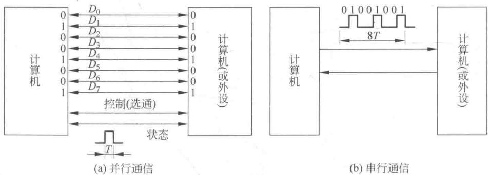

*上图并行（一把扁平线束，D0~D7 同时走），下图串行（两根细线，一位一位排队）。*

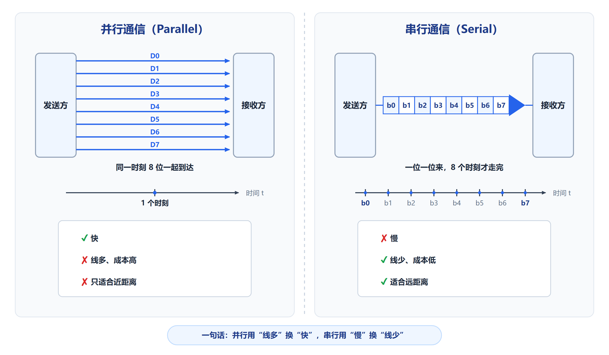

*左边 8 条箭头同时到，右边 1 条箭头 8 个时刻才走完——**并行用"线多"换"快"，串行用"慢"换"线少"**。*

#### 9.1.2 按同步方式分类：异步 vs 同步（必背）

**【① 异步通信（Asynchronous Communication）】**

> **在异步通信方式中，接收器和发送器使用各自的时钟，它们的工作是非同步的。**
> **在异步传送中，每一个字符要用起始位和停止位作为字符开始和结束的标志，以字符为单位一个个地发送和接收。**

**关键词（梁版 PPT 的概括）**：

```
各自的时钟 · 起始位 / 停止位包裹 · 以字符为单位
```

**【② 同步通信（Synchronous Communication）】**

> **同步通信是一种连续串行传送数据的通信方式，一次通信只传送一帧信息。**
> 这里的信息帧和异步通信中的字符帧不同，**通常含有若干个数据字符**。

**按控制规程分两类**：

| 类型 | 数据格式 |
|---|---|
| **面向字符型** | **单同步、双同步和外同步**三种数据格式 |
| **面向比特型** | 每帧由**六个部分**组成（见下） |

**面向比特型（HDLC 帧）的六个部分（PPT 逐条列出）**：

| 部分 | 内容 |
|---|---|
| 第一部分 | **开始标志 `7EH`** |
| 第二部分 | **一个字节的地址场** |
| 第三部分 | **一个字节的控制场** |
| 第四部分 | **数据**（数据都是位 bit 的集合） |
| 第五部分 | **两个字节的循环控制码 CRC** |
| 最后部分 | **又是 `7EH`，作为结束标志** |

> **【为什么异步通信每帧都短】**：
> 因为发送方和接收方**各自用自己的时钟**，两个时钟频率不可能完全一样，传得越久误差积累越大。
> 所以异步通信干脆"只保证一个字符内不跑偏"，**每传一个字符就重新对齐一次**。
> 而**同步通信有专门的时钟线**，双方节拍绝对一致，所以一帧可以很长。

#### 9.1.3 按传送方向分类：单工 / 半双工 / 全双工（必背）

| 方式 | 能不能双向 | 能不能同时 | 生活例子（PPT 给的） |
|---|---|---|---|
| **单工** | **只能单方向** | — | **无线电广播** |
| **半双工** | 可双向 | **不能同时** | **对讲机** |
| **全双工** | 可双向 | **能同时** | **电话机** |

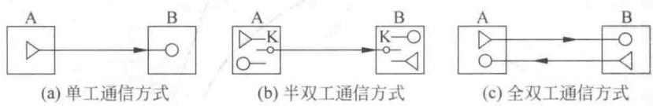

*教材原图：(a) 单工、(b) 半双工（带切换开关 K）、(c) 全双工。*

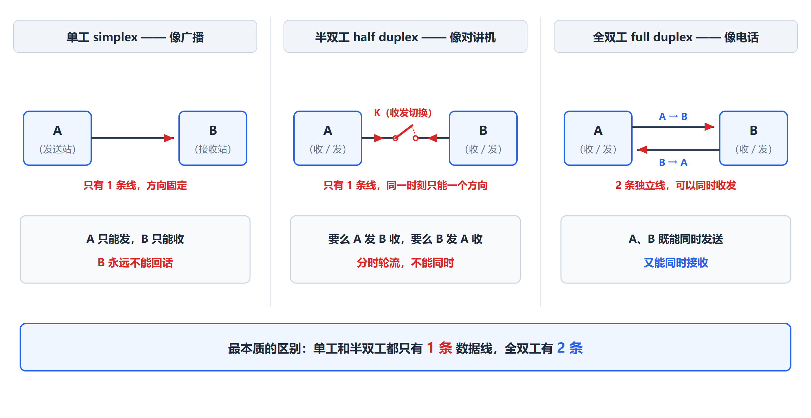

*单工一根单向箭头；半双工一根线加切换开关；全双工两条独立的单向线。*

> **【易错】半双工不是"只能收或者只能发"，而是"能收能发，但不能同时"。**
> 切换靠一个"开关"（图中标的 K）——**说话前得先说"over"**，就是这个道理。

#### 9.1.4 通信双方必须约定好的两件事

> **在异步数据传送中，通信双方必须约定好字符格式和通信速率**：
> - **字符格式**：包括**字符的编码形式、奇偶校验以及起始位和停止位的规定**。
> - **通信速率**：通信速率通常用**比特率**表示。

> **梁版 PPT 的一句话**：**约定不一致 → 收到的就是乱码：格式约定管"怎么排"，速率约定管"多快采样"。**

#### 9.1.5 异步传送的字符帧格式（本章最基础的一张图）

> **异步传送每个字符的组成格式**：
> - **首先用一个起始位表示字符的开始**；
> - **后面紧跟着的是字符的 7 位或 8 位数据（低位在前，高位在后）**，可根据需要加入**奇偶校验位**；
> - **最后是停止位，可以是一位或两位**。
> - **串行传送的数据位加上起始位和停止位就形成了一个串行传送的帧。**
> - **起始位用逻辑"0"低电平表示，停止位用逻辑"1"高电平表示。**

**帧的结构（必背）**：

```
空闲(高) │ 起始 │ b0 b1 b2 b3 b4 b5 b6 b7 │ 校验 │ 停止 │ 空闲(高)
  1      │  0   │ ← 数据（低位在前）→       │ 可选 │  1   │   1
```

**几个关键点**：

| 点 | 说明 |
|---|---|
| **空闲状态** | **高电平**（线没事干的时候就是高的） |
| **起始位** | **低电平（0）**——接收方就是靠这个**下降沿**知道"要开始了" |
| **数据位** | **7 位或 8 位**，**低位在前（LSB first）** |
| **校验位** | 可选（奇校验或偶校验） |
| **停止位** | **高电平（1）**，可以是 **1 位或 2 位**（USART 还支持 0.5、1.5 位） |

> **【最易错】"低位在前"（LSB first）**——发送时数据一位一位往右移出移位寄存器，
> **最右边那一位（bit0）自然最先出去**。不是"高位在前"。
>
> 例：要发 `0x25` = `0010 0101`，线上顺序是 **bit0=1 → 0 → 1 → 0 → 0 → 1 → 0 → 0**。

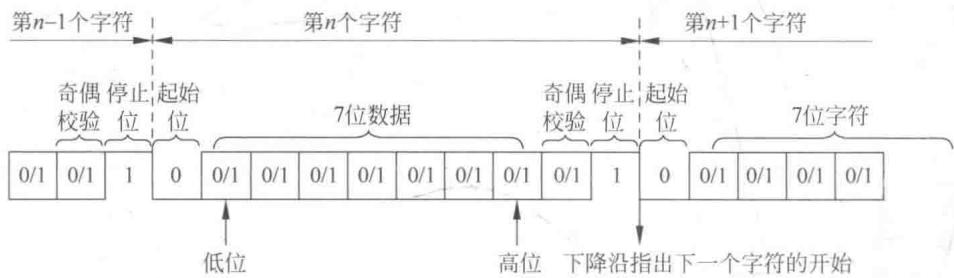

*最左边是上一个字符的停止位（高），然后是一个下降沿（起始位），接着是 7 位数据（低位在前）、校验位、停止位。*

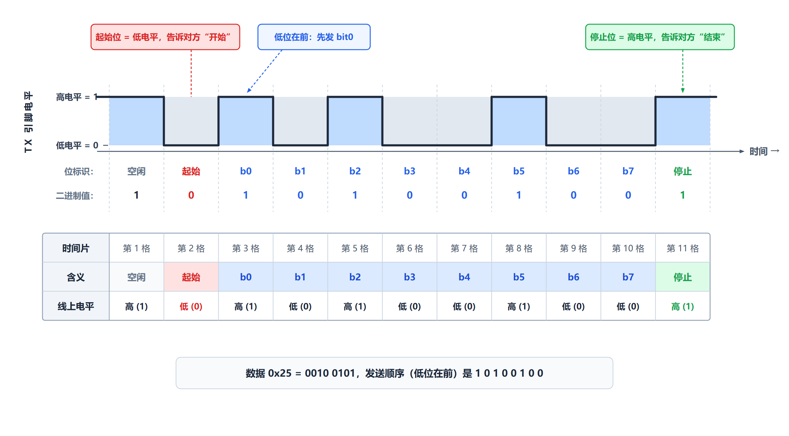

*用 `0x25`、9600、n、8、1 画出的完整帧：空闲 → 起始 → b0~b7 → 停止。*

**【PPT 教材都强调的一句话】**：

> **在异步传送中，字符间隔不固定，在停止位后可以加空闲位，空闲位用高电平表示，用于等待发送。**

> **【理解】**：正因为可以随便插空闲位，异步通信才能"想发就发"——
> 接收方不会因为线一直高就以为在传数据，**它只在看到下降沿时才启动一次接收**。

#### 9.1.6 波特率 vs 比特率（最容易混的一对）

> **在信息传输通道中，携带数据信息的信号单元叫码元，每秒钟通过信道传输的码元数称为码元传输速率，简称波特率。**

| 概念 | 定义 | 单位 |
|---|---|---|
| **波特率（Baud）** | **每秒钟传输的码元数**（码元传输速率） | 波特（Baud） |
| **比特率** | **每秒钟传输的二进制有效位数** | **bit/s（bps）** |

**【PPT 的例子】**

> **数据传送速率为 120 字符/秒（这个速率可以称为波特率），而每一个字符为 10 位，
> 则其传送的比特率为 10 × 120 = 1200 位/秒 = 1200 比特。**

**换算关系**：

```
比特率 = 波特率 × 每个码元携带的 bit 数
```

> **【重要】只有当每个码元只携带 1 bit 信息时，两者在数值上才相等。**
> 我们这门课的 USART 就是"1 码元 = 1 bit"，所以**实际使用时这两个数通常一样**——
> 但概念上必须分清。

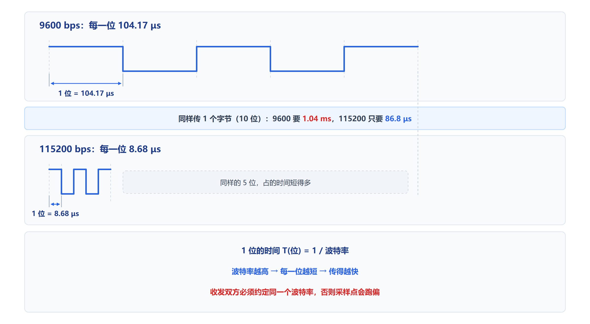

*波特率决定"每一位持续多久"。9600 bps 时一位约 104 µs。*

**【必会的换算】**

> **每一位的时间 = 1 / 波特率**

```
9600 bps  → 一位 ≈ 104.17 µs   （1/9600）
115200 bps → 一位 ≈ 8.68 µs    （1/115200）
```

> **为什么重要**：接收方就是**按这个时间间隔去采样**的。如果双方波特率不一致，
> 采到的就是错位的数据——**这就是"波特率设错就全是乱码"的原因**。

---

### 9.2 STM32 的异步串行通信接口 USART ★★★ 【PPT 重点：陈 p14～p56 / 梁 p15～p57】

#### 9.2.1 USART 是什么、有几个

> **STM32 单片机拥有 3 个 USART（通用同步/异步接收和发送器 USART1~USART3）
> 和 2 个通用异步收发器（UART4 和 UART5）。**

| 缩写 | 全称 | 中文 |
|---|---|---|
| **USART** | **U**niversal **S**ynchronous/**A**synchronous **R**eceiver/**T**ransmitter | **通用同步/异步串行接收/发送器** |
| **UART** | **U**niversal **A**synchronous **R**eceiver/**T**ransmitter | **通用异步接收/发送装置** |

> **USART 是一个全双工通用同步/异步串行收发模块，该接口是一个高度灵活的串行通信设备。**

> **【区分 USART 和 UART】**
> **带 S 的 USART 多一路同步时钟（CK 引脚）**，可以工作在同步模式；
> **UART 只能异步**。
> **本章重点是 USART 的异步模式**——所以下面讲的一切都按"异步"来说。

#### 9.2.2 USART 的主要特性（PPT 列了 10 几条，重点记前 4 条）

| # | 特性 |
|---|---|
| 1 | **全双工的异步通信** |
| 2 | **NRZ 标准格式**（不归零，就是用高低电平直接表示 0/1） |
| 3 | **分数波特率发生器系统**，发送和接收共用的可编程波特率，**最高达 4.5 Mbit/s** |
| 4 | **可编程数据字长度（8 位或 9 位）**；**可配置的停止位——支持 1 或 2 个停止位** |
| 5 | **发送方为同步传输提供时钟** |
| 6 | **LIN 主发送同步断开符的能力、从检测断开符的能力**（生成 13 位断开符；检测 10/11 位断开符） |
| 7 | **IRDA SIR 编码器解码器**：正常模式下支持 3/16 位的持续时间 |
| 8 | **智能卡模拟功能**（ISO7816-3 标准；可用 0.5 和 1.5 个停止位） |
| 9 | **单线半双工通信** |
| 10 | **可配置的 DMA 多缓冲器通信**（在 SRAM 里利用集中式 DMA 缓冲接收/发送字节） |
| 11 | **单独的发送器和接收器使能位** |
| 12 | **检测标志**：接收缓冲器满、发送缓冲器空、传输结束 |
| 13 | **校验控制**：发送校验位、对接收数据进行校验 |
| 14 | **四个错误检测标志**：**溢出错误 ORE、噪音错误 NE、帧错误 FE、校验错误 PE** |
| 15 | **10 个带标志的中断源**（见 9.2.8） |
| 16 | **多处理器通信**：地址不匹配则进入静默模式 |
| 17 | **两种唤醒接收器的方式**：**地址位（MSB，第 9 位）、总线空闲** |

> **【只记这几条】**：全双工、NRZ、分数波特率（4.5Mbit/s）、8/9 位字长、1/2 停止位、四个错误标志。

#### 9.2.3 USART 引脚与重映射

**基本引脚（必记）**：

| 引脚 | 作用 |
|---|---|
| **TX** | **发送数据输出**。发送器被激活且不发送数据时，**TX 处于高电平** |
| **RX** | **接收数据串行输入**。通过**过采样技术**区别数据和噪音 |

**默认引脚（USART1）**：

```
USART1_TX → PA9
USART1_RX → PA10
```

**引脚重映射（PPT 表 9-2/9-3/9-4）**：

> **通过软件设置复用重映射寄存器（`AFIO_MAPR`）中的 USART1_REMAP、USART2_REMAP 和 USART3_REMAP[1:0]，
> USART1~USART3 的功能引脚可以切换（称为功能引脚重映射）。**

**表 9-2 USART1 引脚重映射（必背）**：

| 复用功能 | `USART1_REMAP = 0` | `USART1_REMAP = 1` |
|---|---|---|
| **USART1_TX** | **PA9** | **PB6** |
| **USART1_RX** | **PA10** | **PB7** |

**表 9-3 USART2 引脚重映射**：

| 复用功能 | `USART2_REMAP = 0` | `USART2_REMAP = 1`（只适用于 100 和 144 脚封装） |
|---|---|---|
| USART2_CTS | PA0 | PD3 |
| USART2_RTS | PA1 | PD4 |
| **USART2_TX** | **PA2** | **PD5** |
| **USART2_RX** | **PA3** | **PD6** |
| USART2_CK | PA4 | PD7 |

**表 9-4 USART3 引脚重映射（三档）**：

| 复用功能 | `REMAP[1:0]=00`（无重映射） | `=01`（部分） | `=11`（完全） |
|---|---|---|---|
| USART3_TX | **PB10** | PC10 | PD8 |
| USART3_RX | **PB11** | PC11 | PD9 |
| USART3_CK | PB12 | PC12 | PD10 |

> **【本章只需要记 USART1 的默认引脚：PA9（TX）/ PA10（RX）】**——
> 例 9-1 用的就是这两个。

> **【别忘了】要重映射引脚，必须先开 `AFIO` 时钟**（`RCC_APB2ENR` 的 bit0）——
> 这是第 6、7 章反复强调的。

#### 9.2.4 USART 的内部结构

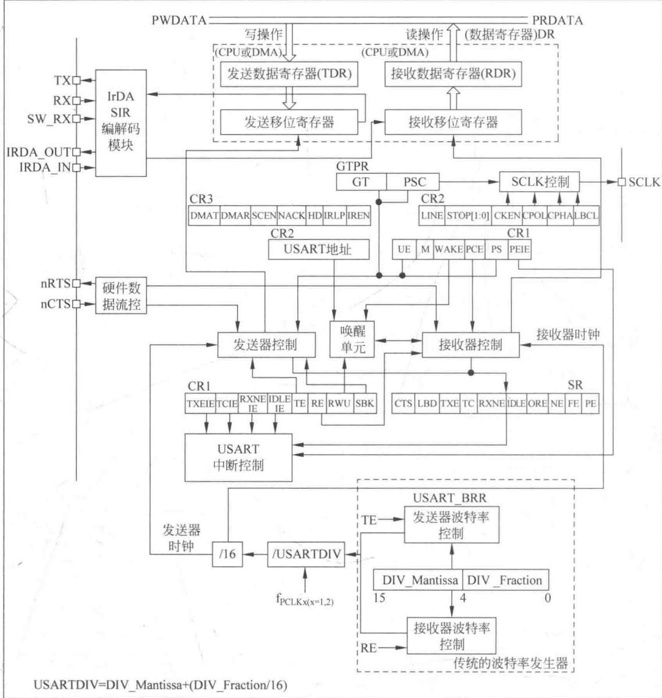

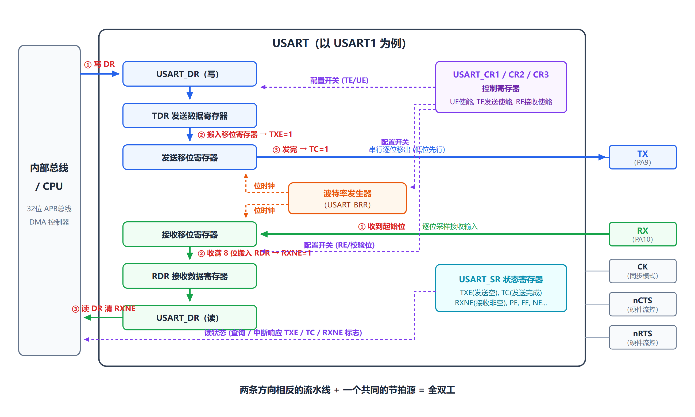

**数据通路（发送方向，必背）**：

```
内部总线 → 【发送数据寄存器 TDR】→ 【发送移位寄存器】→ TX 引脚
              ↑ 写 DR                    ↑ 逐位移出（低位在前）
           （TXE 置 1 表示这个缓冲空了）
```

**数据通路（接收方向）**：

```
RX 引脚 → 【接收移位寄存器】→ 【接收数据寄存器 RDR】→ 内部总线
                                    ↑ 收满一个字符
                              （RXNE 置 1 表示有新数据）
```

**USART 包含的寄存器（PPT 列出）**：

| 寄存器 | 作用 |
|---|---|
| **USART_SR** | **状态寄存器**（各种标志） |
| **USART_DR** | **数据寄存器**（收发都走它） |
| **USART_BRR** | **波特率寄存器**（**12 位整数 + 4 位小数**） |
| **USART_CR1 / CR2 / CR3** | **三个控制寄存器** |
| **USART_GTPR** | 智能卡模式下的保护时间寄存器 |

> **梁版 PPT 的一句话**：**SR 看状态、DR 收发数据、BRR 定节奏、CR1~CR3 定规则。**

#### 9.2.5 数据格式（帧的结构）

> **通过配置 `USART_CR1` 寄存器中的 `M` 位，选择字长为 8 或 9 位。**

> **通过数据线，在 USART 模式下，串行数据作为帧发送和接收，数据帧包括**：
> - **一个起始位**；
> - **一个数据字（8 或 9 位），最低有效位在前**；
> - **0.5、1.5 或 2 个停止位**（默认 1 位）；
> - **总线在发送或接收前处于空闲状态（一般为高电平）**。

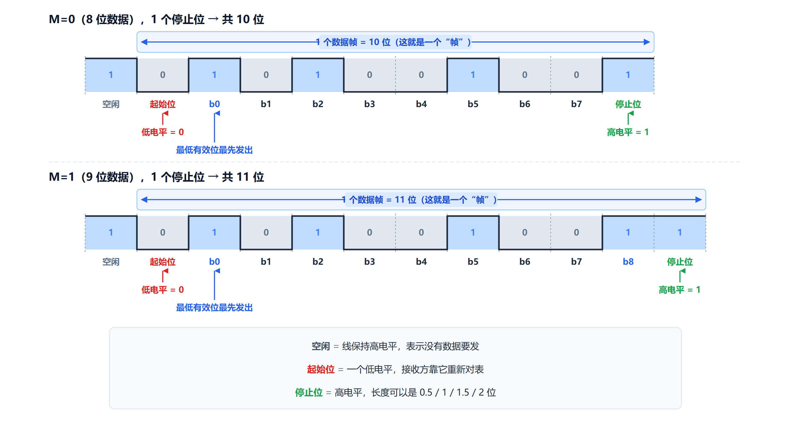

**【必背】M 位与 PCE 位的组合决定帧格式（梁版 PPT 表 9-6）**：

| `M` 位 | `PCE` 位 | USART 帧 |
|---|---|---|
| **0** | **0** | **起始位 + 8 位数据 + 停止位** |
| **0** | **1** | **起始位 + 7 位数据 + 奇偶校验位 + 停止位** |
| **1** | **0** | **起始位 + 9 位数据 + 停止位** |
| **1** | **1** | **起始位 + 8 位数据 + 奇偶校验位 + 停止位** |

> **【易错】`M` 位是"字长选择"**：**`M = 0` 表示 8 位，`M = 1` 表示 9 位**。
> （PPT 原文写作"位12：M，字长（0-9位，1-9位）"是笔误，正确是 **0 = 8 位、1 = 9 位**。）
>
> **注意 `M=0` + `PCE=1` 时，数据只有 7 位**——因为第 8 位被校验位占了。

**【停止位的编码（CR2 的 STOP[1:0]）】**

| `STOP[13:12]` | 停止位位数 |
|---|---|
| **`00`** | **1 个停止位** |
| `01` | **0.5 个停止位** |
| `10` | **2 个停止位** |
| `11` | **1.5 个停止位** |

> **【最常用】`00`（1 个停止位）**——就是常说的 "n,8,1" 里的那个 1。

#### 9.2.6 发送器和接收器的配置步骤（PPT 逐条列出）

**【发送字符的 8 个步骤】**：

```
1）置位 USART_CR1 的 UE 位，激活 USART
2）配置 USART_CR1 的 M 位，定义字长
3）配置 USART_CR2 的 STOP[1:0]，设置停止位的位数
4）（可选）多缓冲器通信时，配置 USART_CR3 的 DMAT 位并按 DMA 方式配置 DMA 寄存器
5）通过 USART_BRR 寄存器选择波特率
6）设置 USART_CR1 的 TE 位，使能发送器
7）把待发送的数据写入 USART_DR（此操作清除 TXE 位）
8）写完最后一个数据字后，要等待 TC=1，表示最后一个数据帧传输结束
```

> **梁版 PPT 的口诀**：**开机 UE → 定格式 M/STOP → 定节奏 BRR → 开发送 TE → 写 DR → 等 TC**

**【接收字符的 6 个步骤】**：

```
1）置位 USART_CR1 的 UE，激活 USART
2）配置 USART_CR1 的 M 位，定义字长
3）配置 USART_CR2 的 STOP[1:0]，设置停止位位数
4）（可选）多缓冲器通信时，配置 CR3 的 DMAT 位并配置 DMA
5）通过 USART_BRR 寄存器选择波特率
6）置位 USART_CR1 的 RE 位，激活接收器，使它开始寻找起始位
```

> **和发送配置几乎相同，只是最后一步从 `TE` 换成 `RE`**——
> **`RE` 置位后，接收器开始侦测起始位的下降沿。**

**【一个字符接收完成时会怎样（必背）】**：

> - **`RXNE` 位被置位**：表明移位寄存器的内容**已转移到接收数据寄存器 RDR**；
> - 如果 **`RXNEIE`** 位被设置，则**产生中断**；
> - 接收期间如果检测到**帧错误、噪音或溢出错误**，相应的错误标志将被置位；
> - 多缓冲器通信时，RXNE 在每个字节接收后被置位，并由 **DMA 读 DR 自动清零**；
> - **单缓冲器模式由软件读 `USART_DR` 清除 RXNE**。**RXNE 必须在下一字符接收结束前被清零，否则溢出。**

> **【本章最重要的一条"操作纪律】读 `USART_DR` 一次 = 取走数据 + 自动清 RXNE。**
> 所以**不要在中断里"只看看有没有数据"而不读 DR**——那样标志永远清不掉。

**【TXE 与 TC 的区别（必考）】**：

| 标志 | 全称 | 什么时候置 1 | 含义 |
|---|---|---|---|
| **TXE** | Transmit data register Empty | **DR 里的数据被搬进移位寄存器后** | **可以写下一个字节了** |
| **TC** | Transmission Complete | **移位寄存器里的最后一位也发完了** | **整个帧真的发完了** |

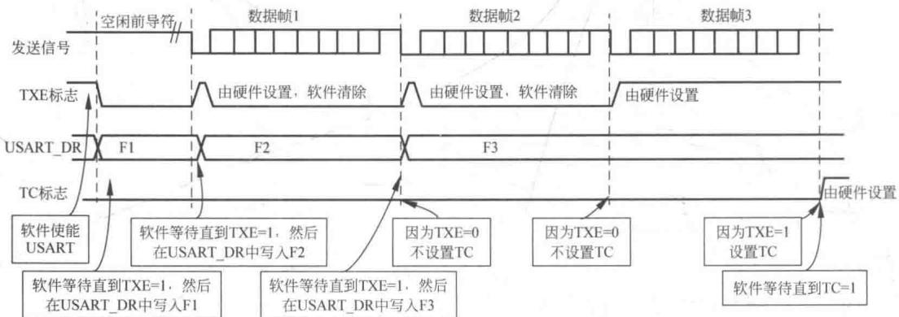

*教材原图：写 DR 后 TXE 清零，数据搬进移位寄存器后 TXE 重新置 1；整个帧发完后 TC 置 1。*

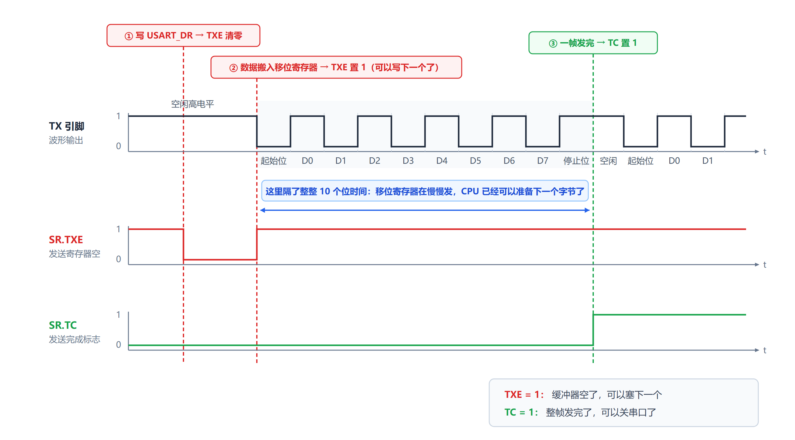

*辅助理解图：写 DR → TXE 清 0 → 数据搬进移位寄存器 → TXE 又置 1（可以写下一个）→ 发完后 TC 置 1。*

> **【易错】TXE 置 1 只代表"缓冲空了"，不代表"发完了"**。
> 要确认"真的发完了"，必须等 **TC**。
> **教材原文**："在 USART_DR 寄存器中写入最后一个数据字后，要等待 TC=1……
> 当需要关闭 USART 或需要进入停机模式之前，需要确认传输结束，避免破坏最后一次传输。"

#### 9.2.7 【必考】分数波特率（本章最容易拿分也最容易算错的地方）

> **接收器和发送器的波特率在 USARTDIV 的整数和小数寄存器中的值设置相同。**

**公式（PPT 原文）**：

```
                    f_CK
      Tx/Rx 波特率 = ─────────────
                    16 × USARTDIV
```

> **`f_CK` 是给外设的时钟：`PCLK1` 用于 USART2、3、4、5，`PCLK2` 用于 USART1。**
> **`USARTDIV` 是一个无符号的定点数，通过 `USART_BRR` 寄存器设置。**

**把公式反过来用（这才是实际写程序时用的）**：

```
USARTDIV = f_CK / (16 × 目标波特率)
```

**`USART_BRR` 的位分配（必背）**：

```
bit15              bit4 bit3        bit0
+---------------------+---------------+
|  DIV_Mantissa[11:0] | DIV_Fraction[3:0] |
|      （整数部分）      |   （小数部分）   |
+---------------------+---------------+
```

```
USARTDIV = DIV_Mantissa + DIV_Fraction / 16

USART_BRR = (DIV_Mantissa << 4) | DIV_Fraction
```

**【教材原例：已知 `USART_BRR = 0x1BC`，求 USARTDIV】**

```
第一步：补成 16 位
   0x1BC = 0000 0001 1011 1100

第二步：按位切两段（互不重叠！）
   DIV_Mantissa = 0x1BC >> 4   = 0x1B = 27
   DIV_Fraction = 0x1BC & 0x0F = 0xC  = 12

第三步：算 USARTDIV
   USARTDIV = 27 + 12/16 = 27 + 0.75 = 27.75
```

> **【极容易错】不能把 `0x1BC` 整个当"整数部分"、再把它末尾的 `1100` 当小数部分**——
> **那样 bit3~bit0 被数了两次**。正确切法只有一种：**整数取 bit15~bit4，小数取 bit3~bit0**。

**【必会：72MHz、9600 bps，BRR 该写多少】**

```
第一步：USARTDIV = 72 000 000 / (16 × 9600)
                 = 72 000 000 / 153 600
                 = 468.75

第二步：拆分
   DIV_Mantissa = 468
   DIV_Fraction = 0.75 × 16 = 12

第三步：拼
   USART_BRR = (468 << 4) | 12
             = 7488 | 12
             = 0x1D40 | 0x00C
             = 0x1D4C
```

**验算**：

```
USARTDIV = 468 + 12/16 = 468.75
实际波特率 = 72 000 000 / (16 × 468.75) = 72 000 000 / 7500 = 9600 ✓
```

> **【必记】9600 bps @ 72MHz → `USART_BRR = 0x1D4C`**——这个值例 9-1 的寄存器版里直接写了。

**【有误差的情况（PPT 课后任务就是这道）】**

**36MHz、115200 bps**：

```
USARTDIV = 36 000 000 / (16 × 115200) = 19.53125
DIV_Mantissa = 19
DIV_Fraction = 0.53125 × 16 = 8.5

8.5 不是整数，必须四舍五入 → 取 9

USART_BRR = (19 << 4) | 9 = 304 + 9 = 313 = 0x139
```

**验算误差**：

```
实际 USARTDIV = 19 + 9/16 = 19.5625
实际波特率 = 36 000 000 / (16 × 19.5625) = 36 000 000 / 313 ≈ 115 016 bps
误差 = (115200 − 115016) / 115200 ≈ 0.16%
```

> **0.16% 的误差能用**——串行通信一般允许 **2%~3%** 以内的误差。
> 但这也说明：**不是所有波特率都能精确配出来，波特率越高误差越大。**

**【PPT 的波特率表（表 9-5）】**

| 波特率(bps) | `f_PCLK = 36 MHz` | `f_PCLK = 72 MHz` |
|---|---|---|
| 2400 | 937.5 | 1875 |
| 9600 | 234.375 | 468.75 |
| 19200 | 117.1875 | 234.375 |
| 57600 | 39.0625 | 78.125 |

> **注意表里这些数都是"`USARTDIV`"本身，不是要写进 BRR 的值。**
> 比如 72MHz、9600 对应 468.75，换算成 BRR 是 `(468 << 4) | 12 = 0x1D4C`。

> **【最实用的一条】`f_CK` 别用错**：
> **只有 USART1 用 PCLK2（72MHz），USART2~5 都用 PCLK1（36MHz）**。
> 用错时钟，波特率直接差一倍，收到的全是乱码。

#### 9.2.8 校验控制与中断

**【校验控制】**

> **设置 `USART_CR1` 寄存器的 `PCE` 位，可以使能奇偶控制**
> （**发送时生成一个奇偶位，接收时进行奇偶校验**）。

> **`PS` 位**：**`0` = 偶校验，`1` = 奇校验**。

**【中断请求（PPT 表 9-7，重点记前 5 行）】**

| 中断事件 | 事件标志 | 使能位 |
|---|---|---|
| **发送数据寄存器空** | **TXE** | **TXEIE** |
| **发送完成** | **TC** | **TCIE** |
| **接收数据就绪可读** | **RXNE** | **RXNEIE** |
| **检测到数据溢出** | ORE | RXNEIE |
| **检测到空闲线路** | IDLE | IDLEIE |
| 奇偶校验错 | PE | PEIE |
| 断开标志 | LBD | LBDIE |
| 噪声/溢出/帧错误 | NE / ORE / FE | EIE（仅 DMA 接收时用） |
| CTS 标志 | CTS | CTSIE |

> **【最关键的机制】USART 的各种中断事件被连接到同一个中断向量。**
> 也就是说：**所有 USART 中断共用一个 ISR（`USART1_IRQHandler`）**，
> 进 ISR 后必须用 `USART_GetITStatus()` 判断到底是哪个事件。

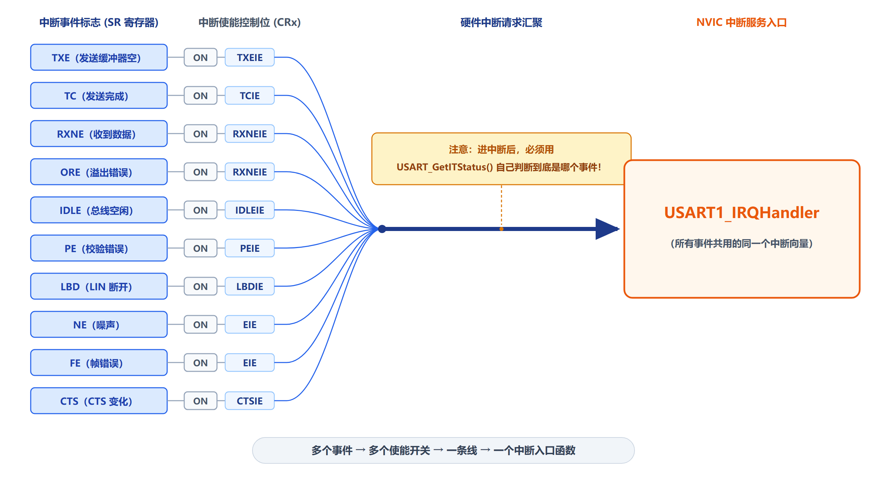

*各个标志位与对应的使能位"与"之后，全部汇入一个"或门"，产生唯一的 USART 中断信号。*

> **【易错】`USART1_IRQn` 只有一个中断号**（梁版 PPT 说 37 号）——
> 你没法"只开接收中断、不开发送中断"地分两个 ISR，只能在一个 ISR 里判断。

#### 9.2.9 USART 寄存器（必背偏移和关键位）

**5 个 USART 的起始地址（必背 USART1）**：

| 外设 | 寄存器起始地址 | 挂在哪条总线 |
|---|---|---|
| **USART1** | **`0x4001 3800`** | **APB2（72MHz）** |
| USART2 | `0x4000 4400` | APB1（36MHz） |
| USART3 | `0x4000 4800` | APB1 |
| UART4 | `0x4000 4C00` | APB1 |
| UART5 | `0x4000 5000` | APB1 |

> **【最容易错】只有 USART1 挂在 APB2（72MHz），其余都在 APB1（36MHz）**——
> **算波特率时用错时钟，波特率就差一倍。**

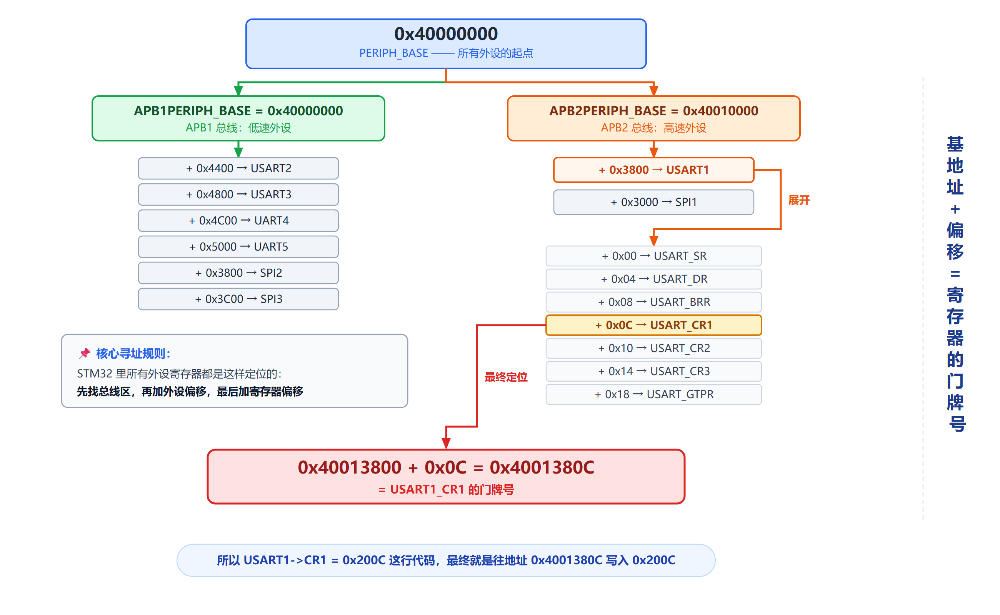

*`0x40000000`（外设区）→ `+0x10000`（APB2）→ `+0x3800`（USART1）→ `+偏移`（具体寄存器）。*

**寄存器偏移表（必背）**：

| 寄存器 | 偏移 | 作用 |
|---|---|---|
| **USART_SR** | **`0x00`** | **状态寄存器**（各种标志） |
| **USART_DR** | **`0x04`** | **数据寄存器**（收发都走它） |
| **USART_BRR** | **`0x08`** | **波特率寄存器** |
| **USART_CR1** | **`0x0C`** | **控制寄存器 1**（UE/M/PCE/PS/TE/RE + 中断使能） |
| **USART_CR2** | **`0x10`** | **控制寄存器 2**（STOP/ADD） |
| USART_CR3 | `0x14` | 控制寄存器 3（DMA 等） |
| USART_GTPR | `0x18` | 保护时间和预分频（智能卡） |

**【USART_SR 的 3 个关键位（必背）】**：

| 位 | 名称 | 含义 |
|---|---|---|
| **bit7** | **TXE** | **发送数据寄存器空**（可以写下一个字节了） |
| **bit6** | **TC** | **发送完成**（整个帧发完了） |
| **bit5** | **RXNE** | **接收数据寄存器非空**（收到新数据了） |

**其他错误标志（了解位置即可）**：

```
bit9  CTS      bit8  LBD      bit4  IDLE
bit3  ORE（溢出）  bit2  NE（噪声）  bit1  FE（帧错误）  bit0  PE（校验错）
```

**【USART_CR1 的关键位（必背）】**：

| 位 | 名称 | 含义 |
|---|---|---|
| **bit13** | **UE** | **USART 使能**（总开关） |
| **bit12** | **M** | **字长**：**0 = 8 位，1 = 9 位** |
| **bit10** | **PCE** | **校验控制使能** |
| **bit9** | **PS** | **校验选择**：**0 = 偶校验，1 = 奇校验** |
| **bit7** | **TXEIE** | **发送缓冲区空中断使能** |
| **bit6** | **TCIE** | **发送完成中断使能** |
| **bit5** | **RXNEIE** | **接收缓冲区非空中断使能** |
| **bit3** | **TE** | **发送使能** |
| **bit2** | **RE** | **接收使能** |

> **梁版 PPT 的提醒**：**UE、TE、RE 三个"总开关"都在 CR1——串口不通先查这三位。**

**【USART_CR2 的关键位】**：

| 位 | 名称 | 含义 |
|---|---|---|
| **bit[13:12]** | **STOP[1:0]** | **停止位位数**：`00`=1 个、`01`=0.5 个、`10`=2 个、`11`=1.5 个 |
| **bit[3:0]** | **ADD[3:0]** | **本设备的 USART 节点地址**（多处理器通信用） |

**【USART_DR】**：**bit[8:0]** 是数据（9 位字长时用 bit8）。**读 DR 一次 = 取走数据 + 清 RXNE。**

#### 9.2.10 固件库函数（9 个，重点记前 6 个）

**USART 的寄存器结构体（和第 5、6、8 章同一个套路）**：

```c
typedef struct
{
  __IO uint16_t SR;   uint16_t RESERVED0;   // 状态寄存器
  __IO uint16_t DR;   uint16_t RESERVED1;   // 数据寄存器
  __IO uint16_t BRR;  uint16_t RESERVED2;   // 波特率寄存器
  __IO uint16_t CR1;  uint16_t RESERVED3;   // 控制寄存器 1
  __IO uint16_t CR2;  uint16_t RESERVED4;   // 控制寄存器 2
  __IO uint16_t CR3;  uint16_t RESERVED5;   // 控制寄存器 3
  __IO uint16_t GTPR; uint16_t RESERVED6;   // 保护时间与预分频
} USART_TypeDef;
```

**基址定义**：

```c
#define PERIPH_BASE     ((u32)0x40000000)
#define APB1PERIPH_BASE PERIPH_BASE
#define APB2PERIPH_BASE (PERIPH_BASE + 0x10000)
#define USART1_BASE     (APB2PERIPH_BASE + 0x3800)   // 0x40013800
#define USART2_BASE     (APB1PERIPH_BASE + 0x4400)   // 0x40004400
#define USART3_BASE     (APB1PERIPH_BASE + 0x4800)   // 0x40004800
#define USART1          ((USART_TypeDef *) USART1_BASE)
```

**9 个常用库函数（必背前 6 个）**：

| # | 函数 | 作用 | 对应哪个寄存器 |
|---|---|---|---|
| **1** | **`USART_Init()`** | **按结构体参数初始化 USART**（波特率、字长、停止位、校验、流控、收发） | **BRR / CR1 / CR2** |
| **2** | **`USART_ITConfig()`** | **使能/除能指定的 USART 中断** | **CR1 的中断使能位** |
| **3** | **`USART_Cmd()`** | **使能/除能 USART 外设** | **CR1 的 UE** |
| **4** | **`USART_SendData()`** | **发送单个数据** | **写 DR** |
| **5** | **`USART_ReceiveData()`** | **返回最近收到的数据** | **读 DR（同时清 RXNE）** |
| **6** | **`USART_GetFlagStatus()`** | **检查指定的标志位状态** | **读 SR** |
| 7 | `USART_ClearFlag()` | 清除标志位 | 写 SR |
| 8 | `USART_GetITStatus()` | **检查指定中断是否发生**（标志位 AND 使能位） | SR + CR1 |
| 9 | `USART_ClearITPendingBit()` | 清除中断待处理位 | SR |

**`USART_InitTypeDef` 结构体（6 个成员）**：

```c
typedef struct
{
  uint32_t USART_BaudRate;            // 波特率
  uint16_t USART_WordLength;          // 字长
  uint16_t USART_StopBits;            // 停止位
  uint16_t USART_Parity;              // 奇偶校验模式
  uint16_t USART_Mode;                // 发送/接收使能
  uint16_t USART_HardwareFlowControl; // 硬件流控制
} USART_InitTypeDef;
```

**【典型初始化：9600, n, 8, 1】**

```c
USART_InitTypeDef USART_InitStructure;
USART_InitStructure.USART_BaudRate            = 9600;                       // 波特率 9600
USART_InitStructure.USART_WordLength          = USART_WordLength_8b;        // 字长 8 位
USART_InitStructure.USART_StopBits            = USART_StopBits_1;           // 1 位停止位
USART_InitStructure.USART_Parity              = USART_Parity_No;            // 无奇偶校验
USART_InitStructure.USART_HardwareFlowControl = USART_HardwareFlowControl_None; // 无流控制
USART_InitStructure.USART_Mode                = USART_Mode_Rx | USART_Mode_Tx;   // 收发都开
USART_Init(USART1, &USART_InitStructure);
```

> **【"9600, n, 8, 1"这串参数怎么对应到代码里】**：
>
> | 参数 | 含义 | 对应成员 |
> |---|---|---|
> | **9600** | 波特率 | `USART_BaudRate = 9600` |
> | **n** | 无校验（none） | `USART_Parity = USART_Parity_No` |
> | **8** | 8 位数据 | `USART_WordLength = USART_WordLength_8b` |
> | **1** | 1 位停止位 | `USART_StopBits = USART_StopBits_1` |

**【`USART_GetITStatus` 和 `USART_GetFlagStatus` 的区别（易错）】**：

> **梁版 PPT 的原文**：
> **`GetITStatus` 比 `GetFlagStatus` 多判一层：标志置位且对应中断使能开着，才算"中断发生"。**

| 函数 | 判断什么 | 用在哪 |
|---|---|---|
| **`USART_GetFlagStatus()`** | **只看标志位** | 轮询（查询）方式 |
| **`USART_GetITStatus()`** | **标志位 AND 中断使能位** | **中断服务函数里**（推荐） |

#### 9.2.11 例 9-1：串口回环（收到数据，取反回送）

**【任务】**：利用 STM32 最小系统板实现 STM32F103VET6 **串口 1** 与计算机的串行通信功能。
**计算机通过串口助手发送一个数据到 STM32，STM32 收到数据后，将数据按位取反后回送给计算机。**
**串行通信参数是 9600，n，8，1。**

**【工程配置】**：

> 在创建工程出现 "Manage Run-Time Environment" 对话框时，
> 选中 **"Device" → "Startup"**；选中 **"CMSIS" → "CORE"**；
> 选中 **"StdPeriph Drivers"** 中的 **GPIO、Framework、RCC 和 USART**。

**【PPT 总结的"USART 一般采用中断方式"的 6 个步骤（必背）】**：

```
1、使能串口时钟和对应的 GPIO 时钟
2、GPIO 端口模式设置：
     TX 引脚设置为 GPIO_Mode_AF_PP，GPIO_Speed_50MHz
     RX 引脚设置为 GPIO_Mode_IN_FLOATING
3、调用 USART_Init() 初始化串口参数
     （波特率、数据字长、奇偶校验、硬件流控、收发使能）
4、调用 USART_ITConfig() 开启串口中断，调用 NVIC_Init() 初始化 NVIC
5、调用 USART_Cmd() 使能串口
6、处理中断服务函数
```

> **梁版 PPT 的对比**：**对比定时器实验的五步，多出的正是 GPIO 复用配置这一步——
> TX 交外设、RX 留输入。**

**【① 时钟与 GPIO 配置】**

```c
// 使能 PA 口和 USART1 时钟（注意：USART1 在 APB2）
RCC_APB2PeriphClockCmd(RCC_APB2Periph_GPIOA | RCC_APB2Periph_USART1, ENABLE);

// USART1_TX 引脚 PA9：复用推挽输出
GPIO_InitStructure.GPIO_Pin   = GPIO_Pin_9;
GPIO_InitStructure.GPIO_Mode  = GPIO_Mode_AF_PP;      // ★ 必须是复用推挽
GPIO_InitStructure.GPIO_Speed = GPIO_Speed_50MHz;
GPIO_Init(GPIOA, &GPIO_InitStructure);

// USART1_RX 引脚 PA10：浮空输入
GPIO_InitStructure.GPIO_Pin  = GPIO_Pin_10;
GPIO_InitStructure.GPIO_Mode = GPIO_Mode_IN_FLOATING; // ★ 必须是浮空输入
GPIO_Init(GPIOA, &GPIO_InitStructure);
```

> **【必考·为什么要这样配】**
> - **TX 是"输出"，而且是被 USART 外设驱动，不是被 ODR 驱动** → 必须配 **`GPIO_Mode_AF_PP`（复用推挽）**；
> - **RX 是"输入"**，而且外部一定有确定的驱动（对方的 TX） → 配 **`GPIO_Mode_IN_FLOATING`（浮空输入）**。
>
> **如果 TX 配成普通推挽（`GPIO_Mode_Out_PP`）**，波形根本出不来——
> 因为引脚被"从外设断开"，ODR 又没人写。

**【② USART 参数配置 + 中断使能】**

```c
USART_InitStructure.USART_BaudRate            = 9600;
USART_InitStructure.USART_WordLength          = USART_WordLength_8b;
USART_InitStructure.USART_StopBits            = USART_StopBits_1;
USART_InitStructure.USART_Parity              = USART_Parity_No;
USART_InitStructure.USART_HardwareFlowControl = USART_HardwareFlowControl_None;
USART_InitStructure.USART_Mode                = USART_Mode_Rx | USART_Mode_Tx;
USART_Init(USART1, &USART_InitStructure);          // 初始化

USART_Cmd(USART1, ENABLE);                          // 启动串口（写 UE）

USART_ITConfig(USART1, USART_IT_RXNE, ENABLE);      // 接收中断使能
USART_ITConfig(USART1, USART_IT_TXE,  ENABLE);      // 发送中断使能
USART_ClearITPendingBit(USART1, USART_IT_TC);       // 先清 TC，防误触发

NVIC_Config();                                      // NVIC 配置
while (1);
```

**【③ NVIC 配置】**

```c
void NVIC_Config(void)
{
    NVIC_InitTypeDef NVIC_InitStructure;
    NVIC_PriorityGroupConfig(NVIC_PriorityGroup_2);     // 2 位抢占 + 2 位副
    NVIC_InitStructure.NVIC_IRQChannel                   = USART1_IRQn;
    NVIC_InitStructure.NVIC_IRQChannelPreemptionPriority = 1;
    NVIC_InitStructure.NVIC_IRQChannelSubPriority        = 0;
    NVIC_InitStructure.NVIC_IRQChannelCmd                = ENABLE;
    NVIC_Init(&NVIC_InitStructure);
}
```

**【④ 中断服务函数（必背结构）】**

```c
void USART1_IRQHandler(void)
{
    uint8_t recdata;
    if (USART_GetITStatus(USART1, USART_IT_RXNE) != RESET)   // 收到数据
    {
        recdata = USART_ReceiveData(USART1);                 // ★ 读 DR（同时清 RXNE）
        USART_SendData(USART1, ~recdata);                    // 按位取反回送
    }
    if (USART_GetITStatus(USART1, USART_IT_TC) != RESET)     // 发送完成
    {
        // 本例为空
    }
}
```

> **【必记三件事】**
> 1. **`USART_ReceiveData()` 内部就是"读 DR"，读一次自动清 RXNE**——所以要**先读**；
> 2. **`~recdata` 是按位取反**（`0x5A` → `0xA5`），这就是题目要的"按位取反回送"；
> 3. **函数名必须叫 `USART1_IRQHandler`**——它要和启动文件里的向量表对上。

**【⑤ 寄存器版（梁版 PPT 给的，很有价值）】**

```c
int main(void)
{
    /* 1. 使能 GPIOA / AFIO / USART1 时钟 */
    RCC->APB2ENR |= RCC_APB2ENR_IOPAEN | RCC_APB2ENR_AFIOEN | RCC_APB2ENR_USART1EN;

    /* 2. 配 PA9（TX）= 0xB 复用推挽 50MHz，PA10（RX）= 0x4 浮空输入 */
    GPIOA->CRH &= ~0x00000FF0;      /* 清 PA9、PA10 的 8 个配置位 */
    GPIOA->CRH |=  0x000004B0;

    /* 3. 写波特率寄存器：9600 @ 72MHz → 0x1D4C */
    USART1->BRR = 0x1D4C;

    /* 4. 使能 USART、发送器、接收器 */
    USART1->CR1 |= USART_CR1_UE | USART_CR1_TE | USART_CR1_RE;

    while (1)
    {
        if (USART1->SR & 0x0020)                    /* RXNE = bit5 = 0x0020 */
        {
            uint8_t d = (uint8_t)USART1->DR;        /* 读 DR，硬件自动清 RXNE */
            while (!(USART1->SR & 0x0080));         /* 等 TXE = bit7 = 0x0080 */
            USART1->DR = (uint8_t)(~d);             /* 按位取反回送 */
        }
    }
}
```

> **【这段代码的三个"数字密码"】**：
> - **`0x000004B0`** → PA9 的 4 位 = `0xB` = `1011` = **CNF=10（复用推挽）、MODE=11（50MHz）**；
>   PA10 的 4 位 = `0x4` = `0100` = **CNF=01（浮空输入）、MODE=00（输入）**；
> - **`0x1D4C`** → 9600 bps @ 72MHz 的 BRR 值（见 9.2.7 的演算）；
> - **`0x0020` = bit5 = RXNE**、**`0x0080` = bit7 = TXE**。

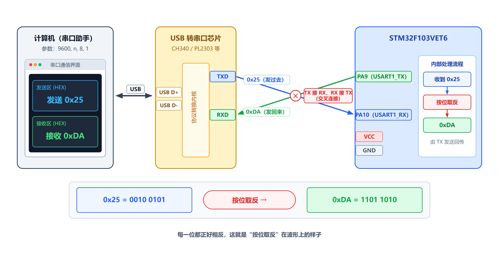

*计算机串口 → PA10（RX）→ 收到后取反 → PA9（TX）→ 回送计算机。*

---

## 三、重要知识之间的联系

### 对比 1：并行 vs 串行

| | **并行** | **串行** |
|---|---|---|
| 线数 | 多根 | **1~2 根** |
| 速度 | **快** | 慢 |
| 成本 | 高 | **低** |
| 距离 | 近 | **远** |
| 场合 | 芯片内部总线 | **COM、USB、网络** |

### 对比 2：异步 vs 同步

| | **异步通信** | **同步通信** |
|---|---|---|
| 时钟 | **收发各自用自己的时钟** | **有专门的时钟线**（或时钟对表） |
| 对齐方式 | **每个字符用起始位重新对表** | 连续传送，靠帧定界 |
| 帧长度 | **短**（一个字符一帧） | **长**（一帧含多个数据字符） |
| 额外开销 | **每帧都有起始位/停止位** | 开销小 |
| 典型协议 | **USART/UART** | HDLC（`7EH` 定界） |

> **一句话**：**异步用"每帧重新对表"换"不用时钟线"；同步用"时钟线"换"高效率"。**

### 对比 3：单工 / 半双工 / 全双工

| | 单工 | 半双工 | 全双工 |
|---|---|---|---|
| 双向 | ❌ | ✅ | ✅ |
| 同时 | — | ❌ | ✅ |
| 例子 | 广播 | 对讲机 | 电话 |

### 对比 4：波特率 vs 比特率

| | **波特率** | **比特率** |
|---|---|---|
| 单位 | 波特（Baud） | **bit/s（bps）** |
| 含义 | 每秒**码元**数 | 每秒**二进制有效位**数 |
| 关系 | **比特率 = 波特率 × 每码元 bit 数** | 每码元 1 bit 时两者相等 |

### 对比 5：TXE vs TC（最容易混的一对）

| | **TXE**（bit7） | **TC**（bit6） |
|---|---|---|
| 全称 | Transmit data register Empty | Transmission Complete |
| 什么时候置 1 | **DR 的数据被搬进移位寄存器后** | **移位寄存器最后一位发完后** |
| 含义 | **可以写下一个字节了** | **真的发完了** |
| 用途 | 连续发送时靠它判断"能不能写下一个" | **关闭串口前必须等它** |

### 对比 6：`USART_GetFlagStatus()` vs `USART_GetITStatus()`

| | `USART_GetFlagStatus()` | `USART_GetITStatus()` |
|---|---|---|
| 判断 | **只看标志位** | **标志位 AND 中断使能位** |
| 用途 | **轮询**方式 | **中断服务函数里** |

### 对比 7：M 位与 PCE 位的组合

| M | PCE | 帧格式 |
|---|---|---|
| 0 | 0 | 起始 + **8 位数据** + 停止 |
| 0 | 1 | 起始 + **7 位数据 + 校验** + 停止 |
| 1 | 0 | 起始 + **9 位数据** + 停止 |
| 1 | 1 | 起始 + **8 位数据 + 校验** + 停止 |

### 对比 8：第 8 章定时器 vs 第 9 章 USART 的配置套路

| 步骤 | **第 8 章 定时器** | **第 9 章 USART** |
|---|---|---|
| ① 开时钟 | `RCC_APB1PeriphClockCmd`（TIM2~7） | **`RCC_APB2PeriphClockCmd`（USART1）+ GPIOA 时钟** |
| ② 配引脚 | 不需要（纯定时） | **★ 多这一步**：TX=AF_PP、RX=IN_FLOATING |
| ③ 配参数 | `TIM_TimeBaseInit()` | `USART_Init()` |
| ④ 开中断 | `TIM_ITConfig()` + `NVIC_Init()` | `USART_ITConfig()` + `NVIC_Init()` |
| ⑤ 使能 | `TIM_Cmd()` | **`USART_Cmd()`**（写 UE） |
| ⑥ 写 ISR | `TIM2_IRQHandler` | `USART1_IRQHandler` |

> **【本章的核心认知】USART 的配置套路和第 8 章定时器一模一样，只多了一步"配 GPIO 复用"。**
> 这也印证了第 1 章讲的"外设四步曲"：**开时钟 → 配寄存器 → 使能 → 使用**。

---

## 四、高频易错点

> 以下为**常见易错点**（不是历年考试统计）。

| # | 易错点 | 正确理解 |
|---|---|---|
| 1 | **TX 引脚配成普通推挽输出** | **必须配 `GPIO_Mode_AF_PP`（复用推挽）**——普通推挽时引脚和外设断开，没有波形 |
| 2 | **RX 引脚配成上拉/下拉** | **教材例子配的是 `GPIO_Mode_IN_FLOATING`（浮空输入）** |
| 3 | **忘了开 USART1 的时钟用 APB1** | **USART1 在 APB2**（`RCC_APB2PeriphClockCmd`）；USART2~5 才在 APB1 |
| 4 | **算波特率时用错时钟** | **USART1 用 PCLK2 = 72MHz；USART2~5 用 PCLK1 = 36MHz** |
| 5 | **BRR 的小数部分没四舍五入** | `DIV_Fraction` 必须是整数，**0.5 要进位**（例：8.5 → 9） |
| 6 | **把 `USART_BRR` 整个当整数** | **bit15~bit4 是整数、bit3~bit0 是小数**，切错会重复数位 |
| 7 | 以为 TXE 置 1 就发完了 | **TXE = 缓冲空了（可以写下一个）**；**TC = 真的发完了** |
| 8 | **中断里只查标志不读 DR** | **读 DR 才清 RXNE**；不读会一直进中断 |
| 9 | **ISR 函数名写错** | 必须叫 `USART1_IRQHandler`，要和向量表对上 |
| 10 | 中断里用 `GetFlagStatus` 判断 | **中断里应该用 `USART_GetITStatus()`**（它多判了使能位） |
| 11 | 以为 USART 有多个中断向量 | **所有 USART 事件共用一个中断向量**，进 ISR 要判断是哪个事件 |
| 12 | 数据顺序记成"高位在前" | **低位在前（LSB first）**：`0x25` 先发 bit0 |
| 13 | 空闲状态记成低电平 | **空闲是高电平**；**起始位是低电平**（靠下降沿识别） |
| 14 | `M` 位含义记反 | **`M = 0` 是 8 位，`M = 1` 是 9 位**（不是反过来） |
| 15 | `PS` 位含义记反 | **`PS = 0` 偶校验，`PS = 1` 奇校验** |
| 16 | 以为 `M=0`、`PCE=1` 还是 8 位数据 | 这时**数据只有 7 位**，第 8 位被校验位占了 |
| 17 | 以为波特率和比特率总是相等 | **只有每码元 1 bit 时才相等**；本课程 USART 恰好是这种情况 |
| 18 | 半双工理解成"只能单向" | **半双工能双向，只是不能同时**；单工才是只能单向 |
| 19 | 以为同步通信和异步通信帧一样长 | **同步一帧可以含多个数据字符**；异步一帧只有一个字符 |
| 20 | 忘了 `AFIO` 时钟（如果要重映射引脚） | 引脚重映射必须先开 `AFIO` 时钟（`RCC_APB2ENR` bit0） |

---

## 五、本章考前速查

> 几分钟扫一遍，只看这一节就能回忆全章骨架。

### 基本概念

- **串行**：一根线一位一位传；**线少、成本低、适合远距离**，但**慢**
- **并行**：多根线同时传；**快**，但线多、成本高、只适合近距离
- **异步**：收发**各自时钟**，每字符用**起始位/停止位**包裹，**以字符为单位**
- **同步**：**连续传送**，帧内含多个数据字符，**用帧定界**（HDLC 用 `7EH` 起止）

**传送方向**：

| 方式 | 双向 | 同时 | 例子 |
|---|---|---|---|
| **单工** | ❌ | — | 广播 |
| **半双工** | ✅ | ❌ | 对讲机 |
| **全双工** | ✅ | ✅ | 电话 |

**波特率 vs 比特率**：

```
波特率 = 每秒码元数（Baud）
比特率 = 每秒二进制有效位数（bps）
比特率 = 波特率 × 每码元 bit 数
每一位的时间 = 1 / 波特率
```

### 异步帧格式（必背）

```
空闲(1) │ 起始(0) │ b0 b1 b2 b3 b4 b5 b6 b7 │ [校验] │ 停止(1)
                    ↑ 低位在前（LSB first）
```

| 项目 | 说明 |
|---|---|
| **空闲** | **高电平** |
| **起始位** | **低电平（0）**，靠下降沿识别 |
| **数据位** | **7 或 8 位，低位在前** |
| **停止位** | **高电平（1）**，1 位或 2 位 |

### USART 基础

- **STM32F103VET6 有 3 个 USART（1~3）+ 2 个 UART（4、5）**
- **USART 比 UART 多一路同步时钟 CK**
- **USART1：TX = PA9，RX = PA10**（重映射后 TX=PB6、RX=PB7）
- **全双工、NRZ、分数波特率、最高 4.5 Mbit/s、8/9 位字长、1/2 停止位**
- **四个错误标志：ORE（溢出）、NE（噪声）、FE（帧错误）、PE（校验错）**

### USART 寄存器（必背）

| 寄存器 | 偏移 | 关键位 |
|---|---|---|
| **SR** | **`0x00`** | **bit7 TXE、bit6 TC、bit5 RXNE** |
| **DR** | **`0x04`** | 数据（bit8:0）；**读一次自动清 RXNE** |
| **BRR** | **`0x08`** | **bit15:4 DIV_Mantissa、bit3:0 DIV_Fraction** |
| **CR1** | **`0x0C`** | **UE(13)、M(12)、PCE(10)、PS(9)、TXEIE(7)、TCIE(6)、RXNEIE(5)、TE(3)、RE(2)** |
| **CR2** | **`0x10`** | **STOP[13:12]**（`00`=1位、`01`=0.5、`10`=2、`11`=1.5）、ADD[3:0] |

**USART1 基地址 `0x40013800`（APB2）；USART2~5 在 APB1。**

### 波特率计算（必背）

```
USARTDIV = f_CK / (16 × 目标波特率)

DIV_Mantissa = USARTDIV 的整数部分
DIV_Fraction = 小数部分 × 16（四舍五入）

USART_BRR = (DIV_Mantissa << 4) | DIV_Fraction
```

**必记的两个值**：

| 场景 | USARTDIV | USART_BRR |
|---|---|---|
| **9600 @ 72MHz** | 468.75 | **`0x1D4C`** |
| 115200 @ 36MHz | 19.53125→19.5625 | `0x139`（误差 0.16%） |

**`f_CK` 别用错**：**USART1 → PCLK2（72MHz）**；**USART2~5 → PCLK1（36MHz）**。

### M 位与帧格式

| M | PCE | 帧 |
|---|---|---|
| 0 | 0 | 起始 + **8 数据** + 停止 |
| 0 | 1 | 起始 + **7 数据 + 校验** + 停止 |
| 1 | 0 | 起始 + **9 数据** + 停止 |
| 1 | 1 | 起始 + **8 数据 + 校验** + 停止 |

### 初始化 6 步（必背）

```
① 使能串口时钟和对应的 GPIO 时钟
② GPIO 模式：TX = GPIO_Mode_AF_PP（复用推挽）、RX = GPIO_Mode_IN_FLOATING（浮空输入）
③ USART_Init() 初始化参数（波特率、字长、停止位、校验、流控、收发使能）
④ USART_ITConfig() 开中断 + NVIC_Init() 配 NVIC
⑤ USART_Cmd() 使能串口（写 UE）
⑥ 写中断服务函数
```

### 常用库函数

| 函数 | 作用 | 对应寄存器 |
|---|---|---|
| **`USART_Init()`** | 初始化参数 | BRR/CR1/CR2 |
| **`USART_ITConfig()`** | 开/关中断 | CR1 |
| **`USART_Cmd()`** | 使能/除能 USART | CR1 的 UE |
| **`USART_SendData()`** | 发一个字节 | 写 DR |
| **`USART_ReceiveData()`** | 收一个字节 | 读 DR（清 RXNE） |
| **`USART_GetFlagStatus()`** | 查标志（轮询用） | 读 SR |
| **`USART_GetITStatus()`** | 查中断（ISR 用） | SR + CR1 |

### 例 9-1 的关键数字

```
9600, n, 8, 1 @ 72MHz
  → USART_BRR = 0x1D4C
  → PA9 配 AF_PP（0xB）、PA10 配 IN_FLOATING（0x4）
  → GPIOA->CRH |= 0x000004B0
  → RXNE = 0x0020（bit5）、TXE = 0x0080（bit7）
```

---

## 六、本章快速自测

> **用法**：先自己答，再看答案。
> **标注说明**：标有「**教材习题 X-Y**」的题目，来自教材第 9 章课后习题。

---

### 第一部分：教材课后习题

**Q1（教材习题 9-1）** STM32F103VET6 的 USART 有哪些特点？

<details><summary>答案</summary>

**按主题归类**：

**（1）传输方式**

- **全双工的异步通信**；
- **NRZ 标准格式**；
- **可编程数据字长度（8 位或 9 位）**；
- **可配置的停止位**——支持 **1 或 2 个停止位**（实际还支持 0.5、1.5）；
- **单独的发送器和接收器使能位**（TE、RE）；
- **单线半双工通信**。

**（2）速度**

- **分数波特率发生器系统**，发送和接收共用的可编程波特率，**最高达 4.5 Mbit/s**。

**（3）校验与错误检测**

- **校验控制**：发送校验位、对接收数据进行校验（PCE/PS）；
- **四个错误检测标志**：**溢出错误 ORE、噪音错误 NE、帧错误 FE、校验错误 PE**。

**（4）中断与 DMA**

- **10 个带标志的中断源**（CTS、LIN 断开、TXE、TC、RXNE、IDLE、ORE、FE、NE、PE）；
- **可配置的 DMA 多缓冲器通信**。

**（5）其他**

- **LIN 主发送/从检测断开符的能力**（13 位断开符 / 10、11 位检测）；
- **IRDA SIR 编码器解码器**；
- **智能卡模拟功能**（ISO7816-3）；
- **多处理器通信**：地址不匹配则进入**静默模式**；
- **两种唤醒接收器的方式**：**地址位（MSB，第 9 位）、总线空闲**。

**答题要点提醒**：**答出"全双工、NRZ、分数波特率 4.5Mbit/s、8/9 位字长、1/2 停止位、四个错误标志"这六条主干即可**，
其余作为补充。★★★
</details>

---

**Q2（教材习题 9-2）** 使用 STM32F103VET6 与计算机进行通信，编程实现计算机发送 `GetID` 作为命令，STM32F103VET6 收到命令后，返回 STM32 的 CPUID。

<details><summary>答案</summary>

**思路**：在例 9-1 的接收中断里**拼出一个字符串**，判断是不是 `"GetID"`，
如果是，就从 **`0x1FFFF7E8`**（STM32 的 96 位唯一 ID 起始地址）读出 12 字节并回送。

**关键代码**：

```c
#include "stm32f10x.h"
#include <string.h>

char cmd[8];
uint8_t idx = 0;

void USART1_IRQHandler(void)
{
    if (USART_GetITStatus(USART1, USART_IT_RXNE) != RESET)
    {
        char ch = (char)USART_ReceiveData(USART1);   // ★ 读 DR，自动清 RXNE

        if (ch == '\r' || ch == '\n' || idx >= 5)    // 一帧结束
        {
            cmd[idx] = '\0';
            idx = 0;

            if (strcmp(cmd, "GetID") == 0)            // 收到 GetID 命令
            {
                /* 96 位唯一 ID 存在 0x1FFFF7E8 ~ 0x1FFFF7F3，共 12 字节 */
                uint8_t *id = (uint8_t *)0x1FFFF7E8;
                for (int i = 0; i < 12; i++)
                {
                    while (!(USART1->SR & 0x0080));   // 等 TXE
                    USART_SendData(USART1, id[i]);     // 逐字节回送
                }
            }
        }
        else
        {
            cmd[idx++] = ch;                          // 拼接命令
        }
    }
}
```

**答题要点提醒**：

1. **要"拼字符串"再比较**——不能收到一个字就判断，因为命令是 5 个字符；
2. **读完 DR 才算取走数据**（同时清 RXNE）；
3. **发送前要等 TXE**，否则会把上一个字节冲掉；
4. **CPUID 的地址是 `0x1FFFF7E8`**（这是 STM32F1 的 96 位唯一 ID，不是"CPU 型号"）。

> **说明**：教材只给了题目，没给标准答案。上面是最直接的实现方式。
> 实际工程里还要考虑帧头帧尾、超时清空缓冲等——这门课不要求。★★
</details>

---

**Q3（教材习题 9-3）** 将例 9-2 的程序代码，修改为使用中断方式实现。

<details><summary>答案</summary>

> **注意**：教材里"例 9-2"是**查询（轮询）方式**的串口收发，
> 本题要求改成**中断方式**——也就是**例 9-1 用的那种写法**。

**两者的核心区别（必答）**：

| | **查询方式（例 9-2）** | **中断方式（例 9-1、本题）** |
|---|---|---|
| 判断有没有数据 | **主循环里反复查 `USART_GetFlagStatus()`** | **数据来了自动进 ISR** |
| CPU 占用 | **高**（一直在等） | **低**（没数据时干别的） |
| 代码位置 | 全在 `main` 的 `while(1)` 里 | **接收处理搬进 `USART1_IRQHandler`** |
| 需要配 NVIC 吗 | **不需要** | **必须配**（`NVIC_Init` + `USART_ITConfig`） |

**改造的四个步骤**：

```
① 删掉主循环里的 while (USART_GetFlagStatus(...) == RESET); 这类轮询
② 加上 USART_ITConfig(USART1, USART_IT_RXNE, ENABLE);   （开接收中断）
③ 加上 NVIC_Config();                                    （配 NVIC，使能 USART1_IRQn）
④ 把"读数据 + 处理"搬进 void USART1_IRQHandler(void)
```

**改造后的核心结构**：

```c
int main(void)
{
    /* GPIO + USART 初始化（和例 9-1 完全一样） */
    ...
    USART_Init(USART1, &USART_InitStructure);
    USART_Cmd(USART1, ENABLE);

    USART_ITConfig(USART1, USART_IT_RXNE, ENABLE);   // ★ 新加：开接收中断
    NVIC_Config();                                    // ★ 新加：配 NVIC

    while (1)
    {
        /* 主循环空了！所有接收处理都搬到 ISR 里 */
    }
}

void USART1_IRQHandler(void)                          // ★ 新加
{
    if (USART_GetITStatus(USART1, USART_IT_RXNE) != RESET)
    {
        uint8_t d = USART_ReceiveData(USART1);         // 读 DR，清 RXNE
        /* 原来的处理逻辑搬到这里 */
        USART_SendData(USART1, ~d);
    }
}
```

**答题要点提醒**：

1. **中断方式必须配 NVIC**（查询方式不用）；
2. **ISR 里要用 `USART_GetITStatus()`**（不是 `GetFlagStatus()`）；
3. **中断服务函数名必须叫 `USART1_IRQHandler`**；
4. **所有 USART 事件共用一个中断向量**，所以 ISR 里要先判断是哪个事件。★★★
</details>

---

### 第二部分：补充理解题

**Q4（必考）异步通信的一帧由哪几部分组成？起始位和停止位分别是什么电平？为什么这样设计？**

<details><summary>答案</summary>

**一帧的组成**：

```
空闲(高) │ 起始位 │ b0 b1 b2 b3 b4 b5 b6 b7 │ [校验位] │ 停止位 │ 空闲(高)
   1     │   0    │      数据（低位在前）       │   可选   │   1    │   1
```

| 部分 | 电平 | 说明 |
|---|---|---|
| **空闲** | **高电平（1）** | 线没事干时就是高的 |
| **起始位** | **低电平（0）** | **1 位**，靠这个**下降沿**告诉接收方"要开始了" |
| **数据位** | 0/1 | **7 位或 8 位，低位在前（LSB first）** |
| **校验位** | 0/1 | 可选（奇校验 / 偶校验） |
| **停止位** | **高电平（1）** | **1 位或 2 位**（USART 还支持 0.5、1.5） |

**为什么这样设计（关键理解）**：

> **① 为什么空闲是高电平？**
> 因为**起始位是低电平**。只有空闲保持高，接收方才可能"看到一个下降沿"——
> **下降沿就是"开始"的信号**。如果空闲是低，就没法用下降沿区分"开始"和"数据里的 0"了。
>
> **② 为什么必须有起始位？**
> 因为异步通信**收发双方各用自己的时钟**，没有共同的时钟线。
> 每个字符开头都有起始位，就是**让接收方每传一个字符就重新对齐一次**——
> 这叫"重新对表"。
>
> **③ 为什么用停止位？**
> 让接收方知道"这个字符结束了"，同时**停止位的高电平**也给下一个起始位的下降沿留出了"跳变空间"。
> 停止位的长度还可用来给收发双方**留一点容错余量**（时钟略有偏差时不至于把下一帧的起始位漏掉）。

**一句话总结**：**异步通信用"起始位/停止位"把每一帧"包"起来，
这样没有时钟线也能靠"每帧重新对齐"来同步。** ★★★
</details>

---

**Q5（计算）波特率 9600，一帧是 "n, 8, 1"（1 起始 + 8 数据 + 1 停止），
问：传一个字节需要多长时间？每秒最多能传多少个字节？**

<details><summary>答案</summary>

**第一步：一帧有多少位**

```
1（起始位）+ 8（数据位）+ 1（停止位）= 10 位
```

> **注意**：**校验位没有**（n = none），所以不算。
> **数据只有 8 位**，但线上实际传了 **10 位**——这就是异步通信的"额外开销"。

**第二步：每一位多长时间**

```
一位的时间 = 1 / 波特率 = 1 / 9600 ≈ 104.17 µs
```

**第三步：一帧多长时间**

```
一帧时间 = 10 × 104.17 µs ≈ 1.0417 ms
```

**第四步：每秒能传多少个字节**

```
1 秒 ÷ 1.0417 ms ≈ 960 个字节/秒
```

**答案**：

- **传一个字节约 1.04 ms**；
- **每秒最多约 960 字节**（理论值，不考虑帧间隔和空闲位）。

**验算用另一种算法**：

```
比特率 = 9600 bps（每秒 9600 个 bit）
每个字节约占 10 个 bit
→ 9600 ÷ 10 = 960 字节/秒  ✓
```

**【重要认知】效率只有 80%**：

```
8 位有效数据 ÷ 10 位实际传输 = 80%
```

> **这就是异步通信的代价**：每个字节都要额外搭上 2 位（起始 + 停止）。
> **同步通信没有这个开销**（靠时钟线和帧定界），所以效率接近 100%——
> 这也是同步通信适合"大批量数据"的原因。

**易错提醒**：
- **别把"9600 bps"当成"每秒 9600 个字节"**——差 10 倍；
- **一帧的位数要按实际配置数**（有校验位时要 +1）。★★★
</details>

---

**Q6（必考）USART 的 TX 引脚为什么要配成"复用推挽输出（`GPIO_Mode_AF_PP`）"，而不能配成普通"推挽输出"？**

<details><summary>答案</summary>

**因为 TX 引脚的电平不是由"你写 ODR"决定的，而是由"USART 外设"决定的。**

**回顾第 6 章的 GPIO 复用机制**：

> **配置成复用输出后，引脚和输出寄存器（ODR）断开，并和片上外设的输出信号连接。**

**两种配置的区别**：

| 配置 | 谁在驱动引脚 | 结果 |
|---|---|---|
| **普通推挽（`GPIO_Mode_Out_PP`）** | **你写的 ODR** | **USART 的数据出不来**（引脚被接到 ODR，和 USART 断开了） |
| **复用推挽（`GPIO_Mode_AF_PP`）** | **USART 外设的移位寄存器** | **✓ 正常输出串行数据** |

**打个比方**：

> 你家的水龙头（引脚）有两条供水管：一条接"你手动拧的阀门"（ODR），
> 一条接"自动控制器"（USART）。
> **配成普通推挽 = 接在手动阀门上**——你不动它，它就不出水；
> **配成复用推挽 = 接在自动控制器上**——控制器的节拍来了，水就自动流。

**所以**：

```c
GPIO_InitStructure.GPIO_Mode = GPIO_Mode_AF_PP;      // ★ TX：必须复用推挽
GPIO_Init(GPIOA, &GPIO_InitStructure);

GPIO_InitStructure.GPIO_Mode = GPIO_Mode_IN_FLOATING; // RX：浮空输入
GPIO_Init(GPIOA, &GPIO_InitStructure);
```

**RX 为什么是"浮空输入"**：

> 因为 **RX 是接收方向**，外部（对方的 TX）一定在驱动这根线，**电平是确定的**。
> 所以既不需要上拉也不需要下拉——**浮空输入**就够了。

> **【补充】为什么不能配成"复用开漏"？**
> 开漏只能主动拉低，高电平要靠外部上拉电阻。串口 TX 空闲时必须是高电平，
> 如果用开漏又没外接上拉，空闲时线是"悬空"的，通信就不稳。**所以串口标准配法是复用推挽。**

**易错提醒**：这是"串口不通"最常见的原因之一——**波形一点都没有，先查 TX 的模式**。★★★
</details>

---

**Q7（计算）PCLK2 = 72MHz，要配置 9600 bps。求 USARTDIV、DIV_Mantissa、DIV_Fraction 和 USART_BRR，并验算。**

<details><summary>答案</summary>

**第一步：算 USARTDIV**

```
USARTDIV = f_CK / (16 × 波特率)
         = 72 000 000 / (16 × 9600)
         = 72 000 000 / 153 600
         = 468.75
```

**第二步：拆成整数和小数**

```
DIV_Mantissa = 468（整数部分）
小数部分 = 0.75
DIV_Fraction = 0.75 × 16 = 12
```

**第三步：拼成 16 位**

```
USART_BRR = (DIV_Mantissa << 4) | DIV_Fraction
          = (468 << 4) | 12
          = 7488 | 12
          = 0x1D40 | 0x00C
          = 0x1D4C
```

**答案**：

| 项目 | 值 |
|---|---|
| **USARTDIV** | **468.75** |
| **DIV_Mantissa** | **468**（0x1D4） |
| **DIV_Fraction** | **12**（0xC） |
| **USART_BRR** | **0x1D4C** |

**验算**：

```
USARTDIV = 468 + 12/16 = 468 + 0.75 = 468.75
实际波特率 = 72 000 000 / (16 × 468.75)
           = 72 000 000 / 7500
           = 9600 bps  ✓ 完全精确
```

**为什么这个能精确配出来**：因为 `0.75 × 16 = 12` 正好是整数，小数部分没有舍入误差。

**易错提醒**：
- **`DIV_Fraction` 是"小数 × 16"，不是"小数 × 10"**；
- **`USART_BRR` 要把整数左移 4 位**（因为低 4 位给小数）；
- **`f_CK` 要用对**：USART1 → 72MHz；USART2~5 → 36MHz。★★★
</details>

---

**Q8（区别）TXE 和 TC 有什么区别？什么时候该看哪个？**

<details><summary>答案</summary>

| | **TXE**（bit7） | **TC**（bit6） |
|---|---|---|
| 全称 | Transmit data register **Empty** | Transmission **Complete** |
| 什么时候置 1 | **DR 里的数据被搬进移位寄存器后** | **移位寄存器里的最后一位也发完了** |
| 含义 | **缓冲空了，可以写下一个字节** | **整个帧真的发完了** |
| 用途 | **连续发送时判断"能不能写下一个"** | **关闭串口/进入停机模式前必须等它** |

**时序关系（必理解）**：

```
写 DR → TXE 清 0 → 数据搬进移位寄存器 → TXE 又置 1
                          ↓ 逐位往线上发
                     …… 发完最后一位 → TC 置 1
```


**什么时候看哪个**：

| 场景 | 看哪个 | 为什么 |
|---|---|---|
| **连续发多个字节** | **TXE** | 只要缓冲空了就能写下一个，不用等前一个完全发完 |
| **发完最后一个字节、要关串口** | **TC** | 必须确认"真的发完了"，否则会截断最后一次传输 |
| **中断方式发送** | **TXEIE**（TXE 中断） | 缓冲空了就进中断写下一个 |
| **发送完成回调** | **TCIE**（TC 中断） | 整帧发完才需要通知 |

**教材原文**：

> "在 `USART_DR` 寄存器中写入最后一个数据字后，**要等待 `TC=1`**，
> 它表示最后一个数据帧的传输结束。**当需要关闭 USART 或需要进入停机模式之前，
> 需要确认传输结束，避免破坏最后一次传输。**"

**易错提醒**：
- **TXE 置 1 不等于发完了**——它只表示"缓冲空了"；
- **只等 TXE 就关串口** → 最后几个字节可能没发出去就被截断；
- 但**连续发送时死等 TC 会降低效率**（每字节都要等完全发完才能写下一个）。★★★
</details>

---

**Q9（综合）例 9-1 里，从"计算机发来一个字节"到"STM32 把取反后的字节送回去"，中间发生了什么？**

<details><summary>答案</summary>

**硬件链路**：

```
① 计算机的 TX → 经串口线 → STM32 的 PA10（USART1_RX）
        ↓
② USART 的接收器用【16 倍过采样】在每一位的中间采样，检测到起始位的下降沿
        ↓
③ 逐位接收 8 位数据（低位在前），拼成一个字节
        ↓
④ 数据从移位寄存器搬到【接收数据寄存器 RDR】
        ↓
⑤ 【RXNE】位被硬件置 1（SR 的 bit5）
        ↓
⑥ 因为【RXNEIE】已使能（USART_ITConfig 设的），产生中断请求
        ↓
⑦ NVIC 判断优先级 → CPU 响应 → 硬件自动压栈 8 个寄存器 → 跳到 USART1_IRQHandler
        ↓
⑧ 执行 ISR
```

**软件步骤（ISR 里）**：

```c
void USART1_IRQHandler(void)
{
    uint8_t recdata;
    if (USART_GetITStatus(USART1, USART_IT_RXNE) != RESET)   // ① 确认是"收到数据"
    {
        recdata = USART_ReceiveData(USART1);                 // ② 读 DR（同时清 RXNE）
        USART_SendData(USART1, ~recdata);                    // ③ 取反，写 DR
    }
}
```

**然后发送方向自动进行**：

```
⑨ 写 DR → 数据进【发送数据寄存器 TDR】
        ↓
⑩ 硬件把 TDR 的内容搬到【发送移位寄存器】→ TXE 置 1（缓冲又空了）
        ↓
⑪ 移位寄存器逐位往 PA9（USART1_TX）上送（低位在前），每位都带起始位/停止位
        ↓
⑫ 计算机收到取反后的字节
```

**这条链的"配置"依据**：

| 环节 | 在哪配的 |
|---|---|
| PA10 能接收（浮空输入） | `GPIO_Init(GPIOA, ... GPIO_Mode_IN_FLOATING)` |
| PA9 能发送（复用推挽） | `GPIO_Init(GPIOA, ... GPIO_Mode_AF_PP)` |
| 9600 bps | `USART_BRR`（由 `USART_Init` 的 `USART_BaudRate` 算出 `0x1D4C`） |
| 8 位数据、1 位停止位、无校验 | `CR1` 的 M、`CR2` 的 STOP、`CR1` 的 PCE |
| USART 使能 | `CR1` 的 **UE**（`USART_Cmd`） |
| 发送器/接收器使能 | `CR1` 的 **TE/RE**（`USART_Mode_Rx \| USART_Mode_Tx`） |
| RXNE 能触发中断 | `CR1` 的 **RXNEIE**（`USART_ITConfig`） |
| 中断能进 CPU | **NVIC**（`NVIC_Init` 使能 `USART1_IRQn`） |
| ISR 名字对得上 | 启动文件向量表（必须叫 `USART1_IRQHandler`） |

**最容易出问题的四个点**：

1. **TX 配成普通推挽** → 波形出不来；
2. **忘了 `USART_Cmd(USART1, ENABLE)`** → UE = 0，整个串口不工作；
3. **波特率算错或用错时钟** → 收到的全是乱码；
4. **ISR 里只查标志不读 DR** → RXNE 清不掉，反复进中断。★★★
</details>

---

**Q10（区别）异步通信和同步通信有什么区别？各自适合什么场合？**

<details><summary>答案</summary>

| | **异步通信** | **同步通信** |
|---|---|---|
| 时钟 | **收发各自用自己的时钟** | **有专门的时钟线**（或时钟对表） |
| 同步方式 | **每帧用起始位重新对表** | **连续传送，靠帧定界** |
| 帧结构 | **起始位 + 数据 + 校验 + 停止位**（一帧一个字符） | **一帧含多个数据字符**（HDLC 用 `7EH` 起止） |
| 帧长度 | **短**（一个字符） | **长** |
| 额外开销 | **每帧 2 位以上**（起始 + 停止）→ 效率约 80% | **开销小** → 效率接近 100% |
| 硬件成本 | **线少（2 根）**，成本低 | 多一根时钟线 |
| 容错 | **每帧重新对齐**，累积误差小 | 需要严格同步，时钟偏差会累积 |
| 典型协议 | **USART / UART** | **SPI、I²C**、HDLC |

**各自的适用场合**：

| 场合 | 选哪个 | 为什么 |
|---|---|---|
| **芯片与电脑通信（串口）** | **异步（USART）** | 线少、简单、距离可以做远 |
| **芯片与芯片高速通信（板内）** | **同步（SPI）** | 效率高、速度快 |
| **长距离、低速（如传感器总线）** | **异步** 或同步 | 看具体协议 |
| **大批量连续数据** | **同步** | 开销小 |

**一句话总结**：

> **异步用"每帧重新对表"换"不用时钟线"；同步用"时钟线"换"高效率"。**
>
> **异步 = 便宜、简单、够用；同步 = 快、贵一点、要求严。**

**易错提醒**：
- **异步不等于"不同时"**——它是"收发**时钟**不同步"，物理上仍是**全双工可以同时收发**；
- **同步通信也不是"一定比异步快"**——要看具体波特率/时钟频率。★★
</details>

---

## 本章来源对照

> 便于核查是否有遗漏。PPT 页码来自实际提取/OCR 的课件文本，未作推测。

| 本节内容 | 对应 PPT | 页 | 完整讲义 |
|---|---|---|---|
| 9.1 通信的有关概念 | 陈 / 梁 | 陈 p4～p13 / 梁 p5～p14 | 9.1 |
| 9.2.1～9.2.2 USART 简介与特性 | 陈 / 梁 | 陈 p14～p17 / 梁 p15～p18 | 9.2.1 |
| 9.2.3 引脚与重映射 | 陈 / 梁 | 陈 p18～p20 / 梁 p19～p20 | 9.2.2 |
| 9.2.4 内部结构 | 陈 / 梁 | 陈 p21～p23 / 梁 p21～p23 | 9.2.3 |
| 9.2.5 数据格式与帧 | 陈 / 梁 | 陈 p24～p26 / 梁 p24～p26 | 9.2.4 |
| 9.2.6 收发配置步骤 | 陈 / 梁 | 陈 p27～p29 / 梁 p27～p29 | 9.2.5 |
| 9.2.7 分数波特率 | 陈 / 梁 | 陈 p30～p31 / 梁 p30～p31 | 9.2.6 |
| 9.2.8 校验与中断 | 陈 / 梁 | 陈 p32～p35 / 梁 p32～p35 | 9.2.7 |
| 9.2.9 寄存器 | 陈 / 梁 | 陈 p36～p40 / 梁 p36～p40 | 9.2.8 |
| 9.2.10 库函数 | 陈 / 梁 | 陈 p41～p50 / 梁 p41～p50 | 9.2.9 |
| 9.2.11 例 9-1 | 陈 / 梁 | 陈 p51～p56 / 梁 p51～p57 | 9.2.10 |
| 教材习题 9-1～9-3 | 对应 PPT 第 9 章内容 | — | 9.6 |

**说明**：

1. 「陈」= `PPT/陈洁平课件/第9章-陈cut.pdf`（57 页，有文字层，**文件名 `cut` 说明是删减版**）；
   「梁」= `PPT/梁桥康课件/第9章-串行通信 1101.pptx.pdf`（59 页，**图片型，无文字层**）。
2. **梁老师版是图片型 PDF**，已用 `tools/ocr_ppt_pages.py` 逐页渲染 + `gemini-3.8-flash-tiered` 转录，
   结果存于 `tools/index/ppt/梁桥康课件__第9章_OCR.md`（**59 页全部成功**）。
3. **两位老师内容互补**：陈版按"概念 → 引脚 → 结构 → 特性 → 寄存器 → 库函数 → 例"顺序；
   梁版额外给出了：
   - **引脚重映射的完整表格**（表 9-2/9-3/9-4，含 USART2/USART3 的全部引脚）；
   - **表 9-6 的 M/PCE 帧格式组合**；
   - **表 9-7 的中断请求与使能位对照**；
   - **寄存器的完整偏移**（SR=0x00、DR=0x04、BRR=0x08、CR1=0x0C、CR2=0x10）；
   - **例 9-1 的寄存器版代码**（含 `GPIOA->CRH |= 0x000004B0`、`USART1->BRR = 0x1D4C`）。
   本复习版取并集。
4. **关于 SPI 的取舍（重要）**：
   **两位老师的第 9 章 PPT 都完全没有 SPI**——陈版大纲只有 USART，
   梁版 59 页全文检索"SPI"出现 **0 次**。
   教材 9.3 节有 SPI，但按"以 PPT 为准"的原则，**本复习版不收录 SPI**。
   需要时查完整讲义 `../09_串行通信.md` 的 9.3 节。
5. **PPT 的一处笔误**（已在正文标注）：
   陈版 p39 写"位12：M，字长（0-9位，1-9位）"——**正确是 `0 = 8 位、1 = 9 位`**。
6. **图片路径**：本复习版引用的图片已复制到 `review/images/` 下，使用**同级相对路径**。
7. **PPT 中的课堂单选题**（梁版 p2~p3、p58）内容与本章正文重复，已作为自测题素材来源，不单独收录。
8. **梁版 PPT 的课后任务**：**"上板跑通例 9-1、演算 115200 波特的 BRR 值"**——
   本复习版已在 9.2.7 节给出 115200 @ 36MHz 的完整演算（`USART_BRR = 0x139`，误差 0.16%）。
